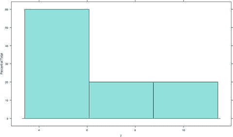
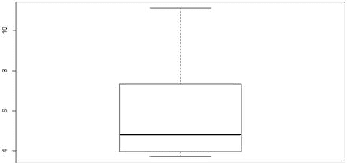
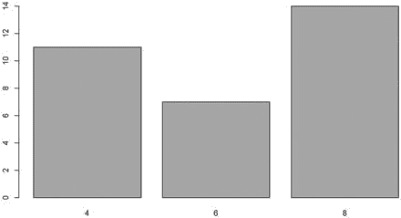

# 3. 编程自动化

有人说，重复同样的行动却期待不同的结果，这是疯狂的定义。虽然在牛津词典的简短搜索中并未找到此定义，但我们持有一个相似的前提：为防止疯狂，让计算机来反复执行同样的操作吧，并期待相同的结果！

本章的目标是让你开始在代码中构建自动化。代码的部分力量在于它乐于按需反复执行相同操作，不会出错也不会疲倦。代码的另一个有用特性是能够在程序流程中嵌入逻辑。我们人类在最佳状态下自然会使用这种逻辑。例如，如果父亲的钥匙挂在挂钩上，他一定在家。否则，父亲一定还在外活动。另一个例子：如果 `p` 小于 `alpha`，则拒绝零假设；否则，不拒绝零假设。

因为这种自动化允许进行大量重复，所以必须注意效率。代码运行需要多长时间？代码能否以不同的方式编写以使操作执行得更快？在编程中，或许也像在生活中一样，我们通常没有完美的答案，而是在选择和结果之间有更多的权衡。我们生活在一个勇敢新世界，在这个世界里，新的、更强大的硬件常常比为了挤出多一点效率所需的人力成本更便宜。另一方面，我们的这个勇敢新世界也拥有数十亿条目的数据集；从每次计算中节省一毫秒，就能节省数百小时的计算时间。我们尽力采取平衡的方法，先演示一些更容易理解的构造，然后再展示更快的方法。

当我们开始介绍这些自动化方法中的第一种时，我们要提醒你，编码既是一门科学，也是一门艺术。更清晰、更易读的代码可能不是最快的。唯一本质的“快”的定义是“足够快”。如果某种代码对你来说更有意义，从而让你更可能记住并使用它，那可能就足够好了。当然，如果不够快，就需要做一些研究来找到更快的替代方案。

## 循环

循环会重复执行其内部的代码。需要注意避免陷入无限循环——即永不停止的循环。大多数循环都内置了尝试停止的机制（尽管这些机制并不总是按计划生效）。在下一节中，我们将讨论手动退出循环的方法。循环的另一个需要注意的方面与它们是函数这一事实有关。虽然我们之前已经使用了“函数”这个词，但我们推迟到下一章再深入讨论函数。现在只需记住，在函数内部创建的任何内容，在该函数结束时都可能消失。对于循环来说，当它们停止重复时就会发生这种情况。因此，如果你想保留结果，就需要在循环外部构建容纳这些结果的容器。同样，我们将在下一章深入探讨具体细节。

### `for` 循环

`for` 循环是我们要讨论的第一个（或许在 R 语言中也是最具争议的）自动化工具。在许多计算机语言中，`for()` 被认为速度相当快，但在 R 中则不然。尽管如此，这个函数易于理解和使用。易读的代码不应被不必要的回避。然而，通常有多种方法可以实现目标，忽视它们是不明智的。我们在代码中使用 `proc.time()` 函数来测量不同的时间；我们将通过计算停止时间与开始时间的差来得到运行时间。请看以下代码和输出：

```
x <- seq(1,100000,1)
head(x)
[1] 1 2 3 4 5 6
forTime<- proc.time()
xCube <- NULL
for (i in 1:length(x) ) {
+   xCube[i] = x[i]³
+ }
forTime <- proc.time()-forTime
head(xCube)
[1]   1   8  27  64 125 216
forTime
user  system elapsed
11.04    0.17   11.25
```

你可以看到变量 `x` 中包含数字 `1` 到 `100,000`（通过调用 `head()` 函数显示前六个数字）。接下来，我们创建一个变量来存放所有这些数字的立方。我们还将当前时间存储在一个变量中，以便对该操作计时。现在来看 `for()` 函数的奇妙之处！这个函数接受一个索引（通常称为 `i`）和一个索引操作的范围。我们从 `i` 等于 `1` 开始，循环运行。在循环结束时，`i` 会自动加 `1`，然后重复循环。循环会一直重复，直到达到范围的最后部分。注意我们没有选择一个固定的上限；相反，我们根据 `x` 的长度来调整循环。你可以看到，循环确实将 `x` 的每一项进行了立方运算。在我们的系统中，这花费了 `11.25` 秒。

#### 优化 `for` 循环

不过，这个时间是可以优化的。注意虽然我们创建了变量 `xCube`，但它是一个空变量。我们的 `for` 循环的每次迭代不仅需要对 `x` 进行立方运算，还必须将 `xCube` 变量的大小增加 `1`。这被证明并非一项简单的任务。如果我们能够提前将 `xCube` 创建为我们所需的大小，性能将显著提高。我们首先删除 `xCube`，以避免被任何先前的数据误导：

```
rm(xCube)
forTime2<- proc.time()
xCube <- vector(mode = "numeric", length = length(x))
for (i in 1:length(x) ) {
+   xCube[i] = x[i]³
+ }
forTime2 <- proc.time()-forTime2
head(xCube)
[1]   1   8  27  64 125 216
forTime2
user  system elapsed
0.15    0.00    0.15
```

注意，现在我们的时间只有 `0.15` 秒——大大提高了！值得注意的是，即使我们创建了一个长度不够的虚拟 `xCube`，或者创建了一个太长、需要在末尾删除一些空条目，这仍然会更快。因此，即使在运行循环之前可能无法或不便知道所需变量的大小，创建一个可能足够大的容器来首先存储数据可能也是有益的。

### R 中的向量化操作

对于这个特定的例子，使用 `for` 循环是错误的做法。R 为其一些最简单的函数提供了强大且快速的底层代码。注意，这里几乎没有花费任何时间（当然，有一些，但根据操作系统，某些差异不明显）。此外，注意 `head()` 函数可以接受负数，用于从末尾向前计数，显示如下内容：

```
xCube <- NULL
vTime <- proc.time()
xCube <- x³
vTime <- proc.time()-vTime
head(xCube, -99994)
[1]   1   8  27  64 125 216
vTime
user  system elapsed
0       0       0
```

### `while` 循环

还有其他类型的循环。`for` 循环最适合运行一个过程特定的次数，并在结束时停止。另一方面，`while` 循环最适合运行一个不确定次数，直到某个停止条件发生的过程。通常，使用不同类型的循环（或者正如你刚刚看到的，根本不用循环）可以获得相同的结果。尽管如此，每种类型的循环在特定条件下往往都有更自然的用途。作为一个独立练习，在学习我们给出的 `while` 循环示例后，看看你是否能复制之前的立方运算结果。

#### 使用 `while` 循环进行模拟

也许一个贴近各地研究人员内心的例子是模拟。毕竟，如果我们能够模拟数据，这可能是理解现实世界结果可能怎样的第一步。统计学已融入 R 语言，函数 `rnorm()` 最多接受三个输入。第一个控制我们希望为样本返回的元素数量。第二个和第三个控制从中随机抽取样本的总体水平的均值和标准差。让我们看看 `rnorm` 给我们什么：

```
for (i in 1:5 ) {
+   x <- rnorm(5,4,2)
+   print(x)
+   print(paste0("Xbar: ",mean(x)))
+   print(paste0("StdDev: ",sd(x)))
+ }
[1] 2.0287126 4.5664489 0.1310789 3.6347667 4.2465319
[1] "Xbar: 2.92150781627209"
[1] "StdDev: 1.84077667180739"
[1] 5.806652 2.707348 4.673238 4.646211 6.496605
[1] "Xbar: 4.86601066066082"
[1] "StdDev: 1.43952629897616"
[1] 1.6476375 0.8618630 0.2519337 0.6902068 1.0062915
[1] "Xbar: 0.8915864810408"
[1] "StdDev: 0.508764053558126"
[1] 5.162450 3.513966 6.503733 3.736576 5.503810
[1] "Xbar: 4.88410690747199"
[1] "StdDev: 1.25287757407054"
[1] 4.719578 1.197946 2.751889 4.451728 2.487819
[1] "Xbar: 3.12179207747434"
[1] "StdDev: 1.46300892878659"
```

我们发现是 `5` 个从均值为 `4`、标准差为 `2` 的同一总体中随机抽取的样本。然而，注意每个样本的均值范围从 `0.89` 到 `4.88`。假设我们需要一个这样的伪随机样本，但想向学生展示随机抽样的点估计量需要谨慎对待。假设我们想找到一个从总体中抽取的随机样本，但该样本的样本均值实际上达到或超过 `10`。那么，`while` 循环可能正好是答案：

```
y <- 3
while(mean(y)< 10){y <- rnorm(5, mean = 4.0, sd = 2)}
```

我们让这段代码运行了大约一分钟才停止。原因当然是这类搜索可能需要很长时间，并且有接近无限循环的危险。均值为 `4`、标准差为 `2` 的正态总体中，元素值达到或超过 `10` 的很少。随机抽取足够多这样的元素使得样本均值达到或超过 `10` 的可能性开始变得微乎其微。我们将 `y` 设为 `3`，只是为了让 `while` 代码至少运行一次。这里我们用更合理的条件（均值为 `6`）重复我们的循环：

```
y <- 3
while(mean(y)< 6){y <- rnorm(5, mean = 4.0, sd = 2)}
mean(y)
[1] 6.188268
y
[1] 11.126657  4.807775  3.703673  3.966180  7.337056
```

请注意，与我们所知的总体现状相比，现在的 `y` 是一个相当奇怪的样本。这当然是支持更大样本量的一个论据，但它也为我们提供了既符合事实又能检验假设的数据。反例和奇异数据对于对代码或模型进行压力测试非常有用。

我们现在要看的最后一个循环是 `repeat()`，它可能与 `while` 和 `for` 循环有所不同。特别是，`repeat` 与 `while` 或 `for` 不同，它不接受任何有可能让它停止的参数。这个函数会一遍又一遍地重复执行。当然，必须有办法让它停下来，否则我们就有麻烦了。我们将在下一节“流程控制”中讨论这类技术。不过，首先我们来看看关于循环的一些观察。

循环的目的是根据需要执行任务多次。在 R 中，我们通过三种方式控制这些任务。如果任务需要执行到特定次数，`for` 循环可能是最好的选择。一个整数迭代器控制着 `for` 循环的启动和停止。如果任务是我们希望在某些条件出现之前一直执行，`while` 循环可能是最好的选择。特别是，`while` 循环在运行之前会测试决定循环是否运行的条件。这一点至关重要！如果条件已经满足，`while` 循环就永远不会运行。在你目前看到的简短示例中，这可能不明显或不太可能发生，这没关系。我们的目标是介绍这些概念，以便你在面对新问题时能轻易想起它们。同样，值得重复的是：`while` 循环首先检查是否需要运行，然后只运行一次，并再次检查，直到停止条件发生。我们讨论的最后一个循环 `repeat()` 则不同。它只是简单地运行。现在我们必须以某种方式停止它，我们会在下一节中手动完成。关键是，`repeat` 从不检查是否需要运行；它只管运行。所以，如果你希望一个过程至少运行一次，`repeat` 可能是你寻找的函数。

我们现在暂不提供 `repeat` 的例子，主要是为了避免无限循环。我们很快会展示一个例子。首先，我们需要一种方法来控制代码的流程。

## 流程控制

代码的流程控制可以通过多种方式实现，但我们关注的是其中的四种（实际上只有三种）。这种控制通过执行测试来决定应采取哪种操作，或者通过修改你刚看到的循环的行为来实现。我们将依次介绍每个命令，并在本节结束时回到上一节提到的那个函数。

`If`/`else` 语句是逻辑的标准部分，也是编程中的标准组成部分。实际上，`if`/`else` 使用得非常频繁，以至于有两种形式。当 `else` 部分是要继续常规操作时，通常的做法是根本不在代码中包含该部分。

让我们以我们强制样本均值大于 `6` 的那些值为例。假设如果成功，我们希望看到箱线图，否则希望看到直方图。我们可能从下面这段错误的代码开始，以及其图 3-1 输出：



图 3-1.

前述及以下代码的 else 输出

```
if(y>6){
+   boxplot(y)
+ }
Warning message:
In if (y > 6) { :
the condition has length > 1 and only the first element will be used
else{
Error: unexpected 'else' in "else"
histogram(y)
}
Error: unexpected '}' in "}"
```

我们故意写错这段代码有两个原因。第一是为了演示虽然流程控制是一个有用的功能，但它的效果取决于你的逻辑。我们本意是测试 `mean(y) > 6`，但测试了别的东西。R 足够友好地警告我们可能有问题。尽管如此，我们还是应该小心。第二个原因是注意这个 `if`/`else` 语句编码不正确。`else` 部分总是会运行；R 尽其所能再次警告我们 `else` 不符合预期，因此我们应该注意。修改后的这组代码创建了两个图像，如图 3-1 和图 3-2 所示。我们展示代码如下，以及成功执行的 `if` 部分的输出图 3-2：



图 3-2.

前面代码的 if 输出，该代码在控制层面已修复，但 else 部分未修复

```
if(mean(y)>6){
+   boxplot(y)
+ }
else{
Error: unexpected 'else' in "else"
histogram(y)
}
Error: unexpected '}' in "}"
```

这很有趣，原因有三。首先，正如你在我们第一个错误示例中看到的，`if` 完全可以作为独立的流程控制部分。控制部分被评估，如果为 `true`，则运行代码；如果为 `false`，则不运行代码。其次，尽管不那么有用，`else` 也是一个独立的代码部分（单独使用时什么都不控制）。第三，这是一个很好的经验教训，即流程控制的逻辑和代码的结构都必须正确设置才能正常工作。接下来，我们展示最初设想的代码。它只输出图 3-2 的箱线图。注意，`else` 需要与 `if` 的闭合 `}` 在同一行：

```
if(mean(y)>6){
+   boxplot(y)
+ } else{
+   histogram(y)
+ }
```

我们使用的另外两个函数彼此有些相似。我们使用 `next` 来跳过循环的一次迭代，使用 `break` 来完全结束循环。这两个函数都让代码继续运行；它们只是控制它们被调用所在循环内的行为。看看下面的代码，看看会发生什么：

```
i <- 0
while(i < 5){
+   i <- i + 1
+   if(i ==2) {next()}
+   print(i)
+ }
[1] 1
[1] 3
[1] 4
[1] 5
```

重要的是要认识到 `next` 的位置很重要。我们可以以六种方式排列 `while` 函数内的那三行代码。至少有一种方式会产生无限循环，至少有一种方式没有任何明显影响。当然，正如你刚才看到，也有一种方式可以跳过数字 `2`。这也表明 `while` 可以很像 `for` 函数。

我们以一个真实的 `repeat` 函数来结束本节。当一个操作需要重复多少次不清楚时，这个函数是理想的选择。同样，`repeat` 类似于 `while`，不同之处在于代码至少运行一次。或许也更容易拥有多个退出标准。当然，`break` 也可以在 `while` 中使用来创建多个退出规则。然而，对于人类可读的代码，可能更容易将多个 `break` 语句放在一起。在下面的代码中，我们重用迭代器 `i`，以便很容易看到需要 `377` 次尝试才能找到随机抽取的、距离均值超过三个标准偏差的值：

```
i <- 0
repeat{
+   i <- i + 1
+   z <- rnorm(1)
+   if(z > 10){break}
+ }
z
[1] 10.69076
i
[1] 378
```

# `apply` 函数族

本章介绍的最后一组函数是 `apply` 函数族。通常，这些函数接收两种主要类型的输入。一种输入包含多个元素，第二种是一个要依次应用于这些元素的函数。不同的函数变体处理不同的用例，我们也会在可能的情况下引入一些错误检查。

## `lapply` 和 `sapply`

我们从 `lapply` 开始，它接收一个列表作为输入，并将给定的函数应用于列表中的每个元素。如其名称前缀所示，该函数返回一个列表，其中包含应用输入函数后的结果：

```r
xL <- 1:5
xL
[1] 1 2 3 4 5
### 返回一个列表
lapply(xL, is.integer)
[[1]]
[1] TRUE
[[2]]
[1] TRUE
[[3]]
[1] TRUE
[[4]]
[1] TRUE
[[5]]
[1] TRUE
```

正如你所见，输出有些混乱。为了简化，我们可以使用功能几乎相同但以 `s`（代表 simple）为前缀的函数，如下所示：

```r
sapply(xL, is.integer)
[1] TRUE TRUE TRUE TRUE TRUE
```

## `vapply`

尽管这两个函数本身都很有用，但它们依赖于正确的输入。当然，我们的代码也依赖于这种正确的输入（脑海中浮现出“垃圾进，垃圾出”这句话）。不过，我们可以使用 `vapply` 函数向 R 提示我们期望的结果类型。它接受第三个输入参数，用于指定期望的输出类型。当函数没有返回正确类型的值时会发生什么？下面我们运行两行代码：第一行告诉函数期望 `logical` 类型的输入，因为默认情况下 `NA` 是 `logical` 类型。在第二行代码中，R 仍然期望相同类型，但得到了一个 `double` 类型：

```r
vapply(xL, is.integer, FUN.VALUE = NA)
[1] TRUE TRUE TRUE TRUE TRUE
vapply(xL, mean, FUN.VALUE = NA)
Error in vapply(xL, mean, FUN.VALUE = NA) :
values must be type 'logical',
but FUN(X[[1]]) result is type 'double'
```

我们再运行一组类似的代码，这次告诉 R 期望每个结果是一个长度为 `2` 的向量。然而，它得到了一个长度为 `1` 的向量，虽然类型正确，但长度错误：

```r
vapply(xL, is.integer, FUN.VALUE = c(NA, NA))
Error in vapply(xL, is.integer, FUN.VALUE = c(NA, NA)) :
values must be length 2,
but FUN(X[[1]]) result is length 1
```

## 应用于列表

让我们看一个更有趣的列表。请注意，在这个列表 `yL` 中，我们同时拥有整数和字符元素：

```r
yL <- list(  a = 1:5,  b = c("6", "7", "8"),  c = c(9:10))
yL
$a
[1] 1 2 3 4 5
$b
[1] "6" "7" "8"
$c
[1]  9 10
yL$b[2]
[1] "7"
is.character(yL$b[2])
[1] TRUE
is.integer(yL$b[2])
[1] FALSE
```

假设我们对列表中每个元素的摘要统计信息感兴趣。我们当然可以对每个元素应用 `summary()` 函数，R 会很乐意执行，甚至不会向我们抛出错误！

```r
lapply(yL, summary)
$a
Min. 1st Qu.  Median    Mean 3rd Qu.    Max.
1       2       3       3       4       5
$b
Length     Class      Mode
3 character character
$c
Min. 1st Qu.  Median    Mean 3rd Qu.    Max.
9.00    9.25    9.50    9.50    9.75   10.00
```

但是，请注意这里存在一些问题。根据信息在现场是如何收集和编码的，这是一种容易因打字错误而导致的数据收集错误。幸运的是，如果我们使用更合适的 `*apply` 函数，并给 R 提供关于期望结果的提示，我们或许可以避免未来的一些麻烦。在代码中加入某种形式的数据验证会很有帮助。当然，这绝不可能防止所有问题；它只是让事情变得更安全一些。

```r
vapply(yL, summary, c(Min. = 0, `1st Qu.` = 0, Median = 0, Mean = 0, `3rd Qu.` = 0, Max. = 0))
Error in vapply(yL, summary, c(Min. = 0, `1st Qu.` = 0, Median = 0, Mean = 0,  :
values must be length 6,
but FUN(X[[2]]) result is length 3
```

## `tapply` 与数据框

`mtcars` 数据框来自 1974 年的一本杂志。我们对每加仑英里数和汽缸数感兴趣。使用这个数据集是理解 R 中各种函数的有用方法，因为它可以在 R 中直接访问。这里，我们查看前六个条目，以便更好地查看和理解我们的原始数据：

```r
head(mtcars[, c("mpg", "cyl")])
mpg cyl
Mazda RX4         21.0   6
Mazda RX4 Wag     21.0   6
Datsun 710        22.8   4
Hornet 4 Drive    21.4   6
Hornet Sportabout 18.7   8
Valiant           18.1   6
```

我们在 `mtcars` 数据框上运行 `tapply`，并按汽缸数进行分组。在图 3-3 中，我们展示了以条形图呈现的结果。



图 3-3
按汽缸数划分的 mtcars 数据框

请注意，这次在我们的函数调用中，我们通过参数名明确指定了每个输入。也就是说，`X`、`INDEX` 和 `FUN` 分别是原始数据的名称、分组因子以及要应用的函数。我们还展示了几乎相同的代码，但带有 `simplify = FALSE` 选项，它会返回一个列表：

```r
tapply(
+   X = mtcars$mpg,
+   INDEX = mtcars$cyl,
+   FUN = mean)
4        6        8
26.66364 19.74286 15.10000
tapply(
+   X = mtcars$mpg,
+   INDEX = mtcars$cyl,
+   FUN = mean,
+   simplify = FALSE)
$`4`
[1] 26.66364
$`6`
[1] 19.74286
$`8`
[1] 15.1
```

## `apply` 函数

当我们的数据结构是数据框、矩阵或数组时，`apply()` 函数通常是一个不错的选择。因为这些结构往往有更多的维度，所以这个函数接受三个输入：数据、我们感兴趣的应用维度，当然还有要执行的函数。我们首先对整个 `mtcars` 数据集按列，然后按行执行此操作以获取标准差。我们先展示一下 `mtcars` 数据的全貌。请注意，按列操作可能更有意义。由于我们既不是汽车爱好者，也并非特别精通机械，这最后一段代码和输出可能没有太大意义：

```r
head(mtcars)
mpg cyl disp  hp drat    wt  qsec vs am gear carb
Mazda RX4         21.0   6  160 110 3.90 2.620 16.46  0  1    4    4
Mazda RX4 Wag     21.0   6  160 110 3.90 2.875 17.02  0  1    4    4
Datsun 710        22.8   4  108  93 3.85 2.320 18.61  1  1    4    1
Hornet 4 Drive    21.4   6  258 110 3.08 3.215 19.44  1  0    3    1
Hornet Sportabout 18.7   8  360 175 3.15 3.440 17.02  0  0    3    2
Valiant           18.1   6  225 105 2.76 3.460 20.22  1  0    3    1
apply(mtcars, MARGIN = 2, FUN = sd)
mpg         cyl        disp          hp        drat          wt        qsec          vs          am        gear        carb
6.0269481   1.7859216 123.9386938  68.5628685   0.5346787   0.9784574   1.7869432   0.5040161   0.4989909   0.7378041   1.6152000
apply(mtcars, MARGIN = 1, FUN = sd)
Mazda RX4       Mazda RX4 Wag          Datsun 710      Hornet 4 Drive   Hornet Sportabout             Valiant
53.53888            53.51210            38.86999            79.40933           113.70330            69.95729
Duster 360           Merc 240D            Merc 230            Merc 280           Merc 280C          Merc 450SE
122.86626            44.43599            46.68811            57.31739            57.33609            92.42901
Merc 450SL         Merc 450SLC  Cadillac Fleetwood Lincoln Continental   Chrysler Imperial            Fiat 128
92.40957            92.46342           147.34689           145.04382           141.16366            28.06702
Honda Civic      Toyota Corolla       Toyota Corona    Dodge Challenger         AMC Javelin          Camaro Z28
25.10753            26.43470            42.34211            99.84844            96.05271           120.45178
Pontiac Firebird           Fiat X1-9       Porsche 914-2        Lotus Europa      Ford Pantera L        Ferrari Dino
124.56688            27.95293            41.26033            40.34473           123.53038            62.68824
Maserati Bora          Volvo 142E
126.32051            44.49888
```