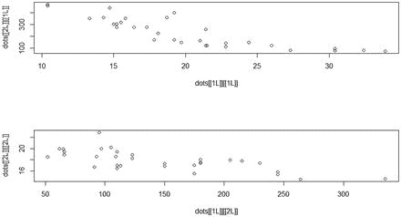

# 当我们需要将相同函数应用于多组数据时，便是在处理多元场景。此时，`mapply()` 是我们的函数调用。与之前的例子不同，该函数将我们想要应用的函数作为第一个变量，其后接受严格为正长度的输入。我们在图 3-4 中展示了以下代码的绘图结果。正如你可能在《R 语言入门》中回忆起的，`par()` 函数提供了一种将多个图形整合到单张图片中的方法：


图 3-4. 应用于 mtcars 数据两个子集的 plot 函数

```
par(mfrow = c(2, 1))
mapply(plot, mtcars[, c("mpg", "hp")], mtcars[, c("disp", "qsec")])
$mpg
NULL
$hp
NULL
```

递归是一种强大的编程思想，我们将在后续章节中进一步探讨。现在，请考虑这个例子：假设一队人绕着一栋建筑的拐角排队；你不确定队伍有多长。你可以走出队伍，慢慢走到队首，清点人数。这就是常规迭代——就像循环以及 `apply` 函数族主要为我们所做的那样。另一方面，你也可以待在原处，问你前面的人：“你前面有多少人？”如果那个人重复你的问题，最终问题会传到队首，那个人可能会转身说：“零！”通过队伍回传给你，就有可能得到答案。

让我们来看看列表 `zL`。如果我们尝试对其使用 `lapply()` 会怎样？这并不好，因为 `lapply()` 会将每个元素传递给 `mean()`，而 `mean()` 无法处理列表！我们在以下代码中展示了这一点，其中包括我们的列表以及我们寻找算术平均数的首次尝试：

```
zL <- list( a = list(1, 2, 3:5), b = list(8:12))
zL
$a
$a[[1]]
[1] 1
$a[[2]]
[1] 2
$a[[3]]
[1] 3 4 5
$b
$b[[1]]
[1]  8  9 10 11 12
lapply(zL, FUN = mean)
$a
[1] NA
$b
[1] NA
Warning messages:
1: In mean.default(X[[i]], ...) :
argument is not numeric or logical: returning NA
2: In mean.default(X[[i]], ...) :
argument is not numeric or logical: returning NA
```

递归应用函数 `rapply()` 是解决方案。根据想要的具体结果，该函数有一些有趣的选项。强烈建议查阅帮助文件，尽管我们目前不深入探讨此函数。

```
rapply(zL, f = mean)
a1 a2 a3  b
1  2  4 10
```

我们也可以使用比 `mean()` 或 `sd()` 更“花哨”的函数。在下一章中，我们将更深入地探讨这些函数可能的样子以及它们可能做什么。现在，让我们花点时间讨论一下环境。

环境是我们的函数和变量存在的“世界”。我们大部分时间都停留在全局环境中。确实，我们的循环在某种程度上创建了微型环境。这就是为什么如果我们想在循环结束后保留信息可用，我们会创建那些空占位符变量。我们可以使用 `environment()` 和 `ls()` 函数来查看我们的环境并列出当前正在使用的变量。注意我们处于全局环境中，并且我们一直在使用的大多数变量都存在：

```
environment()

ls()
[1] "forTime"  "forTime2" "i"        "vTime"    "x"        "xCube"    "xL"       "y"        "yL"       "z"        "zL"
```

但当然，这只不过是又一个列表。有时，操作和使用这个列表可能也很方便。因此，我们最后一个函数是 `eapply()`。这里我们查看环境中所有对象的类别；这些类型在前面的章节中应该很熟悉：

```
eapply(env = environment(), FUN = class)
$xCube
[1] "numeric"
$x
[1] "numeric"
$forTime2
[1] "proc_time"
$y
[1] "numeric"
$z
[1] "numeric"
$forTime
[1] "proc_time"
$yL
[1] "list"
$vTime
[1] "proc_time"
$i
[1] "numeric"
$xL
[1] "integer"
$zL
[1] "list"
```

## 最终思考

你已经看到了几种强大的自动化工具——从控制重复（以及重复频率）发生的各种循环，到为处理我们可能遇到的常见数据集而精简设计的更专业工具。这些技术很有用，并且经常被使用。然而，它们还不够。如果开发了新技术怎么办？`mean()` 是如何工作的？如果我们需要创建自己的函数呢？在下一章中，我们将从理论框架和实际应用两方面探索函数。自定义函数和循环的结合是让计算机为我们处理繁琐工作的核心方法。

## 4. 编写函数

在 R 中编写自己的函数使你能够将一组 R 命令组合成一个易于调用且可泛化的函数。函数是 R 的基础。要成为 R 的更高级用户或开发者，深刻理解函数是什么以及如何编写它们至关重要。广义上讲，函数接收一个或多个输入，对其进行处理以产生并返回输出。

并非所有编程任务都应转换为函数。然而，每当你发现自己第三次复制粘贴特定代码行时，很可能就应该编写一个函数了。另一个“毫无疑问”需要编写函数的时机是当你的代码超过 100 行左右时。长段的代码可能变得几乎无法阅读和理解。相反，我们编写具有良好、描述性名称的函数，使我们的代码更具可读性。然后，在一个单独的步骤中，我们使用这些函数来编写代码。这种体系的美妙之处在于，在每个函数内部编写专注于解决挑战中特定部分的代码变得更加容易。这种方法的另一个好处是，如果需要更高的效率，可以确定哪些函数消耗了最多的处理能力或花费了最长的运行时间。然后可以研究如何仅在该处提高效率。

在本章中，我们使用 `Hmisc` R 包（Harrell Jr，2016）。以下代码加载 `checkpoint`（Microsoft Corporation，2016）包以控制所使用的 R 包的确切版本，然后加载 `Hmisc` 包：

```
## load checkpoint and required packages
library(checkpoint)
checkpoint("2016-09-04", R.version = "3.3.1")
library(Hmisc)
options(width = 70) # only 70 characters per line
```


## 函数的组成部分

除了少数例外，R 语言中的大多数函数都包含三个组成部分：

*   **形参**：函数的参数或输入
*   **函数体**：处理输入的命令
*   **环境**：函数的位置或上下文，它决定了函数在何处查找变量

每一个部分都可以使用专用函数进行检查。首先，我们编写一个示例函数：

```
## create new function, f()
f <- function(x, y = 5) {
x + y
}
```

该函数接受两个参数：`x` 和 `y`。第一个参数 `x` 没有默认值，但第二个参数 `y` 默认为 `5`。虽然我们可以轻松看到这些（部分是因为我们编写了该函数），但可以使用 `formals()` 和 `args()` 函数来检查函数的形参或参数：

```
formals(f)
$x
$y
[1] 5
args(f)
function (x, y = 5)
NULL
```

要查看用于处理形参的实际 R 代码或命令，我们使用 `body()` 函数：

```
body(f)
{
x + y
}
```

命令始终被包裹在开闭大括号 `{ }` 中。在这个例子中，R 代码很简单，就是 `x + y`，但有些函数可能有上百行代码。函数的最后一个关键部分是它的环境。函数的环境决定了它在哪里查找变量或对象，这些对象可以包括数据和函数。要查看函数的环境，我们使用 `environment()` 函数：

```
environment(f)
```

在这个例子中，函数位于我们创建它的全局环境中。对于其他函数，这会有所不同。例如，如果我们查看 `install.packages()` 函数的环境，它是 `utils` 包的命名空间：

```
environment(install.packages)
```

这为讨论 R 函数提供了一种通用语言。在本章的剩余部分，我们将深入探讨编写函数，以及可用于函数的特殊代码和工具。

## 作用域

在 R 中，作用域决定了在何处查找特定变量。例如，当我们键入 `plot` 时，R 如何解释这段代码？R 在哪里查找它？作用域是 R 对语言中“上下文”这一概念的解答。如果我说“我买了一个新的 bat”，你可能会认为我指的是板球拍而不是会飞的哺乳动物。对于 R 来说，上下文来自作用域和环境。因此，不同的环境可能导致不同的结果。

编写 R 函数的大多数方面与交互式使用 R 并无不同。然而，一个区别是函数有自己的环境。此外，函数通常位于不同的环境中。例如，在交互式使用 R 时，几乎所有的命令都是在全局环境中执行的。相比之下，许多函数是作为 R 包的一部分编写的，在这种情况下，函数的环境由 R 包定义。因此，在开始编写函数之前，理解作用域是有帮助的。看下面这两个例子：

```
plot
function (x, y, ...)
UseMethod("plot")

plot <- 5
plot
[1] 5
```

在第一种情况下，R 在 `graphics` 包中找到了 `plot`。在第二种情况下，R 在全局环境中找到了 `plot`。请注意，将 `5` 赋值给变量 `plot` 并不会覆盖 `plot()` 函数，而是创建了另一个与函数同名的 R 对象。在创建新变量后，当我们在控制台键入 `plot` 时，R 返回的是数值而不是函数，因为赋值 `plot <- 5` 发生在全局环境中，而 R 在检查不同包的环境之前会先搜索全局环境。`search()` 函数按照 R 搜索的顺序返回环境。你的环境可能有所不同，尽管可能有一些相似之处：

```
search()
[1] ".GlobalEnv"            "package:Hmisc"
[3] "package:ggplot2"       "package:Formula"
[5] "package:survival"      "package:lattice"
[7] "package:devEMF"        "package:checkpoint"
[9] "ESSR"                  "package:stats"
[11] "package:graphics"      "package:grDevices"
[13] "package:utils"         "package:datasets"
[15] "package:RevoUtilsMath" "package:methods"
[17] "Autoloads"             "package:base"
```

从输出中我们看到，R 首先在全局环境（`.GlobalEnv`）中查找，然后在 `Hmisc` 包中查找，依此类推，直到 `base` 包。我们可以再次使用 `environment()` 函数查看当前环境。R 总是从当前或局部环境开始查找。然后，它进入父环境。我们可以使用 `parent.env()` 函数查找给定环境的父环境：

```
environment()
parent.env(.GlobalEnv)
attr(,"name")
[1] "package:Hmisc"
attr(,"path")
[1] "C:/Users/Authors/.checkpoint/2016-09-04/lib/x86_64-w64-mingw32/3.3.1/Hmisc"
```

回到函数，每个函数除了自身位于某个环境中外，还有其局部环境。以下代码展示了函数的局部环境及其父环境。我们可以大致将函数中的变量分为三种类型：

*   形式变量（形参）
*   在函数内部定义的局部变量
*   既非形参也非局部变量的**自由变量**或其他变量

以下代码依次演示了每种类型：

```
a
[1] "free variable"
[1] "formal variable"
[1] "local variable"
```

变量 `x` 是一个形参，定义了其默认值；`y` 是在函数体中定义的局部变量；`a` 是在函数父环境中定义的变量。虽然函数可以依赖于搜索路径中的对象，而不是在形参中指定或作为局部变量，但这不是一个好主意。依赖于函数的父环境或搜索路径进行编码，可能会导致特别棘手的错误和意外行为。当环境中看似与函数无关的内容发生改变时，即使函数的代码和输入看起来没有变化，输出也可能突然不同，这会给用户或你日后的工作带来混乱。

虽然到目前为止的例子都相对简单，但在使用嵌套函数调用时，作用域会变得更加棘手。在下面的代码中，可能更难预测每段评估代码的结果。接下来的例子设置了两个函数，然后在全局环境中使用三个不同的变量来调用函数：

```
f1 <- function(y = "f1 var") {
x <- y
a1 <- f2(x)
rm(x)
a2 <- f2(x)
}
f2 <- function(x) {
if (nchar(x) < 10) {
x <- "f2 local var"
}
print(x)
return(x)
}
x <- "global var"
f1()
[1] "f2 local var"
[1] "global var"
x <- "g var"
f1()
[1] "f2 local var"
[1] "f2 local var"
rm(x)
f1()
[1] "f2 local var"
Error in nchar(x) (from #2) : object 'x' not found
```

值得对作用域进行实验，直到弄明白为止，因为这对于确保找到正确的对象是必要的。在编写和开发包时，或者在使用出现在多个包中的函数时，这可能是一个特别的挑战。


