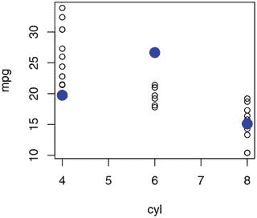
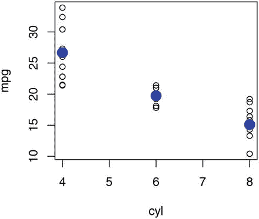

# 函数特定功能：控制流程与错误处理

`on.exit()` 函数可确保在函数退出或完成时执行一组特定命令。即使函数出错或未按预期正常完成，`on.exit()` 中的表达式也会执行。以下代码第二个用例的小函数示例说明了这一点。一个错误导致函数终止，一旦发生这种情况，就会执行`on.exit()`中的表达式。当函数修改其外部的任何值时，使用`on.exit()`尤其有价值。例如，绘图函数有时会修改默认的绘图参数，并在完成后将其恢复原状。使用`on.exit()`可以确保，即使出现问题导致函数失败或出错，用户仍然拥有所有原始设置：

```
f <- function(x) {
on.exit(print("Game over"))
x + 5
}
f(3)
[1] "Game over"
[1] 8
f("a")
Error in x + 5 (from #3) : non-numeric argument to binary operator
[1] "Game over"
```

我们将要介绍的最后一套函数特定功能与向软件或用户发送信号有关。按严重程度排序，它们依次是 `stop()`、`warning()` 和 `message()`。下一个例子更贴近实际一些，它计算一个变量的平均值，可选择原始尺度或转换后的尺度，然后对平均值进行反向转换。对数尺度对异常值相对更具抵抗力。如果使用对数变换，示例代码会通过 `stop()` 函数检查变量是否包含负值（负值在对数变换中未定义，会导致完全错误）。传递给 `stop()` 的参数是要显示的错误消息。对于 `warning()` 也遵循类似过程，同样传递要在警告中显示的消息。警告与错误不同。`stop()` 产生的错误会使函数停止评估并终止。警告会在最后发出，但允许函数继续执行。最后，`message()` 可用于向用户发送消息或信号，但并不像警告那样指示真实或可能的问题。虽然没有演示，但还有一个相关的便利函数 `stopifnot()`，它允许传递一个逻辑表达式，并在该表达式不为真时发出错误。尽管此选项有节省代码的好处，但缺点是无法编写自定义错误消息来准确指出问题所在。

使用警告或消息而非仅调用 `print()` 或 `cat()` 让函数打印信息的一个原因是，警告和消息可以通过同名函数 `suppressWarnings()` 和 `suppressMessages()`（可选择性地）进行抑制。所有这些功能都在下面的代码中得到了演示：

```
f <- function(x, trans = c("identity", "log")) {
trans <- match.arg(trans)
if (trans == "log") {
if (any(x < 0)) stop("Log is not defined for negative values")
if (any(x < 1e-16)) warning("Some x values close or equal to zero, results may be unstable")
x <- log(x)
message("x successfully log transformed")
exp(mean(x))
} else {
mean(x)
}
}
f(c(1, 2, 100))
[1] 34.33333
f(c(1, 2, 100), trans = "log")
x successfully log transformed
[1] 5.848035
suppressMessages(f(c(1, 2, 100), trans = "log"))
[1] 5.848035
f(c(0, 1, 2, 100), trans = "log")
x successfully log transformed
[1] 0
Warning message:
In f(c(0, 1, 2, 100), trans = "log") :
Some x values close or equal to zero, results may be unstable
suppressWarnings(f(c(0, 1, 2, 100), trans = "log"))
x successfully log transformed
[1] 0
f(c(-1, 1, 2, 100), trans = "log")
Error in f(c(-1, 1, 2, 100), trans = "log") (from chapter04.R!79246pw#5) :
Log is not defined for negative valuesFunctionssuppressWarnings()FunctionssuppressMessages()
```

## 调试

到目前为止演示的函数要么都能工作，要么是设置了显而易见的故意错误。有时，寻找错误或调试已编写代码和函数的过程需要更长时间。幸运的是，有一些工具可以帮助这一过程，也有一些实践可以缩小问题的范围。

尽管调试可以应用于任何代码，而不仅仅是函数，但如果没有额外工具，函数尤其难以调试，因为通常它们的所有代码都会无中断地执行，没有机会观察沿途发生了什么。在本节中，我们将编写一个函数，该函数使用公式计算一个变量按另一个变量的水平分组后的均值，利用你在第 3 章中已了解的 `tapply()`；然后该函数绘制原始数据，并用点表示均值，使用以下代码，结果如图 4-1 所示：



图 4-1.
散点图，未填充点表示数据，蓝色大点表示均值，显示错误的结果

```
meanPlot <- function(formula, d) {
v <- all.vars(formula)
m <- tapply(d[, v[1]], d[, v[2]],
FUN = mean, na.rm = TRUE)
plot(formula, data = d, type = "p")
points(x = unique(d[, v[2]]), y = m,
col = "blue", pch = 16, cex = 2)
}
meanPlot(mpg ∼ cyl, d = mtcars)
```

关于均值，有些地方看起来不太对。当 `cyl = 8` 时，点的均值看起来还好，但另外两个似乎处于极端。`debug()` 函数允许我们调试一个函数，并在其执行时逐行逐步执行。要使用它，我们首先需要在要调试的函数上调用 `debug()`：

```
debug(meanPlot)
```

然后当我们调用原始函数时，它会触发 R 进入调试模式。在第一步，R 会告诉我们正在调试的函数调用以及位置：

```
meanPlot(mpg ∼ cyl, d = mtcars)
debugging in: meanPlot(mpg ∼ cyl, d = mtcars)
debug at c:/Temp/chapter04.R!79246wk#1: {
v
debug at #2: v
debug at #3: m
debug at #5: plot(formula, data = d, type = "p")
Browse[2]> m
4        6        8
26.66364 19.74286 15.10000
Browse[2]> unique(d[, v[2]])
[1] 6 4 8
Browse[2]> Q
```

既然我们知道了问题发生的位置，我们就可以通过首先对数据进行排序来修复函数，使 `tapply()` 和 `unique()` 给出的结果顺序一致。代码如下所示，结果在图 4-2 中：



图 4-2.
散点图，未填充点表示数据，蓝色大点表示均值，显示修正后的结果

```
meanPlot <- function(formula, d) {
v <- all.vars(formula)
d <- d[order(d[, v[2]]), ] ## 先排序
m <- tapply(d[, v[1]], d[, v[2]],
FUN = mean, na.rm = TRUE)
plot(formula, data = d, type = "p")
points(x = unique(d[, v[2]]), y = m,
col = "blue", pch = 16, cex = 2)
}
meanPlot(mpg ∼ cyl, d = mtcars)
```

如果你正在调试你的函数，并且不想逐步执行每一行代码，可以将 `browser()` 函数插入到函数代码中。然后，当函数执行到该点时，会启动一个浏览器，你可以检查函数局部环境中变量的当前状态。在以下示例代码中，我们在函数中添加了一个对 `browser()` 的调用，使用 `ls()` 检查当前可用的对象，检查对象 `v` 的内容，并再次输入大写字母 `Q` 退出调试：

```
meanPlot
debug at #9: plot(formula, data = d, type = "p")
Browse[2]> ls()
[1] "d"       "formula" "m"       "v"
Browse[2]> v
[1] "mpg" "cyl"
Browse[2]> Q
```


### 调试实用函数 `traceback()`

在交互式工作时，一个有用的调试函数是 `traceback()`。例如，如果你调用一个像 `lm()` 这样的函数然后得到一个错误信息，有时可能很难确切知道错误发生在哪里或为什么会发生。错误通常并不直接来自你调用的函数，因为你经常使用的函数内部可能会依次调用许多其他函数。下面的例子展示了如何在产生错误的代码之后立即使用 `traceback()` 来做到这一点。输出显示了从初始调用到最终生成错误的代码的调用堆栈跟踪。如果你需要查看代码来确定错误原因，这可能是有用的信息：

```
lm(mpg ∼ jack, data = mtcars)
Error in eval(expr, envir, enclos) : object 'jack' not found
traceback()
7: eval(expr, envir, enclos)
6: eval(predvars, data, env)
5: model.frame.default(formula = mpg ∼ jack, data = mtcars, drop.unused.levels = TRUE)
4: stats::model.frame(formula = mpg ∼ jack, data = mtcars, drop.unused.levels = TRUE)
3: eval(expr, envir, enclos)
2: eval(mf, parent.frame())
1: lm(mpg ∼ jack, data = mtcars)
```

### 调试外部包中的代码

有时，代码错误并不在你的代码中，而是在你正在使用的其他代码中，例如来自另一个 R 包。虽然建议的 R 包中很少发现错误，但在成千上万的其他 R 包中更为常见。此外，有时问题本身并不是错误，而是你希望如何使用函数与原始作者设想其使用方式之间的差异。尽管 CRAN 上所有 R 包的源代码都可以公开下载和编辑，但仅仅为了看看在一个函数中做点略微不同的改动是否能解决问题，就去下载整个包的源代码、编辑和重新安装，可能会很麻烦。

考虑以下挑战。假设你使用的数据由于某种原因有时包含无穷大值，但你只想包含有限的情况。以下代码展示了使用 `Hmisc` 包中的 `wtd.quantile()` 函数的一个例子：

```
wtd.quantile(c(1, 2, 3, Inf, NA),
weights = c(.6, .9, .4, .2, .6))
0%  25%  50%  75% 100%
NaN  Inf  Inf  Inf  Inf
```

如果我们查看 `wtd.quantile()` 的代码，通过在 R 控制台中输入不带括号的函数名，我们可以看到是另一个函数 `wtd.table()` 进行了主要计算，如下所示：

```
wtd.quantile
function (x, weights = NULL, probs = c(0, 0.25, 0.5, 0.75, 1),
type = c("quantile", "(i-1)/(n-1)", "i/(n+1)", "i/n"), normwt = FALSE,
na.rm = TRUE)
{
if (!length(weights))
return(quantile(x, probs = probs, na.rm = na.rm))
type  1))
stop("Probabilities must be between 0 and 1 inclusive")
nams 
1) 2 - log10(diff(range(probs))) else 2)), "%", sep = "")
if (type == "quantile") {
w 
```

#### 检查和修改 `wtd.table()` 函数

使用相同的方法，我们可以检查 `wtd.table()` 函数。这样做时，我们会发现虽然它可以自动删除缺失值，但它没有检查或删除非有限值的方法。仅仅更改你的数据可能看起来更容易，但有时数据是自动生成并传递的，因此更改函数比修改数据更简单。我们可以轻松地将 `wtd.table()` 的代码复制并粘贴到我们的 R 编辑器中并进行修改，如下所示：

```
revised.wtd.table  length(levused)) && any(is.na(weights)))
weights <- weights[!is.na(weights)]
if (length(weights) != length(levused))
stop("program logic error")
names(weights) <- levused
}
if (!length(names(weights)))
stop("program logic error")
if (type == "table")
return(weights)
x <- all.is.numeric(names(weights), "vector")
if (isdate)
attributes(x) <- c(attributes(x), ax)
names(weights) <- NULL
return(list(x = x, sum.of.weights = weights))
}
xx <- x
if (isdate)
attributes(xx) <- c(attributes(xx), ax)
if (type == "list")
list(x = if (length(lev)) lev[x] else xx, sum.of.weights = weights)
else {
names(weights) <- if (length(lev))
lev[x]
else xx
weights
}
}
```

与原始的 `wtd.table()` 函数不同，修改后的函数完全按照我们的意愿工作：

```
wtd.table(c(1, 2, 3, Inf, NA),
weights = c(.6, .9, .4, .2, .6))
$x
[1]   1   2   3 Inf
$sum.of.weights
[1] 0.6 0.9 0.4 0.2
revised.wtd.table(c(1, 2, 3, Inf, NA),
weights = c(.6, .9, .4, .2, .6))
$x
[1] 1 2 3
$sum.of.weights
[1] 0.6 0.9 0.4
```

### 使用 `assignInNamespace()` 在命名空间中覆盖函数

然而，挑战在于 `wtd.quantile()` 函数以及其他使用 `wtd.table()` 的 `Hmisc` 函数仍然无法按我们希望的方式工作，因为它们没有使用我们修改后的函数。将我们的函数分配给全局环境中的名称 `wtd.table()` 是不够的，因为作用域规则意味着 `Hmisc` 函数会首先从 `Hmisc` 环境中访问 `wtd.table()` 函数，而不是从我们的全局环境中。这就像在你的计算机上有两个不同文件夹中的同名文件。为了让所有使用 `wtd.table()` 的 `Hmisc` 函数都使用我们修改后的函数，我们不仅需要正确命名它，还需要将其放在正确的位置。我们可以使用 `assignInNamespace()` 函数将一个对象分配给特定的命名空间：

```
assignInNamespace(x = "wtd.table",
value = revised.wtd.table,
ns = "Hmisc")
wtd.quantile(c(1, 2, 3, Inf, NA),
weights = c(.6, .9, .4, .2, .6))
0%   25%   50%   75%  100%
2.000 2.225 2.450 2.675 2.900
wtd.Ecdf(c(1, 2, 3, Inf, NA),
weights = c(.6, .9, .4, .2, .6))
$x
[1] 1 1 2 3
$ecdf
[1] 0.0000000 0.3157895 0.7894737 1.0000000
```

### 注意事项

虽然 `assignInNamespace()` 函数没有输出，但我们可以看到，之后 `wtd.quantile()` 函数和其他依赖 `wtd.table()` 的函数，如 `wtd.Ecdf()`，现在都按我们希望的那样工作了。关于 `assignInNamespace()` 的一个警告是，你不能将任何对象分配给在命名空间中尚不存在的对象（也就是说，你只能覆盖现有对象）。你也不允许在你可能想提交到 CRAN 的任何包中使用 `assignInNamespace()`。即使这有时是一种便捷的方法，但如果人们将其作为一般规则来做，那会变得混乱。如果发生这种情况，包 A 中的函数定义将取决于你是否加载了包 B，因为包 B 可以覆盖（而不仅仅是屏蔽）包 A 中的函数定义。请注意，你以这种方式所做的任何更改都是临时的，并且在你重启 R 后会消失。然而，这对于调试现有包来说是一个有用的技巧，因为它是一种相对简单的方法来确保在使用 `wtd.quantile()` 时遇到的问题确实通过对 `wtd.table()` 的更改而“修复”了。此时，如果这确实是一个错误，或者即使只是一个理想的功能，你可以给包的维护者发电子邮件建议更改，确信所建议的代码有效。要查看当前的维护者，你可以直接输入 `maintainer("Hmisc")`，或者任何你感兴趣的包的名称。


## 总结

本章我们讨论了许多函数以及关于函数的诸多内容！如果你需要回忆任何特定函数的细节，表 4-1 列出了本章介绍的关键函数，并对每个函数提供了简要描述。当然，你可以在官方帮助文件中查看更多信息。

表 4-1. 本章描述的关键函数

| 函数 | 功能描述 |
| --- | --- |
| `formals()` | 允许查看你构建的函数的形参。 |
| `args()` | 显示已创建函数的参数名称及其默认值。 |
| `body()` | 显示函数的主体（`{` 和 `}` 之间的代码）。 |
| `environment()` | 显示函数所在的环境（到目前为止通常是全局环境）。 |
| `search()` | 显示函数的搜索顺序。记住，别人可能已经使用了你的函数名！ |
| `parent.env()` | 接受一个环境，并向上追溯一层。 |
| `match.arg()` | 允许对函数参数进行模糊匹配。 |
| `missing()` | 测试是否向函数传递了某个值。注意，在 `match.arg()` 之后，此函数会返回 `FALSE`。 |
| `match.call()` | 捕获整个函数调用；常用于回归分析中。 |
| `return()` | 不是必需的，可能有争议，并且如果使用，请确保它是新函数的最后一部分。 |
| `invisible()` | 抑制输出。 |
| `on.exit()` | 无论函数执行成功还是失败，都会执行其参数。 |
| `stop()`, `stopifnot()`, `warning()`, `message()` | 这些是不同严重级别的错误信息，从完全停止并报错，到温和的警告，再到通常较为礼貌的消息。 |
| `suppressWarnings()`, `suppressMessages()` | 这两者功能正如其名。一旦你对一个函数熟悉了，其警告或信息可能会显得冗长或可以安全忽略。 |
| `debug()` | 使用此函数来开始调试一个运行不正常的函数。 |
| `browser()` | 此函数进入函数体内，恰好停在你想调试的部分之前。 |
| `traceback()` | 提供导致错误的表达式列表。 |
| `assignInNamespace()` | 允许用本地编写的函数临时替换某个函数。 |
| `maintainer()` | 在包上调用此函数，会显示用于故障排除的联系人姓名和电子邮件。 |

虽然函数各个部分的正式名称不一定至关重要，但学习如何高效地使用和编写函数可能是你学习 R 语言最好的投资之一。编写函数提供了一种避免编写重复代码的方法。虽然没有严格的规则，但如果你发现自己经常执行相同的任务，那么很可能值得为此编写一个函数。这个任务可能涉及多个部分，也可能很小。例如，在心理学中，通常需要报告连续变量在"高"和"低"水平上的值，这些水平通常定义为均值 +/- 1 个标准差。在 R 中，使用 `mean()` 和 `sd()` 函数可以轻松完成。如果你经常这样做，可能值得编写一个简短的单行函数，这样你就不用输入 `mean(x) + sd(x)`，而只需输入 `msd(x)`，或者你给函数起的任何名字。如果你对使用和编写函数感到不熟悉，在进入第 5 章和第 6 章之前进行更多练习将是个好主意，因为这两章假设你已经熟悉函数。

