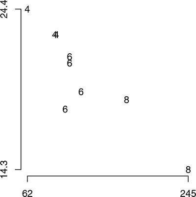

# 编写类与方法

让函数根据传入对象的类型表现出不同的行为通常是很有帮助的。例如，在汇总变量时，为数值型或字符串型数据创建不同的汇总是有意义的。可以为每种对象类型使用不同的函数，但这样用户就需要记住很多函数名，并且为了保持唯一性，函数名可能会更长。面向对象编程（OOP）基于对象，在 R（与大多数编程语言一样）中通过两个概念实现：类和方法。类定义了一个模板或蓝图，描述对象的变量和特征，并确定哪些方法适用于它。例如，房子可以被定义为有地板、四面墙、一个屋顶和一扇门。具体的数据表示这些属性，例如每面墙的尺寸和颜色。方法是可以在特定对象类型上执行的行为或动作。例如，房子可以被粉刷（改变其颜色），但房子不能被吃掉。R 有三种面向对象系统：S3、S4 和 R5。本章涵盖了最常用的 S3 和 S4 系统。

在本章中，我们使用 `ggplot2` R 包（Wickham, 2009）。以下代码加载 `checkpoint`（Microsoft Corporation, 2016）包以控制所用 R 包的确切版本，然后加载 `ggplot2` 包：

```
library(checkpoint)
checkpoint("2016-09-04", R.version = "3.3.1")
library(ggplot2)
options(width = 70)
```

## S3 系统

S3 系统是最常见的面向对象系统。它也是最容易上手且最简单的系统。S3 系统易于使用，部分原因在于它相当非正式，且主要关注函数或方法。这些优点也是其局限性，因为 S3 系统没有提供正式的框架来确保对象满足类的要求。关于使用 S3 系统进行 R 编程的更深入指南，请参阅 W.N. Venables 和 B.D. Ripley 的 *S Programming*（Springer, 2004）。

### S3 类

在 R 语言中，默认提供某些类型的对象或类，几乎所有对象都可以看作是向量或泛型向量。例如，矩阵和数组本质上是带有维度属性的向量。列表是泛型向量，其中向量的每个元素都可以包含另一个向量。数据框是列表，其中每个项目都是一个向量，但所有向量的长度都相同，因此具有表格格式。向量可以保存特定类型的数据，例如逻辑值、整数、数值（实数）或字符串。这些基本对象和类由基础包提供。S3 类是在基础包提供的对象和类之上构建创建的。

> **注意**
>
> S3 类是通过使用常规的 R 对象（例如向量或列表）和类（例如逻辑类或数值类）创建的。通过 `class(object) <- "class name"` 设置类名来定义 S3 类。S3 对象的元素通常通过使用 `` `$` ``、`` `[` `` 或 `` `[[` `` 来访问。

S3 类的实际创建很简单。首先，创建一个满足该类要求或特性的 R 对象，然后通过用类名标记该对象来定义 S3 类。由于 S3 类与其他 R 对象的唯一区别在于具有特殊的名称或属性，因此它们使用与其他基本 R 对象相同的方式来访问和操作，即使用 `` `$` ``、`` `[` `` 和 `` `[[` ``。要检查对象的类，我们可以使用 `class()` 函数。在以下示例中，查询 `mtcars` 对象以确定它具有数据框类：

```
class(mtcars)
[1] "data.frame"
```

要查看如何设置对象的类，我们可以查看基础 R 中的许多函数，例如 `table()`。在这里，我们打印 `table()` 函数的源代码，为了节省空间省略了中间部分：

```
table
function (..., exclude = if (useNA == "no") c(NA, NaN), useNA = c("no",
"ifany", "always"), dnn = list.names(...), deparse.level = 1)
{
[为节省空间省略]
y
```

最后返回的对象 `y` 是一个数组，但具有 `table` 类。对象类的设置使用了惯用法 `class(object) <- "class name"`。也可以为一个对象分配多个类。这几乎与分配单个类的方式相同，并且按优先级顺序进行。以下示例将调用 `table()` 的结果存储在对象 `x` 中，然后设置两个类，首先是 `newclass`，然后是原始的 `table` 类：

```
x <- table(mtcars$cyl)
class(x) <- c("newclass", "table")
class(x)
[1] "newclass" "table"
```

分配多个类的价值在于作为一种备份，主要用于方法。例如，如果你创建了一个作为表格或数据框变体的新类，你可能会为打印编写专用方法，但对于其他函数（例如绘图或摘要），则依赖于原始类的方法。

你可以编写的类类型几乎是无限的。一个简单的入门方法是创建现有类的特殊或增强情况。在以下示例中，我们创建了一个数据框的特殊情况，具有 x 和 y 坐标以及文本标签，称为 `textplot`。“创建”该类的最简单方法是创建一个数据框，然后更改其类。如果我们只使用新的类标签，调用 `print()` 函数将使用默认方法，但如果我们先用新的 `textplot` 标签标记它，其次再标记为数据框，那么调用 `print()` 则会回退到数据框的方法：

```
d <- data.frame(
  x = c(1, 3, 5),
  y = c(1, 2, 4),
  labels = c("First", "Second", "Third")
)
class(d) <- "textplot"
print(d)
$x
[1] 1 3 5
$y
[1] 1 2 4
$labels
[1] First  Second Third
  Levels: First Second Third
  attr(,"row.names")
[1] 1 2 3
  attr(,"class")
[1] "textplot"
class(d) <- c("textplot", "data.frame")
print(d)
  x y labels
1 1 1  First
2 3 2 Second
3 5 4  Third
```

在 S3 系统中，没有正式的方法来从特定类创建对象。然而，创建特定类对象的最常见方式是作为函数的输出。可以编写专用函数来创建特定类的对象，或者编写执行操作并以特定类对象输出结果的函数。后一种方法在使用 S3 系统时在 R 中更为典型。

当你创建一个新类时，一些期望的特性或元素可能已经存在于现有类中。如果是这种情况，基于现有类进行构建或扩展可能是有意义的。例如，数据框基于列表构建，要求列表的每个元素都是长度相等的向量。同样，我们之前创建的 `textplot` 类基于数据框构建，要求具有名为 `x`、`y` 和 `labels` 的三个元素。在这种情况下，我们会说 `textplot` 继承自 `data.frame`。也就是说，`textplot` 是父类 `data.frame` 的子类（注意，父类也称为超类或基类）。如果一个类只继承自另一个类，则称为单继承（即，它只有一个父类）。如果一个类继承自多个类，则称为多继承（即，它有多个父类）。如果一个类继承自另一个类，它可能会继承存储数据的特性，也可能继承方法——即对特定类对象进行操作的函数。继承方法对于避免重复造轮子尤其有用。

> **注意**
>
> 继承是指通过基于现有类的特性和方法创建新类。新类被称为子类，而新类派生自的类被称为父类或超类。子类既可以继承父类的特性，也可以使用父类的方法。

在下一个例子中，我们编写一个小函数，使用公式接口从数据框构建 `textplot` 对象。该函数有两个参数：称为 `f` 的公式和称为 `d` 的数据。代码的第一部分使用第 4 章介绍的 `stopifnot()` 函数来检查传递给函数的对象的类是否符合预期。为了测试类，我们使用 `inherits()` 函数，该函数评估特定对象是否是指定类的实例或是否继承自指定类。例如，我们的 `textplot` 类是其次是一个数据框，因此使用 `inherits(object, "data.frame")` 进行测试将评估为 `TRUE`。当我们构建 S4 类时，我们将看到更正式的类继承定义和系统。函数的下一部分按顺序从指定的数据框获取公式中的所有变量，重命名列，应用我们的 `textplot` 类，并返回对象：

```
textplot_data <- function(f, d) {
  stopifnot(inherits(d, "data.frame"))
  stopifnot(inherits(f, "formula"))
  newdata <- get_all_vars(formula = f, data = d)
  colnames(newdata) <- c("y", "x", "labels")
  class(newdata) <- c("textplot", "data.frame")
  return(newdata)
}
## 使用示例
textplot_data(f = mpg ~ hp | cyl, d = mtcars[1:10, ])
                    y   x labels
Mazda RX4         21.0 110      6
Mazda RX4 Wag     21.0 110      6
Datsun 710        22.8  93      4
Hornet 4 Drive    21.4 110      6
Hornet Sportabout 18.7 175      8
Valiant           18.1 105      6
Duster 360        14.3 245      8
Merc 240D         24.4  62      4
Merc 230          22.8  95      4
Merc 280          19.2 123      6
```

这些示例展示了使用 S3 系统创建类是多么容易。接下来，我们将探讨如何为现有或新类编写方法。

### S3 方法

方法是可在特定类别的对象上执行的函数或操作。即使你不编写自己的类，也可以编写自己的方法。编写 S3 方法与我们在第 4 章中编写函数的方式相似。唯一的区别在于 S3 方法遵循特殊的命名约定，并且需要一个面向用户的泛型函数，该函数负责将调用分派到适当的方法。

> **注意**
>
> S3 方法是遵循特定命名约定的常规 R 函数：`foo.classname()`。用户调用泛型函数`foo()`，该函数根据传入参数对象的类别分派到相应的方法。如果泛型函数不存在，则需要编写一个包含对`UseMethod()`调用的泛型函数，后者负责实际的方法分派。

首先，让我们为我们创建的`textplot`对象类编写一个简单的绘图方法。要创建 S3 绘图方法，我们使用函数名（这里是`plot`）后跟类名，即遵循`function.classname()`模式，在本例中就是`plot.textplot()`。只要函数以此方式命名，并且存在一个泛型函数`plot()`（我们稍后讨论），它就能作为 S3 方法工作。

我们的绘图函数如下方代码所示。对`par()`函数的调用调整了图形的默认边距，以减少图形顶部和右侧的留白。结果存储在对象`op`中，因为它保存了原始的图形参数。然后，在函数退出时，通过调用`par(op)`来恢复用户原始的图形参数状态，这是你在第 4 章中学到的模式。接着，我们通过调用`plot.new()`创建一个新的绘图区域，并通过调用`plot.window()`根据数据的范围设置新绘图的 x 轴和 y 轴限制来确定其尺寸。随后，我们使用接受坐标和标签的`text()`函数来绘制标签。最后，我们在底部（`side = 1`）和左侧（`side = 2`）添加坐标轴。原始的`textplot`数据对象在结尾被隐式地返回。

```r
plot.textplot <- function(d) {
op <- par(mar = c(4, 4, 1, 1))
on.exit(par(op))
plot.new()
plot.window(xlim = range(d$x, na.rm = TRUE),
ylim = range(d$y, na.rm = TRUE))
text(d$x, d$y, labels = d$labels)
axis(side = 1, range(d$x, na.rm = TRUE))
axis(side = 2, range(d$y, na.rm = TRUE))
invisible(d)
}
```

接下来，我们需要创建一些数据然后`plot()`它。请注意，因为它是一个方法，我们不需要通过全名`plot.textplot()`来调用我们的函数。我们可以直接调用`plot()`，R 会根据对象的类别`textplot`自动将数据对象分派给正确的方法。结果如图 5-1 所示，代码如下：



```r
dat <- textplot_data(f = mpg ~ hp | cyl, d = mtcars[1:10, ])
plot(dat)
```

这个例子展示了使用 S3 系统是多么简单。几乎不需要特殊的函数或额外的努力。只需按你希望的方式创建一个常规的 R 对象，添加一个自定义的类标签，编写一个函数，并赋予它一个特殊的名称——基本上这就是所需的全部。然而，S3 方法有一些特殊的函数和工具。首先，让我们看看查看`plot()`源代码时会发生什么。这个泛型函数只包含三个参数。函数体仅包含一个对`UseMethod()`的调用，这正是告诉 R 检查参数类别并分派到适当方法的部分。如果你正在编写方法但相应的泛型函数不存在，你还需要编写这个泛型函数。在 S3 系统中编写泛型函数是一个直接的任务，主要考虑的是默认应包含哪些参数：

```r
plot
function (x, y, ...)
UseMethod("plot")
```

要查看可用的方法，我们使用`methods()`函数。结果显示`plot()`有许多特定的方法可用，包括我们新编写的`plot.textplot`：

```r
methods(plot)
[1] plot,ANY-method               plot,color-method
[为节省空间省略]
[71] plot.table*                   plot.textplot
[为节省空间省略]
[81] plot.varclus                  plot.xyVector*
see '?methods' for accessing help and source code
```

有些函数后面跟着星号，表示这些方法不是公开的或者无法直接访问，例如`plot.table()`。例如，如果我们输入它的名字，会得到一个错误，提示找不到它：

```r
plot.table
Error: object 'plot.table' not found
```

> **注意**
>
> `::`运算符用于引用特定包中公开导出的函数，主要用于当多个包导出同名函数时：`package::foo()`。`:::`运算符用于访问包命名空间中未导出的函数。使用非公共函数时要小心，因为它们可能在没有通知的情况下发生变化。

非公开或未从包命名空间导出的函数仍可以作为方法访问。这些函数也可以通过指定它们来自哪个包并使用`:::`运算符直接访问，从而查看函数源代码：

```r
graphics:::plot.table
function (x, type = "h", ylim = c(0, max(x)), lwd = 2, xlab = NULL,
ylab = NULL, frame.plot = is.num, ...)
{
xnam
```

除了为新类编写方法外，有时为现有类编写方法也很有帮助。例如，流行的`ggplot2`包没有为处理线性模型或回归对象提供默认的方法。首先，我们使用内置的`mtcars`数据建立一个简单的回归模型。然后，我们通过`hp`、`vs`、它们的交互作用（通过`hp * vs`创建，这扩展为两个主效应及其交互项或乘积项）以及通过`factor()`调用进行虚拟编码的`cyl`来预测`mpg`。结果如下，通过调用`summary()`方法显示：

```r
m <- lm(mpg ~ hp * vs + factor(cyl), data = mtcars)
summary(m)
```

```markdown
Signif. codes:  0 '***' 0.001 '**' 0.01 '*' 0.05 '.' 0.1 ' ' 1
Residual standard error: 3.007 on 26 degrees of freedom
Multiple R-squared:  0.7913,  Adjusted R-squared:  0.7511
F-statistic: 19.71 on 5 and 26 DF,  p-value: 4.181e-08
```

我们可以检查对象的类别，并使用以下代码查看当前是否存在`ggplot()`方法：

```r
class(m)
[1] "lm"
methods(ggplot)
[1] ggplot.data.frame* ggplot.default*    ggplot.summaryP
[4] ggplot.transcan
see '?methods' for accessing help and source code
```

虽然`fortify()`函数有一个针对线性模型的方法，可以创建一个适合与`ggplot()`一起使用的数据框，但它只提取原始数据、拟合值和残差。为了展示模型的效果，绘制一个变量在其他变量保持在特定值时的预测值函数图会很有帮助。下面的方法实现了一个系统来做到这一点。