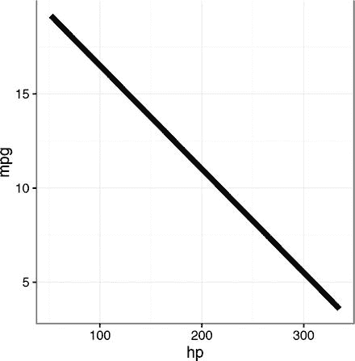
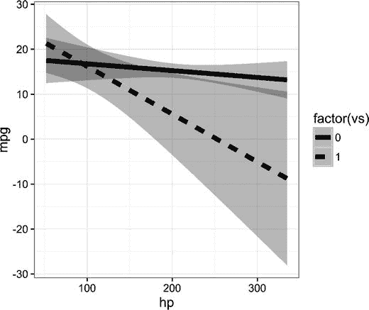

# ggplot.lm 方法

该方法采用与`ggplot()`相同的基本参数，但增加了`vars`参数。模型中使用的每个变量都通过一组特定的值来传递以进行预测。通过使用`do.call()`函数将这些列表作为参数传递给`expand.grid()`函数，创建所有这些可能组合。然后从模型公式中提取因变量`yvar`并转换为字符。生成新的预测值及其标准误。基于拟合值（或预测值）和正态分位数乘以拟合标准误，计算 95% 置信区间的下限`LL`和上限`UL`。最后，将列名从`fit`更改为因变量的实际名称，然后将用于预测的数据和预测值合并到一个新的数据框中。此数据框被传递给`ggplot()`，它会分派到数据框的`ggplot()`方法。

```r
ggplot.lm <- function(data, mapping, vars, ...) {
newdat <- do.call(expand.grid, vars)
yvar <- as.character(formula(data)[[2]])
d <- as.data.frame(predict(data, newdata = newdat, se.fit = TRUE))
d <- within(d, {
LL <- fit + qnorm(.025) * se.fit
UL <- fit + qnorm(.975) * se.fit
})
colnames(d)[1] <- yvar
data <- cbind(newdat, d[, c(yvar, "LL", "UL")])
ggplot(data = data, mapping = mapping, ...)
}
```

有了这个方法后，我们可以轻松地从线性回归模型生成图形。以下代码使用我们的新方法，指定预测变量的具体值，通过`geom_line()`添加线条，并使用`theme_bw()`黑白主题。结果如图 5-2 所示；代码如下：



图 5-2.
使用`ggplot.lm()`方法得到的模型预测回归线

```r
ggplot(m, aes(hp, mpg), vars = list(
hp = min(mtcars$hp):max(mtcars$hp),
vs = mean(mtcars$vs),
cyl = 8)) +
geom_line(size=2) +
theme_bw()
```

由于我们的方法中通过`expand.grid()`创建了预测器值的所有可能组合，我们可以生成多条预测线，例如将`vs`分别保持在`0`和`1`，如下例代码和图 5-3 所示：



图 5-3.
使用`ggplot.lm()`方法得到的模型预测回归线及置信区间

```r
ggplot(m, aes(hp, mpg, linetype = factor(vs), group = factor(vs)), vars = list(
hp = min(mtcars$hp):max(mtcars$hp),
vs = c(0, 1),
cyl = 8)) +
geom_ribbon(aes(ymin = LL, ymax = UL), alpha = .25) +
geom_line(size=2) +
theme_bw()
```

这些示例简要介绍了在编写新的类和方法或扩展现有类和方法时可以完成的工作。由于 S3 系统是 R 中最常用的系统，它可能是最重要的系统；它可以广泛应用并且可以扩展许多类别的对象。

## S4 系统

与 S3 系统相比，S4 系统是一个`正式`的系统。这种形式化的好处是能够更大程度地确保特定类的对象完全符合预期。形式化的缺点则是复杂性更高：需要更多的函数来设置类和方法，并且在编程中要求更严格。S3 系统允许编写快速且非正式的代码，而 S4 系统则需要更仔细的规划并带来更高的开销。

对象有三个组成部分：类、槽和方法。对象的名称和结构——它包含什么——就是类。存储在对象中的变量或其他对象是槽。最后，可以对该对象进行操作的函数就是它的方法。在本节中，我们将逐一介绍这些组成部分。关于 S4 系统的进一步阅读，一个极好的指南是 John Chambers 所著的《*Software for Data Analysis: Programming with R*》（Springer，2010）。

### S4 类

由于 S4 类更加正式，在编写新类之前需要进行规划。与 S3 类不同，在 S4 中必须指定要包含的每个变量的名称和类型。之前我们使用 S3 系统定义了一个类`textplot`。我们可以使用 S4 系统定义相同的类。`x`和`y`参数都应为数值类型，`labels`参数应为字符串。我们还知道所有参数的长度应该相同。最后，我们可能希望断言虽然可以存在缺失的标签，但不允许出现空标签。所有这些都需要提前考虑和指定——因为虽然在 S3 系统中无法控制这些，但在 S4 系统中我们可以在创建类时定义所有内容。要创建第一个 S4 类，我们使用`setClass()`函数，如下例所示。并非每个参数都是必需的，但在定义新类时，尽可能明确被认为是良好的实践。

S4 类通过调用`setClass()`创建。`Class`和`slots`参数是必需的。类名指定为字符串，槽（存放变量）定义为命名的字符向量；名称对应槽名，值对应每个槽的类。可以通过`prototype`参数指定一个"空"对象，并通过向`validity`参数传递一个函数来设置有效性检查。

第一个参数`Class`提供类的名称。接下来，使用一个命名向量定义`slots`，其中名称表示槽名，值表示每个槽的类型。`prototype`参数不是必需的，但定义它很有帮助，因为它决定了如何创建"空"对象，或者在未指定具体数据时如何创建该类的对象。`validity`参数也不是必需的，但允许运行显式检查以确保对象符合预期。R 默认确保传递给槽的对象具有适当的类型，但可以添加许多其他测试和有效性检查，以减少创建不符合预期工作对象的机会。以下是`setClass()`示例：

```r
setClass(
Class = "textplot",
slots = c(
x = "numeric",
y = "numeric",
labels = "character"),
prototype = list(
x = numeric(0),
y = numeric(0),
labels = character(0)),
validity = function(object) {
stopifnot(
length(object@x) == length(object@y),
length(object@x) == length(object@labels))
if (!all(nchar(object@labels) > 0, na.rm = TRUE)) {
stop("All labels must be missing or non zero length characters")
}
return(TRUE)
}
)
```

要在 S4 系统中创建特定类的新对象，我们使用`new()`函数。在下面的代码中，我们检查了三次创建新对象的尝试。首先，我们创建了一个正确且有效的对象。然后，我们看看如果尝试使用错误类型的参数会发生什么。最后，我们看一个测试我们创建的有效性函数的例子。

```r
new("textplot",
x = c(1, 3, 5),
y = c(1, 2, 4),
labels = c("First", "Second", "Third"))
An object of class "textplot"
Slot "x":
[1] 1 3 5
Slot "y":
[1] 1 2 4
Slot "labels":
[1] "First"  "Second" "Third"
new("textplot",
x = c(1, 3, 5),
y = c(1, 2, 4),
labels = 1:3)
Error in validObject(.Object) :
invalid class "textplot" object: invalid object for slot "labels" in class "textplot": got class "integer", should be or extend class "character"
new("textplot",
x = c(1, 3, 5),
y = c(1, 2, 4),
labels = c("First", "Second", ""))
Error in validityMethod(object) (from #16) :
All labels must be missing or non zero length characters
```

如果使用 S3 系统定义类，这些错误就不会发生，因为 S3 既不进行类型检查，也不进行有效性检查。前面的例子中，每次尝试创建新对象最多只有一个错误。下面的例子则包含两个错误：传递给`y`槽位的向量长度与其他两个不匹配，并且存在一个零长度的字符标签。然而，按照目前的写法，只有第一个错误会被捕获，因为一旦发现问题，有效性函数就会停止：

```r
new("textplot",
x = c(1, 3, 5),
y = c(1, 2),
labels = c("First", "Second", ""))
Error: length(object@x) == length(object@y) is not TRUE
```

另一种编写有效性函数的方法是，不针对每个问题抛出错误，而是收集它们并在最后一次性返回所有错误。在修订有效性函数时，我们还可以考虑如何使错误信息更具参考价值。目前的错误信息虽然能让人看出问题所在，但可能不够精确。例如，很明显长度不相等，但到底是`x`太长还是`y`太短？修订后的类定义代码实现了这一点。

然而，在深入改进有效性函数之前，我们需要简要了解如何在 R 中创建和格式化字符串。

首先，在编写文本时，可以通过包含特殊字符`\n`来插入换行符。为了查看示例，我们使用`cat()`函数（`cat`代表“连接并打印”），它将文本输出到 R 控制台（如果指定了文件，则输出到其他位置）。以下两个例子完全相同，除了第二个例子中`a`和`b`之间有换行符：

```r
cat("ab", fill = TRUE)
ab
cat("a\nb", fill = TRUE)
a
b
```

一个常用的函数是`paste()`，它可以组合或折叠向量。下面的第一个例子展示了组合功能。通过使用`sep`参数定义的连接符（在我们的例子中是空字符串）将两个向量组合起来。在第二个例子中，包含多个元素的单个向量被折叠成一个单独的字符串。向量元素如何合并为一个字符串由`collapse`参数决定——在我们的例子中，就是换行符。

```r
paste(c("a", "b"), c(1, 2), sep = "")
[1] "a1" "b2"
paste(c("a", "b"), collapse = "\n")
[1] "a\nb"
```

在编写有效性检查函数时，这些函数非常有用，因为它们允许我们将多个错误合并成一个字符串，并在需要时使用换行符分隔。

我们使用的另一个关键函数是`sprintf()`。它的第一个参数是一个用户定义的字符串，其中包含应以百分比符号（`%`）开头的特殊符号，用于指示值应替换的位置。随后的参数是要替换的值。举例可能是展示其用法最清晰的方式。这里，`%d`用于指示要替换一个整数，然后 R 会依次替换 98、80 和 75。替换的顺序就是出现的顺序。

```r
sprintf("First (%d), Second (%d), Third (%d)", 98, 80, 75)
[1] "First (98), Second (80), Third (75)"
```

常用的格式选项有：`%d`表示整数，`%f`表示定点小数，`%s`表示字符串，`%%`表示字面量百分号。下一个示例演示了每种用法，更多文档可参阅帮助页面`?sprintf`。对于数值，我们使用`0.2`来指定数字应四舍五入到两位小数。

```r
sprintf("Integer %d, Numeric %0.2f, String %s, They won by 58%%", 5, 3.141593, "some text")
[1] "Integer 5, Numeric 3.14, String some text, They won by 58%"
```

掌握了`paste()`和`sprintf()`，我们就可以修改`textplot`类的有效性函数，以提供更具参考价值的错误信息，并且运行所有检查，沿途收集错误，最后一次性返回所有错误。

最后一个注意事项：之前，我们使用惯用语`new("classname", arguments)`来创建特定类的新对象。虽然这完全可以接受，但有一个快捷方式。`setClass()`函数的主要作用是定义一个新类（副作用），但它也会隐式地返回一个构造函数。如果我们保存调用`setClass()`的结果——按照惯例，保存在一个与类同名的对象中——我们就可以使用得到的对象来创建该类的新实例：

```r
textplot <- setClass(...)
```

以下是修订后的`textplot`类定义，包含一个改进的有效性函数：

```r
setClass("textplot",
slots = list(
x = "numeric",
y = "numeric",
labels = "character"
),
validity = function(object) {
errors <- character()
if (length(object@x) != length(object@y)) {
errors <- c(errors, sprintf(
"x (length %d) and y (length %d) are not equal",
length(object@x), length(object@y)))
}
if (!all(nchar(object@labels) > 0, na.rm = TRUE)) {
errors <- c(errors, sprintf(
"%d label(s) are zero length. All labels must be missing or non zero length",
sum(nchar(object@labels) == 0, na.rm = TRUE)))
}
if (length(errors)) {
stop(paste(c("\n", errors), collapse = "\n"))
} else {
return(TRUE)
}
}
)
```

现在，当我们创建具有多个问题的相同对象时，我们获得了更多信息，并且节省了一些输入。我们可以看到`x`和`y`的长度，并且了解到标签也有问题：

```r
textplot(
x = c(1, 3, 5),
y = c(1, 2),
labels = c("First", "Second", ""))
Error in validityMethod(object) (from #30) :
x (length 3) and y (length 2) are not equal
1 label(s) are zero length. All labels must be missing or non zero length
```

# 总结

## S4 类继承

到目前为止，你已经了解了如何定义新的 S4 类。可能仍然感觉使用 S4 系统比 S3 系统需要更多的工作，但除了更正式的有效性验证和错误检查之外，似乎好处不多。S4 系统的一个强大特性就是`继承`。

S4 类可以通过调用`setClass()`并添加参数`contains = "要继承的 S4 类"`来继承现有的 S4 类。现有的槽（slot）、原型（prototype）和有效性检查都会被继承。在新的`setClass()`调用中，只需要指定新的槽以及相应的原型/有效性检查。

我们之前创建了一个简单的`textplot`类。现在假设，尽管有时我们简单的类就足够了，但有时我们可能需要更多功能。例如，有时我们可能希望深入数据，根据某个分组变量为数据的不同子集创建一个多面板图形。为此，我们需要一个`groupedtextplot`类。然而，我们唯一需要额外存储的数据就是一个额外的槽。一种选择是复制并粘贴旧代码，然后按需修改。在本节中，我们将探讨如何使用继承来重用和扩展现有类。当一个类继承另一个类时，前一个类的所有槽以及有效性检查都会被继承。接下来，我们创建我们的`groupedtextplot`类。这与创建一个新类类似，但我们只定义新的槽，然后通过使用参数`contains`来指定继承关系。由于有效性检查也被继承，我们只需要为新槽指定有效性检查。

```r
groupedtextplot <- setClass(
Class = "groupedtextplot",
slots = c(
group = "factor"),
prototype = list(
group = factor()),
contains = "textplot",
validity = function(object) {
if (length(object@x) != length(object@group)) {
stop(sprintf("x (length %d) and group (length %d) are not equal",
length(object@x), length(object@group)))
}
return(TRUE)
}
)
```

通过这么少的代码，我们就可以使用新类了。以下两个例子中，第一个展示了正确创建的新对象，后者展示了当我们尝试创建一个无效对象时熟悉的错误信息：

```r
gdat <- groupedtextplot(
group = factor(c(1, 1, 1, 1, 2, 2, 2, 2)),
x = 1:8,
y = c(1, 3, 4, 2, 6, 8, 7, 10),
labels = letters[1:8])
gdat
An object of class "groupedtextplot"
Slot "group":
[1] 1 1 1 1 2 2 2 2
Levels: 1 2
Slot "x":
[1] 1 2 3 4 5 6 7 8
Slot "y":
[1]  1  3  4  2  6  8  7 10
Slot "labels":
[1] "a" "b" "c" "d" "e" "f" "g" "h"
groupedtextplot(
group = factor(c(1, 1, 1, 1, 2, 2, 2, 2)),
x = 1:8,
y = c(1, 3, 4, 2, 6, 8, 7),
labels = c(letters[1:7], ""))
Error in validityMethod(as(object, superClass)) (from #30) :
x (length 8) and y (length 7) are not equal
1 label(s) are zero length. All labels must be missing or non zero length
```

在这种情况下，`textplot`被称为`父类`，而`groupedtextplot`被称为`子类`。这种关系可以用图表表示（对于复杂的继承关系，图表有时很有帮助）。按照惯例，关系以箭头从子类指向父类的方式图形化表示，例如`textplot <- groupedtextplot`。同样按照惯例，父类通常在左侧，或者如果从上到下绘图，则在顶部。尽管本书只涉及从单个父类继承，但类可以从多个父类继承，而这些父类又可以继承自它们的父类，依此类推。在这些情况下，视觉图表特别有用。使用继承而不是编写一个全新的类的另一个好处是，方法也会被继承。这意味着我们可以重用父类的槽以及为父类编写的方法，这是我们将在下一节讨论的主题。

## S4 方法

除了你之前看到的`methods()`函数可以显示给定函数可用的方法之外，在 S4 系统中，我们还可以使用`showMethods()`来查找方法。由于更正式的类系统，`showMethods()`可用于显示特定函数的所有方法，或者通过使用参数`classes = "类名"`来显示特定类的所有方法（针对任何函数）。如果你正在处理一个新类，并想知道已经编写了哪些方法且可用，这会很有帮助。

可用的 S4 方法可以通过`showMethods("泛型函数")`来检查。新的 S4 方法通过调用`setMethod()`来定义。主要的三个参数是`f`、`signature`和`definition`，分别包含泛型函数的名称（字符串）、将分派到此方法的 S4 类名（字符串）以及作为实际方法的函数。

要在 S3 系统中编写新方法，我们只需按照特殊的命名约定编写函数。要定义 S4 方法，我们使用函数`setMethod()`。当然，可以为现有类编写新方法，也可以为新类编写方法。对于新类，需要为`show()`编写一个方法。当在控制台简单地键入一个对象时，R 会通过调用`show()`来显示它。如果没有为新类定义`show()`方法，默认打印会很难看，就像你在我们之前的例子中看到的那样。

在下面的代码中，我们为`textplot`类定义了一个新方法。第一个参数是我们为其创建方法的函数名。下一个参数，签名（signature），是类名。在这种情况下，因为`show()`只接受一个参数，所以只需要指定一个类名。对于具有多个参数的函数，签名可能变得更加复杂，根据多个参数的类不同，会有不同的方法。最后，我们编写我们的函数，即方法的定义。代码相对简单，使用`cat()`函数来显示值。参数`fill = TRUE`的效果是添加换行符，使每一行都以 `X:` 或变量标签开始，然后是值。`head()`函数用于获取最多前五个值，如果值较少则获取更少。

```r
setMethod(
f = "show",
signature = "textplot",
definition = function(object) {
cat("     X: ")
cat(head(object@x, 5), fill = TRUE)
cat("     Y: ")
cat(head(object@y, 5), fill = TRUE)
cat("Labels: ")
cat(head(object@labels, 5), fill = TRUE)
})
[1] "show"
```

R 回显了我们刚刚为其创建了方法的泛型函数`show()`的名称。现在，当我们创建一个`textplot`类对象时，会得到一些更美观的输出：

```r
dat <- textplot(
x = 1:4,
y = c(1, 3, 5, 2),
labels = letters[1:4])
dat
X: 1 2 3 4
Y: 1 3 5 2
Labels: a b c d
```

一旦我们开始定义方法，类继承的好处就变得更大了。因为`groupedtextplot`继承自`textplot`，如果没有为`groupedtextplot`定义方法，并且`textplot`有可用的方法，那么它会回退到`textplot`的方法。虽然不完美（因为未显示分组信息），但这仍然比默认输出要好：

```r
gdat
X: 1 2 3 4 5
Y: 1 3 4 2 6
Labels: a b c d e
```

接下来，我们为`[`函数定义一个方法，该函数用于数据子集化。这个函数更复杂，因为我们必须构建一个逻辑树，允许多种可能的参数组合。函数的第一个参数`x`是要进行子集化的对象。按照惯例，`i`指行或观测，`j`指列或变量。如果只有`i`没有缺失（即指定了行或观测），通常包含所有变量。如果只指定了`j`（变量），通常包含所有观测。如果两者都指定了，则只包含选定的变量和观测。这是通过使用一系列`if`和`else if`语句来完成的。这里涉及三个新函数：

### `validObject()`、`slotNames()` 和 `slot()`

*   `validObject()`是一个泛型函数，用于对特定对象类执行有效性检查（如果存在的话）。
*   `slotNames()`返回一个字符向量，给出每个槽的名称。
*   `slot()`的功能类似于`@`操作符，但可以使用字符串按名称提取槽。

方法设置完成后，展示了几个使用示例：

```r
setMethod(
f = "[",
signature = "textplot",
definition = function(x, i, j, drop) {
if (missing(i) & missing(j)) {
out <- x
validObject(out)
} else if (!missing(i) & missing(j)) {
out <- textplot(
x = x@x[i],
y = x@y[i],
labels = x@labels[i])
validObject(out)
} else if (!missing(j)) {
if (missing(i)) {
i <- seq_along(x@x)
}
if (is.character(j)) {
out <- lapply(j, function(n) {
slot(x, n)[i]
})
names(out) <- j
} else if (is.numeric(j)) {
n <- slotNames(x)
out <- lapply(j, function(k) {
slot(x, n[j])[i]
})
names(out) <- n[j]
} else {
stop("j is not a valid type")
}
}
return(out)
})
dat[]
X: 1 2 3 4
Y: 1 3 5 2
Labels: a b c d
dat[i = 1:2]
X: 1 2
Y: 1 3
Labels: a b
dat[j = 1]
$x
[1] 1 2 3 4
dat[j = "y"]
$y
[1] 1 3 5 2
dat[i = 1:2, j = c("x", "y")]
$x
[1] 1 2
$y
[1] 1 3
```

为我们的`textplot`类定义了`show`和`subsetting`方法后，我们可以轻松地利用这些方法，通过按组循环遍历对象、子集化和显示每个子集，来为`groupedtextplot`类创建一个`show`方法：

```r
setMethod(
f = "show",
signature = "groupedtextplot",
definition = function(object) {
n <- unique(object@group)
i <- lapply(n, function(index) {
cat("Group: ", index, fill = TRUE)
show(object[which(object@group == index)])
})
})
gdat
Group:  1
X: 1 2 3 4
Y: 1 3 4 2
Labels: a b c d
Group:  2
X: 5 6 7 8
Y: 6 8 7 10
Labels: e f g h
```

本章介绍了 R 中用于开发新类和新方法的 S3 和 S4 系统。特别是 S4 系统，可能非常复杂，涉及从多个父类继承以及针对多个参数类特化的方法。即使你在 R 中使用和开发，也可能很少开发新的类，因为大多数数据类型已经有现成的类。然而，开发或扩展现有方法通常很有帮助，至少，理解类和方法的工作原理可以让你更容易地使用现有的类和函数。

希望本章足以让你开始使用这些系统并了解它们的能力。表 5-1 描述了本章涉及的关键函数。在第 6 章中，我们将函数、类和方法捆绑在一起，制作我们自己的 R 包。重点是制作 R 包，所以你不需要对类和方法非常熟悉。如果你的工作能从使用 S4 系统中受益，你可以从 John Chambers 的《How S4 Methods Work》（可在 [`http://developer.r-project.org/howMethodsWork.pdf`](http://developer.r-project.org/howMethodsWork.pdf) 在线获取）中获得更深入的介绍。如果你打算使用 S4 系统并需要进行深入研究，我们推荐《*Software for Data Analysis: Programming with R*》。另一本更侧重于通用 R 编程和较旧的 S3 系统的优秀书籍是《*S Programming*》。

表 5-1. 本章描述的关键函数

| 函数 | 功能描述 |
| --- | --- |
| `class()` | 返回对象的类（S3/S4）。 |
| `inherits()` | 检查对象是否属于某个特定类或继承自该类。 |
| `methods()` | 返回给定函数可用的方法列表。 |
| `showMethods()` | 返回给定函数可用的方法列表；或者，如果使用 `classes` 参数，则返回给定类中任何函数可用的方法列表。 |
| `:::` | 操作符，允许访问包中未导出（非公开）的函数。 |
| `function.class()` | 命名 S3 方法的通用方案：使用函数名，后跟一个句点，再后跟应用该方法的对象类。 |
| `setClass()` | 定义一个新的 S4 类。 |
| `setMethod()` | 为特定 S4 类的特定函数定义一个方法。 |
| `@` | 在 S4 系统中按名称访问对象中槽的低级方式，类似于其他 R 对象或 S3 类对象的 `$`。 |
| `new()` | 创建一个指定类的新 S4 对象。 |
| `paste()` | 将字符串粘贴在一起。可以操作多个向量，也可以将单个向量的所有元素合并在一起。 |
| `sprintf()` | 格式化字符串，并允许将数字和其他字符串替换到定义的模板中。对于制作信息丰富的错误消息或其他给用户的消息很有用。 |
| `show()` | 显示 R 对象的泛型函数。也是你在 R 控制台键入对象名称时默认调用的函数。 |
| `` `[`() `` | 用于子集化数据或访问特定变量或行的操作符/泛型函数。在 S4 系统的新类中，必须定义方法，否则该函数不可用。 |
| `head()` | 列出对象的前几个元素或行。 |
| `validObject()` | 一个泛型函数，通过使用创建类时指定的有效性检查（如果有的话）来检查具有 S4 类的对象何时有效。创建对象时默认调用，但也可以在修改对象后显式调用，以检查其是否仍然有效。 |
| `slotNames()` | 返回 S4 类对象的所有槽名，类似于其他 R 对象或 S3 类对象的 `names()`。 |
| `slot()` | 可用于访问 S4 对象的特定槽。 |