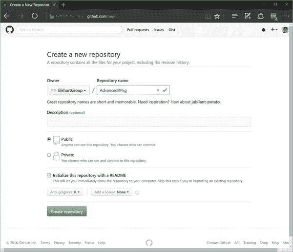
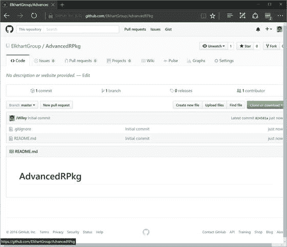
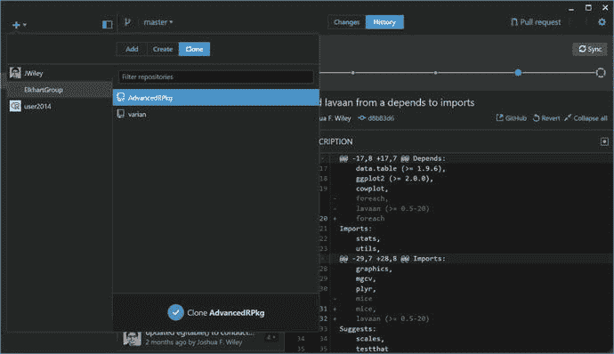
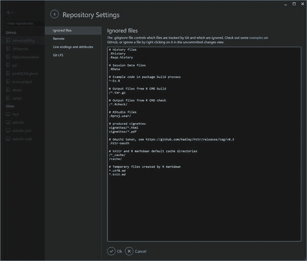
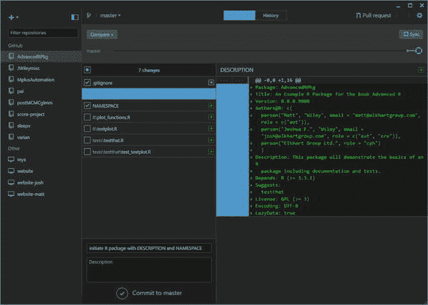
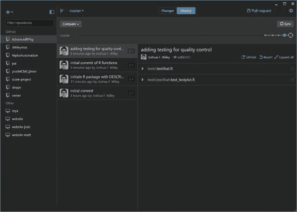
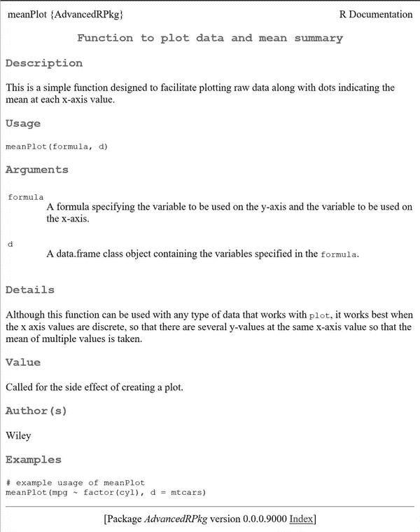
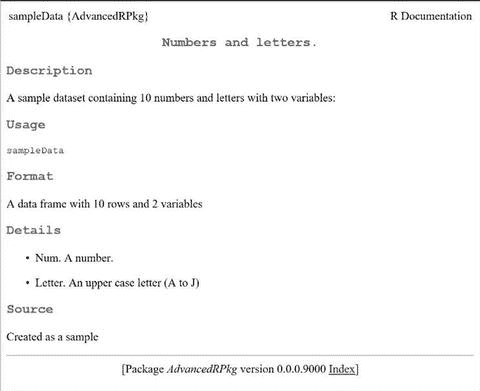
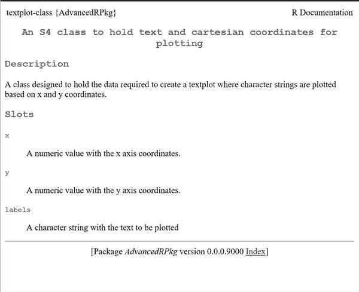
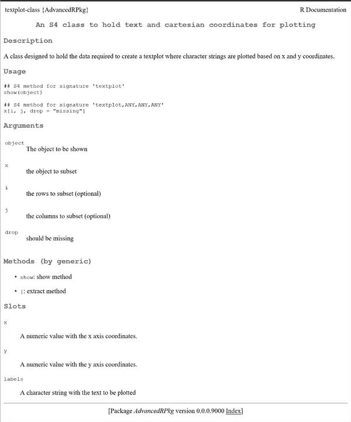

# 6. 编写包

包是记录、共享和分发 R 代码和数据的基本方式。我们的目标是编写自己的包，我们需要提前说明，本章特别复杂，因为在 R 包开发过程中会用到许多软件工具。

在本章中，我们使用了四个包。`devtools` 包（Wickham and Chang, 2016）提供了帮助设置、记录和管理 R 包开发的函数。`roxygen2` 包（Wickham, Danenberg, and Eugster, 2015）通过在函数旁边使用注释行内编写函数文档，大大简化了为 R 包编写文档的工作。我们还使用了另外两个不太关键的包。`testthat` 包（Wickham, 2011）不是必需的，但它提供了通过测试函数是否返回预期值来促进质量控制的函数。类似地，`covr` 包（Hester, 2016）通过测试被测试执行的代码百分比（覆盖率）来促进质量控制。理想情况下，100% 的代码都应该被测试覆盖，尽管在实践中，许多 R 包没有任何测试，所以任何覆盖率都比平均水平要好。在包中，我们对 `ggplot2` 使用了第 5 章中的一种方法，因此我们也包含了现在已经很熟悉的 `ggplot2` 包（Wickham, 2009）。

编写包可能是一个复杂的过程。熟悉最终产品可能会有所帮助，该产品可在 [`https://github.com/ElkhartGroup/AdvancedRPkg`](https://github.com/ElkhartGroup/AdvancedRPkg) 在线获取。如果你不确定文件是否位于正确的位置或设置是否正确，我们还建议你在阅读本章时参考我们在 GitHub 上的官方包记录。以下代码加载 `checkpoint` 包（Microsoft Corporation, 2016）以控制使用的 R 包的确切版本，然后加载所需的包：

```r
## load checkpoint and required packages
library(checkpoint)
checkpoint("2016-09-04", R.version = "3.3.1")
library(testthat)
library(devtools)
library(roxygen2)
library(covr)
library(ggplot2)
options(width = 70) # only 70 characters per line
```

## 开始之前

本章将介绍编写 R 包的一些基础知识，并介绍一些工具来简化未包含在官方手册《Writing R Extensions》中的流程，该手册可在线访问 `https://cran.r-project.org/doc/manuals/R-exts.html`。该手册可能相当技术性，但它是权威指南。如果你计划向 CRAN 提交 R 包，阅读它是必需的；即使你只是计划开发供自己使用，或供更有限用户群（如你的公司或实验室小组）使用的包，阅读它也是一个好主意。

许多 R 包包含来自其他编程语言（如 C、C++、Fortran 或 Java）的代码。这通常是因为其他语言（如 C）可以编译和优化，运行速度远快于 R，因此包开发者可能会选择用编译型且高效的语言来编写代码中计算密集的部分。然而，在本章中，我们将讨论如何编写仅包含纯 R 代码或数据的 R 包，因为其过程几乎相同，大部分差异是由所包含语言特有的特性造成的（例如 makefile）。

在开发 R 包之前，需要一些工具。确实，对于不习惯软件开发的人来说，编写 R 包可能需要一个相当令人生畏的工具链。如果你使用的是 Linux 系统，很可能你已经拥有其中许多工具，或者可以轻松安装它们。在 Windows 和 Mac OS 系统中，可能需要更多设置。无论使用何种系统，这些工具需要是可访问的，这意味着需要将它们添加到系统路径中，以便在命令行调用时可以找到它们。

### Windows 系统所需工具

如果使用 Windows，所需的主要工具（一些命令行工具和编译器）可以从 `https://cran.r-project.org/bin/windows/Rtools/` 的二进制安装程序获取。在安装的最后一步之前，有两个复选框，其中一个可能未被勾选，其作用是将工具添加到系统路径。只需勾选两者。此外，你需要 LaTeX（一种排版系统）。MiKTeX 是一个流行的选择 (`www.miktex.org/`)；如果你的系统是 64 位，请务必选择 64 位选项。虽然这两者的大多数默认选项在大多数情况下已足够，但我们建议 MiKTeX 用户将“按需安装默认包”的选项更改为“是”。关于所需工具链的更多详细信息，可参阅 R 手册中的 `https://cran.r-project.org/doc/manuals/R-admin.html#The-Windows-toolset`。

### Mac OS 系统所需工具

如果使用 Mac OS，请从 App Store 获取 Xcode（开发者工具）。你可能还需要获取 XQuartz (`https://xquartz.macosforge.org/`)。与 Windows 一样，你需要 LaTeX。MacTeX 是一个选择 (`www.tug.org/mactex/`)。更多详细信息可参阅 R 手册 (`https://cran.r-project.org/doc/manuals/R-admin.html#OS-X`)。

### 为你的包命名和授权

在开始编写第一个 R 包之前，还需要做两个决定。首先，如何命名 R 包？这个看似简单的任务变得复杂，因为目前 CRAN 上有超过 8,000 个 R 包，并且数量在快速增长 (`https://cloud.r-project.org/web/packages/available_packages_by_name.html`)。尽管你可以为一个不上传到 CRAN 的包取一个与 CRAN 上现有包相同的名字，但如果你将来会使用那个 CRAN 包或者任何依赖它的包，这样做就会有问题。即使你的包不打算提交到 CRAN，将来也可能有其他人写一个同名包并提交到 CRAN。基于这些原因，选择包名需要一些思考。在本章所有示例中，我们将构建一个名为 `AdvancedRPkg` 的 R 包。第二个决定是包使用什么许可证。如果你计划提交到 CRAN，许可证必须与 CRAN 兼容。即使包永远不会发送到 CRAN，许可证仍然可能是相关的。在本章中，我们使用 GPLv3 许可证。

### 版本控制

截至目前，我们讨论了相对随意的代码开发、一些基础编程、函数和类。开发新的 R 包更为复杂，需要管理的文件也更多。随着复杂性的增加，建立一个高效的文件备份和版本回退系统会很有帮助。版本控制系统提供了一个极佳的方式来备份代码以及将更改回滚到之前的版本（例如，如果为实现新功能所做的更改破坏了旧功能或引入了错误）。存在多种版本控制系统，但目前最流行的可能是开源的 Git，它最初是为 Linux 内核提供版本控制而开发的。Git 可以直接通过命令行使用，也可以通过多种图形界面使用。许多人使用 GitHub（[`https://github.com/`](https://github.com/)），这是一个使用 Git 并在线托管代码库的服务，对公共项目免费。GitHub 也为 Windows 和 Mac OS 提供了图形界面（[`https://desktop.github.com/`](https://desktop.github.com/)）。但是，如果你不想学习或使用 Git 或其他版本控制系统，可以放心地忽略本节以及本章中所有仅与版本控制相关的命令。

我们在本章中使用 Git（和 GitHub for Windows）为我们开发的示例 R 包提供版本控制。具体来说，本书使用 Windows GitHub 桌面客户端 v3.3.0。Git 代码库可以仅在一台本地计算机上使用，但配合 GitHub 使用可以方便地在包上进行协作，并与他人分享早期的包代码。

## 设置代码库

通过命令行可以设置 Git 代码库，但对于新用户来说，创建新的 Git 代码库最直观的方式可能是在线直接通过 GitHub。我们为本章开发的 R 包创建一个新的代码库，并命名为 `AdvancedRPkg`。代码库初始化时会包含一个 `README` 文件，我们稍后会编辑它。我们可以通过将某些文件或特定扩展名的文件添加到名为 `.gitignore` 的文件中来告诉 Git 忽略它们。每个文件或扩展名独占一行列出。我们稍后可以编辑它，但暂时只让 GitHub 创建一个。图 6-1 展示了执行此操作的步骤。


图 6-1. 创建 `AdvancedRPkg` 代码库的 GitHub 页面

如果一切按计划进行，结果应类似图 6-2 所示。除了 `README` 和 `.gitignore` 文件外，代码库是空的。


图 6-2. 显示已创建的 `AdvancedRPkg` 代码库的 GitHub 页面

从这里，我们可以将代码库克隆到本地计算机。本质上，这创建了一个本地副本，我们在其中进行包的编写。要做到这一点，打开 GitHub 桌面客户端，点击加号，选择"克隆"，然后选择代码库，如图 6-3 所示。


图 6-3. GitHub 桌面客户端克隆 `AdvancedRPkg` 代码库

点击"克隆"后，我们会看到一个选项，用于选择代码库应克隆到的目录。请注意，无论选择哪个目录，都会为代码库创建一个与代码库同名（即 `AdvancedRPkg`）的新目录。代码库的设置可以通过终端管理，也可以通过点击 GitHub 桌面客户端中的齿轮图标并选择"Repository Settings"（代码库设置）来管理。其中一个设置显示当前被忽略的文件。文件是根据 `.gitignore` 文件忽略的，由于我们在创建代码库时选择了 R，一些通常希望被忽略的默认文件扩展名已被默认包含（见图 6-4）。


图 6-4. GitHub 桌面客户端显示 `AdvancedRPkg` 代码库的设置，包括 Git 代码库忽略的各种文件扩展名

Windows 经常在目录中创建临时（有时是隐藏的）文件 `desktop.ini`。为了避免包含这些文件，我们可以编辑代码库设置，在末尾添加新行并输入 `desktop.ini`。这样这些文件就被忽略了。被忽略的文件是 Git 代码库不随时间跟踪和存储更改的文件。它们仍然存在于目录中；Git 只是不监视和版本化它们。

## Git 操作：提交与同步

除了设置一个新的 Git 代码库外，你可能会用 Git 执行的任务包括向代码库提交更改以及将本地代码库副本与在线（GitHub）版本同步。提交可以看作是在提交时对文件状态的一次快照。为了避免冗余提交，只对自上次提交以来文件所做的更改进行快照。尽管即使是稍微修改的二进制文件也可能难以比较，但像 R 代码这样的纯文本文件则很容易比较。Git 在跟踪文本文件随时间的变化方面非常高效，允许你查看所做的更改或回到过去的特定时间点。如果代码中引入了错误或缺陷，访问项目（代码库）的这段历史记录会特别有帮助，这样可以精确定位错误是何时引入的（例如，基于此代码的多少结果可能受到影响？）并查看之前有效运行的代码版本。

在稍复杂的用例中，Git 可以有效地用于管理代码的不同版本。例如，通常一个项目会定期发布稳定版或生产就绪的代码版本，同时继续进行开发。在 Git 中，这是通过使用同一代码库的不同分支，并定期将某个分支（例如开发分支）的部分更改合并到稳定分支中来实现的。

## 附加资源

我们将在本章中展示更多相关的 Git 命令。关于使用 Git 的更多背景知识，一个很棒且免费的资源是 Scott Chacon 和 Ben Straub 所著的《Pro Git》（Apress，2014），可在[`https://progit.org/`](https://progit.org/)获取。对于问答，Stack Overflow（[`http://stackoverflow.com`](http://stackoverflow.com)）是一个很好的资源。很可能其他人已经问过类似的问题，如果没有，你可以提问并获得答案。另外请注意，如果你使用 RStudio 编写 R 代码，它内置了一些与 Git 的集成功能。有关这方面的更多信息，请参阅 RStudio 支持页面：[`https://support.rstudio.com/hc/en-us/articles/200532077-Version-Control-with-Git-and-SVN`](https://support.rstudio.com/hc/en-us/articles/200532077-Version-Control-with-Git-and-SVN)。最后请注意，你可以公开访问在线代码库：[`https://github.com/ElkhartGroup/AdvancedRPkg`](https://github.com/ElkhartGroup/AdvancedRPkg)。

## R 包基础

一个 R 包就是一个包含特定文件集的目录。虽然 R 包的核心无疑是 R 代码，但许多文件并非严格意义上的 R 代码。表 6-1 列出了可能出现在 R 包目录根层级的主要文件。并非所有这些文件都是必需的，这取决于包的其他特性。在本章后续内容中，我们将借助 `devtools` 包来帮助创建其中一些文件。

**表 6-1. `R` 包根目录下可能使用的文件。**

| 文件 | 描述 |
| --- | --- |
| `DESCRIPTION`* | 提供关于包的一般信息。必需的字段包括：`Package`（包名）、`Version`、`License`、`Title`（包描述）、`Author` 和 `Maintainer`（可能与作者相同或不同）。通常也包含依赖关系信息，除非包是独立的。 |
| `NAMESPACE`* | 控制包的命名空间，包括需要导出的对象以及需要从其他包导入的对象。虽然是必需的，但我们可以使用 `roxygen2` 包自动生成此文件。 |
| `README`/`README.md` | 非必需，且被 R 忽略，但对读者和用户很有帮助。提供关于包的一般信息（例如，获取帮助的途径、简要概述、安装指南，或任何其他在简要文档中有用的信息）。 |
| `NEWS` | 提供关于包的变更或新闻信息。通常包括新特性、漏洞修复以及与先前版本相比的任何其他重大变更。 |
| `LICENSE` | 许可证文件，如果未使用常见许可证或需要附加信息时使用。 |
| `INDEX` | 可选的，因为它可以从文档文件中自动生成。但如果指定了，则会提供一个所有有用/有趣对象的列表，每行包含一个名称和描述。 |
| `configure`, `cleanup` | 可选的 Bourne shell 脚本，分别在 Unix 系统（例如 Linux、Unix）上安装前和安装后运行。 |

\* 表示必需文件

除了根层级的文件，R 包还可以包含许多子目录。这些列在表 6-2 中，并附有简要描述。对于我们相对简单的包，我们只处理其中的一小部分，包括 `R`、`man` 和 `tests`。

**表 6-2. `R` 包子目录**

| 子目录 | 描述 |
| --- | --- |
| `R`* | 包含所有函数、类、方法等 R 源代码的目录。 |
| `man`* | 包含 R 文档文件的目录。我们使用 `roxygen2` 包自动生成这些文件。 |
| `tests` | 可选的目录，包含用于测试包是否按预期工作的 R 代码。 |
| `data` | 可选的目录，包含与包一起分发的数据。通常，包含的数据集较小，用于说明包的特性，而不是作为共享数据的主要手段。 |
| `demo` | 可选的目录，包含 R 包的演示，以 R 源代码文件形式存在。 |
| `exec` | 可以包含其他必需的可执行脚本。仅包含文件，不包含子目录。 |
| `inst` | 可以包含在包安装时复制到安装目录的其他文件。例如，可用于与用户共享 `NEWS` 文件，或包含图像或其他非标准文档。 |
| `po` | 用于添加 C 和 R 错误信息的翻译以及其他与本地化相关的任务。 |
| `src` | 通常包含其他语言的源代码，如 C、C++ 或 Fortran。这些代码通常需要编译；如果使用它，通常需要指定一个 makefile。 |
| `tools` | 不常用，但可用于提供配置所需的其他文件。 |
| `vignettes` | 用于提供一个或多个使用该包的指南或说明。与通常针对特定函数的函数文档相比，说明通常包含更多的入门背景知识和关于如何整体使用包的完整示例。虽然不是必需的，但对用户非常有帮助。 |

\* 表示必需子目录

### 使用 DevTools 启动包

至少，在你的包根目录下，你需要`DESCRIPTION`和`NAMESPACE`文件。你还需要一个子目录`R`，顾名思义，这是放置 R 代码的地方。这对于提交到 CRAN 的包来说还不够，但对于启动一个供私人使用的功能包来说已经足够了。然而，即使对于私人使用，适当的文档也极其有帮助。遗憾的是，包的目录和文件结构相当复杂，尤其是在文本中描述时。因此作为参考，以下是本章结束时你应该获得的包的最终目录结构（取自`AdvancedRPkg`目录内）：

```
.
├── data
│   └── sampleData.rda
├── DESCRIPTION
├── man
│   ├── ggplot.lm.Rd
│   ├── meanPlot.Rd
│   ├── sampleData.Rd
│   └── textplot-class.Rd
├── NAMESPACE
├── R
│   ├── plot_functions.R
│   ├── sampledata.R
│   └── textplot.R
├── README.md
└── tests
    ├── testthat
    │   └── test_textplot.R
    └── testthat.R
5 directories, 13 files
```

对于初始设置，我们使用`setup()`函数。我们可以指定更多信息，但最低要求是路径。我们还将`rstudio = FALSE`设置为使代码适用于任何编辑器，而不仅仅是 RStudio。要查看创建了什么，我们可以使用`list.files()`函数，它显示已经创建了`DESCRIPTION`和`NAMESPACE`文件以及一个`R`目录。对于以下代码，可以从 R 命令行运行它，或者创建一个新的 R 文件（我们将我们的命名为`chapter06.R`）。请注意，重要的是调整`path`参数，使其指向包含 Git 仓库的目录，无论你在本地机器上将其克隆到了哪里。在我们的例子中，R 的工作目录（可以通过调用`getwd()`函数检查）位于`AdvancedRPkg`目录的正上方目录。如果你的 R 会话不在此目录，要么调整`path`参数，要么使用`setwd()`函数将 R 的工作目录更改为`AdvancedRPkg`的父目录：

```r
setup(
    path = "AdvancedRPkg/",
    rstudio = FALSE)
```

```
创建包'AdvancedRPkg'在'∼/Apress_AdvancedR/RFiles'
未找到 DESCRIPTION 文件。使用以下值创建：
Package: AdvancedRPkg
Title: What the Package Does (one line, title case)
Version: 0.0.0.9000
Authors@R: person("First", "Last", email = "first.last@example.com", role = c("aut", "cre"))
Description: What the package does (one paragraph).
Depends: R (>= 3.3.1)
License: What license is it under?
Encoding: UTF-8
LazyData: true
```

```
list.files("AdvancedRPkg")
```

```
[1] "DESCRIPTION" "NAMESPACE"   "R"           "README.md"
```

输出还显示了部分字段及其填充信息。由于这些大多是占位符，我们需要使用文本编辑器（包括 RStudio 在内的任何编辑器都应该可以）打开文件并修改它们。`setup()`函数根据目录猜测包名，但其余部分需要填写。使用编辑器，我们将这些字段修改如下：

```
Package: AdvancedRPkg
Title: 书籍《Advanced R》的示例 R 包
Version: 0.0.0.9000
Authors@R: c(
    person("Matt", "Wiley", email = "matt@elkhartgroup.com", role = c("aut")),
    person("Joshua F.", "Wiley", email = "josh@elkhartgroup.com", role = c("aut", "cre")),
    person("Elkhart Group Ltd.", role = "cph")
)
Description: 该包将演示 R 包的基础知识，包括文档和测试。
Depends: R (>= 3.3.1)
License: GPL (>= 3)
Encoding: UTF-8
LazyData: true
```

注意版本号，其格式设计为`主版本.次版本.修订版.开发版本`。关于如何确定软件版本的考量，语义化版本规范（[`http://semver.org/`](http://semver.org/)）中给出了很好的概述。虽然它的建议相当规范，但有一套固定的规则来确定软件的主版本或次版本通常很有帮助。最后一部分`开发版本`仅存在于开发版本中，发布时会删除。尽管有这些规则和指南，许多 R 包的实际做法要异构和不一致得多（并非所有人都同意这些规则，即使同意也并非总能严格遵守）。

接下来是作者，使用`person()`函数描述。除了每个人的姓名和电子邮件外，还使用三个字母的缩写来描述角色和关系。所有可能性都在 MARC 关系者代码列表（[`www.loc.gov/marc/relators/relaterm.html`](http://www.loc.gov/marc/relators/relaterm.html)）中列出。然而，最常用的是`aut`（作者）、`cre`（项目负责人或 R 术语中的维护者，即出现问题时的联系人）和`cph`（版权持有者）。然后我们为包的描述提供几句话，指定我们的包依赖的 R 版本、许可证，以及数据可以按需加载（以节省启动时间）。

#### 添加 R 代码

有了包的基础之后，是时候开始添加一些 R 代码了，这是包的真正目的！由于本章的重点是打包代码，我们将重用前几章中的一些函数和类。第一步，我们在`AdvancedRPkg/R/`目录下创建两个文件：`plot_functions.R`和`textplot.R`。

接下来，我们将第四章中的最终`meanPlot()`函数复制过来以制作均值图。我们将此函数的代码以及第五章中编写的 S3 方法`ggplot.lm()`添加到`plot_functions.R`中。然后，我们将第五章中`textplot`类的类和方法（`show`和`subset`，即方括号操作符`[`）复制到`textplot.R`中。由于容易复制错误的代码，我们建议从我们的 GitHub 仓库（[`https://github.com/ElkhartGroup/AdvancedRPkg`](https://github.com/ElkhartGroup/AdvancedRPkg)）复制粘贴代码。如果一切正常，应该如下所示：

```r
list.files("AdvancedRPkg/R")
```

```
[1] "plot_functions.R" "textplot.R"
```

顺便提一下，决定要多少个独立文件可能很困难。这对 R 本身没有影响，但对开发有影响。将所有代码放在一个文件中不好，将每个函数、类和方法都分割到单独的文件中也不好。如果结果不是太长，我们尝试将相关函数（如绘图函数）分组，并将相关类和方法分组。作为常识，即使可以，也不要用仅通过大小写区分的文件名；在文件名中使用特殊字符或符号通常也不是好主意。

现在我们有了一个基本的包模板，可以使用`devtools`中的`load_all()`函数加载函数。我们只需指定包的路径即可。现在我们可以看到包命名空间中提供了一些函数，我们通过使用`ls()`函数并指定要列出可用对象的位置来实现：

```r
load_all("AdvancedRPkg")
```

```
Loading AdvancedRPkg
```

```r
ls(name = "package:AdvancedRPkg")
```

```
[1] "ggplot.lm" "meanPlot"  "textplot"
```

在第四章中，我们简要讨论了作用域。在编写包时，理解作用域变得更加重要。包作者可以编写与其他包中函数同名的函数。虽然这些函数不会相互覆盖，但要明确你打算调用哪个函数可能会令人困惑。这时包命名空间就很有帮助了。命名空间控制从其他包中导入哪些函数（从而供该包内的代码使用），以及从包中导出哪些函数，使其对包的用户公开可用。您可以使用导入功能从其他包中导入特定函数。如果您需要另一个包的许多函数，您可能决定让您的包依赖于那个包，在这种情况下，所有公共函数都可供您的包使用。导入和依赖另一个包之间的另一个区别是，当您的包被加载时会发生什么。如果包 B 依赖于包 A，当用户调用`library(B)`时，包 B 和包 A 都会被加载和附加。如果包 B 从包 A 导入，当用户调用`library(B)`时，包 B 被加载和附加，而包 A 被加载但不附加。因为包 A 已加载，所以它的函数可供包 B 内的代码使用，但由于包 A 未附加，它们不会直接暴露给用户。即使包 A（或包 B）被加载和附加，也只有导出的函数对用户公开可用。这很有益，因为它允许包开发者编写和记录仅用于内部使用的函数。如果您不需要导出一个函数，最好不要导出。如果两个 R 包导出了同名的函数，并且用户加载和附加了这两个包，那么后加载的包中的函数会屏蔽较早的那个。对用户来说，唯一的选择是不加载和附加其中一个包，或者在函数调用时显式地使用双冒号运算符，如`PkgA::foo()`或`PkgB::foo()`。由于有数千个 R 包和更多的函数，只导出必要的函数有助于避免这种冲突和名称屏蔽。

所有这些都通过包的`NAMESPACE`文件控制。虽然我们没有查看，但我们的包确实有一个`NAMESPACE`文件，它在运行`setup()`时创建。然而，`load_all()`函数的独特之处在于，默认情况下它在加载包时会导出所有对象。这是因为在开发过程中，能够调用所有函数（无论是否导出）通常很方便。

## 测试

随着函数和方法被添加到我们的新包中并在 R 中运行正常，我们可以开始考虑质量控制。编写出能运行的代码固然很棒，但确保代码能实现其意图同样至关重要。不过，意图和预期并不总是一致的（这就是文档发挥关键作用的地方，我们将在后面讨论）。尽管如此，即使对于开发者而言，测试也能确保所写代码能够完成它应该完成的任务。

测试可以在包开发的任何阶段编写。如果函数、名称和特性正在发生根本性的变化，那么可能还为时过早，不适合开始编写大量测试。然而，即使包尚未完成，如果某些函数相对稳定，尽早编写测试会很有帮助。早写测试优于晚写，原因在于，在编写完函数后立即编写测试通常更容易，此时其目的和运行方式在您的记忆中仍然清晰。（如果您不了解或忘记了函数的工作原理，就很难进行充分的测试！）此外，如果后续函数建立在早期函数之上，边开发边测试有助于确保问题出在新编写的函数上，而不是之前的某个构建块上。

抛开好处不谈，实际编写测试的工作因`testthat`包而变得更容易。首先，我们需要在包中创建一个名为`tests`的新子目录，位于`AdvancedRPkg/tests/`。接着，我们在第一个目录内创建第二个名为`testthat`的子目录（即`AdvancedRPkg/tests/testthat/`），并在其中创建运行各种测试的R源文件。请注意，测试包还有其他方法。这里我们重点介绍使用`testthat`包范式的方法。

正确地测试绘图函数相当困难，因此在我们的测试中，我们检查`textplot`的 subset 方法是否按预期工作。我们可以在`AdvancedRPkg/tests/testthat/`下创建一个名为`test_textplot.R`的文件。我们首先调用`context()`，表明接下来的测试是针对相关功能的，并为一系列测试提供一个总名称`textplot`。接着，我们设置一个简单的`textplot`类对象，然后运行一系列测试。测试包含两个部分。首先，外层调用`test_that()`。第一个参数是测试的描述，第二个是执行测试的代码。代码可以包含任何内容，但通常包括调用众多`expect_*()`函数之一。在选择之前，我们使用`apropos()`函数调用来显示`expect_*()`的所有选项：

```
apropos("expect_")
[1] "expect_cpp_tests_pass"     "expect_equal"
[3] "expect_equal_to_reference" "expect_equivalent"
[5] "expect_error"              "expect_failure"
[7] "expect_false"              "expect_gt"
[9] "expect_gte"                "expect_identical"
[11] "expect_is"                 "expect_length"
[13] "expect_less_than"          "expect_lt"
[15] "expect_lte"                "expect_match"
[17] "expect_message"            "expect_more_than"
[19] "expect_named"              "expect_null"
[21] "expect_output"             "expect_output_file"
[23] "expect_s3_class"           "expect_s4_class"
[25] "expect_silent"             "expect_success"
[27] "expect_that"               "expect_true"
[29] "expect_type"               "expect_warning"
```

我们选择`expect_is()`来检查对象的类，选择`expect_equal()`来检查其他特性。也可以通过`expect_error()`或`expect_warning()`来检查您的错误检查是否正常工作，如果代码产生了错误，这些检查就会“通过”。我们将以下代码放入`test_textplot.R`文件中：

```
context("textplot")
dat <- textplot(
x = 1:4,
y = c(1, 3, 5, 2),
labels = letters[1:4])
test_that("textplot subset method works with rows only", {
tmp <- dat[i = 1:2, ]
expect_is(tmp, "textplot")
expect_equal(length(tmp@x), 2)
})
test_that("textplot subset method works with variables only", {
tmp <- dat[, j = c("x", "y")]
expect_is(tmp, "list")
expect_equal(length(tmp), 2)
expect_equal(length(tmp$x), 4)
})
test_that("textplot subset method works with rows and variables", {
tmp <- dat[1:2, j = c("x", "y")]
expect_is(tmp, "list")
expect_equal(length(tmp), 2)
expect_equal(length(tmp$x), 2)
})
```

我们可以直接运行代码测试。如果一切正常，则没有输出。只有当某些内容未通过检查时，才会产生输出。然而，通常不会直接运行此代码；而是批量运行。我们使用`devtools`包的函数`test()`和我们的包名/路径来运行所有测试。`devtools`包知道`testthat`包的目录结构，因此它们可以很好地配合工作。为了运行测试，`test()`首先使用`load_all()`加载包，然后执行测试。回到包目录的上层文件夹，从我们的章节级R文件`chapter06.R`中，我们通过执行以下代码来运行所有测试：

```
test("AdvancedRPkg")
Loading AdvancedRPkg
Testing AdvancedRPkg
textplot: ........
DONE =================================================================
```

如果存在错误，则会注明。虽然我们可以使用`devtools`包按原样运行测试，但为了让 R 能够运行它们，我们需要在`tests`目录（即`AdvancedRPkg/tests/`）中添加一个简短的文件，名为`testthat.R`。在这个文件中，我们只需要添加以下几行代码，如下所示。我们不运行此代码；这由 R 运行：

```
library(testthat)
library(AdvancedRPkg)
test_check("AdvancedRPkg")
```

现在，我们可以使用`covr`包来检查代码覆盖率。`covr`包 (https://github.com/jimhester/covr) 会检查在执行测试时，代码的不同部分是否被运行。例如，一个包含 `if/else` 语句的函数可能在一个测试中只执行了部分代码，除非派生额外的测试来检查其他条件。同样，虽然不是开发包所必需的，但这是一个有用的工具，可以查看当前测试对包功能的覆盖程度。高覆盖率（目标是 100%）是发现错误并确保新代码开发不会破坏旧功能和特性的好方法；所有这些也有助于向用户保证您的包是一个不错的选择。

虽然我们使用了`checkpoint`库来确保代码的可复现性，但测试的性质决定了使用此类库效果不佳。因此，需要同时安装`covr`和`testthat`。回到我们的顶层`chapter06.R`文件，我们运行`package_coverage()`函数来测试我们的测试对我们小型包代码的覆盖情况。唯一需要的参数是包所在的目录。在我们的例子中，R 的工作目录是父目录`AdvancedRPkg/`。如果您的 R 实例工作目录不同，则需要指定适当的路径以访问您机器上的`AdvancedRPkg/`目录：

```
install.packages(c("covr", "testthat"))
cov <- package_coverage("AdvancedRPkg")
```

输出（如下所示）表明当前的测试覆盖率约为 36%，这主要是由`textplot.R`代码的覆盖率驱动的。也可以使用`as.data.frame(cov)`获得更详细的分析。输出内容很多，所以我们只显示几行和几列，但如果您认为您的测试已经覆盖了所有内容，但需要找出代码中哪些方面尚未被测试，这将是一个宝贵的资源：

```
cov
AdvancedRPkg 覆盖率: 35.85%
R/plot_functions.R: 0.00%
R/textplot.R: 52.78%
as.data.frame(cov)[1:3, c(1, 2, 3, 11)]
filename functions first_line value
1 R/plot_functions.R  meanPlot          2     0
2 R/plot_functions.R  meanPlot          3     0
3 R/plot_functions.R  meanPlot          4     0
```

为了让测试运行，我们需要指明我们的包需要`testthat`包。包的核心功能并不依赖于`testthat`，因此我们将其添加到`DESCRIPTION`文件中的一个新部分`Suggests`下。再次使用任何文本编辑器，我们将`DESCRIPTION`修改为以下内容：

```
Package: AdvancedRPkgPackagetests
Title: An Example R Package for the Book Advanced R
Version: 0.0.0.9000
Authors@R: c(
person("Matt", "Wiley", email = "matt@elkhartgroup.com", role = c("aut")),
person("Joshua F.", "Wiley", email = "josh@elkhartgroup.com", role = c("aut", "cre")),
person("Elkhart Group Ltd.", role = "cph")
)
Description: This package will demonstrate the basics of an R
package including documentation and tests.
Depends: R (>= 3.3.1)
Suggests:
testthat
License: GPL (>= 3)
Encoding: UTF-8
LazyData: true
```

最后，在对我们的包进行了所有这些更改之后，是时候将其与版本控制系统同步了。可以通过命令行来完成，但我们使用 GitHub 桌面客户端。默认情况下，所有更改的文件都被选中，但我们不是一次性提交所有更改，而是将相关的文件批次一起提交，并附上有意义的提交信息。每条提交信息都随着每次提交一起添加，用于提醒您或让他人知道所做更改的**高级摘要**或原因。不需要详述每一次更改，因为 Git 会负责准确跟踪哪些文件发生了变化以及它们的内容是如何变化的。

首先，我们选择`DESCRIPTION`、`NAMESPACE`和`.gitignore`文件，并添加提交信息：使用`DESCRIPTION`和`NAMESPACE`初始化 R 包。该过程如图 6-5 所示。



图 6-5. GitHub 桌面客户端选择更改的文件、添加提交信息并提交到主分支

接下来，我们添加`plot_functions.R`和`textplot.R`，并添加提交信息：R 函数的初始提交。最后，我们添加`testthat.R`和`test_textplot.R`，并添加提交信息：添加质量控制测试。当然，您也可以在文件创建时随时提交它们。如果我们切换到 GitHub 桌面客户端的历史记录标签页，可以看到所做的更改。如果我们对将它们公开感到满意，则点击同步按钮，该按钮会将 GitHub 仓库的更改拉取到本地仓库，并将所有已提交的更改从本地仓库推送到 GitHub 仓库。请注意，在同步之前，所有更改都应该已提交，因为同步的不是目录中的实际文件，而是 Git 仓库。只有在提交后，对文件的更改才会被添加到本地 Git 仓库中，因此如果不提交，更新就不会添加到本地仓库，也就不会被推送到远程（GitHub）仓库。图 6-6 展示了这个情况。



图 6-6. GitHub 桌面客户端显示提交历史记录和右上角的同步按钮

我们只触及了测试的皮毛，显然，我们的包在得到全面测试之前还有很长的路要走。然而，这些工具应该能让您在测试和质量控制方面走上正确的轨道（并且领先于 CRAN 上的大多数 R 包）。下一个关键部分是文档，这是我们接下来要讨论的主题。

## 使用 roxygen2 进行文档编制

R 中函数、数据、类和方法文档位于包的`man`子目录中，通过使用扩展名为`.Rd`的特殊 R 文档文件来完成。然而，对于程序员来说，这可能更困难，因为文档与实际 R 代码是分离的。还有许多必须编写的标记，这些只是标准模板的一部分。`roxygen2`包完全自动化了这个过程，包括子目录的创建，并通过在 R 代码旁边使用特殊格式的注释，提供了一种更简单的编写文档的方法。然后运行`roxygen2`包，将这些特定的注释转换为`man`目录中适当格式的`.Rd`文件，从而使 R 具备了为包函数创建帮助文件所需的一切。在本节中，我们将学习如何为包括函数、数据、类和方法在内的多种对象类型编写文档。

## 函数

要使用 `roxygen2` 记录对象，文档应添加在以特殊注释引导 `##'` 或 `#'` 之后。由于 `#` 是 R 语言的注释符号，R 会忽略其内容，但引导中的单引号向 `roxygen2` 表明此信息应被处理为文档。请注意，此语法排除了在代码块内添加常规注释的可能。所有这些代码都添加到 `plot_functions.R` 文件中 `meanPlot()` 函数代码的上方。

如前所述，由于语法限制，无法添加常规注释；因此内容的顺序变得至关重要。要理解哪部分映射到哪个参数，只需记住有三个部分，仅通过换行符分隔：`title`（标题）、`description`（描述）和 `details`（详情）。`details` 部分是可选的。为了便于阅读，我们在换行符之间添加了空格。函数参数通过使用 `@param argument_name 参数的简要描述` 来指定。此处列出的参数名称必须与函数中定义的命名参数完全匹配。`@return` 部分用于说明函数返回何种对象。在本例中，调用该函数主要为了生成绘图这一副作用，其返回值并不重要。`@author` 之后可以添加任意文本来标明函数的作者。通常，如果作者与整个包的作者相同，则无需 `@author` 部分。要使函数公开可用，必须导出它。这是通过指令 `@export` 完成的。`roxygen2` 包会将其转换为 `NAMESPACE` 文件中的一行额外代码，指示该函数应被导出。`@keywords` 部分是可选的。最后，对读者最有用的是 `@examples` 部分，它为读者提供可执行的示例，是展示如何使用函数的最简单方法之一。

```
##' 用于绘制数据和均值摘要的函数
##'
##' 这是一个简单的函数，旨在便于绘制原始数据以及表示每个 x 轴值处均值的点。
##'
##' 尽管此函数可以与任何适用于\code{plot}的数据类型一起使用，但当 x 轴值是离散值时效果最佳，
##' 这样同一 x 轴值处会有多个 y 值，从而可以对多个值取均值。
##'
##' @param formula 一个公式，指定要用于 y 轴和 x 轴的变量。
##' @param d 一个包含\code{formula}中指定变量的`data.frame`类对象。
##' @return 调用该函数以创建绘图的副作用。
##' @author Wiley
##' @export
##' @keywords plot
##' @examples
##' # meanPlot 的使用示例
##' meanPlot(mpg ∼ factor(cyl), d = mtcars)
```

现在要生成文档，我们可以运行 `roxygen2` 包。这可以直接通过使用 `roxygenize()` 函数并指定包目录的路径来实现，或者通过使用 `devtools` 包中的 `document()` 函数来完成。我们指定包目录，其余部分会自动完成。输出显示已写入一个文档文件（`meanPlot.Rd`）和 `NAMESPACE` 文件：

```
document("AdvancedRPkg")
更新 AdvancedRPkg 文档
加载 AdvancedRPkg
在 ∼\RFiles\AdvancedRPkg/DESCRIPTION 中更新 roxygen 版本
写入 NAMESPACE
写入 meanPlot.Rd
```

当构建或安装包时，R 文档文件会被转换为 HTML 和 PDF 格式。但是，您已经可以预览文档的开发版本。在 R 控制台中，现在应该可以使用获取函数帮助的常规方式：

```
?meanPlot
```

如果您使用 RStudio，也可以打开文件并预览它。构建包后生成的 HTML 文件如图 6-7 所示。考虑到此函数的简单性以及篇幅，我们撰写的文档相当精简。通常，为了用户和未来参考，进行更详尽的文档记录并仔细解释每个参数可以接受和不能接受什么是很有帮助的。如果函数实现了新的过程或统计方法，通常还会使用 `@` `references` 部分包含一些参考文献。



图 6-7. 函数 `meanPlot()` 的 R 文档文件的 HTML 输出

### 数据

在我们能够记录数据之前，需要向包中添加一些数据。首先，我们在包文件夹中创建一个 `data` 子目录，位于 `AdvancedRPkg/data/`。然后，我们创建一个小的示例数据框，并在 `chapter06.R` 文件中使用以下代码将其保存为 `.rda` 文件。再次注意，需要根据 R 的当前工作目录给出到 `AdvacedRPkg/data/` 的正确文件路径：

```
sampleData <- data.frame(
Num = 1:10,
Letter = LETTERS[1:10])
save(sampleData, file = "AdvancedRPkg/data/sampleData.rda")
```

我们添加以下代码来记录数据，代码位于 `R` 子目录中的一个新文件 `sampledata.R` 中（即 `AdvancedRPkg/R/sampledata.R`）。这提供了数据的标题和详细信息，以及特殊参数 `@format` 来说明数据的格式或类型，`@source` 来说明其来源。最后，在引号中给出了对象的名称。

```
##' 数字和字母。
##'
##' 一个包含 10 个数字和字母的示例数据集，包含两个变量：
##'
##' \itemize{
##'   \item Num. 一个数字。
##'   \item Letter. 一个大写字母（A 到 J）
##' }
##'
##' @format 一个包含 10 行和 2 个变量的数据框
##' @source 作为样本创建
"sampleData"
```

通过使用 `document()` 函数重新对包进行 roxygenize 处理后，得到的 HTML 如图 6-8 所示，同样可以使用构建完整包后的帮助工具或通过 RStudio 预览来查看。



图 6-8. 数据集 `sampleData` 的 R 文档文件的 HTML 输出

### 类

S3 类是非正式的，通常不进行记录。S4 类的记录则很简单。它们的文档直接放在我们对 `textplot.R` 文件（`AdvancedRPkg/R/textplot.R`）中 `setClass()` 调用的上方，包含一个标题、一个详细信息部分，然后是一些参数——每个槽位一个 `@slot`，详细说明槽位的名称和功能。要在包中使用 S4 系统，我们还需要添加 `methods` 包，我们通过添加 `@import` `methods` 并同时将其添加到 `DESCRIPTION` 文件的 `Imports` 字段中来实现。更新后的 `DESCRIPTION` 文件带有新的 `Imports` 字段如下所示；通常，`Imports` 部分紧接在 `Depends` 部分之后：

```
Imports:
methods
```

该类的完整文档如下所示：

```
##' 用于存放文本和用于绘图的笛卡尔坐标的 S4 类
##'
##' 设计用于存放创建文本图所需数据的类，其中基于 x 和 y 坐标绘制字符串。
##'
##' @slot x 包含 x 轴坐标的数值。
##' @slot y 包含 y 轴坐标的数值。
##' @slot labels 包含要绘制的文本的字符串
##' @import methods
```

通过使用 `document()` 函数重新对包进行 roxygenize 处理后，得到的 HTML 如图 6-9 所示。



图 6-9. S4 类 `textplot` 的 R 文档文件的 HTML 输出

## 文档化方法

方法的文档化过程与常规函数的文档化类似。S3 方法可以选择不进行文档化，或者作为一个函数来文档化。以下是添加到 `ggplot.lm` 方法中的 `roxygen2` 风格文档。这段代码直接放置在 `AdvancedRPkg/R/plot_functions.R` 文件的函数定义上方。请注意，这里我们导入了 `ggplot2` 包以确保其可用。我们还将 `ggplot2` 包添加到 `DESCRIPTION` 文件的 `Imports` 部分，与包所依赖的 R 版本之间用逗号分隔。更新后的 `DESCRIPTION` 文件 `Imports` 部分如下所示：

```
Imports:
methods,
ggplot2
```

通过导入它，`roxygen2` 将自动将适当的导入代码添加到 `NAMESPACE` 文件中：

```
##' Method for plotting linear models
##'
##' Simple method to plot a linear model using ggplot
##' along with 95% confidence intervals.
##'
##' @param data The linear model object from \code{lm}
##' @param mapping Regular mapping, see \code{ggplot} and \code{aes} for details.
##' @param vars A list of variable values used for prediction.
##' @param \ldots Additional arguments passed to \code{ggplot}
##' @return A ggplot class object.
##' @export
##' @import ggplot2
##' @examples
##' ggplot(
##'   lm(mpg ∼ hp * qsec, data = mtcars),
##'   aes(hp, mpg, linetype = factor(qsec)),
##'   vars = list(
##'     hp = min(mtcars$hp):max(mtcars$hp),
##'     qsec = round(mean(mtcars$qsec) + c(-1, 1) * sd(mtcars$qsec)), 1)) +
##'   geom_ribbon(aes(ymin = LL, ymax = UL), alpha = .2) +
##'   geom_line() +
##'   theme_bw()
```

S4 方法可以单独文档化，与泛型函数一起文档化，或者与类一起文档化。这可以通过使用 `@describeIn` 参数来实现，它用于替代标题。对于我们的 S4 方法，我们将它们与类一起文档化。`roxygen2` 代码相对简洁。我们可以添加更多细节，但并非必需。`roxygen2` 包负责注册方法，所以我们真正需要做的是添加任何特殊说明并记录参数的使用。`show()` 方法的文档如下：

```
##' @describeIn textplot show 方法
##'
##' @param object 要显示的对象
```

接着是 `` 运算符方法的文档。注意我们也导出 `[` 方法并添加了一个别名，这只是用户查找该方法的另一种方式：

```
##' @describeIn textplot 提取方法
##'
##' @param x 要子集化的对象
##' @param i 要子集化的行（可选）
##' @param j 要子集化的列（可选）
##' @param drop 应为缺失值
##' @export
##' @aliases [,textplot-method
```

使用 `document()` 重新生成 roxygen 文档后，更新后的 HTML 帮助文件如图 [6-10 所示，其中包括类及其附加方法的文档。



**图 6-10.**

添加了方法文档的 S4 类 `textplot` 的 R 文档文件的 HTML 输出