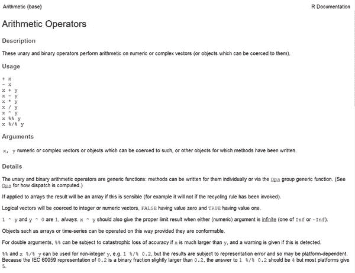
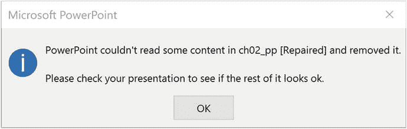
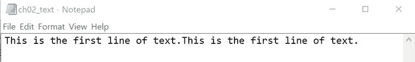
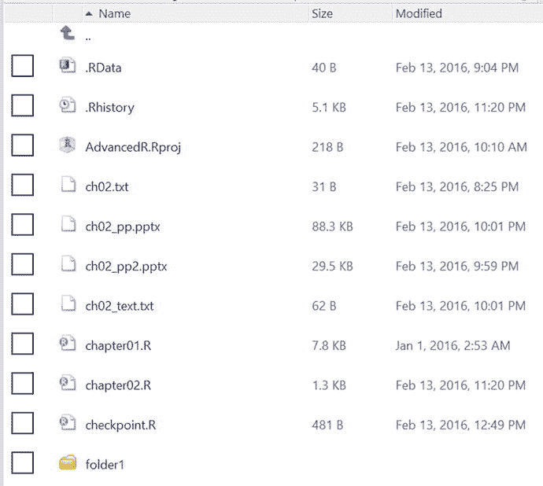
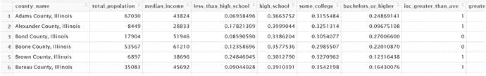
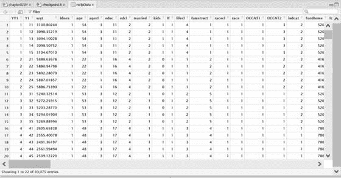
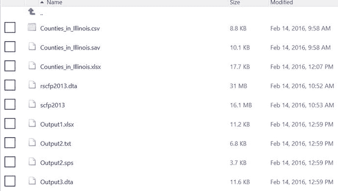
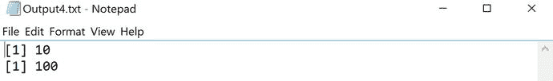

# 对象的类型

首先，我们需要构建语言的基础元素，在 R 语言中，这些元素被称为**对象**。我们从五种非常常见的对象类型开始介绍。

`Logical`（逻辑型）对象只有两个值：`TRUE`（真）或 `FALSE`（假）。计算机是二进制机器，数据也常常在全有或全无的世界中进行记录和建模。这些逻辑值会很有用，其中 `TRUE` 的值为 `1`，`FALSE` 的值为 `0`：

```
TRUE
[1] TRUE
FALSE
[1] FALSE
```

或许你还记得代数教授快速念叨的评论，数字有许多类型或“风格”。整数包括零以及负数值。用集合符号表示，即 {…, -2, -1, 0, 1, 2, …}，这些数字对于人数统计或其他索引非常有用（当然，也适用于其他情况）。在 R 语言中，整数带有大写字母 `L` 后缀。如果需要小数，则应使用双精度数值型对象。这些数字适用于等比率数据类型。复数也具有有用的属性，你可以完全按照预期理解它们，只需在虚数部分加上 `i` 后缀即可。R 语言非常友好地支持所有这些数字，你只需输入所需的数字（记得根据需要添加 `L` 或 `i` 后缀）：

```
42L
[1] 42
1.5
[1] 1.5
2+3i
[1] 2+3i
```

名义级别的数据可以通过 `character`（字符型）类来存储，并用引号指定：

```
"a" ## 字符型
[1] "a"
```

当然，数值数据可能存在缺失值。这些缺失值的类型与该数据集中其余数据的类型一致（我们稍后会讨论数据存储）。不过，了解如何手动编写逻辑型、整型、双精度型、复数型或字符型的缺失值可能会有所帮助：

```
NA
[1] NA
NA_integer_
[1] NA
NA_real_
[1] NA
NA_character_
[1] NA
NA_complex_
[1] NA
```

`Factor`（因子）是一种特殊的对象，对通用编程不太有用，但在统计学中使用相当频繁。一个因子变量表示该变量应被当作离散值处理。因子以整数形式存储，并带有标签来指示原始值：

```
factor(1:3)
[1] 1 2 3
Levels: 1 2 3
factor(c("a", "b", "c"))
[1] a b c
Levels: a b c
factor(letters[1:3])
[1] a b c
Levels: a b c
```

现在我们转向数据结构，它可以存储我们刚才讨论过的对象类型（当然也包括更多类型）。向量是一种相对简单的数据存储对象。创建向量的一种简单方法是使用连接函数 `c()`：

```
c(1, 2, 3)
[1] 1 2 3
```

正如数学中那样，标量是长度仅为 1 的向量。在这个连续体的另一端，矩阵是一个同时具有行和列两个维度的向量。请注意矩阵填充数字 1 到 6 的方式，即按列逐个计数：

```
c(1)
[1] 1
matrix(c(1:6), nrow = 3, ncol = 2)
[,1] [,2]
[1,]    1    4
[2,]    2    5
[3,]    3    6
```

所有向量，无论是标量、向量还是矩阵，都只能有一种数据类型（例如，整型、逻辑型或复数型）。如果需要多种类型的数据，那么将数据存储在列表中可能更有意义。`list`（列表）是一个对象向量，其中列表的每个元素可以是不同的类型。在下面的示例中，我们构建了一个包含字符型、向量和矩阵元素的列表：

```
list(
+   c("a"),
+   c(1, 2, 3),
+   matrix(c(1:6), nrow = 3, ncol = 2)
+   )
[[1]]
[1] "a"
[[2]]
[1] 1 2 3
[[3]]
[,1] [,2]
[1,]    1    4
[2,]    2    5
[3,]    3    6
```

列表的一种特殊类型是数据框，其中列表的每个元素长度相同（尽管对象类型不一定相同）。请看以下带有输出的说明性示例：

```
data.frame(1:3, 4:6)
X1.3 X4.6
1    1    4
2    2    5
3    3    6
## 使用不等长对象会导致问题
data.frame( 1:3, 4:5)
Error in data.frame(1:3, 4:5) :
arguments imply differing number of rows: 3, 2
data.frame( 1:3, letters[1:3])
X1.3 letters.1.3.
1    1            a
2    2            b
3    3            c
```

由于速度快，我们在 R 语言中使用来自 `data.table` 包的数据表对象。数据表类似于数据框，但设计上更节省内存且速度更快。尽管我们推荐使用数据表，但我们也会展示一些使用数据框的示例，因为当你使用 R 语言时，许多其他人的代码包含数据框，并且实际上数据表继承了许多来自数据框的方法。

```
library(data.table)
data.table( 1:3, 4:6)
V1 V2
1:  1  4
2:  2  5
3:  3  6
```

在探索了多种对象类型之后，我们将注意力转向使用运算符和函数来操作这些对象的方法。


## 基本运算符与函数

仅有对象对一门语言而言是不够的；有些事情需要动作来完成。运算符和函数就是编程世界中的动词。我们先从赋值开始，赋值有两种方式。与书面语言类似，更优雅的措辞往往比简单的平铺直叙更有帮助。因此，尽管 `=` 和 `<-` 都是赋值运算符，功能相同，但由于 `=` 在函数内部用于设置参数，为了清晰起见，我们建议在一般赋值时使用 `<-`。不过，我们还是会演示两种赋值技巧。赋值操作可以让对象拥有合理的名称；这能显著提升代码的可读性（对您未来的自己以及其他用户都是如此）。

除了为变量赋值，您还可以通过使用函数来检查具体信息。R 中的函数通常遵循这样的格式：函数名，后跟括号，括号内放入输入值，然后 R 给出输出。示例如下：

```
x <- 5
y = 3
x
[1] 5
y
[1] 3
is.integer(x)
[1] FALSE
is.double(y)
[1] TRUE
is.vector(x)
[1] TRUE
```

一旦对象被赋值，您就可以使用方括号来访问特定的对象元素。大多数计算机语言的索引从 `0` 或 `1` 开始。R 的索引从 `1` 开始。同时，请注意，您可以轻松地更改先前的赋值，几乎不会遇到麻烦，也不会收到警告；因此，谨慎地观察变量名称并认真地为代码添加注释是明智之举。

```
x <- c("a", "b", "c")
x[1]
[1] "a"
is.vector(x)
[1] TRUE
is.vector(x[1])
[1] TRUE
is.character(x[1])
[1] TRUE
```

向量可能只需要一个索引，而更复杂的结构则需要更多的索引。对于您之前遇到的矩阵，第一个索引是行，第二个索引是列的位置。请注意，在构建并赋值一个矩阵之后，有多种方法可以访问元素的各种组合。这种仅访问部分元素的过程有时被称为子集化：

```
x2 <- matrix(c(1:6), nrow = 3, ncol = 2)
x2
[,1] [,2]
[1,]    1    4
[2,]    2    5
[3,]    3    6
x2[1, 2] ## 第 1 行，第 2 列
[1] 4
x2[1, ] ## 第 1 行所有列
[1] 1 4
x2[, 1] ## 第 1 列所有行
[1] 1 2 3
x2[c(1, 2), ] ## 第 1 行和第 2 行
[,1] [,2]
[1,]    1    4
[2,]    2    5
x2[c(1, 3), ] ## 第 1 行和第 3 行
[,1] [,2]
[1,]    1    4
[2,]    3    6
x[-2] ## 删除第二个元素
[1] "a" "c"
x2[, -2] ## 删除第二列
[1] 1 2 3
x2[-1, ] ## 删除第一行
[,1] [,2]
[1,]    2    5
[2,]    3    6
is.vector(x2)
[1] FALSE
is.matrix(x2)
[1] TRUE
```

访问和子集化列表可能稍显复杂，但对于后续技术的学习和掌握却至关重要。在单层方括号中使用单个索引会返回该位置上的整个元素（回想一下，对于列表，每个元素可能是一个向量或只是一个单独的对象）。使用双层方括号则返回该列表元素内部的对象——仅此而已。

因此，以下代码实际上是一个包含元素 `"a"` 的向量。同样，使用数据类型检查函数有助于学习如何解释各种代码片段。

```
y <- list( c("a"), c(1:3))
y[1]
[[1]]
[1] "a"
is.vector(y[1])
[1] TRUE
is.list(y[1])
[1] TRUE
is.character(y[1])
[1] FALSE
```

将此与下面的代码进行对比，下面的代码仅仅是元素 `"a"` 本身：

```
y[[1]]
[1] "a"
is.vector(y[[1]])
[1] TRUE
is.list(y[[1]])
[1] FALSE
is.character(y[[1]])
[1] TRUE
```

实际上，您可以链式使用方括号，因此，可以访问列表的第二个元素（一个包含数字 1 到 3 的向量），然后在该向量内访问第三个元素：

```
y[[2]][3]
[1] 3
```

根据对象的类型，方括号几乎总是有效的，但可能还有其他访问组件的方法。对于有名称的数据框和列表，可以使用 `$` 运算符。请注意以下代码中方括号和美元符号是如何实现相同功能的：

```
x3 <- data.frame( A = 1:3, B = 4:6)
y2 <- list( C = c("a"), D = c(1, 2, 3))
x3$A
[1] 1 2 3
y2$C
[1] "a"
x3[["A"]]
[1] 1 2 3
y2[["C"]]
[1] "a"
```

请注意，尽管数据框和列表都是列表，但它们都不是矩阵：

```
is.list(x3)
[1] TRUE
is.list(y2)
[1] TRUE
is.matrix(x3)
[1] FALSE
is.matrix(y2)
[1] FALSE
```

此外，尽管不是矩阵，但由于其特殊性（即所有元素长度相等），数据框和数据表可以像矩阵一样进行索引：

```
x3[1, 1]
[1] 1
x3[1, ]
A B
1 1 4
x3[, 1]
[1] 1 2 3
```

任何有名称的对象都可以通过使用名称而非位置编号来进行索引，前提是这些名称已经被设置：

```
x3[1, "A"]
[1] 1
x3[, "A"]
[1] 1 2 3
```

这同样适用于列名和行名，并且这些名称可以在构建矩阵之后建立：

```
rownames(x3) <- c("first", "second", "third")
x3["second", "B"]
[1] 5
```

数据表使用略微不同的方法。选择行的方式几乎完全相同，但选择列则不需要引号。此外，您可以通过使用 `.()` 运算符，不带引号地按名称选择多个列。如果需要使用引号，可以通过设置 `with = FALSE` 选项来访问数据表，如下所示：

```
x4 <- data.table( A = 1:3, B = 4:6)
x4[1, ]
A B
1: 1 4
x4[, A]
[1] 1 2 3
x4[1, A]
[1] 1
x4[1:2, .(A, B)]
A B
1: 1 4
2: 2 5
x4[1, "A", with = FALSE]
A
1: 1
```

从技术上讲，方括号运算符也是函数。虽然通常不作为函数使用，但它们确实可以。大多数函数是有名称的，但方括号是一个特例，在常规函数格式中需要使用单引号，如以下示例所示：

```
`[`(x, 1)
[1] "a"
`[`(x3, "second", "A")
[1] 2
```

尽管我们一直在使用 `is.datatype()` 函数来更好地说明对象的类型，但实际上我们能做的更多。具体来说，您可以使用 `is.na()` 函数来检查某个值是否缺失：

```
is.na(NA) ## 可以工作
[1] TRUE
```

当然，上面的代码片段通常接受一个向量或矩阵元素作为参数，以判断其是否被填充。我们目前要介绍的最后（就目前而言）一个探索性函数是 `inherits()` 函数。当没有现成的 `is.class()` 函数可用时（这可能发生在开发了除您目前所见的核心类之外的其他特定类时），这个函数会很有帮助：

```
inherits(x3, "data.frame")
[1] TRUE
inherits(x2, "matrix")
[1] TRUE
```

您还可以将较低类型强制转换为较高类型。这种强制转换可能很有用，但也可能带来意想不到的后果。如果您将一个更高级的数据对象强制转换为较低级的类型，风险尤其大（请特别注意将整数强制转换的行为）。

```
as.integer(3.8)
[1] 3
as.character(3)
[1] "3"
as.numeric(3)
[1] 3
as.complex(3)
[1] 3+0i
as.factor(3)
[1] 3
Levels: 3
as.matrix(3)
[,1]
[1,]    3
as.data.frame(3)

1 3
as.list(3)
[[1]]
[1] 3
as.logical("a")
[1] NA
as.logical(3)
[1] TRUE
as.numeric("a")
[1] NA
Warning message:
NAs introduced by coercion
```

强制转换可能很有用。尽管如此，必须谨慎使用。在您结束本部分的学习之前，如果这些内容有任何新东西，请务必尝试我们之前示例中使用的不同输入进行实验！实验永远没有坏处，并且可以是学习的有力途径。

现在，让我们把注意力转向数学和逻辑运算符与函数。


## 数学运算符与函数

多个运算符可用于比较。这些将在后续学习循环和构建自定义函数时派上用场。同样实用的还有符号逻辑形式。我们先从一些基本比较开始，并承认我们对数字 4 有一种奇怪的偏爱：

```
4 > 4
[1] FALSE
4 >= 4
[1] TRUE
4 < 4
[1] FALSE
4 <= 4
[1] TRUE
4 == 4
[1] TRUE
4 != 4
[1] FALSE
```

现在有必要指出，尽管上述代码可能有用，但数值之间往往只存在微小差异——尤其是在依赖计算机浮点（无理数）表示的编程环境中。因此，我们经常检查数值是否在容差范围内接近：

```
all.equal(1, 1.00000002, tolerance = .00001)
[1] TRUE
```

在符号逻辑中，`AND` 和 `OR` 是对两个对象进行的有用比较。在 R 语言中，我们使用 `&` 表示 `AND`，使用 `|` 表示 `OR`。复杂的逻辑测试可以由这些简单结构构建：

```
TRUE | FALSE
[1] TRUE
FALSE | TRUE
[1] TRUE
TRUE & TRUE
[1] TRUE
TRUE & FALSE
[1] FALSE
```

到目前为止提到的所有逻辑测试同样适用于向量和单个对象：

```
1:3 >= 3:1
[1] FALSE  TRUE  TRUE
c(TRUE, TRUE) | c(TRUE, FALSE)
[1] TRUE TRUE
c(TRUE, TRUE) & c(TRUE, FALSE)
[1]  TRUE FALSE
```

如果你只想要单个结果（例如用于 `if`-`else` 流程控制），可以使用 `&&` 或 `||`，它们一旦确定最终结果就会停止评估。请仔细研读以下代码和输出：

```
W
Error: object 'W' not found
TRUE | W
Error: object 'W' not found
TRUE || W
[1] TRUE
W || TRUE
Error: object 'W' not found
FALSE & W
Error: object 'W' not found
FALSE && W
[1] FALSE
```

请注意，双运算符实际上并非向量化操作。它们仅使用任何向量的第一个元素：

```
c(TRUE, TRUE) || c(TRUE, FALSE)
[1] TRUE
c(TRUE, TRUE) && c(TRUE, FALSE)
[1] TRUE
```

`any()` 和 `all()` 函数在这些上下文中也同样有用：

```
any(c(TRUE, FALSE, FALSE))
[1] TRUE
all(c(TRUE, FALSE, TRUE))
[1] FALSE
all(c(TRUE, TRUE, TRUE))
[1] TRUE
```

现在我们将注意力转向数学运算符而非逻辑运算符。R 在数学方面功能强大，可以执行大多数数学计算。因此，虽然我们介绍了一些函数，但仍有许多未涉及。更多详情可参考 `?Arithmetic`。（一如既往地）了解计算机执行数学计算的方式非常重要。能够直接编写定制解决方案固然强大，但自由的定制也伴随着相应的责任。请仔细查看以下数学运算（由于实现方式的选择，它们的行为可能与预期不同）：

```
3 + 3
[1] 6
3 - 3
[1] 0
3 * 3
[1] 9
3 / 3
[1] 1
(-27) ^ (1/3)
[1] NaN
4 %/% .7
[1] 5
4 %% .3
[1] 0.1
```

R 还有一些名称直观的常用函数：

```
sqrt(3)
[1] 1.732051
abs(-3)
[1] 3
exp(1)
[1] 2.718282
log(2.71)
[1] 0.9969486
```

三角函数也有其用武之地，`?Trig` 可以调出相关函数的完整列表。为简洁起见，我们展示了余弦函数的调用 `cos()`。请注意余弦函数输出中再次出现的微小误差：

```
cos(3.1415)
[1] -1
```

我们以矩阵运算的简短示例来结束本节及本章。标量运算使用基本算术运算符。要执行矩阵乘法，我们使用 `%*%`：

```
x2
[,1] [,2]
[1,]    1    4
[2,]    2    5
[3,]    3    6
x2 * 3
[,1] [,2]
[1,]    3   12
[2,]    6   15
[3,]    9   18
x2 + 3
[,1] [,2]
[1,]    4    7
[2,]    5    8
[3,]    6    9
x2 %*% matrix(c(1, 1), 2)
[,1]
[1,]    5
[2,]    7
[3,]    9
```

矩阵还有一些在线性代数中相当常用的操作。我们假设你对建模中某些应用背后的数学有一定的了解，并将在后续章节中根据需要讨论相应数量的数学内容。尽管如此，这里似乎是展示如何编写转置、叉积和转置叉积代码的好时机。我们既展示了实现叉积和转置叉积的原始代码，也展示了可能用到的更简易的函数调用。顺便提一下，这种情况在 R 中相当常见。通过各类扩展包，许多技术都以相当清晰的函数调用形式实现。以下是示例：

```
t(x2)
[,1] [,2] [,3]
[1,]    1    2    3
[2,]    4    5    6
t(x2) %*% x2
[,1] [,2]
[1,]   14   32
[2,]   32   77
crossprod(x2)
[,1] [,2]
[1,]   14   32
[2,]   32   77
x2 %*% t(x2)
[,1] [,2] [,3]
[1,]   17   22   27
[2,]   22   29   36
[3,]   27   36   45
tcrossprod(x2)
[,1] [,2] [,3]
[1,]   17   22   27
[2,]   22   29   36
[3,]   27   36   45
```

我们以一些总结性思考结束本章。首先，正如你刚刚所见，在 R 中，常常已经有其他人完成了繁重的工作，通过编写一个能直接生成所需结果的函数来实现。当然，这些友好程序员的工作成果仅受 R 自身底层约束及其获取免费 GitHub 账户能力的限制。因此，至少理解一些使 R 得以运行的基础命令和运算符会很有帮助。其次，R 运行在计算机上，对于那些尚未接触过计算机逻辑的人而言，由于硬件结构（以及随之而来的软件实现选择）的不同，会存在差异。

接下来，让我们专注于理解实现细节，以及如何快速将数据读入和导出 R 环境。

## 编程实用工具

使用 R 执行更高级的操作需要创建可能从未存在过的新事物。要创造新事物，需要对预构建函数的具体工作方式有细致入微的理解。本章将讨论如何以及从哪里为现有功能寻找帮助和文档，R 如何与你的计算机系统和文件交互，以及数据输入输出的方方面面。和之前一样，请根据需求自由选择阅读本章的哪些部分。我们从帮助文件和文档开始。

> **注意：** 本书中，粗体代码表示需要运行的代码。非粗体代码代表命令行输出结果，或仅为提供信息而不必实际运行的代码。


## 帮助与文档

R 语言社区拥有众多资源来帮助用户。从预构建的函数到软件包中按主题分类的整套函数，支持方式多种多样。`?` 和 `help` 都是访问对象或函数信息的有效途径。对于常见对象，R 不仅提供了关于输入（函数）等具体内容的详尽文档，还详细说明了这些输入预期接收的内容。此外，通常还会有详细的示例来展示具体用法。图 2-1 展示了使用这两个函数并配合加法运算符时输出的结果：



图 2-1.

算术运算符的帮助文档

```
?'+'
help("+")
```

请注意图 2-1 底部内容，算术运算符的文档甚至贴心地提供了具体信息，指出输出结果可能因平台而异。值得注意的是，并非所有函数都拥有如此完整的现成文档，但对于大多数常见函数和软件包而言，均可获取到极为丰富的信息。编写能够复现预期结果且不依赖平台和环境的代码并非总是可行。稍后讨论调试时，这种对各函数的高级了解将会很有帮助。

当然，当你已经知道要使用的对象或函数，只需要更多细节时，这种帮助更为有用。当需要实现全新的功能时，参考手册会有所帮助。其中一个站点是由 R 核心开发团队维护的 [`https://cran.r-project.org/manuals.html`](https://cran.r-project.org/manuals.html)。

现在，我们将注意力转向 R 访问系统文件的方式。

## 系统与文件

在 Windows 环境中，R 可能是实现文件操作自动化的非常有效的方式。大多数 IT 部门都愿意安装 R，并且 R 拥有与你相同的文件权限。从创建文件、移动文件到检查日期，R 提供了多种便捷函数，用于从系统获取信息并实现文件管理自动化。我们的观察是，基于 Unix 的系统可能拥有更优雅的方式来通过命令行处理此类场景。

R 访问系统的一个有用特性是，它可以发现运行 R 的系统的当前日期、时间和时区。这有助于检测新文件，或用于给文件添加时间戳（后续会详述）。需要注意的是，这些信息当然依赖于系统环境的准确性，因此在用于高风险项目时应谨慎。

```
Sys.Date()
[1] "2016-02-13"
Sys.time()
[1] "2016-02-13 16:58:36 CST"
Sys.timezone()
[1] "America/Chicago"
```

这些命令的帮助文档提出了有用的建议来提高输出精度，甚至可能达到毫秒或微秒级别。

现在让我们把注意力转向各种文件管理函数。它们都采用 `file.*` 格式，并将一个字符向量作为其第一个参数，该字符向量应该是当前工作目录下的文件名或是一个路径加文件名。我们从工作目录中的一个文本文件 `ch02_text.txt` 开始。

函数 `file.exists()` 只接受一个字符串输入，即文件名或路径加文件名。如果只是文件名，它只检查工作目录。该工作目录可通过 `getwd()` 函数验证。如果想要检查其他目录中的文件，可以通过在字符串中提供完整文件路径来实现。该函数返回一个逻辑值，即 `TRUE` 或 `FALSE`。根据用户对特定文件的权限，你可能无法获得该文件的预期结果。

```
getwd()
[1] "C:/Books/Apress_AdvancedR/RFiles"
file.exists("ch02_text.txt")
[1] TRUE
file.exists("NOSUCHFILE.FAKE")
[1] FALSE
file.exists("C:/Books/Apress_AdvancedR/Apress_AdvancedR_Proposal.docx")
[1] TRUE
```

前面的函数检查的是文件是否存在，而另一个函数则测试我们是否有权访问一个文件。函数 `file.access` 接受类似的输入，但它还接受第二个参数。要测试是否存在，第二个参数为 `0`。要测试可执行权限，使用 `1`；要测试写入权限，使用 `2`。如果你想测试读取文件的能力，使用 `4`。该函数返回一个整数向量，`0` 表示具有相应权限，`-1` 表示不具有相应权限。注意，该函数的默认设置是测试文件是否存在。以下是 `file.access` 的示例：

```
file.access("ch02_text.txt")
ch02_text.txt

file.access("ch02_text.txt", mode = 0)
ch02_text.txt

file.access("ch02_text.txt", mode = 1)
ch02_text.txt

file.access("ch02_text.txt", mode = 2)
ch02_text.txt

file.access("ch02_text.txt", mode = 4)
ch02_text.txt

```

接下来，我们将注意力转向使用 `file.info` 函数获取关于文件修改、变更或访问时间的更详细信息。该函数也接受字符串作为输入。其输出提供有关文件大小的信息；是否为目录；按读取、写入和执行顺序排列的文件权限整数；最后修改时间；最后变更时间；最后访问时间；最后，文件是否可执行：

```
file.info("ch02_text.txt", "chapter01.R")
size isdir mode               mtime               ctime               atime exe
ch02_text.txt   31 FALSE  666 2016-02-13 17:00:16 2016-02-13 16:59:57 2016-02-13 16:59:57  no
chapter01.R   7983 FALSE  666 2016-01-01 02:53:17 2016-01-05 12:26:39 2016-01-01 02:53:17  no
```


请注意，你可以通过 `sys.setFileTime` 函数修改修改时间。这在某些时候会很有用，尽管其精确度和准确度取决于环境。以下是一个示例：

```
newTime<-Sys.time()-20
newTime
[1] "2016-02-13 20:25:53 CST"
file.info("ch02_text.txt")
size isdir mode               mtime               ctime               atime exe
ch02_text.txt   31 FALSE  666 2016-02-13 17:00:16 2016-02-13 16:59:57 2016-02-13 16:59:57  no
Sys.setFileTime("ch02_text.txt", newTime)
file.info("ch02_text.txt")
size isdir mode               mtime               ctime               atime exe
ch02_text.txt   31 FALSE  666 2016-02-13 20:25:53 2016-02-13 16:59:57 2016-02-13 16:59:57  no
```

接下来，我们把注意力转向文件的创建和删除。`file.create` 和 `file.remove` 函数的功能正如你所期待的那样。它们会返回逻辑值 `TRUE` 或 `FALSE`，甚至可以提供更多细节：

```
file.create("ch02_created.docx", showWarnings = TRUE)
[1] TRUE
file.remove("ch02_created.docx")
[1] TRUE
file.remove("NOSUCHFILE.FAKE")
[1] FALSE
Warning message:
In file.remove("NOSUCHFILE.FAKE") :
cannot remove file 'NOSUCHFILE.FAKE', reason 'No such file or directory'
```

文件还可以被复制和重命名。`file.copy` 函数可以被授予覆盖权限，甚至可以通过 `recursive=TRUE` 选项来复制整个文件夹及其子文件夹。此外，它还可以选择复制文件的模式（或权限），以及复制文件的日期数据（当然，也可以让副本拥有新的修改日期）。以下代码示例展示了这一切是如何工作的：

```
Sys.time()
[1] "2016-02-13 21:05:29 CST"
file.copy("ch02_text.txt", "ch02_copy.txt", overwrite = TRUE, recursive = FALSE, copy.mode = TRUE, copy.date = TRUE)
[1] TRUE
file.info("ch02_copy.txt")
size isdir mode               mtime               ctime               atime exe
ch02_copy.txt   31 FALSE  666 2016-02-13 20:25:53 2016-02-13 21:05:30 2016-02-13 21:05:30  no
file.rename("ch02_copy.txt", "ch02.txt")
[1] TRUE
```

`file.append` 函数用于将两个文件拼接在一起。这对于某些文件类型来说效果不错。但如果简单使用，可能会产生不幸的后果。虽然下面的代码展示了如何执行此操作，但请特别注意图 2-2 和图 2-3。对于文本文件来说，这个过程运行得很好。但对于 Microsoft PowerPoint 文件，情况就没那么理想了。请记住，这里关注 PowerPoint 文件本身的意义不大（两位作者都不认为有人会真的用 R 来处理这类文件），更多的是想强调，文件操作中的细微差别通常需要谨慎对待。请注意，R 认为这两个操作都成功了：



图 2-3.

R 认为第二个操作成功了，但打开文件时却发现并未生效



图 2-2.

R 认为第一个操作成功了，并且打开文件后也正常

```
file.append("ch02_text.txt", "ch02.txt")
[1] TRUE
file.append("ch02_pp.pptx", "ch02_pp2.pptx")
[1] TRUE
```

你不仅可以用 R 操作文件，还可以创建目录（即文件夹）。相应的函数是 `dir.create`，它的行为正如你所期望的那样。这里我们展示了一个函数示例，其创建的目录如图 2-4 所示：



图 2-4.

创建的 folder1 目录

```
dir.create("folder1")
```

这些命令适用于用户有权访问和操作的任何文件。其中一位作者就用这些命令将数据从不同部门拥有的多个共享驱动器中移动出来，最终将结果文件发布到一个网站上。一旦你理解了后续章节中的循环和函数，你将能够自动化大部分文件管理工作。

## 输入

将新数据导入 R 是接下来的挑战。数据集通常很大，尽管一些高效的技术也适用于较小的数据集。以制表符或逗号分隔的文本文件是导入 R 的最直接方式。接下来，常见的数据文件类型包括 Microsoft Excel、SPSS、SAS 和 Stata。更一般地说，可以相当肯定地认为，可能存在一个 R 包可以处理你想要的任何文件类型的导入。如有需要，甚至可以输入 PDF 和 Microsoft Word 文件（从词云到更具预测性的应用的文本分析自然会想到这一点）。对于大多数这类记录，输入过程都是相似的，因此也许没有必要面面俱到，更重要的是建立扎实的原则。请务必访问本书的 Apress 网站下载本书的代码包。在接下来的示例中，我们使用了第 [02](http://dx.doi.org/10.1007/978-1-4842-2077-1_02) 章文件夹中的文件；其中使用了 `Counties in Illinois` 文件（伊利诺伊州所有县，2016 年）和 `rscfp2013` 文件（DADS，2016 年）。

我们从 R 中的一个函数 `read.table()` 开始，它可以读取几种更基本的文件类型，并将其作为数据框读入。与大多数输入函数一样，它有几个选项，但并非所有选项在任何特定情况下都是必需的。根据读入 R 的数据类型，可能需要多次尝试才能以方便使用和操作的方式成功读取数据。在这种情况下，`View` 函数会很有帮助，其输出如图 2-5 所示。



图 2-5.

`View()` 函数的输出

```
countiesILCSV<-read.table("Ch02/Counties_in_Illinois.csv", header = TRUE, sep = ",")
View(countiesILCSV)
```

我们使用三个包——`Hmisc`（Harrell，2016 年）、`xlsx`（Dragulescu，2014 年）和 `foreign`（R 核心团队，2015 年）——来演示从各种文件类型的输入。一个观察结果是，文件类型实际上可能非常大。如图 2-6 所示，`read.dta` 能够快速、便捷地导入包含超过 30,000 条记录的 Stata 文件。



图 2-6.

一个较大的 Stata `.dta` 文件成功导入 R，包含数千条记录

```
library(checkpoint)
checkpoint("2016-09-04", R.version = "3.3.1")
library(Hmisc)
library(foreign)
library(xlsx)
rscfpData <- read.dta("Ch02/rscfp2013.dta")
View(rscfpData)
```

我们还可以通过 `spss.get` 函数导入 SPSS 文件。即使出现警告，数据也常常能够成功导入。如果数据导入不成功，请搜索警告消息以获取具体信息。在这种情况下，从我们的表头视图来看，一切正常。为简洁起见，我们截断了部分表头输出。


`countiesILSPSS <- spss.get("Ch02/Counties_in_Illinois.sav")`

```
警告信息：
在 read.spss(file, use.value.labels = use.value.labels, to.data.frame = to.data.frame, 中 :
Ch02/Counties_in_Illinois.sav: 系统文件中遇到无法识别的记录类型 7，子类型 18
```

`head(countiesILSPSS)`

```
   county.name total.population median.income
1              亚当斯县, 伊利诺伊州             67030         43824
2              亚历山大县, 伊利诺伊州              8449         28833
3              邦德县, 伊利诺伊州                17904         51946
4              布恩县, 伊利诺伊州               53567         61210
5              布朗县, 伊利诺伊州                6897         38696
6              比罗县, 伊利诺伊州              35083         45692
   less.than.high.school high.school some.college bachelors.or.higher
1            0.06938496   0.3663752    0.3155484          0.24869141
2            0.17821309   0.3999044    0.3251314          0.09675108
3            0.08590590   0.3386204    0.3054077          0.27006600
4            0.12358696   0.3577536    0.2985507          0.22010870
5            0.24846045   0.3012790    0.3270962          0.12316438
6            0.09044028   0.3910391    0.3542198          0.16430076
```

我们将使用最后一个包 `xlsx`，通过 Excel 再做一个最终示例。这个包依赖于 `rJava`（Urbanek, 2016），而这一点与您使用的 R 版本有关。我们这些大多无所畏惧的作者尽可能坚持使用 64 位版本，这需要安装 64 位版本的 Java。如果未安装，R 会毫不客气地频繁报错。请注意，工作表名称可以具体指定，这使得 `read.xlsx` 函数非常适合提取特定数据片段。

```
countiesILExcel <- read.xlsx("Ch02/Counties_in_Illinois.xlsx", sheetName = "Counties_in_Illinois")
```

这三个包，加上 R 本身能够读取存储在文本文件中、使用各种分隔符的表格数据的能力，使得大多数可能已预先整理或收集的数据都能轻松输入。让 R 直接在线查找文件也并不困难，这样一位研究人员可以更新记录，而这些结果也能迅速传递给其他人。稍后，在其他示例中，我们将包含一些从互联网实时下载的文件。现在，我们将注意力转向输出。

## 输出

输出有多种形式。或许是由于需要与其他研究人员或合作伙伴协作，就需要适应其他软件系统。与前面关于输入的部分类似，R 可以轻松输出为多种文件类型。更有趣的是，可以设置 R 将特定的控制台输出发送到指定文件。这使得一台机器可以查看在另一台计算机上运行的分析结果。在本节中，我们将演示将数据输出到 SPSS、Stata 和 Excel 的几个示例。然后，我们会处理控制台输出。请您记住，还有许多其他创建方式和文件类型，在后续更大的示例中，我们将展示多种类型，包括各种文档文件和图形。

要将文件输出到 Excel、SPSS 或 Stata，只需正确调用 `xlsx` 或 `foreign` 包即可。如图 2-7 所示，R 可以轻松创建输出。



图 2-7.

从 R 创建 Excel、SPSS 和 Stata 文件格式的输出

```
write.xlsx(countiesILExcel, "Ch02/Output1.xlsx")
write.foreign(countiesILExcel, "Ch02/Output2.txt", "Ch02/Output2.sps",   package="SPSS")
警告信息：
在 writeForeignSPSS(df = list(county_name = c(1L, 2L, 3L, 4L, 5L,  : 中
某些变量名被缩写
write.dta(countiesILExcel, "Ch02/Output3.dta")
警告信息：
在 write.dta(countiesILExcel, "Ch02/Output3.dta") 中：
变量名被缩写
```

`sink` 函数用于获取控制台输出并将其定向到文件。因此，R 进程的结果可以存储起来供日后观察，或保存到共享驱动器供他人查看。控制台仅将输出发送到文件，而不发送输入。请仔细查看以下代码与图 2-8 中 `Output4.txt` 截图的区别：



图 2-8.

`sink()` 函数输出到文本文件的结果

```
sink("Ch02/Output4.txt", append = TRUE, split = TRUE)
x <- 10
xSquared <- x²
x
[1] 10
xSquared
[1] 100
unlink("Ch02/Output4.txt")
```

我们先暂时将注意力从输出上移开，因为我们知道在后续几章中会再次探讨这个主题。各种类型的输出都是必要的，而且它们往往取决于目标和具体情况。

下一章将提供一些工具，用于快速重复执行类似操作，以及根据环境进行过程修正。这些技术与本章方法相结合，可以相当便捷地在相对较大的规模上实现文件管理的自动化。

