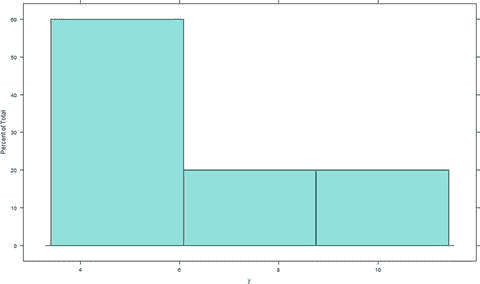
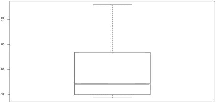

# 3. 编程自动化

有人说，重复做同一件事却期望得到不同的结果，是疯狂的定義。尽管速查牛津词典并未找到这个定义，但我们有一个类似的前提：为了避免抓狂，让您的计算机去重复执行同一操作，并期待相同的结果吧！

本章的目标是让您开始在代码中构建自动化功能。代码的强大之处在于，它能不知疲倦、不犯错误地按要求重复执行同一操作。代码的另一个有用特性是能够将逻辑编织到编程流程中。人类在最佳状态下，自然会运用这种逻辑。例如，如果父亲的钥匙在挂钩上，那他一定在家。否则，父亲肯定还在外面。再举个例子：如果 `p` 小于 `alpha`，则拒绝原假设；否则，不拒绝原假设。

由于此类自动化允许进行海量重复，因此必须关注效率。代码运行需要多长时间？能否以不同的方式编写代码以使操作运行得更快？在编程中，就像在生活中一样，我们往往很少有完美的答案，更多的是在选项与结果之间进行权衡。我们生活在一个崭新的世界中，新的、更强大的硬件通常比为了挤出一点效率而付出的人力成本要便宜。另一方面，我们的新世界也拥有数十亿条记录的数据集；将每次计算缩短一毫秒，就能节省数百小时的计算时间。我们尽力采取一种平衡的方法，首先演示一些更易于理解的结构，然后介绍更快速的方法。

当我们审视第一种自动化方法时，我们提醒您，编程既是一门科学，也是一门艺术。更清晰、更具可读性的代码可能不是最快的。唯一的“快”的定义是足够快。如果某种特定类型的代码对您来说更容易理解，从而使您更有可能记住并使用它，那可能就足够好了。当然，如果不够快，那么进行一点研究来发现更快的替代方案就是有必要的。

## 循环

循环会重复执行其内部的代码。需要注意避免陷入无限循环——即永远持续下去的循环。大多数循环都内置了尝试停止的机制（尽管这些机制并非总能按计划工作）。在下一节中，我们将讨论手动退出循环的方法。循环的另一个问题在于它们本质上是函数。虽然我们已经在使用这个词，但我们将把关于函数的坦诚讨论推迟到下一章。目前只需记住：在函数内部创建的任何内容，在函数结束时可能会消失。对于循环来说，这发生在它们停止重复时。因此，如果你希望保留结果，就需要在循环外部为这些结果构建容器。同样，我们将在下一章深入探讨具体细节。

`for` 循环是我们讨论的第一个（也许在 R 语言中争议最大）自动化机制。在许多计算机语言中，`for()` 被认为速度相当快，但在 R 语言中并非如此。尽管如此，这个函数易于理解和使用。可读性好的代码不应无故回避。然而，通常解决问题的方法不止一种，忽略其他方法也不明智。我们在代码中使用 `proc.time()` 函数来测量不同耗时；我们将通过计算停止时间与开始时间之差来得出运行时间。请看以下代码和输出：

```r
x <- seq(1,100000,1)
head(x)
[1] 1 2 3 4 5 6
forTime<- proc.time()
xCube <- NULL
for (i in 1:length(x) ) {
+   xCube[i] = x[i]³
+ }
forTime <- proc.time()-forTime
head(xCube)
[1]   1   8  27  64 125 216
forTime
user  system elapsed
11.04    0.17   11.25
```

你可以看到变量 `x` 中包含了从 `1` 到 `100,000` 的数字（通过调用 `head()` 函数显示了前六个）。接下来，我们创建一个变量来保存所有这些变量的立方值。同时，我们将当前时间存储在一个变量中，以便对操作进行计时。`for()` 函数的魔力现在开始！该函数接受一个索引（通常称为 `i`）和该索引操作的范围。我们从 `i` 等于 `1` 开始，循环开始运行。在循环结束时，`i` 自动递增 `1`，然后循环重复。循环重复直到到达范围的最后一部分。请注意，我们没有选择硬性限制；而是根据 `x` 的长度使循环具有适应性。你可以看到，循环确实将 `x` 中的每一项都进行了立方运算。在我们的系统上，这花费了 `11.25` 秒。

然而，这次耗时是可以改进的。请注意，虽然我们创建了一个变量 `xCube`，但它是一个空变量。`for` 循环的每次迭代不仅需要对 `x` 进行立方运算，还需要将 `xCube` 变量的大小增加 `1`。事实证明，这并不是一个微不足道的任务。如果我们预先创建好所需大小的 `xCube`，性能将显著提升。我们首先移除 `xCube`，以免被之前的任何数据所误导：

```r
rm(xCube)
forTime2<- proc.time()
xCube <- vector(mode = "numeric", length = length(x))
for (i in 1:length(x) ) {
+   xCube[i] = x[i]³
+ }
forTime2 <- proc.time()-forTime2
head(xCube)
[1]   1   8  27  64 125 216
forTime2
user  system elapsed
0.15    0.00    0.15
```

注意，现在我们的耗时仅为 `0.15` 秒——改进巨大！值得注意的是，即使我们创建了一个长度不够的虚拟 `xCube`，或者创建了一个过长而需要删除末尾一些空条目的 `xCube`，这种方法仍然更快。因此，即使在运行循环之前不可能或不方便知道所需变量的大小，预先创建一个可能足够大的容器来存储数据也可能是有益的。

现在，针对这个特定的例子，使用 `for` 循环是错误的做法。R 语言为其一些最简单的函数提供了强大而快速的底层代码。请注意，几乎没有任何流逝时间（当然，有一些时间，但取决于操作系统，某些差异并不明显）。另外，请注意 `head()` 函数可以接受负数，以便从末尾向前计数，如下所示：

```r
xCube <- NULL
vTime <- proc.time()
xCube <- x³
vTime <- proc.time()-vTime
head(xCube, -99994)
[1]   1   8  27  64 125 216
vTime
user  system elapsed
0       0       0
```

还存在其他类型的循环。`for` 循环最适合于运行特定次数的过程，并在到达末尾时停止。而 `while` 循环则最适合于运行一个不确定次数的过程，直到满足停止条件。通常，使用不同类型的循环（或者像你刚刚看到的，完全不使用循环）可能获得相同的结果。尽管如此，每种类型的循环在特定条件下往往有更自然的用途。作为你自己的练习，在研究了我们将给出的 `while` 循环示例后，看看你是否能复制之前的立方结果。

也许一个与所有研究人员心心相印的例子是**模拟**。毕竟，如果我们能模拟数据，那可能是理解真实世界结果的第一步。统计功能已深深嵌入 R 语言中，函数 `rnorm()` 最多接受三个输入。第一个参数控制我们想要从样本中返回的元素数量。第二个和第三个参数控制抽取样本的总体均值和标准差。让我们看看 `rnorm` 会给我们带来什么：

```r
for (i in 1:5 ) {
+   x <- rnorm(5,4,2)
+   print(x)
+   print(paste0("Xbar: ",mean(x)))
+   print(paste0("StdDev: ",sd(x)))
+ }
[1] 2.0287126 4.5664489 0.1310789 3.6347667 4.2465319
[1] "Xbar: 2.92150781627209"
[1] "StdDev: 1.84077667180739"
[1] 5.806652 2.707348 4.673238 4.646211 6.496605
[1] "Xbar: 4.86601066066082"
[1] "StdDev: 1.43952629897616"
[1] 1.6476375 0.8618630 0.2519337 0.6902068 1.0062915
[1] "Xbar: 0.8915864810408"
[1] "StdDev: 0.508764053558126"
[1] 5.162450 3.513966 6.503733 3.736576 5.503810
[1] "Xbar: 4.88410690747199"
[1] "StdDev: 1.25287757407054"
[1] 4.719578 1.197946 2.751889 4.451728 2.487819
[1] "Xbar: 3.12179207747434"
[1] "StdDev: 1.46300892878659"
```

我们发现从同一个总体（均值为 `4`，标准差为 `2`）中随机抽取了 `5` 个样本。然而，请注意每个样本的均值范围从 `0.89` 到 `4.88`。假设我们需要这样一个伪随机样本，但想向学生演示随机抽样点估计量需要谨慎使用。比方说，我们想找到一个从总体中抽取的随机样本，但其样本均值实际上等于或大于 `10`。好吧，`while` 循环可能正是答案：

```r
y <- 3
while(mean(y)< 10){y <- rnorm(5, mean = 4.0, sd = 2)}
```

我们让这段代码运行了大约一分钟才停止它。原因当然是，这种类型的搜索可能需要一段时间，并且非常接近无限循环的风险。均值为 `4`、标准差为 `2` 的正态总体中，等于或大于 `10` 的元素很少。随机抽取足够多的这些元素，使得样本均值等于或大于 `10` 的可能性开始变得很小。我们将 `y` 设置为 `3`，只是为了确保 `while` 代码至少运行一次。这里我们用更合理的情况重复循环——均值为 `6`：

```r
y <- 3
while(mean(y)< 6){y <- rnorm(5, mean = 4.0, sd = 2)}
mean(y)
[1] 6.188268
y
[1] 11.126657  4.807775  3.703673  3.966180  7.337056
```

注意 `y` 现在是一个相当奇怪的样本，与我们已知的总体情况相比。当然，这是支持更大样本量的论据，但它也提供了既符合事实又能检验假设的数据。反例和异常数据对于压力测试代码或模型非常有用。

我们目前要看的最后一个循环是 `repeat()`，它不同于 `while` 和 `for` 循环。特别是，`repeat` 与 `while` 或 `for` 不同，它不接受任何可能使其停止的参数。该函数会不断地重复。当然，必须有办法停止它，否则我们就有麻烦了。我们将在下一节“流程控制”中讨论这些技术。不过，首先来看一些关于循环的观察。

循环旨在根据需要多次执行某项任务。在 R 中，我们通过三种方式控制这些任务。如果任务需要执行到特定次数，`for` 循环可能是最佳选择。整数迭代器控制 `for` 循环的开始和停止。如果任务是希望一直执行直到满足特定条件，`while` 循环可能是最佳选择。特别是，`while` 循环在循环运行之前会测试决定循环是否运行的条件。这一点至关重要！如果条件已经满足，`while` 循环就永远不会运行。在你目前看到的简短示例中，这似乎不可能或不明显，这没关系。我们的目标是介绍它们，以便你在面对新问题时能轻松想到它们。尽管如此，还是要重复强调：`while` 循环首先检查是否需要运行，然后只运行一次，并再次检查，直到检查停止条件发生。我们讨论的最后一个循环 `repeat()` 则不同。它只是运行。现在，我们必须以某种方式停止它，我们将在下一节中手动操作。关键是，`repeat` 从不检查是否需要运行；它只是运行。因此，如果你希望某个进程至少运行一次，`repeat` 可能就是你要寻找的函数。

我们暂不给出 `repeat` 的示例，主要是为了避免无限循环。我们很快就会展示一个例子。首先，我们需要一种控制代码流程的方法。

### 流程控制

代码流程控制有多种方式，但我们关注其中四种（实际上只有三种）。这种控制通过执行测试来决定是否应采取某一操作，或修改你刚刚看到的循环的行为来工作。我们依次介绍每条命令，在本节末尾，我们将回到上一节提到的那个函数。

`if/else` 语句是逻辑的标准组成部分，它们也是编程的标准组成部分。实际上，`if/else` 使用频率极高，以至于有两种形式。当 `else` 部分是要像往常一样继续执行时，标准做法是根本不在代码中包含该部分。

让我们以那个我们强制其样本均值大于 `6` 的值样本为例。假设我们想在成功时看到该样本的箱线图和须状图，否则想看直方图。我们可能会从以下有问题的代码及其图 3-1 的输出开始：



**图 3-1.** 前面代码和以下代码的 `else` 输出

```r
if(y>6){
+   boxplot(y)
+ }
Warning message:
In if (y > 6) { :
the condition has length > 1 and only the first element will be used
else{
Error: unexpected 'else' in "else"
histogram(y)
}
Error: unexpected '}' in "}"
```

我们破坏这段代码有两个原因。第一个是为了演示，虽然流程控制是一个有用的特性，但其有效性取决于你的逻辑。我们原本想测试 `mean(y) > 6`，却测试了其他东西。R 很有帮助地警告我们可能有问题。尽管如此，我们还是要谨慎。第二个原因是要注意这个 `if/else` 语句编码不正确。`else` 部分总是运行；R 尽力再次警告我们 `else` 是意外的，因此我们应该注意。这组修改后的代码创建了两个图像，如图 3-1 和图 3-2 所示。我们展示如下代码以及图 3-2，这是成功执行的 `if` 部分的输出：



**图 3-2.** 前面代码的 `if` 输出，该代码已在控制层面修复，但 `else` 部分未修复

```r
if(mean(y)>6){
+   boxplot(y)
+ }
else{
Error: unexpected 'else' in "else"
histogram(y)
}
Error: unexpected '}' in "}"
```

这很有趣，原因有三点。第一，正如你在第一个有问题的示例中所见，`if` 完全可以作为一个独立的流程控制片段。控制部分求值，如果为 `true` 则运行代码，如果为 `false` 则不运行。第二，虽然用处不大，但 `else` 也是一个独立的代码片段（单独使用时什么也不控制）。第三，这是一个很好的实践课，说明流程控制的逻辑和代码的结构都必须正确设置才能正常工作。接下来，我们展示最初设想的代码。它只输出图 3-2 中的箱线图和须状图。注意，`else` 需要与 `if` 的闭合花括号 `}` 在同一行：

```r
if(mean(y)>6){
+   boxplot(y)
+ } else{
+   histogram(y)
+ }
```

我们使用的另外两个函数有些相似。我们使用 `next` 来跳过循环中的一次迭代，使用 `break` 来完全结束循环。两者都保持代码运行；它们只控制被调用时所在循环内部的行为。看看以下代码会发生什么：

```r
i <- 0
while(i < 5){
+   i <- i + 1
+   if(i ==2) {next()}
+   print(i)
+ }
[1] 1
[1] 3
[1] 4
[1] 5
```

重要的是要认识到 `next` 的位置很重要。我们可以用六种方式排列 `while` 函数内部的那三行代码。至少一种方式会产生无限循环，至少一种方式没有任何明显影响。当然，正如你刚才所见，还有一种方式会使其跳过数字 `2`。这也表明 `while` 与 `for` 函数可以非常相似。

我们以对 `repeat` 函数的真正了解来结束本节。当不清楚某个操作可能需要重复多少次时，这个函数是理想的选择。再次强调，`repeat` 类似于 `while`，但区别在于代码至少运行一次。而且，拥有多个退出条件也可能更容易。诚然，`break` 也可以在 `while` 中使用来创建多个退出规则。然而，对于人类可读的代码，将多个 `break` 语句放在彼此附近可能更容易理解。在以下代码中，我们重用了迭代器 `i`，以便清楚地看到需要 `377` 次尝试才能找到我们随机抽取的、距离均值超过三个标准差的值：

```r
z < - 10.69076
i < - 378
```