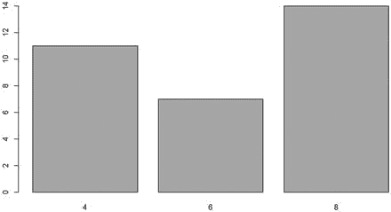
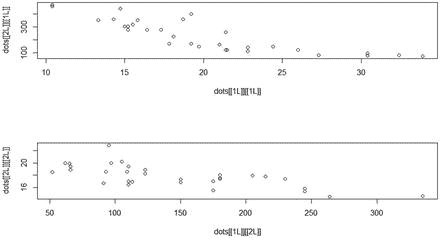

# `apply` 函数家族

本章我们要介绍的最后一系列函数是 `apply` 函数。一般来说，这些函数接收两种主要类型的输入：一种是包含多个元素的输入，另一种是依次应用于这些元素的函数。不同变体处理不同的使用场景，我们还会尽可能引入一些错误检查机制。

我们从 `lapply` 开始，它接收一个列表输入，并将给定的函数应用于列表中的每个元素。正如其前缀所示，该函数返回一个列表，其中包含应用输入函数后的结果：

```
xL <- 1:5
xL
[1] 1 2 3 4 5
### 返回一个列表
lapply(xL, is.integer)
[[1]]
[1] TRUE
[[2]]
[1] TRUE
[[3]]
[1] TRUE
[[4]]
[1] TRUE
[[5]]
[1] TRUE
```

如你所见，这相当混乱。为了简化，我们使用几乎相同的函数调用，但加上 `s` 前缀（代表 simple，简化版），如下所示：

```
sapply(xL, is.integer)
[1] TRUE TRUE TRUE TRUE TRUE
```

尽管这两个函数本身都很有用，但它们依赖于正确的输入。当然，我们的代码也依赖于这种正确输入（所谓“垃圾进，垃圾出”）。不过，我们可以通过 `vapply` 函数向 R 表明我们期望的结果类型。它接收第三个输入，用于设定我们期望的输出类型。当函数没有返回正确的值类型时会发生什么呢？这里我们运行两行代码，告诉函数我们期望 `logical`（逻辑型）输入，因为默认情况下 `NA` 是 `logical` 类型。在第二次尝试中，R 仍然期望相同的类型，但实际得到的是 `double`（双精度型）：

```
vapply(xL, is.integer, FUN.VALUE = NA)
[1] TRUE TRUE TRUE TRUE TRUE
vapply(xL, mean, FUN.VALUE = NA)
Error in vapply(xL, mean, FUN.VALUE = NA) :
values must be type 'logical',
but FUN(X[[1]]) result is type 'double'
```

我们运行一组类似的代码，这次告诉 R 期望每个结果是一个长度为 `2` 的向量。但实际上它得到了一个长度为 `1` 的向量，类型正确但长度错误：

```
vapply(xL, is.integer, FUN.VALUE = c(NA, NA))
Error in vapply(xL, is.integer, FUN.VALUE = c(NA, NA)) :
values must be length 2,
but FUN(X[[1]]) result is length 1
```

让我们看看一个更有趣的列表。注意，在这个列表 `yL` 中，我们既有整数也有字符：

```
yL <- list(  a = 1:5,  b = c("6", "7", "8"),  c = c(9:10))
yL
$a
[1] 1 2 3 4 5
$b
[1] "6" "7" "8"
$c
[1]  9 10
yL$b[2]
[1] "7"
is.character(yL$b[2])
[1] TRUE
is.integer(yL$b[2])
[1] FALSE
```

假设我们对列表中每个元素的汇总统计信息感兴趣。我们当然可以对每个元素应用 `summary()` 函数，R 会很乐意执行，甚至不会报错！

```
lapply(yL, summary)
$a
   Min. 1st Qu.  Median    Mean 3rd Qu.    Max.
      1       2       3       3       4       5
$b
   Length     Class      Mode
        3 character character
$c
   Min. 1st Qu.  Median    Mean 3rd Qu.    Max.
   9.00    9.25    9.50    9.50    9.75   10.00
```

然而，请注意这里存在一些问题。根据数据在实地采集和编码的方式，这是一种很容易出现的数据收集类型错误。幸运的是，如果我们使用更好的 `apply` 函数，并提前告知 R 期望什么，我们或许可以避免以后的一些麻烦。在代码中构建某种形式的数据验证会很有帮助。当然，这无论如何也无法阻止所有问题；它只是让生活更安全一些。

```
vapply(yL, summary, c(Min. = 0, `1st Qu.` = 0, Median = 0, Mean = 0, `3rd Qu.` = 0, Max. = 0))
Error in vapply(yL, summary, c(Min. = 0, `1st Qu.` = 0, Median = 0, Mean = 0,  :
values must be length 6,
but FUN(X[[2]]) result is length 3
```

`mtcars` 数据框来自 1974 年的一本杂志。我们对每加仑英里数和气缸数感兴趣。使用这个数据集是理解 R 中各种函数的有用方式，因为它在 R 中很容易获取。这里我们查看前六条记录，以更好地理解原始数据：

```
head(mtcars[, c("mpg", "cyl")])
                   mpg cyl
Mazda RX4         21.0   6
Mazda RX4 Wag     21.0   6
Datsun 710        22.8   4
Hornet 4 Drive    21.4   6
Hornet Sportabout 18.7   8
Valiant           18.1   6
```

我们在 `mtcars` 数据框上运行 `tapply`，并按气缸数进行分组。在图 3-3 中，我们展示了以柱状图形式呈现的结果。



图 3-3. 按气缸数分组的 `mtcars` 数据框

注意，这一次在函数调用中，我们明确按名称指定了每个输入。也就是说，`X`、`INDEX` 和 `FUN` 分别是数据、分组输入和所应用函数的原始名称。我们还展示了几乎相同的代码，但使用了 `simplify = FALSE` 选项，该选项会返回一个列表：

```
tapply(
+   X = mtcars$mpg,
+   INDEX = mtcars$cyl,
+   FUN = mean)
       4        6        8
26.66364 19.74286 15.10000
tapply(
+   X = mtcars$mpg,
+   INDEX = mtcars$cyl,
+   FUN = mean,
+   simplify = FALSE)
$`4`
[1] 26.66364
$`6`
[1] 19.74286
$`8`
[1] 15.1
```

当我们的数据结构是数据框、矩阵或数组时，`apply()` 函数通常是个不错的选择。由于这些结构往往有更多维度，该函数接收三个输入：数据、我们感兴趣应用的边距，以及要执行的函数。我们首先按列、然后按行对整个 `mtcars` 数据集执行此操作，以计算标准差。我们还首先展示了 `mtcars` 数据的整体样子。注意，按列执行可能更有意义。因为我们既不是汽车爱好者，也不是特别懂机械，所以这最后一组代码和输出可能意义不大：

```
head(mtcars)
                   mpg cyl disp  hp drat    wt  qsec vs am gear carb
Mazda RX4         21.0   6  160 110 3.90 2.620 16.46  0  1    4    4
Mazda RX4 Wag     21.0   6  160 110 3.90 2.875 17.02  0  1    4    4
Datsun 710        22.8   4  108  93 3.85 2.320 18.61  1  1    4    1
Hornet 4 Drive    21.4   6  258 110 3.08 3.215 19.44  1  0    3    1
Hornet Sportabout 18.7   8  360 175 3.15 3.440 17.02  0  0    3    1
Valiant           18.1   6  225 105 2.76 3.460 20.22  1  0    3    1
apply(mtcars, MARGIN = 2, FUN = sd)
        mpg         cyl        disp          hp        drat          wt        qsec          vs          am        gear        carb
6.0269481   1.7859216 123.9386938  68.5628685   0.5346787   0.9784574   1.7869432   0.5040161   0.4989909   0.7378041   1.6152000
apply(mtcars, MARGIN = 1, FUN = sd)
          Mazda RX4       Mazda RX4 Wag          Datsun 710      Hornet 4 Drive   Hornet Sportabout             Valiant
          53.53888            53.51210            38.86999            79.40933           113.70330            69.95729
          Duster 360           Merc 240D            Merc 230            Merc 280           Merc 280C          Merc 450SE
         122.86626            44.43599            46.68811            57.31739            57.33609            92.42901
         Merc 450SL         Merc 450SLC  Cadillac Fleetwood Lincoln Continental   Chrysler Imperial            Fiat 128
          92.40957            92.46342           147.34689           145.04382           141.16366            28.06702
        Honda Civic      Toyota Corolla       Toyota Corona    Dodge Challenger         AMC Javelin          Camaro Z28
          25.10753            26.43470            42.34211            99.84844            96.05271           120.45178
   Pontiac Firebird           Fiat X1-9       Porsche 914-2        Lotus Europa      Ford Pantera L        Ferrari Dino
         124.56688            27.95293            41.26033            40.34473           123.53038            62.68824
       Maserati Bora          Volvo 142E
         126.32051            44.49888
```

当我们需要对多组数据应用相同的函数时，就涉及多变量场景。在这种情况下，`mapply()`是我们的函数调用。与之前的例子不同，`mapply()`将我们要应用的函数作为第一个变量，然后接收长度严格为正的输入。我们将在图 3-4 中展示以下代码的绘图结果。正如你可能从《R 入门》中学到的，`par()`函数提供了一种将多个图形嵌入到单个图像中的方法：



图 3-4. 应用于 `mtcars` 两个子集的 `plot` 函数

```r
par(mfrow = c(2, 1))
mapply(plot, mtcars[, c("mpg", "hp")], mtcars[, c("disp", "qsec")])
$mpg
NULL
$hp
NULL
```

递归是一种强大的编程思想，我们将在后续章节中进一步探讨。现在，先考虑这个例子：假设有一排人沿着建筑物的拐角排成一列，你不确定队伍有多长。你可以离开自己的位置，慢慢走到队伍前面，数一数人数。这是常规的迭代——就像循环一样，`apply`函数大多在为我们做这件事。另一方面，你可以保持自己的位置，问前面的人：“你前面有多少人？”如果那个人重复你的问题，最终会传到队伍最前面，那个人可能会转过身说：“零！”然后沿着队伍传回你这里，你就能得到答案。

让我们看看列表`zL`。如果我们对其使用`lapply()`会怎样？这并不好，因为`lapply()`会将每个元素传递给`mean()`，而`mean()`无法处理列表！我们在以下代码中展示了这一点，其中包括我们的列表以及首次尝试计算算术平均值：

```r
zL <- list( a = list(1, 2, 3:5), b = list(8:12))
zL
$a
$a[[1]]
[1] 1
$a[[2]]
[1] 2
$a[[3]]
[1] 3 4 5
$b
$b[[1]]
[1]  8  9 10 11 12
lapply(zL, FUN = mean)
$a
[1] NA
$b
[1] NA
Warning messages:
1: In mean.default(X[[i]], ...) :
argument is not numeric or logical: returning NA
2: In mean.default(X[[i]], ...) :
argument is not numeric or logical: returning NA
```

递归应用函数`rapply()`是解决方案。根据所需的具体结果，该函数有一些有趣的选项。强烈建议查阅帮助文件，不过我们在此不再深入探讨该函数。

```r
rapply(zL, f = mean)
a1 a2 a3  b
1  2  4 10
```

可以使用比`mean()`或`sd()`更“高级”的函数。在下一章中，我们将深入探讨这些函数可能的形式及其功能。现在，让我们花点时间讨论环境。

环境是函数和变量所处的“世界”。我们主要处于全局环境中。实际上，我们的循环以某种方式创建了微型环境。这就是为什么如果我们希望在循环结束后保留某些信息，需要创建那些空的占位符变量。通过使用`environment()`和`ls()`函数，我们可以查看环境并列出当前使用的变量。注意，我们处于全局环境中，使用的大多数变量都存在：

```r
environment()

ls()
[1] "forTime"  "forTime2" "i"        "vTime"    "x"        "xCube"    "xL"       "y"        "yL"       "z"        "zL"
```

当然，这仅仅是另一个列表。有时，对此进行操控和使用也很方便。因此，我们的最后一个函数是`eapply()`。这里我们查看环境中所有对象的类；这些类型应该在前面的章节中已经熟悉：

```r
eapply(env = environment(), FUN = class)
$xCube
[1] "numeric"
$x
[1] "numeric"
$forTime2
[1] "proc_time"
$y
[1] "numeric"
$z
[1] "numeric"
$forTime
[1] "proc_time"
$yL
[1] "list"
$vTime
[1] "proc_time"
$i
[1] "numeric"
$xL
[1] "integer"
$zL
[1] "list"
```

## 最终思考

你已经看到了几种强大的自动化工具——从控制重复执行（以及执行频率）的各种循环，到专门处理数据集中常见元素的专业化工具。这些技术非常有用且经常使用。然而，这还不够。如果开发出新技术怎么办？`mean()`是如何工作的？如果我们需要创建自己的函数呢？在下一章中，我们将从理论框架和实际应用两个角度探讨函数。自定义函数与循环的结合，是让计算机替我们完成繁琐工作的核心方法。