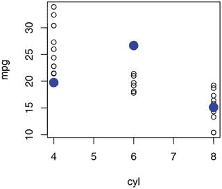
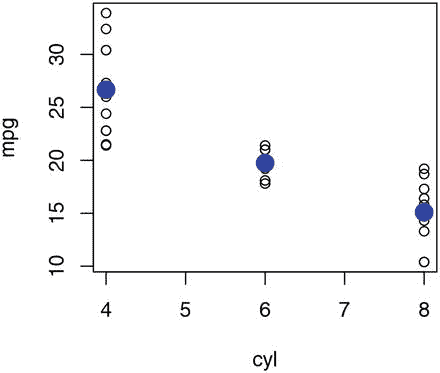

# 4. 编写函数

在 R 中编写自己的函数，使你能够将一组 R 命令组合成一个易于调用且可泛化的函数。函数是 R 的基础。要成为更高级的 R 用户或开发者，深入理解函数是什么以及如何编写至关重要。广义上讲，函数接收一个或多个输入，对其进行处理，并生成和返回输出。

并非每个编程任务都应转为函数。然而，当你发现自己第三次复制粘贴某行代码时，很可能应该编写一个函数。另一个“毫无疑问”需要编写函数的时机是当代码超过 100 行左右时。长段代码可能变得几乎无法阅读和理解。相反，我们编写具有良好描述性名称的函数，使代码更易读。然后，在单独的传递中，我们使用这些函数来编写代码。这种系统的美妙之处在于，更容易在每个函数内编写专注的代码，解决挑战中的特定部分。这种方法的另一个好处是，如果需要更高的效率，可以确定哪些函数消耗最多的处理能力或花费最长时间，然后针对该部分研究如何提高效率。

在本章中，我们使用`Hmisc`R 包（Harrell Jr, 2016）。以下代码加载`checkpoint`（Microsoft Corporation, 2016）包以控制所用 R 包的精确版本，然后加载`Hmisc`包：

```r
## load checkpoint and required packages
library(checkpoint)
checkpoint("2016-09-04", R.version = "3.3.1")
library(Hmisc)
options(width = 70) # only 70 characters per line
```


## 函数的组成部分

除少数例外情况外，R 语言中的大多数函数都由三个部分组成：

- `Formals`（形式参数）：函数的参数或输入
- `Body`（函数体）：处理输入的命令
- `Environment`（环境）：函数的位置或上下文，决定了它查找变量的位置

每个部分都可以使用专门的函数进行检查。首先，我们编写一个示例函数：

```
### 创建新函数 f()
f <- function(x, y = 5) {
x + y
}
```

该函数接受两个参数：`x` 和 `y`。第一个参数 `x` 没有默认值，但第二个参数 `y` 的默认值为 `5`。虽然我们可以轻松看到这些（部分原因是我们编写了这个函数），但也可以使用 `formals()` 和 `args()` 函数来检查函数的**形式参数**（即参数）：

```
formals(f)
$x
$y
[1] 5
args(f)
function (x, y = 5)
NULL
```

要查看用于处理形式参数的实际 R 代码或命令，我们使用 `body()` 函数：

```
body(f)
{
x + y
}
```

这些命令始终包含在开闭花括号 `{ }` 中。在这个例子中，R 代码仅仅是 `x + y`，但有些函数可能有数百行代码。函数的最后一个关键部分是它的环境。函数的环境决定了它在哪里查找变量或对象，这可以包括数据和函数。要查看函数的环境，我们使用 `environment()` 函数：

```
environment(f)
```

在这种情况下，该函数位于全局环境中，也就是我们创建函数的地方。对于其他函数，情况会有所不同。例如，如果我们查看 `install.packages()` 函数的环境，它是 `utils` 包的命名空间：

```
environment(install.packages)
```

这为讨论 R 函数提供了一种通用语言。在本章的剩余部分，我们将更深入地探讨编写函数的方法，以及可用于函数的特殊代码和工具。

### 作用域

在 R 中，作用域决定了在哪里查找特定的变量。例如，当我们输入 `plot` 时，R 如何解析这段代码？R 在哪里查找它？作用域是 R 对语言中“上下文”这一概念的回答。如果我说“我买了一个新的**球棒**”，你可能会认为我指的是板球球棒，而不是会飞的哺乳动物。对 R 而言，上下文来源于作用域和环境。因此，不同的环境可能导致不同的结果。

编写 R 函数的大多数方面与交互式使用 R 并无不同。但有一个区别是函数拥有自己的环境。此外，函数通常位于不同的环境中。例如，在交互式使用 R 时，几乎所有命令都在全局环境中执行。相比之下，许多函数是作为 R 包的一部分编写的，在这种情况下，函数的环境由该 R 包定义。因此，在开始编写函数之前，理解作用域会很有帮助。考虑以下两个例子：

```
plot
function (x, y, ...)
UseMethod("plot")

plot <- 5
plot
[1] 5
```

在第一个例子中，R 在 `graphics` 包中找到了 `plot`。在第二个例子中，R 在全局环境中找到了 `plot`。请注意，将 `5` 赋值给变量 `plot` 并不会覆盖 `plot()` 函数。相反，它会创建另一个与函数同名的 R 对象。创建这个新变量后，当我们在控制台输入 `plot` 时，R 返回的是数值而不是函数，因为赋值操作 `plot <- 5` 发生在全局环境中，而 R 在检查不同包的环境之前会先搜索全局环境。`search()` 函数按 R 搜索的顺序返回环境。你的环境可能有所不同，但可能会存在一些相似之处：

```
search()
[1] ".GlobalEnv"            "package:Hmisc"
[3] "package:ggplot2"       "package:Formula"
[5] "package:survival"      "package:lattice"
[7] "package:devEMF"        "package:checkpoint"
[9] "ESSR"                  "package:stats"
[11] "package:graphics"      "package:grDevices"
[13] "package:utils"         "package:datasets"
[15] "package:RevoUtilsMath" "package:methods"
[17] "Autoloads"             "package:base"
```

从输出中，我们可以看到 R 首先在全局环境（`.GlobalEnv`）中查找，然后在 `Hmisc` 包中查找，依此类推，直到到达 `base` 包。我们可以再次使用 `environment()` 函数来查看当前环境。R 总是从当前或局部环境开始查找。然后，它会逐步向上查找父环境。我们可以通过 `parent.env()` 函数找到给定环境的父环境：

```
environment()

parent.env(.GlobalEnv)

attr(,"name")
[1] "package:Hmisc"
attr(,"path")
[1] "C:/Users/Authors/.checkpoint/2016-09-04/lib/x86_64-w64-mingw32/3.3.1/Hmisc"
```

回到函数上来，每个函数除了本身位于某个环境中之外，还有自己的局部环境。以下代码展示了函数的局部环境及其父环境。我们可以粗略地将函数中的变量分为三种类型：

- 形式变量
- 在函数内部定义的局部变量
- 既非形式变量也非局部变量的自由变量或其他变量

以下代码依次演示了每种类型：

```
a

[1] "free variable"
[1] "formal variable"
[1] "local variable"
```

变量 `x` 是一个形式变量，其默认值为 `y`，`y` 是在函数体中定义的局部变量，而 `a` 是在函数父环境中定义的变量。尽管函数可以依赖搜索路径中的对象，而不是在形式参数或局部变量中指定的对象，但这并非明智之举。编写依赖于函数父环境或搜索路径的代码可能会导致特别棘手的错误和意外行为。这会给用户或以后的你带来混乱，因为当环境中看似与函数无关的某个内容发生变化时，即使函数的代码和输入看起来没有改变，输出结果也可能会突然不同。

尽管到目前为止的例子都相对简单，但在使用嵌套函数调用时，作用域会变得更加棘手。在以下代码中，可能很难预测每段评估代码的结果。接下来的例子设置两个函数，然后使用全局环境中的三个不同变量来调用这些函数：

```
f1 <- function(y = "f1 var") {
x <- y
a1 <- f2(x)
rm(x)
a2 <- f2(x)
}
f2 <- function(x) {
if (nchar(x) < 10) {
x <- "f2 local var"
}
print(x)
return(x)
}
x <- "global var"
f1()
[1] "f2 local var"
[1] "global var"
x <- "g var"
f1()
[1] "f2 local var"
[1] "f2 local var"
rm(x)
f1()
[1] "f2 local var"
Error in nchar(x) (from #2) : object 'x' not found
```

值得反复试验作用域，直到理解其原理，因为它对于确保找到正确的对象至关重要。在编写和开发包，或者使用出现在多个包中的函数时，这可能是一个特别的挑战。


## 函数的函数

在你编写的函数中，除了常规的 R 代码和函数外，还存在一些特殊的函数。这些函数仅用于或主要用于其他函数内部。即使你是一位经验丰富的 R 用户，如果你以前没有编写过函数，这些函数也可能让你感到陌生。

`match.arg()` 函数用于对参数进行模糊匹配。它的另一个好处是，如果参数与任何有效选项都不匹配（即无效），则会抛出一个错误。以下代码展示了两个相似的函数，其中一个使用了 `match.arg()` 函数。示例演示了模糊匹配以及使用无效参数时会发生什么：

```
f1 <- function(type = c("first", "second")) {
type
}
f2 <- function(type = c("first", "second")) {
type <- match.arg(type)
type
}
f1("fi")
[1] "fi"
f2("fi")
[1] "first"
f1("test")
[1] "test"
f2("test")
Error in match.arg(type) : 'arg' should be one of "first", "second"
```

参数匹配对于确保传入文本字符串时只使用有效选项也非常有用，并且如果传入无效选项，会抛出信息丰富的错误信息。以下代码对我们之前构建的未使用 `match.arg()` 的函数进行了扩展：当 `type = "first"` 时计算均值，当 `type = "second"` 时计算标准差。然而，当向 `type` 参数传递一个无效选项时，我们得到的是相对隐晦的错误信息“找不到对象 `x`”：

```
f1b <- function(type = c("first", "second")) {
if (type == "first") {
x <- mean(1:5)
} else if (type == "second") {
x <- sd(1:5)
}
return(x)
}
f1b("test")
Error in f1b("test"): object 'x' not found
```

另一个专用于函数参数的函数是 `missing()`。它返回一个逻辑值，指示函数调用中是否缺少某个特定参数。这在编写可能以不同方式使用的函数时很有帮助。以下是一个计算 Cohen's d 效应量的函数示例，对于单组数据，它定义为变量均值除以标准差。Cohen's d 也可以用于重复测量数据，例如干预前后测量的同一组数据。这通过计算两个变量的差值来完成，然后按照之前的方法继续处理。我们使用 `missing()` 函数来判断用户是传入单个变量 `x`，还是两个变量 `x` 和 `y`，这样我们的函数就能优雅地处理单样本和重复测量数据的 Cohen's d 计算：

```
cohend <- function(x, y) {
if (!missing(y)) {
x <- y - x
}
mean(x) / sd(x)
}
cohend(x = c(0.61, 0.99, 1.47, 1.52, 0.45,
3.34, 1.05, -1.47, 1.3, 0.33),
y = c(-0.69, 1.6, 0.44, 1, 0.88,
1.17, 2.4, 1.21, 0.87, 2.15))
[1] 0.09522249
cohend(x = c(0.61, 0.99, 1.47, 1.52, 0.45,
3.34, 1.05, -1.47, 1.3, 0.33))
[1] 0.796495
```

与确定函数调用特征相关的另一个函数是 `match.call()`。`missing()` 判断的是特定参数是否缺失，`match.arg()` 判断的是参数是否与有效选项之一匹配，而 `match.call()` 捕获的是整个函数调用。这可能演示比解释更容易理解。以下小函数计算变异系数，即样本标准差除以样本均值。它还通过 `match.call()` 捕获并返回了函数调用：

```
cv <- function(x, na.rm = FALSE) {
fcall <- match.call()
est <- sd(x, na.rm = na.rm) / mean(x, na.rm = na.rm)
return(list(CV = est, Call = fcall))
}
cv(1:5)
$CV
[1] 0.5270463
$Call
cv(x = 1:5)
cv(1:8, na.rm = TRUE)
$CV
[1] 0.5443311
$Call
cv(x = 1:8, na.rm = TRUE)
```

从这两个示例的输出中可以看到，`match.call()` 精确地捕获了对函数的调用，但它添加了显式的参数名称。这对于记录生成特定输出时的确切调用有时非常有用。在 R 中，此功能最常见的应用场景可能是回归模型的输出。例如，以下代码展示了一个线性模型，其输出中回显了函数调用，这是通过 `match.call()` 实现的：

```
lm(mpg ∼ hp, data = mtcars)
Call:
lm(formula = mpg ∼ hp, data = mtcars)
Coefficients:
(Intercept)           hp
30.09886     -0.06823
```

`return()` 函数通常用于函数末尾以返回特定对象，正如你在之前的一些示例中已经看到的那样，尽管我们没有明确讨论它。然而，`return()` 也可以用于从函数内的任意点返回值，从而终止函数的执行。以下函数有一个 `if` 语句，如果条件为真，则会导致函数提前终止。注意，如果条件不成立，最终结果甚至没有用 `return()` 包裹。R 默认返回函数中的最后一个对象，因此，严格来说，并非必须显式调用 `return()`：

```
f <- function(x) {
if (x < 4) return("I'm done!")
paste(x, "- Fin!")
}
f(10)
[1] "10 - Fin!"
f(3)
[1] "I'm done!"
```

尽管你可以在函数中提前使用 `return()`，但不鼓励这样做，因为这对于用户以及其他阅读或调试代码的人来说可能会感到意外。前面代码中的相同效果可以通过使用流程控制来实现：

```
f <- function(x) {
if (x < 4) {
"I'm done!"
} else {
paste(x, "- Fin!")
}
}
f(10)
[1] "10 - Fin!"
f(3)
[1] "I'm done!"
```

除了不要在函数中途使用 `return()` 之外，有些人也认为不应当在函数末尾显式调用 `return()`，因为它是不必要的。这仍然是一个个人偏好问题，因为它有助于引起对函数末尾确切返回内容的关注。

虽然并非专用于函数，但 `invisible()` 函数经常与函数返回的对象一起使用。之前我们创建了一个计算变异系数并返回函数调用的函数。我们可以修改该函数，使其打印变异系数并不可见地返回其余部分，如下代码所示。使用 `invisible()` 意味着，即使函数返回了与之前相同的对象，该对象也不会显示出来。`invisible()` 函数可能最常用于设计用于创建有吸引力输出的函数，例如对 `summary()` 或绘图函数的调用。这些函数的主要目的是显示摘要或图形，但以防有人想要或需要编辑该对象，实际对象会被不可见地返回，从而可以被捕获并保存以供后续使用：

```
cv <- function(x, na.rm = FALSE) {
fcall <- match.call()
est <- sd(x, na.rm = na.rm) / mean(x, na.rm = na.rm)
print(est)
return(invisible(list(CV = est, Call = fcall)))
}
cv(1:8, na.rm = TRUE)
[1] 0.5443311
res <- cv(1:8, na.rm = TRUE)
[1] 0.5443311
res$Call
cv(x = 1:8, na.rm = TRUE)
```


`on.exit()`函数可用于确保函数退出或完成时执行一组特定命令。即使函数发生错误或未正常完成，`on.exit()`中的表达式也会执行。以下代码中第二个小函数的用例展示了这一点：错误导致函数终止，随即`on.exit()`中的表达式被执行。当函数修改了自身以外的任何值时，使用`on.exit()`尤其有价值。例如，有时绘图函数会修改默认绘图参数，并在完成后将它们恢复为原始状态。使用`on.exit()`可以确保，即使出现问题或函数失败，用户仍保有所有原始设置：

```
f <- function(x) {
on.exit(print("Game over"))
x + 5
}
f(3)
[1] "Game over"
[1] 8
f("a")
Error in x + 5 (from #3) : non-numeric argument to binary operator
[1] "Game over"
```

我们要讲解的最后一组特定于函数的功能，与向软件或用户发送信号相关。按严重程度排序，它们是`stop()`、`warning()`和`message()`。接下来的示例稍显实际，它计算变量的均值，可以是原始尺度，也可以是变换后的尺度，然后再反向变换回均值。对数尺度对异常值的抵抗力相对较强。如果使用对数变换，示例代码通过`stop()`函数检查变量是否有负值（负值未定义且会引发完整错误）。传递给`stop()`的参数是要显示的错误消息。`warning()`也遵循类似的流程，传递要在警告中显示的消息。警告与错误不同。通过`stop()`引发的错误会导致函数停止评估并终止。警告在最后发出，但允许函数继续评估。最后，`message()`可用于向用户发送消息或信号，但不会像警告那样指示真实或可能存在的问题。虽然未展示，但一个相关的便捷函数是`stopifnot()`，它允许传入一个逻辑表达式，如果表达式评估结果不为真，则会发出错误。尽管此选项有助于节省代码，但缺点是你无法编写自定义错误消息来准确指出问题所在。

使用警告或消息（而非仅调用`print()`或`cat()`让函数打印消息）的一个原因是，可以通过函数`suppressWarnings()`和`suppressMessages()`（可选）抑制警告和消息。以下代码演示了所有这些函数：

```
f <- function(x, trans = c("identity", "log")) {
trans <- match.arg(trans)
if (trans == "log") {
if (any(x < 0)) stop("Log is not defined for negative values")
if (any(x < 1e-16)) warning("Some x values close or equal to zero, results may be unstable")
x <- log(x)
message("x successfully log transformed")
exp(mean(x))
} else {
mean(x)
}
}
f(c(1, 2, 100))
[1] 34.33333
f(c(1, 2, 100), trans = "log")
x successfully log transformed
[1] 5.848035
suppressMessages(f(c(1, 2, 100), trans = "log"))
[1] 5.848035
f(c(0, 1, 2, 100), trans = "log")
x successfully log transformed
[1] 0
Warning message:
In f(c(0, 1, 2, 100), trans = "log") :
Some x values close or equal to zero, results may be unstable
suppressWarnings(f(c(0, 1, 2, 100), trans = "log"))
x successfully log transformed
[1] 0
f(c(-1, 1, 2, 100), trans = "log")
Error in f(c(-1, 1, 2, 100), trans = "log") (from chapter04.R!79246pw#5) :
Log is not defined for negative values
```

### 调试

到目前为止，演示的函数都能正常工作，或者存在意图明显、易于发现的错误。有时，查找错误或调试代码和编写的函数需要更长时间。幸运的是，有一些工具可以帮助这一过程，并且有一些实践方法可以缩小问题范围。

虽然调试适用于任何代码（而不仅仅是函数），但函数在没有额外工具的情况下尤其难以调试，因为通常它的所有代码都会不间断地执行，没有机会查看中间过程。在本节中，我们编写一个函数，该函数使用公式按另一个变量的水平计算变量的均值，使用之前在第 3 章中介绍过的`tapply()`，然后绘制原始数据并用点表示均值，代码如下，结果如图 4-1 所示：



**图 4-1.** 带有原始数据（空心点）和均值（大蓝点）的散点图，显示错误结果

```
meanPlot <- function(formula, d) {
v <- all.vars(formula)
m <- tapply(d[, v[1]], d[, v[2]],
FUN = mean, na.rm = TRUE)
plot(formula, data = d, type = "p")
points(x = unique(d[, v[2]]), y = m,
col = "blue", pch = 16, cex = 2)
}
meanPlot(mpg ~ cyl, d = mtcars)
```

均值看起来有些不对劲。`cyl = 8` 时的均值看起来没问题，但另外两个似乎落在了极端值上。`debug()`函数允许我们调试函数，并逐行执行代码。要使用它，我们首先在要调试的函数上调用`debug()`：

```
debug(meanPlot)
```

然后，当我们使用原始函数时，会触发 R 进入调试模式。第一步，R 告诉我们正在调试的函数调用及其位置：

```
meanPlot(mpg ~ cyl, d = mtcars)
debugging in: meanPlot(mpg ~ cyl, d = mtcars)
debug at c:/Temp/chapter04.R!79246wk#1: {
v <- all.vars(formula)
m <- tapply(d[, v[1]], d[, v[2]], FUN = mean, na.rm = TRUE)
plot(formula, data = d, type = "p")
points(x = unique(d[, v[2]]), y = m, col = "blue", pch = 16, cex = 2)
}
debug at #2: v <- all.vars(formula)
debug at #3: m <- tapply(d[, v[1]], d[, v[2]], FUN = mean, na.rm = TRUE)
debug at #5: plot(formula, data = d, type = "p")
Browse[2]> m
       4        6        8
26.66364 19.74286 15.10000
Browse[2]> unique(d[, v[2]])
[1] 6 4 8
Browse[2]> Q
```

现在我们知道了问题所在，可以通过首先对数据进行排序来修复函数，使`tapply()`和`unique()`以相同顺序给出结果。代码如下所示，结果如图 4-2 所示：



**图 4-2.** 带有原始数据（空心点）和均值（大蓝点）的散点图，显示修正后的结果

```
meanPlot <- function(formula, d) {
v <- all.vars(formula)
d <- d[order(d[, v[2]]), ] ## sorting first
m <- tapply(d[, v[1]], d[, v[2]],
FUN = mean, na.rm = TRUE)
plot(formula, data = d, type = "p")
points(x = unique(d[, v[2]]), y = m,
col = "blue", pch = 16, cex = 2)
}
meanPlot(mpg ~ cyl, d = mtcars)
```

如果你正在调试函数，并且不想逐行执行代码，可以将`browser()`函数插入到函数代码中。然后，当函数执行到该点时，会调用一个浏览器，你可以检查函数局部环境中变量的当前状态。在以下示例代码中，我们在函数中添加了对`browser()`的调用，使用`ls()`检查当前可用的对象，检查对象`v`的内容，并再次输入大写`Q`退出调试：

```
meanPlot <- function(formula, d) {
v <- all.vars(formula)
d <- d[order(d[, v[2]]), ]
m <- tapply(d[, v[1]], d[, v[2]], FUN = mean, na.rm = TRUE)
plot(formula, data = d, type = "p")
browser()
points(x = unique(d[, v[2]]), y = m, col = "blue", pch = 16, cex = 2)
}
debug at #9: plot(formula, data = d, type = "p")
Browse[2]> ls()
[1] "d"       "formula" "m"       "v"
Browse[2]> v
[1] "mpg" "cyl"
Browse[2]> Q
```


`traceback()`是一个在交互式调试时非常有用的函数。例如，当你调用`lm()`等函数后遇到错误信息，有时很难确切知道错误发生的位置或原因。错误通常甚至不直接来自你调用的函数，因为你经常使用的函数可能会在内部调用许多其他函数。下面的示例展示了如何在导致错误的代码之后立即使用`traceback()`。输出显示了调用栈，追踪了从初始调用到最终生成错误的代码的路径。如果需要查看代码以确定错误原因，这些信息会很有用：

```
> lm(mpg ∼ jack, data = mtcars)
Error in eval(expr, envir, enclos) : object 'jack' not found
> traceback()
7: eval(expr, envir, enclos)
6: eval(predvars, data, env)
5: model.frame.default(formula = mpg ∼ jack, data = mtcars, drop.unused.levels = TRUE)
4: stats::model.frame(formula = mpg ∼ jack, data = mtcars, drop.unused.levels = TRUE)
3: eval(expr, envir, enclos)
2: eval(mf, parent.frame())
1: lm(mpg ∼ jack, data = mtcars)
```

最后，有时代码错误并不在你的代码中，而是在你使用的其他代码中，例如来自另一个 R 包。虽然在推荐的 R 包中发现错误的情况很少见，但在成千上万个其他 R 包中错误更为常见。此外，有时问题本身并非错误，而是你使用函数的方式与原始作者设想的使用方式存在差异。尽管 CRAN 上所有 R 包的源代码都可以公开下载和编辑，但仅仅为了看看在一个函数中稍作改动是否能解决问题，就去下载整个包的源代码、编辑并重新安装，可能会非常麻烦。

考虑以下挑战。假设你使用的数据有时会由于某种原因包含无穷大（`Inf`），但你只想包含有限的情况。以下代码展示了使用`Hmisc`包中`wtd.quantile()`函数的一个例子：

```
> wtd.quantile(c(1, 2, 3, Inf, NA),
+ weights = c(.6, .9, .4, .2, .6))
0%  25%  50%  75% 100%
NaN  Inf  Inf  Inf  Inf
```

如果我们查看`wtd.quantile()`的代码（通过在 R 控制台中不带括号地输入它），我们可以看到另一个函数`wtd.table()`负责主要的计算，如下所示：

```
> wtd.quantile
function (x, weights = NULL, probs = c(0, 0.25, 0.5, 0.75, 1),
type = c("quantile", "(i-1)/(n-1)", "i/(n+1)", "i/n"), normwt = FALSE,
na.rm = TRUE)
{
if (!length(weights))
return(quantile(x, probs = probs, na.rm = na.rm))
type  1))
stop("Probabilities must be between 0 and 1 inclusive")
nams 
1) 2 - log10(diff(range(probs))) else 2)), "%", sep = "")
if (type == "quantile") {
w 
```

使用同样的方法，我们可以检查`wtd.table()`函数。检查时我们发现，尽管它可以自动移除缺失值，但它没有检查或移除非有限值（`Inf`）的方法。直接更改数据似乎更容易，但有时数据是自动生成并传递的，因此修改函数比修改数据更简单。我们可以将`wtd.table()`的代码复制粘贴到 R 编辑器中并进行修改，如下所示：

```
> revised.wtd.table  length(levused)) && any(is.na(weights)))
weights <- weights[!is.na(weights)]
if (length(weights) != length(levused))
stop("program logic error")
names(weights) <- levused
}
if (!length(names(weights)))
stop("program logic error")
if (type == "table")
return(weights)
x <- all.is.numeric(names(weights), "vector")
if (isdate)
attributes(x) <- c(attributes(x), ax)
names(weights) <- NULL
return(list(x = x, sum.of.weights = weights))
}
xx <- x
if (isdate)
attributes(xx) <- c(attributes(xx), ax)
if (type == "list")
list(x = if (length(lev)) lev[x] else xx, sum.of.weights = weights)
else {
names(weights) <- if (length(lev))
lev[x]
else xx
weights
}
}
```

与原始的`wtd.table()`函数不同，修改后的函数完全按照我们的期望工作：

```
> wtd.table(c(1, 2, 3, Inf, NA),
+ weights = c(.6, .9, .4, .2, .6))
$x
[1]   1   2   3 Inf
$sum.of.weights
[1] 0.6 0.9 0.4 0.2
> revised.wtd.table(c(1, 2, 3, Inf, NA),
+ weights = c(.6, .9, .4, .2, .6))
$x
[1] 1 2 3
$sum.of.weights
[1] 0.6 0.9 0.4
```

然而，挑战在于`wtd.quantile()`函数和`Hmisc`包中其他使用`wtd.table()`的函数仍然无法按我们希望的方式工作，因为它们并未使用我们修改后的函数。将我们的函数赋值给全局环境中的名称`wtd.table()`是不够的，因为作用域规则意味着`Hmisc`函数会优先从`Hmisc`包的环境中访问`wtd.table()`函数，而不是从全局环境。这就像你的电脑上有同名但位于两个不同文件夹的文件一样。为了让所有使用`wtd.table()`的`Hmisc`函数都能用上我们修改后的函数，我们不仅要正确命名它，还要把它放在正确的位置。我们可以通过`assignInNamespace()`函数将对象赋值到特定的命名空间：

```
> assignInNamespace(x = "wtd.table",
+ value = revised.wtd.table,
+ ns = "Hmisc")
> wtd.quantile(c(1, 2, 3, Inf, NA),
+ weights = c(.6, .9, .4, .2, .6))
0%   25%   50%   75%  100%
2.000 2.225 2.450 2.675 2.900
> wtd.Ecdf(c(1, 2, 3, Inf, NA),
+ weights = c(.6, .9, .4, .2, .6))
$x
[1] 1 1 2 3
$ecdf
[1] 0.0000000 0.3157895 0.7894737 1.0000000
```

尽管`assignInNamespace()`函数没有输出，但我们可以看到，在此之后，`wtd.quantile()`函数和依赖于`wtd.table()`的其他函数（如`wtd.Ecdf()`）就能按我们期望的方式工作了。关于`assignInNamespace()`的一个注意事项是：你无法将任何对象赋值给该命名空间中不存在的对象（即只能覆盖已存在的对象）。此外，对于任何你打算提交到 CRAN 的包，不允许使用`assignInNamespace()`。尽管这有时是一个便捷的方法，但如果人们将其作为一般规则，那么情况会变得混乱。如果发生这种情况，包 A 中函数的定义将取决于你是否加载了包 B，因为包 B 可以覆盖（不仅仅是遮蔽）包 A 中的函数定义。请注意，你通过这种方式做出的任何更改都是临时的，在重启 R 后会消失。然而，这可以是一种调试现有包的有用技术，因为它是一种相对简单的方法，可以确保使用`wtd.quantile()`时遇到的问题确实通过对`wtd.table()`的建议修改而被“修复”。此时，如果这确实是一个错误，或者即使只是一个理想的功能，你可以给包维护者发送电子邮件建议修改，并且确信建议的代码是有效的。要查看当前的维护者，你可以直接输入`maintainer("Hmisc")`，或者任何你感兴趣的包的名字。


## 总结

本章我们介绍了大量函数及其相关知识！如果你需要回顾某个具体函数，表 4-1 列出了本章介绍的关键函数及其简要说明。当然，你也可以查阅官方帮助文件获取更多信息。

**表 4-1.** 本章描述的关键函数

| 函数 | 作用 |
| --- | --- |
| `formals()` | 允许查看你所构建函数的形式参数。 |
| `args()` | 显示所创建函数参数的默认值和名称。 |
| `body()` | 显示函数体（即`{`和`}`之间的代码）。 |
| `environment()` | 显示函数所在的环境（目前通常为全局环境）。 |
| `search()` | 显示函数的搜索顺序。请记住，其他人可能已经使用了你的函数名！ |
| `parent.env()` | 接收一个环境，并追踪其上一级环境。 |
| `match.arg()` | 允许对函数参数进行模糊匹配。 |
| `missing()` | 测试是否有值传递给函数。注意，在`match.arg()`之后，此值将为`FALSE`。 |
| `match.call()` | 捕获整个函数调用；常用于回归分析。 |
| `return()` | 非必需，可能存在争议，但若使用，务必作为新函数的最后一部分。 |
| `invisible()` | 抑制输出。 |
| `on.exit()` | 无论函数执行成功与否，都执行其参数。 |
| `stop()`、`stopifnot()`、`warning()`、`message()` | 这些是不同严重级别的错误，从完全停止并报错，到较温和的警告，再到基本礼貌的消息。 |
| `suppressWarnings()`、`suppressMessages()` | 这两个函数的作用如其名。一旦你熟悉了某个函数，警告或消息可能会显得烦人或可以安全忽略。 |
| `debug()` | 用于开始调试无法正常工作的函数。 |
| `browser()` | 进入函数体，位于待调试部分之前。 |
| `traceback()` | 提供导致错误根源的表达式列表。 |
| `assignInNamespace()` | 允许用本地编写的函数临时替换某个函数。 |
| `maintainer()` | 针对包调用，显示用于故障排除的联系人姓名和电子邮箱。 |

虽然函数各部分的正式名称并非绝对关键，但学会高效使用和编写函数可能是你学习 R 语言的最佳投资之一。编写函数提供了一种摆脱编写重复代码的方法。虽然没有严格规则，但如果你发现自己经常执行相同的任务，那么很可能值得为此编写一个函数。它可能是一项涉及多个部分的大任务，也可能是一个小任务。例如，在心理学中，通常需要报告连续变量的“高”值和“低”值，这些值通常定义为均值 +/– 1 个标准差。在 R 中，使用`mean()`和`sd()`函数可以轻松实现。如果你经常这样做，那么编写一个简短的单行函数，使你不用输入`mean(x) + sd(x)`，而只需输入`msd(x)`或你命名的其他函数名，可能会很值得。如果你对操作函数和编写自己的函数感到不自在，那么在进入第 5 章和第 6 章之前，最好多进行一些练习，因为我们假设你已熟练掌握函数。

