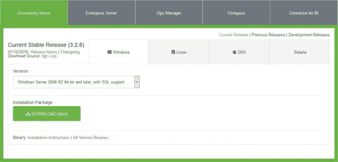
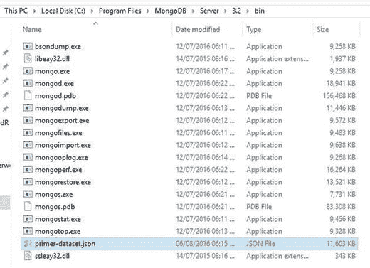
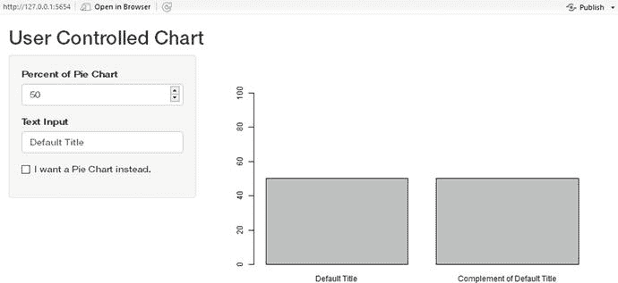

# 加载检查点与所需包
```r
library(checkpoint)
checkpoint("2016-09-04", R.version = "3.3.1")
library(devEMF)
library(RPostgreSQL)
library(DBI)
library(RSQLite)
library(jsonlite)
library(tm)
library(wordcloud)
library(RMongo)
library(data.table)
options(width = 70) # 每行仅 70 个字符
```

本章并非关于在 R 中整理大数据，更非专门探讨在 R 中整理大数据。相反，本章将引导你学习如何使用 R 与一些流行的开源数据库进行交互。在深入具体数据库之前，有一条建议：如果你希望学习这三种数据库，请先阅读各节的安装说明。按照说明操作，完成后再重启电脑以确保安全。

## SQLite

SQLite 既异常小巧又极其高效，并且（截至撰写本文时及过去 16 年间）完全免费。虽然我们推荐阅读 Grant Allen 和 Mike Owens 合著的《SQLite 权威指南》（Apress, 2010），但 SQLite 主要识别五种数据类型（与 R 相比）：空值、整数、实数、文本和二进制大对象。

每个 SQLite 数据库仅以一个文件的形式存在，因此非常便于移植。这类数据库没有用户、无需密码，且连接结构简单。其缺点也恰恰源于这些优点：由于没有用户权限，读取信息和修改数据之间没有区别。

这种缺乏用户权限的情况需要特别警示。我们在本章中构建的数据库均使用模拟数据。在实际工作中，数据库并非用于练习。第一次直接连接到真实数据库时，难免会感到紧张——尤其是当你一个误操作就可能删除团队或客户的数据时。由于 SQLite 只是一个文件，如果可能的话，明智的做法是先在真实数据的副本上进行尝试。或者，像我们这样，先在完全安全的环境下练习。

### 在 Windows 上安装 SQLite

SQLite 无需安装，只需下载文件即可。访问 SQLite 官网[`www.sqlite.org/download.html`](https://www.sqlite.org/download.html)即可；我们下载了`sqlite-tools-win32-VERSION.zip`文件，其中`VERSION`对应当前产品和版本。接着，将`sqliteV.exe`（`V`代表版本号）解压到你希望存放数据的磁盘文件夹中。我们将它解压到了`C:/sqlite`文件夹。请确保磁盘有足够的空间；这个数据库最终会占用一定空间。

这就是在系统上启动并运行 SQLite 所需的全部操作。在实际场景中，也许别人已经创建了 SQLite 数据库，而你拥有数据库副本或通过网络共享驱动器访问。我们的目标是从数据库中读取数据，并将数据从 R 存储到数据库中。这与使用“正确”技术管理 SQLite 数据库并不相同，效率也不如后者。尽管如此，这能让我们快速上手使用数据库！

### SQLite 与 R

我们的首要任务是连接到数据库。连接使用`DBI`包库来建立与数据库的链接。对于 SQLite，无需用户名或密码。但我们需要告诉链接数据库的位置以及数据库的类型。回想一下，我们选择了一个位置来存放 SQLite，该位置必须与当前路径匹配。我们将第一个连接命名为`con1`，然后使用`RSQLite`库中的`dbIsValid()`函数来测试它是否成功启动。结果显示为有效，因此我们可以开始了：

```r
con1 = dbConnect(SQLite(), dbname = "C:/sqlite/LiteDB.db")
dbIsValid(con1)
[1] TRUE
```

我们的目标是让你快速连接到这个数据库。我们将熟悉的鸢尾花数据推送到 SQLite，以便验证系统是否正常工作。SQLite 中的数据存储在表中，表内包含字段。这对应于 R 中的数据表，数据表有名称和列。我们假设你已经非常熟悉 iris 数据集，并将显示将 iris 的数据表版本写入 SQLite 的结果。`dbWriteTable()`函数需要三个必需参数：连接、新表的名称以及要写入该表的 R 对象名称。R 对象应为数据框。还可以传递其他参数，包括决定如果数据库中已存在同名表时是覆盖还是追加的设置。在第一次尝试中，我们将两者都设置为默认值`FALSE`：

```r
dbWriteTable(con1, name = "Iris", diris, overwrite = FALSE, append = FALSE)
[1] TRUE
dbListTables(con1)
[1] "Iris"
dbListFields(con1, "Iris")
[1] "Sepal.Length" "Sepal.Width"  "Petal.Length" "Petal.Width"  "Species"
```

现在这些数据已经存储在我们的 SQLite `Iris`表中；我们可以将其读回 R。我们的目标是让你学习如何将整个表读入 R，并确认我们的存储是无损或准确的。使用`dbReadTable()`函数，通过`con1`连接和 SQLite 中的`Iris`表，即可访问我们的数据。该函数返回一个数据框：

```r
diris_lite1 <- dbReadTable(con1, "Iris")
diris_lite1 <- as.data.table(diris_lite1)
all.equal(diris, diris_lite1)
[1] TRUE
```

`all.equal()`函数确认没有数据丢失。这提供了一种存储大型数据的简便方法。R 中的数据表可以轻松存储，并且通过合理使用`overwrite`、`append`或`name`参数，我们可以在对 SQLite 了解最少的情况下，足够好地管理这些数据。如果你需要处理大型表格数据，这无疑是一种简单的跟踪方法。本书一位作者拥有一系列偶尔会随时间变化但高度相似的表格数据。添加一列当前日期，就可以轻松地将大量数据写入 SQLite，形成一种永久存档。现在，这样做的主要好处是，可以只读取表的一部分到 R 中，而不是整个表。

读取表的一部分是我们的目标，但这并不像我们之前做的那样简单。根据你对结构化查询语言的熟悉程度，这一步可能容易也可能困难。如果你不太熟悉 SQL，那完全没问题。在这种情况下，我们的建议是，首先对 SQLite 表进行广泛查询，然后使用 R 删除你不需要或不想要的更多行或列。另一方面，如果你对 SQL 更熟悉，完全可以精确选择你需要的部分。这里，我们给出几个例子，这些例子应该足以应对 SQL 初学者的需求。再次强调，我们推荐其他书籍来深入学习 SQL。

一个基本的 SQL 查询：`SELECT`特定列，`FROM`特定表，`WHERE`特定列的特定行满足某个条件。我们使用`dbSendQuery()`将查询发送到 SQLite 并执行。然后，使用`dbFetch()`将结果获取到 R 中。最后，使用`dbClearResult()`清除 SQLite 中的缓冲区，为后续查询做准备。

```r
query <- dbSendQuery(con1, "SELECT [Sepal.Length] FROM Iris WHERE Species = 'setosa'")
diris_lite2 <- dbFetch(query, n=-1)
head(diris_lite2)
Sepal.Length
1          5.1
2          4.9
3          4.7
4          4.6
5          5.0
6          5.4
dbClearResult(query)
[1] TRUE
```

上述代码返回了`setosa`品种的`50`条花萼长度观测数据。在`dbFetch()`中，我们引用已执行的查询，`n`参数告诉我们要选择的行数。这里，我们要求返回所有行。相反，我们也可以要求返回所有不是`setosa`的`100`行。命令类似，如下所示：

```r
query <- dbSendQuery(con1, "SELECT [Sepal.Length], Species FROM Iris WHERE Species != 'setosa'")
diris_lite3 <- dbFetch(query, n=-1)
head(diris_lite3)
Sepal.Length    Species
1          7.0 versicolor
2          6.4 versicolor
3          6.9 versicolor
4          5.5 versicolor
5          6.5 versicolor
6          5.7 versicolor
dbClearResult(query)
[1] TRUE
```

注意，由于`Sepal`和`Length`之间存在句点，我们必须将该变量用方括号括起来，而 Species 则不需要。值得一提的是，SQL 有一些语言特性和保留字符（某种程度上与 R 类似）。事实上，对于 SQL 经验不足的人来说，这可能是最大的风险。记住，一旦你使用`dbSendQuery`，SQLite 就会愉快地接收并执行该查询。由于 SQLite 没有用户身份验证，无法使用最低限度的只读权限。最好的情况是，错误的命令没有任何效果。最坏的情况是，你可能删除、覆盖或以其他方式损坏数据。我们来之不易的建议是：始终在数据的本地副本上工作，特别是如果你正在阅读本章以启动你的大数据项目。否则，如果你对 SQL 不熟悉，请与数据库所有者或管理员沟通。

我们最后一个 iris 示例使用`*`通配符返回所有列，而不是列出所有列。同样，我们要求返回所有不是`setosa`的行：

```r
query <- dbSendQuery(con1, "SELECT * FROM Iris WHERE Species != 'setosa'")
diris_lite4 <- dbFetch(query, n=-1)
diris_lite4 <- as.data.table(diris_lite4)
diris_lite4
Sepal.Length Sepal.Width Petal.Length Petal.Width    Species
1:          7.0         3.2          4.7         1.4 versicolor
2:          6.4         3.2          4.5         1.5 versicolor
3:          6.9         3.1          4.9         1.5 versicolor

98:          6.5         3.0          5.2         2.0  virginica
99:          6.2         3.4          5.4         2.3  virginica
100:          5.9         3.0          5.1         1.8  virginica
dbClearResult(query)
```

SQLite 的用途或许在于允许处理可能超出物理 RAM 容量的数据。正如我们所演示的，它可以分块读取，或者我们可以将大量数据从 R 推送出去以释放内存。下一个示例提供了一个选择。如果你的系统 RAM 有足够的可用空间，请按原样执行 2 亿行数据的示例。否则，要么将`rnorm()`中的变量数改小一些，要么使用我们提供的在线代码来运行 7000 万行数据的较小示例。

以下代码创建了 2 亿个完全虚构的数据观测值，均值为 1，默认标准差为 1。如你所见，其大小约为 1.6 GB。当然，数据可以更大，但作为测试用例，足以让你看到其对系统的影响。在你的系统上运行大约需要 5 分钟，所以请做好等待的准备。

```r
BiggerData <- rnorm(200000000, 1)
BiggerData <-as.data.table(BiggerData)
object.size(BiggerData)
1600001088 bytes
dbWriteTable(con1, "BiggerData", BiggerData)
[1] TRUE
dbListTables(con1)
[1] "BiggerData" "Iris"
```

可以从 R 中删除 SQLite 中的表。请注意，我们的数据库中有两个表列出。`BiggerData`是一个大表，所以不是瞬间完成的。尽管如此，操作速度还是相当快的。SQLite 不会因为此操作而减少硬盘上数据库文件的大小。它会在内部释放该空间，这样数据库就不会再增长。但是，该空间在 SQLite 外部并不能自由使用。用 SQL 术语来说，需要对数据库执行`VACUUM`操作。此过程可能需要多达文件大小的两倍空间，并且再次强调，空间已释放以供新使用——只是不能在数据库外部使用。无论如何，在我们看来，这最好在 R 外部完成。

```r
dbRemoveTable(con1, "BiggerData")
[1] TRUE
dbListTables(con1)
[1] "Iris"
```

我们最后的代码片段关闭了与数据库的连接。函数调用是`dbDisconnect()`，我们对连接`con1`调用该函数。成功调用返回`TRUE`，并且我们还通过`dbIsValid()`看到它确实已关闭。在继续下一个数据库之前，我们还删除了一些不需要的数据。

```r
dbDisconnect(con1)
[1] TRUE
dbIsValid(con1)
[1] FALSE
rm(diris_lite1, diris_lite2, diris_lite3, diris_lite4)
```

我们之前说过空间没有释放。由于这是虚构的数据，要释放系统空间，只需在完成后使用 Windows 资源管理器删除`C:/sqlite`文件夹中的`LiteDB.db`文件。需要重申的是，数据库管理不应通过 R 进行。相反，R 可以在必要时本地存储一些数据，或访问数据的子集进行分析。

## PostgreSQL

PostgreSQL 既开源又流行（根据某些来源，在所有数据库中排名第五）。这个数据库非常高级，内部支持超过 30 种数据类型。我们推荐 Neil Matthew 和 Richard Stones 合著的《PostgreSQL 入门》（Apress, 2005）。与 SQLite 一样，我们将带你完成在本地机器上安装实践版本的过程。我们的目标是让你尽快开始使用 R 处理该数据库中的数据。更高级的数据库操作很可能不应在 R 中完成。

当数据完整性、可靠性以及不同级别用户访问的需求可能有用时，推荐使用这种格式。另一方面，如果你只需要对更静态但体积较大的数据进行快速读取，这可能不是最佳选择。当然，我们承认，数据库的选择往往与我们想要什么关系不大，而与数据在哪里发现关系更大。关于 PostgreSQL 的一个警告是，它确实有用户，并且这些用户拥有某些权限。在我们的示例中，我们有一个超级用户。从安全角度来看，这并不明智，从现实角度来看，数据库所有者不太可能授予分析师这样的权限。如果你打算在此环境中进行大量工作并希望获得更多练习，一个简单的方法是在我们简短的安装过程中创建比我们更多的用户级别。然后，练习使用这些用户名和密码在 R 中访问你的数据库。

### 在 Windows 上安装 PostgreSQL

访问 PostgreSQL 网站（[`www.postgresql.org/download/windows/`](https://www.postgresql.org/download/windows/)）并选择一个安装程序选项。我们为 64 位架构选择了最新的稳定版本（非测试版）。下载后，你应该会得到一个名为`postgresql-9.5.4-windows-x64.exe`的文件，这就是你的安装程序。当然，你的版本号很可能高于 9.5.4，因为那是我们撰写本章时的版本。

继续安装程序，根据需要点击“下一步”，并接受安装目录的默认设置。安装程序会要求为名为`postgres`的数据库超级用户设置密码，我们将其设置为`advancedr`。如果你选择了不同的密码，请务必安全地记录下来。顺便说一下，这也会创建一个与超级用户同名的数据库。PostgreSQL 默认使用端口 5432，如果该端口没有显示为默认选项，则说明你的计算机上可能运行着另一个版本的 PostgreSQL。虽然我们会在 R 中配置端口，但我们强烈建议在初次练习时尽可能使用默认设置。再点击几次“下一步”，接受默认设置，应该就会进入安装环节。在最后一个屏幕上，你可能会被问到是否安装 Stack Builder；它不是必需的，你可以在点击“完成”之前取消选中该选项。

至此，PostgreSQL 安装完毕，并且正在你的计算机上运行。如果你熟悉这个数据库，你可以直接向其中添加数据（而且可能不需要本入门指南）。我们将通过 R 添加数据，并快速访问这些数据的子集。

### PostgreSQL 与 R

我们的首要任务是连接到数据库。这使用`DBI`包库来建立与数据库的链接。对于 PostgreSQL，我们需要用户名和密码。我们还需要告诉链接数据库的位置以及数据库的类型。这个数据库是一个服务器，我们不需要告诉它文件位置，而是需要主机位置和端口。我们将第二个连接命名为`con2`，然后使用`RPostgreSQL`库中的`dbGetInfo()`函数来测试它是否成功启动。我们的连接返回了大量信息，因此我们可以开始了：

```
drv <- dbDriver("PostgreSQL")
con2 <- dbConnect(drv, dbname = "postgres", host = "localhost",
+                  port = 5432, user = "postgres", password = "advancedr")
dbGetInfo(con2)
$host
[1] "localhost"
$port
[1] "5432"
$user
[1] "postgres"
$dbname
[1] "postgres"
$serverVersion
[1] "9.5.4"
$protocolVersion
[1] 3
$backendPId
[1] 14220
$rsId
list()
```

值得一提的是，这次我们在代码中直接以明文形式包含了`dbConnect()`的密码。这可能不是最安全的方法，需要小心处理（尤其是这种情况下，因为这是我们的超级用户）。尽管如此，我们的连接正在工作，它正确连接到了端口`5432`（虽然这是此数据库的默认端口，但并不总是这个端口），并且我们的主机是`localhost`。如果你要连接到在线数据库，则需要将地址更改为该数据库的地址。现在连接正常，我们查看数据库中有哪些表，并添加熟悉的鸢尾花数据集：

```
dbListTables(con2)
character(0)
diris <- as.data.table(iris)
dbWriteTable(con2, "iris", diris, overwrite = TRUE)
[1] TRUE
dbListTables(con2)
[1] "iris"
dbListFields(con2, "iris")
[1] "row.names"    "Sepal.Length" "Sepal.Width"  "Petal.Length"  "Petal.Width"  "Species"
```

这些函数的一个不错的特点是它们名符其实。尽管如此，我们还是要提请你注意`dbWriteTable()`函数。虽然写入不是我们的主要关注点，但该函数提供了`overwrite`和`append`选项，均可以设置为`FALSE`或`TRUE`。两者在适当的情况下都很方便。我们将注意力转向从该数据库读取数据，并通过直观检查我们的数据，确认我们成功地将 PostgreSQL 中的数据拉取到 R 中：

```
diris_gre1 <- dbReadTable(con2, "iris")
diris_gre1 <- as.data.table(diris_gre1)
diris_gre1
Sepal.Length Sepal.Width Petal.Length Petal.Width   Species
1:          5.1         3.5          1.4         0.2    setosa
2:          4.9         3.0          1.4         0.2    setosa
3:          4.7         3.2          1.3         0.2    setosa

148:          6.5         3.0          5.2         2.0 virginica
149:          6.2         3.4          5.4         2.3 virginica
150:          5.9         3.0          5.1         1.8 virginica
```

一个基本的 `SQL` 查询：`SELECT`特定列，`FROM`特定表，`WHERE`特定列的特定行满足某个条件。我们使用`dbSendQuery()`将查询发送到 PostgreSQL 并执行。然后，使用`dbFetch()`将结果获取到 R 中。请注意，当我们获取时，我们只选择了满足该条件的前三行。最后，我们使用`dbClearResult()`清除 PostgreSQL 中的缓冲区，为后续查询做准备。

```
query <- dbSendQuery(con2, 'SELECT * FROM iris WHERE "Sepal.Width" > 2')
diris_gre2 <- dbFetch(query, n=3)
head(diris_gre2)
row.names Sepal.Length Sepal.Width Petal.Length Petal.Width    Species
1        51          7.0         3.2          4.7         1.4 versicolor
2        52          6.4         3.2          4.5         1.5 versicolor
3        53          6.9         3.1          4.9         1.5 versicolor
dbClearResult(query)
[1] TRUE
```

这与我们之前用 SQLite 所做的非常相似，因为这两个数据库都是存储表格数据的 `SQL` 数据库。或者，如果我们只需要一列数据，我们可以`SELECT`特定列，而不是使用通配符值：

```
query <- dbSendQuery(con2, 'SELECT "Petal.Length" FROM iris')
diris_gre3 <- dbFetch(query, n=6)
head(diris_gre3)
Petal.Length
1          1.4
2          1.4
3          1.3
4          1.5
5          1.4
6          1.7
dbClearResult(query)
[1] TRUE
```

下一个查询返回 `iris` 数据集中的`Sepal.Length`和`Species`列，条件是花萼宽度不等于`2.2`（一个任意数字）。值得注意的是，这只返回了`147`行，而不是全部的`150`行，当然也只返回了两列而不是五列。将这个想法扩展，你可以很容易地看到大数据如何被分解成相关的分析块。我们将`query`改为`qu`只是为了少打几个字符，以提高查询文本中这行代码的可读性。

```
qu <- dbSendQuery(con2, 'SELECT "Sepal.Length", Species FROM iris WHERE "Sepal.Width" <> 2.2')
diris_gre5 <- dbFetch(qu, n=-1)
head(diris_gre5)
Sepal.Length Species
1          5.1  setosa
2          4.9  setosa
3          4.7  setosa
4          4.6  setosa
5          5.0  setosa
6          5.4  setosa
dbClearResult(qu)
[1] TRUE
```

`PostgreSQL` 的用途或许在于允许处理可能超出物理 `RAM` 容量的数据。正如我们所演示的，它可以分块读取，或者我们可以将大量数据从 R 推送出去以释放内存。下一个示例提供了一个选择。如果你的系统 `RAM` 有足够的可用空间，请按原样执行 2 亿行数据的示例。否则，要么将`rnorm()`中的变量数改小一些，要么使用我们提供的在线代码来运行 7000 万行数据的较小示例。

以下代码创建了 2 亿个完全虚构的数据观测值，均值为 1，默认标准差为 1。如你所见，其大小约为 1.6 `GB`。当然，数据可以更大，但作为测试用例，足以让你看到它如何在你的系统上工作。运行大约需要 5 分钟，所以请做好等待的准备。如果你已经在之前的步骤中运行过此代码，则无需重复。

```
BiggerData <- rnorm(200000000, 1)
BiggerData <-as.data.table(BiggerData)
dbWriteTable(con2, "BiggerData", BiggerData)
[1] TRUE
dbListTables(con2)
[1] "iris"       "BiggerData"
```

再次强调，虽然我们（至少拥有超级用户权限时）能够`DROP`一个表，但 PostgreSQL 并不会释放空间给我们（因此也不会释放硬盘空间）。同样，我们建议将`VACUUM`命令留给实际的数据库管理（因此建议直接在数据库上使用 `SQL`，而不是在 R 中）。

```
dbListTables(con2)
[1] "iris"       "BiggerData"
dbRemoveTable(con2, "BiggerData")
[1] TRUE
dbListTables(con2)
[1] "iris"
```

要关闭此连接，需要两步而不是一步，因为我们必须断开与 PostgreSQL 的连接并卸载允许`DBI`建立连接的驱动程序。如果成功，两者都将返回`TRUE`。

```
dbDisconnect(con2)
[1] TRUE
dbUnloadDriver(drv)
[1] TRUE
```

至此，我们对 PostgreSQL 和表格数据库的演示结束。使你现有知识更强大的真正方法是更深入地学习 `SQL` 语法，以便在更复杂的查询中使用`dbSendQuery()`。不过现在，读取一小部分数据到 R 中进行分析应该是可行的。我们将注意力转向另一种类型的数据库。

### MongoDB

如前所述，MongoDB 是不同的。这是一个文档存储数据库，是一种非关系型数据库。它避免了表的概念，转而使用称为对象的文档。这些文档是 `JavaScript` 对象表示法的二进制版本；由于是二进制版本，MongoDB 称它们为 `BSON` 对象。这种类型的数据库用于可能是半结构化或非结构化的数据。这更接近于数据湖的概念（数据科学中一个日益流行的流行词），它意味着可能需要存储和访问各种类型的数据。

`JSON` 和半结构化数据的一个强大功能是能够在一个地方为一个特定实例收集所有信息。例如，假设我们将所有患者记录放在一个地方。不是用几十个表，每个表占用患者的一行，每个表类似于地址或诊断，而是将一个患者的所有记录存储在一个大对象中。当然，大多数患者都有地址，但也许并非所有患者的诊断部分都需要三种类型的血检报告。这就是半结构化数据。另一方面，如果你只是从网络上收集关于一家喜爱的公司的数据——包括新闻文章、社交媒体帖子或点赞，以及股票市场表现数据——那么这些数据元素之间可能几乎没有相似之处。无论哪种情况，MongoDB 都可以存储它，我们可以访问它。

#### 在 Windows 上安装 MongoDB

访问 MongoDB 网站（ [`www.mongodb.com/download-center`](http://www.mongodb.com/download-center) ）会显示一个选项，可以下载支持 `SSL` 的 64 位版本 MongoDB（截至撰写本文时为 3.2.8 版）。见图 10-1。下载后，继续开始安装过程。选择“下一步”，阅读并同意许可文档，然后继续。我们使用了完整安装，然后点击了“安装”按钮。片刻之后，请点击“完成”。



图 10-1。下载 MongoDB

我们还需要为 MongoDB 下载示例数据库。我们将使用 MongoDB 的“导入示例数据集”页面（位于[`https://docs.mongodb.com/getting-started/shell/import-data/`](https://docs.mongodb.com/getting-started/shell/import-data/)）步骤 1（`primer-dataset.json`）中提供的 `restaurants` 数据集。我们还将使用`Ch10_MOCK_DATA.json`作为另一个数据集。这两个文件也可以作为本章代码包的一部分从本书网站获取。继续下载这两个文件，并将它们存储在`C:\Program Files\MongoDB\Server\3.2\bin`中。请记住，你使用的可能是 3.3 或更高版本，因此请根据需要更改此文件路径中的版本号。至此，MongoDB 已安装完毕，我们有了数据集。图 10-2 显示了该文件夹。



图 10-2。`MongoDB\Server\3.2\bin` 文件夹

现在，按下 Windows 键，按住不放，然后按 `R` 键。这会打开“运行”对话框。输入`cmd`，然后按 `Enter/Return` 键。需要为你的数据库创建一个数据目录。默认情况下，它在主文件路径中（例如，通常是 Windows 的 `C` 盘）。在命令提示符下，输入`md \data\db`来创建默认目录。注意`md`和`\data\db`之间的空格。接下来，仍在命令提示符下，输入`cd C:\Program Files\MongoDB\Server\3.2\bin`并按 `Enter/Return` 键。如果本书出版前发布了 3.3 版本，请将前面文件路径中的 3.2 改为 3.3。然后，输入`mongod.exe`并按 `Enter/Return` 键。如果一切顺利，最后一行应该是`waiting for connections on port 27017`。保持此窗口打开（否则，我们的服务器将无法提供文件服务）。

接下来，再次保持第一个控制台打开，按住 Windows 键并按 `R` 键，打开第二个“运行”对话框。这次，很可能`cmd`已经填好了，所以按 `Enter/Return` 键打开第二个命令提示符。在命令提示符下，再次输入`cd C:\Program Files\MongoDB\Server\3.2\bin`并按 `Enter/Return` 键。我们现在使用 MongoDB 本身来导入这两个数据集。运行以下代码（加粗部分），输出结果如下：

```
mongoimport --db test --collection restaurants --drop --file primer-dataset.json
2016-09-25T11:11:24    connected to: localhost
2016-09-25T11:11:24    dropping: test.restaurants
2016-09-25T11:11:26    imported 25359 documents
mongoimport --db test --collection mock --drop --file Ch10_MOCK_DATA.json
2016-09-25T11:19:45    connected to: localhost
2016-09-25T11:19:45    dropping: test.mock
2016-09-25T11:19:45    imported 1000 documents
```

请注意，该数据库有一个名为`test`的数据库，并且该数据库内现在有两个集合。这些集合，即`restaurants`和`mock`，是通过导入 `JSON` 文件创建的。如果这两个集合已经存在于我们的`test`数据库中，那么`--drop`命令将会清除它们。使用名为`test`或`temp`的数据库作为标志，表明期望在此类地方进行实验，这在一定程度上是标准做法。

继续关闭第二个命令提示符窗口（要小心——你必须保持第一个窗口打开，它应该正在向你提供服务器`COMMAND`和`NETWORK`反馈）。关闭第二个窗口后，我们将注意力转向 R。

## MongoDB 与 R

MongoDB 确实有用户名、密码和多个数据库的选项。由于我们尚未设置任何这些，我们只需连接到本地服务器上的第三个连接`con3`。与我们前两个连接不同，这使用了一个新命令`mongoDbConnect()`，来自`RMongo`包。另外，请注意，该命令要求主机为`localhost`，并且也指定了端口。如果你要通过网络连接到 MongoDB 实例，请务必确定其 IP 地址和端口。当然，还要向管理员询问你要访问的数据库名称。最后，查明你是只有读取权限还是更多。不要在别人的数据库上进行实验！

```
con3<-mongoDbConnect("test", host = "127.0.0.1", port=27017)
```

如果需要身份验证，你需要运行第二个命令。在你的 R 会话中输入并运行`dbAuthenticate(con3, username, password)`。这里需要提醒一句：根据所访问的 MongoDB 版本、本地机器上安装的 Java 版本以及数据库管理员设置的身份验证协议，此功能可能有效也可能无效。我们意识到这是一个模糊的说法。在撰写本书时，身份验证似乎是可能的，但似乎有迹象表明并非对所有用户都适用。

更糟糕的是，目前，函数调用`dbShowCollections()`在最新版本的 MongoDB 上不起作用。如果你连接到一个成熟的数据库，它可能正在使用较旧的版本，你可能能够看到集合。`RMongo`包大约有三年历史，我们期待有更新。现在，我们只能提供一个无奈的见解：连接到数据库和数据整理通常很少是容易的。幸运的是，我们知道我们的集合存储在`restaurants`和`mock`中。

因此，我们可以继续从集合中访问一些数据，以确认我们确实能够将数据从 MongoDB 读入 R。请注意，函数调用`dbGetQuery()`至少需要三个参数。首先，它需要连接；其次，它需要一个包含`collection`信息的文本字符串。第三个参数是用于访问我们数据的搜索词。在第一个例子中，我们没有定义任何搜索词，因此该形式参数只包含`{}`包装器。最后两个参数是可选的。`0`表示我们从列表的开头开始，`8`表示我们只想要接下来的八个条目。换句话说，我们不跳过任何条目，并将返回的条目限制为八个。为了可读性，我们编辑了最终输出，并在图 10-3 中显示了`View()`结果的一部分。


图 10-3。

View(output1)命令结果的一部分

```
output1 <- dbGetQuery(con3, 'restaurants' , "{}", 0,8 )
is.data.frame(output1)
[1] TRUE
names(output1)
[1] "address"  "restaurant_id"  "name"  "cuisine"      "X_id"  "borough"      "grades"
output1[1,]
address
{ "building" : "2206" , "coord" : [ -74.1377286 , 40.6119572] , "street" : "Victory Boulevard" , "zipcode" : "10314"}
restaurant_id   name           cuisine        X_id                            borough
40356442        Kosher Island  Jewish/Kosher  57e7f9a275bec64c417b9ab2        Staten Island
grades
[ { "date" : { "$date" : "2014-10-06T00:00:00.000Z"} , "grade" : "A" , "score" : 9} ,
{ "date" : { "$date" : "2014-05-20T00:00:00.000Z"} , "grade" : "A" , "score" : 12} ,
{ "date" : { "$date" : "2013-04-04T00:00:00.000Z"} , "grade" : "A" , "score" : 12} ,
{ "date" : { "$date" : "2012-01-24T00:00:00.000Z"} , "grade" : "A" , "score" : 9}]
View(output1)
```

这些数据似乎包含关于位置、食物类型和餐馆名称的信息。利用这些知识，我们优化搜索标准，查找`American`菜肴类型。这很有趣，因为我们移除了起始位置和限制参数，并调整了查询条件。数据卫生在此变得至关重要。天真地，我们尝试了`dbGetQuery(con3, 'restaurants' , '{"cuisine":`

### `用户界面绘制饼图的主面板`

```r
ui <- shinyUI(fluidPage(
  # 页面标题
  titlePanel("用户控制图表"),

# 侧边栏，包含由用户控制的数字、文本和复选框输入
  sidebarLayout(
    sidebarPanel(
      numericInput("pie",
        "饼图百分比",
        min = 0,
        max = 100,
        value = 50),
      textInput("pietext", "文本输入", value = "默认标题",
        placeholder = "在此处输入您的标题"),
      checkboxInput("pieChoice",
        "  我想要饼图而不是条形图。", value = FALSE)
    ),

# 显示绘图
    mainPanel(
      plotOutput("piePlot")
    )
  )
))
```

### `服务器端创建饼图或条形图的 R 代码，对用户隐藏`

```r
server <- shinyServer(function(input, output) {
  output$piePlot <- renderPlot({
    # 根据用户的 input$pie 生成饼图比例
    y <- c(input$pie, 100-input$pie)

# 使用指定的比例和标签绘制饼图或条形图
    if(input$pieChoice == FALSE){
      barplot(y, ylim = c(0,100),
        names.arg = c(input$pietext, paste0(input$pietext, "的补集")))
    }else{
      pie(y, labels = c(input$pietext, paste0(input$pietext, "的补集")))}
  })
})
```

### `运行应用程序`

```r
shinyApp(ui = ui, server = server)
```

在深入研究那部分代码之前，让我们先看看它的实际运行效果。在 RStudio 控制台中输入并运行以下代码，在您的本地 Windows 机器上安装 Shiny：

```
install.packages("shiny")
```

现在，进入您仔细输入的`app.R`文件，并一次性运行那段代码。代码区域右上角附近甚至应该有一个“运行应用”的播放按钮。无论如何，应该会出现类似图 13-1 的内容。



图 13-1. 本地托管的 Shiny 应用，用于查看我们具体获得了什么功能

继续输入各种数字和文本值。尝试使用 Shiny，看看它能做什么。在此过程中，请认识到 Shiny 所做的是在您和 R 之间提供了一个接口。目前，这个特定的运行实例是由 RStudio 在您的本地机器上托管的。请注意，控制台中显示正在监听，您可能需要选择一个停止按钮才能输入任何新代码。

那么发生了什么？假设您将饼图百分比数字更改为 75。这个`numericInput()`是一个响应式值。当您更改它时，后台会发送一个信号，通知服务器`input$pie`已经改变。然后服务器会通知任何使用`input$pie`的响应式函数，告知它们某些内容已更改。在我们的例子中，`renderPlot()`是一个响应式函数。它现在知道`input$pie`不同了，因此它查询该值，获取新值，并再次运行其所有代码。由于那是一个输出值，这个循环会反过来通过`output$piePlot`重复，结果是用户端的`plotOutput()`会刷新。

关于这一切，有一些重要的事情需要注意。我们刚刚描述的过程会再次运行`renderPlot()`内部的所有代码——全部代码。在其他条件不变的情况下，没有必要再查找`input$pietext`和`input$pieChoice`。我们的响应式函数知道这些值，因为它们是最新的，虽然它们会被再次使用，但它们不会被再次调用。然而，如果我们在`renderPlot()`内部有比一个减法运算和一些绘图更密集的操作，我们可能会发现进行任何更改的性能成本相对较高。虽然这段代码相当紧凑，但您仍然可以看到三个可以放置 R 代码的地方。一个是放置`library(shiny)`的地方。这位于我们的`shinyServer()`之外。放在这里的代码，比如我们的库调用，每个会话会运行一次。单个会话可以有多个用户与其交互（尽管这在目前有些深奥）。尽管如此，每个新用户至少会执行`shinyServer()`内部的所有代码一次。最后，正如我们刚刚看到的，在`renderPlot()`这样的响应式函数内部的代码，会在任何连接的响应式输入值每次更新时运行一次。这意味着，为了效率，请考虑将尽可能多的代码放在响应式函数之外。此外，如果您预计会有大量用户流量，也请尽可能将代码放在服务器函数之外。

现在，让我们介绍一些新函数。请记住，有用户输入端、服务器端和整个 Shiny 应用。在本质上，Shiny 就由这三部分组成。实际上，这里有一个相当基础的 Shiny 应用程序：

```r
library(shiny)
```