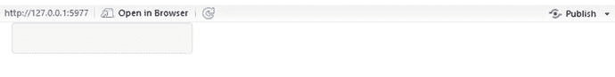

# 定义用户界面

这段代码很好地展示了函数组合这个数学概念的强大功能。我们的目标最终是让用户能够向我们的 R 代码输入一些东西，比如图 13-1 示例中的文本或复选框。用户将这些值输入到尚未命名的函数中，这些函数提供可视化输出，这些输出又被输入到`sidebarPanel()`函数中，该函数提供网页输出，再被输入到`fluidPage()`中，最终输出给用户的网页界面。我们可以在图 13-2 中看到结果，尽管它们是空白的。



图 13-2. 一个大部分空白的 Shiny 应用，带有`sidebarPanel()`

从这一点出发，我们可以使用三个输入函数快速构建用户的输入。这些输入函数中的每一个都遵循特定的格式，即`blargInput(输入标识, 供用户阅读的文本标签, 与 blarg 所代表的特定类型输入相关的设置)`。正式来说，我们的三个输入函数布局如下，请注意它们的相似之处！

```r
numericInput(inputId, label, value, min = NA, max = NA, step = NA,  width = NULL)
textInput(inputId, label, value = "", width = NULL, placeholder = NULL)
checkboxInput(inputId, label, value = FALSE, width = NULL)
```

继续为我们的代码填充一些具体细节，我们可以为每个输入设置一个对我们后续服务器代码有用的变量标识。因为我们确实计划构建一个饼图（并且，亲爱的读者们，请不要因为我们选择饼图而讨厌我们），所以将数字输入限制在`0`到`100`之间是合理的。因为我们的服务器代码在启动时运行一次，所以为数字输入以及文本输入提供默认值也是有意义的。在我们不断发展的用户界面代码基础上进一步构建，现在我们有了：

```r
ui <- shinyUI(fluidPage(
  sidebarLayout(
    sidebarPanel(
      numericInput(inputId = "num", label = "Enter a number", value = 50, min = 0, max = 100),
      textInput(inputId = "text", label = "Enter some text", value = "Hello Shiny!"),
      checkboxInput(inputId = "check", label = "Check this box", value = FALSE)
    ),
    mainPanel()
  )
))
```