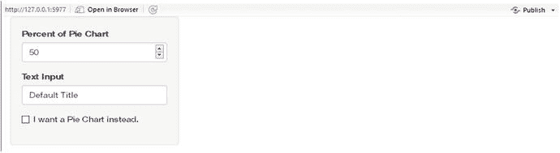

# 用户界面绘制饼图

```R
ui <- shinyUI(fluidPage(
  # 由用户控制的包含数值、文本和复选框输入的侧边栏
  sidebarLayout(
    sidebarPanel(
      numericInput("pie", "百分比饼图",
                   min = 0, max = 100, value = 50),
      textInput("pietext", "文本输入", value = "默认标题",
                placeholder = "在此输入您的标题"),
      checkboxInput("pieChoice", "  我想要一个饼图。", value = FALSE)
    ),
    mainPanel()
  )
))
```

同样，完成这些修改后，再次运行整个应用程序是有意义的，我们将看到图 13-3 中的新结果。请注意，在我们的代码中，`mainPanel()`目前是空的，事实上，在图 13-3 中，右侧我们什么也看不到。



图 13-3.

用户界面即将完成，侧边栏的输入部分确实已完成

既然我们已经捕获了用户输入，我们就可以在服务器端使用它了。请记住，Shiny 是一个 R 包装器，它接收输入，当输入发生变化时，会通知服务器端的某个反应式函数发生了变化。在幕后，Shiny 负责知道输入何时变化，并通知服务器上正确的反应式函数；我们无需担心这些事情。我们的服务器定义了一个新的函数，该函数将输入和输出作为形式参数，并在函数体中使用它们。如果需要，可以快速回顾一下第 4 章，以刷新关于函数是什么的记忆。由于我们想要做的就是绘制条形图或饼图，我们的大部分代码正是使用非常常见的 R 代码来实现这一点。事实上，唯一不那么常规的 R 代码部分是我们的反应式函数`renderPlot()`。由于我们希望输出图形，所以我们使用该函数。

反应式函数总是在等待 Shiny 通知它们来自用户界面端的输入的任何变化。当输入发生变化时，如果其函数体中至少包含一个发生改变的值，反应式函数就会收到通知。如果确实如此，那么反应式函数将再次运行其代码，这次使用新的值。我们在下面的代码中可以看到这一点。唯一另外的部分是，`renderPlot()`的输出存储在一个输出变量中，我们选择将其命名为`piePlot`（尽管根据复选框的选择，它可能不会输出饼图——这完全是我们选择了一个糟糕的名称的错）。

```R
# 代码内容待补充
```