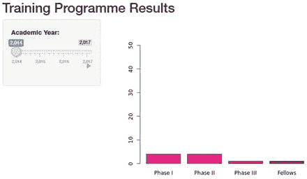

# 创建饼图或条形图的服务器端 R 代码
server <- shinyServer(function(input, output) {
  output$piePlot <- renderPlot({

    # 根据用户的 input$pie 生成饼图比例
    y <- c(input$pie, 100-input$pie)

    # 用指定的比例和标签绘制饼图或条形图
    if(input$pieChoice == FALSE){
      barplot(y, ylim = c(0,100),
              names.arg = c(input$pietext, paste0("Complement of ", input$pietext)))
    }else{
      pie(y, labels = c(input$pietext, paste0("Complement of ", input$pietext)))}
  })
})
```

本质上就是这样。当我们的服务器运行时，它会通知用户界面函数 `plotOutput("piePlot")` 更新图像。该函数位于 `mainPanel()` 区域。在 Shiny 的这种简单模型下，侧边栏是接收用户输入的地方，服务器端是 R 在幕后处理输入的地方，而主面板是用户查看处理结果的地方。仅此一次，我们在图 13-1 中展示 Shiny 为我们创建并提供服务的完整 HTML 代码：

```html
    json2[2014.02.04];jquery[1.11.3];shiny[0.13.1];bootstrap[3.3.5]

  用户控制的图表

用户控制的图表 ShinyHTML 代码，创建

饼图百分比

文本输入

  我想要一个饼图。
```

现在，请回过头仔细查看本节开头展示的第一个代码块，那是整个 Shiny 应用程序，并意识到正是那段代码创建了前面所有的 HTML 和 JavaScript。这就是 Shiny 的全部内容。在本例中，我们的 R 代码并不特别令人印象深刻。尽管如此，原则才是最重要的。用户现在可以与数据交互，并且不难想象更富趣味的应用程序。

在接下来的几节中，我们将介绍一些其他有趣且有用的 Shiny 输入函数以及一些基本的反应式函数。最后，我们将它们全部上传到云端，以便您可以在网络上实时查看。

## 动态的 Shiny

既然我们对 Shiny 的功能有了更好的理解，那么理解网页相对于打印报告所具有的动态潜力就很重要。其中一位作者是数学教授，数学教学面临的挑战之一是，一旦数据超出三维，学生就很难对信息进行概念化。自然地，作为人，学生并不独特于他们的高维视觉障碍。时间可以提供第四维度，而 Shiny 可以为我们提供这种时间感。

我们之前提到的 Shiny 的另一个特性是，将 R 代码放在三个不同的位置是合理的。第一个位置是所有代码的开头，在编写用户界面或服务器端代码之前。放在此区域的代码每个实例运行一次。虽然在本地机器上其价值可能不那么明显，但当您的代码托管在云端时，特定的 R 会话可能同时有多个用户与之交互。这就是我们在前一章安装的 Shiny 服务器的工作方式。这是读入任何静态数据或执行任何一次性计算的绝佳位置。这是计算效率最高的位置。虽然我们在本例中没有这样做，但代码也可以放在服务器代码内部，但在任何反应式函数之外，这部分代码会在用户连接到会话时每个用户运行一次。最后，位于服务器函数内部、反应式函数内部的代码，会在其引用的任何输入数据每次发生变化时执行。

让我们看看如何随时间变化数据。从用户界面端，有一个作为数字线滑动条的输入函数。与所有输入函数一样，我们需要给它一个名称，以便我们的反应式函数知道去哪里寻找输入更新。与上一节的 `numericInput()` 类似，我们为此函数提供以年为单位的最大值和最小值。最后，我们将为我们的 `sliderInput()` 函数添加动画效果。看看我们在用户界面中使用的代码。我们的代码使用了包含 `interval`（以毫秒为单位）的动画选项，并使动画保持循环播放。

```R
sliderInput("ayear", "学年：",
            min = 2014, max = 2017,
            value = 2014, step = 1,
            animate = animationOptions(interval=600, loop=T) )
```

虽然此应用程序也展示了如何对静态数据和用户输入执行 R 计算，但从 R 代码的角度来看，这确实又相当简单。事实上，除了 `titlePanel()` 命令以及我们的滑块代码外，这非常像我们的第一个 Shiny 应用程序。我们在图 13-4 中同时展示了代码和最终结果。



图 13-4.

一个带有播放按钮功能的滑块输入，展示动态数据

```R
library(shiny)
slider_data<-read.csv("slider_data.csv", header = TRUE, sep = ",")
Phase1    <- slider_data[,2]
Phase2    <- slider_data[,3]
Phase3    <- slider_data[,4]
Phase4    <- slider_data[,5]

