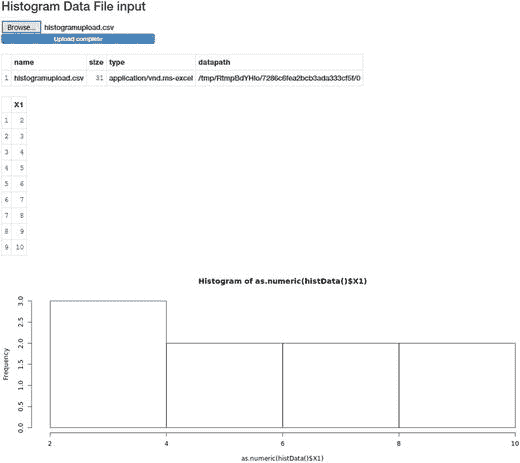
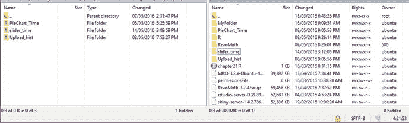
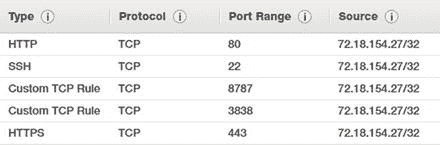

# 定义用于绘制条形图的应用程序的 UI

```R
ui <- shinyUI(fluidPage(
  # 应用程序标题
  titlePanel("培训计划结果"),
```

# 侧边栏带滑块输入用于设置分组数量

```R
sidebarLayout(
  sidebarPanel(
    sliderInput("ayear", "Academic Year:",
                min = 2014, max = 2017,
                value = 2014, step = 1,
                animate = animationOptions(interval=600, loop=T) )  ),
  mainPanel(plotOutput("barPlot") )
)
```

## 定义绘制柱状图所需的服务器逻辑

```R
server <- shinyServer(function(input, output) {
  output$barPlot <- renderPlot({
    cap<-input$ayear*100
    x <- c(sum(Phase1<cap), sum(Phase2<cap), sum(Phase3<cap), sum(Phase4<cap))
    barplot(x, names.arg = c("Phase I", "Phase II", "Phase III", "Fellows"),
            col = c("deeppink1","deeppink2","deeppink3","deeppink4"), ylim=c(0,50))
  })
})
```

## 运行应用程序

```R
shinyApp(ui = ui, server = server)
```

## 将用户文件上传到 Shiny

本章最后一个示例表明，用户可以通过 Shiny 上传文件，然后通过 R 进行处理。当然，与之前两个示例不同，这稍微有点风险，因为上传的文件不受我们控制。数据可能是任何文件，不一定适用于我们的结果。可以在代码中构建各种错误检查功能；实际上，我们在讨论函数时曾部分提到这些技术。但是，为了让代码专注于严格的新特性，我们暂时假设生活在一个完美的世界里。我们在这本书的 Apress 网站上提供了一个示例文件，它只是一个包含数字 1 到 10 的逗号分隔值文件。

或许并不意外，为了接收文件输入，Shiny 中的命令是`fileInput()`。除了`inputId`，也许最有趣的功能是它甚至可以接受`multiple`上传，尽管在我们的示例中我们将其保留为默认值`FALSE`。并非所有浏览器都支持上传多个文件。同样在用户界面区域，我们使用了一个新的输出函数`tableOutput()`，它与`plotOutput()`一起，允许我们为用户提供图表和图形输出。在讨论允许我们与用户文件交互的服务器端代码之前，我们先看看上传的 CSV 文件给我们带来了什么。图 13-5 是我们上传 CSV 文件后的视图，下面仅展示用户界面的代码：


图 13-5. 文件上传结果

```R
ui <- shinyUI(fluidPage(
  fileInput("file", label = h3("Histogram Data File input")),
  tableOutput("tabledf"),
  tableOutput("tabledf2"),
  plotOutput("histPlot1")
))
```

首先，请注意第一个表格。它包含四个变量，这些变量是直接访问`input$file`变量的结果。这可能会与我们之前的示例相悖，在其他示例中，用户输入可以直接从`input$inputId`访问。然而，这确实表明我们的用户输入实际上是一个数据框，并且可以像访问任何文件位置一样访问临时数据路径。注意：如果用户上传另一个文件，由于我们在临时目录中，旧文件很可能会被覆盖。接下来，请注意我们文件的真实数据在第二个表格中，并且如直方图所示，该信息可用于我们可能选择编码的任何 R 计算。

接下来让我们重点看服务器端，因为这不像之前的示例那么简单。有时，您处理的输入比单个数字或文本值需要更多管理。因为该数据是输入数据，如果它发生变化，需要一个响应式函数来通知。但是，您可能更倾向于使用相当简洁的代码。幸运的是，Shiny 提供了一个基本的响应式函数，名为`reactive()`。在下面的代码中，我们创建自己的响应式函数来处理一个新场景，即我们想要的场景。当文件上传时，Shiny 会通知我们的响应式函数`reactive()`：`input$file`已经改变。该函数自然会查询输入以查看现在是什么，并将该数据框存储到变量`file1`中。我们希望访问 CSV 文件内部的数据，因此需要对该文件调用`read.csv()`，这自然需要知道文件的位置。该位置存储在名为`datapath`的最后一列中。我们得到的是一个在后续代码中可以像数据框一样处理的对象。

```R
histData<-reactive({
  file1<-input$file
  read.csv(file1$datapath,header=TRUE ,sep = ",")
})
```

除此之外，我们现在可以在其他响应式函数中使用我们的数据，即使是熟悉的函数。我们再展示一个新的响应式函数`renderTable()`，以及一个熟悉的`renderPlot()`。您还应该注意`histData()$X1`。请注意，它有函数括号，但元素仍然通过熟悉的`$`访问。这是用响应式函数构建的，因此，我们必须承认它既是一个接收用户输入的函数，也是一个可访问数据的存储对象。

```R
output$tabledf2<-renderTable({
  histData()
})
output$histPlot1<-renderPlot({
  hist(as.numeric(histData()$X1))
})
```

以上就是对代码的分析。为了完整性，我们以完整的代码结束本节，但现在您已经掌握了在 Shiny 中启动和运行的技术。在本节结束之前，我们指出，参考文献部分的第一条链接是大多数或许多 Shiny 函数的参考网站。如果您想做某事，请先查看那里。它非常直观。同样值得注意的是，本章下一节展示了如何将应用程序文件上传到云端并使其实时运行。最后，请注意用户界面中`fileInput()`函数内部的`h3()`函数。Shiny 有一整套函数，可以复制各种常见的 HTML 特性，如标题。对于本章，我们将这些视为次要事项。在第 14 章中，我们将更多地关注使我们的用户界面（为了找一个更好的词）更加美观。

```R
library(shiny)
ui <- shinyUI(fluidPage(
  fileInput("file", label = h3("Histogram Data File input"), multiple = FALSE),
  tableOutput("tabledf"),
  tableOutput("tabledf2"),
  plotOutput("histPlot1")
))
server <- shinyServer(function(input, output) {
  output$tabledf<-renderTable({
    input$file
  })
  histData<-reactive({
    file1<-input$file
    read.csv(file1$datapath, header=TRUE ,sep = ",")
  })
  output$tabledf2<-renderTable({
    histData()
  })
  output$histPlot1<-renderPlot({
    hist(as.numeric(histData()$X1))
  })
})
```

# 运行应用程序

```R
shinyApp(ui = ui, server = server)
```

请注意，在这段代码中，我们并没有关注侧边栏或主面板之类的区分；相反，我们将用户界面端（既包括请求的输入也包括生成的输出）全部混杂在一起。值得注意的是，如果你有一个侧边栏，就需要一个主面板来容纳侧边栏不承载的任何输出内容。

## 在云端托管 Shiny 应用

我们最后一项任务是将文件从本地机器传输到云端实例。请记住，在前面的章节中，我们不仅使用 `PuTTY` (Tatham, 2016) 在云端服务器上安装了 Shiny Server，还使用 `WinSCP` (Prikryl, 2007) 将文件上传到云端。我们启动 `WinSCP`，重新连接，并确保左侧（本地端）位于 Shiny 应用程序文件夹中，而右侧（云端服务器端）位于 `/home/ubuntu` 目录下。我们在图 13-6 中展示了这一过程的结果。



图 13-6. 已将 PieChart_Time、slider_time 和 Upload_hist 等 Shiny 应用程序全部上传的 WinSCP 界面

在此之后，我们通过 `PuTTY` 访问云端服务器，并在命令行中逐一运行以下代码：

```bash
sudo cp -R ∼/PieChart_Time /srv/shiny-server/
sudo cp -R ∼/slider_time /srv/shiny-server/
sudo cp -R ∼/Upload_hist /srv/shiny-server/
```

这就只剩最后一步了。回想一下，当我们最初设置云端实例时，我们只谨慎地开放了少数几个端口，并仅允许少数几个 IP 地址访问。你需要重新登录 AWS，再次进入 EC2 控制面板。从那里，在左侧导航菜单中，回到“安全组”并选择你的 `AdvancedR` 组。选中该组后，点击“入站”选项卡，然后点击“编辑”→“添加规则”。你需要使用“自定义 TCP 规则”，添加端口 `3838`，最后将其锁定到你的 IP 地址。然后点击“保存”。结果如图 13-7 所示。



图 13-7. AWS 入站规则表，其中 Shiny Server 端口 3838 仅对一个本地 IP 地址开放

你现在可以通过在任何浏览器中输入以下 URL 来验证你的应用程序是否正常工作：

`http://你的.实例.IP.地址:3838/PieChart_Time/`

`http://你的.实例.IP.地址:3838/slider_time/`

`http://你的.实例.IP.地址:3838/Upload_hist/`

如果你希望允许其他人或全世界访问你的应用程序，请仅为端口 `3838` 将入站规则中的源 IP 地址更改为 `0.0.0.0/0`。不允许外部世界访问你的 SSH 端口是一项安全措施。当然，如果你现在开放了端口 `3838` 供全世界访问，你的服务器就是可见且已知的。为不同的独立活动使用不同的云端实例可能是有益的。我们建议不要在可公开访问的服务器上存放机密数据。再次强调，云端安全超出了本书的范围。

## 最终思考

我们似乎花了些时间讨论云端安全。这背后有两个原因。第一，纯粹是我们天生偏执的习性。然而，相当一部分数据可能包含机密信息。合乎道德地使用数据，包括采取合理的防护措施，是很重要的。最近几个月，AWS 在 EC2 上创建更安全的环境方面取得了长足进步。一如既往，安全是一个合理性的问题。你的数据越重要，就越有必要采取更好的措施来保护这些信息。

抛开这些担忧不谈，这确实是一项前所未有的能力，允许用户以如此开放的方式与数据分析进行交互。是的，根据我们的经验，这可能会导致一些数据消费者做出缺乏依据的决策。尽管如此，通过 Shiny 这类技术实现透明度所带来的好处，远远超过了其缺点。这是一个令人兴奋的世界，我们渴望探索。

# 14. Shiny 仪表板示例集

本章内容并非理解本书其他章节所必需的。虽然我们会介绍一些新技术，但你主要会发现的是一个完整的仪表板示例，可以直接修改以满足你的需求。

这个示例集具体做什么？它将我们在前一章中使用的应用程序以一种引人入胜、交互式的格式呈现出来。重要的是要记住，虽然我们通常以图形化输出来展示这些应用程序，但可以对这些数据执行任何 R 处理过程。目标是让信息消费者（无论是研究评审员、上级主管还是董事会成员）能够自然地与实时数据交互。

与上一章类似，我们在 Windows 系统中的 `RStudio` (RStudio Team, 2015) 内介绍这个示例。我们既提供了一个理解这个仪表板的框架，也提供了一些专业技巧。重要的是，要将这个示例集视为某种创造力的孵化器。我们希望你能从中看到你喜欢的东西，并且更重要的是，意识到如何最好地展示你的数据。

我们将从仪表板的基本结构开始。

## 仪表板的骨架

回想一下我们在前一章中创建的最简单的 `shiny` (Chang, Cheng, Allaire, Xie, and McPherson, 2016) 应用程序：

```R
library(shiny)
```