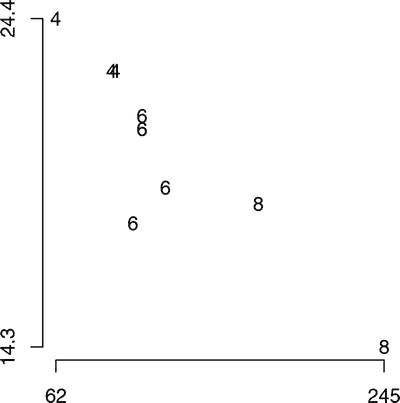
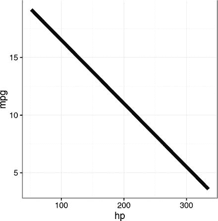
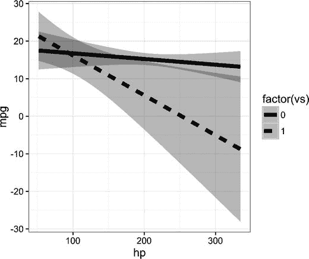

# 5. 编写类和方法

让函数根据传入对象的类型表现出不同行为通常很有帮助。例如，在汇总变量时，为数值数据或字符串数据创建不同的汇总方式是有意义的。可以为每种对象类型使用不同的函数，但这样用户必须记住许多函数名，而且为了保持名称唯一，函数名可能会更长。面向对象编程（OOP）基于对象，并在 R 中（与大多数编程语言一样）通过使用两个概念来实现：类和方法。类定义了一个模板或蓝图，描述对象的变量和特征，并确定哪些方法适用于它。例如，房子可以定义为有地板、四面墙、屋顶和一扇门。具体数据代表这些属性，例如每面墙的尺寸和颜色。方法是可以在特定对象类型上执行的行为或操作。例如，房子可以粉刷，从而改变其颜色，但房子不能吃。R 有三种面向对象系统：S3、S4 和 R5。本章将介绍最常见的 S3 和 S4 系统。

在本章中，我们将使用`ggplot2`R 包（Wickham, 2009）。以下代码加载了`checkpoint`（Microsoft Corporation, 2016）包以控制所用 R 包的具体版本，然后加载了`ggplot2`包：

```r
## 加载 checkpoint 及所需包
library(checkpoint)
checkpoint("2016-09-04", R.version = "3.3.1")
library(ggplot2)
options(width = 70) # 每行仅 70 个字符
```

## S3 系统

S3 系统是最常见的面向对象系统。它也是最容易上手、最简单的系统。S3 系统易于使用，部分原因在于它相当非正式，并且主要关注函数或方法。这些优势同时也是局限，因为 S3 系统没有提供正式的框架来确保对象满足类的要求。有关使用 S3 系统进行 R 编程的更深入指南，请参阅 W.N. Venables 和 B.D. Ripley 所著的《S Programming》（Springer, 2004）。

### S3 类

在 R 中，默认情况下可以使用某些类型或类别的对象，并且几乎所有对象都可以被视为向量或泛型向量。例如，矩阵和数组本质上是带有表示维度属性的向量。列表是泛型向量，其中向量的每个元素可能包含另一个向量。数据框是列表，其中每个元素都是一个向量，但所有向量长度相等，因此具有表格格式。向量可以保存特定类型的数据，例如逻辑型、整型、数值型（实数）或字符型。这些基础对象和类由基础包提供。S3 类是通过在基础包提供的对象和类基础上构建而创建的。

**注意**

S3 类是使用常规的 R 对象（例如，向量或列表）和类（例如，逻辑型或数值型）创建的。S3 类通过使用 `class(object) <- "class name"` 设置类名来定义。S3 对象的元素通常通过使用 `$`、`[` 或 `[[` 来访问。

实际创建 S3 类很简单。首先，创建一个满足该类要求或特性的 R 对象，然后通过使用类名标记该对象来定义 S3 类。由于 S3 类与其他 R 对象的区别仅在于具有特殊的名称或属性，因此它们可以通过使用 `$`、`[` 和 `[[` 以与其他基础 R 对象相同的方式进行访问和操作。要检查对象的类，我们可以使用 `class()` 函数。在以下示例中，查询了 `mtcars` 对象以确定其具有数据框类：

```r
class(mtcars)
[1] "data.frame"
```

要查看对象的类是如何设置的，我们可以查看基础 R 中的许多函数，例如 `table()`。在这里，我们打印 `table()` 函数的源代码，为了节省空间省略了中间部分：

```r
table
function (..., exclude = if (useNA == "no") c(NA, NaN), useNA = c("no",
"ifany", "always"), dnn = list.names(...), deparse.level = 1)
{
[为了节省篇幅而省略]
y
```

最后返回的对象 `y` 是一个数组，但具有 `table` 类。对象类是使用惯用语 `class(object) <- "class name"` 设置的。也可以为一个对象分配多个类。这与分配单个类的方式大致相同，并按优先顺序进行。以下示例将调用 `table()` 的结果存储在对象 `x` 中，然后设置两个类，首先是 `newclass`，然后是原始 `table` 类：

```r
x <- table(mtcars$cyl)
class(x) <- c("newclass", "table")
class(x)
[1] "newclass" "table"
```

分配多个类的价值在于提供了一种备份，主要用于方法。例如，如果您创建一个新类，它是表或数据框的变体，您可以为打印编写专用方法，但依赖原始类的方法来处理其他功能，例如绘图或汇总。

您可以编写的类类型几乎是无穷无尽的。一个简单的入门方法是创建现有类的特殊或增强案例。在以下示例中，我们创建了一个特殊的数据框案例，其中包含 x 和 y 坐标以及文本标签，称为 `textplot`。“创建”该类的最简单方法是创建一个数据框，然后更改其类。如果我们只使用新的类标签，调用 `print()` 函数将导致使用默认方法，但如果我们同时使用新的 `textplot` 标签和其次的数据框标签进行标记，那么调用 `print()` 将回退到数据框的方法：

```r
d <- data.frame(
x = c(1, 3, 5),
y = c(1, 2, 4),
labels = c("First", "Second", "Third")
)
class(d) <- "textplot"
print(d)
$x
[1] 1 3 5
$y
[1] 1 2 4
$labels
[1] First  Second Third
Levels: First Second Third
attr(,"row.names")
[1] 1 2 3
attr(,"class")
[1] "textplot"
class(d) <- c("textplot", "data.frame")
print(d)
x y labels
1 1 1  First
2 3 2 Second
3 5 4  Third
```

在 S3 系统中，没有正式的方法从特定类创建对象。然而，创建特定类对象的最常见方式是作为函数的输出。可以编写专用函数来创建特定类的对象，或者编写执行操作并将结果输出为特定类对象的函数。在 R 中使用 S3 系统时，后一种方法更为典型。

当您创建一个新类时，某些所需的特性或元素可能存在于现有类中。如果是这种情况，那么在现有类的基础上进行构建或扩展可能是有意义的。例如，数据框建立在列表的基础上，要求列表的每个元素都是长度相同的向量。同样，我们之前创建的 `textplot` 类建立在数据框的基础上，要求三个元素分别命名为 `x`、`y` 和 `labels`。在这种情况下，我们说 `textplot` 继承自 `data.frame`。也就是说，`textplot` 是父类 `data.frame` 的子类（注意，父类也称为超类或基类）。如果一个类只继承自另一个类，则称为单继承（即只有一个父类）。如果一个类继承自多个类，则称为多继承（即具有多个父类）。如果一个类继承自另一个类，它可能继承数据的存储特性，也可能继承方法，即用于操作特定类对象的函数。继承方法对于避免重复造轮子尤其有用。

**注意**

继承是指通过在现有类的特性和方法基础上进行构建来创建一个新类。新类称为子类，而新类派生自的类称为父类或超类。子类既可以继承父类的特性，也可以使用父类的方法。

在下一个示例中，我们编写一个小函数，使用公式接口从数据框构建一个 `textplot` 对象。该函数有两个参数：公式，称为 `f`；以及数据，称为 `d`。代码的第一部分使用第 4 章介绍的 `stopifnot()` 函数来检查传递给函数的对象类是否符合预期。为了测试类，我们使用 `inherits()` 函数，该函数评估特定对象是否属于指定的类或从其继承。例如，我们的 `textplot` 类别是数据框，因此使用 `inherits(object, "data.frame")` 进行测试的结果将为 `TRUE`。当我们构建 S4 类时，我们会看到更正式的定义和类继承系统。函数的下一部分从指定的数据框中按顺序获取公式中的所有变量，重命名列，应用我们的 `textplot` 类，并返回对象：

```r
textplot_data <- function(f, d) {
stopifnot(inherits(d, "data.frame"))
stopifnot(inherits(f, "formula"))
newdata <- get_all_vars(formula = f, data = d)
colnames(newdata) <- c("y", "x", "labels")
class(newdata) <- c("textplot", "data.frame")
return(newdata)
}
### 使用示例
textplot_data(f = mpg ∼ hp | cyl, d = mtcars[1:10, ])
y   x labels
Mazda RX4         21.0 110      6
Mazda RX4 Wag     21.0 110      6
Datsun 710        22.8  93      4
Hornet 4 Drive    21.4 110      6
Hornet Sportabout 18.7 175      8
Valiant           18.1 105      6
Duster 360        14.3 245      8
Merc 240D         24.4  62      4
Merc 230          22.8  95      4
Merc 280          19.2 123      6
```

这些示例展示了使用 S3 系统创建类是如此的容易。接下来，我们将探讨如何为现有类或新类编写方法。

### S3 方法

方法是可对特定类别的对象执行的函数或操作。即使你不编写自定义类，也可能需要编写自己的方法。编写 S3 方法就像编写我们在第 4 章中介绍的函数一样。唯一的区别在于，S3 方法具有特殊的命名约定，并且需要为用户提供一个通用函数（generic function），该函数负责将调用分派到相应的方法。

**注意**： S3 方法是遵循特定命名约定的常规 R 函数：`foo.classname()`。用户调用通用函数 `foo()`，该函数会根据作为参数传入的对象的类别，将其分派到相应的方法。如果尚不存在通用函数，则必须编写一个包含 `UseMethods()` 调用的通用函数，由它来处理实际的方法分派。

首先，让我们为我们开发的 `textplot` 对象类别编写一个简单的绘图方法。要创建一个 S3 绘图方法，我们使用函数名（此处为 `plot`），后跟类别名——`function.classname()`，或者在此例中为 `plot.textplot()`。只要我们的函数以这种方式命名，并且存在一个通用的 `plot()` 函数（我们稍后将讨论此主题），它就可以作为 S3 方法工作。

我们的绘图函数如下所示。调用 `par()` 函数可以调整图形的默认边距，以减少图形顶部和右侧的过多空白空间。结果存储在对象 `op` 中，因为它存储了原始的图形参数。然后，当函数退出时，可以在退出时调用 `par(op)` 来恢复用户的原始图形参数状态，这是你在第 4 章中学习过的一个函数。接下来，我们通过调用 `plot.new()` 创建一个新的绘图区域，并通过调用 `plot.window()` 设置新绘图的尺寸，其 x 和 y 轴范围由数据的范围决定。接着，我们使用 `text()` 函数绘制标签，该函数接收坐标和标签。最后，我们在底部（`side = 1`）和左侧（`side = 2`）添加坐标轴。原始的 `textplot` 数据对象将在函数末尾以不可见的方式返回。

```r
plot.textplot <- function(d) {
op <- par(mar = c(4, 4, 1, 1))
on.exit(par(op))
plot.new()
plot.window(xlim = range(d$x, na.rm = TRUE),
ylim = range(d$y, na.rm = TRUE))
text(d$x, d$y, labels = d$labels)
axis(side = 1, range(d$x, na.rm = TRUE))
axis(side = 2, range(d$y, na.rm = TRUE))
invisible(d)
}
```

接下来，我们需要创建一些数据，然后对它们调用 `plot()`。请注意，因为它是一个方法，我们无需使用其全名 `plot.textplot()` 来调用该函数。我们只需调用 `plot()`，R 就会根据对象类别 `textplot` 将数据对象分派到正确的方法。结果如图 5-1 所示，代码如下：


**图 5-1.** 在特定坐标处绘制文本标签的图形，演示了为自定义类使用自定义方法

```r
dat <- textplot_data(f = mpg ∼ hp | cyl, d = mtcars[1:10, ])
plot(dat)
```

这个例子展示了使用 S3 系统是多么容易。几乎不需要特殊的函数或付出额外的努力。只需以你喜欢的任何方式创建一个常规的 R 对象，添加一个自定义的类别标签，编写一个函数，并给它取一个特殊的名字——基本上这就是全部所需。不过，S3 方法也有一些特殊的函数和工具。首先，让我们看看查看 `plot()` 的源代码时会发现什么。这个通用函数只包含三个参数。函数体仅包含对 `UseMethod()` 的调用，它的作用是告诉 R 检查参数类别并分派到适当的方法。如果你正在编写方法，并且尚不存在通用函数，那么你还需要编写这个通用函数。在 S3 系统中编写通用函数是一项直截了当的任务，只需要考虑包含的默认参数：

```r
plot
function (x, y, ...)
UseMethod("plot")
```

要查看可用的方法，我们使用 `methods()` 函数。结果显示 `plot()` 有许多具体的方法，包括我们刚刚编写的 `plot.textplot`：

```r
methods(plot)
[1] plot,ANY-method               plot,color-method
[为节省空间省略]
[71] plot.table*                   plot.textplot
[为节省空间省略]
[81] plot.varclus                  plot.xyVector*
see '?methods' for accessing help and source code
```

某些函数后面带有星号，表示这些方法不是公开的或无法直接访问，例如 `plot.table()`。例如，如果我们键入其名称，会得到一个找不到该函数的错误：

```r
plot.table
Error: object 'plot.table' not found
```

**注意**： `::` 运算符用于引用特定包中公开导出的函数，主要用于多个包导出同名函数的情况：`package::foo()`。`:::` 运算符用于访问包命名空间中未导出的函数。应谨慎使用非公开函数，因为它们可能会在没有通知的情况下更改。

不公开或未从包命名空间导出的函数仍然可以作为方法访问。这些函数也可以通过指定其来源包并使用 `:::` 运算符来直接访问，从而显示函数源代码：

```r
graphics:::plot.table
function (x, type = "h", ylim = c(0, max(x)), lwd = 2, xlab = NULL,
ylab = NULL, frame.plot = is.num, ...)
{
xnam
```

除了为新类编写方法外，有时为现有类编写方法也很有帮助。例如，流行的 `ggplot2` 包没有用于处理线性模型或回归对象的默认方法。首先，我们使用内置的 `mtcars` 数据建立一个简单的回归模型。然后，我们通过调用 `factor()`，根据 `hp`、`vs`、它们的交互项（由 `hp * vs` 创建，展开为主效应项及其交互项或乘积项）以及虚拟编码的 `cyl` 来预测 `mpg`。通过对对象调用 `summary()` 来显示结果：

```r
m <- lm(mpg ~ hp * vs + factor(cyl), data = mtcars)
summary(m)
```

```r
...
Coefficients:
Estimate Std. Error t value Pr(>|t|)
(Intercept)  26.92908    2.71758   9.909 2.56e-10 ***
hp           -0.01519    0.01554  -0.978  0.33718
vs            8.53352    4.95297   1.723  0.09678 .
factor(cyl)6 -4.21121    1.93887  -2.172  0.03916 *
factor(cyl)8 -8.65096    2.69738  -3.207  0.00354 **
hp:vs        -0.09101    0.04363  -2.086  0.04692 *

Signif. codes:  0 '***' 0.001 '**' 0.01 '*' 0.05 '.' 0.1 ' ' 1
Residual standard error: 3.007 on 26 degrees of freedom
Multiple R-squared:  0.7913,  Adjusted R-squared:  0.7511
F-statistic: 19.71 on 5 and 26 DF,  p-value: 4.181e-08
```

我们可以使用以下代码检查对象的类别，并确认当前没有 `ggplot()` 方法：

```r
class(m)
[1] "lm"
methods(ggplot)
[1] ggplot.data.frame* ggplot.default*    ggplot.summaryP
[4] ggplot.transcan
see '?methods' for accessing help and source code
```

尽管 `fortify()` 函数有一个用于线性模型的方法，该方法能创建一个适用于 `ggplot()` 的数据框，但它只提取原始数据、拟合值和残差。为了展示模型的效果，将预测值绘制为其中一个变量在其他变量取特定值时的函数可能会很有帮助。下面的方法实现了一个实现此功能的系统。

它采用与 `ggplot()` 相同的基本参数，但增加了 `vars` 参数，并且模型中使用的每个变量都通过一组特定值传递，以便在预测时保持这些值。通过使用 `do.call()` 函数将列表作为参数传递给 `expand.grid()`，可以创建所有可能的变量值组合。然后，从模型公式中提取因变量（即 `yvar`）并将其转换为字符。随后生成新的预测值及其标准误。基于拟合值或预测值以及正态分位数乘以拟合标准误，生成包含下限 `LL` 和上限 `UL` 的 95%置信区间。最后，将列名从 `fit` 更改为因变量的实际名称，然后将用于预测的数据与预测值合并成一个新的数据框。最终传递给 `ggplot()`，该函数会调度到数据框的 `ggplot()` 方法。

```r
ggplot.lm <- function(data, mapping, vars, ...) {
newdat <- do.call(expand.grid, vars)
yvar <- as.character(formula(data)[[2]])
d <- as.data.frame(predict(data, newdata = newdat, se.fit = TRUE))
d <- within(d, {
LL <- fit + qnorm(.025) * se.fit
UL <- fit + qnorm(.975) * se.fit
})
colnames(d)[1] <- yvar
data <- cbind(newdat, d[, c(yvar, "LL", "UL")])
ggplot(data = data, mapping = mapping, ...)
}
```

有了这个方法，我们可以轻松地从线性回归模型生成一些图形。以下代码使用了我们的新方法，指定了预测变量的确切值，通过 `geom_line()` 添加线条，并使用 `theme_bw()` 应用黑白主题。结果如图 5-2 所示；代码如下：


**图 5-2.** 使用 `ggplot.lm()` 方法从模型预测的回归线。

```r
ggplot(m, aes(hp, mpg), vars = list(
hp = min(mtcars$hp):max(mtcars$hp),
vs = mean(mtcars$vs),
cyl = 8)) +
geom_line(size=2) +
theme_bw()
```

因为在我们的方法中使用 `expand.grid()` 创建了所有可能的预测变量组合，所以我们可以生成多条预测线，例如将 `vs` 保持在 `0` 和 `1`，如下例代码和图 5-3 所示：


**图 5-3.** 使用 `ggplot.lm()` 方法从模型预测的回归线（含置信区间）。

```r
ggplot(m, aes(hp, mpg, linetype = factor(vs), group = factor(vs)), vars = list(
hp = min(mtcars$hp):max(mtcars$hp),
vs = c(0, 1),
cyl = 8)) +
geom_ribbon(aes(ymin = LL, ymax = UL), alpha = .25) +
geom_line(size=2) +
theme_bw()
```

这些示例简要介绍了编写新类和方法或扩展现有类和方法时可以完成的工作。由于 S3 系统是 R 中最常用的系统，它可能是最重要的要学习的系统；它应用广泛，并且可以扩展许多对象类。

### S4 系统

与 S3 系统相比，S4 系统是一个正式的系统。这种形式化的好处是，能够更大程度地确保特定类的对象包含完全符合预期的内容。形式化的缺点是更高的复杂性：需要更多函数来设置类和方法，并且编程要求更加严格。S3 系统允许编写快速且粗略的代码，而 S4 系统则需要更周密的计划，并且开销更高。

对象包含三个组成部分：类（class）、槽（slot）和方法（method）。对象的名称和结构——即它所包含的内容——称为类。对象中存储的变量或其他对象称为槽。最后，可以对对象进行操作的函数称为其方法。在本节中，我们将逐一介绍这些组件。关于 S4 系统的进一步阅读，推荐 John Chambers 所著的《用于数据分析的软件：使用 R 进行编程》（Springer，2010 年）。

### S4 类

因为 S4 类更加形式化，在编写新类之前需要预先规划。与 S3 类不同，在 S4 中必须指定要包含的每个变量的名称和类型。之前我们使用 S3 系统定义了一个名为 `textplot` 的类。我们可以使用 S4 系统定义相同的类。`x` 和 `y` 参数应为数值类型，`labels` 参数应为字符型。我们还知道所有参数的长度应相同。最后，我们可能需要断言，虽然允许缺少标签，但不允许出现空白标签。所有这些都需要提前考虑和指定——因为在 S3 系统中，这些都无法控制，而在 S4 系统中，我们可以在创建类时定义所有内容。为了创建我们的第一个 S4 类，我们使用 `setClass()` 函数，如下例所示。并非每个参数都是必需的，但在定义新类时尽可能明确被认为是一种良好实践。

注意

通过调用 `setClass()` 创建 S4 类。`Class` 和 `slots` 参数是必需的。类名指定为字符向量，槽（保存变量）定义为一个命名字符向量；名称对应槽名，值对应每个槽的类。可以使用 `prototype` 参数指定一个“空”对象，并且可以通过向 `validity` 参数传递一个函数来设置有效性检查。

第一个参数 `Class` 提供类的名称。接下来，使用一个命名向量定义 `slots`，其中名称指示槽名，值指示每个槽的类型。`prototype` 参数不是必需的，但定义它有助于确定如何创建一个“空”对象，或者在没有指定具体数据时如何创建该类的一个对象。`validity` 参数也不是必需的，但允许进行明确的检查，以确保对象符合预期。R 默认确保将适当类型的对象传递给槽，但可以添加许多其他测试和有效性检查，以减少创建无法按预期工作的对象的机会。以下是 `setClass()` 示例：

```
setClass(
Class = "textplot",
slots = c(
x = "numeric",
y = "numeric",
labels = "character"),
prototype = list(
x = numeric(0),
y = numeric(0),
labels = character(0)),
validity = function(object) {
stopifnot(
length(object@x) == length(object@y),
length(object@x) == length(object@labels))
if (!all(nchar(object@labels) > 0, na.rm = TRUE)) {
stop("All labels must be missing or non zero length characters")
}
return(TRUE)
}
)
```

要在 S4 系统中创建特定类的新对象，我们使用 `new()` 函数。在接下来的代码中，我们检查创建新对象的三种尝试。首先，我们创建一个正确且有效的对象。然后，我们查看如果尝试使用错误类型的参数会发生什么。最后，我们查看一个测试我们所创建有效性函数的示例。

```
new("textplot",
x = c(1, 3, 5),
y = c(1, 2, 4),
labels = c("First", "Second", "Third"))
An object of class "textplot"
Slot "x":
[1] 1 3 5
Slot "y":
[1] 1 2 4
Slot "labels":
[1] "First"  "Second" "Third"
new("textplot",
x = c(1, 3, 5),
y = c(1, 2, 4),
labels = 1:3)
Error in validObject(.Object) :
invalid class "textplot" object: invalid object for slot "labels" in class "textplot": got class "integer", should be or extend class "character"
new("textplot",
x = c(1, 3, 5),
y = c(1, 2, 4),
labels = c("First", "Second", ""))
Error in validityMethod(object) (from #16) :
All labels must be missing or non zero length characters
```

如果我们使用 `S3` 系统定义类，则不会发生这些错误，因为不会进行类型检查或有效性检查。在前面的示例中，每次尝试创建新对象时最多出现一个错误。下一个示例有两个错误：传递给 `y` 槽位的向量与其他两个向量的长度不同，并且存在一个零长度的字符标签。然而，按照当前的写法，只有第一个错误被捕获，因为有效性函数在出现任何问题时就会停止：

```
new("textplot",
x = c(1, 3, 5),
y = c(1, 2),
labels = c("First", "Second", ""))
Error: length(object@x) == length(object@y) is not TRUE
```

编写有效性函数的另一种方法是，该函数不针对任何问题立即抛出错误，而是收集所有问题并在最后统一返回。在修改有效性函数时，我们还可以思考如何让错误信息更具信息性。目前，问题本身相当直观，但或许并非一目了然地看到具体问题是什么。例如，很明显长度不相等，但到底是 `x` 太长还是 `y` 太短？这在修订后的类定义代码中得到了实现。

然而，在深入改进有效性函数之前，我们需要简要了解如何在 `R` 中创建和格式化字符串。首先，在编写文本时，可以通过包含特殊字符 `\n` 来插入换行符。为了查看示例，我们使用 `cat()` 函数，该函数代表连接并打印，将文本输出到 `R` 控制台（如果指定了文件，则输出到其他位置）。以下两个示例除了第二个示例中 `a` 和 `b` 之间的换行符外完全相同：

```
cat("ab", fill = TRUE)
ab
cat("a\nb", fill = TRUE)
a
b
```

一个常用的函数是 `paste()`，它可以合并向量或将它们折叠起来。以下第一个示例展示了合并操作。两个向量通过 `sep` 参数定义的分隔符（本例中为空字符串）进行合并。在第二个示例中，一个包含多个元素的向量被折叠成一个单一的字符串。向量元素如何合并成一个字符串由 `collapse` 参数决定——在我们的示例中，该参数是换行符。

```
paste(c("a", "b"), c(1, 2), sep = "")
[1] "a1" "b2"
paste(c("a", "b"), collapse = "\n")
[1] "a\nb"
```

这些函数在我们编写有效性检查函数时非常有用，因为它们允许我们根据需要将多个错误合并成一个带换行符的字符串。

我们使用的另一个关键函数是 `sprintf()`。它的第一个参数是用户定义的字符串，其中包含总是以百分号（`%`）开头的特殊符号，表示需要在此处替换值。后续参数是要替换的值。用一个例子可以最清晰地展示其用法。这里，`%d` 用于表示替换一个整数，然后 `R` 会依次替换为 `98`、`80` 和 `75`。替换的顺序就是出现的顺序。

```
sprintf("First (%d), Second (%d), Third (%d)", 98, 80, 75)
[1] "First (98), Second (80), Third (75)"
```

常用的替换格式选项包括：`%d` 用于整数，`%f` 用于定点小数，`%s` 用于字符串，`%%` 用于字面上的百分号。每个选项都在下一个示例中得到了展示，更多文档可在帮助页面 `?sprintf` 中找到。对于数值，我们使用 `0.2` 来指定数字应四舍五入到两位小数。

```
sprintf("Integer %d, Numeric %0.2f, String %s, They won by 58%%",
5, 3.141593, "some text")
[1] "Integer 5, Numeric 3.14, String some text, They won by 58%"
```

掌握了 `paste()` 和 `sprintf()` 之后，我们可以着手修改 `textplot` 类的有效性函数，以提供更具信息性的错误信息，并运行所有检查，在过程中收集错误，最后一次性返回所有错误。最后一点说明：之前，我们使用 `new("classname", arguments)` 这个习语来创建特定类的新对象。虽然这完全可行，但存在一种快捷方式。函数 `setClass()` 的主要作用是通过副作用来定义一个新类，但它也会不可见地返回一个构造函数。如果我们保存对 `setClass()` 的调用结果（按照惯例，使用与类同名的对象），就可以使用结果对象来创建该类的新对象：

```
textplot <- setClass("textplot", 
    representation(x = "numeric", y = "numeric", labels = "character"),
    validity = function(object) {
        errors <- character()
        if (length(object@x) != length(object@y)) {
            errors <- c(errors, sprintf(
                "x (length %d) and y (length %d) are not equal",
                length(object@x), length(object@y)))
        }
        if (any(nchar(object@labels) == 0, na.rm = TRUE)) {
            errors <- c(errors, sprintf(
                "%d label(s) are zero length. All labels must be missing or non zero length",
                sum(nchar(object@labels) == 0, na.rm = TRUE)))
        }
        if (length(errors)) {
            stop(paste(c("\n", errors), collapse = "\n"))
        } else {
            return(TRUE)
        }
    }
)
```

现在，当我们创建同一个包含多个问题的对象时，我们将获得更多信息并节省一些按键操作。我们可以看到 `x` 和 `y` 的长度，同时也了解到标签存在问题：

```
textplot(
    x = c(1, 3, 5),
    y = c(1, 2),
    labels = c("First", "Second", ""))
Error in validityMethod(object) (from #30) :
x (length 3) and y (length 2) are not equal
1 label(s) are zero length. All labels must be missing or non zero length
```

### S4 类继承

到目前为止，你已经了解了如何定义新的 S4 类。S4 系统可能看起来比 S3 系统需要更多的工作，并且除了更正式的数据验证和错误检查之外，几乎没有其他好处。S4 系统的强大特性之一便是继承。

**注意**

S4 类可以通过调用 `setClass()` 并增加参数 `contains = "要继承的 S4 类"` 来继承现有的 S4 类。现有的槽、原型和有效性检查都会被继承。在新的 `setClass()` 调用中，只需指定新的槽以及对应的原型/有效性检查。

我们之前创建了一个简单的 `textplot` 类。现在假设尽管我们的简单类有时已经足够，但在其他时候我们可能需要更多功能。例如，有时我们可能希望深入挖掘数据，并根据某个分组变量为数据的不同子集创建一个面板图。为此，我们需要一个 `groupedtextplot` 类。然而，我们唯一需要额外增加的数据就是一个槽。一种选择是复制并粘贴我们旧的代码，然后根据需要进行修改。在本节中，我们将探讨如何利用继承来重用和扩展现有类。当一个类继承自另一个类时，前一个类中的所有槽以及有效性检查都会被继承。接下来，我们创建 `groupedtextplot` 类。这与创建一个新类类似，但我们只定义新的槽，然后通过使用 `contains` 参数来指定继承关系。由于有效性检查也会被继承，我们只需要为新的槽指定有效性检查。

```
groupedtextplot <- setClass(
Class = "groupedtextplot",
slots = c(
group = "factor"),
prototype = list(
group = factor()),
contains = "textplot",
validity = function(object) {
if (length(object@x) != length(object@group)) {
stop(sprintf("x (长度 %d) 与 group (长度 %d) 不相等",
length(object@x), length(object@group)))
}
return(TRUE)
}
)
```

只需这些少量的代码，我们就可以使用我们的新类了。在下面两个例子中，第一个例子展示了正确创建的新对象，第二个例子则展示了当我们试图创建一个无效对象时常见的错误信息：

```
gdat <- groupedtextplot(
group = factor(c(1, 1, 1, 1, 2, 2, 2, 2)),
x = 1:8,
y = c(1, 3, 4, 2, 6, 8, 7, 10),
labels = letters[1:8])
gdat
An object of class "groupedtextplot"
Slot "group":
[1] 1 1 1 1 2 2 2 2
Levels: 1 2
Slot "x":
[1] 1 2 3 4 5 6 7 8
Slot "y":
[1]  1  3  4  2  6  8  7 10
Slot "labels":
[1] "a" "b" "c" "d" "e" "f" "g" "h"
groupedtextplot(
group = factor(c(1, 1, 1, 1, 2, 2, 2, 2)),
x = 1:8,
y = c(1, 3, 4, 2, 6, 8, 7),
labels = c(letters[1:7], ""))
Error in validityMethod(as(object, superClass)) (from #30) :
x (长度 8) 与 y (长度 7) 不相等
1 个标签长度为零。所有标签必须缺失或长度非零
```

在这种情况下，`textplot` 被称为父类，而 `groupedtextplot` 被称为子类。这种关系可以用图表示（有时对于复杂的继承关系，画图会很有帮助）。按照惯例，这种关系在图形上用箭头表示，箭头从子类指向父类，例如 `textplot <- groupedtextplot`。同样按照惯例，父类通常放在左边，或者如果从上到下绘图则放在上方。尽管本书只涉及单亲继承，但类可以从多个父类继承，而这些父类也可以从其他父类继承，以此类推。正是在这些情况下，可视化图表会特别有用。使用继承而非编写一个全新的类的另一个好处是，方法也会被继承。这意味着我们可以重用父类的槽以及为父类编写的方法，这是下一节将讨论的主题。

### S4 方法

除了之前看到的用于显示给定函数可用方法的 `methods()` 函数之外，在 S4 系统中，我们可以使用 `showMethods()` 来查找方法。由于有了更正式的类系统，`showMethods()` 可以用来显示特定函数的所有方法，或者通过使用 `classes = "class name"` 参数来显示特定类（针对任何函数）的所有方法。如果你正在使用一个新类，并且想知道已经有哪些方法被编写并可用，这将非常有帮助。

`注意`

可以通过使用 `showMethods("泛型函数")` 来检查可用的 S4 方法。新的 S4 方法通过调用 `setMethod()` 来定义。主要的三个参数是 `f`、`signature` 和 `definition`，分别包含泛型函数的名称（字符串）、将分派到此方法的 S4 类名称（字符串）以及作为实际方法的函数。

要在 S3 系统中编写新方法，我们只需编写具有特殊命名约定的函数。要定义 S4 方法，我们使用 `setMethod()` 函数。我们可以为现有类编写新方法，当然也可以为新类编写方法。对于一个新类，需要为 `show()` 提供一个方法。当在控制台中简单地输入一个对象时，R 通过调用 `show()` 来显示它。如果没有为新类提供 `show()` 方法，默认的打印输出会相当难看，正如你到目前为止在我们的示例中看到的那样。

在下面的代码中，我们为 `textplot` 类定义了一个新方法。第一个参数是我们为其创建方法的函数名称。下一个参数是签名，即类的名称。在这种情况下，因为 `show()` 只接受一个参数，所以只需要指定一个类名。对于具有多个参数的函数，签名可能会变得更加复杂，根据多个参数的类有不同的方法。最后，我们编写函数，即方法的定义。代码相对简单，使用 `cat()` 函数来显示值。参数 `fill = TRUE` 的作用是添加换行符，以便每行以 `X:` 或变量标签开头，然后是值。使用 `head()` 函数来获取最多前五个值，如果值更少则获取全部。

```r
setMethod(
f = "show",
signature = "textplot",
definition = function(object) {
cat("     X: ")
cat(head(object@x, 5), fill = TRUE)
cat("     Y: ")
cat(head(object@y, 5), fill = TRUE)
cat("Labels: ")
cat(head(object@labels, 5), fill = TRUE)
})
[1] "show"
```

R 回显了我们刚刚为其创建方法的泛型函数 `show()` 的名称。现在，当我们创建一个 `textplot` 类对象时，会得到更漂亮的输出：

```r
dat <- textplot(
x = 1:4,
y = c(1, 3, 5, 2),
labels = letters[1:4])
dat
X: 1 2 3 4
Y: 1 3 5 2
Labels: a b c d
```

一旦我们开始定义方法，类继承的好处就变得更加明显。因为 `groupedtextplot` 继承自 `textplot`，如果没有为 `groupedtextplot` 定义方法，它会回退到 `textplot` 的方法（如果可用的话）。尽管并不完美（因为没有显示分组信息），但这仍然比默认输出要好：

```r
gdat
X: 1 2 3 4 5
Y: 1 3 4 2 6
Labels: a b c d e
```

接下来，我们为 `[` 函数定义一个方法，该函数用于子集化数据。这个函数更复杂，因为我们必须构建一个逻辑树来处理几种可能的参数组合。函数的第一个参数 `x` 是要被创建子集的对象。按照惯例，`i` 指行或观测值，`j` 指列或变量。如果只有 `i` 不缺失（即指定了行或观测值），通常包含所有变量。如果只指定了 `j`（变量），通常包含所有观测值。如果两者都指定了，则只包含选定的变量和观测值。这是通过使用一系列 `if` 和 `else if` 语句来实现的。这里涉及到三个新函数：

- `validObject()` 是一个通用函数，用于对特定对象类执行有效性检查（如果存在）。
- `slotNames()` 返回一个字符向量，给出每个槽位的名称。
- `slot()` 的工作方式与 `@` 运算符类似，但可以使用字符串按名称提取槽位。

设置方法后，展示了其使用的几个示例：

```r
setMethod(
f = "[",
signature = "textplot",
definition = function(x, i, j, drop) {
if (missing(i) & missing(j)) {
out <- x
validObject(out)
} else if (!missing(i) & missing(j)) {
out <- textplot(
x = x@x[i],
y = x@y[i],
labels = x@labels[i])
validObject(out)
} else if (!missing(j)) {
if (missing(i)) {
i <- seq_along(x@x)
}
if (is.character(j)) {
out <- lapply(j, function(n) {
slot(x, n)[i]
})
names(out) <- j
} else if (is.numeric(j)) {
n <- slotNames(x)
out <- lapply(j, function(k) {
slot(x, n[j])[i]
})
names(out) <- n[j]
} else {
stop("j is not a valid type")
}
}
return(out)
})
dat[]
X: 1 2 3 4
Y: 1 3 5 2
Labels: a b c d
dat[i = 1:2]
X: 1 2
Y: 1 3
Labels: a b
dat[j = 1]
$x
[1] 1 2 3 4
dat[j = "y"]
$y
[1] 1 3 5 2
dat[i = 1:2, j = c("x", "y")]
$x
[1] 1 2
$y
[1] 1 3
```

在为我们定义的 `textplot` 类定义了 `show` 和 `subsetting` 方法后，我们可以通过按组循环对象、子集化并显示每个子集，轻松利用这些方法来为我们的 `groupedtextplot` 类编写一个 `show` 方法：

```r
setMethod(
f = "show",
signature = "groupedtextplot",
definition = function(object) {
n <- unique(object@group)
i <- lapply(n, function(index) {
cat("Group: ", index, fill = TRUE)
show(object[which(object@group == index)])
})
})
gdat
Group:  1
X: 1 2 3 4
Y: 1 3 4 2
Labels: a b c d
Group:  2
X: 5 6 7 8
Y: 6 8 7 10
Labels: e f g h
```

## 总结

本章介绍了用于开发新类和方法 的 R 语言中的 S3 和 S4 系统。特别是 S4 系统可能比较复杂，涉及多重父类继承以及针对多个参数类进行特化的方法。即使你使用并在 R 中进行开发，你可能也很少开发新类，因为大多数数据类型都已经有现成的类。然而，开发或扩展现有方法通常很有帮助，至少理解类和方法的运作方式可以让你更容易地使用现有功能。

希望本章足以让你开始使用这些系统并了解其能力。表 5-1 描述了本章涵盖的关键函数。在第 6 章中，我们将函数、类和方法捆绑在一起，制作我们自己的 R 包。重点在于制作一个 R 包，因此你无需对类和方法的掌握过于熟练。如果你的工作能受益于 S4 系统的使用，你可以从 John Chambers 的“How S4 Methods Work”（在线获取于 `http://developer.r-project.org/howMethodsWork.pdf`）中获得更深入的介绍。如果你打算使用 S4 系统并需要深入学习，我们推荐《Software for Data Analysis: Programming with R》一书。另一本更侧重于通用 R 编程和较旧的 S3 系统的好书是《S Programming》。

**表 5-1.** 本章描述的关键函数

| 函数 | 功能 |
| --- | --- |
| `class()` | 返回对象的类（S3/S4）。 |
| `inherits()` | 检查对象是否属于某个类或继承自该类。 |
| `methods()` | 返回给定函数的可用方法列表。 |
| `showMethods()` | 返回给定函数的可用方法列表，或者如果使用了 `classes` 参数，则返回给定类的任何函数的可用方法列表。 |
| `:::` | 允许访问包中未导出（非公共）函数的运算符。 |
| `function.class()` | 命名 S3 方法的通用方案，使用函数名，后跟一个点，再跟应用该方法的对象类名。 |
| `setClass()` | 定义一个新的 S4 类。 |
| `setMethod()` | 为特定 S4 类的特定函数定义方法。 |
| `@` | 在 S4 系统中按名称访问对象槽位的底层方式，类似于其他 R 对象或 S3 类对象的 `$`。 |
| `new()` | 创建一个特定类的新的 S4 对象。 |
| `paste()` | 拼接字符串。可以对多个向量进行操作，或将单个向量的所有元素拼接在一起。 |
| `sprintf()` | 格式化字符串，并允许将数字和其他字符串代入已定义的模板中。用于生成信息丰富的错误消息或其他用户消息。 |
| `show()` | 显示 R 对象的通用函数。也是你在 R 控制台输入对象名时调用的默认函数。 |
| `[]` | 用于子集化数据或访问特定变量/行的运算符/通用函数。在 S4 系统中，对于新类，必须定义方法，否则该函数不可用。 |
| `head()` | 列出对象的前几个元素或行。 |
| `validObject()` | 通用函数，通过使用创建类时指定的有效性检查（如果有），来检查 S4 类对象是否有效。在对象创建时默认调用，也可以在修改对象后显式调用以检查其是否仍然有效。 |
| `slotNames()` | 返回 S4 类对象的所有槽位名称，类似于其他 R 对象或 S3 类对象的 `names()`。 |
| `slot()` | 可用于访问 S4 对象的特定槽位。 |