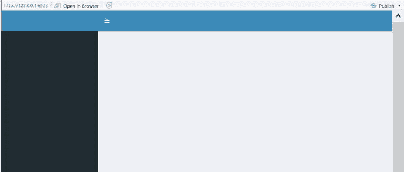

# 运行应用程序
shinyApp(ui = ui, server = server)
```

这段代码从一开始就值得一看，因为它突显了所有 Shiny 应用程序都由用户界面和承载 R 代码逻辑的服务器端组成——这两者本身都是作为一个 R 进程运行的（可能在云服务器上）。我们打算在这个结构中添加的，只是用户界面端的一些代码。这应该很容易理解，因为仪表板更多关乎用户界面，而非任何新的代码逻辑。其目标是让分析和统计推断对用户来说易于获取。为此需要安装一个新的库，但只有一个，那就是 `shinydashboard` (Chang, 2015)。在 RStudio 的命令行中，继续运行以下代码：

```
install.packages("shinydashboard")
```

安装好这个新包后，我们现在可以看看最简单的 Shiny 仪表板应用程序了。仪表板包含一个标题栏、一个带有各种菜单项的侧边栏，以及容纳应用程序不同对象的主体部分。请对比这个仪表板代码布局与单个应用程序的代码。两个版本几乎相同。在代码之后，请查看图 14-1 中它们生成的效果。



图 14-1. 最简单的 Shiny 仪表板相当空旷

```
library(shiny)
library(shinydashboard)

