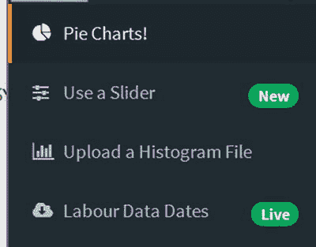
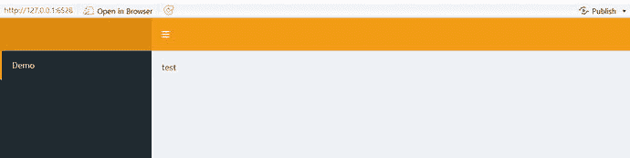

# shinydashboard 组件

如前面代码所示，我们定义了服务器 `server <- shinyServer(function(input, output) {})` 并运行了应用程序 `shinyApp(ui = ui, server = server)`。我们有三个函数：`dashboardHeader()`、`dashboardSidebar()` 和 `dashboardBody()`。它们为我们的仪表板提供了良好的结构。它们都位于 `dashboardPage()` 内部，作为页面函数的五个形式参数中的前三个。最后两个参数包括 `title`（默认为 `NULL`）和 `skin`（取值为 `blue`、`black`、`purple`、`green`、`red` 或 `yellow` 颜色之一）。正如您可以通过 `formals(dashboardPage)` 命令自己看到的那样，该页面函数确实足够简单。`title` 参数控制浏览器本身（或在大多数流行浏览器中打开的多个标签页上的浏览器标签页）中的标题。`skin` 颜色选项控制仪表板的整体调色板。前三个形式参数本身也是函数，并且变得相当复杂。尽管如此，我们将依次讨论所有这三个。

### 仪表板标题

`dashboardHeader()` 函数也接受一个 `title` 形式参数，用于将用户定义的文本添加到标题区域，以及一个 `titleWidth` 参数来控制该文本的宽度。标题还接受其他几个 Shiny 用户界面风格的函数来控制页面导航，以及一些更专门的函数，允许更交互式的导航。在本章以及本书中，我们基本上忽略这些函数，以将 `shiny` 和 `shinydashboard` 作为向数据消费者提供已经熟悉的 R 代码的方式，而不是一次学习太多新功能。事实上，我们为这个函数提到的最后一个参数是 `disable`，它默认为 `FALSE`，当设置为 `TRUE` 时会完全隐藏标题。在我们的示例中，我们将以几乎空白的状态保留标题。

### 仪表板侧边栏

接下来是 `dashboardSidebar()` 函数，唯一明确列出的形式参数同样是 `disable` 选项和一个 `width` 参数。然而，这里除了列出的函数外，还有更多可能的函数。首先要知道的是，来自 `shiny` 的任何用户界面函数都可以在侧边栏中使用。因此，如果在菜单中放置滑块或下拉输入函数有意义，那是可能的。不过，也有一些仪表板库独有的函数适合放置在侧边栏区域。

第一个是 `sidebarMenu()` 函数。与 `dashboardSidebar()` 本身类似，该函数主要接受其他输入，并以高效的方式处理它们的组织。特别值得注意的是 `menuItem()` 函数，它在 `sidebarMenu()` 内部被调用。在这个示例中，我们将前一章创建的每个应用程序都放在它们自己的 `menuItem()` 调用中。如以下代码所示，此函数有几个形式参数：

```R
formals(menuItem)
$text
$...
$icon
NULL
$badgeLabel
NULL
$badgeColor
[1] "green"
$tabName
NULL
$href
NULL
$newtab
[1] TRUE
$selected
NULL
```

在上述函数和形式参数中，`text` 接受带引号的文本字符串，为该菜单上的特定项目提供文本信息或链接名称。`icon` 参数被赋予一个 `Font-Awesome` 图标的名称。我们在本章的参考部分提供了一个在线库的链接，展示了所有可能的图标选择。我们也可以切换到不同的图标库；我们将此类探索留给你们。`badgelabel` 调用在侧边栏的最右侧放置一个内联徽章，用于容纳一小段文本。徽章在将查看者的注意力吸引到特定菜单项目并因此吸引到底层应用程序方面做得很好。这些形式参数中有许多是可选的；但是，必须有一个与仪表板主体中的相关 `tabItem()` 链接的 `tabName`，或者必须为 `href` 命令提供一个 `URL`。如果提供的是 `URL` 而不是 `tabName`，那么如果您希望查看者在访问该页面时离开您的站点，可以将 `newtab` 从默认值 `TRUE` 更改为 `FALSE`。最后，通过将 `selected` 设置为 `TRUE`，可以将默认选项卡从第一个 `menuItem()` 强制更改为特定选项卡。

当我们把注意力转向仪表板的主体时，提醒您侧边栏也可以接受任何 Shiny 函数，例如 `img()` 函数，它指向一个必须包含在仪表板应用程序文件夹内名为 `www` 的文件夹中的图像。我们展示了我们示例菜单的一个代码片段（尚未运行）以及图 14-2 中的结果。前三个菜单项的名称应该从前一章中熟悉。


图 14-2. 一些 `sidebarMenu()` 和 `menuItem()` 函数的结果

```R
sidebarMenu(
menuItem("Pie Charts!", tabName = "PieChart_Time", icon = icon("pie-chart")),
menuItem("Use a Slider", tabName = "slider_time", icon = icon("sliders"), badgeLabel = "New"),
menuItem("Upload a Histogram File", tabName = "Upload_hist", icon = icon("bar-chart")),
menuItem("Labour Data Dates", tabName = "labour", icon = icon("cloud-download"), badgeLabel = "Live")
)
```

### 仪表板主体

如前面的代码所示，每个菜单项都有一个 `tabName`。我们现在将讨论 `dashboardBody()` 函数内部的代码，该代码将捕获那个 `tabName`。请查看以下代码和图 14-3 中的小（虽然不是最小的）Shiny 仪表板，然后我们将逐步介绍新行。


图 14-3. 一个侧边栏中有 `menuItem()`、主体中有 `tabItem()` 的仪表板。注意匹配的 First。

```R
library(shiny)
library(shinydashboard)
```