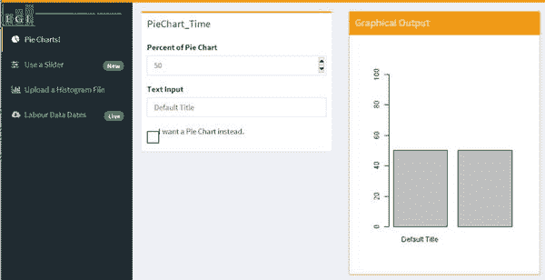
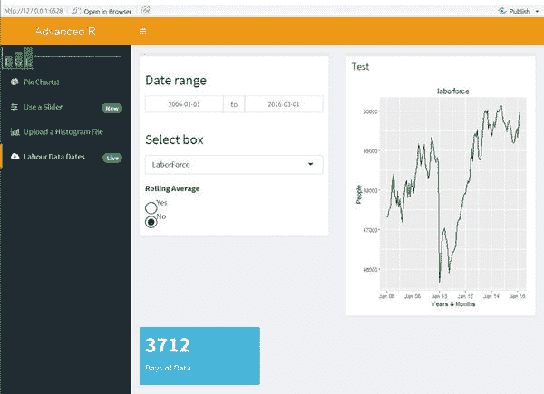

# 定义服务器

```r
server <- shinyServer(function(input, output) {})
```

# 运行应用

```r
shinyApp(ui = ui, server = server)
```

仪表盘主体中可以放置许多项目。但是，如果我们想使用在侧边栏部分编写的标签页，就需要调用`tabItems()`。这个函数除了单个的`tabItem()`函数调用外不接受任何参数；每个`tabItem()`调用都需要有一个唯一的`tabName`，与`sidebarMenu()`中的唯一`tabName`相匹配。

每个`tabItem()`里面放什么呢？就像在 Shiny 中一样，使布局足够灵活，以便仪表盘能够适应不同大小的浏览器窗口是有好处的。因此，常用的`fluidRow()`函数会再次出现。回想一下，`fluidRow()`设置的最大行宽为 12。记住这一点，请密切注意我们将要讨论的用于填充这些行的三个框对象的默认宽度。当然，不止这三个对象；我们的目标是让您快速达到能够通过云端向用户或利益相关者提供数据服务的水平。

## 框对象

行中最基本的输入元素是`box()`。在这个函数内部，我们可以放置前一章中使用的任何应用代码，无论是用于获取用户输入还是输出响应式内容。不过，`box()`也接受九个特定参数。自然地，每个`box()`可以接受一个`title`值，这是一个用户定义的文本字符串，应简洁地描述框的内容或所需的操作。框的底部还有一个`footer`，也可以接受一个文本字符串。框还有一个`status`，可以设置为`primary`、`success`、`info`、`warning`或`danger`。每个状态值都有一个关联的颜色，这些颜色是默认层叠样式表结构的一部分，使得`shinydashboard`看起来相当美观。颜色相当一致，尽管根据您为整个仪表盘选择的颜色可能会有一些差异。

`solidHeader`的默认值是`FALSE`，当然，这可以改为`TRUE`。选择`TRUE`只会将状态的颜色增强为`title`文本的狭窄横幅背景。如果您希望框的主体区域具有特定颜色，可以将`background`设置为大约 15 种有效颜色选择之一。顾名思义，任何输入代码和输出代码都位于该`background`之上。

框的默认`width`是`6`，所以除非采取措施缩小它们，否则两个框会填满一行。如果不注意保持`fluidRow()`总宽度为`12`，可能会导致一些奇怪的布局。框的`height`也可以设置为固定高度。如果您需要非常整齐的行，这会很有帮助。最后，框是`collapsible`的，并且可能已经`collapsed`，尽管这两个选项的默认值都是`FALSE`。


*图 14-4. 一个包含两个框和多个选项的熟悉应用——详见完整采样器代码*

### `valueBox()`

另一种类型的框是`valueBox()`，它接受六个正式参数。第一个是`value`，通常是一个短文本字符串或数值。`valueBox()`还接受一个`subtitle`参数，同样是一个文本字符串。您可以选择一个`icon`，尽管默认值是`NULL`。这些框的默认`color`是`aqua`，并且相当短，默认`width`仅为`4`。最后，`valueBox()`也接受一个`href`值，默认为`NULL`。我们在此展示采样器中数值框使用的代码：


*图 14-5. 示例`valueBox()`，显示从网站实时获取的数据天数*

```r
valueBox(endYear-startYear, "Days of Data", icon = icon("calendar"))
```

### `infoBox()`

我们以`infoBox()`结束对`dashboardBody()`框的讨论，这是一个与`valueBox()`类似的框。这个框有一个接受文本字符串的`title`，一个在框中突出显示的`value`，可选的`subtitle`文本，以及默认的条形图`icon`。它的`color`默认也是`aqua`，`width`默认为`4`，`href`默认为`NULL`。不同之处在于`icon`更小，并且有一个`fill`选项（通常为`FALSE`），可以改变背景颜色的显示方式。我们不展示这个框，但它看起来与图 14-5 中的小框非常相似。根据我们的经验，这些框除了外观之外没有显著差异。