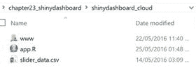
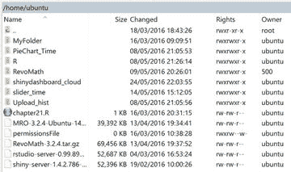

# 云端仪表盘

我们确实希望将这个仪表盘部署到云实例中，这涉及一组稍复杂的代码。我们再次使用`RStudio`在标准的`Shiny`文件夹中创建了它，因此它有自己的文件结构。在`Windows`上的文件结构如图 14-6 所示。我们的`shinydashboard_cloud`文件夹中有三个文件。注意`www`文件夹，它存放我们采样器的图像，然后是`app.R`文件，它包含我们整个`Shiny`应用以及`CSV`文件。


*图 14-6. `shinydashboard_cloud`的文件结构*

我们使用`WinSCP`将文件和文件夹上传到我们的`Ubuntu`云实例，如图 14-7 所示。


*图 14-7. `WinSCP`上传文件夹视图*

登录`PuTTY`后，我们确实有一些工作要做。我们的采样器使用了一些新的库，并且，当然，文件需要从用户文件夹移动到`Shiny`服务器期望它存放的位置。为简洁起见，我们只安装尚未在云实例上安装的包。

新包中的第一个是`XML`，这个包提供了从`Web`实时读取`HTML`表格的能力。各种政府和非营利机构将数据存储在此类表格中，以便公众轻松访问。我们还安装了`zoo`包，它为时间序列提供了方便的函数。已经熟悉的包是`ggplot2`和`data.table`，它们处理图形绘制并提供更高级的数据框结构。

以下命令在我们的实例上为所有用户逐一安装五个新库，然后复制文件以便可以通过浏览器访问。我们还安装了一些`Ubuntu`上必需的软件以允许`XML`包运行。为便于阅读，我们将其中一些命令分组。它们应在`PuTTY`中逐行运行，每个命令执行后屏幕上会打印一些文本。

```
sudo su - -c "R -e \"install.packages('shinydashboard', repos='https://cran.rstudio.com/')\""
sudo apt-get install libcurl4-openssl-dev libxml2-dev
sudo su - -c "R -e \"install.packages('XML', repos='https://cran.rstudio.com/')\""
sudo su - -c "R -e \"install.packages('zoo', repos='https://cran.rstudio.com/')\""
sudo su - -c "R -e \"install.packages('data.table', repos='https://cran.rstudio.com/')\""
sudo su - -c "R -e \"install.packages('ggplot2', repos='https://cran.rstudio.com/')\""
sudo cp -R ∼/shinydashboard_cloud /srv/shiny-server/
```

至此，我们关于`Shiny`和`Shiny`仪表盘的工作就完成了。您的仪表盘应该可以在`http://您的实例 IP 地址:3838/shinydashboard_cloud/`地址访问，并通过您的网络浏览器查看。在结束本章之前，我们还有几点说明。

首先，我们强烈建议您访问`Apress`网站上这本教科书的页面，并下载本章的代码包。它包含了完整、可用的文件和文件夹，如图 14-6 和图 14-7 所示。您无需手动键入所有这些代码来了解仪表板是否是您想要的功能。

其次，本章节中我们并未提供完整的示例代码。我们将这部分内容留到了最后，以确保所有内容在一个统一、连贯的整体中，并将您的注意力集中在示例代码中需要寻找的特定结构上。

第三，我们提醒您，如果您遵循了我们关于`AWS`服务器入站策略设置的安全建议，您可能需要更改这些设置，以允许除您自己之外的更多人查看您的最终仪表板项目。请记住，您需要在入站设置中更改的是允许从`0.0.0.0/0`（整个互联网）访问端口`3838`。请注意，整个互联网都将能够访问您的仪表板。如果您有敏感数据，甚至是不需要公开的信息，请考虑与`IT`专业人员或至少是`IT`高级用户合作。

最后，我们希望您和我们一样喜欢本章内容及成果。请务必探索“参考文献”部分的链接。您会找到有价值的信息，包括附加函数、完整的图标列表、第二个图标库，以及`shiny`和`shinydashboard`包的最新信息。这些包的更新相当频繁，新功能通常能带来出色的效果。

## 完整示例代码

```
library(shiny)
library(shinydashboard)
library(XML)
library(zoo)
library(data.table)
library(ggplot2)
#this code will run just once each time a session is instantiated - there may be multiple viewers in the same session.
slider_data=xlow]
yValue =4){  blsSub[,(yValue):=rollmean(get(yValue), k=3, na.pad = TRUE)] }
ggplot(data = blsSub, mapping = aes_string("Date", yValue)) +
geom_line()+
xlab("Years & Months")+
ylab("People")+
xlim(xlow, xhigh)+
ggtitle(yValue)+
scale_x_date(date_labels = "%b %y")
}) })

# Run the application
shinyApp(ui = ui, server = server)
```