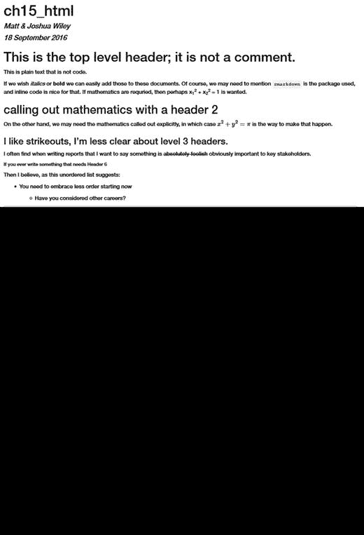

# 15. 动态报告与云端

在前面的章节中，您了解了`Shiny`如何基于动态数据提供交互式环境。动态报告和实时仪表板有许多相似之处。另一方面，由于报告最终会生成为PDF，本章的交互性较低。报告是许多领域的常态，相关方通常需要的是时间点的快照，而非完全交互式的环境。通过`knitr`和`rmarkdown`包，我们可以基于数据输入创建文档（例如 PDF、HTML 或 Microsoft Word）。对于基于持续变化的数据但整体结构相同的定期报告来说，这是一个巨大的时间节省工具。

`rmarkdown`包（Xie, 2015）增加了将 R 流程嵌入此类文档的功能，允许一键分析，并使用多种样式进行精美的格式化。LaTeX 接口几乎可以实现任何所需的格式，尽管除了 PDF 还有其他选项。从基于从学生信息系统数据库实时拉取数据的招生董事会报告，到基于关键绩效指标绘制的战略计划行动表，当变量输入需要形成标准化输出时，动态报告效果最好。`knitr`和`formatR`包（Xie, 2015）也促进了这一点。

此外，在本章中，我们使用了`evaluate`包（Wickham, 2016）和`tufte`包（Xie, 2016）。这些包使我们能够更优雅地组织数据的布局和格式。我们还使用`ltm`包（Rizopoulos, 2006）进行心理测量测试。

本章的目标是增强我们本地和云端机器的软件环境，以便编译动态文档，探索独立`rmarkdown`的结构，开发一个允许用户上传数据然后下载 PDF 报告的 Shiny 页面，最后将所有内容推送到我们的云端实例。我们从所需软件开始。

## 所需软件

我们已经拥有了所需的大部分软件，即 R、`Shiny`包（Chang, Cheng, Allaire, Xie, and McPherson, 2016）、`PuTTY`以及我们在 Ubuntu 上的云实例。我们需要安装一些新的包——无论是在本地机器还是云端服务器上。

## 本地机器

首先，在您的 R 控制台中，重要的是运行以下代码，不依赖任何 R 文件：

```
install.packages("rmarkdown")
install.packages("tufte")
install.packages("knitr")
install.packages("evaluate")
install.packages("ltm")
install.packages("formatR")
```

安装完这些包之后，我们将注意力转向安装 `MiKTeX` (Schenk, 2009)，它能够创建 PDF 文件。只需快速访问 `MiKTeX` 网站 (`http://miktex.org/download`)，你就可以获取推荐的 basic 安装程序（32 位）或其他 basic 安装程序（64 位）。我们在系统上使用 64 位版本，尽管在本章中，不同版本之间可能不会有太大差异。下载完成后，在安装过程中接受所有默认设置。安装完成后，`MiKTeX` 包可能会有更新。要执行这些更新，请前往你的开始文件。在名为 `MiKTeX` 的文件夹中，你会在末尾附近找到 `Update` 选项。按照默认选项操作，然后选择所有包以更新到最新版本。虽然不是必须的，但我们建议在此次安装后重启计算机。

### 云实例

使用 `PuTTY` 访问你的云实例控制台。我们需要在控制台逐行运行以下代码。回想一下前面的章节，这些代码是为该服务器的所有用户（而不仅仅是你的用户）安装这些包。这是允许 `Shiny` 服务器访问正确包的关键。

```bash
sudo su - -c "R -e \"install.packages('rmarkdown', repos = 'http://cran.rstudio.com/')\""
sudo su - -c "R -e \"install.packages('tufte', repos = 'http://cran.rstudio.com/')\""
sudo su - -c "R -e \"install.packages('knitr', repos = 'http://cran.rstudio.com/')\""
sudo su - -c "R -e \"install.packages('ltm', repos = 'http://cran.rstudio.com/')\""
sudo su - -c "R -e \"install.packages('formatR', repos = 'http://cran.rstudio.com/')\""
sudo su - -c "R -e \"install.packages('data.table', repos = 'http://cran.rstudio.com/')\""
```

上述代码不会花费很长时间。然而，安装 `texlive`（Ubuntu 中用于替代 `MiKTeX` 的 LaTeX 解决方案）可能需要一些时间。它还需要相当大的磁盘空间，所以请确保你有足够的空间。在我们的试验中，需要完整版本。

```bash
sudo apt-get install texlive-full
```

之后，我们建议执行 `sudo reboot` 来重启你的云实例。这是做这件事的好时机，然后暂时关闭 `PuTTY`。当你的服务器重启时，你可以使用本地机器来探索动态文档。

## 动态文档

动态文档并非必须以任何方式链接到互联网。实际上，大多数报告可能都是内部的。在 `RStudio` 中，选择 File ➤ New File ➤ `R Markdown` 会打开一个向导。注意，其中有文档（例如，HTML、PDF 或 Word）以及演示文稿（例如，HTML 或 PDF）选项。通常需要提供一个标题，以及列出作者。当然，`RStudio` 并非必需；在 R 中创建一个以 `.Rmd` 后缀结尾的新文件就足够了。

我们打算采用一种混合的方法来介绍动态文档。也就是说，我们首先给出一个直观且信息丰富的示例，展示这类代码的样子，然后我们再对该代码的每个部分进行更深入的分析。我们从创建一个名为 `ch15_html.Rmd` 的新文件开始，并用以下代码填充它：

```
---
title: "ch15_html"
author: "Matt & Joshua Wiley"
date: "18 September 2016"
output: html_document
---

```{r echo=FALSE}
## notice the 'echo=FALSE'
## it means the following code will never make it to our knited html
library(data.table)
diris <- as.data.table(iris)
## it is still run, however, so we do have access to it.
```
# 这是一级标题；它不是注释。
这是纯文本，不是代码。
如果我们想要*斜体*或**粗体**，我们可以轻松地将它们添加到这些文档中。当然，我们可能需要提到 `rmarkdown` 是所使用的包，而内联代码很适合用来提及它。如果需要数学公式，那么可能需要 $x_1^2 + x_2^2 = 1$。
## 使用二级标题来调用数学公式
另一方面，我们可能需要显式地调用数学公式，在这种情况下，$x^{2} + y^{2}= \pi$ 是实现它的方式。
### 我喜欢删除线；我不太确定三级标题的用法。
在撰写报告时，我经常发现我想说某事是~~绝对愚蠢的~~与关键利益相关者明显相关的。
###### 如果你曾经写过需要六级标题的内容
那么我相信，正如这个无序列表所暗示的：
* 你需要从现在开始拥抱更少的秩序
- 你是否考虑过其他职业？
```{r echo=FALSE}
summary(diris)
```
然而，请注意，可以同时包含代码和控制台输出：
```{r}
hist(diris$Sepal.Length)
```
```

编织上述代码的结果如图 15-1 所示。



**图 15-1.** 一个简单动态文档的 HTML 输出

正如你所想象的，正是摘要数据或图形可以根据任何输入轻松地重新生成。事实上，其中一位作者使用动态文档为入门统计学课程的学生创建了案例研究（以及案例研究答案）。使用不同的种子生成伪随机数据非常容易，这允许每个学生拥有独特的数据集（以及几个主题）。它还允许为快速评分提供解答密钥。

现在你已经对 `Rmarkdown` 有了一个概览，让我们以合理的代码块来探索之前的代码。第一个代码块是 YAML，它代表 Yet Another Markup Language 或者可能是递归定义的 `YAML Ain’t Markup Language` (YAML, 2016) 头部。在最简单的情况下，它可能只包含关于标题、作者、日期和输出类型的信息。在这里，对于本文档，我们选择了 `html_document`。然而，如前所述，还有更多的选项，例如 `pdf_document`、`word_document`、`odt_document`、`rtf_document` 和 `beamer_presentation`（仅举几例——实际上还有更多）。这些类型分别创建 HTML 页面、PDF、Microsoft Word 文件、OpenDocument 或富文本，以及 Beamer PDF 幻灯片。`Beamer` 和 PDF 都需要我们之前完成的 `MiKTeX` 安装。要更改编译的文档类型，只需更改输出！值得注意的是，第一次使用 `MiKTeX` 时，编译可能需要更长时间，因为可能需要在后台安装一两个包。这无需任何用户干预；只是需要时间。同样值得注意的是，如果你使用 `beamer_presentation`，则需要考虑一张幻灯片上能放什么和不能放什么。在这种情况下，一个回车符后跟 `----`，再跟另一个回车符，表示演示文稿中的新幻灯片。

```
---
title: "ch15_html"
author: "Matt & Joshua Wiley"
date: "18 September 2016"
output: html_document
---
```

头部可以比这更复杂。可以使用 `` `r code goes here` `` 格式内联注入 R 代码。因此，我们可以通过在我们的代码中将 `date: "18 September 2016"` 替换为 ``date: "`r Sys.Date()`"`` 来使日期更具动态性。有数十种渲染选项可与 YAML 头部一起使用，比我们更聪明的人已经创建了使用这些头部变体以及设置多个不错选项的模板。就像在 `Shiny` 中一样，几乎可以无限制地自定义文档的输出和显示方式。

我们的 Markdown 代码接下来的部分是一个代码块。代码块以 ````{r }`` 开头，以 ```` ``` ```` 结束。这两者之间的内容就是你的代码。现在，在 `{r }` 内部有几个有用的选项。如果你的部分代码计算量大且大部分是静态的，你可能希望设置 `cache = TRUE` 而不是默认的 `FALSE`。这会存储结果。我们经常使用 `echo=FALSE`，它可以防止显示代码本身，但不会阻止代码结果的显示。请注意，在接下来的第一个代码块中，我们的最终文档里没有任何代码运行过的迹象。然而，第二个代码块仍然显示了 `summary(diris)` 的结果。

```
```{r echo=FALSE}
library(data.table)
diris <- as.data.table(iris)
```

```{r echo=FALSE}
summary(diris)
```
```

对于涉及图表或图形的代码块，也有许多选项。`fig.align` 选项可以设置为 `right`、`centre` 或 `left`。对于图形，还有 `fig.height` 或 `fig.width` 的高度和宽度设置，默认单位为英寸。

```
```{r fig.align="right"}
hist(diris$Sepal.Length)
```
```

最后，是文本本身，我们在此不再重复，因为其重要性稍低。我们确实注意到，代码既可以像在标题中那样内联编写。稍后，当我们想根据计算结果提供不同的叙述文本时，你会发现这个选项非常有用。

## 动态文档与 Shiny

我们现在将注意力转向提供不仅仅是动态文档，而且是一个他人可以通过动态输入进行控制的文档。我们构建了一个简单的 `Shiny` 环境，允许用户上传一个包含学生测验成绩数据的 CSV 文件。数据编码如下：列代表测验中的具体问题；行代表每个学生；测验为多项选择题，正确回答编码为 `1`，错误回答编码为 `0`。

与前一节一样，我们将查看实现该功能所需的三个文件的所有代码。然后，我们逐行分解这些代码。对于已经熟悉 `Shiny` 的读者，请随意跳到最后一部分。我们将此代码构建在一个名为 `Chapter15` 的文件夹中。稍后，当我们上传到 Ubuntu 服务器时，我们会上传整个文件夹。

### server.R

在 `Shiny` 服务器端，我们调用各种库，然后构建所需的系统来上传我们的 CSV 文件，向用户确认其文件已上传，将该文件读入 R，将所需信息传递到我们的标记文档中，然后允许用户将该文档下载为 PDF。只需要以下 55 行代码：

```r
##Dynamic Reports and the Cloud
library(shiny)
library(ltm)
library(data.table)
library(rmarkdown)
library(tufte)
library(formatR)
library(knitr)
library(evaluate)
function(input, output) {
output$contents <- renderTable({
inFile <- input$file1
if (is.null(inFile))
return(NULL)
read.csv(inFile$datapath, header = input$header,
sep = input$sep, quote = input$quote)
})
scores <- reactive({
inFile <- input$file1
if (is.null(inFile))
return(NULL)
read.csv(inFile$datapath, header = input$header,
sep = input$sep, quote = input$quote)
})
output$downloadReport <- downloadHandler(
filename = function() {
paste('quiz-report', sep = '.', 'pdf')
},
content = function(file) {
src <- normalizePath('report.Rmd')
owd <- setwd(tempdir())
on.exit(setwd(owd))
file.copy(src, 'report.Rmd', overwrite = TRUE)
knitr::opts_chunk$set(tidy = FALSE, cache.extra = packageVersion('tufte'))
options(htmltools.dir.version = FALSE)
out <- render('report.Rmd')
file.rename(out, file)
}
)
}
```

上述代码以调用所有库开始，然后迅速进入 Shiny 的 `function(input, output) {}` 服务器端包装器。之后，主要有三个代码块。我们依次查看每一个，从 `renderTable({})` 调用开始。这会在用户界面端生成输出。具体来说，它创建了一个表格。这是一个交互式函数，当用户在用户端上传文件时，Shiny 会提醒该函数其某个输入已发生变化。这会触发代码的运行。从入口端来看，`input$datapath` 是服务器上 Shiny 存储上传文件的位置。假设确实存在一个文件，`read.csv` 可以访问该文件的数据路径，并获取有关数据是否有标题、使用了何种分隔符以及用户设置的其他一些信息。实际上，可以向用户提出更多要求，以实现更定制化的分析。在此，我们保持示例简单而有效。这次读取的结果创建了一个表格，并将该表格存储在名为 `contents` 的输出变量中。这会产生一个净效果，即 Shiny 现在会提醒用户界面端有可用的输出。我们将在本章后面看到该输出去了哪里。

```r
output$contents <- renderTable({
inFile <- input$file1
if (is.null(inFile))
return(NULL)
read.csv(inFile$datapath, header = input$header,
sep = input$sep, quote = input$quote)
})
```

除了创建一个表格以便用户能立即看到其文件上传是否成功（并且我们设想在真实场景中，或许可以在用户界面上添加评论，让用户发现上传失败），我们还必须以允许我们的 Markdown 文件使用这些数据的格式来读取数据。我们将数据读入一个名为 `scores` 的变量。这是一个响应式函数，始终警惕相关输入变量的变化（在此例中，即文件的上传）。

```r
scores <- reactive({
inFile <- input$file1
if (is.null(inFile))
return(NULL)
read.csv(inFile$datapath, header = input$header,
sep = input$sep, quote = input$quote)
})
```

服务器端的最后一部分最为复杂，它控制着用户可访问的下载文件。本区块的第一部分控制用户下载的报告名称。我们将其命名为`quiz-report.pdf`，这看似复杂，但该代码为我们提供了未来调整报告类型或性质的灵活性，便于更改文件类型或名称。注意，如果使用 RStudio 的内部浏览器，报告下载时会使用不同的名称。接下来，我们对 Markdown 文件调用`normalizePath()`，该函数返回当前工作目录的路径，并在参数后附加文件名。具体而言，它会根据代码所在的操作系统环境返回路径。这很重要，原因有二：首先，它使得代码可在 Windows 和 Ubuntu（或任何操作系统）之间移植；其次，我们即将更改工作目录，因此直接调用`report.Rmd`将不再有效。

更改工作目录是必要的，因为我们即将创建一个新的 PDF 文件。在拥有管理权限的本地机器上，创建新文件毫无问题。然而，我们的目标是上传到云端，而并非所有服务器都能确保拥有此类权限。因此，我们将工作目录更改为服务器的临时目录。在 R 中，`setwd(tempdir())`执行两项操作：它同时复制并返回当前工作目录，然后更改目录为参数指定的目录。因此，`owd`代表旧工作目录。我们设置`on.exit()`参数，以确保`downloadHandler`完成后，工作目录恢复到原来状态，从而避免 Shiny 网站崩溃。

现在，我们将 Markdown 文件从旧工作目录的原始位置复制到临时区域，使其能在该临时目录中运行并生成 PDF。我们还为`knitr`（负责生成 Markdown PDF）设置了一些环境选项，以支持`tufte`格式（以 Edward Tufte 命名，参见[`rmarkdown.rstudio.com/tufte_handout_format.html`](http://rmarkdown.rstudio.com/tufte_handout_format.html)）。剩下的工作就是`render()`我们的 Markdown 文档，然后将文件重命名为所需名称。

```r
output$downloadReport <- downloadHandler(
  filename = function() {
    paste('quiz-report', sep = '.', 'pdf')
  },
  content = function(file) {
    src <- normalizePath('report.Rmd')
    owd <- setwd(tempdir())
    on.exit(setwd(owd))
    file.copy(src, 'report.Rmd', overwrite = TRUE)
    knitr::opts_chunk$set(tidy = FALSE, cache.extra = packageVersion('tufte'))
    options(htmltools.dir.version = FALSE)
    out <- render('report.Rmd')
    file.rename(out, file)
  }
)
```

我们已看到，Shiny 服务器端需要能够根据相应的输入信息（例如是否存在表头）读取用户上传的文件，并负责启动`Rmarkdown`进程。诚然，要让该进程在任何计算机上工作，需要更改工作目录以及对布局和格式选项进行一些调整。我们在此部分结束时指出，简单的 PDF 设置起来会更简单（尽管我们承认更喜欢更简洁的`tufte`布局）。现在，我们将注意力转向用户界面。

### ui.R

对于这个非常简单的 Shiny 应用程序，用户界面相当简洁。仅用 40 行代码（实际上我们本可以移除一些选项），用户就可以上传 CSV 文件，查看该文件渲染的表格，并下载文件的分析结果。像之前一样，我们先给出完整代码，然后逐一说明每个区块：

```r
