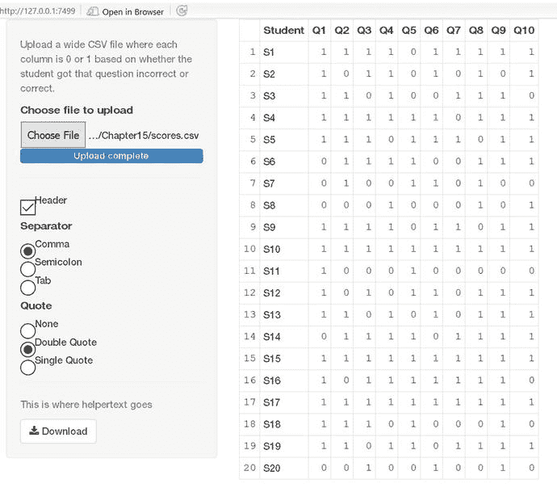

# Dynamic Reports and the Cloud User Interface
shinyUI(
  fluidPage(
    title = 'Score Control Panel',
    sidebarLayout(
      sidebarPanel(
        helpText("Upload a wide CSV file where
          each column is 0 or 1 based on whether the student
          got that question incorrect or correct."),
        fileInput('file1', 'Choose file to upload',
          accept = c(
            'text/csv',
            'text/comma-separated-values',
            'text/tab-separated-values',
            'text/plain',
            '.csv',
            '.tsv'
          )
        ),
        tags$hr(),
        checkboxInput('header', 'Header', TRUE),
        radioButtons('sep', 'Separator',
          c(Comma=',',
            Semicolon=';',
            Tab='\t'),
          ','),
        radioButtons('quote', 'Quote',
          c(None='',
            'Double Quote'='"',
            'Single Quote'="'"),
          '"'),
        tags$hr(),
        helpText("This is where helpertext goes"),
        downloadButton('downloadReport')
      ),
      mainPanel(
        tableOutput('contents')
      )
    )
  )
)
```

与往常一样，用户界面包含`fluidPage()`以及`sidebarPanel()`和`mainPanel()`。主要事件发生在侧边栏内，因此我们首先查看那里。`fileInput()`函数用于获取输入文件。我们可以控制接受的文件类型，并将范围限制为逗号分隔值或制表符分隔值。我们将上传控件命名为`file1`，回顾一下，在服务器端我们使用`input$file1`来读取文件。

```
fileInput('file1', 'Choose file to upload',
  accept = c(
    'text/csv',
    'text/comma-separated-values',
    'text/tab-separated-values',
    'text/plain',
    '.csv',
    '.tsv'
  )
),
```

另一个主要的关注点是下载区域。其理解起来并不复杂：

```
downloadButton('downloadReport')
```

虽然有辅助文本框向用户进行说明，并且我们确实建议实际中设置示例布局，以便用户理解可接受的输入，但我们选择将此用户界面尽可能保持精简。在转向实际的报告文件之前，我们在图 15-2 中展示了上传`scores.csv`文件（该文件可在 Apress 网站上获取）后 Shiny 应用程序的界面。



图 15-2. 本地托管网站上的 Shiny 用户界面

### report.Rmd

本报告涉及测验或其他考试中每个问题的学生得分。我们的目标是将图 15-2 中所示的输入转换为关于问题和测试有效性的可操作摘要信息。在阅读首次展示的全部代码之前，请花一点时间将此代码与独立的 Markdown 文件进行比较。两者没有重大区别。实际上，判断此文件是否由 Shiny 应用程序渲染的唯一方法是查看读取`scores <- scores()` 的这一行代码。

```
---
title: "Example Scoring Report"
subtitle: "Item-Level Analysis"
date: "`r Sys.Date()`"
output:
  tufte::tufte_handout: default
---

