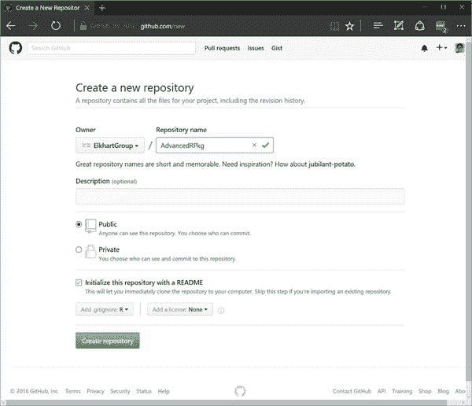
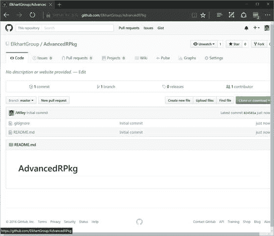
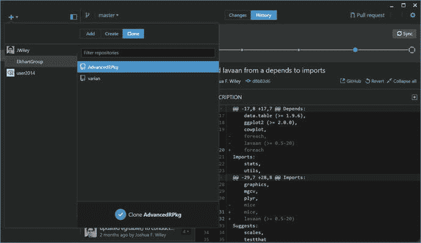
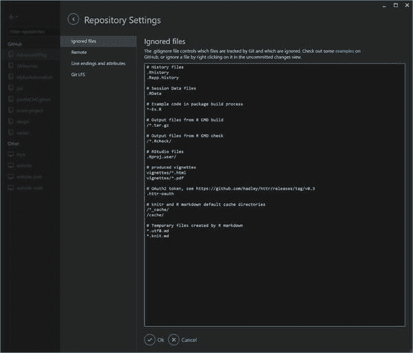
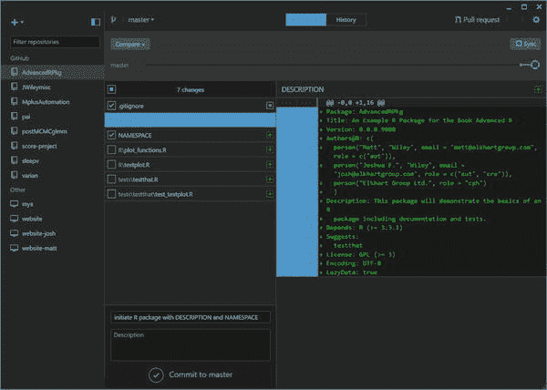
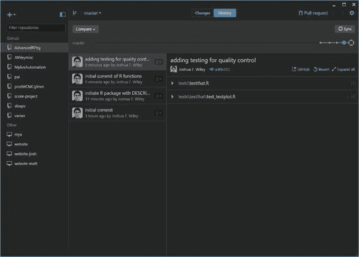
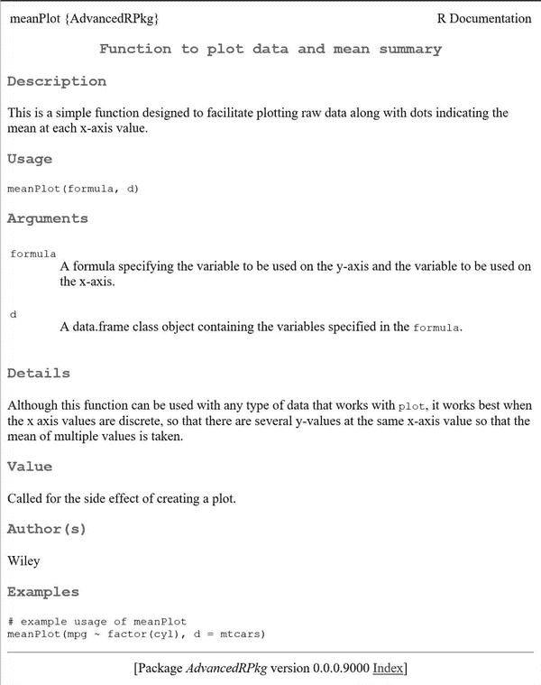
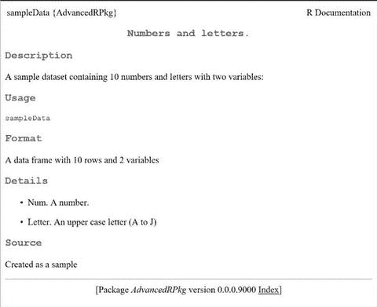
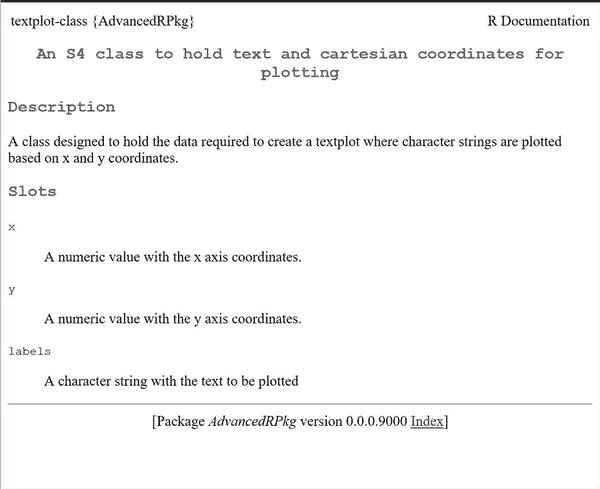
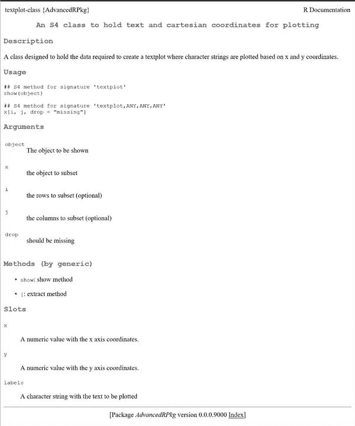

# 6. 编写一个包

包是记录、共享和分发 R 代码和数据的基本方式。我们的目标是编写自己的包，需要提醒的是，由于 R 包开发过程中会用到许多软件工具，本章会特别复杂。

在本章中，我们使用了四个包。`devtools`包（Wickham and Chang, 2016）提供了一系列函数来帮助搭建、文档化和管理 R 包的开发。`roxygen2`包（Wickham, Danenberg, and Eugster, 2015）通过允许使用注释在函数旁边内联编写函数文档，极大地简化了 R 包文档的编写。我们还使用了另外两个不那么关键的包。`testthat`包（Wickham, 2011）不是必需的，但它提供的函数通过测试函数是否返回预期值来促进质量控制。同样，`covr`包（Hester, 2016）通过测试被测试执行的包代码的百分比（覆盖率）来促进质量控制。理想情况下，100%的代码都应被测试覆盖，尽管实际上许多 R 包没有测试，因此任何覆盖率都优于平均水平。在包中，我们使用了第[5 章中用于`ggplot2`的方法之一，因此我们还包含了大家熟悉的`ggplot2`（Wickham, 2009）包。

编写包可能是一个复杂的过程。熟悉最终产品可能会有所帮助，该产品可在[`https://github.com/ElkhartGroup/AdvancedRPkg`](https://github.com/ElkhartGroup/AdvancedRPkg)在线获取。在阅读本章时，如果你不确定某个文件位置是否正确或设置是否正确，我们也建议参考我们官方 GitHub 上的包记录。以下代码加载了`checkpoint`（Microsoft Corporation, 2016）包以控制所用 R 包的精确版本，然后加载所需的包：

```r
## load checkpoint and required packages
library(checkpoint)
checkpoint("2016-09-04", R.version = "3.3.1")
library(testthat)
library(devtools)
library(roxygen2)
library(covr)
library(ggplot2)
options(width = 70) # only 70 characters per line
```

## 开始之前

本章涵盖编写 R 包的一些基础知识，并介绍一些工具来简化官方手册《编写 R 扩展》（在线地址：[`https://cran.r-project.org/doc/manuals/R-exts.html`](https://cran.r-project.org/doc/manuals/R-exts.html)）中未包含的流程。该手册技术性可能较强，但它是一份权威指南。如果你计划向`CRAN`提交 R 包，这是必读材料；即使你只打算为自己或更有限的用户群体（如你的公司或实验室小组）开发包，也建议阅读。

许多 R 包包含来自其他编程语言的代码，例如`C`、`C++`、`Fortran`或`Java`。这通常是因为像`C`这样的语言可以被编译和优化，运行速度远快于`R`，因此包开发者可能会选择将计算密集型的代码部分用编译型且高效的语言编写。然而，本章我们只讨论如何编写包含纯`R`代码或数据的 R 包，因为其流程几乎相同，大多数差异仅在于所包含语言的特殊性（例如`makefiles`）。

在开发 R 包之前，需要一些工具。实际上，对于那些不习惯软件开发的人来说，编写 R 包可能需要一套相当令人生畏的工具链。如果你使用的是 Linux 系统，很可能已经安装了其中许多工具，或者可以轻松安装它们。在 Windows 和 Mac OS 上，可能需要更多设置。无论哪种系统，这些工具都必须可访问，这意味着要将它们添加到系统路径中，以便在命令行调用时能够找到。

如果使用 Windows，所需的主要工具（一些命令行工具以及编译器）可从二进制安装程序获得，地址为[`https://cran.r-project.org/bin/windows/Rtools/`](https://cran.r-project.org/bin/windows/Rtools/)。在安装的最后一步之前，有两个复选框，其中一个可能未被选中，它负责将这些工具添加到系统路径。请将两个复选框都选中。另外，你还需要`LaTeX`，一个排版系统。`MiKTeX`是一个流行的选择（[`www.miktex.org/`](http://www.miktex.org/)）；如果你的系统是 64 位，请务必选择 64 位选项。虽然在大多数情况下，这两个软件的默认选项已经足够，但我们建议`MiKTeX`用户将“即时安装默认包”的选项改为“是”。关于所需工具链的更多详细信息，请参见 R 手册：[`https://cran.r-project.org/doc/manuals/R-admin.html#The-Windows-toolset`](https://cran.r-project.org/doc/manuals/R-admin.html#The-Windows-toolset)。

如果使用 Mac OS，请从 App Store 获取`Xcode`（开发者工具）。你可能还需要获取`XQuartz`（[`https://xquartz.macosforge.org/`](https://xquartz.macosforge.org/)）。与 Windows 一样，你需要`LaTeX`。`MacTeX`是一个选择（[`www.tug.org/mactex/`](http://www.tug.org/mactex/)）。其他详细信息请参见 R 手册（[`https://cran.r-project.org/doc/manuals/R-admin.html#OS-X`](https://cran.r-project.org/doc/manuals/R-admin.html#OS-X)）。

在着手编写第一个 R 包之前，还需要做两个决定。首先，给 R 包起什么名字？这项看似简单的任务变得复杂，因为目前`CRAN`上有超过 8000 个 R 包，而且数量正在快速增长（[`https://cloud.r-project.org/web/packages/available_packages_by_name.html`](https://cloud.r-project.org/web/packages/available_packages_by_name.html)）。虽然你可以给一个不打算上传到`CRAN`的包起一个与`CRAN`上已存在的包相同的名字，但如果你将来使用该`CRAN`包或任何依赖它的其他包，这样做就会产生问题。即使你的包不提交到`CRAN`，将来也可能有其他人编写一个同名包并提交到`CRAN`。出于这些原因，选择包名需要深思熟虑。在本章中，所有示例都将构建一个名为`AdvancedRPkg`的 R 包。第二个决定是给包使用什么许可证。如果你计划提交到`CRAN`，许可证必须与`CRAN`兼容。即使包永远不会提交到`CRAN`，许可证可能仍然相关。在本章中，我们使用`GPLv3`许可证。

## 版本控制

到目前为止，我们讨论的都是相对随意的代码开发、一些基础编程、函数和类。开发新的 R 包则更为复杂，需要管理更多的文件。面对这种更高的复杂性，拥有一个高效的系统来备份文件并回溯到早期版本会很有帮助。版本控制系统提供了一种绝佳的方式，既能备份代码，又能将更改回滚到之前的版本（例如，当实现新功能的修改破坏了旧功能或引入了 bug 时）。目前存在多种版本控制系统，但当下最流行的或许是开源软件`Git`，它最初是为 Linux 内核提供版本控制而开发的。`Git`可以直接通过命令行使用，也可以通过多种图形界面使用。许多人使用`GitHub`（<https://github.com/>），这是一项基于`Git`的服务，它在线托管仓库，且对公共项目免费。`GitHub`也为 Windows 和 Mac OS 提供了图形界面（<https://desktop.github.com/>）。然而，如果你不想学习或使用`Git`或其他版本控制系统，可以放心地忽略本节以及本章中所有仅与版本控制相关的命令。

我们在本章中使用`Git`（和`GitHub`）为 Windows 环境下的示例 R 包提供版本控制。具体来说，本书使用的是 Windows 版 GitHub 桌面客户端 v3.3.0。`Git`仓库可以只在本机使用，但配合`GitHub`使用可以方便地协作开发包，并轻松地与其他人共享早期包代码。

可以通过命令行设置`Git`仓库，但对于新用户来说，最直观的方式或许是在线直接通过`GitHub`创建一个新的`Git`仓库。我们为本章开发的 R 包创建了一个新仓库，并将其命名为`AdvancedRPkg`。该仓库初始化时包含一个`README`文件，稍后我们将对其进行编辑。我们可以通过将某些文件或具有特定扩展名的文件添加到一个名为`.gitignore`的文件中，来告诉`Git`忽略它们。每个文件或扩展名单独占一行。我们可以稍后编辑它，但现在，我们只需让`GitHub`创建一个。图 6-1 展示了进行此操作的步骤。



**图 6-1.** 用于创建`AdvancedRPkg`仓库的 GitHub 页面

如果一切按计划进行，结果应该类似于图 6-2。该仓库除了`README`和`.gitignore`文件外是空的。



**图 6-2.** 显示已创建的`AdvancedRPkg`仓库的 GitHub 页面

接下来，我们可以将这个仓库克隆到本地计算机上。这实质上创建了一个本地副本，我们将在其中进行包的编写。为此，请打开 GitHub 桌面客户端，点击 + 号，选择“克隆”（Clone），然后选择该仓库，如图 6-3 所示。



**图 6-3.** GitHub 桌面客户端克隆`AdvancedRPkg`仓库

点击“克隆”后，我们会看到一个选项，可以选择要将仓库克隆到的目录。请注意，无论您选择哪个目录，系统都会为仓库创建一个与仓库同名的（即`AdvancedRPkg`）新目录。仓库的设置可以通过终端进行管理，或者点击 GitHub 桌面客户端中的齿轮图标并选择“仓库设置”（Repository Settings）进行管理。其中一项设置会显示当前被忽略的文件。文件是根据`.gitignore`文件被忽略的，由于我们在创建仓库时较早地选择了 R，因此默认包含了一些通常希望忽略的默认文件扩展名（图 6-4）。



**图 6-4.** GitHub 桌面客户端显示`AdvancedRPkg`仓库的设置，包括被 Git 仓库忽略的各种文件扩展名

Windows 经常在目录中创建临时（有时是隐藏的）文件`desktop.ini`。为了避免包含这些文件，我们可以编辑仓库设置，在末尾添加新的一行并输入`desktop.ini`。这样这些文件就会被忽略。被忽略的文件是那些 Git 仓库不跟踪且不存储其随时间变化内容的文件。它们仍然存在于目录中；Git 只是不监控和版本管理它们。

除了设置一个新的 Git 仓库，你可能经常使用 Git 执行的任务是提交对仓库的更改，以及将仓库的本地副本与在线（GitHub）版本同步。提交可以被认为是拍摄提交时文件状态的快照。为了避免冗余，提交只会对自上次提交以来发生更改的文件进行快照。尽管即使是略微修改过的二进制文件也可能难以比较，但像 R 代码这样的纯文本文件则易于比较。Git 在随时间跟踪文本文件的更改方面效率极高，并允许你查看所做的更改或回退到过去的特定时间点。访问项目（仓库）的变更历史在代码中引入错误或 bug 时尤其有用，这样可以精确定位 bug 是什么时候引入的（例如，有多少基于该代码的结果可能受到影响？），并查看之前的代码工作版本。

在稍微复杂一些的用例中，Git 可以有效地用于管理代码的不同版本。例如，常见的情况是拥有一个项目，并定期发布稳定版或生产就绪版的代码，同时继续进行开发。在 Git 中，这是通过使用同一仓库的不同分支，并定期将一个分支（例如，开发分支）的部分更改合并到稳定分支来实现的。

在本章中，我们还会展示一些相关的 Git 命令。关于使用 Git 的更多背景知识，一个极好的免费资源是 Scott Chacon 和 Ben Straub 合著的 *Pro Git*（Apress, 2014），可从 <https://progit.org/> 获取。要查找问题和答案，Stack Overflow（<http://stackoverflow.com>）是一个不错的资源。很可能已经有人问过与您类似的问题，如果没有，您可以提问并获得答案。另请注意，如果您使用 RStudio 来编写 R 代码，它内置了一些与 Git 的集成功能。更多信息，请参阅 RStudio 支持页面：<https://support.rstudio.com/hc/en-us/articles/200532077-Version-Control-with-Git-and-SVN>。最后，请注意，您可以在 <https://github.com/ElkhartGroup/AdvancedRPkg> 公开访问在线仓库。

## R 包基础

一个 R 包本质上就是一个包含特定文件的目录。尽管 R 包的核心无疑是 R 代码，但其中许多文件并非严格意义上的 R 代码。表 6-1 列出了可能出现在 R 包目录根目录下的主要文件。根据包的其他特性，并非所有这些文件都是必需的。本章稍后我们将借助`devtools`包来帮助创建其中的一些文件。

表 6-1. 可能用于 R 包根目录的文件

| 文件 | 描述 |
| --- | --- |
| `DESCRIPTION`* | 提供关于包的通用信息。必填字段包括：Package（包名）、Version（版本）、License（许可证）、Title（包描述）、Author（作者）和 Maintainer（维护者，可与作者相同或不同）。除非包是独立的，否则通常还包括依赖关系信息。 |
| `NAMESPACE`* | 控制包的命名空间，包括导出哪些对象以及从其他包导入哪些对象。虽然是必需文件，但我们将通过`roxygen2`包自动生成。 |
| `README`/`README.md` | 非必需，R 会忽略此文件，但对读者和用户有帮助。提供关于包的通用信息（如获取帮助的途径、简要概述、安装指南，或任何其他在简短文档中有用的内容）。 |
| `NEWS` | 提供关于包变更或新闻的信息。通常包括新功能、错误修复，以及与先前版本相比的其他重大变化。 |
| `LICENSE` | 如果未使用常见许可证或需要额外信息，则提供许可证文件。 |
| `INDEX` | 可选，由文档文件自动生成。但如果指定，则会在每一行以名称和描述的形式列出所有有趣/有用的对象。 |
| `configure`、`cleanup` | 可选的 Bourne Shell 脚本，分别在 Unix 系统（例如 Linux、Unix）安装前后运行。 |

* 表示必需文件

除了根级别的文件外，R 包中还可以包含多个子目录。这些子目录列于表 6-2 中，并附有简要说明。对于我们相对简单的包，我们只用到其中少数几个，包括`R`、`man`和`tests`。

表 6-2. R 包子目录

| 子目录 | 描述 |
| --- | --- |
| `R`* | 包含所有函数、类、方法等 R 源代码的目录。 |
| `man`* | 包含 R 文档文件的目录。我们通过`roxygen2`包自动生成这些文件。 |
| `tests` | 可选目录，包含用于测试包是否按预期工作的 R 代码。 |
| `data` | 可选目录，包含随包一起分发的数据。通常包含的数据集较小，用于演示包的特性，而非作为共享数据的主要方式。 |
| `demo` | 可选目录，包含 R 包的演示内容，以 R 源代码文件形式存在。 |
| `exec` | 可包含其他必需的可执行脚本。仅包含文件，不包含子目录。 |
| `inst` | 可包含在安装包时复制到安装目录的其他文件。例如，可用于与用户共享`NEWS`文件，或包含图片及其他非标准文档。 |
| `po` | 用于添加 C 和 R 错误消息的翻译以及其他本地化相关任务。 |
| `src` | 通常包含其他语言（如 C、C++或 Fortran）的源代码。这些代码通常需要编译；如果你使用它，通常需要指定一个 Makefile。 |
| `tools` | 不常用，但可用于提供配置所需的其他文件。 |
| `vignettes` | 用于提供一个或多个软件包使用手册或指南。与通常仅针对特定函数的函数文档相比，软件包使用手册通常包含更多入门背景和关于如何使用整个包的完整示例。虽然不是必需，但对用户非常有帮助。 |

* 表示必需子目录

### 使用 DevTools 启动一个包

在包的根目录下，你至少需要`DESCRIPTION`和`NAMESPACE`文件。你还需要一个名为`R`的子目录，顾名思义，这是放置 R 代码的地方。这不足以将包提交到 CRAN，但足以启动一个供私人使用的功能性包。然而，即使仅供私人使用，适当的文档也极有帮助。包的目录和文件结构相当复杂，尤其是用文字描述时。因此，作为参考，以下是我们包在学完本章后应具备的最终目录结构，该结构位于`AdvancedRPkg`目录内：

```
.
├── data
│   └── sampleData.rda
├── DESCRIPTION
├── man
│   ├── ggplot.lm.Rd
│   ├── meanPlot.Rd
│   ├── sampleData.Rd
│   └── textplot-class.Rd
├── NAMESPACE
├── R
│   ├── plot_functions.R
│   ├── sampledata.R
│   └── textplot.R
├── README.md
└── tests
    ├── testthat
    │   └── test_textplot.R
    └── testthat.R
5 directories, 13 files
```

对于初始设置，我们使用`setup()`函数。我们可以指定更多信息，但最小要求是路径。我们还设置了`rstudio = FALSE`，以便代码能适用于任何编辑器，而不仅仅是 RStudio。要查看已创建的内容，我们可以使用`list.files()`函数，该函数会显示已创建了`DESCRIPTION`和`NAMESPACE`文件以及一个`R`目录。对于以下代码，请在 R 命令行中运行，或创建一个新的 R 文件（我们将其命名为`chapter 06.R`）。请注意，调整`path`参数以指向包含 Git 仓库的目录非常重要，即你在本地机器上克隆该仓库的位置。在我们的例子中，R 的工作目录（你可以通过调用`getwd()`函数来检查）位于`AdvancedRPkg`目录的上一级目录。如果你的 R 会话不在该目录，请调整`path`参数，或使用`setwd()`函数将 R 的工作目录更改为`AdvancedRPkg`的父目录：

```r
setup(
    path = "AdvancedRPkg/",
    rstudio = FALSE)
```

```
Creating package 'AdvancedRPkg' in '~/Apress_AdvancedR/RFiles'
No DESCRIPTION found. Creating with values:
Package: AdvancedRPkg
Title: What the Package Does (one line, title case)
Version: 0.0.0.9000
Authors@R: person("First", "Last", email = "first.last@example.com", role = c("aut", "cre"))
Description: What the package does (one paragraph).
Depends: R (>= 3.3.1)
License: What license is it under?
Encoding: UTF-8
LazyData: true
```

```r
list.files("AdvancedRPkg")
```

```
[1] "DESCRIPTION" "NAMESPACE"   "R"           "README.md"
```

输出还显示了一些字段以及用于填充这些字段的信息。由于这些大多是占位符，我们需要使用文本编辑器（任何编辑器均可，包括 RStudio）打开文件并进行修改。根据目录，`setup()`函数推测了包名，但其余内容需要填写。我们使用编辑器将这些字段修改为如下内容：

```
Package: AdvancedRPkg
Title: An Example R Package for the Book Advanced R
Version: 0.0.0.9000
Authors@R: c(
person("Matt", "Wiley", email = "matt@elkhartgroup.com", role = c("aut")),
person("Joshua F.", "Wiley", email = "josh@elkhartgroup.com", role = c("aut", "cre")),
person("Elkhart Group Ltd.", role = "cph")
)
Description: This package will demonstrate the basics of an R
package including documentation and tests.
Depends: R (>= 3.3.1)
License: GPL (>= 3)
Encoding: UTF-8
LazyData: true
```

注意版本号，其格式为`Major.Minor.Patch.DevelopmentVersion`。关于确定软件版本因素的精彩概述，请参见语义化版本规范（[http://semver.org/](http://semver.org/)）。该规范在建议方面相当有指导性，但拥有一套固定的规则来确定软件的主版本号或次版本号通常很有帮助。最后一部分`DevelopmentVersion`仅存在于开发版本中，并在发布时被移除。尽管有这些规则和指南，但许多 R 包的实际版本情况却更加多样和不一致（并非每个人都同意这些规则，即使同意的人也并非总是严格遵守）。

接下来是作者信息，使用`person()`函数描述。除了每个人的姓名和电子邮件外，还使用三个字母的缩写来描述角色和关系。所有可能性都在 MARC 关系者代码列表中列出（[www.loc.gov/marc/relators/relaterm.html](http://www.loc.gov/marc/relators/relaterm.html)）。然而，最常用的缩写包括：`aut`代表作者，`cre`代表创建者（即项目负责人，或者用 R 术语来说，是遇到问题时要投诉的人——维护者），以及`cph`代表版权持有者。然后，我们用几句话描述包，指定包所依赖的 R 版本、许可证，以及数据可以按需加载（以节省启动时间）。

#### 添加 R 代码

有了包的基本结构后，是时候开始添加一些 R 代码了，这正是包的核心所在！由于本章的重点是打包代码，我们将复用前面章节中的一些函数和类。第一步，我们在`AdvancedRPkg/R/`目录下创建两个文件：`plot_functions.R`和`textplot.R`。

接下来，我们从第 4 章复制最终的`meanPlot()`函数，用于绘制带有均值的图表。我们将此函数的代码以及在第 5 章编写的 S3 方法`ggplot.lm()`一起添加到`plot_functions.R`中。然后，我们将第 5 章中`textplot`类的类和方法（`show`和`subset`，即括号运算符`[`）复制到`textplot.R`中。由于容易复制错误的代码，我们建议从我们的 GitHub 仓库（[https://github.com/ElkhartGroup/AdvancedRPkg](https://github.com/ElkhartGroup/AdvancedRPkg)）复制和粘贴代码。如果一切正常，它应该看起来像这样：

```r
list.files("AdvancedRPkg/R")
```

```
[1] "plot_functions.R" "textplot.R"
```

顺便提一下，决定分成多少个单独的文件可能比较困难。这对 R 本身没有影响，但对开发过程有影响。将所有代码放在一个文件中不好，将每个函数、类和方法都拆分成单独的文件也不好。如果结果文件不太长，我们尝试将相关的函数（如绘图函数）归为一组，并将相关的类和方法归为一组。根据常识，即使可以，也不要给文件起仅通过大小写区分的相同名称；在文件名中使用特殊字符或符号通常也是个坏主意。

现在我们已经有了一个基本的包模板，可以使用`devtools`包中的`load_all()`函数来加载这些函数。我们只需要指定包的路径即可。然后，我们可以看到一些函数在包的命名空间中可用，这通过使用`ls()`函数并指定要列出可用对象的位置来实现：

```r
load_all("AdvancedRPkg")
```

```
Loading AdvancedRPkg
```

```r
ls(name = "package:AdvancedRPkg")
```

```
[1] "ggplot.lm" "meanPlot"  "textplot"
```

在第 4 章中，我们简要讨论了作用域问题。编写包时，理解作用域变得更加重要。包的作者可以编写与其他包中函数同名的函数。虽然这些函数不会互相覆盖，但明确你想要调用哪个函数可能会让人困惑。这时包命名空间就很有帮助了。命名空间控制从其他包导入哪些函数（因此被该包内的代码使用），以及从该包导出哪些函数，使其对包的公开可用。你可以使用`import`功能从其他包中导入特定函数。如果你需要另一个包中的许多函数，你可以决定让你的包依赖于那个包，在这种情况下，该包的所有公共函数对你的包都是可用的。导入和依赖另一个包之间的另一个区别在于包加载时发生的情况。如果包 B 依赖于包 A，当用户调用`library(B)`时，包 B 和包 A 都会被加载并附加。如果包 B 从包 A 导入函数，当用户调用`library(B)`时，包 B 会被加载并附加，而包 A 会被加载但不会附加。因为包 A 被加载了，它的函数对于包 B 内部的代码是可用的，但由于包 A 未被附加，这些函数不会直接暴露给用户。即使包 A（或包 B）被加载并附加，也只有导出的函数对用户公开可用。这很有好处，因为它允许包开发者编写和记录仅供内部使用的函数。如果你不需要导出一个函数，那么最好不要导出它。如果两个 R 包导出了同名的函数，并且用户加载并附加了两个包，那么后加载的包中的函数会屏蔽先加载的包中的函数。对于用户来说，唯一的选择就是不加载并附加其中一个包，或者使用双冒号运算符`PkgA::foo()`、`PkgB::foo()`显式进行函数调用。面对成千上万的 R 包和更多的函数，只导出必要的函数有助于避免此类名称冲突和屏蔽问题。

所有这些都通过包的`NAMESPACE`文件进行控制。虽然我们没有查看，但我们的包确实有一个`NAMESPACE`文件，它是在我们运行`setup()`时创建的。然而，`load_all()`函数的独特之处在于，默认情况下，当它加载一个包时，它会导出所有对象。这是因为在开发过程中，能够调用所有函数（无论是否导出）通常很方便。

## 测试

随着我们为新包添加函数和方法，并能在 R 中运行，我们可以开始考虑质量控制问题。编写能运行的代码固然很棒，但代码能否实现预期功能同样至关重要。然而，“预期”和“期望”并不总是一回事（这就是文档发挥关键作用的地方，我们下一节会谈到）。即便如此，即使对于开发者来说，测试也能确保编写的代码能完成其应有的功能。

测试可以在包开发的任何阶段进行。如果函数、名称和特性正在发生根本性变化，那么此时开始编写大量测试可能为时过早。不过，即使一个包尚未完成，如果某些函数相对稳定，尽早编写测试也会很有帮助。尽早而非推迟编写测试之所以有益，是因为在编写函数之后立即编写测试通常更容易，此时该函数的目的和工作方式在你脑海中还记忆犹新。（如果你不知道或忘记了函数的工作方式，就很难对其进行充分的测试！）。这也有助于确保，如果后面的函数建立在前面的函数之上，那么沿途进行测试可以确保问题出在新编写的函数上，而不是之前的某个构建模块。

抛开好处不谈，编写测试的实际操作因`testthat`包而变得更加容易。首先，我们需要在包中创建一个名为`tests`的新子目录，位于`AdvancedRPkg/tests/`。接下来，在第一个子目录内创建第二个名为`testthat`的子目录（即`AdvancedRPkg/tests/testthat/`），我们将在其中创建运行各种测试的R源文件。注意，还有其他测试包的方法。这里我们主要关注使用`testthat`包范式进行测试。

正确测试绘图函数相当困难，因此对于我们的测试，我们检查`textplot`的子集方法是否能按预期工作。我们可以创建一个名为`test_textplot.R`的文件，位于`AdvancedRPkg/tests/testthat/`下。我们首先调用`context()`，这表示接下来的测试测试的是相关功能，然后我们为测试套件提供一个总名称`textplot`。接下来，我们设置一个简单的`textplot`类对象，然后运行一系列测试。这些测试包含两个部分。首先，是对`test_that()`的外部调用。第一个参数是对测试的描述，第二个参数是执行测试的代码。代码可以包含任何内容，但通常包括对某个`expect_*()`函数的调用，此类函数有很多。在做选择之前，我们使用`apropos()`函数调用来显示所有`expect_*()`选项：

```
apropos("expect_")
[1] "expect_cpp_tests_pass"     "expect_equal"
[3] "expect_equal_to_reference" "expect_equivalent"
[5] "expect_error"              "expect_failure"
[7] "expect_false"              "expect_gt"
[9] "expect_gte"                "expect_identical"
[11] "expect_is"                 "expect_length"
[13] "expect_less_than"          "expect_lt"
[15] "expect_lte"                "expect_match"
[17] "expect_message"            "expect_more_than"
[19] "expect_named"              "expect_null"
[21] "expect_output"             "expect_output_file"
[23] "expect_s3_class"           "expect_s4_class"
[25] "expect_silent"             "expect_success"
[27] "expect_that"               "expect_true"
[29] "expect_type"               "expect_warning"
```

我们选择`expect_is()`来检查对象的类，选择`expect_equal()`来检查其他特性。还可以使用`expect_error()`或`expect_warning()`来检查错误检查是否有效，如果代码产生了错误，这两个函数就会“通过”。我们将以下代码放入`test_textplot.R`文件中：

```
context("textplot")
dat <- textplot(
x = 1:4,
y = c(1, 3, 5, 2),
labels = letters[1:4])
test_that("textplot subset method works with rows only", {
tmp <- dat[i = 1:2, ]
expect_is(tmp, "textplot")
expect_equal(length(tmp@x), 2)
})
test_that("textplot subset method works with variables only", {
tmp <- dat[, j = c("x", "y")]
expect_is(tmp, "list")
expect_equal(length(tmp), 2)
expect_equal(length(tmp$x), 4)
})
test_that("textplot subset method works with rows and variables", {
tmp <- dat[1:2, j = c("x", "y")]
expect_is(tmp, "list")
expect_equal(length(tmp), 2)
expect_equal(length(tmp$x), 2)
})
```

我们可以直接运行这些代码测试。如果一切正常，则没有输出。只有在某些检查未通过时才会产生输出。不过，通常这些代码不会直接运行，而是批量运行。我们通过使用`devtools`包的`test()`函数以及我们的包名/路径来运行所有测试。`devtools`包了解`testthat`包的目录结构，因此它们能很好地协同工作。为了运行测试，`test()`首先使用`load_all()`加载包，然后执行测试。回到包目录上一级的文件夹，从我们章节级别的R文件`chapter06.R`中，我们通过执行以下代码来运行所有测试：

```
test("AdvancedRPkg")
Loading AdvancedRPkg
Testing AdvancedRPkg
textplot: ........
DONE =================================================================
```

如果存在错误，将会被注明。虽然我们可以直接使用`devtools`包来运行测试，但为了让R能运行它们，我们需要在`tests`目录（即`AdvancedRPkg/tests/`）中添加一个名为`testthat.R`的简短文件。在这个文件中，我们只需要添加几行代码，如下所示。我们不运行这段代码；这是由R运行的：

```
library(testthat)
library(AdvancedRPkg)
test_check("AdvancedRPkg")
```

现在，我们可以使用`covr`包来检查代码覆盖率。`covr`包（[`github.com/jimhester/covr`](https://github.com/jimhester/covr)）会检查执行测试时代码的不同部分是否被运行。例如，一个包含if/else语句的函数，其部分代码可能只被一个测试执行，除非派生出额外的测试来检查其他条件。同样，尽管开发包并非必需，但它是一个有用的工具，可以了解当前测试对包功能的覆盖程度。高覆盖率（目标是100%）是捕获错误、确保新代码开发不会破坏旧特性和功能的好方法；所有这些也有助于向用户保证你的包是一个好的选择。

虽然我们使用了`checkpoint`库来实现代码的可重复性，但测试的性质使得这种库的使用难以奏效。因此，需要同时安装`covr`和`testthat`。回到我们顶层的`chapter06.R`文件中，我们运行`package_coverage()`函数来测试我们的测试对我们小包的代码覆盖情况如何。唯一需要的参数是包所在的目录。在我们的例子中，R的工作目录是父目录`AdvancedRPkg/`。如果你的R实例的工作目录不同，你需要指定适当的路径来访问你机器上的`AdvancedRPkg/`目录：

```
install.packages(c("covr", "testthat"))
cov <- package_coverage("AdvancedRPkg")
```

输出（如下所示）表明，当前的测试覆盖率约为36%，这主要来自对`textplot.R`中代码的覆盖。还可以使用`as.data.frame(cov)`获得更详细的分析。输出内容很多，因此我们只展示几行几列，但如果你认为自己测试覆盖了所有内容，需要找出代码的哪些方面尚未被测试时，这是一个非常宝贵的资源。

```
AdvancedRPkg 覆盖率：35.85%
R/plot_functions.R：0.00%
R/textplot.R：52.78%
as.data.frame(cov)[1:3, c(1, 2, 3, 11)]
filename functions first_line value
1 R/plot_functions.R  meanPlot          2     0
2 R/plot_functions.R  meanPlot          3     0
3 R/plot_functions.R  meanPlot          4     0
```

要运行测试，我们需要指出我们的包依赖于`testthat`包。该包的核心功能并不依赖`testthat`，因此我们将它添加到`DESCRIPTION`文件的一个新部分`Suggests`下。再次使用任意文本编辑器，将`DESCRIPTION`修改为以下内容：

```
Package: AdvancedRPkgPackagetests
Title: An Example R Package for the Book Advanced R
Version: 0.0.0.9000
Authors@R: c(
person("Matt", "Wiley", email = "matt@elkhartgroup.com", role = c("aut")),
person("Joshua F.", "Wiley", email = "josh@elkhartgroup.com", role = c("aut", "cre")),
person("Elkhart Group Ltd.", role = "cph")
)
Description: This package will demonstrate the basics of an R
package including documentation and tests.
Depends: R (>= 3.3.1)
Suggests:
testthat
License: GPL (>= 3)
Encoding: UTF-8
LazyData: true
```

最后，完成对包的所有更改后，我们需要通过版本控制进行核查。这可以通过命令行完成，但我们使用的是GitHub桌面客户端。默认情况下，所有更改的文件都会被选中，但我们不会一次性提交所有更改，而是按照相关文件批次进行提交，并附上有意义的说明信息。提交信息会随每次提交一同记录，用于提醒你自己或告知他人所做更改的高层摘要或原因。没有必要详细记录每一处更改，因为Git会精确追踪哪些文件发生了更改以及内容如何变化。

首先，我们选择`DESCRIPTION`、`NAMESPACE`和`.gitignore`文件，并添加说明信息：使用DESCRIPTION和NAMESPACE初始化R包。该过程如图6-5所示。



图6-5.
GitHub桌面客户端选择更改的文件，添加提交信息，并提交到主分支。

接下来，我们添加`plot_functions.R`和`textplot.R`，并添加提交信息：R函数的初始提交。最后，我们添加`testthat.R`和`test_textplot.R`，并添加提交信息：添加质量控制的测试。当然，你也可以在文件创建过程中随时提交它们。如果切换到GitHub桌面客户端的“历史记录”标签页，我们可以查看所做的更改。如果我们希望将这些更改公开，则点击“同步”按钮，该操作会从GitHub仓库拉取更改到本地仓库，并将所有已提交的更改从本地仓库推送到GitHub仓库。请注意，在同步之前，所有更改都应已提交，因为同步的内容并非目录中的实际文件，而是Git仓库。只有当更改被提交时，它们才会被添加到本地Git仓库；因此，如果不提交，更新就不会被添加到本地仓库，也就不会被推送到远程（GitHub）仓库。图6-6展示了这种情况。



图6-6.
GitHub桌面客户端显示提交历史记录以及右上角的同步按钮。

我们只是浅尝了测试的皮毛，显然我们的包距离全面测试还有很长的路要走。不过，这些工具应该能让你在测试和质量控制方面走上正轨（并且领先于CRAN上的大多数R包）。下一个关键部分是文档，这是我们接下来要讨论的主题。

### 使用 roxygen2 编写文档

R中函数、数据、类及方法的文档位于包的`man`子目录中，通过使用扩展名为`.Rd`的特殊R文档文件完成。然而，对于程序员来说，这可能会更困难，因为文档与实际R代码是分离的。此外，还必须编写大量标记内容，而这些只是标准模板的一部分。`roxygen2`包完全自动化了这一过程，包括子目录的创建，并通过在R代码旁使用特殊格式的注释，提供了一种更简单的文档编写方式。运行`roxygen2`包后，这些特定注释会被转换为`man`目录中格式正确的`.Rd`文件，从而R包拥有了创建包函数帮助文件所需的一切。在本节中，我们将了解如何为多种类型的对象编写文档，包括函数、数据、类和方法。

## 函数

使用 `roxygen2` 记录对象时，文档需添加在特殊注释引导符 `##'` 或 `#'` 之后。由于 `#` 是 R 的注释符，R 会忽略它，但特殊的单引号会指示 `roxygen2` 将这些信息处理为文档。请注意，这种语法禁止了对该代码进行注释。所有这些代码都添加在 `meanPlot()` 函数代码上方的 `plot_functions.R` 文件中。

如前所述，由于语法原因，注释被禁止执行；因此，顺序变得至关重要。要了解哪部分对应哪个格式项，只需记住有三个部分仅通过换行符分隔：`title`（标题）、`description`（描述）和 `details`（详细信息）。`details` 部分是可选的。为了读者清晰起见，我们在换行符之间添加了空格。函数参数通过使用 `@param argument_name 参数的简要描述` 来指示。此处列出的参数名称必须与函数中的命名参数完全匹配。`@return` 部分用于指明函数返回何种类型的对象。在本例中，调用该函数是为了产生绘图这一副作用，其返回值并不重要。`@author` 之后可以添加任意文本，以指示函数的编写者。通常，如果作者与整体包的作者相同，则不需要 `@author` 部分。为了使函数公开可用，必须将其导出。这通过使用指令 `@export` 来实现。`roxygen2` 包会将其转换为 `NAMESPACE` 文件中的额外代码行，指示应导出该函数。`@keywords` 部分是可选的。最后，对读者最有用的部分之一是 `@examples` 部分，它为读者提供了可执行的示例，是演示如何使用函数的最简单方法之一。

```
##' 绘制数据及均值汇总的函数
##'
##' 这是一个简单的函数，旨在方便绘制原始数据
##' 以及在每个 x 轴数值处显示均值的点。
##'
##' 尽管此函数可用于任何适用于 \code{plot} 的数据类型，
##' 但当 x 轴数值为离散值时效果最佳，
##' 这样在同一个 x 轴数值处有多个 y 值，
##' 从而可以计算多个值的均值。
##'
##' @param formula 一个公式，指定用于 y 轴的变量
##'   和用于 x 轴的变量。
##' @param d 一个数据框类对象，包含 \code{formula} 中指定的变量。
##' @return 调用该函数是为了产生创建绘图这一副作用。
##' @author Wiley
##' @export
##' @keywords plot
##' @examples
##' # meanPlot 的使用示例
##' meanPlot(mpg ∼ factor(cyl), d = mtcars)
```

现在要生成文档，我们可以运行 `roxygen2` 包。这可以直接通过使用 `roxygenize()` 函数并为其提供包目录的路径来完成，也可以通过使用 `devtools` 包中的 `document()` 函数来完成。我们指定包目录，其余过程自动进行。输出显示已写入文档文件（`meanPlot.Rd`）并已写入 `NAMESPACE` 文件：

```
document("AdvancedRPkg")
Updating AdvancedRPkg documentation
Loading AdvancedRPkg
Updating roxygen version in  ∼\RFiles\AdvancedRPkg/DESCRIPTION
Writing NAMESPACE
Writing meanPlot.Rd
```

在构建或安装时，R 文档文件会被转换为 HTML 和 PDF 格式。不过，您已经可以预览文档的开发版本。在 R 控制台中，常规的获取函数帮助的方式现在应该可以工作了：

```
?meanPlot
```

如果您使用 RStudio，您也可以打开该文件并进行预览。生成的 HTML 文件（在构建包之后）如图 6-7 所示。由于此函数的简单性，同时也为了节省篇幅，我们编写了相当简洁的文档。通常，为用户和未来参考提供更详尽的文档，并仔细解释每个参数可以接受和不能接受的内容是很有帮助的。如果函数实现了新的过程或统计方法，通常也会通过使用 `@references` 部分包含一些参考文献。



图 6-7. `meanPlot()` 函数的 R 文档文件的 HTML 输出

## 数据

在记录数据之前，我们需要向包中添加一些数据。首先，在我们的包文件夹中创建一个 `data` 子目录，路径为 `AdvancedRPkg/data/`。然后，我们使用接下来的代码在我们的 `chapter06.R` 文件中创建一个小样本数据框，并将其保存为 `.rda` 文件。再次注意，该文件需要根据 R 的当前工作目录给出指向 `AdvancedRPkg/data/` 的正确路径：

```
sampleData <- data.frame(
Num = 1:10,
Letter = LETTERS[1:10])
save(sampleData, file = "AdvancedRPkg/data/sampleData.rda")
```

我们添加以下代码，在一个名为 `sampledata.R` 的新文件中记录数据，该文件位于 `R` 子目录（即 `AdvancedRPkg/R/sampledata.R`）中。这提供了数据的标题和详细信息，以及特殊参数 `@format` 以指示数据的格式或类型，以及 `@source` 以指示数据来源。在末尾的引号中，给出了对象的名称。

```
##' 数字与字母。
##'
##' 一个包含 10 个数字和字母的样本数据集，包含两个变量：
##'
##' \itemize{
##'   \item Num. 一个数字。
##'   \item Letter. 一个大写字母（A 至 J）
##' }
##'
##' @format 一个包含 10 行和 2 个变量的数据框
##' @source 创建为样本数据
"sampleData"
```

使用 `document()` 函数对包重新进行 roxygenize 后，生成的 HTML 如图 6-8 所示，同样是通过使用完全构建的包中的帮助工具或通过 RStudio 的预览功能获得。



图 6-8. `sampleData` 数据集的 R 文档文件的 HTML 输出

## 类

S3 类是非正式的，通常不记录文档。S4 类则很容易记录文档。它们的文档直接放置在 `textplot.R` 文件（`AdvancedRPkg/R/textplot.R`）中 `setClass()` 调用的上方，包含一个标题、一个详细信息部分，然后是一些参数——每个槽位名称对应一个 `@slot`，详细说明该槽位的名称和功能。要在包中使用 S4 系统，我们还需要添加 `methods` 包，通过添加 `@import methods` 并将其添加到 `DESCRIPTION` 文件的 `Imports` 字段中来实现。带有新 `Imports` 字段的更新后的 `DESCRIPTION` 文件如下所示；通常，`Imports` 部分紧跟 `Depends` 部分之后：

```
Imports:
methods
```

该类完整的文档如下代码所示：

```
##' 用于保存文本及笛卡尔坐标以进行绘图的 S4 类
##'
##' 一个旨在保存创建文本图所需数据的类，
##' 在该文本图中，基于 x 和 y 坐标绘制字符串。
##'
##' @slot x 一个数值，包含 x 轴坐标。
##' @slot y 一个数值，包含 y 轴坐标。
##' @slot labels 一个字符串，包含要绘制的文本
##' @import methods
```

使用 `document()` 函数对包重新进行 roxygenize 后，生成的 HTML 如图 6-9 所示。



图 6-9. S4 类 `textplot` 的 R 文档文件的 HTML 输出

## 方法

为方法编写文档与为常规函数编写文档类似。S3 方法可以没有文档，也可以作为函数进行文档化。以下是为 `ggplot.lm` 方法添加的 `roxygen2` 样式文档。该代码紧跟在 `AdvancedRPkg/R/plot_functions.R` 文件中的函数定义之上。请注意，我们在此处导入了 `ggplot2` 包，以便可以使用它。我们还将 `ggplot2` 包添加到 `DESCRIPTION` 文件的 `Imports` 部分下，并用逗号与包所依赖的 R 版本分隔开。新的 `DESCRIPTION` 文件的 `Depends` 部分如下所示：

```
Imports:
methods,
ggplot2
```

通过导入它，`roxygen2` 将自动将适当的导入代码添加到 `NAMESPACE` 文件中：

```
##' 绘制线性模型的方法
##'
##' 使用 ggplot 绘制线性模型并附带 95% 置信区间的简单方法。
##'
##' @param data 来自 \code{lm} 的线性模型对象
##' @param mapping 常规映射，详情请参阅 \code{ggplot} 和 \code{aes}。
##' @param vars 用于预测的变量值列表。
##' @param \ldots 传递给 \code{ggplot} 的附加参数。
##' @return 一个 ggplot 类对象。
##' @export
##' @import ggplot2
##' @examples
##' ggplot(
##'   lm(mpg ∼ hp * qsec, data = mtcars),
##'   aes(hp, mpg, linetype = factor(qsec)),
##'   vars = list(
##'     hp = min(mtcars$hp):max(mtcars$hp),
##'     qsec = round(mean(mtcars$qsec) + c(-1, 1) * sd(mtcars$qsec)), 1)) +
##'   geom_ribbon(aes(ymin = LL, ymax = UL), alpha = .2) +
##'   geom_line() +
##'   theme_bw()
```

S4 方法可以单独编写文档，也可以与泛型函数一起编写文档，或者与类一起编写文档。这可以通过使用 `@describeIn` 参数来实现，该参数用于替代标题。对于我们的 S4 方法，我们将它们与类一起编写文档。`roxygen2` 代码相对简洁。我们可以添加详细信息，但并非必需。`roxygen2` 包会负责注册这些方法，因此我们真正需要做的只是添加任何特殊注释并记录参数的使用。`show()` 方法的文档如下所示：

```
##' @describeIn textplot show 方法
##'
##' @param object 要显示的对象
```

接下来是 `` 运算符方法的文档。请注意，我们还导出了 `[` 方法并添加了一个别名，这是用户查找该方法的另一种方式：

```
##' @describeIn textplot 提取方法
##'
##' @param x 要子集化的对象
##' @param i 要子集化的行（可选）
##' @param j 要子集化的列（可选）
##' @param drop 应缺失
##' @export
##' @aliases [,textplot-method
```

通过使用 `document()` 重新运行 `roxygen2` 后，更新后的 HTML 帮助文件如图 [6-10 所示，其中包含了该类以及附加方法的文档。



图 6-10.

S4 类 `textplot` 的 R 文档文件的 HTML 输出（附带了方法文档）

好的，作为高级文档工程师和翻译员，我将遵循您提供的注意事项和示例，将给定的英文文本翻译成中文。

## 构建、安装和分发 R 包

与 Git 类似，在构建 R 包时，忽略目录中的某些文件会很有帮助。我们在主目录 `AdvancedRPkg/` 中创建一个名为 `.Rbuildignore` 的文件，其中包含以下代码。该文件应与 `DESCRIPTION` 文件处于同一层级：

```
desktop.ini
.Rhistory
.RData
```

在通过再次运行 `document("AdvancedRPkg")` 确保文档是最新的之后，我们就基本准备好了。此时，我们做了一些更改，因此将更改添加并提交到 Git 仓库（如果您一开始选择了这样做）是一个好主意。虽然您可以通过运行 `git add` 一次性添加所有文件，但根据相似主题将更改分块提交，信息更丰富，并且以后（如果需要）也更容易回退。例如，我们为以下每一项使用了单独的提交，这些提交在后面的代码中分块展示：

-   更新的代码文件（`AdvancedRPkg/R/` 目录中的每个文件）、`DESCRIPTION` 和 `NAMESPACE`，提交信息为“added roxygen style documentation”
-   示例数据，提交信息为“added sample data”
-   更新的文档文件（`AdvancedRPkg/man/` 目录中的每个文件），提交信息为“re-roxygenized package”
-   `.Rbuildignore` 文件，提交信息为“adding file to ignore files during package build”

现在，我们可以使用 `chapter06.R` 文件中来自 `devtools` 包的 `build()` 函数，将该包构建成一个压缩的源代码 tar 包。输出显示了构建过程，并在最后生成一个 `.tar.gz` 文件：

```
build("AdvancedRPkg")
"c:/usr/MRO/MRO-3.3.1/bin/x64/R" --no-site-file --no-environ  \
--no-save --no-restore --quiet CMD build "∼\Apress_AdvancedR\RFiles\AdvancedRPkg"  \
--no-resave-data --no-manual
* checking for file '∼\Apress_AdvancedR\RFiles\AdvancedRPkg/DESCRIPTION' ... OK
* preparing 'AdvancedRPkg':
* checking DESCRIPTION meta-information ... OK
* checking for LF line-endings in source and make files
* checking for empty or unneeded directories
* looking to see if a 'data/datalist' file should be added
* building 'AdvancedRPkg_0.0.0.9000.tar.gz'
[1] "∼/Apress_AdvancedR/RFiles/AdvancedRPkg_0.0.0.9000.tar.gz"
```

我们可以安装并使用它。然而，再运行一轮检查会很有帮助。`devtools` 包中的 `check()` 函数会对该包运行 `Rcmd check`。参数 `cran = TRUE` 使用针对 CRAN 的测试。以下代码应从我们的 `chapter06.R` 文件中运行。输出内容很多，因此我们省略了许多正常工作的部分，并重点突出一些可能表明存在需要解决的问题的检查。省略的输出用 `[. . .]` 表示。

# R 包检查与调试

## 检查结果与问题分析

`check("AdvancedRPkg", cran = TRUE)` 的输出如下：

```
check("AdvancedRPkg", cran = TRUE)
Updating AdvancedRPkg documentation
Loading AdvancedRPkg
[. . .]
* using R version 3.3.1 (2016-06-21)
[. . .]
* checking R code for possible problems ... NOTE
ggplot.lm: no visible global function definition for 'formula'
ggplot.lm: no visible global function definition for 'predict'
ggplot.lm: no visible binding for global variable 'fit'
ggplot.lm: no visible global function definition for 'qnorm'
ggplot.lm: no visible binding for global variable 'se.fit'
meanPlot: no visible global function definition for 'plot'
meanPlot: no visible global function definition for 'points'
show,textplot: no visible global function definition for 'head'
Undefined global functions or variables:
fit formula head plot points predict qnorm se.fit
Consider adding
importFrom("graphics", "plot", "points")
importFrom("stats", "formula", "predict", "qnorm")
importFrom("utils", "head")
to your NAMESPACE file.
[. . .]
* checking examples ... ERROR
Running examples in 'AdvancedRPkg-Ex.R' failed
The error most likely occurred in:
> base::assign(".ptime", proc.time(), pos = "CheckExEnv")
> ### Name: ggplot.lm
> ### Title: Method for plotting linear models
> ### Aliases: ggplot.lm
>
> ### ** Examples
>
> ggplot(
+   lm(mpg ∼ hp * qsec, data = mtcars),
+   aes(hp, mpg, linetype = factor(qsec)),
+   vars = list(
+     hp = min(mtcars$hp):max(mtcars$hp),
+     qsec = round(mean(mtcars$qsec) + c(-1, 1) * sd(mtcars$qsec)), 1)) +
+   geom_ribbon(aes(ymin = LL, ymax = UL), alpha = .2) +
+   geom_line() +
+   theme_bw()
Error: could not find function "ggplot"
Execution halted
* checking for unstated dependencies in 'tests' ... OK
* checking tests ...
Running 'testthat.R'
OK
* DONE
Status: 1 ERROR, 1 NOTE
See
'∼ /Temp/RtmpEnhRD4/AdvancedRPkg.Rcheck/00check.log'R Package check() function
for details.
R CMD check results
1 error  | 0 warnings | 1 note
checking examples ... ERROR
Running examples in 'AdvancedRPkg-Ex.R' failed
The error most likely occurred in:
> base::assign(".ptime", proc.time(), pos = "CheckExEnv")
> ### Name: ggplot.lm
> ### Title: Method for plotting linear models
> ### Aliases: ggplot.lm
>
> ### ** Examples
>
> ggplot(
+   lm(mpg ∼ hp * qsec, data = mtcars),
+   aes(hp, mpg, linetype = factor(qsec)),
+   vars = list(
+     hp = min(mtcars$hp):max(mtcars$hp),
+     qsec = round(mean(mtcars$qsec) + c(-1, 1) * sd(mtcars$qsec)), 1)) +
+   geom_ribbon(aes(ymin = LL, ymax = UL), alpha = .2) +
+   geom_line() +
+   theme_bw()
Error: could not find function "ggplot"
Execution halted
checking R code for possible problems ... NOTE
ggplot.lm: no visible global function definition for 'formula'
ggplot.lm: no visible global function definition for 'predict'
ggplot.lm: no visible binding for global variable 'fit'
ggplot.lm: no visible global function definition for 'qnorm'
ggplot.lm: no visible binding for global variable 'se.fit'
meanPlot: no visible global function definition for 'plot'
meanPlot: no visible global function definition for 'points'
show,textplot: no visible global function definition for 'head'
Undefined global functions or variables:
fit formula head plot points predict qnorm se.fit
Consider adding
importFrom("graphics", "plot", "points")
importFrom("stats", "formula", "predict", "qnorm")
importFrom("utils", "head")
to your NAMESPACE file.
```

`check()` 函数包含几个步骤。它首先确保文档是最新的，然后构建一个源代码包 tar 包，最后对其运行 `Rcmd check`。我们在这里可以看到，检查捕获了相当多的问题。所有这些问题基本上都可以归结为没有明确告诉 R 导入或需要哪些函数或包。大多数问题的出现是因为包和交互式 R 的工作方式存在差异。在交互式会话期间，即使没有调用 `library(stats)`，`base`、`methods`、`graphics`、`utils` 和 `stats` 包也会默认加载。这意味着在交互式会话中，搜索路径上默认有许多函数可用。在包中，R 在最近的版本中变得更加严格，需要显式导入 `base` 包之外的所需函数。这些检查甚至建议了我们可以在命名空间中添加什么。我们使用 `roxygen2` 包，因此我们不是将这些添加到的命名空间，而是将它们添加到 R 代码文件中。

具体来说，对于 `meanPlot()`，在 `AdvancedRPkg/R/plot_functions.R` 中，紧跟在 `@export` roxygen2 语句之后，我们添加：

```
##' @importFrom graphics plot points
##' @importFrom stats formula
```

对于同一文件中的 `ggplot.lm()` 方法，我们添加：

```
##' @importFrom stats predict qnorm
```

对于 `AdvancedRPkg/R/textplot.R`，紧跟在 `@param object` roxygen2 语句之后，我们对 `show()` 方法添加：

```
##' @importFrom utils head
```

此外，某些全局变量出现不可见绑定的类似问题。这来自 `ggplot.lm()` 方法；因为它使用了 `within()`，R 无法判断这些变量是否已定义，即使它们是在包含这些变量的数据框环境中查找的。尽管这是一个有些虚假的提示，但最好还是消除所有提示。一种解决方案是在我们的 R 文件的某处添加对 `globalVariables()` 的调用。在 `AdvancedRPkg/R/plot_functions.R` 的顶部，我们添加以下内容：

```
globalVariables(c("fit", "se.fit"))
```

指出的最后一个问题是，在其中一个示例中找不到 `ggplot()`。因为我们的包导入了 `ggplot2` 包，`ggplot()` 函数对我们的包内的代码是可用的。但是，如果用户只加载了我们的包，`ggplot2` 函数不会加载到用户的搜索路径中。函数的示例是以用户身份运行的，因此该函数不可用，R 会抛出错误。这里的最佳路径很复杂。我们可以省略该示例，但这样文档的帮助性就会降低。我们可以将 `ggplot2` 从 `DESCRIPTION` 文件的 `Imports` 字段移到 `Depends` 字段。依赖的包会在加载包之前被加载。这种方法的缺点是它会强制用户加载 `ggplot2`。这会增加用户函数屏蔽的可能性，因为它强制加载了许多包。我们也可以确保代码不被运行。最后，我们可以通过添加 `ggplot2::function()` 来显式指向 `ggplot2` 包。这很繁琐，因为我们在该示例中使用了几个 `ggplot2` 函数，并且需要在整个过程中添加。但是，这确保了示例能够正常工作，并避免将 `ggplot2` 加载到用户的搜索路径中。当然，用户可以通过自己显式调用 `library(ggplot2)` 来自由加载 `ggplot2`。

在 `AdvancedRPkg/R/plot_functions.R` 文件中，我们编辑了 `ggplot.lm()` 的 roxygen2 代码示例，如下所示：

```
##' @examples
##' ggplot2::ggplot(
##'   lm(mpg ∼ hp * qsec, data = mtcars),
##'   ggplot2::aes(hp, mpg, linetype = factor(qsec)),
##'   vars = list(
##'     hp = min(mtcars$hp):max(mtcars$hp),
##'     qsec = round(mean(mtcars$qsec) + c(-1, 1) * sd(mtcars$qsec)), 1)) +
##'   ggplot2::geom_ribbon(ggplot2::aes(ymin = LL, ymax = UL), alpha = .2) +
##'   ggplot2::geom_line() +
##'   ggplot2::theme_bw()
```

## 重新运行检查与后续步骤

接下来我们重新运行 `check()` 函数。如果一切顺利，我们应该会得到一个 OK 状态，如下所示：

```
check("AdvancedRPkg", cran = TRUE)
Updating AdvancedRPkg documentation
[. . .]
* DONE
Status: OK
R CMD check results
0 errors | 0 warnings | 0 notes
```

此时，我们可以将所有更改提交到 Git 仓库并与 GitHub 同步。我们也可以安装该包。首先，打开一个终端并导航到包含我们包的文件夹（不是包目录本身，而是包含包目录的目录）。在终端中，我们可以在支持 R 的终端（例如 Windows 命令提示符）上运行 `R CMD INSTALL`（如果您已确保在安装 R 时将其添加到了系统路径，那么这可以是任何终端）：

```
R CMD INSTALL AdvancedRPkg
```

现在，如果您愿意，`library(AdvancedRPkg)` 在 R 中可以正常工作：

```
library(AdvancedRPkg)
```

您也可以分享从 `devtools` 包的 `build()` 创建的压缩 tar 包。如果您将包放在 GitHub 上，也可以通过运行以下代码轻松安装它，将 `ElkhartGroup` 替换为您的用户名，并在 R 控制台（不是操作系统终端！）中运行此代码：

```
library(devtools)
install_github("ElkhartGroup/AdvancedRPkg")
```

如果您愿意，可以编辑包的 `README` 文件。这不是必需的，但可以作为一个有用的参考。它是用 Markdown 标记语言编写的。如果编辑了，它也会显示在 GitHub 上。我们编辑 `README.md` 文件并添加以下文本和标记语言。简而言之，Markdown 使用不同数量的井号（`#`）来表示标题级别：例如，`#` 表示一级标题，`##` 表示二级标题。星号 `*` 之间的文本会被强调（斜体化）。方括号 `[ ]` 和圆括号 `( )` 用于添加 URL 链接，而三个反引号 (```) 用于表示代码块的开始和结束。

### AdvancedRPkg

这是一个示例 R 包，与《高级 R：数据编程与云计算》第 6 章配套使用。如需了解更多信息，请查阅本书（[《高级 R：数据编程与云计算》](http://www.apress.com/9781484220764)）。

### 安装

您可以通过运行以下命令来安装和测试该包：

```r
library(devtools)
install_github("ElkhartGroup/AdvancedRPkg")
```

最后，如果您愿意，可以将您的包提交到 CRAN。第一步是仔细查看 CRAN 存储库策略站点（[`https://cran.r-project.org/web/packages/policies.html`](https://cran.r-project.org/web/packages/policies.html)）上所有当前的政策。在检查确保您的包符合要求并纠正所有不合规之处后，您可以将其提交到 CRAN，地址为 [`https://cran.r-project.org/submit.html`](https://cran.r-project.org/submit.html)。CRAN 非常庞大，拥有数千个包，且每天都有大量更新。这是一个由志愿者运营的社区免费服务。因此，即使有些要求很繁琐，如果您希望自己的包出现在 CRAN 上，遵守他们的规则并尽可能方便他们处理也是公平的。否则，GitHub 是一个相对容易托管和分发包源代码的地方。

## 总结

本章涵盖了开发、测试、文档编写和发布 R 包的流程。虽然该流程不一定涉及复杂的 R 代码，但处理众多方面并让所有部分正确交互可能颇具挑战性。这项工作的回报是用户易于安装和使用，同时拥有高质量的文档，并能确保代码按预期工作。如果您计划继续开发包，进一步阅读的有用资源包括官方手册《编写 R 扩展》（[`https://cran.r-project.org/doc/manuals/R-exts.html`](https://cran.r-project.org/doc/manuals/R-exts.html)）以及使用 `roxygen2` 的文档（[`https://cran.r-project.org/web/packages/roxygen2/vignettes/roxygen2.html`](https://cran.r-project.org/web/packages/roxygen2/vignettes/roxygen2.html)）。`roxygen2` 的 vignette 文档对于本章未涉及的主题特别有用，例如格式化文档和排序顺序（当您的包中某些类或函数必须比其他类或函数先加载时，这是必需的）。本章使用的函数简要总结见表 6-3。

**表 6-3.** 本章描述的关键函数

| 函数 | 功能 |
| --- | --- |
| `setup()` | 创建一个新包（在本例中为 `AdvancedRPkg`）。 |
| `list.files()` | 如其名——相当于 Unix 或 Windows 中的 `ls`。|
| `load_all()` | 在包被构建或安装之前，`library()` 不起作用；此函数在此期间模拟其功能。 |
| `context()` | 我们在 `test_textplot.R` 中使用的 `testthat` 包的一部分。 |
| `test_that()` | 我们在 `test_textplot.R` 中使用的 `testthat` 包的一部分。 |
| `expect_*()` | 一系列用于测试代码的函数。这些函数检查输出是否符合特定预期，例如输出类别、代码是否返回错误或警告，以及其他许多情况。完整列表可在加载 `testthat` 包后，在控制台运行 `apropos("expect_")` 查看。 |
| `apropos()` | 用于搜索部分记忆的函数调用。 |
| `test()` | 运行 `testthat` 测试；从我们的 `chapter06.R` 文件中运行。 |
| `package_coverage()` | 计算包已测试的覆盖率；通常目标是 100%。|
| `document()` | 用于为 R 包构建 `roxygen2` 文档。 |
| `build()` | 用于构建 R 包。 |
| `check()` | 用于检查 R 包；我们在检查中使用了 `CRAN` 选项。 |

本章也是专门关注 R 编程及 R 软件开发工具相关内容的最后一章。本书的其余部分将重点介绍如何高级使用 R 进行数据管理和应用分析。尽管我们会利用您在本节中学到的许多 R 编程知识并编写许多函数，但在接下来的章节中，我们不会开发任何新的包。

# 使用 `data.table` 进行数据管理简介

我们已经简要介绍过 `data.table` 包。该包是本章的核心，本章涵盖了在“数据管理”这个广义术语下访问、编辑和操作数据的基础知识。数据管理虽然不引人注目，但却是数据可视化或分析的关键第一步。此外，特定分析项目的大部分时间可能都花在数据管理上。例如，在 R 中运行线性模型，一旦数据清洗完毕并符合 R 中 `lm()` 函数期望的格式，只需一行代码。数据管理可能具有挑战性，因为原始数据有各种类型、形状和格式；缺失数据很常见；您可能还需要合并或整合不同的数据源。在本章中，我们将介绍处理数据管理的方法论和哲学技巧。本章中使用的所有包都已存在于我们的 `checkpoint.R` 文件中。因此，您只需加载该文件即可开始。

在本章中，我们将使用 `data.table` R 包（Dowle, Srinivasan, Short, and Lianoglou, 2015）。以下代码加载 `checkpoint`（Microsoft Corporation, 2016）包以控制所用 R 包的确切版本，然后加载 `data.table` 包：

## 加载检查点与所需包

```r
library(checkpoint)
checkpoint("2016-09-04", R.version = "3.3.1")
library(data.table)
options(width = 70) # 每行仅显示 70 个字符
```

## `data.table` 简介

使用数据表（而非内置的数据框类对象）的优势之一在于，数据表在内存利用率和操作修改速度上更为高效。`data.table` 包主要通过就地修改内存中的数据表来实现这一高效性；而对于数据框，R 通常会复制数据、修改后再存储，无论只改一列还是全部列都会完整复制。因此，与数据表相比，数据框的操作往往耗时更长、占用内存更多。为演示数据管理概念，我们使用小数据集，此时内存和处理器时间不成问题。但我们仍强调使用数据表而非数据框，因为数据表能平滑扩展至远超数据框可处理的更大数据量。数据表还有其他优势，例如无需为所有变量名加引号，这将在本章中展示。相比之下，数据框的主要优势在于它属于 R 基础包，且更多人熟悉其操作（例如在共享代码时这一点会很有帮助）。

数据表可能非常庞大。不必查看所有数据，通常只需查看 `head()` 和 `tail()` 即可。在 R 中直接输入数据表名称时，默认会返回前五行和后五行。R 还默认打印七位有效数字，这可能导致数值显示杂乱。为清晰起见，我们使用 `options()` 函数控制一些全局选项，使数据表在总行数超过 20 行时只打印前三行和后三行（否则显示全部行），同时数值只显示两位有效数字。设置完选项后，我们引入埃德加·安德森的鸢尾花数据。该数据包含三种鸢尾花的花萼与花瓣的长度和宽度（以厘米为单位）。

将鸢尾花数据转换为数据表之前，我们先将物种名称从因子类型转换为字符类型。在以下代码中，我们设置选项、将物种名强制转换为字符，并创建数据表 `diris`：

```r
options(stringsAsFactors = FALSE,
datatable.print.nrows = 20, ## 若超过 20 行
datatable.print.topn = 3, ## 打印前三行和后三行
digits = 2) ## 减少 R 打印的数字位数
iris$Species <- as.character(iris$Species)
diris <- as.data.table(iris)
diris
Sepal.Length Sepal.Width Petal.Length Petal.Width   Species
1:          5.1         3.5          1.4         0.2    setosa
2:          4.9         3.0          1.4         0.2    setosa
3:          4.7         3.2          1.3         0.2    setosa

148:          6.5         3.0          5.2         2.0 virginica
149:          6.2         3.4          5.4         2.3 virginica
150:          5.9         3.0          5.1         1.8 virginica
```

共有 `150` 行数据，包含三个物种：`setosa`、`versicolor` 和 `virginica`，每个物种有 `50` 组测量值。R 在内存中运行，对于庞大的数据表，这可能会引发问题。`tables()` 命令可显示内存中所有数据表及其大小。实际上，`tables()` 本身也是一个数据表。注意，该函数提供了数据表的名称、行数、列数、以 `MB` 为单位的大小，以及是否设有键。我们稍后将讨论带键的数据表。目前，注意到 `1MB` 不太可能造成内存问题：

```r
tables()
NAME  NROW NCOL MB
[1,] diris  150    5  1
COLS                                                      KEY
[1,] Sepal.Length,Sepal.Width,Petal.Length,Petal.Width,Species
Total: 1MB
```

如需了解更多关于各列数据类型的信息，可在目标数据表上调用 `sapply()` 命令并搭配 `class()` 函数。回忆一下，`*apply` 函数会对其第一个形式参数的元素调用第二个形式参数所命名的函数，并返回结果。此处，我们对 `diris` 调用 `class()`，可看到 `diris` 各列存储的值类型：

```r
sapply(diris, class)
Sepal.Length  Sepal.Width Petal.Length  Petal.Width      Species
"numeric"    "numeric"    "numeric"    "numeric"  "character"
```

数据表在其他数据格式之上有一个强大的概念优势：数据表可以设置键。设置键后便可使用二分搜索。对于不熟悉二分搜索的读者，可以想象在电话簿中查找一个名字。如果逐一阅读每个名字会非常耗时。但由于我们知道电话簿是按字母顺序排列的，我们可以迅速找到中间位置的名字，确定目标名字在该位置之前还是之后，并因此排除一半的电话簿。重复这个过程，每次都能将搜索范围减半：仅访问两次后，就只剩下原数据的四分之一需要搜索！从数学角度讲，对数据框进行全量搜索的时间复杂度是线性的（取决于行数 `n`），而在数据表中，最坏情况下的复杂度仅为 `log n`。在我们作者使用的几个新表中，数据量翻倍仅仅增加了数分钟的运行时间，而不是翻倍。这是一个重大优势。

> **注意**：在 `data.table` 中，键是一个索引，可以唯一也可以不唯一，由数据中的一个或多个列创建。数据按该键排序，从而允许基于键的极快操作。示例操作包括子集选择或过滤、对每个唯一键值执行计算（例如变量的均值），以及合并两个或多个数据集。

当然，为数据表设置键也需要时间，因此在做出此类选择之前，需考虑访问数据的频率。另一个考虑因素是选择什么作为键。一个表只有一个键，尽管该键可以由多个列组成。函数 `setkey()` 将数据表作为第一个形式参数，之后可接受不限数量的列名来设置键。要检查一个数据表是否已设键，只需在目标数据表上调用 `haskey()`。最后，若想了解键由哪些列构成，可在数据表上调用 `key()` 函数。以下代码行展示了如何在我们的数据表 `diris` 上执行这些命令：

```r
haskey(diris)
[1] FALSE
setkey(diris, Species)
key(diris)
[1] "Species"
haskey(diris)
[1] TRUE
```

键通常基于标识变量创建。例如，在研究项目中，每个参与者可能被分配唯一的 `ID`。在商业场景中，每个客户可能有一个 `ID` 号。数据表通常按此类 `ID` 设键，因为操作常基于这些 `ID` 进行。例如，在医疗场景中进行研究时，你可能有两个数据表：一个包含参与者填写的问卷，另一个包含医疗记录的数据。这两个表可以通过参与者 `ID` 进行连接。在商业场景中，每当客户进行新购买时，可能会在数据集中增加一行，包含购买金额和客户 `ID`。除了了解单次购买情况，了解每个客户的总购买金额（即每个客户 `ID` 的购买金额总和）也很有帮助。

设置键并非强制要求；二分排序的本质仅需要一个逻辑顺序。函数调用 `order()` 即可实现这一点。重要的是，数据表还有另一个优良特性。回到电话簿的类比，假设我们想按名字（而非姓氏）排序。复杂的方法是让电话簿中的每个人排好队，然后按新顺序重新排列。在此例中，人们就是数据。然而，更简单的方法是重新组织电话簿本身——这样涉及的数据量小得多。电话目录是对人们物理位置的引用。我们可以只移动引用表中的某些条目，而无需更改任何人的实际地址。这同样是一种更快的技术，避免了在内存中删除和重新保存数据。因此，当我们对数据表施加排序时，也是通过引用完成的。注意，这种新排序会取消我们的键，因为键的一个关键特性是数据按该键排序：

```r
diris <- diris[order(Sepal.Length)]
diris
Sepal.Length Sepal.Width Petal.Length Petal.Width   Species
1:          4.3         3.0          1.1         0.1    setosa
2:          4.4         2.9          1.4         0.2    setosa
3:          4.4         3.0          1.3         0.2    setosa

148:          7.7         3.0          6.1         2.3 virginica
149:          7.7         3.8          6.7         2.2 virginica
150:          7.9         3.8          6.4         2.0 virginica
haskey(diris)
[1] FALSE
```

此外，我们可以使用多个变量对数据表进行排序，甚至将默认的升序改为降序。要使用多列，只需对多个列调用 `order()`。在列名前加 `-` 表示按降序排序。以下代码根据升序的花萼长度和降序的花萼宽度对 `diris` 进行排序：

```r
diris <- diris[order(Sepal.Length, -Sepal.Width)]
diris
Sepal.Length Sepal.Width Petal.Length Petal.Width   Species
1:          4.3         3.0          1.1         0.1    setosa
2:          4.4         3.2          1.3         0.2    setosa
3:          4.4         3.0          1.3         0.2    setosa

148:          7.7         2.8          6.7         2.0 virginica
149:          7.7         2.6          6.9         2.3 virginica
150:          7.9         3.8          6.4         2.0 virginica
```

如果我们重置键，则会破坏当前的排序。虽然这在正常调用 `diris` 时不会直接体现，但如果查看特定行，会发现严格按花萼长度升序排列的顺序丢失了：

```r
setkey(diris, Species)
diris[49:52]
Sepal.Length Sepal.Width Petal.Length Petal.Width    Species
1:          5.7         3.8          1.7         0.3     setosa
2:          5.8         4.0          1.2         0.2     setosa
3:          4.9         2.4          3.3         1.0 versicolor
4:          5.0         2.3          3.3         1.0 versicolor
```

这告诉我们，关于排序和键的选择是有代价的。数据表速度提升的部分原因在于能执行快速搜索。选择键需要一次性计算成本，因此明智地选择键对我们有利。鸢尾花数据集足够小，在我们学习过程中这种成本可以忽略不计，但现实中的数据集通常不会如此宽容。选择键还会影响我们用来理解数据表某些方面的一些函数的默认行为。设置键不仅是对数据进行排序，更是表明我们将键作为数据决定性方面的意图。`anyDuplicated()` 函数的调用便是一个例子，该函数返回第一个重复行的索引。由于我们将键设为 `Species`，它默认只在该列中查找。注意，`Species` 的第一个重复出现在第二行，而第一个重复的花萼长度条目出现在第三行：

```r
anyDuplicated(diris)
[1] 2
anyDuplicated(diris$Sepal.Length)
[1] 3
```

受 `key` 影响的重复相关函数族中的其他函数包括 `duplicated()` 本身，它为每一行返回布尔值。在我们的案例中，对 `diris` 调用该函数会为第 `1`、`51` 和 `101` 行返回 `FALSE`，因为我们每个物种有 `50` 行且按物种排序。这会返回很多值，因此我们将其放入一个整洁的表中。如果我们没有设置键，`duplicated()` 仅当某行完全复制时才视为重复。请将带键的代码与不带键的示例进行对比（我们在后半段代码中临时移除了键）：

```r
haskey(diris)
[1] TRUE
table(duplicated(diris))
FALSE  TRUE
   3   147
```

## 移除键后的代码
```r
haskey(diris)
[1] FALSE
table(duplicated(diris))
FALSE  TRUE
149     1
anyDuplicated(diris)
[1] 79
diris[77:80]
Sepal.Length Sepal.Width Petal.Length Petal.Width    Species
1:          5.8         2.7          3.9         1.2 versicolor
2:          5.8         2.7          5.1         1.9  virginica
3:          5.8         2.7          5.1         1.9  virginica
4:          5.8         2.6          4.0         1.2 versicolor
```

如果我们将 `key` 恢复至数据集，最后讨论的函数将显示 `unique()` 返回的那三行。如果数据集未设置键，`unique()` 函数将仅移除第 `79` 行：
```r
unique(diris)
Sepal.Length Sepal.Width Petal.Length Petal.Width    Species
1:          4.3         3.0          1.1         0.1     setosa
2:          4.9         2.4          3.3         1.0 versicolor
3:          4.9         2.5          4.5         1.7  virginica
```

如本节所示，数据表的优势之一在于能够定义键。键的选择应能代表数据表的真正唯一性。对于某些类型的数据，`key` 可能显而易见。员工记录分析可能会使用员工身份证号或社会安全号码。但在其他场景（如本例）中，键可能不那么明显。实际上，正如我们在对已设键的 `diris` 数据表调用 `unique()` 后看到的结果所示，仅返回三行。这可能并不能真正代表任何意义上的唯一性。在这种情况下，使用多个列来创建键可能对我们更有利，但选择哪些列完全取决于可用数据以及最终分析的目标。我们暂时将这些思考放在一边，转而关注如何访问数据的特定部分。

## 数据的选择和子集

### 使用第一个形式参数

数据表的设计初衷是便于快速访问数据。实现方式之一是没有正式的行名。实际上，键的部分作用可视为提供有用的行名，而非任意索引。数据表对象的通用格式为 `Data.Table[i, j, by]`，其中 `i` 期望行信息。特别地，数据表具备一定的自感知能力：它能将列名视为变量，无需使用 `$` 运算符。如果未指定列变量，则默认按行进行操作，如下代码所示：

注意
从数据表中选择行通常通过传递一个向量来实现，向量可包含以下内容之一：(1) 指示要选择的行号的数字，`d[1:5]`；(2) 指示要排除的行号的负数，`d[-(1:5)]`；(3) 指示是否包含每一行的逻辑向量 `TRUE`/`FALSE`，`d[v == 1]`，通常是使用数据集中的列 `v` 进行逻辑测试。

```r
diris[1:5]
Sepal.Length Sepal.Width Petal.Length Petal.Width Species
1:          4.3         3.0          1.1         0.1  setosa
2:          4.4         3.2          1.3         0.2  setosa
3:          4.4         3.0          1.3         0.2  setosa
4:          4.4         2.9          1.4         0.2  setosa
5:          4.5         2.3          1.3         0.3  setosa
```

注意，如果这是数据框，我们会得到整个数据框，因为我们只调用了列（而实际上只有五列）。但在数据表的世界里，由于我们没有调用特定的列名，因此获取的是前五行。与升序或降序类似，我们也可以通过 `-` 运算符进行反向选择。在此例中，通过指定要获取第 `1:148` 行的补集，我们只得到最后两行。注意左侧的行号。这些是第 `149` 和 `150` 行，但由于数据表不关心行名，它们在打印到屏幕时会重新编号。在数据表中选择行时需谨慎。
```r
diris[-(1:148)]
Sepal.Length Sepal.Width Petal.Length Petal.Width   Species
1:          7.7         2.6          6.9         2.3 virginica
2:          7.9         3.8          6.4         2.0 virginica
```

更常见的是，我们通过列名或键来选择。由于已将键设为 `Species`，选择单个物种变得非常容易。我们只需请求匹配的字符串。在本章开头，我们确保物种是字符字符串。做出这一选择的原因在以下代码中显而易见：能够方便地选择所需的键值非常实用。注意，第二个命令使用了否定运算符 `!`，表示我们要选择所有不属于输入字符串的键元素：
```r
diris["setosa"]
Sepal.Length Sepal.Width Petal.Length Petal.Width Species
1:          4.3         3.0          1.1         0.1  setosa
2:          4.4         3.2          1.3         0.2  setosa
3:          4.4         3.0          1.3         0.2  setosa
48:          5.7         4.4          1.5         0.4  setosa
49:          5.7         3.8          1.7         0.3  setosa
50:          5.8         4.0          1.2         0.2  setosa
diris[!"setosa"]
Sepal.Length Sepal.Width Petal.Length Petal.Width    Species
1:          4.9         2.4          3.3         1.0 versicolor
2:          5.0         2.3          3.3         1.0 versicolor
3:          5.0         2.0          3.5         1.0 versicolor
98:          7.7         2.8          6.7         2.0  virginica
99:          7.7         2.6          6.9         2.3  virginica
100:          7.9         3.8          6.4         2.0  virginica
```

当然，虽然我们到目前为止都选择使用键元素，但这并非必须。逻辑索引在任何列上都非常自然。整体格式是将指定列的元素与逻辑测试进行比较。最终结果仅显示评估为 `TRUE` 的行子集。对于不等式、多个参数和严格相等（即通常的比较运算符），数据表的行为符合预期。另请注意，在数据表中，我们无需引用变量 `Sepal.Length` 所属的对象，它默认在数据表内部进行求值。
```r
diris[Sepal.Length < 5]
Sepal.Length Sepal.Width Petal.Length Petal.Width    Species
1:          4.3         3.0          1.1         0.1     setosa
2:          4.4         3.2          1.3         0.2     setosa
3:          4.4         3.0          1.3         0.2     setosa
20:          4.9         3.0          1.4         0.2     setosa
21:          4.9         2.4          3.3         1.0 versicolor
22:          4.9         2.5          4.5         1.7  virginica
diris[Sepal.Length < 5 & Petal.Width < .2]
Sepal.Length Sepal.Width Petal.Length Petal.Width Species
1:          4.3         3.0          1.1         0.1  setosa
2:          4.8         3.0          1.4         0.1  setosa
3:          4.9         3.6          1.4         0.1  setosa
4:          4.9         3.1          1.5         0.1  setosa
diris[Sepal.Length == 4.3 | Sepal.Length == 4.4]
Sepal.Length Sepal.Width Petal.Length Petal.Width Species
1:          4.3         3.0          1.1         0.1  setosa
2:          4.4         3.2          1.3         0.2  setosa
3:          4.4         3.0          1.3         0.2  setosa
4:          4.4         2.9          1.4         0.2  setosa
```

不过，也有一些新的运算符。在上述代码中，我们输入的内容稍显冗余，因为重复了 `Sepal.Length`。考虑到数据表存储的内容，假设我们有一个偶尔修改的员工列表。我们可以简单地将员工的唯一标识符存储到该列表中，并在需要时从数据表中提取。当然，在此例中，我们处理的是花萼长度而非员工，我们只想要列表中感兴趣的数值对应的行。相关命令是 `%in%`，左侧为列名，右侧为向量。自然地，我们可能还想要此类组的补集，此时使用否定运算符。以下代码展示了两种结果：
```r
interest <- c(4.3, 4.4)
diris[Sepal.Length %in% interest]
Sepal.Length Sepal.Width Petal.Length Petal.Width Species
1:          4.3         3.0          1.1         0.1  setosa
2:          4.4         3.2          1.3         0.2  setosa
3:          4.4         3.0          1.3         0.2  setosa
4:          4.4         2.9          1.4         0.2  setosa
diris[!Sepal.Length %in% interest]
Sepal.Length Sepal.Width Petal.Length Petal.Width   Species
1:          4.5         2.3          1.3         0.3    setosa
2:          4.6         3.6          1.0         0.2    setosa
3:          4.6         3.4          1.4         0.3    setosa
144:          7.7         2.8          6.7         2.0 virginica
145:          7.7         2.6          6.9         2.3 virginica
146:          7.9         3.8          6.4         2.0 virginica
```

### 使用第二个形式参数

到目前为止，我们提到数据表没有原生的行名，但我们已经通过各种方式选择了特定的行。回顾通用布局 `Data.Table[i, j, by]`，它允许我们在第一个形式参数中选择列对象。现在，我们将注意力转向第二个形式参数 `j` 的位置，目标是只选择部分列，而非全部列。请记住，数据表预设在其内部传递的变量存在于数据表的环境中。因此，请求单个列的所有变量变得非常容易。

注意
变量通过输入未加引号的变量名 `d[, variable]` 来选择，或通过 `.()` 内以逗号分隔的多个变量 `d[, .(v1, v2)]` 来选择。

```r
diris[,Sepal.Length]
[1] 4.3 4.4 4.4 4.4 4.5 4.6 4.6 4.6 4.6 4.7 4.7 4.8 4.8 4.8 4.8 4.8
[17] 4.9 4.9 4.9 4.9 5.0 5.0 5.0 5.0 5.0 5.0 5.0 5.0 5.1 5.1 5.1 5.1
[33] 5.1 5.1 5.1 5.1 5.2 5.2 5.2 5.3 5.4 5.4 5.4 5.4 5.4 5.5 5.5 5.7
[49] 5.7 5.8 4.9 5.0 5.0 5.1 5.2 5.4 5.5 5.5 5.5 5.5 5.5 5.6 5.6 5.6
[65] 5.6 5.6 5.7 5.7 5.7 5.7 5.7 5.8 5.8 5.8 5.9 5.9 6.0 6.0 6.0 6.0
[81] 6.1 6.1 6.1 6.1 6.2 6.2 6.3 6.3 6.3 6.4 6.4 6.5 6.6 6.6 6.7 6.7
[97] 6.7 6.8 6.9 7.0 4.9 5.6 5.7 5.8 5.8 5.8 5.9 6.0 6.0 6.1 6.1 6.2
[113] 6.2 6.3 6.3 6.3 6.3 6.3 6.3 6.4 6.4 6.4 6.4 6.4 6.5 6.5 6.5 6.5
[129] 6.7 6.7 6.7 6.7 6.7 6.8 6.8 6.9 6.9 6.9 7.1 7.2 7.2 7.2 7.3 7.4
[145] 7.6 7.7 7.7 7.7 7.7 7.9
is.data.table(diris[,Sepal.Length])
[1] FALSE
```

另一方面，如上向量返回结果所示，输入单个列名并不会返回数据表。如果需要返回数据表，则可以通过多种方式解决。回顾一下，数据表力求在计算速度和编程便捷性上都有优势。我们通过在列表中访问列来提取单列或多列，同时保留数据表结构。这一常见需求——将 `list()` 作为参数传递给数据——在数据表中有一个简洁的简写函数调用 `.()`。以下代码显示，我们可以传递包含一个或多个元素的列表，并指定列名。两者都返回数据表。
```r
diris[, .(Sepal.Length)]
Sepal.Length
1:          4.3
2:          4.4
3:          4.4
148:          7.7
149:          7.7
150:          7.9
diris[, .(Sepal.Length, Sepal.Width)]
Sepal.Length Sepal.Width
1:          4.3         3.0
2:          4.4         3.2
3:          4.4         3.0
148:          7.7         2.8
149:          7.7         2.6
150:          7.9         3.8
```

### 使用第二和第三个形式参数

我们一直将列名用作可直接访问的变量。它们在数据表 `diris` 的框架内进行求值。此功能可通过 `with` 参数开启或关闭，该参数是通用布局 `Data.Table[i, j, by]` 中最后一个形式参数的选项之一。默认值为 `with = TRUE`，即默认行为是在数据表 `diris` 的框架内对 `j` 形式参数进行求值。将值改为 `with = FALSE` 会改变默认行为。这种差异类似于在 R 交互式环境中的操作。我们将文本 `example` 赋值给变量 `x`。如果在 R 控制台中不加引号输入 `x`，R 会查找名为 `x` 的对象。如果加引号输入 `"x"`，R 会将其视为字符串而非 R 对象的名称。
```r
x <- "example"
x
[1] "example"
"x"
[1] "x"
```

当 `with = TRUE`（默认）时，数据表的行为类似于交互式 R 控制台。未加引号的变量名会被当作数据表中的变量进行搜索。加引号的变量名或数字则被直接作为向量进行字面求值。当 `with = FALSE` 时，数据表的行为更类似于数据框：不将数字或字符视为独立的向量，而是搜索与之匹配的列名或位置。在这种上下文中，数据表期望 `j` 是数字形式的列位置，或是包含列名的字符向量。在这两种情况下，仍会返回数据表。
```r
diris[, 1, with = FALSE]
Sepal.Length
1:          4.3
2:          4.4
3:          4.4
148:          7.7
149:          7.7
150:          7.9
diris[, "Sepal.Length", with = FALSE]
Sepal.Length
1:          4.3
2:          4.4
3:          4.4
148:          7.7
149:          7.7
150:          7.9
```

如果需要动态选择列，这将是一个非常实用的特性。字符串通过变量传递给数据表，如下代码所示：
```r
v <- "Sepal.Length"
diris[, v, with = FALSE]
Sepal.Length
1:          4.3
2:          4.4
3:          4.4
148:          7.7
149:          7.7
150:          7.9
```

当然，如果我们不通过第三个形式参数关闭默认行为，可能会导致意外结果。务必谨慎，以确保获得所需的数据。不过，请记住每种返回结果的含义；以下结果实际上并非错误或失误，它们证明是非常有用的。
```r
diris[, v]
[1] "Sepal.Length"
diris[, 1]
[1] 1
```

如您所见，我们可以根据需求以多种方式调用一个或多个列。回顾 `-` 运算符在数据表中用于减法的有用表示法，我们也可以从数据表中移除一个或多个列，从而访问其余所有列。特别注意，如果必要，我们可以使用变量 `v` 来存储多个列，从而方便地保留需要移除的列列表。例如，这可用于移除数据中从仅限内部使用变更为可供外部使用时的敏感信息。在以下减法示例中，我们均请求第一行以节省空间和墨水：
```r
diris[1, -"Sepal.Length", with=FALSE]
Sepal.Width Petal.Length Petal.Width Species
1:           3          1.1         0.1  setosa
diris[1, !"Sepal.Length", with=FALSE]
Sepal.Width Petal.Length Petal.Width Species
1:           3          1.1         0.1  setosa
diris[1, -c("Sepal.Length", "Petal.Width"), with=FALSE]
Sepal.Width Petal.Length Species
1:           3          1.1  setosa
diris[1, -v, with=FALSE]
Sepal.Width Petal.Length Petal.Width Species
1:           3          1.1         0.1  setosa
```

与此相对，有时我们确实希望像 `diris[,Sepal.Length]` 那样将列作为向量返回。在这种情况下，有足够简单的方法来获取该向量。此处，我们将所有函数调用示例与 `head()` 函数结合以截断输出。注意，第二个示例在需要以向量形式动态访问该列时非常方便，而最后一个示例提醒我们，数据表是建立在数据框之上的：
```r
head(diris[["Sepal.Length"]]) # 若拥有 R 变量则很方便
[1] 4.3 4.4 4.4 4.4 4.5 4.6
head(diris[[v]]) # 若拥有 R 变量则很方便
[1] 4.3 4.4 4.4 4.4 4.5 4.6
head(diris[, Sepal.Length]) # 便于输入
[1] 4.3 4.4 4.4 4.4 4.5 4.6
head(diris$Sepal.Length) # 便于输入
[1] 4.3 4.4 4.4 4.4 4.5 4.6
```

## 变量重命名与排序

数据表包含变量及列的排序。有时可能需要更改排序或重命名变量。本节将展示一些实现这些操作的技术，并保持注释简洁，让代码说话。

注意
数据表中的变量名可通过 `names(data)` 查看，通过 `setnames(data, oldnames, newnames)` 更改，并通过 `setnames(data, neworder)` 重新排序。

虽然本书尚未使用此函数，但 `names()` 是 R 基础代码的一部分，是一个通用函数。数据表只有列名，因此 `base` 包中的 `colnames()` 函数也会返回相同结果：
```r
names(diris)
[1] "Sepal.Length" "Sepal.Width"  "Petal.Length" "Petal.Width" "Species"
colnames(diris)
[1] "Sepal.Length" "Sepal.Width"  "Petal.Length" "Petal.Width" "Species"
```

对于 R 基础代码中的对象（如数据框），`names()` 甚至可用于设置新值。然而，数据表的操作方式不同，它使用不同的函数以实现内存效率。请记住，数据表在可能的情况下会避免复制数据，而只是更改引用指针。通常，在 R 中重命名一个对象会复制数据，这既耗时又占用内存空间。数据表

现在我们循环遍历每个观察到的名称，并尝试将其与最佳匹配的 5% 范围内的参考名称进行匹配（`.05`）。由于输出格式始终相同，我们可以按行合并它们。

```r
output <- lapply(observed.Names, function(n) {
  matchIt( index = n, pool = reference.Names, ignore = c("\\.", "-"), split = "\\s", fuzz = .05)
})
output <- do.call(rbind, output)
output
```