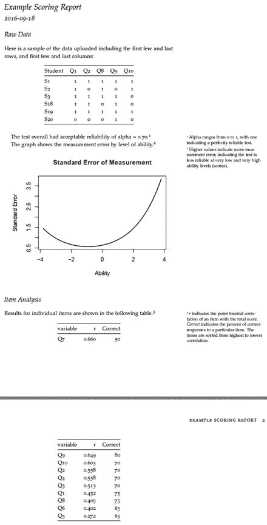
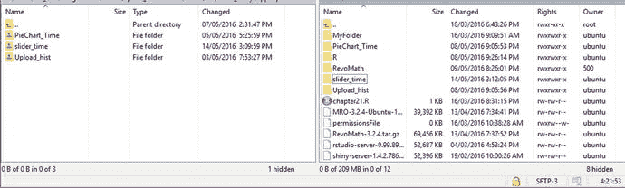

# 项目分析

各项目的分析结果如下表所示。^* *r* 表示项目与总分的点二列相关系数。*正确率* 表示特定项目的正确回答百分比。项目按相关系数从高到低排序。]

```{r, echo = FALSE, results = 'asis'}
kable(biserial.results)
```

现在，我们来逐一分解并解释这个 Markdown 文件的每个部分。这个标题比第一个稍高级一些。请注意，我们使用了内联 R 代码来将日期设置为当前日期。此外，我们的输出不再仅仅是 `pdf_document`，而是使用了默认的 `tufte_handout` 样式（这是一个包含样式信息的 PDF）。我们直接从其包中调用该样式（回想一下，`library(tufte)` 是在服务器端调用的）。

```
---
title: "示例评分报告"
subtitle: "项目层面分析"
date: "`r Sys.Date()`"
output:
  tufte::tufte_handout: default
---
```

接下来是将我们的分数数据读入 Markdown 文件。我们已经熟悉 `echo=FALSE`，它用于阻止代码显示。然而，我们还设置了 `include=FALSE`，这会阻止代码的任何输出显示。如前所述，我们使用 Shiny 服务器端的 `scores()` 变量，也就是我们使用 `read.csv()` 读取分数的地方。回想一下，在 Shiny 服务器上，我们将该变量简单地称为 `scores`。但在 `rmarkdown` 文件中，我们是将其作为函数调用的（毕竟它会动态更新）。为了避免继续将变量作为函数调用，我们在此使用同名的局部环境变量 `scores` 对其进行重命名：

```{r echo=FALSE, include = FALSE}
scores <- scores()
scores <- as.data.table(scores)
setnames(scores, 1, "Student")
```

我们的下一个代码块设置了 `results='asis'`，以防止对我们的 `knitr` 表格（称为 `kable`）进行进一步处理。此外，这段代码会将前五行和后两行与列输出到一个小的示例 `kable` 中。只有当行数或列数超过六时，它才会这样做。

```{r, echo = FALSE, results = 'asis'}
if (nrow(scores) > 6) {
  row.index <- c(1:3, (nrow(scores)-2):nrow(scores))
} else {
  row.index <- 1:nrow(scores)
}
if (ncol(scores) > 6) {
  col.index <- c(1:3, (ncol(scores)-2):ncol(scores))
}
kable(scores[row.index, col.index, with = FALSE])
```

从这里开始，我们可以使用 `ltm` 包计算测验或题目信度的若干指标。点二列相关系数是至关重要的；它使用更熟悉的皮尔逊相关系数，并针对测验题目是二分数据这一事实进行了调整。它允许比较学生在某个特定题目上的表现与他们在整个测验中的表现（因此我们将其与 `rowSums` 进行比较）。通过将这些数据从高到低排序，我们可以找出得分最低的测验题目。那些可能没有测量到我们测验主题的题目（诚然，这是极大的简化——心理测量学是一门远远超出本文范围的科学）。此外，我们还计算了克隆巴赫 α 系数和拉希模型，稍后会用到这些。再次强调，我们不打算直接将这些结果包含在我们的动态文档中；但我们可以在以后使用它们。

```{r, include = FALSE}
items <- names(scores)[-1]
scores[, SUM := rowSums(scores[, items, with = FALSE])]
## 现在计算点二列相关系数
## 首先将数据转换为长格式
scores.long <- melt(scores, id.vars = c("Student", "SUM"))
## 按项目计算点二列相关系数
## 从高到低排序
biserial.results <- scores.long[, .(
  r = round(biserial.cor(SUM, value, level = 2), 3),
  Correct = round(mean(value) * 100, 1)
), by = variable][order(r, decreasing = TRUE)]
alpha.results <- cronbach.alpha(scores[, !c("Student", "SUM"), with=FALSE])
rasch.results <- rasch(scores[,!c("Student", "SUM"), with=FALSE])
```

并非所有代码都必须放在正式的代码块中；代码也可以与文档正文内联。这很有用，因为我们可以设置临界分数（在本例中，半随意地设置为 `0.6`），并根据这些分数在最终报告中生成不同的文本。`tufte` 包允许使用 `^[]` 进行侧边栏注释。

```
整个测验具有 `r ifelse(alpha.results$alpha > .6, "可接受的信度", "信度较低")`，α = `r format(alpha.results$alpha, FALSE, 2, 2)`。^[Alpha 取值范围从 0 到 1，1 表示测验完全可靠。] 该图显示了按能力水平划分的测量误差。^[值越高表示测量误差越大，表明测验在非常低和非常高的能力水平（分数）下信度较低。]
```

回想一下我们之前的讨论，图形大小可以在代码块中进行控制。在这里，我们绘制了拉希模型图，并看到高水平和低水平学生的测量精确度较低：

```{r, echo = FALSE, fig.width = 5, fig.height = 4}
## 可以绘制测量标准误
vals <- plot(rasch.results, type = "IIC", items = 0, plot = FALSE)
plot(vals[, "z"], 1 / sqrt(vals[, "info"]),
     type = "l", lwd = 2, xlab = "能力", ylab = "标准误",
     main = "测量标准误")
```

代码最后以最后一个 `kable` 结尾，但我们之前已经看到过，不必赘述。现在我们在图 15-3 中展示的是下载的最终结果。请注意，所有被隐藏的代码都没有显示出来。同时，注意数据的样本，因为从图 15-2 中我们知道数据有多于六行或六列。最后，请注意自动编号的侧边注释，它们提供了更多细节。这些注释是使用文档文本区域中的 `^[]` 代码构建的。这使得提供详细但非关键性的洞察变得非常容易。



图 15-3. 下载的 PDF

## 上传至云端

我们的最后一项任务是将文件从本地机器上传到云实例。请记住，在前面的章节中，我们不仅使用 `PuTTY` 在云上安装了 Shiny Server，还使用 `WinSCP` 将文件上传到云。我们启动 `WinSCP`，重新连接，并确保左侧的本地端位于我们的 Shiny 应用程序文件夹中，而右侧的云服务器端位于 `/home/ubuntu`。我们回忆一下该过程的结果，如图 15-4 所示。



图 15-4. 已上传 PieChart_Time、slider_time 和 Upload_hist Shiny 应用程序的 WinSCP

从这里开始，我们访问 `PuTTY` 并从命令行运行以下代码：

```
sudo cp -R ∼/Chapter15 /srv/shiny-server/
```

请记住，在较早的章节中，我们调整了实例以允许从特定地址访问特定端口。您现在可以通过在任意浏览器中输入以下 URL 来验证您的应用程序是否正常工作：

```
http://Your.Instance.IP.Address:3838/Chapter15/
```

## 总结

在最后一章中，我们构建了一个可以基于新数据快速更新的动态文档。这种更新甚至可以扩展到图形和内联 `ifelse` 语句，允许叙述本身根据新数据发生变化。此外，我们构建了一个 Shiny 应用程序，允许有互联网连接的用户上传文件，为该报告提供新数据。此类报告可以以多种格式下载，尽管我们选择了 PDF。


在本文中，我们提供了高级数据管理技术，包括连接各种数据库。这些技术与动态文档能很好地融合，并具备将数据仓库中的信息轻松转化为可执行情报的能力。我们的最终结论是：随着数据变得越来越庞大，成功筛选并呈现有用数据的能力，在任何领域中都成为更加重要的技能。祝编码愉快！

## 参考文献

本章收录了本书其余部分所引用的全部资源的完整参考文献。

University Library, University of Illinois at Urbana-Champaign. “LibGuides: SPSS Tutorial: About This Tutorial.” [`http://guides.library.illinois.edu/c.php?g=347869`](http://guides.library.illinois.edu/c.php%3Fg%3D347869). 检索于 2016 年 9 月 27 日。

Chambers, J. *Software for Data Analysis: Programming with R*. Springer, 2009.

Chang, W. “shinydashboard: Create Dashboards with 'Shiny'.” `R` 包版本 0.5.1. [`https://CRAN.R-project.org/package=shinydashboard`](https://cran.r-project.org/package%3Dshinydashboard). 2015.

Chang, W., Cheng, J., Allaire, J., Xie, Y., and McPherson, J. “shiny: web application framework for R.” `R` 包版本 0.11, 1. 2015.

Chheng, T. “RMongo: MongoDB Client for R.” `R` 包版本 0.0.25. [`https://CRAN.R-project.org/package=RMongo`](https://cran.r-project.org/package%3DRMongo). 2015.

Conway, J., Eddelbuettel, D., Nishiyama, T., Prayaga, S.K., and Tiffin, N. “RPostgreSQL: R interface to the PostgreSQL database system.” `R` 包版本 0.4-1. [`https://CRAN.R-project.org/package=RPostgreSQL`](https://cran.r-project.org/package%3DRPostgreSQL). 2015.

U.S. Census Bureau, American FactFinder. “Data Access and Dissemination Systems (DADS).” [`http://factfinder2.census.gov/faces/tableservices/jsf/pages/productview.xhtml?pid=ACS_10_5YR_B01003`](http://factfinder2.census.gov/faces/tableservices/jsf/pages/productview.xhtml%3Fpid%3DACS_10_5YR_B01003). 检索于 2016 年 9 月 27 日。

Dragulescu, A. A. “xlsx: Read, write, format Excel 2007 and Excel 97/2000/XP/2003 files.” `R` 包版本 0.5.7. [`https://CRAN.R-project.org/package=xlsx`](https://cran.r-project.org/package%3Dxlsx). 2014.

Dowle, M., Srinivasan A., Short T., and Lianoglou S. with contributions from R Saporta and E Antonyan. “data.table: Extension of Data.frame.” `R` 包版本 1.9.6. [`https://CRAN.R-project.org/package=data.table`](https://cran.r-project.org/package%3Ddata.table). 2015.

Feinerer, I. and Hornik, K. “tm: Text Mining Package.” `R` 包版本 0.6-2. [`https://CRAN.R-project.org/package=tm`](https://cran.r-project.org/package%3Dtm). 2015.

Fellows, I. “wordcloud: Word Clouds.” `R` 包版本 2.5. [`https://CRAN.R-project.org/package=wordcloud`](https://cran.r-project.org/package%3Dwordcloud). 2014.

Friedl, J. E. F. *Mastering Regular Expressions, Third Edition*. O’Reilly Media, 2006.

Harrell Jr, F. E. with contributions from Charles Dupont and many others. “Hmisc: Harrell Miscellaneous.” `R` 包版本 3.17-1. [`https://CRAN.R-project.org/package=Hmisc`](https://cran.r-project.org/package%3DHmisc). 2015.

Hester, J. “covr: Test coverage for packages.” `R` 包版本 2.2.1. [`https://CRAN.R-project.org/package=covr`](https://cran.r-project.org/package%3Dcovr). 2016.

Johnson, P. “devEMF: EMF Graphics Output Device.” `R` 包版本 2.0. [`https://CRAN.R-project.org/package=devEMF`](https://cran.r-project.org/package%3DdevEMF). 2015.

Lang, D. T. and the CRAN Team. “XML: Tools for Parsing and Generating XML Within R and S-Plus.” `R` 包版本 3.98-1.4. [`https://CRAN.R-project.org/package=XML`](https://cran.r-project.org/package%3DXML). 2016.

Microsoft Corporation. “checkpoint: Install Packages from Snapshots on the Checkpoint Server for Reproducibility.” `R` 包版本 0.3.16. [`https://github.com/RevolutionAnalytics/checkpoint`](https://github.com/RevolutionAnalytics/checkpoint). 2016.

Ooms, J. “The jsonlite package: a practical and consistent mapping between JSON data and R objects.” *arXiv preprint arXiv:1403.2805*. 2014.

Prikryl, M. *WinSCP—Free SFTP and SCP client for Windows*. 2007.

R Core Team. “foreign: Read Data Stored by Minitab, S, SAS, SPSS, Stata, Systat, Weka, dBase, …” `R` 包版本 0.8-66. [`https://CRAN.R-project.org/package=foreign`](https://cran.r-project.org/package%3Dforeign). 2015.

Rizopoulos, D. “ltm: An R package for latent variable modeling and item response theory analyses.” *Journal of Statistical Software*, 17(5), 1–25. 2016.

R Special Interest Group on Databases (R-SIG-DB), Hadley Wickham, and Kirill Müller. “DBI: R Database Interface.” `R` 包版本 0.5. [`https://CRAN.R-project.org/package=DBI`](https://cran.r-project.org/package%3DDBI). 2016.

RStudio Team. “RStudio: Integrated Development for R.” [`www.rstudio.com`](http://www.rstudio.com). 2015.

Amazon Web Services. “Setting Up with Amazon EC2.” [`http://docs.aws.amazon.com/AWSEC2/latest/UserGuide/get-set-up-for-amazon-ec2.html`](http://docs.aws.amazon.com/AWSEC2/latest/UserGuide/get-set-up-for-amazon-ec2.html). 检索于 2016 年 10 月 2 日。

Schenk, C. *MiKTEX project page*. `http://miktex.org`. 2009

Tatham, S. “PuTTY: A free SSH and Telnet client.” [`www.chiark.greenend.org.uk/∼sgtatham/putty/`](http://www.chiark.greenend.org.uk/~sgtatham/putty/). 2016.

Urbanek, S. “rJava: Low-Level R to Java Interface.” `R` 包版本 0.9-8. [`https://CRAN.R-project.org/package=rJava`](https://cran.r-project.org/package%3DrJava). 2016.

U. S. Census Bureau, American FactFinder. “B01003—Total Population. All Counties within Illinois. 2006–2010 American Community Survey 5-Year Estimates.” [`http://factfinder2.census.gov/faces/tableservices/jsf/pages/productview.xhtml?pid=ACS_10_5YR_B01003&prodType=table`](http://factfinder2.census.gov/faces/tableservices/jsf/pages/productview.xhtml%3Fpid%3DACS_10_5YR_B01003&prodType=table). 2010.

U. S. Census Bureau, American FactFinder. “B23006—Educational Attainment by Employment Status for the Population 25 To 64 Years. Universe: Population 25 to 64 years. All Counties within Illinois. 2006–2010 American Community Survey 5-Year Estimates.” [`http://factfinder2.census.gov/faces/tableservices/jsf/pages/productview.xhtml?pid=ACS_10_5YR_B23006&prodType=table`](http://factfinder2.census.gov/faces/tableservices/jsf/pages/productview.xhtml%3Fpid%3DACS_10_5YR_B23006&prodType=table). 2010.

U. S. Census Bureau, American FactFinder. “S1903—Median Income in the Past 12 Months (in 2010 Inflation-Adjusted Dollars): All Counties within Illinois. 2006–2010 American Community Survey 5-Year Estimates.” [`http://factfinder2.census.gov/faces/tableservices/jsf/pages/productview.xhtml?pid=ACS_10_5YR_S1903&prodType=table`](http://factfinder2.census.gov/faces/tableservices/jsf/pages/productview.xhtml%3Fpid%3DACS_10_5YR_S1903&prodType%3Dtable). 2010.

van der Loo, M. “The stringdist package for approximate string matching.” *The R Journal*, 6, pp. 111–122. [`http://CRAN.R-project.org/package=stringdist`](http://cran.r-project.org/package%3Dstringdist). 2014.

Venables, W., and Ripley, B. D. *S programming*. Springer, 2004.

Wickham, H. “Reshaping data with the reshape package.” *Journal of Statistical Software*, 21(12), pp. 1–20. 2007.

Wickham, H. *ggplot2: Elegant Graphics for Data Analysis*. Springer, 2016.

Wickham, H. “testthat: Get started with testing.” *The R Journal*, 3 (1), pp. 5–10.

Wickham, H. “evaluate: Parsing and Evaluation Tools that Provide More Details than the Default.” `R` 包版本 0.9. [`https://CRAN.R-project.org/package=evaluate`](https://cran.r-project.org/package%3Devaluate). 2016.

Wickham, H., and Chang, W. “devtools: Tools to Make Developing R Packages Easier.” `R` 包版本 1.12.0. [`https://CRAN.R-project.org/package=devtools`](https://cran.r-project.org/package%3Ddevtools). 2016.


Wickham, H., Danenberg, P., 和 Eugster, M. “roxygen2：R 的源代码内文档工具.” R 包版本 5.0.1. [`https://CRAN.R-project.org/package=roxygen2`](https://cran.r-project.org/package%3Droxygen2). 2015.

Wickham, H. 和 Francois, R. “dplyr：数据操作语法.” R 包版本 0.4.3. [`https://CRAN.R-project.org/package=dplyr`](https://cran.r-project.org/package%3Ddplyr). 2015.

Wickham, H., Francois, R., 和 Müller, K. “tibble：简易数据框.” R 包版本 1.0. [`https://CRAN.R-project.org/package=tibble`](https://cran.r-project.org/package%3Dtibble). 2016.

Wickham, H., James, D. A., 和 Falcon S. “RSQLite：R 的 SQLite 接口.” R 包版本 1.0.0. [`https://CRAN.R-project.org/package=RSQLite`](https://cran.r-project.org/package%3DRSQLite). 2014.

Wiley, J. F. 和 Pace, L. *R 语言入门：统计编程导论*，第二版. Apress, 2015.

谢益辉. *R 与 knitr 动态文档*. CRC Press, 2015.

谢益辉 和 Allaire, J. J. “tufte：R Markdown 文档的 Tufte 风格.” R 包版本 0.2. [`https://CRAN.R-project.org/package=tufte`](https://cran.r-project.org/package%3Dtufte). 2016.

YAML：YAML 官方网站. [`www.yaml.org`](http://www.yaml.org). 检索于 2016 年 10 月 2 日.

Zeileis, A. 和 Grothendieck, G. “zoo：规则与不规则时间序列的 S3 基础设施.” *统计软件杂志* arXiv 预印本 math/0505527.


