# 第 15 章：动态报告与云服务

## 所需软件

## 本地机器

### 云实例

## 动态文档

## 动态文档与 Shiny

### `server.R`

### `ui.R`

### `report.Rmd`

## 上传到云端

## 总结

# 编程基础

与大多数语言一样，要掌握更高级的用法，需要深入研究其底层结构。本章将介绍这类编程基础，本书的第一部分（直到第 6 章）将讲解一些高级编程技术。我们从 R 的基本构建块开始，这将为我们进行编程、数据管理和云分析奠定基础。

在深入研究 R 之前，最好先遵循一些通用原则。首先，动手实践是好的。通过实践学习比单纯阅读更有效。请下载本书附带的源文件，并尝试新事物！

其次，熟悉 `?` 函数会非常有帮助。只需在 R 控制台中键入 `?` 后紧跟文本，即可调出相应的帮助文档。我们稍后会详细介绍函数，但这一点太有用了，不能等到那时再讲。

最后，在深入探讨您购买本书的真正目的之前，有一个注意事项：这是一本应用型书籍。我们可能会跳过或忽略 R 的某些主题和领域。虽然我们作者希望这是因为经过了想法的仔细筛选，但也可能是因为我们的知识局限。很可能存在其他方法来执行这些任务，或者其他值得学习的好主题。我们的目标是让您尽快上手并掌握一些有用的技能。祝您好运！

## 高级 R 软件选择

本书是为 R 语言的高级用户编写的。需要注意的是，在大多数示例中，我们像在《Beginning R: An Introduction to Statistical Programming》(Apress, 2015)中一样，继续使用 `RStudio` (`www.rstudio.com/products/rstudio/download/`)。我们还假设您使用的是 `Microsoft Windows` (`www.microsoft.com`)操作系统，但在后面的章节中，我们将通过 `Ubuntu` (`www.ubuntu.com`)深入探讨在云端使用 R。不同的是底层的 R 发行版。

我们将使用 `Microsoft R Open` (MRO)，它与当前版本的 R 完全兼容。这提供了幕后的性能增强。我们还使用 `Intel Math Kernel Library` (Intel MKL)，它可以从 MRO 的同一站点下载 (`https://mran.microsoft.com/download/`)。事实上，在本书付印时，这两个软件在最新版本中已合二为一。如果这种趋势持续下去，那就太好了。这些下载非常简单直接，我们预计已熟悉使用 R 和 RStudio 的读者会发现安装过程是无缝的。在 Windows（和基于 Linux 的操作系统）上，MKL 用优化的系统取代了默认的线性代数系统，并允许对线性代数操作（如许多统计算法中使用的矩阵乘法和分解）进行隐式并行处理。

如果尚未安装，您还需要安装 Java。本书使用了 64 位的 Java Version 8 Update 91。Java 可以在 `www.oracle.com/technetwork/java/javase/` 下载；具体来说，请获取 Java Development Kit (JDK)。

虽然这些选择可能会带来一些细微的影响，但我们的目标是提供通用指导，使其无论环境细节如何都足够准确。尽管如此，一些包和预构建函数偶尔会有特别之处。我们将注意力转向确保您可以轻松复现我们的结果。

## 复现结果

R 的一个有用特性是其丰富的包生态系统，这些包由全球专家编写。这也可能成为使用 R 的一个潜在弱点：从 R 本身的版本到特定包的版本，许多代码细节都处于不断变化之中。您的代码可能每天都会出现问题，更不用说我们在这本书出版前几个月编写的代码了。为了解决这个问题，我们使用 Revolution Analytics 的 `checkpoint` 包（Microsoft Corporation, 2016），它利用综合 R 存档网络(CRAN)中存储的服务器快照，将我们的代码“锁定”到特定的版本和日期。要了解其技术细节，请参阅本章末尾“参考文献”部分的链接。我们将从基础开始。

对于本书，我们使用了 R 版本 3.3.1 (Bug in Your Hair)以及 Windows 10 Professional x64。随着此版本从当前版本变为历史版本，CRAN 会维护过去版本的存档。因此，`checkpoint` 包可以轻松访问以前的 R 版本以及所有包。您需要在项目目录中第 1 章 R 文件的顶部添加以下代码：

```
## uncomment to install the checkpoint package
## install.packages("checkpoint")
library(checkpoint)
checkpoint("2016-09-04", R.version = "3.3.1")
library(data.table)
```

我们将所有 `library` 调用放在每章项目文件的开头，在调用 `checkpoint` 库之后。通过包含 2016 年 9 月 4 日这个日期，我们确保 `checkpoint` 安装并运行截至该截止日期所有包的最新版本。第一次运行时，在获得许可后，`checkpoint` 会创建一个文件夹来存放所需包的版本。因此，只要您以正确的 `library` 调用开始每一章的代码文件，您使用的就是我们使用的相同版本的包。

## 对象类型

首先，我们需要一些东西来构建我们的语言，在 R 语言中，这些东西被称为对象。我们从五种非常常见的对象类型开始。

逻辑型对象只取两个值：`TRUE` 或 `FALSE`。计算机是二进制机器，数据通常可以在一个“全有或全无”的世界中被记录和建模。这些逻辑值非常有用，其中 `TRUE` 的值为 `1`，`FALSE` 的值为 `0`：

```
TRUE
[1] TRUE
FALSE
[1] FALSE
```

你可能还记得代数教授快速念叨过的评论，数字有多种类型或“风味”。整数，包括零和负值，在集合记法中为 {…,-2, -1, 0, 1, 2, …}，这些数字对于计数或其他索引（当然还有其他用途）很有帮助。在 R 中，整数带有大写 `L` 后缀。如果需要小数，那么双精度数值型对象就派上用场了。这些数字适用于等距比例数据类型。复数也拥有有用的性质，其表示方式正如你所料，虚部带有 `i` 后缀。R 在使用所有这些数字时非常友好，你只需键入所需的数字即可（记住根据需要添加 `L` 或 `i` 后缀）：

```
42L
[1] 42
1.5
[1] 1.5
2+3i
[1] 2+3i
```

名义级数据可以通过 `character`（字符）类来存储，并用引号标示：

```
"a" ## 字符
[1] "a"
```

当然，数值型数据可能存在缺失值。这些缺失值的类型与数据集中其余数据的类型相同（我们稍后会讨论数据存储）。不过，了解如何手动编码逻辑型、整型、双精度型、复数型或字符型的缺失值会很有帮助：

```
NA
[1] NA
NA_integer_
[1] NA
NA_real_
[1] NA
NA_character_
[1] NA
NA_complex_
[1] NA
```

### 因子

因子是一种特殊的对象，对于通用编程不那么有用，但在统计学中经常使用。因子变量表示该变量应被视作离散变量处理。因子以整数形式存储，并用标签来指示原始值：

```
factor(1:3)
[1] 1 2 3
Levels: 1 2 3
factor(c("a", "b", "c"))
[1] a b c
Levels: a b c
factor(letters[1:3])
[1] a b c
Levels: a b c
```

### 数据结构

现在我们转向数据结构，它们可以存储我们讨论过的那些类型的对象（当然还有更多）。

#### 向量

向量是一种相对简单的数据存储对象。创建向量的一个简单方法是使用连接函数 `c()`：

```
c(1, 2, 3)
[1] 1 2 3
```

就像在数学中一样，标量是长度为 1 的向量。在连续谱的另一端，矩阵是一个具有行和列维度的向量。注意矩阵是如何用数字 1 到 6 填充的，按每列向下计数：

```
c(1)
[1] 1
matrix(c(1:6), nrow = 3, ncol = 2)
     [,1] [,2]
[1,]    1    4
[2,]    2    5
[3,]    3    6
```

#### 列表

所有向量，无论是标量、向量还是矩阵，都只能有一种数据类型（例如，整型、逻辑型或复数型）。如果需要多种类型的数据，将数据存储在列表中可能更合适。`list`（列表）是一个对象的向量，其中列表的每个元素可以是不同的类型。在下面的例子中，我们构建了一个包含字符、向量和矩阵元素的列表：

```
list(
+   c("a"),
+   c(1, 2, 3),
+   matrix(c(1:6), nrow = 3, ncol = 2)
+   )
[[1]]
[1] "a"
[[2]]
[1] 1 2 3
[[3]]
     [,1] [,2]
[1,]    1    4
[2,]    2    5
[3,]    3    6
```

#### 数据框

列表的一种特殊类型是数据框，其中列表的每个元素长度相同（尽管对象类型不一定相同）。请看以下带有输出的指导性示例：

```
data.frame(1:3, 4:6)
  X1.3 X4.6
1    1    4
2    2    5
3    3    6
### 使用长度不等的对象会导致问题
data.frame( 1:3, 4:5)
Error in data.frame(1:3, 4:5) :
arguments imply differing number of rows: 3, 2
data.frame( 1:3, letters[1:3])
  X1.3 letters.1.3.
1    1            a
2    2            b
3    3            c
```

#### 数据表

由于其卓越的速度，我们在 R 中使用 `data.table` 包中的数据表对象。数据表与数据框类似，但设计得更节省内存且速度更快。尽管我们推荐使用数据表，我们也会展示一些数据框的示例，因为当你使用 R 时，许多其他人的代码中包含数据框，并且数据表确实从数据框继承了许多方法。

```
library(data.table)
data.table( 1:3, 4:6)
   V1 V2
1:  1  4
2:  2  5
3:  3  6
```

探索了几种对象类型后，我们将注意力转向使用运算符和函数来操作这些对象的方法。

# 引言

在数据科学日益普及的时代，R 语言已成为最流行的编程语言之一。随着 R 语言和数据科学逐渐成为主流，越来越多没有经过统计计算或数据科学专门训练的 R 语言用户涌现，因此对能够弥合仅具备统计学或编程入门背景的应用型用户与高级数据分析之间差距的书籍和资源的需求日益增长。本书重点介绍如何使用 R 语言的高级编程来加速数据分析和数据科学中的日常任务。本书的独特之处还在于涵盖了如何在云端配置 R 语言，并为定期重复的分析（例如公司月度销售分析、学校学生成绩、入学率、辍学人数以及未来入学率的预测等）生成动态报告。

第 1 章至第 6 章重点介绍比 Apress 出版的《Beginning R》更高级的编程技术。

第 7 章至第 10 章则开发强大的数据管理方法，包括令人兴奋且（相对）新颖的`data.table`。

在此基础上，我们深入探讨使用 R 语言进行云计算的现代（且稍显前沿）世界。在第 11 章至第 14 章中，我们将从头开始引导您在亚马逊云上启动 R 语言。

最后，第 15 章为您提供了有关动态文档和报告的扎实技术。

# 基础运算符与函数

对象对于一门语言来说还不够；某些事物需要操作。运算符和函数是编程世界中的动词。我们从赋值开始，赋值可以通过两种方式进行。就像书面语言一样，更优雅的表达方式往往比简单的叙述更有帮助。因此，尽管 `=` 和 `<-` 都是赋值运算符，并且功能相同，但由于 `=` 在函数内部用于设置参数，为了清晰起见，我们建议在一般情况下使用 `<-` 进行赋值。尽管如此，我们还是会演示两种赋值技术。赋值允许给对象赋予合理的名称；这可以显著提高代码的可读性（既为了未来的自己，也为了其他用户）。

除了给变量命名外，你还可以使用函数来检查具体细节。R 中的函数通常采用函数名后跟括号的格式，括号内是输入内容，然后 R 会提供输出。以下是一些示例：

```
x <- 5
y = 3
x
[1] 5
y
[1] 3
is.integer(x)
[1] FALSE
is.double(y)
[1] TRUE
is.vector(x)
[1] TRUE
```

一旦对象被赋值，你可以使用方括号访问特定的对象元素。大多数计算机语言的索引从 `0` 或 `1` 开始。R 的索引从 `1` 开始。另外，请注意，你可以轻松地更改旧的赋值，几乎没有麻烦，也不会收到警告；明智的做法是谨慎地注意名称并仔细注释代码。

```
x <- c("a", "b", "c")
x[1]
[1] "a"
is.vector(x)
[1] TRUE
is.vector(x[1])
[1] TRUE
is.character(x[1])
[1] TRUE
```

### 访问和子集化数据结构

虽然向量可能只需要单个索引，但更复杂的结构需要更多索引。对于你之前遇到的矩阵，第一个索引是行，第二个是列位置。注意，在构建矩阵并赋值之后，有多种方法可以访问元素的各种组合。这种仅访问部分元素的过程有时称为`子集化`：

```
x2 <- matrix(c(1:6), nrow = 3, ncol = 2)
x2
[,1] [,2]
[1,]    1    4
[2,]    2    5
[3,]    3    6
x2[1, 2] ## 第 1 行，第 2 列
[1] 4
x2[1, ] ## 所有第 1 行
[1] 1 4
x2[, 1] ## 所有第 1 列
[1] 1 2 3
x2[c(1, 2), ] ## 第 1 行和第 2 行
[,1] [,2]
[1,]    1    4
[2,]    2    5
x2[c(1, 3), ] ## 第 1 行和第 3 行
[,1] [,2]
[1,]    1    4
[2,]    3    6
x[-2] ## 丢弃第二个元素
[1] "a" "c"
x2[, -2] ## 丢弃第二列
[1] 1 2 3
x2[-1, ] ## 丢弃第 1 行
[,1] [,2]
[1,]    2    5
[2,]    3 6
is.vector(x2)
[1] FALSE
is.matrix(x2)
[1] TRUE
```

#### 列表的子集化

访问和子集化列表可能稍微复杂一点，但对于后续技术的学习和掌握却至关重要。在单括号中使用单个索引会返回该位置处的整个元素（请记住，对于列表，每个元素可能是一个向量或只是一个单独的对象）。使用双括号则返回该列表元素内的对象——仅此而已。

因此，以下代码实际上是一个包含元素 `"a"` 的向量。同样，使用数据类型检查函数有助于学习如何解读代码的各个部分。

```
y <- list(c("a"), c(1:3))
y[1]
[[1]]
[1] "a"
is.vector(y[1])
[1] TRUE
is.list(y[1])
[1] TRUE
is.character(y[1])
[1] FALSE
```

与以下代码形成对比，它只是元素 `"a"`：

```
y[[1]]
[1] "a"
is.vector(y[[1]])
[1] TRUE
is.list(y[[1]])
[1] FALSE
is.character(y[[1]])
[1] TRUE
```

事实上，你可以将方括号链接在一起，因此可以访问列表的第二个元素（包含数字 1 到 3 的向量），然后在该向量内访问第三个元素：

```
y[[2]][3]
[1] 3
```

#### 使用 `$` 运算符

方括号几乎总是有效的，取决于对象的类型，但也可能有其他访问组件的方式。命名的数据框和列表可以使用 `$` 运算符。请注意在以下代码中，方括号或美元符号最终是等价的：

```
x3 <- data.frame(A = 1:3, B = 4:6)
y2 <- list(C = c("a"), D = c(1, 2, 3))
x3$A
[1] 1 2 3
y2$C
[1] "a"
x3[["A"]]
[1] 1 2 3
y2[["C"]]
[1] "a"
```

请注意，虽然数据框和列表都是列表，但它们都不是矩阵：

```
is.list(x3)
[1] TRUE
is.list(y2)
[1] TRUE
is.matrix(x3)
[1] FALSE
is.matrix(y2)
[1] FALSE
```

此外，尽管不是矩阵，但由于其特殊性质（即所有元素长度相等），数据框和数据表可以像矩阵一样进行索引：

```
x3[1, 1]
[1] 1
x3[1, ]
A B
1 1 4
x3[, 1]
[1] 1 2 3
```

#### 按名称索引

任何命名的对象都可以通过使用名称而不是位置数字来索引，前提是这些名称已设置：

```
x3[1, "A"]
[1] 1
x3[, "A"]
[1] 1 2 3
```

这适用于列名和行名，并且这些名称可以在构建矩阵后建立：

```
rownames(x3) <- c("first", "second", "third")
x3["second", "B"]
[1] 5
```

#### 处理数据表

数据表使用略有不同的方法。选择行的操作几乎相同，但选择列时不需要引号。此外，你可以使用 `.()` 运算符按名称选择多个（不带引号）。如果需要使用引号，可以通过选项 `with = FALSE` 来访问数据表，如下所示：

```
x4 <- data.table(A = 1:3, B = 4:6)
x4[1, ]
A B
1: 1 4
x4[, A]
[1] 1 2 3
x4[1, A]
[1] 1
x4[1:2, .(A, B)]
A B
1: 1 4
2: 2 5
x4[1, "A", with = FALSE]
A
1: 1
```

### 方括号作为函数

从技术上讲，方括号运算符是函数。尽管它们不常用作函数，但可以这样使用。大多数函数都有名称，但方括号是一个特例，需要在常规函数格式中使用单引号，如以下示例所示：

```
`[`(x, 1)
[1] "a"
`[`(x3, "second", "A")
[1] 2
```

### 类型检查和强制转换

虽然我们一直在使用 `is.datatype()` 函数来更好地说明对象的类型，但你还可以做更多。具体来说，你可以使用 `is.na()` 函数检查某个值是否缺少元素：

```
is.na(NA) ## 有效
[1] TRUE
```

当然，前面的代码片段通常有一个向量或矩阵元素参数，其填充状态有待讨论。我们最后一个（目前）探索性函数是 `inherits()` 函数。当不存在 `is.class()` 函数时（这可能在开发了你目前所见的核心类之外的特定类时发生），它很有帮助：

```
inherits(x3, "data.frame")
[1] TRUE
inherits(x2, "matrix")
[1] TRUE
```

#### 数据类型强制转换

你也可以将较低类型强制转换为较高类型。这种强制转换可能会有帮助，但也可能产生意想不到的后果。如果你有一个更高级的数据对象被强制转换为较低类型，这尤其有风险（特别注意尝试将整数强制转换的情况）。

```
as.integer(3.8)
[1] 3
as.character(3)
[1] "3"
as.numeric(3)
[1] 3
as.complex(3)
[1] 3+0i
as.factor(3)
[1] 3
Levels: 3
as.matrix(3)
[,1]
[1,]    3
as.data.frame(3)
1 3
as.list(3)
[[1]]
[1] 3
> as.logical("a")
[1] NA
as.logical(3)
[1] TRUE
as.numeric("a")
[1] NA
Warning message:
NAs introduced by coercion
```

强制转换可能很有用。尽管如此，使用时必须谨慎。在离开本节之前，如果这些内容有任何新意，请务必使用不同于前述示例中的输入进行实验！实验永远不会有坏处，它是学习的有效方法。

现在，让我们把注意力转向数学和逻辑运算符及函数。

## 数学运算符与函数

多种运算符可用于比较操作。这些在我们后续学习循环和构建自定义函数时会很有帮助。同样实用的还有符号逻辑形式。我们先从一些基本比较开始，并承认对数字 **4** 有一种奇特的偏好：

```
4 > 4
[1] FALSE
4 >= 4
[1] TRUE
4 < 4
[1] FALSE
4 <= 4
[1] TRUE
4 == 4
[1] TRUE
4 != 4
[1] FALSE
```

现在有必要提一下，虽然前面的代码可能有用，但数字之间通常只有微小的差异——尤其是在编程环境中，这依赖于计算机对浮点数（无理数）的表示。因此，我们经常检查数值是否在一个容差范围内接近：

```
all.equal(1, 1.00000002, tolerance = .00001)
[1] TRUE
```

在符号逻辑中，**AND** 和 **OR** 是两个对象间有用的比较。在 R 中，我们用 `&` 表示 AND，用 `|` 表示 OR。可以从这些简单的结构构建复杂的逻辑测试：

```
TRUE | FALSE
[1] TRUE
FALSE | TRUE
[1] TRUE
TRUE & TRUE
[1] TRUE
TRUE & FALSE
[1] FALSE
```

到目前为止提到的所有逻辑测试，应用于向量和应用于单个对象一样有效：

```
1:3 >= 3:1
[1] FALSE  TRUE  TRUE
c(TRUE, TRUE) | c(TRUE, FALSE)
[1] TRUE TRUE
c(TRUE, TRUE) & c(TRUE, FALSE)
[1]  TRUE FALSE
```

如果你只想要单一的结果，例如用于 `if-else` 流程控制，你可以使用 `&&` 或 `||`，它们一旦确定了最终结果就会停止求值。请仔细理解以下代码和输出：

```
W
Error: object 'W' not found
TRUE | W
Error: object 'W' not found
TRUE || W
[1] TRUE
W || TRUE
Error: object 'W' not found
FALSE & W
Error: object 'W' not found
FALSE && W
[1] FALSE
```

需要注意的是，双运算符实际上并非向量化的。它们只使用任何向量的第一个元素：

```
c(TRUE, TRUE) || c(TRUE, FALSE)
[1] TRUE
c(TRUE, TRUE) && c(TRUE, FALSE)
[1] TRUE
```

`any()` 和 `all()` 函数在这些场景下也很有用，原因类似：

```
any(c(TRUE, FALSE, FALSE))
[1] TRUE
all(c(TRUE, FALSE, TRUE))
[1] FALSE
all(c(TRUE, TRUE, TRUE))
[1] TRUE
```

现在我们将注意力转向数学运算符，而非逻辑运算符。R 在数学上很强大，可以执行大多数数学计算。因此，虽然我们介绍一些函数，但会省略很多。更多细节请参考 `?Arithmetic`，它会是个好帮手。了解计算机执行数学计算的方式（一如既往地）很重要。能够直接编写定制解决方案是强大的，但伴随着定制自由而来的是相应的责任。请仔细看以下数学运算（由于实现选择，它们的行为可能与预期不同）：

```
3 + 3
[1] 6
3 - 3
[1] 0
3 * 3
[1] 9
3 / 3
[1] 1
(-27) ^ (1/3)
[1] NaN
4 %/% .7
[1] 5
4 %% .3
[1] 0.1
```

R 还有一些名称直白的常用函数：

```
sqrt(3)
[1] 1.732051
abs(-3)
[1] 3
exp(1)
[1] 2.718282
log(2.71)
[1] 0.9969486
```

三角函数也占有一席之地，`?Trig` 可以调出一个很好的列表。为简洁起见，我们展示余弦函数调用 `cos()`。再次注意余弦函数输出的细微误差：

```
cos(3.1415)
[1] -1
```

我们用一组简短的矩阵运算来结束本节和本章。标量运算使用基本算术运算符。要执行矩阵乘法，我们使用 `%*%`：

```
x2
[,1] [,2]
[1,]    1    4
[2,]    2    5
[3,]    3    6
x2 * 3
[,1] [,2]
[1,]    3   12
[2,]    6   15
[3,]    9   18
x2 + 3
[,1] [,2]
[1,]    4    7
[2,]    5    8
[3,]    6    9
x2 %*% matrix(c(1, 1), 2)
[,1]
[1,]    5
[2,]    7
[3,]    9
```

矩阵在线性代数中还有一些其他相当常见的操作很有用。我们假设你对我们在建模中涉及的一些应用背后的数学有所了解，我们将在后续章节根据需要讨论适量的数学内容。不过，这里似乎是展示如何编码转置、叉积和转置叉积的好地方。我们展示了实现叉积和转置叉积的原始代码，以及可能使用的更简单的函数调用。顺便提一句，这在 R 中是相对常见的。通过程序包，许多技术都以相当清晰的函数调用实现。以下是示例：

```
t(x2)
[,1] [,2] [,3]
[1,]    1    2    3
[2,]    4    5    6
t(x2) %*% x2
[,1] [,2]
[1,]   14   32
[2,]   32   77
crossprod(x2)
[,1] [,2]
[1,]   14   32
[2,]   32   77
x2 %*% t(x2)
[,1] [,2] [,3]
[1,]   17   22   27
[2,]   22   29   36
[3,]   27   36   45
tcrossprod(x2)
[,1] [,2] [,3]
[1,]   17   22   27
[2,]   22   29   36
[3,]   27   36   45
```

我们用一些最后的思考来结束本章。首先，正如你刚才看到的，在 R 中，通常有人已经完成了繁重的工作，通过编写一个函数来直接产生期望的结果。当然，这些友好程序员的工作只受限于 R 本身的基础约束以及获取免费 GitHub 账户的能力。因此，了解至少一些使 R 工作的基本命令和运算符是有帮助的。其次，R 运行在计算机上，对于那些尚未接触过计算机逻辑的人来说，由于硬件结构（以及随之而来的软件实现选择），存在一些差异。

接下来，让我们专注于理解实现的细微差别，以及快速地将数据输入和输出 R。

# 编程实用工具

使用 R 执行更高级的操作需要创建可能从未存在过的东西。要创造新事物，就需要细致地理解预构建函数的精确工作方式。本章讨论如何以及在哪里查找现有功能的帮助和文档，R 如何与你的计算机系统和文件交互，以及数据输入输出的细节。和之前一样，请根据你的需要自由选择本章的内容。我们从帮助文件和文档开始。

注意
本书中，`粗体` 代码意味着需要运行。非粗体代码表示命令行输出的结果，或者旨在提供信息但不一定需要运行的代码。

## 帮助与文档

R 语言社区提供了丰富的资源来帮助用户。从预置的函数到包中按主题收集的完整函数集，支持形式多种多样。`?` 和 `help` 都是获取对象或函数信息的有效方式。对于更常见的对象，R 不仅提供了详尽的文档说明具体细节（例如函数的输入），还对预期接受的输入内容进行了详细注释。此外，文档中通常还会展示详细的示例，以说明可以实现的功能。图 2-1 展示了使用这两个函数查询加法运算符时的输出：

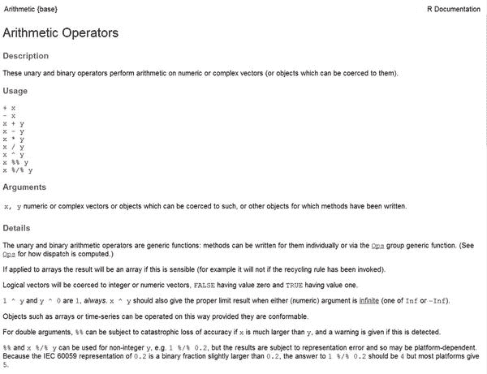

图 2-1. 算术运算符的帮助文档

```
?'+'
help("+")
```

请注意图 2-1 底部，关于算术运算符的文档甚至贴心地提供了特定信息，指出输出结果可能因平台而异。值得注意的是，并非所有函数都有如此完整、随时可查的文档，但对于许多最常用的函数和包，可以获得极其详细的信息。编写能够独立于平台和环境、重现预期结果的代码，并非总是可行。稍后讨论调试时，这类对各种函数的高级认知会很有帮助。

当然，当你已经知道要使用的对象或函数，只是需要更多细节时，这类帮助更有用。若想实现全新的功能，查阅手册会有所帮助。[`https://cran.r-project.org/manuals.html`](https://cran.r-project.org/manuals.html) 就是这样一个由 R 核心开发团队维护的网站。

现在我们将注意力转向 R 访问系统文件的方式。

## 系统与文件

在 Windows 环境中，R 可能是实现文件操作自动化的非常有效的方式。大多数 IT 部门都愿意安装 R，并且它具有与您相同的文件权限。从创建文件到移动文件、检查日期，R 提供了多种函数，便于从系统获取信息和实现文件管理自动化。根据我们的观察，基于 Unix 的系统可能通过命令行有更优雅的方式来处理此类场景。

R 访问系统的一个有用特性是，它可以发现运行 R 的系统的当前日期、时间和时区。这有助于检测新文件，或用于在文件中添加时间戳（稍后详述）。需要注意的是，这些信息当然依赖于系统环境的准确性，因此在用于高风险项目之前，可能需要谨慎行事。

```
Sys.Date()
[1] "2016-02-13"
Sys.time()
[1] "2016-02-13 16:58:36 CST"
Sys.timezone()
[1] "America/Chicago"
```

这些命令的帮助文档提供了有用的建议，以提高输出的准确性，甚至可能达到毫秒或微秒的精度。

现在让我们关注各种文件管理函数。它们都遵循 `file.*` 的格式，并且第一个参数是一个字符向量，应该是当前工作目录下的文件名，或者是路径加文件名。我们从工作目录中的一个文本文件 `ch02_text.txt` 开始。

函数 `file.exists()` 只接受一个字符串输入，即文件名或路径加文件名。如果仅仅是文件名，它只检查工作目录。这个工作目录由 `getwd()` 函数确认。如果想检查另一个目录中的文件，可以通过在字符串中提供完整的文件路径来实现。此函数返回一个逻辑值 `TRUE` 或 `FALSE`。根据用户对特定文件的权限，您可能无法获得预期的结果。

```
getwd()
[1] "C:/Books/Apress_AdvancedR/RFiles"
file.exists("ch02_text.txt")
[1] TRUE
file.exists("NOSUCHFILE.FAKE")
[1] FALSE
file.exists("C:/Books/Apress_AdvancedR/Apress_AdvancedR_Proposal.docx")
[1] TRUE
```

前面的函数检查是否存在，而另一个函数则测试我们是否有权访问文件。函数 `file.access` 接受类似的输入，但它还需要第二个参数。要测试存在性，第二个参数是 `0`。要测试可执行权限，使用 `1`；要测试写入权限，使用 `2`。如果要测试读取文件的能力，使用 `4`。此函数返回一个整数向量，`0` 表示授予权限，`-1` 表示未授予权限。请注意，该函数的默认设置是测试简单的存在性。`file.access` 的示例如下：

```
file.access("ch02_text.txt")
ch02_text.txt

file.access("ch02_text.txt", mode = 0)
ch02_text.txt

file.access("ch02_text.txt", mode = 1)
ch02_text.txt

file.access("ch02_text.txt", mode = 2)
ch02_text.txt

file.access("ch02_text.txt", mode = 4)
ch02_text.txt
```

接下来，我们将注意力转向 `file.info` 函数，它可以获取关于文件何时被修改、更改或访问的更详细信息。该函数同样接受字符串作为输入。输出提供以下信息：文件大小；是否为目录；以读、写、执行顺序表示的文件权限整数；最后修改时间；最后更改时间；最后访问时间；最后，文件是否可执行：

```
file.info("ch02_text.txt", "chapter01.R")
size isdir mode               mtime               ctime               atime exe
ch02_text.txt   31 FALSE  666 2016-02-13 17:00:16 2016-02-13 16:59:57 2016-02-13 16:59:57  no
chapter01.R   7983 FALSE  666 2016-01-01 02:53:17 2016-01-05 12:26:39 2016-01-01 02:53:17  no
```

请注意，您可以通过 `sys.setFileTime` 函数修改文件的修改时间。这在某些情况下会很有帮助，尽管其精确度和准确性取决于环境。以下是一个示例：

```
newTime<-Sys.time()-20
newTime
[1] "2016-02-13 20:25:53 CST"
file.info("ch02_text.txt")
size isdir mode               mtime               ctime               atime exe
ch02_text.txt   31 FALSE  666 2016-02-13 17:00:16 2016-02-13 16:59:57 2016-02-13 16:59:57  no
Sys.setFileTime("ch02_text.txt", newTime)
file.info("ch02_text.txt")
size isdir mode               mtime               ctime               atime exe
ch02_text.txt   31 FALSE  666 2016-02-13 20:25:53 2016-02-13 16:59:57 2016-02-13 16:59:57  no
```

关于文件的创建和删除，函数 `file.create` 和 `file.remove` 的作用正如其名。它们会返回逻辑值 `TRUE` 或 `FALSE`，甚至能提供更多详细信息：

```
file.create("ch02_created.docx", showWarnings = TRUE)
[1] TRUE
file.remove("ch02_created.docx")
[1] TRUE
file.remove("NOSUCHFILE.FAKE")
[1] FALSE
Warning message:
In file.remove("NOSUCHFILE.FAKE") :
cannot remove file 'NOSUCHFILE.FAKE', reason 'No such file or directory'
```

文件也可以被复制和重命名。函数 `file.copy` 可以设置覆盖权限，甚至可以使用 `recursive=TRUE` 选项来复制整个文件夹及其子文件夹。此外，它还有选项来复制模式或文件权限以及文件日期数据（或者，当然，让副本拥有新的修改日期）。以下代码示例展示了这可能如何运作：

```
Sys.time()
[1] "2016-02-13 21:05:29 CST"
file.copy("ch02_text.txt", "ch02_copy.txt", overwrite = TRUE, recursive = FALSE, copy.mode = TRUE, copy.date = TRUE)
[1] TRUE
file.info("ch02_copy.txt")
size isdir mode               mtime               ctime               atime exe
ch02_copy.txt   31 FALSE  666 2016-02-13 20:25:53 2016-02-13 21:05:30 2016-02-13 21:05:30  no
file.rename("ch02_copy.txt", "ch02.txt")
[1] TRUE
```

`file.append` 函数将两个文件连接在一起。这对某些文件类型效果很好。如果使用不当，可能会产生不良后果。虽然执行此操作的代码如下，但请仔细注意图 2-2 和图 2-3。对于文本文件，该过程效果足够好。对于 Microsoft PowerPoint 文件，则不然。请记住，这些 PowerPoint 文件的例子更不是为了说明文件本身（两位作者都不认为会真正使用 R 来处理此类文件），而是为了说明文件操作的细节通常值得谨慎对待。请注意，R 认为两个操作都是成功的：

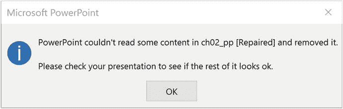

图 2-3. 第二个操作在 R 看来是成功的，但打开文件时并未起作用

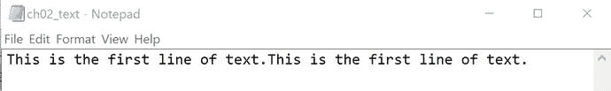

图 2-2. 第一个操作在 R 看来是成功的，并且打开文件时确实起作用了

```
file.append("ch02_text.txt", "ch02.txt")
[1] TRUE
file.append("ch02_pp.pptx", "ch02_pp2.pptx")
[1] TRUE
```

您不仅可以用 R 操作文件，还可以创建目录或文件夹。函数是 `dir.create`，其行为正如您所期望的那样。我们在此展示该函数的一个示例，以及图 2-4 中生成的结果目录：

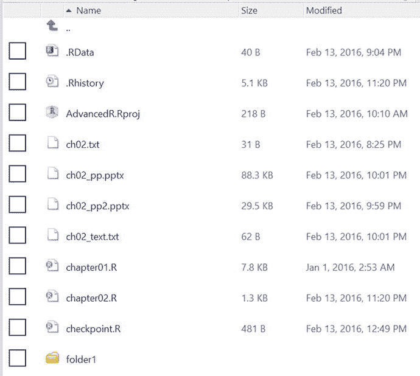

图 2-4. 创建的 folder1 目录

```
dir.create("folder1")
```

这些命令对用户有权访问和操作的任何文件都有效。其中一位作者使用这些命令将来自不同部门拥有的各种共享驱动器的数据移动，最终将结果文件发布到网站上。一旦您了解了后续章节中的循环和函数，您将能够自动化大部分文件管理。

# 输入

接下来要面对的挑战是如何将新数据导入 R。数据集往往很大，但有效的技术也可以用于较小的数据集。以制表符或逗号分隔的文本文件是最容易导入 R 的。接下来，常见的数据文件类型包括 Microsoft Excel、SPSS、SAS 和 Stata。更普遍地说，可以相当肯定地说，很可能存在一个 R 包可以处理您想要导入的文件类型。即使需要，也可以输入 PDF 和 Microsoft Word 文件（文本分析，从词云到更具预测性的应用，可以想到这些情况）。对于这些记录中的大部分，输入过程是相似的，因此或许不需要详尽介绍，而更需要建立正确的原则。请务必访问本书的 Apress 网站下载本书的代码包。我们在接下来的示例中使用第[02](http://dx.doi.org/10.1007/978-1-4842-2077-1_02)章文件夹中的文件；使用了`Counties in Illinois`文件（All Counties in Illinois， 2016）和`rscfp2013`文件（DADS， 2016）。

我们从 R 中的一个函数`read.table()`开始，它可以接收几种更基本的文件类型，并将它们作为数据框读入。与大多数输入函数一样，它有几个选项，并非所有选项在任何特定情况下都是必需的。根据读入 R 的数据类型，可能需要多次尝试才能以便于使用和操作的方式成功读入数据。在这种情况下，`View`函数可能会有所帮助，其输出如图 2-5 所示。

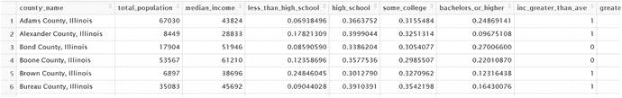
图 2-5. `View()`函数的输出

```
countiesILCSV<-read.table("Ch02/Counties_in_Illinois.csv", header = TRUE, sep = ",")
View(countiesILCSV)
```

我们使用三个包——`Hmisc` (Harrell， 2016)、`xlsx` (Dragulescu， 2014)和`foreign` (R Core Team， 2015)——来展示从各种文件类型输入。一个观察是，文件类型实际上可能非常大。如图 2-6 所示，`read.dta`快速而方便地导入了具有超过 30，000 条记录的 Stata 文件。

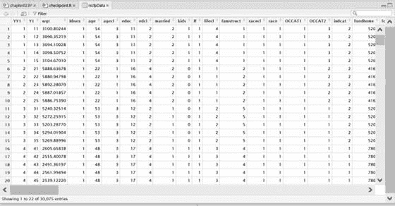
图 2-6. 一个更大的 Stata .dta 文件成功导入 R，包含数千条记录

```
library(checkpoint)
checkpoint("2016-09-04", R.version = "3.3.1")
library(Hmisc)
library(foreign)
library(xlsx)
rscfpData <- read.dta("Ch02/rscfp2013.dta")
View(rscfpData)
```

我们也可以通过`spss.get`函数导入 SPSS 文件。即使有警告，数据通常也能成功导入。如果数据未成功导入，请搜索警告信息以获取具体细节。在本例中，从我们的标头视图来看，一切似乎都正常。为了简洁起见，我们截取了部分标头输出：

```
countiesILSPSS <- spss.get("Ch02/Counties_in_Illinois.sav")
Warning message:
In read.spss(file, use.value.labels = use.value.labels, to.data.frame = to.data.frame,  :
Ch02/Counties_in_Illinois.sav: Unrecognized record type 7, subtype 18 encountered in system file
head(countiesILSPSS)
county.name total.population median.income
1 Adams County, Illinois                  67030         43824
2 Alexander County, Illinois               8449         28833
3 Bond County, Illinois                   17904         51946
4 Boone County, Illinois                  53567         61210
5 Brown County, Illinois                   6897         38696
6 Bureau County, Illinois                 35083         45692
less.than.high.school high.school some.college bachelors.or.higher
1            0.06938496   0.3663752    0.3155484          0.24869141
2            0.17821309   0.3999044    0.3251314          0.09675108
3            0.08590590   0.3386204    0.3054077          0.27006600
4            0.12358696   0.3577536    0.2985507          0.22010870
5            0.24846045   0.3012790    0.3270962          0.12316438
6            0.09044028   0.3910391    0.3542198          0.16430076
```

我们将用 Excel 进行最后一个示例，这要用到我们的最后一个包 `xlsx`。这个包依赖于 `rJava`（Urbanek, 2016），这个依赖关系根据你使用的 R 版本有所不同。作者们通常尽可能坚持使用 64 位版本，这要求安装 64 位的 Java。如果没做到这一点，R 会毫不客气地报怨。请注意，可以专门指定工作表名称，这使得函数 `read.xlsx` 在提取特定数据片段时非常方便。

```
countiesILExcel <- read.xlsx("Ch02/Counties_in_Illinois.xlsx", sheetName = "Counties_in_Illinois")
```

这三个包，加上 R 本身固有的读取以各种分隔符存储于文本文件中的表格数据的能力，使得输入大部分可能已预排序或收集好的数据变得足够容易。让 R 直接在线查找文件也不困难，这样一位研究人员可以更新记录，而这些结果可以轻松地传播给其他人。稍后，作为其他示例的一部分，我们有一些文件是从互联网实时下载的。现在，我们将注意力转向输出。

# 输出

输出形式多种多样。或许因为需要与其他研究人员或合作伙伴协作，需要适配其他的软件系统。与前面的输入部分非常相似，R 可以轻松地输出为多种文件类型。更有趣的是设置 R 将特定的控制台输出发送到某些文件。这允许一台机器查看在另一台计算机上运行的分析结果。在本节中，我们将演示将数据输出到 SPSS、Stata 和 Excel 的几种方法。然后我们处理控制台输出。请你记住，还有很多其他的创建文件的方法和类型，并且作为更大示例的一部分，我们将演示包括各种文档文件和图形在内的多种类型。

要将文件输出到 Excel、SPSS 或 Stata，只需正确调用 `xlsx` 或 `foreign` 包。如图 2-7 所示，R 可以方便地创建输出。

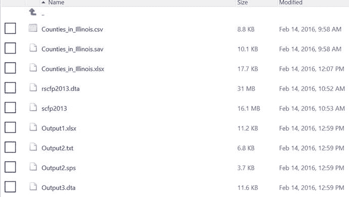
图 2-7. 从 R 创建的 Excel、SPSS 和 Stata 文件格式的输出

```
write.xlsx(countiesILExcel, "Ch02/Output1.xlsx")
write.foreign(countiesILExcel, "Ch02/Output2.txt", "Ch02/Output2.sps",   package="SPSS")
Warning message:
In writeForeignSPSS(df = list(county_name = c(1L, 2L, 3L, 4L, 5L,  :
some variable names were abbreviated
write.dta(countiesILExcel, "Ch02/Output3.dta")
Warning message:
In write.dta(countiesILExcel, "Ch02/Output3.dta") :
abbreviating variable names
```

`sink` 函数获取控制台输出并将其定向到文件。因此，R 过程的运行结果可以被存储以供后续观察，或保存到共享驱动器供他人查阅。控制台仅将输出发送到文件，不包括输入。仔细比较下面的代码与图 2-8 所示的`Output4.txt`截图之间的差异：

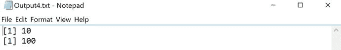
图 2-8. `sink()` 函数输出到文本文件

```
sink("Ch02/Output4.txt", append = TRUE, split = TRUE)
x <- 10
xSquared <- x²
x
[1] 10
xSquared
[1] 100
unlink("Ch02/Output4.txt")
```

我们暂且将注意力从输出上移开，因为我们知道在后续几章中还会再次讨论这个话题。不同类型的输出是必要的，它们往往取决于目标与环境。

下一章将提供快速重复类似操作以及根据环境进行过程修正的工具。这些技术与本章的方法相结合，能够相当方便地在相对较大的规模上实现文件管理的自动化。

# 3. 编程自动化

有人说，重复同样的行动却期待不同的结果，这是疯狂的定义。虽然在牛津词典的简短搜索中并未找到此定义，但我们持有一个相似的前提：为防止疯狂，让计算机来反复执行同样的操作吧，并期待相同的结果！

本章的目标是让你开始在代码中构建自动化。代码的部分力量在于它乐于按需反复执行相同操作，不会出错也不会疲倦。代码的另一个有用特性是能够在程序流程中嵌入逻辑。我们人类在最佳状态下自然会使用这种逻辑。例如，如果父亲的钥匙挂在挂钩上，他一定在家。否则，父亲一定还在外活动。另一个例子：如果 `p` 小于 `alpha`，则拒绝零假设；否则，不拒绝零假设。

因为这种自动化允许进行大量重复，所以必须注意效率。代码运行需要多长时间？代码能否以不同的方式编写以使操作执行得更快？在编程中，或许也像在生活中一样，我们通常没有完美的答案，而是在选择和结果之间有更多的权衡。我们生活在一个勇敢新世界，在这个世界里，新的、更强大的硬件常常比为了挤出多一点效率所需的人力成本更便宜。另一方面，我们的这个勇敢新世界也拥有数十亿条目的数据集；从每次计算中节省一毫秒，就能节省数百小时的计算时间。我们尽力采取平衡的方法，先演示一些更容易理解的构造，然后再展示更快的方法。

当我们开始介绍这些自动化方法中的第一种时，我们要提醒你，编码既是一门科学，也是一门艺术。更清晰、更易读的代码可能不是最快的。唯一本质的“快”的定义是“足够快”。如果某种代码对你来说更有意义，从而让你更可能记住并使用它，那可能就足够好了。当然，如果不够快，就需要做一些研究来找到更快的替代方案。

## 循环

循环会重复执行其内部的代码。需要注意避免陷入无限循环——即永不停止的循环。大多数循环都内置了尝试停止的机制（尽管这些机制并不总是按计划生效）。在下一节中，我们将讨论手动退出循环的方法。循环的另一个需要注意的方面与它们是函数这一事实有关。虽然我们之前已经使用了“函数”这个词，但我们推迟到下一章再深入讨论函数。现在只需记住，在函数内部创建的任何内容，在该函数结束时都可能消失。对于循环来说，当它们停止重复时就会发生这种情况。因此，如果你想保留结果，就需要在循环外部构建容纳这些结果的容器。同样，我们将在下一章深入探讨具体细节。

### `for` 循环

`for` 循环是我们要讨论的第一个（或许在 R 语言中也是最具争议的）自动化工具。在许多计算机语言中，`for()` 被认为速度相当快，但在 R 中则不然。尽管如此，这个函数易于理解和使用。易读的代码不应被不必要的回避。然而，通常有多种方法可以实现目标，忽视它们是不明智的。我们在代码中使用 `proc.time()` 函数来测量不同的时间；我们将通过计算停止时间与开始时间的差来得到运行时间。请看以下代码和输出：

```
x <- seq(1,100000,1)
head(x)
[1] 1 2 3 4 5 6
forTime<- proc.time()
xCube <- NULL
for (i in 1:length(x) ) {
+   xCube[i] = x[i]³
+ }
forTime <- proc.time()-forTime
head(xCube)
[1]   1   8  27  64 125 216
forTime
user  system elapsed
11.04    0.17   11.25
```

你可以看到变量 `x` 中包含数字 `1` 到 `100,000`（通过调用 `head()` 函数显示前六个数字）。接下来，我们创建一个变量来存放所有这些数字的立方。我们还将当前时间存储在一个变量中，以便对该操作计时。现在来看 `for()` 函数的奇妙之处！这个函数接受一个索引（通常称为 `i`）和一个索引操作的范围。我们从 `i` 等于 `1` 开始，循环运行。在循环结束时，`i` 会自动加 `1`，然后重复循环。循环会一直重复，直到达到范围的最后部分。注意我们没有选择一个固定的上限；相反，我们根据 `x` 的长度来调整循环。你可以看到，循环确实将 `x` 的每一项进行了立方运算。在我们的系统中，这花费了 `11.25` 秒。

#### 优化 `for` 循环

不过，这个时间是可以优化的。注意虽然我们创建了变量 `xCube`，但它是一个空变量。我们的 `for` 循环的每次迭代不仅需要对 `x` 进行立方运算，还必须将 `xCube` 变量的大小增加 `1`。这被证明并非一项简单的任务。如果我们能够提前将 `xCube` 创建为我们所需的大小，性能将显著提高。我们首先删除 `xCube`，以避免被任何先前的数据误导：

```
rm(xCube)
forTime2<- proc.time()
xCube <- vector(mode = "numeric", length = length(x))
for (i in 1:length(x) ) {
+   xCube[i] = x[i]³
+ }
forTime2 <- proc.time()-forTime2
head(xCube)
[1]   1   8  27  64 125 216
forTime2
user  system elapsed
0.15    0.00    0.15
```

注意，现在我们的时间只有 `0.15` 秒——大大提高了！值得注意的是，即使我们创建了一个长度不够的虚拟 `xCube`，或者创建了一个太长、需要在末尾删除一些空条目，这仍然会更快。因此，即使在运行循环之前可能无法或不便知道所需变量的大小，创建一个可能足够大的容器来首先存储数据可能也是有益的。

### R 中的向量化操作

对于这个特定的例子，使用 `for` 循环是错误的做法。R 为其一些最简单的函数提供了强大且快速的底层代码。注意，这里几乎没有花费任何时间（当然，有一些，但根据操作系统，某些差异不明显）。此外，注意 `head()` 函数可以接受负数，用于从末尾向前计数，显示如下内容：

```
xCube <- NULL
vTime <- proc.time()
xCube <- x³
vTime <- proc.time()-vTime
head(xCube, -99994)
[1]   1   8  27  64 125 216
vTime
user  system elapsed
0       0       0
```

### `while` 循环

还有其他类型的循环。`for` 循环最适合运行一个过程特定的次数，并在结束时停止。另一方面，`while` 循环最适合运行一个不确定次数，直到某个停止条件发生的过程。通常，使用不同类型的循环（或者正如你刚刚看到的，根本不用循环）可以获得相同的结果。尽管如此，每种类型的循环在特定条件下往往都有更自然的用途。作为一个独立练习，在学习我们给出的 `while` 循环示例后，看看你是否能复制之前的立方运算结果。

#### 使用 `while` 循环进行模拟

也许一个贴近各地研究人员内心的例子是模拟。毕竟，如果我们能够模拟数据，这可能是理解现实世界结果可能怎样的第一步。统计学已融入 R 语言，函数 `rnorm()` 最多接受三个输入。第一个控制我们希望为样本返回的元素数量。第二个和第三个控制从中随机抽取样本的总体水平的均值和标准差。让我们看看 `rnorm` 给我们什么：

```
for (i in 1:5 ) {
+   x <- rnorm(5,4,2)
+   print(x)
+   print(paste0("Xbar: ",mean(x)))
+   print(paste0("StdDev: ",sd(x)))
+ }
[1] 2.0287126 4.5664489 0.1310789 3.6347667 4.2465319
[1] "Xbar: 2.92150781627209"
[1] "StdDev: 1.84077667180739"
[1] 5.806652 2.707348 4.673238 4.646211 6.496605
[1] "Xbar: 4.86601066066082"
[1] "StdDev: 1.43952629897616"
[1] 1.6476375 0.8618630 0.2519337 0.6902068 1.0062915
[1] "Xbar: 0.8915864810408"
[1] "StdDev: 0.508764053558126"
[1] 5.162450 3.513966 6.503733 3.736576 5.503810
[1] "Xbar: 4.88410690747199"
[1] "StdDev: 1.25287757407054"
[1] 4.719578 1.197946 2.751889 4.451728 2.487819
[1] "Xbar: 3.12179207747434"
[1] "StdDev: 1.46300892878659"
```

我们发现是 `5` 个从均值为 `4`、标准差为 `2` 的同一总体中随机抽取的样本。然而，注意每个样本的均值范围从 `0.89` 到 `4.88`。假设我们需要一个这样的伪随机样本，但想向学生展示随机抽样的点估计量需要谨慎对待。假设我们想找到一个从总体中抽取的随机样本，但该样本的样本均值实际上达到或超过 `10`。那么，`while` 循环可能正好是答案：

```
y <- 3
while(mean(y)< 10){y <- rnorm(5, mean = 4.0, sd = 2)}
```

我们让这段代码运行了大约一分钟才停止。原因当然是这类搜索可能需要很长时间，并且有接近无限循环的危险。均值为 `4`、标准差为 `2` 的正态总体中，元素值达到或超过 `10` 的很少。随机抽取足够多这样的元素使得样本均值达到或超过 `10` 的可能性开始变得微乎其微。我们将 `y` 设为 `3`，只是为了让 `while` 代码至少运行一次。这里我们用更合理的条件（均值为 `6`）重复我们的循环：

```
y <- 3
while(mean(y)< 6){y <- rnorm(5, mean = 4.0, sd = 2)}
mean(y)
[1] 6.188268
y
[1] 11.126657  4.807775  3.703673  3.966180  7.337056
```

请注意，与我们所知的总体现状相比，现在的 `y` 是一个相当奇怪的样本。这当然是支持更大样本量的一个论据，但它也为我们提供了既符合事实又能检验假设的数据。反例和奇异数据对于对代码或模型进行压力测试非常有用。

我们现在要看的最后一个循环是 `repeat()`，它可能与 `while` 和 `for` 循环有所不同。特别是，`repeat` 与 `while` 或 `for` 不同，它不接受任何有可能让它停止的参数。这个函数会一遍又一遍地重复执行。当然，必须有办法让它停下来，否则我们就有麻烦了。我们将在下一节“流程控制”中讨论这类技术。不过，首先我们来看看关于循环的一些观察。

循环的目的是根据需要执行任务多次。在 R 中，我们通过三种方式控制这些任务。如果任务需要执行到特定次数，`for` 循环可能是最好的选择。一个整数迭代器控制着 `for` 循环的启动和停止。如果任务是我们希望在某些条件出现之前一直执行，`while` 循环可能是最好的选择。特别是，`while` 循环在运行之前会测试决定循环是否运行的条件。这一点至关重要！如果条件已经满足，`while` 循环就永远不会运行。在你目前看到的简短示例中，这可能不明显或不太可能发生，这没关系。我们的目标是介绍这些概念，以便你在面对新问题时能轻易想起它们。同样，值得重复的是：`while` 循环首先检查是否需要运行，然后只运行一次，并再次检查，直到停止条件发生。我们讨论的最后一个循环 `repeat()` 则不同。它只是简单地运行。现在我们必须以某种方式停止它，我们会在下一节中手动完成。关键是，`repeat` 从不检查是否需要运行；它只管运行。所以，如果你希望一个过程至少运行一次，`repeat` 可能是你寻找的函数。

我们现在暂不提供 `repeat` 的例子，主要是为了避免无限循环。我们很快会展示一个例子。首先，我们需要一种方法来控制代码的流程。

## 流程控制

代码的流程控制可以通过多种方式实现，但我们关注的是其中的四种（实际上只有三种）。这种控制通过执行测试来决定应采取哪种操作，或者通过修改你刚看到的循环的行为来实现。我们将依次介绍每个命令，并在本节结束时回到上一节提到的那个函数。

`If`/`else` 语句是逻辑的标准部分，也是编程中的标准组成部分。实际上，`if`/`else` 使用得非常频繁，以至于有两种形式。当 `else` 部分是要继续常规操作时，通常的做法是根本不在代码中包含该部分。

让我们以我们强制样本均值大于 `6` 的那些值为例。假设如果成功，我们希望看到箱线图，否则希望看到直方图。我们可能从下面这段错误的代码开始，以及其图 3-1 输出：

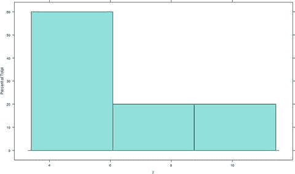

图 3-1.

前述及以下代码的 else 输出

```
if(y>6){
+   boxplot(y)
+ }
Warning message:
In if (y > 6) { :
the condition has length > 1 and only the first element will be used
else{
Error: unexpected 'else' in "else"
histogram(y)
}
Error: unexpected '}' in "}"
```

我们故意写错这段代码有两个原因。第一是为了演示虽然流程控制是一个有用的功能，但它的效果取决于你的逻辑。我们本意是测试 `mean(y) > 6`，但测试了别的东西。R 足够友好地警告我们可能有问题。尽管如此，我们还是应该小心。第二个原因是注意这个 `if`/`else` 语句编码不正确。`else` 部分总是会运行；R 尽其所能再次警告我们 `else` 不符合预期，因此我们应该注意。修改后的这组代码创建了两个图像，如图 3-1 和图 3-2 所示。我们展示代码如下，以及成功执行的 `if` 部分的输出图 3-2：

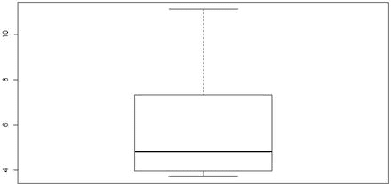

图 3-2.

前面代码的 if 输出，该代码在控制层面已修复，但 else 部分未修复

```
if(mean(y)>6){
+   boxplot(y)
+ }
else{
Error: unexpected 'else' in "else"
histogram(y)
}
Error: unexpected '}' in "}"
```

这很有趣，原因有三。首先，正如你在我们第一个错误示例中看到的，`if` 完全可以作为独立的流程控制部分。控制部分被评估，如果为 `true`，则运行代码；如果为 `false`，则不运行代码。其次，尽管不那么有用，`else` 也是一个独立的代码部分（单独使用时什么都不控制）。第三，这是一个很好的经验教训，即流程控制的逻辑和代码的结构都必须正确设置才能正常工作。接下来，我们展示最初设想的代码。它只输出图 3-2 的箱线图。注意，`else` 需要与 `if` 的闭合 `}` 在同一行：

```
if(mean(y)>6){
+   boxplot(y)
+ } else{
+   histogram(y)
+ }
```

我们使用的另外两个函数彼此有些相似。我们使用 `next` 来跳过循环的一次迭代，使用 `break` 来完全结束循环。这两个函数都让代码继续运行；它们只是控制它们被调用所在循环内的行为。看看下面的代码，看看会发生什么：

```
i <- 0
while(i < 5){
+   i <- i + 1
+   if(i ==2) {next()}
+   print(i)
+ }
[1] 1
[1] 3
[1] 4
[1] 5
```

重要的是要认识到 `next` 的位置很重要。我们可以以六种方式排列 `while` 函数内的那三行代码。至少有一种方式会产生无限循环，至少有一种方式没有任何明显影响。当然，正如你刚才看到，也有一种方式可以跳过数字 `2`。这也表明 `while` 可以很像 `for` 函数。

我们以一个真实的 `repeat` 函数来结束本节。当一个操作需要重复多少次不清楚时，这个函数是理想的选择。同样，`repeat` 类似于 `while`，不同之处在于代码至少运行一次。或许也更容易拥有多个退出标准。当然，`break` 也可以在 `while` 中使用来创建多个退出规则。然而，对于人类可读的代码，可能更容易将多个 `break` 语句放在一起。在下面的代码中，我们重用迭代器 `i`，以便很容易看到需要 `377` 次尝试才能找到随机抽取的、距离均值超过三个标准偏差的值：

```
i <- 0
repeat{
+   i <- i + 1
+   z <- rnorm(1)
+   if(z > 10){break}
+ }
z
[1] 10.69076
i
[1] 378
```

# `apply` 函数族

本章介绍的最后一组函数是 `apply` 函数族。通常，这些函数接收两种主要类型的输入。一种输入包含多个元素，第二种是一个要依次应用于这些元素的函数。不同的函数变体处理不同的用例，我们也会在可能的情况下引入一些错误检查。

## `lapply` 和 `sapply`

我们从 `lapply` 开始，它接收一个列表作为输入，并将给定的函数应用于列表中的每个元素。如其名称前缀所示，该函数返回一个列表，其中包含应用输入函数后的结果：

```r
xL <- 1:5
xL
[1] 1 2 3 4 5
### 返回一个列表
lapply(xL, is.integer)
[[1]]
[1] TRUE
[[2]]
[1] TRUE
[[3]]
[1] TRUE
[[4]]
[1] TRUE
[[5]]
[1] TRUE
```

正如你所见，输出有些混乱。为了简化，我们可以使用功能几乎相同但以 `s`（代表 simple）为前缀的函数，如下所示：

```r
sapply(xL, is.integer)
[1] TRUE TRUE TRUE TRUE TRUE
```

## `vapply`

尽管这两个函数本身都很有用，但它们依赖于正确的输入。当然，我们的代码也依赖于这种正确的输入（脑海中浮现出“垃圾进，垃圾出”这句话）。不过，我们可以使用 `vapply` 函数向 R 提示我们期望的结果类型。它接受第三个输入参数，用于指定期望的输出类型。当函数没有返回正确类型的值时会发生什么？下面我们运行两行代码：第一行告诉函数期望 `logical` 类型的输入，因为默认情况下 `NA` 是 `logical` 类型。在第二行代码中，R 仍然期望相同类型，但得到了一个 `double` 类型：

```r
vapply(xL, is.integer, FUN.VALUE = NA)
[1] TRUE TRUE TRUE TRUE TRUE
vapply(xL, mean, FUN.VALUE = NA)
Error in vapply(xL, mean, FUN.VALUE = NA) :
values must be type 'logical',
but FUN(X[[1]]) result is type 'double'
```

我们再运行一组类似的代码，这次告诉 R 期望每个结果是一个长度为 `2` 的向量。然而，它得到了一个长度为 `1` 的向量，虽然类型正确，但长度错误：

```r
vapply(xL, is.integer, FUN.VALUE = c(NA, NA))
Error in vapply(xL, is.integer, FUN.VALUE = c(NA, NA)) :
values must be length 2,
but FUN(X[[1]]) result is length 1
```

## 应用于列表

让我们看一个更有趣的列表。请注意，在这个列表 `yL` 中，我们同时拥有整数和字符元素：

```r
yL <- list(  a = 1:5,  b = c("6", "7", "8"),  c = c(9:10))
yL
$a
[1] 1 2 3 4 5
$b
[1] "6" "7" "8"
$c
[1]  9 10
yL$b[2]
[1] "7"
is.character(yL$b[2])
[1] TRUE
is.integer(yL$b[2])
[1] FALSE
```

假设我们对列表中每个元素的摘要统计信息感兴趣。我们当然可以对每个元素应用 `summary()` 函数，R 会很乐意执行，甚至不会向我们抛出错误！

```r
lapply(yL, summary)
$a
Min. 1st Qu.  Median    Mean 3rd Qu.    Max.
1       2       3       3       4       5
$b
Length     Class      Mode
3 character character
$c
Min. 1st Qu.  Median    Mean 3rd Qu.    Max.
9.00    9.25    9.50    9.50    9.75   10.00
```

但是，请注意这里存在一些问题。根据信息在现场是如何收集和编码的，这是一种容易因打字错误而导致的数据收集错误。幸运的是，如果我们使用更合适的 `*apply` 函数，并给 R 提供关于期望结果的提示，我们或许可以避免未来的一些麻烦。在代码中加入某种形式的数据验证会很有帮助。当然，这绝不可能防止所有问题；它只是让事情变得更安全一些。

```r
vapply(yL, summary, c(Min. = 0, `1st Qu.` = 0, Median = 0, Mean = 0, `3rd Qu.` = 0, Max. = 0))
Error in vapply(yL, summary, c(Min. = 0, `1st Qu.` = 0, Median = 0, Mean = 0,  :
values must be length 6,
but FUN(X[[2]]) result is length 3
```

## `tapply` 与数据框

`mtcars` 数据框来自 1974 年的一本杂志。我们对每加仑英里数和汽缸数感兴趣。使用这个数据集是理解 R 中各种函数的有用方法，因为它可以在 R 中直接访问。这里，我们查看前六个条目，以便更好地查看和理解我们的原始数据：

```r
head(mtcars[, c("mpg", "cyl")])
mpg cyl
Mazda RX4         21.0   6
Mazda RX4 Wag     21.0   6
Datsun 710        22.8   4
Hornet 4 Drive    21.4   6
Hornet Sportabout 18.7   8
Valiant           18.1   6
```

我们在 `mtcars` 数据框上运行 `tapply`，并按汽缸数进行分组。在图 3-3 中，我们展示了以条形图呈现的结果。

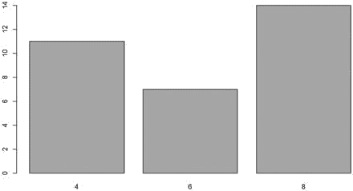

图 3-3
按汽缸数划分的 mtcars 数据框

请注意，这次在我们的函数调用中，我们通过参数名明确指定了每个输入。也就是说，`X`、`INDEX` 和 `FUN` 分别是原始数据的名称、分组因子以及要应用的函数。我们还展示了几乎相同的代码，但带有 `simplify = FALSE` 选项，它会返回一个列表：

```r
tapply(
+   X = mtcars$mpg,
+   INDEX = mtcars$cyl,
+   FUN = mean)
4        6        8
26.66364 19.74286 15.10000
tapply(
+   X = mtcars$mpg,
+   INDEX = mtcars$cyl,
+   FUN = mean,
+   simplify = FALSE)
$`4`
[1] 26.66364
$`6`
[1] 19.74286
$`8`
[1] 15.1
```

## `apply` 函数

当我们的数据结构是数据框、矩阵或数组时，`apply()` 函数通常是一个不错的选择。因为这些结构往往有更多的维度，所以这个函数接受三个输入：数据、我们感兴趣的应用维度，当然还有要执行的函数。我们首先对整个 `mtcars` 数据集按列，然后按行执行此操作以获取标准差。我们先展示一下 `mtcars` 数据的全貌。请注意，按列操作可能更有意义。由于我们既不是汽车爱好者，也并非特别精通机械，这最后一段代码和输出可能没有太大意义：

```r
head(mtcars)
mpg cyl disp  hp drat    wt  qsec vs am gear carb
Mazda RX4         21.0   6  160 110 3.90 2.620 16.46  0  1    4    4
Mazda RX4 Wag     21.0   6  160 110 3.90 2.875 17.02  0  1    4    4
Datsun 710        22.8   4  108  93 3.85 2.320 18.61  1  1    4    1
Hornet 4 Drive    21.4   6  258 110 3.08 3.215 19.44  1  0    3    1
Hornet Sportabout 18.7   8  360 175 3.15 3.440 17.02  0  0    3    2
Valiant           18.1   6  225 105 2.76 3.460 20.22  1  0    3    1
apply(mtcars, MARGIN = 2, FUN = sd)
mpg         cyl        disp          hp        drat          wt        qsec          vs          am        gear        carb
6.0269481   1.7859216 123.9386938  68.5628685   0.5346787   0.9784574   1.7869432   0.5040161   0.4989909   0.7378041   1.6152000
apply(mtcars, MARGIN = 1, FUN = sd)
Mazda RX4       Mazda RX4 Wag          Datsun 710      Hornet 4 Drive   Hornet Sportabout             Valiant
53.53888            53.51210            38.86999            79.40933           113.70330            69.95729
Duster 360           Merc 240D            Merc 230            Merc 280           Merc 280C          Merc 450SE
122.86626            44.43599            46.68811            57.31739            57.33609            92.42901
Merc 450SL         Merc 450SLC  Cadillac Fleetwood Lincoln Continental   Chrysler Imperial            Fiat 128
92.40957            92.46342           147.34689           145.04382           141.16366            28.06702
Honda Civic      Toyota Corolla       Toyota Corona    Dodge Challenger         AMC Javelin          Camaro Z28
25.10753            26.43470            42.34211            99.84844            96.05271           120.45178
Pontiac Firebird           Fiat X1-9       Porsche 914-2        Lotus Europa      Ford Pantera L        Ferrari Dino
124.56688            27.95293            41.26033            40.34473           123.53038            62.68824
Maserati Bora          Volvo 142E
126.32051            44.49888
```

# 当我们需要将相同函数应用于多组数据时，便是在处理多元场景。此时，`mapply()` 是我们的函数调用。与之前的例子不同，该函数将我们想要应用的函数作为第一个变量，其后接受严格为正长度的输入。我们在图 3-4 中展示了以下代码的绘图结果。正如你可能在《R 语言入门》中回忆起的，`par()` 函数提供了一种将多个图形整合到单张图片中的方法：

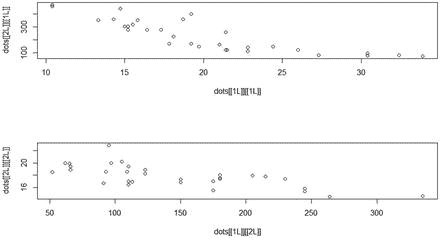
图 3-4. 应用于 mtcars 数据两个子集的 `plot` 函数

```
par(mfrow = c(2, 1))
mapply(plot, mtcars[, c("mpg", "hp")], mtcars[, c("disp", "qsec")])
$mpg
NULL
$hp
NULL
```

递归是一种强大的编程思想，我们将在后续章节中进一步探讨。现在，请考虑这个例子：假设一队人绕着一栋建筑的拐角排队；你不确定队伍有多长。你可以走出队伍，慢慢走到队首，清点人数。这就是常规迭代——就像循环以及 `apply` 函数族主要为我们所做的那样。另一方面，你也可以待在原处，问你前面的人：“你前面有多少人？”如果那个人重复你的问题，最终问题会传到队首，那个人可能会转身说：“零！”通过队伍回传给你，就有可能得到答案。

让我们来看看列表 `zL`。如果我们尝试对其使用 `lapply()` 会怎样？这并不好，因为 `lapply()` 会将每个元素传递给 `mean()`，而 `mean()` 无法处理列表！我们在以下代码中展示了这一点，其中包括我们的列表以及我们寻找算术平均数的首次尝试：

```
zL <- list( a = list(1, 2, 3:5), b = list(8:12))
zL
$a
$a[[1]]
[1] 1
$a[[2]]
[1] 2
$a[[3]]
[1] 3 4 5
$b
$b[[1]]
[1]  8  9 10 11 12
lapply(zL, FUN = mean)
$a
[1] NA
$b
[1] NA
Warning messages:
1: In mean.default(X[[i]], ...) :
argument is not numeric or logical: returning NA
2: In mean.default(X[[i]], ...) :
argument is not numeric or logical: returning NA
```

递归应用函数 `rapply()` 是解决方案。根据想要的具体结果，该函数有一些有趣的选项。强烈建议查阅帮助文件，尽管我们目前不深入探讨此函数。

```
rapply(zL, f = mean)
a1 a2 a3  b
1  2  4 10
```

我们也可以使用比 `mean()` 或 `sd()` 更“花哨”的函数。在下一章中，我们将更深入地探讨这些函数可能的样子以及它们可能做什么。现在，让我们花点时间讨论一下环境。

环境是我们的函数和变量存在的“世界”。我们大部分时间都停留在全局环境中。确实，我们的循环在某种程度上创建了微型环境。这就是为什么如果我们想在循环结束后保留信息可用，我们会创建那些空占位符变量。我们可以使用 `environment()` 和 `ls()` 函数来查看我们的环境并列出当前正在使用的变量。注意我们处于全局环境中，并且我们一直在使用的大多数变量都存在：

```
environment()

ls()
[1] "forTime"  "forTime2" "i"        "vTime"    "x"        "xCube"    "xL"       "y"        "yL"       "z"        "zL"
```

但当然，这只不过是又一个列表。有时，操作和使用这个列表可能也很方便。因此，我们最后一个函数是 `eapply()`。这里我们查看环境中所有对象的类别；这些类型在前面的章节中应该很熟悉：

```
eapply(env = environment(), FUN = class)
$xCube
[1] "numeric"
$x
[1] "numeric"
$forTime2
[1] "proc_time"
$y
[1] "numeric"
$z
[1] "numeric"
$forTime
[1] "proc_time"
$yL
[1] "list"
$vTime
[1] "proc_time"
$i
[1] "numeric"
$xL
[1] "integer"
$zL
[1] "list"
```

## 最终思考

你已经看到了几种强大的自动化工具——从控制重复（以及重复频率）发生的各种循环，到为处理我们可能遇到的常见数据集而精简设计的更专业工具。这些技术很有用，并且经常被使用。然而，它们还不够。如果开发了新技术怎么办？`mean()` 是如何工作的？如果我们需要创建自己的函数呢？在下一章中，我们将从理论框架和实际应用两方面探索函数。自定义函数和循环的结合是让计算机为我们处理繁琐工作的核心方法。

## 4. 编写函数

在 R 中编写自己的函数使你能够将一组 R 命令组合成一个易于调用且可泛化的函数。函数是 R 的基础。要成为 R 的更高级用户或开发者，深刻理解函数是什么以及如何编写它们至关重要。广义上讲，函数接收一个或多个输入，对其进行处理以产生并返回输出。

并非所有编程任务都应转换为函数。然而，每当你发现自己第三次复制粘贴特定代码行时，很可能就应该编写一个函数了。另一个“毫无疑问”需要编写函数的时机是当你的代码超过 100 行左右时。长段的代码可能变得几乎无法阅读和理解。相反，我们编写具有良好、描述性名称的函数，使我们的代码更具可读性。然后，在一个单独的步骤中，我们使用这些函数来编写代码。这种体系的美妙之处在于，在每个函数内部编写专注于解决挑战中特定部分的代码变得更加容易。这种方法的另一个好处是，如果需要更高的效率，可以确定哪些函数消耗了最多的处理能力或花费了最长的运行时间。然后可以研究如何仅在该处提高效率。

在本章中，我们使用 `Hmisc` R 包（Harrell Jr，2016）。以下代码加载 `checkpoint`（Microsoft Corporation，2016）包以控制所使用的 R 包的确切版本，然后加载 `Hmisc` 包：

```
## load checkpoint and required packages
library(checkpoint)
checkpoint("2016-09-04", R.version = "3.3.1")
library(Hmisc)
options(width = 70) # only 70 characters per line
```

## 函数的组成部分

除了少数例外，R 语言中的大多数函数都包含三个组成部分：

*   **形参**：函数的参数或输入
*   **函数体**：处理输入的命令
*   **环境**：函数的位置或上下文，它决定了函数在何处查找变量

每一个部分都可以使用专用函数进行检查。首先，我们编写一个示例函数：

```
## create new function, f()
f <- function(x, y = 5) {
x + y
}
```

该函数接受两个参数：`x` 和 `y`。第一个参数 `x` 没有默认值，但第二个参数 `y` 默认为 `5`。虽然我们可以轻松看到这些（部分是因为我们编写了该函数），但可以使用 `formals()` 和 `args()` 函数来检查函数的形参或参数：

```
formals(f)
$x
$y
[1] 5
args(f)
function (x, y = 5)
NULL
```

要查看用于处理形参的实际 R 代码或命令，我们使用 `body()` 函数：

```
body(f)
{
x + y
}
```

命令始终被包裹在开闭大括号 `{ }` 中。在这个例子中，R 代码很简单，就是 `x + y`，但有些函数可能有上百行代码。函数的最后一个关键部分是它的环境。函数的环境决定了它在哪里查找变量或对象，这些对象可以包括数据和函数。要查看函数的环境，我们使用 `environment()` 函数：

```
environment(f)
```

在这个例子中，函数位于我们创建它的全局环境中。对于其他函数，这会有所不同。例如，如果我们查看 `install.packages()` 函数的环境，它是 `utils` 包的命名空间：

```
environment(install.packages)
```

这为讨论 R 函数提供了一种通用语言。在本章的剩余部分，我们将深入探讨编写函数，以及可用于函数的特殊代码和工具。

## 作用域

在 R 中，作用域决定了在何处查找特定变量。例如，当我们键入 `plot` 时，R 如何解释这段代码？R 在哪里查找它？作用域是 R 对语言中“上下文”这一概念的解答。如果我说“我买了一个新的 bat”，你可能会认为我指的是板球拍而不是会飞的哺乳动物。对于 R 来说，上下文来自作用域和环境。因此，不同的环境可能导致不同的结果。

编写 R 函数的大多数方面与交互式使用 R 并无不同。然而，一个区别是函数有自己的环境。此外，函数通常位于不同的环境中。例如，在交互式使用 R 时，几乎所有的命令都是在全局环境中执行的。相比之下，许多函数是作为 R 包的一部分编写的，在这种情况下，函数的环境由 R 包定义。因此，在开始编写函数之前，理解作用域是有帮助的。看下面这两个例子：

```
plot
function (x, y, ...)
UseMethod("plot")

plot <- 5
plot
[1] 5
```

在第一种情况下，R 在 `graphics` 包中找到了 `plot`。在第二种情况下，R 在全局环境中找到了 `plot`。请注意，将 `5` 赋值给变量 `plot` 并不会覆盖 `plot()` 函数，而是创建了另一个与函数同名的 R 对象。在创建新变量后，当我们在控制台键入 `plot` 时，R 返回的是数值而不是函数，因为赋值 `plot <- 5` 发生在全局环境中，而 R 在检查不同包的环境之前会先搜索全局环境。`search()` 函数按照 R 搜索的顺序返回环境。你的环境可能有所不同，尽管可能有一些相似之处：

```
search()
[1] ".GlobalEnv"            "package:Hmisc"
[3] "package:ggplot2"       "package:Formula"
[5] "package:survival"      "package:lattice"
[7] "package:devEMF"        "package:checkpoint"
[9] "ESSR"                  "package:stats"
[11] "package:graphics"      "package:grDevices"
[13] "package:utils"         "package:datasets"
[15] "package:RevoUtilsMath" "package:methods"
[17] "Autoloads"             "package:base"
```

从输出中我们看到，R 首先在全局环境（`.GlobalEnv`）中查找，然后在 `Hmisc` 包中查找，依此类推，直到 `base` 包。我们可以再次使用 `environment()` 函数查看当前环境。R 总是从当前或局部环境开始查找。然后，它进入父环境。我们可以使用 `parent.env()` 函数查找给定环境的父环境：

```
environment()
parent.env(.GlobalEnv)
attr(,"name")
[1] "package:Hmisc"
attr(,"path")
[1] "C:/Users/Authors/.checkpoint/2016-09-04/lib/x86_64-w64-mingw32/3.3.1/Hmisc"
```

回到函数，每个函数除了自身位于某个环境中外，还有其局部环境。以下代码展示了函数的局部环境及其父环境。我们可以大致将函数中的变量分为三种类型：

*   形式变量（形参）
*   在函数内部定义的局部变量
*   既非形参也非局部变量的**自由变量**或其他变量

以下代码依次演示了每种类型：

```
a
[1] "free variable"
[1] "formal variable"
[1] "local variable"
```

变量 `x` 是一个形参，定义了其默认值；`y` 是在函数体中定义的局部变量；`a` 是在函数父环境中定义的变量。虽然函数可以依赖于搜索路径中的对象，而不是在形参中指定或作为局部变量，但这不是一个好主意。依赖于函数的父环境或搜索路径进行编码，可能会导致特别棘手的错误和意外行为。当环境中看似与函数无关的内容发生改变时，即使函数的代码和输入看起来没有变化，输出也可能突然不同，这会给用户或你日后的工作带来混乱。

虽然到目前为止的例子都相对简单，但在使用嵌套函数调用时，作用域会变得更加棘手。在下面的代码中，可能更难预测每段评估代码的结果。接下来的例子设置了两个函数，然后在全局环境中使用三个不同的变量来调用函数：

```
f1 <- function(y = "f1 var") {
x <- y
a1 <- f2(x)
rm(x)
a2 <- f2(x)
}
f2 <- function(x) {
if (nchar(x) < 10) {
x <- "f2 local var"
}
print(x)
return(x)
}
x <- "global var"
f1()
[1] "f2 local var"
[1] "global var"
x <- "g var"
f1()
[1] "f2 local var"
[1] "f2 local var"
rm(x)
f1()
[1] "f2 local var"
Error in nchar(x) (from #2) : object 'x' not found
```

值得对作用域进行实验，直到弄明白为止，因为这对于确保找到正确的对象是必要的。在编写和开发包时，或者在使用出现在多个包中的函数时，这可能是一个特别的挑战。

# 函数中的函数

除了你可以在自己编写的函数中使用的常规 R 代码和函数外，还存在一些特殊的函数。这些函数**仅**或**主要**在其他函数内部使用。即使你是经验丰富的 R 用户，如果之前没有编写过函数，对这些函数也可能不熟悉。

### `match.arg()`

`match.arg()` 函数对于执行参数模糊匹配非常有用。这样做还有一个好处，就是如果参数与有效选项之一（即无效）不匹配，它会抛出错误。以下代码展示了两个相似函数，区别在于其中一个使用了 `match.arg()` 函数。示例演示了模糊匹配以及使用无效参数时会发生什么：

```
f1 <- function(type = c("first", "second")) {
type
}
f2 <- function(type = c("first", "second")) {
type <- match.arg(type)
type
}
f1("fi")
[1] "fi"
f2("fi")
[1] "first"
f1("test")
[1] "test"
f2("test")
Error in match.arg(type) : 'arg' should be one of "first", "second"
```

参数匹配还有助于确保在传递文本字符串时只使用有效选项，否则会抛出一个信息丰富的错误。以下代码扩展了我们构建的未使用 `match.arg()` 的函数，当 `type = "first"` 时计算平均值，当 `type = "second"` 时计算标准差。然而，当向 `type` 参数传递无效选项时，我们会得到一个相对隐晦的错误消息，提示找不到对象 `x`：

```
f1b <- function(type = c("first", "second")) {
if (type == "first") {
x <- mean(1:5)
} else if (type == "second") {
x <- sd(1:5)
}
return(x)
}
f1b("test")
Error in f1b("test"): object 'x' not found
```

### `missing()`

另一个专门针对函数参数的函数是 `missing()`。它返回一个逻辑值，指示特定参数在函数调用中是否缺失。这在编写可能以不同方式使用的函数时很有帮助。下面是一个计算 Cohen's d 效应量的函数示例，对于单组而言，其定义为变量的平均值除以标准差。Cohen's d 也可以针对重复测量（例如干预前后测量的组）进行计算。这是通过计算两个变量的差值，然后按前述方法进行处理来完成的。我们使用 `missing()` 函数来确定用户是传递了单个变量 `x`，还是两个变量 `x` 和 `y`，从而使我们的函数能够优雅地处理单样本数据和重复测量数据的 Cohen's d 计算：

```
cohend <- function(x, y) {
if (!missing(y)) {
x <- y - x
}
mean(x) / sd(x)
}
cohend(x = c(0.61, 0.99, 1.47, 1.52, 0.45,
3.34, 1.05, -1.47, 1.3, 0.33),
y = c(-0.69, 1.6, 0.44, 1, 0.88,
1.17, 2.4, 1.21, 0.87, 2.15))
[1] 0.09522249
cohend(x = c(0.61, 0.99, 1.47, 1.52, 0.45,
3.34, 1.05, -1.47, 1.3, 0.33))
[1] 0.796495
```

### `match.call()`

同样与确定函数调用特性相关的函数是 `match.call()`。`missing()` 用于判断特定参数是否缺失，`match.arg()` 用于判断参数是否与有效选项匹配，而 `match.call()` 则捕获整个函数调用。这或许比解释更容易演示。下面的小函数计算变异系数（样本标准差除以样本均值）。它还通过使用 `match.call()` 来捕获并返回函数调用：

```
cv <- function(x, na.rm = FALSE) {
fcall <- match.call()
est <- sd(x, na.rm = na.rm) / mean(x, na.rm = na.rm)
return(list(CV = est, Call = fcall))
}
cv(1:5)
$CV
[1] 0.5270463
$Call
cv(x = 1:5)
cv(1:8, na.rm = TRUE)
$CV
[1] 0.5443311
$Call
cv(x = 1:8, na.rm = TRUE)
```

在上述两个示例的输出中，`match.call()` 精确地捕获了对函数的调用，尽管它添加了显式的参数名。有时这有助于记录特定输出是由什么调用创建的。也许最常见使用此功能的地方是 R 中回归模型的输出。例如，以下代码展示了一个线性模型，其输出中呼应了函数调用，这是通过 `match.call()` 实现的：

```
lm(mpg ∼ hp, data = mtcars)
Call:
lm(formula = mpg ∼ hp, data = mtcars)
Coefficients:
(Intercept)           hp
30.09886     -0.06823
```

### `return()`

`return()` 函数通常用在函数的末尾以返回特定对象，正如你已在前面一些示例中看到的那样，尽管没有明确讨论过。然而，`return()` 也可以在函数内部的任意点用于返回值，从而结束函数的执行。以下函数有一个 `if` 语句，如果为真，则导致函数提前终止。请注意，如果条件不为真，最终的结果甚至没有用 `return()` 包裹。R 默认返回函数中的最后一个对象，因此严格来说，显式调用 `return()` 并非必需：

```
f <- function(x) {
if (x < 4) return("I'm done!")
paste(x, "- Fin!")
}
f(10)
[1] "10 - Fin!"
f(3)
[1] "I'm done!"
```

尽管你可以在函数的前半部分使用 `return()`，但这是不鼓励的，因为它可能会让用户以及任何阅读或调试代码的人感到意外。与上述代码相同的效果可以通过使用流程控制来实现：

```
f <- function(x) {
if (x < 4) {
"I'm done!"
} else {
paste(x, "- Fin!")
}
}
f(10)
[1] "10 - Fin!"
f(3)
[1] "I'm done!"
```

除了不在函数中途使用 `return()` 之外，一些人还认为在函数末尾也不应使用显式的 `return()` 调用，因为它没有必要。这仍然是一个偏好问题，因为它有助于将注意力引向函数末尾确切返回的内容。

### `invisible()`

虽然 `invisible()` 函数并非仅在函数内部使用，但它经常与函数返回的对象一起使用。之前我们创建了一个计算变异系数并返回函数调用的函数。我们可以修改该函数，使其打印变异系数并隐式地返回其余部分，如以下代码所示。使用 `invisible()` 意味着即使函数返回了与之前相同的对象，该对象也不会显示。`invisible()` 函数可能最常用于设计用来创建美观输出的函数，例如调用 `summary()` 或绘图函数。这些函数的主要目的是显示摘要或图表，但以防有人想要或需要编辑该对象，实际对象会隐式返回，因此可以被捕获并保存以供后续使用：

```
cv <- function(x, na.rm = FALSE) {
fcall <- match.call()
est <- sd(x, na.rm = na.rm) / mean(x, na.rm = na.rm)
print(est)
return(invisible(list(CV = est, Call = fcall)))
}
cv(1:8, na.rm = TRUE)
[1] 0.5443311
res <- cv(1:8, na.rm = TRUE)
[1] 0.5443311
res$Call
cv(x = 1:8, na.rm = TRUE)
```

# 函数特定功能：控制流程与错误处理

`on.exit()`函数可确保在函数退出或完成时执行一组特定命令。即使函数出错或未按预期正常完成，`on.exit()`中的表达式也会执行。以下代码第二个用例的小函数示例说明了这一点。一个错误导致函数终止，一旦发生这种情况，就会执行`on.exit()`中的表达式。当函数修改其外部的任何值时，使用`on.exit()`尤其有价值。例如，绘图函数有时会修改默认的绘图参数，并在完成后将其恢复原状。使用`on.exit()`可以确保，即使出现问题导致函数失败或出错，用户仍然拥有所有原始设置：

```
f <- function(x) {
on.exit(print("Game over"))
x + 5
}
f(3)
[1] "Game over"
[1] 8
f("a")
Error in x + 5 (from #3) : non-numeric argument to binary operator
[1] "Game over"
```

我们将要介绍的最后一套函数特定功能与向软件或用户发送信号有关。按严重程度排序，它们依次是`stop()`、`warning()`和`message()`。下一个例子更贴近实际一些，它计算一个变量的平均值，可选择原始尺度或转换后的尺度，然后对平均值进行反向转换。对数尺度对异常值相对更具抵抗力。如果使用对数变换，示例代码会通过`stop()`函数检查变量是否包含负值（负值在对数变换中未定义，会导致完全错误）。传递给`stop()`的参数是要显示的错误消息。对于`warning()`也遵循类似过程，同样传递要在警告中显示的消息。警告与错误不同。`stop()`产生的错误会使函数停止评估并终止。警告会在最后发出，但允许函数继续执行。最后，`message()`可用于向用户发送消息或信号，但并不像警告那样指示真实或可能的问题。虽然没有演示，但还有一个相关的便利函数`stopifnot()`，它允许传递一个逻辑表达式，并在该表达式不为真时发出错误。尽管此选项有节省代码的好处，但缺点是无法编写自定义错误消息来准确指出问题所在。

使用警告或消息而非仅调用`print()`或`cat()`让函数打印信息的一个原因是，警告和消息可以通过同名函数`suppressWarnings()`和`suppressMessages()`（可选择性地）进行抑制。所有这些功能都在下面的代码中得到了演示：

```
f <- function(x, trans = c("identity", "log")) {
trans <- match.arg(trans)
if (trans == "log") {
if (any(x < 0)) stop("Log is not defined for negative values")
if (any(x < 1e-16)) warning("Some x values close or equal to zero, results may be unstable")
x <- log(x)
message("x successfully log transformed")
exp(mean(x))
} else {
mean(x)
}
}
f(c(1, 2, 100))
[1] 34.33333
f(c(1, 2, 100), trans = "log")
x successfully log transformed
[1] 5.848035
suppressMessages(f(c(1, 2, 100), trans = "log"))
[1] 5.848035
f(c(0, 1, 2, 100), trans = "log")
x successfully log transformed
[1] 0
Warning message:
In f(c(0, 1, 2, 100), trans = "log") :
Some x values close or equal to zero, results may be unstable
suppressWarnings(f(c(0, 1, 2, 100), trans = "log"))
x successfully log transformed
[1] 0
f(c(-1, 1, 2, 100), trans = "log")
Error in f(c(-1, 1, 2, 100), trans = "log") (from chapter04.R!79246pw#5) :
Log is not defined for negative valuesFunctionssuppressWarnings()FunctionssuppressMessages()
```

## 调试

到目前为止演示的函数要么都能工作，要么是设置了显而易见的故意错误。有时，寻找错误或调试已编写代码和函数的过程需要更长时间。幸运的是，有一些工具可以帮助这一过程，也有一些实践可以缩小问题的范围。

尽管调试可以应用于任何代码，而不仅仅是函数，但如果没有额外工具，函数尤其难以调试，因为通常它们的所有代码都会无中断地执行，没有机会观察沿途发生了什么。在本节中，我们将编写一个函数，该函数使用公式计算一个变量按另一个变量的水平分组后的均值，利用你在第3章中已了解的`tapply()`；然后该函数绘制原始数据，并用点表示均值，使用以下代码，结果如图4-1所示：

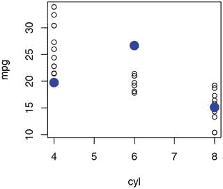

图 4-1. 散点图，未填充点表示数据，蓝色大点表示均值，显示错误的结果

```
meanPlot <- function(formula, d) {
v <- all.vars(formula)
m <- tapply(d[, v[1]], d[, v[2]],
FUN = mean, na.rm = TRUE)
plot(formula, data = d, type = "p")
points(x = unique(d[, v[2]]), y = m,
col = "blue", pch = 16, cex = 2)
}
meanPlot(mpg ∼ cyl, d = mtcars)
```

关于均值，有些地方看起来不太对。当`cyl = 8`时，点的均值看起来还好，但另外两个似乎处于极端。`debug()`函数允许我们调试一个函数，并在其执行时逐行逐步执行。要使用它，我们首先需要在要调试的函数上调用`debug()`：

```
debug(meanPlot)
```

然后当我们调用原始函数时，它会触发R进入调试模式。在第一步，R会告诉我们正在调试的函数调用以及位置：

```
meanPlot(mpg ∼ cyl, d = mtcars)
debugging in: meanPlot(mpg ∼ cyl, d = mtcars)
debug at c:/Temp/chapter04.R!79246wk#1: {
v
debug at #2: v
debug at #3: m
debug at #5: plot(formula, data = d, type = "p")
Browse[2]> m
4        6        8
26.66364 19.74286 15.10000
Browse[2]> unique(d[, v[2]])
[1] 6 4 8
Browse[2]> Q
```

既然我们知道了问题发生的位置，我们就可以通过首先对数据进行排序来修复函数，使`tapply()`和`unique()`给出的结果顺序一致。代码如下所示，结果在图4-2中：

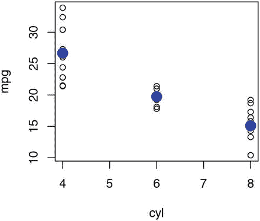

图 4-2. 散点图，未填充点表示数据，蓝色大点表示均值，显示修正后的结果

```
meanPlot <- function(formula, d) {
v <- all.vars(formula)
d <- d[order(d[, v[2]]), ] ## 先排序
m <- tapply(d[, v[1]], d[, v[2]],
FUN = mean, na.rm = TRUE)
plot(formula, data = d, type = "p")
points(x = unique(d[, v[2]]), y = m,
col = "blue", pch = 16, cex = 2)
}
meanPlot(mpg ∼ cyl, d = mtcars)
```

如果你正在调试你的函数，并且不想逐步执行每一行代码，可以将`browser()`函数插入到函数代码中。然后，当函数执行到该点时，会启动一个浏览器，你可以检查函数局部环境中变量的当前状态。在以下示例代码中，我们在函数中添加了一个对`browser()`的调用，使用`ls()`检查当前可用的对象，检查对象`v`的内容，并再次输入大写字母`Q`退出调试：

```
meanPlot
debug at #9: plot(formula, data = d, type = "p")
Browse[2]> ls()
[1] "d"       "formula" "m"       "v"
Browse[2]> v
[1] "mpg" "cyl"
Browse[2]> Q
```

### 调试实用函数`traceback()`

在交互式工作时，一个有用的调试函数是`traceback()`。例如，如果你调用一个像`lm()`这样的函数然后得到一个错误信息，有时可能很难确切知道错误发生在哪里或为什么会发生。错误通常并不直接来自你调用的函数，因为你经常使用的函数内部可能会依次调用许多其他函数。下面的例子展示了如何在产生错误的代码之后立即使用`traceback()`来做到这一点。输出显示了从初始调用到最终生成错误的代码的调用堆栈跟踪。如果你需要查看代码来确定错误原因，这可能是有用的信息：

```
lm(mpg ∼ jack, data = mtcars)
Error in eval(expr, envir, enclos) : object 'jack' not found
traceback()
7: eval(expr, envir, enclos)
6: eval(predvars, data, env)
5: model.frame.default(formula = mpg ∼ jack, data = mtcars, drop.unused.levels = TRUE)
4: stats::model.frame(formula = mpg ∼ jack, data = mtcars, drop.unused.levels = TRUE)
3: eval(expr, envir, enclos)
2: eval(mf, parent.frame())
1: lm(mpg ∼ jack, data = mtcars)
```

### 调试外部包中的代码

有时，代码错误并不在你的代码中，而是在你正在使用的其他代码中，例如来自另一个R包。虽然建议的R包中很少发现错误，但在成千上万的其他R包中更为常见。此外，有时问题本身并不是错误，而是你希望如何使用函数与原始作者设想其使用方式之间的差异。尽管CRAN上所有R包的源代码都可以公开下载和编辑，但仅仅为了看看在一个函数中做点略微不同的改动是否能解决问题，就去下载整个包的源代码、编辑和重新安装，可能会很麻烦。

考虑以下挑战。假设你使用的数据由于某种原因有时包含无穷大值，但你只想包含有限的情况。以下代码展示了使用`Hmisc`包中的`wtd.quantile()`函数的一个例子：

```
wtd.quantile(c(1, 2, 3, Inf, NA),
weights = c(.6, .9, .4, .2, .6))
0%  25%  50%  75% 100%
NaN  Inf  Inf  Inf  Inf
```

如果我们查看`wtd.quantile()`的代码，通过在R控制台中输入不带括号的函数名，我们可以看到是另一个函数`wtd.table()`进行了主要计算，如下所示：

```
wtd.quantile
function (x, weights = NULL, probs = c(0, 0.25, 0.5, 0.75, 1),
type = c("quantile", "(i-1)/(n-1)", "i/(n+1)", "i/n"), normwt = FALSE,
na.rm = TRUE)
{
if (!length(weights))
return(quantile(x, probs = probs, na.rm = na.rm))
type  1))
stop("Probabilities must be between 0 and 1 inclusive")
nams 
1) 2 - log10(diff(range(probs))) else 2)), "%", sep = "")
if (type == "quantile") {
w 
```

#### 检查和修改`wtd.table()`函数

使用相同的方法，我们可以检查`wtd.table()`函数。这样做时，我们会发现虽然它可以自动删除缺失值，但它没有检查或删除非有限值的方法。仅仅更改你的数据可能看起来更容易，但有时数据是自动生成并传递的，因此更改函数比修改数据更简单。我们可以轻松地将`wtd.table()`的代码复制并粘贴到我们的R编辑器中并进行修改，如下所示：

```
revised.wtd.table  length(levused)) && any(is.na(weights)))
weights <- weights[!is.na(weights)]
if (length(weights) != length(levused))
stop("program logic error")
names(weights) <- levused
}
if (!length(names(weights)))
stop("program logic error")
if (type == "table")
return(weights)
x <- all.is.numeric(names(weights), "vector")
if (isdate)
attributes(x) <- c(attributes(x), ax)
names(weights) <- NULL
return(list(x = x, sum.of.weights = weights))
}
xx <- x
if (isdate)
attributes(xx) <- c(attributes(xx), ax)
if (type == "list")
list(x = if (length(lev)) lev[x] else xx, sum.of.weights = weights)
else {
names(weights) <- if (length(lev))
lev[x]
else xx
weights
}
}
```

与原始的`wtd.table()`函数不同，修改后的函数完全按照我们的意愿工作：

```
wtd.table(c(1, 2, 3, Inf, NA),
weights = c(.6, .9, .4, .2, .6))
$x
[1]   1   2   3 Inf
$sum.of.weights
[1] 0.6 0.9 0.4 0.2
revised.wtd.table(c(1, 2, 3, Inf, NA),
weights = c(.6, .9, .4, .2, .6))
$x
[1] 1 2 3
$sum.of.weights
[1] 0.6 0.9 0.4
```

### 使用`assignInNamespace()`在命名空间中覆盖函数

然而，挑战在于`wtd.quantile()`函数以及其他使用`wtd.table()`的`Hmisc`函数仍然无法按我们希望的方式工作，因为它们没有使用我们修改后的函数。将我们的函数分配给全局环境中的名称`wtd.table()`是不够的，因为作用域规则意味着`Hmisc`函数会首先从`Hmisc`环境中访问`wtd.table()`函数，而不是从我们的全局环境中。这就像在你的计算机上有两个不同文件夹中的同名文件。为了让所有使用`wtd.table()`的`Hmisc`函数都使用我们修改后的函数，我们不仅需要正确命名它，还需要将其放在正确的位置。我们可以使用`assignInNamespace()`函数将一个对象分配给特定的命名空间：

```
assignInNamespace(x = "wtd.table",
value = revised.wtd.table,
ns = "Hmisc")
wtd.quantile(c(1, 2, 3, Inf, NA),
weights = c(.6, .9, .4, .2, .6))
0%   25%   50%   75%  100%
2.000 2.225 2.450 2.675 2.900
wtd.Ecdf(c(1, 2, 3, Inf, NA),
weights = c(.6, .9, .4, .2, .6))
$x
[1] 1 1 2 3
$ecdf
[1] 0.0000000 0.3157895 0.7894737 1.0000000
```

### 注意事项

虽然`assignInNamespace()`函数没有输出，但我们可以看到，之后`wtd.quantile()`函数和其他依赖`wtd.table()`的函数，如`wtd.Ecdf()`，现在都按我们希望的那样工作了。关于`assignInNamespace()`的一个警告是，你不能将任何对象分配给在命名空间中尚不存在的对象（也就是说，你只能覆盖现有对象）。你也不允许在你可能想提交到CRAN的任何包中使用`assignInNamespace()`。即使这有时是一种便捷的方法，但如果人们将其作为一般规则来做，那会变得混乱。如果发生这种情况，包A中的函数定义将取决于你是否加载了包B，因为包B可以覆盖（而不仅仅是屏蔽）包A中的函数定义。请注意，你以这种方式所做的任何更改都是临时的，并且在你重启R后会消失。然而，这对于调试现有包来说是一个有用的技巧，因为它是一种相对简单的方法来确保在使用`wtd.quantile()`时遇到的问题确实通过对`wtd.table()`的更改而“修复”了。此时，如果这确实是一个错误，或者即使只是一个理想的功能，你可以给包的维护者发电子邮件建议更改，确信所建议的代码有效。要查看当前的维护者，你可以直接输入`maintainer("Hmisc")`，或者任何你感兴趣的包的名称。

## 总结

本章我们讨论了许多函数以及关于函数的诸多内容！如果你需要回忆任何特定函数的细节，表4-1列出了本章介绍的关键函数，并对每个函数提供了简要描述。当然，你可以在官方帮助文件中查看更多信息。

**表4-1. 本章描述的关键函数**

| 函数 | 功能描述 |
| --- | --- |
| `formals()` | 允许查看你构建的函数的形参。 |
| `args()` | 显示已创建函数的参数名称及其默认值。 |
| `body()` | 显示函数的主体（`{`和`}`之间的代码）。 |
| `environment()` | 显示函数所在的环境（到目前为止通常是全局环境）。 |
| `search()` | 显示函数的搜索顺序。记住，别人可能已经使用了你的函数名！ |
| `parent.env()` | 接受一个环境，并向上追溯一层。 |
| `match.arg()` | 允许对函数参数进行模糊匹配。 |
| `missing()` | 测试是否向函数传递了某个值。注意，在`match.arg()`之后，此函数会返回`FALSE`。 |
| `match.call()` | 捕获整个函数调用；常用于回归分析中。 |
| `return()` | 不是必需的，可能有争议，并且如果使用，请确保它是新函数的最后一部分。 |
| `invisible()` | 抑制输出。 |
| `on.exit()` | 无论函数执行成功还是失败，都会执行其参数。 |
| `stop()`, `stopifnot()`, `warning()`, `message()` | 这些是不同严重级别的错误信息，从完全停止并报错，到温和的警告，再到通常较为礼貌的消息。 |
| `suppressWarnings()`, `suppressMessages()` | 这两者功能正如其名。一旦你对一个函数熟悉了，其警告或信息可能会显得冗长或可以安全忽略。 |
| `debug()` | 使用此函数来开始调试一个运行不正常的函数。 |
| `browser()` | 此函数进入函数体内，恰好停在你想调试的部分之前。 |
| `traceback()` | 提供导致错误的表达式列表。 |
| `assignInNamespace()` | 允许用本地编写的函数临时替换某个函数。 |
| `maintainer()` | 在包上调用此函数，会显示用于故障排除的联系人姓名和电子邮件。 |

虽然函数各个部分的正式名称不一定至关重要，但学习如何高效地使用和编写函数可能是你学习R语言最好的投资之一。编写函数提供了一种避免编写重复代码的方法。虽然没有严格的规则，但如果你发现自己经常执行相同的任务，那么很可能值得为此编写一个函数。这个任务可能涉及多个部分，也可能很小。例如，在心理学中，通常需要报告连续变量在"高"和"低"水平上的值，这些水平通常定义为均值 +/- 1 个标准差。在R中，使用`mean()`和`sd()`函数可以轻松完成。如果你经常这样做，可能值得编写一个简短的单行函数，这样你就不用输入`mean(x) + sd(x)`，而只需输入`msd(x)`，或者你给函数起的任何名字。如果你对使用和编写函数感到不熟悉，在进入第5章和第6章之前进行更多练习将是个好主意，因为这两章假设你已经熟悉函数。

# 编写类与方法

让函数根据传入对象的类型表现出不同的行为通常是很有帮助的。例如，在汇总变量时，为数值型或字符串型数据创建不同的汇总是有意义的。可以为每种对象类型使用不同的函数，但这样用户就需要记住很多函数名，并且为了保持唯一性，函数名可能会更长。面向对象编程（OOP）基于对象，在 R（与大多数编程语言一样）中通过两个概念实现：类和方法。类定义了一个模板或蓝图，描述对象的变量和特征，并确定哪些方法适用于它。例如，房子可以被定义为有地板、四面墙、一个屋顶和一扇门。具体的数据表示这些属性，例如每面墙的尺寸和颜色。方法是可以在特定对象类型上执行的行为或动作。例如，房子可以被粉刷（改变其颜色），但房子不能被吃掉。R 有三种面向对象系统：S3、S4 和 R5。本章涵盖了最常用的 S3 和 S4 系统。

在本章中，我们使用 `ggplot2` R 包（Wickham, 2009）。以下代码加载 `checkpoint`（Microsoft Corporation, 2016）包以控制所用 R 包的确切版本，然后加载 `ggplot2` 包：

```
library(checkpoint)
checkpoint("2016-09-04", R.version = "3.3.1")
library(ggplot2)
options(width = 70)
```

## S3 系统

S3 系统是最常见的面向对象系统。它也是最容易上手且最简单的系统。S3 系统易于使用，部分原因在于它相当非正式，且主要关注函数或方法。这些优点也是其局限性，因为 S3 系统没有提供正式的框架来确保对象满足类的要求。关于使用 S3 系统进行 R 编程的更深入指南，请参阅 W.N. Venables 和 B.D. Ripley 的 *S Programming*（Springer, 2004）。

### S3 类

在 R 语言中，默认提供某些类型的对象或类，几乎所有对象都可以看作是向量或泛型向量。例如，矩阵和数组本质上是带有维度属性的向量。列表是泛型向量，其中向量的每个元素都可以包含另一个向量。数据框是列表，其中每个项目都是一个向量，但所有向量的长度都相同，因此具有表格格式。向量可以保存特定类型的数据，例如逻辑值、整数、数值（实数）或字符串。这些基本对象和类由基础包提供。S3 类是在基础包提供的对象和类之上构建创建的。

> **注意**
>
> S3 类是通过使用常规的 R 对象（例如向量或列表）和类（例如逻辑类或数值类）创建的。通过 `class(object) <- "class name"` 设置类名来定义 S3 类。S3 对象的元素通常通过使用 `` `$` ``、`` `[` `` 或 `` `[[` `` 来访问。

S3 类的实际创建很简单。首先，创建一个满足该类要求或特性的 R 对象，然后通过用类名标记该对象来定义 S3 类。由于 S3 类与其他 R 对象的唯一区别在于具有特殊的名称或属性，因此它们使用与其他基本 R 对象相同的方式来访问和操作，即使用 `` `$` ``、`` `[` `` 和 `` `[[` ``。要检查对象的类，我们可以使用 `class()` 函数。在以下示例中，查询 `mtcars` 对象以确定它具有数据框类：

```
class(mtcars)
[1] "data.frame"
```

要查看如何设置对象的类，我们可以查看基础 R 中的许多函数，例如 `table()`。在这里，我们打印 `table()` 函数的源代码，为了节省空间省略了中间部分：

```
table
function (..., exclude = if (useNA == "no") c(NA, NaN), useNA = c("no",
"ifany", "always"), dnn = list.names(...), deparse.level = 1)
{
[为节省空间省略]
y
```

最后返回的对象 `y` 是一个数组，但具有 `table` 类。对象类的设置使用了惯用法 `class(object) <- "class name"`。也可以为一个对象分配多个类。这几乎与分配单个类的方式相同，并且按优先级顺序进行。以下示例将调用 `table()` 的结果存储在对象 `x` 中，然后设置两个类，首先是 `newclass`，然后是原始的 `table` 类：

```
x <- table(mtcars$cyl)
class(x) <- c("newclass", "table")
class(x)
[1] "newclass" "table"
```

分配多个类的价值在于作为一种备份，主要用于方法。例如，如果你创建了一个作为表格或数据框变体的新类，你可能会为打印编写专用方法，但对于其他函数（例如绘图或摘要），则依赖于原始类的方法。

你可以编写的类类型几乎是无限的。一个简单的入门方法是创建现有类的特殊或增强情况。在以下示例中，我们创建了一个数据框的特殊情况，具有 x 和 y 坐标以及文本标签，称为 `textplot`。“创建”该类的最简单方法是创建一个数据框，然后更改其类。如果我们只使用新的类标签，调用 `print()` 函数将使用默认方法，但如果我们先用新的 `textplot` 标签标记它，其次再标记为数据框，那么调用 `print()` 则会回退到数据框的方法：

```
d <- data.frame(
  x = c(1, 3, 5),
  y = c(1, 2, 4),
  labels = c("First", "Second", "Third")
)
class(d) <- "textplot"
print(d)
$x
[1] 1 3 5
$y
[1] 1 2 4
$labels
[1] First  Second Third
  Levels: First Second Third
  attr(,"row.names")
[1] 1 2 3
  attr(,"class")
[1] "textplot"
class(d) <- c("textplot", "data.frame")
print(d)
  x y labels
1 1 1  First
2 3 2 Second
3 5 4  Third
```

在 S3 系统中，没有正式的方法来从特定类创建对象。然而，创建特定类对象的最常见方式是作为函数的输出。可以编写专用函数来创建特定类的对象，或者编写执行操作并以特定类对象输出结果的函数。后一种方法在使用 S3 系统时在 R 中更为典型。

当你创建一个新类时，一些期望的特性或元素可能已经存在于现有类中。如果是这种情况，基于现有类进行构建或扩展可能是有意义的。例如，数据框基于列表构建，要求列表的每个元素都是长度相等的向量。同样，我们之前创建的 `textplot` 类基于数据框构建，要求具有名为 `x`、`y` 和 `labels` 的三个元素。在这种情况下，我们会说 `textplot` 继承自 `data.frame`。也就是说，`textplot` 是父类 `data.frame` 的子类（注意，父类也称为超类或基类）。如果一个类只继承自另一个类，则称为单继承（即，它只有一个父类）。如果一个类继承自多个类，则称为多继承（即，它有多个父类）。如果一个类继承自另一个类，它可能会继承存储数据的特性，也可能继承方法——即对特定类对象进行操作的函数。继承方法对于避免重复造轮子尤其有用。

> **注意**
>
> 继承是指通过基于现有类的特性和方法创建新类。新类被称为子类，而新类派生自的类被称为父类或超类。子类既可以继承父类的特性，也可以使用父类的方法。

在下一个例子中，我们编写一个小函数，使用公式接口从数据框构建 `textplot` 对象。该函数有两个参数：称为 `f` 的公式和称为 `d` 的数据。代码的第一部分使用第 4 章介绍的 `stopifnot()` 函数来检查传递给函数的对象的类是否符合预期。为了测试类，我们使用 `inherits()` 函数，该函数评估特定对象是否是指定类的实例或是否继承自指定类。例如，我们的 `textplot` 类是其次是一个数据框，因此使用 `inherits(object, "data.frame")` 进行测试将评估为 `TRUE`。当我们构建 S4 类时，我们将看到更正式的类继承定义和系统。函数的下一部分按顺序从指定的数据框获取公式中的所有变量，重命名列，应用我们的 `textplot` 类，并返回对象：

```
textplot_data <- function(f, d) {
  stopifnot(inherits(d, "data.frame"))
  stopifnot(inherits(f, "formula"))
  newdata <- get_all_vars(formula = f, data = d)
  colnames(newdata) <- c("y", "x", "labels")
  class(newdata) <- c("textplot", "data.frame")
  return(newdata)
}
## 使用示例
textplot_data(f = mpg ~ hp | cyl, d = mtcars[1:10, ])
                    y   x labels
Mazda RX4         21.0 110      6
Mazda RX4 Wag     21.0 110      6
Datsun 710        22.8  93      4
Hornet 4 Drive    21.4 110      6
Hornet Sportabout 18.7 175      8
Valiant           18.1 105      6
Duster 360        14.3 245      8
Merc 240D         24.4  62      4
Merc 230          22.8  95      4
Merc 280          19.2 123      6
```

这些示例展示了使用 S3 系统创建类是多么容易。接下来，我们将探讨如何为现有或新类编写方法。

### S3 方法

方法是可在特定类别的对象上执行的函数或操作。即使你不编写自己的类，也可以编写自己的方法。编写 S3 方法与我们在第 4 章中编写函数的方式相似。唯一的区别在于 S3 方法遵循特殊的命名约定，并且需要一个面向用户的泛型函数，该函数负责将调用分派到适当的方法。

> **注意**
>
> S3 方法是遵循特定命名约定的常规 R 函数：`foo.classname()`。用户调用泛型函数`foo()`，该函数根据传入参数对象的类别分派到相应的方法。如果泛型函数不存在，则需要编写一个包含对`UseMethod()`调用的泛型函数，后者负责实际的方法分派。

首先，让我们为我们创建的`textplot`对象类编写一个简单的绘图方法。要创建 S3 绘图方法，我们使用函数名（这里是`plot`）后跟类名，即遵循`function.classname()`模式，在本例中就是`plot.textplot()`。只要函数以此方式命名，并且存在一个泛型函数`plot()`（我们稍后讨论），它就能作为 S3 方法工作。

我们的绘图函数如下方代码所示。对`par()`函数的调用调整了图形的默认边距，以减少图形顶部和右侧的留白。结果存储在对象`op`中，因为它保存了原始的图形参数。然后，在函数退出时，通过调用`par(op)`来恢复用户原始的图形参数状态，这是你在第 4 章中学到的模式。接着，我们通过调用`plot.new()`创建一个新的绘图区域，并通过调用`plot.window()`根据数据的范围设置新绘图的 x 轴和 y 轴限制来确定其尺寸。随后，我们使用接受坐标和标签的`text()`函数来绘制标签。最后，我们在底部（`side = 1`）和左侧（`side = 2`）添加坐标轴。原始的`textplot`数据对象在结尾被隐式地返回。

```r
plot.textplot <- function(d) {
op <- par(mar = c(4, 4, 1, 1))
on.exit(par(op))
plot.new()
plot.window(xlim = range(d$x, na.rm = TRUE),
ylim = range(d$y, na.rm = TRUE))
text(d$x, d$y, labels = d$labels)
axis(side = 1, range(d$x, na.rm = TRUE))
axis(side = 2, range(d$y, na.rm = TRUE))
invisible(d)
}
```

接下来，我们需要创建一些数据然后`plot()`它。请注意，因为它是一个方法，我们不需要通过全名`plot.textplot()`来调用我们的函数。我们可以直接调用`plot()`，R 会根据对象的类别`textplot`自动将数据对象分派给正确的方法。结果如图 5-1 所示，代码如下：

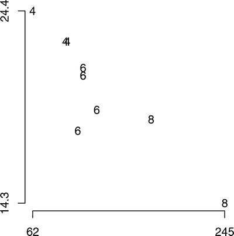

```r
dat <- textplot_data(f = mpg ~ hp | cyl, d = mtcars[1:10, ])
plot(dat)
```

这个例子展示了使用 S3 系统是多么简单。几乎不需要特殊的函数或额外的努力。只需按你希望的方式创建一个常规的 R 对象，添加一个自定义的类标签，编写一个函数，并赋予它一个特殊的名称——基本上这就是所需的全部。然而，S3 方法有一些特殊的函数和工具。首先，让我们看看查看`plot()`源代码时会发生什么。这个泛型函数只包含三个参数。函数体仅包含一个对`UseMethod()`的调用，这正是告诉 R 检查参数类别并分派到适当方法的部分。如果你正在编写方法但相应的泛型函数不存在，你还需要编写这个泛型函数。在 S3 系统中编写泛型函数是一个直接的任务，主要考虑的是默认应包含哪些参数：

```r
plot
function (x, y, ...)
UseMethod("plot")
```

要查看可用的方法，我们使用`methods()`函数。结果显示`plot()`有许多特定的方法可用，包括我们新编写的`plot.textplot`：

```r
methods(plot)
[1] plot,ANY-method               plot,color-method
[为节省空间省略]
[71] plot.table*                   plot.textplot
[为节省空间省略]
[81] plot.varclus                  plot.xyVector*
see '?methods' for accessing help and source code
```

有些函数后面跟着星号，表示这些方法不是公开的或者无法直接访问，例如`plot.table()`。例如，如果我们输入它的名字，会得到一个错误，提示找不到它：

```r
plot.table
Error: object 'plot.table' not found
```

> **注意**
>
> `::`运算符用于引用特定包中公开导出的函数，主要用于当多个包导出同名函数时：`package::foo()`。`:::`运算符用于访问包命名空间中未导出的函数。使用非公共函数时要小心，因为它们可能在没有通知的情况下发生变化。

非公开或未从包命名空间导出的函数仍可以作为方法访问。这些函数也可以通过指定它们来自哪个包并使用`:::`运算符直接访问，从而查看函数源代码：

```r
graphics:::plot.table
function (x, type = "h", ylim = c(0, max(x)), lwd = 2, xlab = NULL,
ylab = NULL, frame.plot = is.num, ...)
{
xnam
```

除了为新类编写方法外，有时为现有类编写方法也很有帮助。例如，流行的`ggplot2`包没有为处理线性模型或回归对象提供默认的方法。首先，我们使用内置的`mtcars`数据建立一个简单的回归模型。然后，我们通过`hp`、`vs`、它们的交互作用（通过`hp * vs`创建，这扩展为两个主效应及其交互项或乘积项）以及通过`factor()`调用进行虚拟编码的`cyl`来预测`mpg`。结果如下，通过调用`summary()`方法显示：

```r
m <- lm(mpg ~ hp * vs + factor(cyl), data = mtcars)
summary(m)
```

```markdown
Signif. codes:  0 '***' 0.001 '**' 0.01 '*' 0.05 '.' 0.1 ' ' 1
Residual standard error: 3.007 on 26 degrees of freedom
Multiple R-squared:  0.7913,  Adjusted R-squared:  0.7511
F-statistic: 19.71 on 5 and 26 DF,  p-value: 4.181e-08
```

我们可以检查对象的类别，并使用以下代码查看当前是否存在`ggplot()`方法：

```r
class(m)
[1] "lm"
methods(ggplot)
[1] ggplot.data.frame* ggplot.default*    ggplot.summaryP
[4] ggplot.transcan
see '?methods' for accessing help and source code
```

虽然`fortify()`函数有一个针对线性模型的方法，可以创建一个适合与`ggplot()`一起使用的数据框，但它只提取原始数据、拟合值和残差。为了展示模型的效果，绘制一个变量在其他变量保持在特定值时的预测值函数图会很有帮助。下面的方法实现了一个系统来做到这一点。

# ggplot.lm 方法

该方法采用与`ggplot()`相同的基本参数，但增加了`vars`参数。模型中使用的每个变量都通过一组特定的值来传递以进行预测。通过使用`do.call()`函数将这些列表作为参数传递给`expand.grid()`函数，创建所有这些可能组合。然后从模型公式中提取因变量`yvar`并转换为字符。生成新的预测值及其标准误。基于拟合值（或预测值）和正态分位数乘以拟合标准误，计算 95% 置信区间的下限`LL`和上限`UL`。最后，将列名从`fit`更改为因变量的实际名称，然后将用于预测的数据和预测值合并到一个新的数据框中。此数据框被传递给`ggplot()`，它会分派到数据框的`ggplot()`方法。

```r
ggplot.lm <- function(data, mapping, vars, ...) {
newdat <- do.call(expand.grid, vars)
yvar <- as.character(formula(data)[[2]])
d <- as.data.frame(predict(data, newdata = newdat, se.fit = TRUE))
d <- within(d, {
LL <- fit + qnorm(.025) * se.fit
UL <- fit + qnorm(.975) * se.fit
})
colnames(d)[1] <- yvar
data <- cbind(newdat, d[, c(yvar, "LL", "UL")])
ggplot(data = data, mapping = mapping, ...)
}
```

有了这个方法后，我们可以轻松地从线性回归模型生成图形。以下代码使用我们的新方法，指定预测变量的具体值，通过`geom_line()`添加线条，并使用`theme_bw()`黑白主题。结果如图 5-2 所示；代码如下：

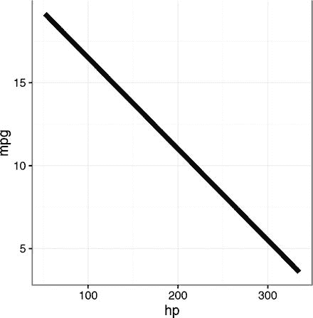

图 5-2.
使用`ggplot.lm()`方法得到的模型预测回归线

```r
ggplot(m, aes(hp, mpg), vars = list(
hp = min(mtcars$hp):max(mtcars$hp),
vs = mean(mtcars$vs),
cyl = 8)) +
geom_line(size=2) +
theme_bw()
```

由于我们的方法中通过`expand.grid()`创建了预测器值的所有可能组合，我们可以生成多条预测线，例如将`vs`分别保持在`0`和`1`，如下例代码和图 5-3 所示：

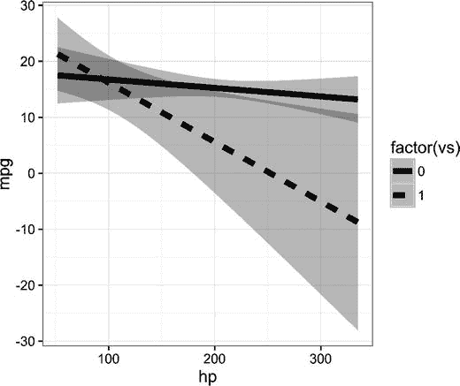

图 5-3.
使用`ggplot.lm()`方法得到的模型预测回归线及置信区间

```r
ggplot(m, aes(hp, mpg, linetype = factor(vs), group = factor(vs)), vars = list(
hp = min(mtcars$hp):max(mtcars$hp),
vs = c(0, 1),
cyl = 8)) +
geom_ribbon(aes(ymin = LL, ymax = UL), alpha = .25) +
geom_line(size=2) +
theme_bw()
```

这些示例简要介绍了在编写新的类和方法或扩展现有类和方法时可以完成的工作。由于 S3 系统是 R 中最常用的系统，它可能是最重要的系统；它可以广泛应用并且可以扩展许多类别的对象。

## S4 系统

与 S3 系统相比，S4 系统是一个`正式`的系统。这种形式化的好处是能够更大程度地确保特定类的对象完全符合预期。形式化的缺点则是复杂性更高：需要更多的函数来设置类和方法，并且在编程中要求更严格。S3 系统允许编写快速且非正式的代码，而 S4 系统则需要更仔细的规划并带来更高的开销。

对象有三个组成部分：类、槽和方法。对象的名称和结构——它包含什么——就是类。存储在对象中的变量或其他对象是槽。最后，可以对该对象进行操作的函数就是它的方法。在本节中，我们将逐一介绍这些组成部分。关于 S4 系统的进一步阅读，一个极好的指南是 John Chambers 所著的《*Software for Data Analysis: Programming with R*》（Springer，2010）。

### S4 类

由于 S4 类更加正式，在编写新类之前需要进行规划。与 S3 类不同，在 S4 中必须指定要包含的每个变量的名称和类型。之前我们使用 S3 系统定义了一个类`textplot`。我们可以使用 S4 系统定义相同的类。`x`和`y`参数都应为数值类型，`labels`参数应为字符串。我们还知道所有参数的长度应该相同。最后，我们可能希望断言虽然可以存在缺失的标签，但不允许出现空标签。所有这些都需要提前考虑和指定——因为虽然在 S3 系统中无法控制这些，但在 S4 系统中我们可以在创建类时定义所有内容。要创建第一个 S4 类，我们使用`setClass()`函数，如下例所示。并非每个参数都是必需的，但在定义新类时，尽可能明确被认为是良好的实践。

S4 类通过调用`setClass()`创建。`Class`和`slots`参数是必需的。类名指定为字符串，槽（存放变量）定义为命名的字符向量；名称对应槽名，值对应每个槽的类。可以通过`prototype`参数指定一个"空"对象，并通过向`validity`参数传递一个函数来设置有效性检查。

第一个参数`Class`提供类的名称。接下来，使用一个命名向量定义`slots`，其中名称表示槽名，值表示每个槽的类型。`prototype`参数不是必需的，但定义它很有帮助，因为它决定了如何创建"空"对象，或者在未指定具体数据时如何创建该类的对象。`validity`参数也不是必需的，但允许运行显式检查以确保对象符合预期。R 默认确保传递给槽的对象具有适当的类型，但可以添加许多其他测试和有效性检查，以减少创建不符合预期工作对象的机会。以下是`setClass()`示例：

```r
setClass(
Class = "textplot",
slots = c(
x = "numeric",
y = "numeric",
labels = "character"),
prototype = list(
x = numeric(0),
y = numeric(0),
labels = character(0)),
validity = function(object) {
stopifnot(
length(object@x) == length(object@y),
length(object@x) == length(object@labels))
if (!all(nchar(object@labels) > 0, na.rm = TRUE)) {
stop("All labels must be missing or non zero length characters")
}
return(TRUE)
}
)
```

要在 S4 系统中创建特定类的新对象，我们使用`new()`函数。在下面的代码中，我们检查了三次创建新对象的尝试。首先，我们创建了一个正确且有效的对象。然后，我们看看如果尝试使用错误类型的参数会发生什么。最后，我们看一个测试我们创建的有效性函数的例子。

```r
new("textplot",
x = c(1, 3, 5),
y = c(1, 2, 4),
labels = c("First", "Second", "Third"))
An object of class "textplot"
Slot "x":
[1] 1 3 5
Slot "y":
[1] 1 2 4
Slot "labels":
[1] "First"  "Second" "Third"
new("textplot",
x = c(1, 3, 5),
y = c(1, 2, 4),
labels = 1:3)
Error in validObject(.Object) :
invalid class "textplot" object: invalid object for slot "labels" in class "textplot": got class "integer", should be or extend class "character"
new("textplot",
x = c(1, 3, 5),
y = c(1, 2, 4),
labels = c("First", "Second", ""))
Error in validityMethod(object) (from #16) :
All labels must be missing or non zero length characters
```

如果使用 S3 系统定义类，这些错误就不会发生，因为 S3 既不进行类型检查，也不进行有效性检查。前面的例子中，每次尝试创建新对象最多只有一个错误。下面的例子则包含两个错误：传递给`y`槽位的向量长度与其他两个不匹配，并且存在一个零长度的字符标签。然而，按照目前的写法，只有第一个错误会被捕获，因为一旦发现问题，有效性函数就会停止：

```r
new("textplot",
x = c(1, 3, 5),
y = c(1, 2),
labels = c("First", "Second", ""))
Error: length(object@x) == length(object@y) is not TRUE
```

另一种编写有效性函数的方法是，不针对每个问题抛出错误，而是收集它们并在最后一次性返回所有错误。在修订有效性函数时，我们还可以考虑如何使错误信息更具参考价值。目前的错误信息虽然能让人看出问题所在，但可能不够精确。例如，很明显长度不相等，但到底是`x`太长还是`y`太短？修订后的类定义代码实现了这一点。

然而，在深入改进有效性函数之前，我们需要简要了解如何在 R 中创建和格式化字符串。

首先，在编写文本时，可以通过包含特殊字符`\n`来插入换行符。为了查看示例，我们使用`cat()`函数（`cat`代表“连接并打印”），它将文本输出到 R 控制台（如果指定了文件，则输出到其他位置）。以下两个例子完全相同，除了第二个例子中`a`和`b`之间有换行符：

```r
cat("ab", fill = TRUE)
ab
cat("a\nb", fill = TRUE)
a
b
```

一个常用的函数是`paste()`，它可以组合或折叠向量。下面的第一个例子展示了组合功能。通过使用`sep`参数定义的连接符（在我们的例子中是空字符串）将两个向量组合起来。在第二个例子中，包含多个元素的单个向量被折叠成一个单独的字符串。向量元素如何合并为一个字符串由`collapse`参数决定——在我们的例子中，就是换行符。

```r
paste(c("a", "b"), c(1, 2), sep = "")
[1] "a1" "b2"
paste(c("a", "b"), collapse = "\n")
[1] "a\nb"
```

在编写有效性检查函数时，这些函数非常有用，因为它们允许我们将多个错误合并成一个字符串，并在需要时使用换行符分隔。

我们使用的另一个关键函数是`sprintf()`。它的第一个参数是一个用户定义的字符串，其中包含应以百分比符号（`%`）开头的特殊符号，用于指示值应替换的位置。随后的参数是要替换的值。举例可能是展示其用法最清晰的方式。这里，`%d`用于指示要替换一个整数，然后 R 会依次替换 98、80 和 75。替换的顺序就是出现的顺序。

```r
sprintf("First (%d), Second (%d), Third (%d)", 98, 80, 75)
[1] "First (98), Second (80), Third (75)"
```

常用的格式选项有：`%d`表示整数，`%f`表示定点小数，`%s`表示字符串，`%%`表示字面量百分号。下一个示例演示了每种用法，更多文档可参阅帮助页面`?sprintf`。对于数值，我们使用`0.2`来指定数字应四舍五入到两位小数。

```r
sprintf("Integer %d, Numeric %0.2f, String %s, They won by 58%%", 5, 3.141593, "some text")
[1] "Integer 5, Numeric 3.14, String some text, They won by 58%"
```

掌握了`paste()`和`sprintf()`，我们就可以修改`textplot`类的有效性函数，以提供更具参考价值的错误信息，并且运行所有检查，沿途收集错误，最后一次性返回所有错误。

最后一个注意事项：之前，我们使用惯用语`new("classname", arguments)`来创建特定类的新对象。虽然这完全可以接受，但有一个快捷方式。`setClass()`函数的主要作用是定义一个新类（副作用），但它也会隐式地返回一个构造函数。如果我们保存调用`setClass()`的结果——按照惯例，保存在一个与类同名的对象中——我们就可以使用得到的对象来创建该类的新实例：

```r
textplot <- setClass(...)
```

以下是修订后的`textplot`类定义，包含一个改进的有效性函数：

```r
setClass("textplot",
slots = list(
x = "numeric",
y = "numeric",
labels = "character"
),
validity = function(object) {
errors <- character()
if (length(object@x) != length(object@y)) {
errors <- c(errors, sprintf(
"x (length %d) and y (length %d) are not equal",
length(object@x), length(object@y)))
}
if (!all(nchar(object@labels) > 0, na.rm = TRUE)) {
errors <- c(errors, sprintf(
"%d label(s) are zero length. All labels must be missing or non zero length",
sum(nchar(object@labels) == 0, na.rm = TRUE)))
}
if (length(errors)) {
stop(paste(c("\n", errors), collapse = "\n"))
} else {
return(TRUE)
}
}
)
```

现在，当我们创建具有多个问题的相同对象时，我们获得了更多信息，并且节省了一些输入。我们可以看到`x`和`y`的长度，并且了解到标签也有问题：

```r
textplot(
x = c(1, 3, 5),
y = c(1, 2),
labels = c("First", "Second", ""))
Error in validityMethod(object) (from #30) :
x (length 3) and y (length 2) are not equal
1 label(s) are zero length. All labels must be missing or non zero length
```

# 总结

## S4 类继承

到目前为止，你已经了解了如何定义新的 S4 类。可能仍然感觉使用 S4 系统比 S3 系统需要更多的工作，但除了更正式的有效性验证和错误检查之外，似乎好处不多。S4 系统的一个强大特性就是`继承`。

S4 类可以通过调用`setClass()`并添加参数`contains = "要继承的 S4 类"`来继承现有的 S4 类。现有的槽（slot）、原型（prototype）和有效性检查都会被继承。在新的`setClass()`调用中，只需要指定新的槽以及相应的原型/有效性检查。

我们之前创建了一个简单的`textplot`类。现在假设，尽管有时我们简单的类就足够了，但有时我们可能需要更多功能。例如，有时我们可能希望深入数据，根据某个分组变量为数据的不同子集创建一个多面板图形。为此，我们需要一个`groupedtextplot`类。然而，我们唯一需要额外存储的数据就是一个额外的槽。一种选择是复制并粘贴旧代码，然后按需修改。在本节中，我们将探讨如何使用继承来重用和扩展现有类。当一个类继承另一个类时，前一个类的所有槽以及有效性检查都会被继承。接下来，我们创建我们的`groupedtextplot`类。这与创建一个新类类似，但我们只定义新的槽，然后通过使用参数`contains`来指定继承关系。由于有效性检查也被继承，我们只需要为新槽指定有效性检查。

```r
groupedtextplot <- setClass(
Class = "groupedtextplot",
slots = c(
group = "factor"),
prototype = list(
group = factor()),
contains = "textplot",
validity = function(object) {
if (length(object@x) != length(object@group)) {
stop(sprintf("x (length %d) and group (length %d) are not equal",
length(object@x), length(object@group)))
}
return(TRUE)
}
)
```

通过这么少的代码，我们就可以使用新类了。以下两个例子中，第一个展示了正确创建的新对象，后者展示了当我们尝试创建一个无效对象时熟悉的错误信息：

```r
gdat <- groupedtextplot(
group = factor(c(1, 1, 1, 1, 2, 2, 2, 2)),
x = 1:8,
y = c(1, 3, 4, 2, 6, 8, 7, 10),
labels = letters[1:8])
gdat
An object of class "groupedtextplot"
Slot "group":
[1] 1 1 1 1 2 2 2 2
Levels: 1 2
Slot "x":
[1] 1 2 3 4 5 6 7 8
Slot "y":
[1]  1  3  4  2  6  8  7 10
Slot "labels":
[1] "a" "b" "c" "d" "e" "f" "g" "h"
groupedtextplot(
group = factor(c(1, 1, 1, 1, 2, 2, 2, 2)),
x = 1:8,
y = c(1, 3, 4, 2, 6, 8, 7),
labels = c(letters[1:7], ""))
Error in validityMethod(as(object, superClass)) (from #30) :
x (length 8) and y (length 7) are not equal
1 label(s) are zero length. All labels must be missing or non zero length
```

在这种情况下，`textplot`被称为`父类`，而`groupedtextplot`被称为`子类`。这种关系可以用图表表示（对于复杂的继承关系，图表有时很有帮助）。按照惯例，关系以箭头从子类指向父类的方式图形化表示，例如`textplot <- groupedtextplot`。同样按照惯例，父类通常在左侧，或者如果从上到下绘图，则在顶部。尽管本书只涉及从单个父类继承，但类可以从多个父类继承，而这些父类又可以继承自它们的父类，依此类推。在这些情况下，视觉图表特别有用。使用继承而不是编写一个全新的类的另一个好处是，方法也会被继承。这意味着我们可以重用父类的槽以及为父类编写的方法，这是我们将在下一节讨论的主题。

## S4 方法

除了你之前看到的`methods()`函数可以显示给定函数可用的方法之外，在 S4 系统中，我们还可以使用`showMethods()`来查找方法。由于更正式的类系统，`showMethods()`可用于显示特定函数的所有方法，或者通过使用参数`classes = "类名"`来显示特定类的所有方法（针对任何函数）。如果你正在处理一个新类，并想知道已经编写了哪些方法且可用，这会很有帮助。

可用的 S4 方法可以通过`showMethods("泛型函数")`来检查。新的 S4 方法通过调用`setMethod()`来定义。主要的三个参数是`f`、`signature`和`definition`，分别包含泛型函数的名称（字符串）、将分派到此方法的 S4 类名（字符串）以及作为实际方法的函数。

要在 S3 系统中编写新方法，我们只需按照特殊的命名约定编写函数。要定义 S4 方法，我们使用函数`setMethod()`。当然，可以为现有类编写新方法，也可以为新类编写方法。对于新类，需要为`show()`编写一个方法。当在控制台简单地键入一个对象时，R 会通过调用`show()`来显示它。如果没有为新类定义`show()`方法，默认打印会很难看，就像你在我们之前的例子中看到的那样。

在下面的代码中，我们为`textplot`类定义了一个新方法。第一个参数是我们为其创建方法的函数名。下一个参数，签名（signature），是类名。在这种情况下，因为`show()`只接受一个参数，所以只需要指定一个类名。对于具有多个参数的函数，签名可能变得更加复杂，根据多个参数的类不同，会有不同的方法。最后，我们编写我们的函数，即方法的定义。代码相对简单，使用`cat()`函数来显示值。参数`fill = TRUE`的效果是添加换行符，使每一行都以 `X:` 或变量标签开始，然后是值。`head()`函数用于获取最多前五个值，如果值较少则获取更少。

```r
setMethod(
f = "show",
signature = "textplot",
definition = function(object) {
cat("     X: ")
cat(head(object@x, 5), fill = TRUE)
cat("     Y: ")
cat(head(object@y, 5), fill = TRUE)
cat("Labels: ")
cat(head(object@labels, 5), fill = TRUE)
})
[1] "show"
```

R 回显了我们刚刚为其创建了方法的泛型函数`show()`的名称。现在，当我们创建一个`textplot`类对象时，会得到一些更美观的输出：

```r
dat <- textplot(
x = 1:4,
y = c(1, 3, 5, 2),
labels = letters[1:4])
dat
X: 1 2 3 4
Y: 1 3 5 2
Labels: a b c d
```

一旦我们开始定义方法，类继承的好处就变得更大了。因为`groupedtextplot`继承自`textplot`，如果没有为`groupedtextplot`定义方法，并且`textplot`有可用的方法，那么它会回退到`textplot`的方法。虽然不完美（因为未显示分组信息），但这仍然比默认输出要好：

```r
gdat
X: 1 2 3 4 5
Y: 1 3 4 2 6
Labels: a b c d e
```

接下来，我们为`[`函数定义一个方法，该函数用于数据子集化。这个函数更复杂，因为我们必须构建一个逻辑树，允许多种可能的参数组合。函数的第一个参数`x`是要进行子集化的对象。按照惯例，`i`指行或观测，`j`指列或变量。如果只有`i`没有缺失（即指定了行或观测），通常包含所有变量。如果只指定了`j`（变量），通常包含所有观测。如果两者都指定了，则只包含选定的变量和观测。这是通过使用一系列`if`和`else if`语句来完成的。这里涉及三个新函数：

### `validObject()`、`slotNames()` 和 `slot()`

*   `validObject()`是一个泛型函数，用于对特定对象类执行有效性检查（如果存在的话）。
*   `slotNames()`返回一个字符向量，给出每个槽的名称。
*   `slot()`的功能类似于`@`操作符，但可以使用字符串按名称提取槽。

方法设置完成后，展示了几个使用示例：

```r
setMethod(
f = "[",
signature = "textplot",
definition = function(x, i, j, drop) {
if (missing(i) & missing(j)) {
out <- x
validObject(out)
} else if (!missing(i) & missing(j)) {
out <- textplot(
x = x@x[i],
y = x@y[i],
labels = x@labels[i])
validObject(out)
} else if (!missing(j)) {
if (missing(i)) {
i <- seq_along(x@x)
}
if (is.character(j)) {
out <- lapply(j, function(n) {
slot(x, n)[i]
})
names(out) <- j
} else if (is.numeric(j)) {
n <- slotNames(x)
out <- lapply(j, function(k) {
slot(x, n[j])[i]
})
names(out) <- n[j]
} else {
stop("j is not a valid type")
}
}
return(out)
})
dat[]
X: 1 2 3 4
Y: 1 3 5 2
Labels: a b c d
dat[i = 1:2]
X: 1 2
Y: 1 3
Labels: a b
dat[j = 1]
$x
[1] 1 2 3 4
dat[j = "y"]
$y
[1] 1 3 5 2
dat[i = 1:2, j = c("x", "y")]
$x
[1] 1 2
$y
[1] 1 3
```

为我们的`textplot`类定义了`show`和`subsetting`方法后，我们可以轻松地利用这些方法，通过按组循环遍历对象、子集化和显示每个子集，来为`groupedtextplot`类创建一个`show`方法：

```r
setMethod(
f = "show",
signature = "groupedtextplot",
definition = function(object) {
n <- unique(object@group)
i <- lapply(n, function(index) {
cat("Group: ", index, fill = TRUE)
show(object[which(object@group == index)])
})
})
gdat
Group:  1
X: 1 2 3 4
Y: 1 3 4 2
Labels: a b c d
Group:  2
X: 5 6 7 8
Y: 6 8 7 10
Labels: e f g h
```

本章介绍了 R 中用于开发新类和新方法的 S3 和 S4 系统。特别是 S4 系统，可能非常复杂，涉及从多个父类继承以及针对多个参数类特化的方法。即使你在 R 中使用和开发，也可能很少开发新的类，因为大多数数据类型已经有现成的类。然而，开发或扩展现有方法通常很有帮助，至少，理解类和方法的工作原理可以让你更容易地使用现有的类和函数。

希望本章足以让你开始使用这些系统并了解它们的能力。表 5-1 描述了本章涉及的关键函数。在第 6 章中，我们将函数、类和方法捆绑在一起，制作我们自己的 R 包。重点是制作 R 包，所以你不需要对类和方法非常熟悉。如果你的工作能从使用 S4 系统中受益，你可以从 John Chambers 的《How S4 Methods Work》（可在 [`http://developer.r-project.org/howMethodsWork.pdf`](http://developer.r-project.org/howMethodsWork.pdf) 在线获取）中获得更深入的介绍。如果你打算使用 S4 系统并需要进行深入研究，我们推荐《*Software for Data Analysis: Programming with R*》。另一本更侧重于通用 R 编程和较旧的 S3 系统的优秀书籍是《*S Programming*》。

表 5-1. 本章描述的关键函数

| 函数 | 功能描述 |
| --- | --- |
| `class()` | 返回对象的类（S3/S4）。 |
| `inherits()` | 检查对象是否属于某个特定类或继承自该类。 |
| `methods()` | 返回给定函数可用的方法列表。 |
| `showMethods()` | 返回给定函数可用的方法列表；或者，如果使用 `classes` 参数，则返回给定类中任何函数可用的方法列表。 |
| `:::` | 操作符，允许访问包中未导出（非公开）的函数。 |
| `function.class()` | 命名 S3 方法的通用方案：使用函数名，后跟一个句点，再后跟应用该方法的对象类。 |
| `setClass()` | 定义一个新的 S4 类。 |
| `setMethod()` | 为特定 S4 类的特定函数定义一个方法。 |
| `@` | 在 S4 系统中按名称访问对象中槽的低级方式，类似于其他 R 对象或 S3 类对象的 `$`。 |
| `new()` | 创建一个指定类的新 S4 对象。 |
| `paste()` | 将字符串粘贴在一起。可以操作多个向量，也可以将单个向量的所有元素合并在一起。 |
| `sprintf()` | 格式化字符串，并允许将数字和其他字符串替换到定义的模板中。对于制作信息丰富的错误消息或其他给用户的消息很有用。 |
| `show()` | 显示 R 对象的泛型函数。也是你在 R 控制台键入对象名称时默认调用的函数。 |
| `` `[`() `` | 用于子集化数据或访问特定变量或行的操作符/泛型函数。在 S4 系统的新类中，必须定义方法，否则该函数不可用。 |
| `head()` | 列出对象的前几个元素或行。 |
| `validObject()` | 一个泛型函数，通过使用创建类时指定的有效性检查（如果有的话）来检查具有 S4 类的对象何时有效。创建对象时默认调用，但也可以在修改对象后显式调用，以检查其是否仍然有效。 |
| `slotNames()` | 返回 S4 类对象的所有槽名，类似于其他 R 对象或 S3 类对象的 `names()`。 |
| `slot()` | 可用于访问 S4 对象的特定槽。 |

# 6. 编写包

包是记录、共享和分发 R 代码和数据的基本方式。我们的目标是编写自己的包，我们需要提前说明，本章特别复杂，因为在 R 包开发过程中会用到许多软件工具。

在本章中，我们使用了四个包。`devtools` 包（Wickham and Chang, 2016）提供了帮助设置、记录和管理 R 包开发的函数。`roxygen2` 包（Wickham, Danenberg, and Eugster, 2015）通过在函数旁边使用注释行内编写函数文档，大大简化了为 R 包编写文档的工作。我们还使用了另外两个不太关键的包。`testthat` 包（Wickham, 2011）不是必需的，但它提供了通过测试函数是否返回预期值来促进质量控制的函数。类似地，`covr` 包（Hester, 2016）通过测试被测试执行的代码百分比（覆盖率）来促进质量控制。理想情况下，100% 的代码都应该被测试覆盖，尽管在实践中，许多 R 包没有任何测试，所以任何覆盖率都比平均水平要好。在包中，我们对 `ggplot2` 使用了第 5 章中的一种方法，因此我们也包含了现在已经很熟悉的 `ggplot2` 包（Wickham, 2009）。

编写包可能是一个复杂的过程。熟悉最终产品可能会有所帮助，该产品可在 [`https://github.com/ElkhartGroup/AdvancedRPkg`](https://github.com/ElkhartGroup/AdvancedRPkg) 在线获取。如果你不确定文件是否位于正确的位置或设置是否正确，我们还建议你在阅读本章时参考我们在 GitHub 上的官方包记录。以下代码加载 `checkpoint` 包（Microsoft Corporation, 2016）以控制使用的 R 包的确切版本，然后加载所需的包：

```r
## load checkpoint and required packages
library(checkpoint)
checkpoint("2016-09-04", R.version = "3.3.1")
library(testthat)
library(devtools)
library(roxygen2)
library(covr)
library(ggplot2)
options(width = 70) # only 70 characters per line
```

## 开始之前

本章将介绍编写 R 包的一些基础知识，并介绍一些工具来简化未包含在官方手册《Writing R Extensions》中的流程，该手册可在线访问 `https://cran.r-project.org/doc/manuals/R-exts.html`。该手册可能相当技术性，但它是权威指南。如果你计划向 CRAN 提交 R 包，阅读它是必需的；即使你只是计划开发供自己使用，或供更有限用户群（如你的公司或实验室小组）使用的包，阅读它也是一个好主意。

许多 R 包包含来自其他编程语言（如 C、C++、Fortran 或 Java）的代码。这通常是因为其他语言（如 C）可以编译和优化，运行速度远快于 R，因此包开发者可能会选择用编译型且高效的语言来编写代码中计算密集的部分。然而，在本章中，我们将讨论如何编写仅包含纯 R 代码或数据的 R 包，因为其过程几乎相同，大部分差异是由所包含语言特有的特性造成的（例如 makefile）。

在开发 R 包之前，需要一些工具。确实，对于不习惯软件开发的人来说，编写 R 包可能需要一个相当令人生畏的工具链。如果你使用的是 Linux 系统，很可能你已经拥有其中许多工具，或者可以轻松安装它们。在 Windows 和 Mac OS 系统中，可能需要更多设置。无论使用何种系统，这些工具需要是可访问的，这意味着需要将它们添加到系统路径中，以便在命令行调用时可以找到它们。

### Windows 系统所需工具

如果使用 Windows，所需的主要工具（一些命令行工具和编译器）可以从 `https://cran.r-project.org/bin/windows/Rtools/` 的二进制安装程序获取。在安装的最后一步之前，有两个复选框，其中一个可能未被勾选，其作用是将工具添加到系统路径。只需勾选两者。此外，你需要 LaTeX（一种排版系统）。MiKTeX 是一个流行的选择 (`www.miktex.org/`)；如果你的系统是 64 位，请务必选择 64 位选项。虽然这两者的大多数默认选项在大多数情况下已足够，但我们建议 MiKTeX 用户将“按需安装默认包”的选项更改为“是”。关于所需工具链的更多详细信息，可参阅 R 手册中的 `https://cran.r-project.org/doc/manuals/R-admin.html#The-Windows-toolset`。

### Mac OS 系统所需工具

如果使用 Mac OS，请从 App Store 获取 Xcode（开发者工具）。你可能还需要获取 XQuartz (`https://xquartz.macosforge.org/`)。与 Windows 一样，你需要 LaTeX。MacTeX 是一个选择 (`www.tug.org/mactex/`)。更多详细信息可参阅 R 手册 (`https://cran.r-project.org/doc/manuals/R-admin.html#OS-X`)。

### 为你的包命名和授权

在开始编写第一个 R 包之前，还需要做两个决定。首先，如何命名 R 包？这个看似简单的任务变得复杂，因为目前 CRAN 上有超过 8,000 个 R 包，并且数量在快速增长 (`https://cloud.r-project.org/web/packages/available_packages_by_name.html`)。尽管你可以为一个不上传到 CRAN 的包取一个与 CRAN 上现有包相同的名字，但如果你将来会使用那个 CRAN 包或者任何依赖它的包，这样做就会有问题。即使你的包不打算提交到 CRAN，将来也可能有其他人写一个同名包并提交到 CRAN。基于这些原因，选择包名需要一些思考。在本章所有示例中，我们将构建一个名为 `AdvancedRPkg` 的 R 包。第二个决定是包使用什么许可证。如果你计划提交到 CRAN，许可证必须与 CRAN 兼容。即使包永远不会发送到 CRAN，许可证仍然可能是相关的。在本章中，我们使用 GPLv3 许可证。

### 版本控制

截至目前，我们讨论了相对随意的代码开发、一些基础编程、函数和类。开发新的 R 包更为复杂，需要管理的文件也更多。随着复杂性的增加，建立一个高效的文件备份和版本回退系统会很有帮助。版本控制系统提供了一个极佳的方式来备份代码以及将更改回滚到之前的版本（例如，如果为实现新功能所做的更改破坏了旧功能或引入了错误）。存在多种版本控制系统，但目前最流行的可能是开源的 Git，它最初是为 Linux 内核提供版本控制而开发的。Git 可以直接通过命令行使用，也可以通过多种图形界面使用。许多人使用 GitHub（[`https://github.com/`](https://github.com/)），这是一个使用 Git 并在线托管代码库的服务，对公共项目免费。GitHub 也为 Windows 和 Mac OS 提供了图形界面（[`https://desktop.github.com/`](https://desktop.github.com/)）。但是，如果你不想学习或使用 Git 或其他版本控制系统，可以放心地忽略本节以及本章中所有仅与版本控制相关的命令。

我们在本章中使用 Git（和 GitHub for Windows）为我们开发的示例 R 包提供版本控制。具体来说，本书使用 Windows GitHub 桌面客户端 v3.3.0。Git 代码库可以仅在一台本地计算机上使用，但配合 GitHub 使用可以方便地在包上进行协作，并与他人分享早期的包代码。

## 设置代码库

通过命令行可以设置 Git 代码库，但对于新用户来说，创建新的 Git 代码库最直观的方式可能是在线直接通过 GitHub。我们为本章开发的 R 包创建一个新的代码库，并命名为 `AdvancedRPkg`。代码库初始化时会包含一个 `README` 文件，我们稍后会编辑它。我们可以通过将某些文件或特定扩展名的文件添加到名为 `.gitignore` 的文件中来告诉 Git 忽略它们。每个文件或扩展名独占一行列出。我们稍后可以编辑它，但暂时只让 GitHub 创建一个。图 6-1 展示了执行此操作的步骤。

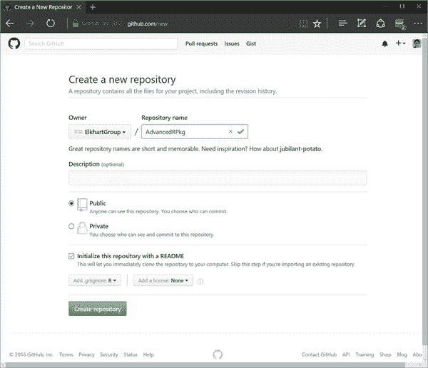
图 6-1. 创建 `AdvancedRPkg` 代码库的 GitHub 页面

如果一切按计划进行，结果应类似图 6-2 所示。除了 `README` 和 `.gitignore` 文件外，代码库是空的。

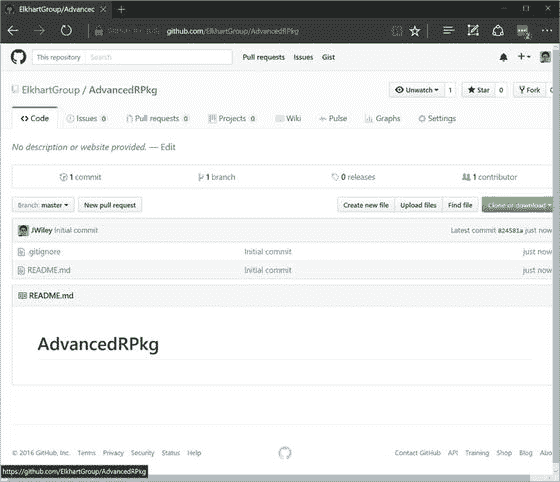
图 6-2. 显示已创建的 `AdvancedRPkg` 代码库的 GitHub 页面

从这里，我们可以将代码库克隆到本地计算机。本质上，这创建了一个本地副本，我们在其中进行包的编写。要做到这一点，打开 GitHub 桌面客户端，点击加号，选择"克隆"，然后选择代码库，如图 6-3 所示。

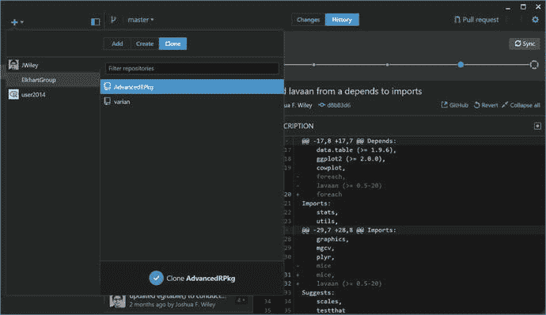
图 6-3. GitHub 桌面客户端克隆 `AdvancedRPkg` 代码库

点击"克隆"后，我们会看到一个选项，用于选择代码库应克隆到的目录。请注意，无论选择哪个目录，都会为代码库创建一个与代码库同名（即 `AdvancedRPkg`）的新目录。代码库的设置可以通过终端管理，也可以通过点击 GitHub 桌面客户端中的齿轮图标并选择"Repository Settings"（代码库设置）来管理。其中一个设置显示当前被忽略的文件。文件是根据 `.gitignore` 文件忽略的，由于我们在创建代码库时选择了 R，一些通常希望被忽略的默认文件扩展名已被默认包含（见图 6-4）。

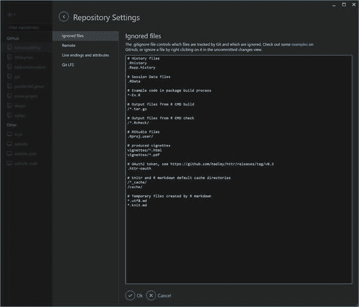
图 6-4. GitHub 桌面客户端显示 `AdvancedRPkg` 代码库的设置，包括 Git 代码库忽略的各种文件扩展名

Windows 经常在目录中创建临时（有时是隐藏的）文件 `desktop.ini`。为了避免包含这些文件，我们可以编辑代码库设置，在末尾添加新行并输入 `desktop.ini`。这样这些文件就被忽略了。被忽略的文件是 Git 代码库不随时间跟踪和存储更改的文件。它们仍然存在于目录中；Git 只是不监视和版本化它们。

## Git 操作：提交与同步

除了设置一个新的 Git 代码库外，你可能会用 Git 执行的任务包括向代码库提交更改以及将本地代码库副本与在线（GitHub）版本同步。提交可以看作是在提交时对文件状态的一次快照。为了避免冗余提交，只对自上次提交以来文件所做的更改进行快照。尽管即使是稍微修改的二进制文件也可能难以比较，但像 R 代码这样的纯文本文件则很容易比较。Git 在跟踪文本文件随时间的变化方面非常高效，允许你查看所做的更改或回到过去的特定时间点。如果代码中引入了错误或缺陷，访问项目（代码库）的这段历史记录会特别有帮助，这样可以精确定位错误是何时引入的（例如，基于此代码的多少结果可能受到影响？）并查看之前有效运行的代码版本。

在稍复杂的用例中，Git 可以有效地用于管理代码的不同版本。例如，通常一个项目会定期发布稳定版或生产就绪的代码版本，同时继续进行开发。在 Git 中，这是通过使用同一代码库的不同分支，并定期将某个分支（例如开发分支）的部分更改合并到稳定分支中来实现的。

## 附加资源

我们将在本章中展示更多相关的 Git 命令。关于使用 Git 的更多背景知识，一个很棒且免费的资源是 Scott Chacon 和 Ben Straub 所著的《Pro Git》（Apress，2014），可在[`https://progit.org/`](https://progit.org/)获取。对于问答，Stack Overflow（[`http://stackoverflow.com`](http://stackoverflow.com)）是一个很好的资源。很可能其他人已经问过类似的问题，如果没有，你可以提问并获得答案。另外请注意，如果你使用 RStudio 编写 R 代码，它内置了一些与 Git 的集成功能。有关这方面的更多信息，请参阅 RStudio 支持页面：[`https://support.rstudio.com/hc/en-us/articles/200532077-Version-Control-with-Git-and-SVN`](https://support.rstudio.com/hc/en-us/articles/200532077-Version-Control-with-Git-and-SVN)。最后请注意，你可以公开访问在线代码库：[`https://github.com/ElkhartGroup/AdvancedRPkg`](https://github.com/ElkhartGroup/AdvancedRPkg)。

## R 包基础

一个 R 包就是一个包含特定文件集的目录。虽然 R 包的核心无疑是 R 代码，但许多文件并非严格意义上的 R 代码。表 6-1 列出了可能出现在 R 包目录根层级的主要文件。并非所有这些文件都是必需的，这取决于包的其他特性。在本章后续内容中，我们将借助 `devtools` 包来帮助创建其中一些文件。

**表 6-1. `R` 包根目录下可能使用的文件。**

| 文件 | 描述 |
| --- | --- |
| `DESCRIPTION`* | 提供关于包的一般信息。必需的字段包括：`Package`（包名）、`Version`、`License`、`Title`（包描述）、`Author` 和 `Maintainer`（可能与作者相同或不同）。通常也包含依赖关系信息，除非包是独立的。 |
| `NAMESPACE`* | 控制包的命名空间，包括需要导出的对象以及需要从其他包导入的对象。虽然是必需的，但我们可以使用 `roxygen2` 包自动生成此文件。 |
| `README`/`README.md` | 非必需，且被 R 忽略，但对读者和用户很有帮助。提供关于包的一般信息（例如，获取帮助的途径、简要概述、安装指南，或任何其他在简要文档中有用的信息）。 |
| `NEWS` | 提供关于包的变更或新闻信息。通常包括新特性、漏洞修复以及与先前版本相比的任何其他重大变更。 |
| `LICENSE` | 许可证文件，如果未使用常见许可证或需要附加信息时使用。 |
| `INDEX` | 可选的，因为它可以从文档文件中自动生成。但如果指定了，则会提供一个所有有用/有趣对象的列表，每行包含一个名称和描述。 |
| `configure`, `cleanup` | 可选的 Bourne shell 脚本，分别在 Unix 系统（例如 Linux、Unix）上安装前和安装后运行。 |

\* 表示必需文件

除了根层级的文件，R 包还可以包含许多子目录。这些列在表 6-2 中，并附有简要描述。对于我们相对简单的包，我们只处理其中的一小部分，包括 `R`、`man` 和 `tests`。

**表 6-2. `R` 包子目录**

| 子目录 | 描述 |
| --- | --- |
| `R`* | 包含所有函数、类、方法等 R 源代码的目录。 |
| `man`* | 包含 R 文档文件的目录。我们使用 `roxygen2` 包自动生成这些文件。 |
| `tests` | 可选的目录，包含用于测试包是否按预期工作的 R 代码。 |
| `data` | 可选的目录，包含与包一起分发的数据。通常，包含的数据集较小，用于说明包的特性，而不是作为共享数据的主要手段。 |
| `demo` | 可选的目录，包含 R 包的演示，以 R 源代码文件形式存在。 |
| `exec` | 可以包含其他必需的可执行脚本。仅包含文件，不包含子目录。 |
| `inst` | 可以包含在包安装时复制到安装目录的其他文件。例如，可用于与用户共享 `NEWS` 文件，或包含图像或其他非标准文档。 |
| `po` | 用于添加 C 和 R 错误信息的翻译以及其他与本地化相关的任务。 |
| `src` | 通常包含其他语言的源代码，如 C、C++ 或 Fortran。这些代码通常需要编译；如果使用它，通常需要指定一个 makefile。 |
| `tools` | 不常用，但可用于提供配置所需的其他文件。 |
| `vignettes` | 用于提供一个或多个使用该包的指南或说明。与通常针对特定函数的函数文档相比，说明通常包含更多的入门背景知识和关于如何整体使用包的完整示例。虽然不是必需的，但对用户非常有帮助。 |

\* 表示必需子目录

### 使用 DevTools 启动包

至少，在你的包根目录下，你需要`DESCRIPTION`和`NAMESPACE`文件。你还需要一个子目录`R`，顾名思义，这是放置 R 代码的地方。这对于提交到 CRAN 的包来说还不够，但对于启动一个供私人使用的功能包来说已经足够了。然而，即使对于私人使用，适当的文档也极其有帮助。遗憾的是，包的目录和文件结构相当复杂，尤其是在文本中描述时。因此作为参考，以下是本章结束时你应该获得的包的最终目录结构（取自`AdvancedRPkg`目录内）：

```
.
├── data
│   └── sampleData.rda
├── DESCRIPTION
├── man
│   ├── ggplot.lm.Rd
│   ├── meanPlot.Rd
│   ├── sampleData.Rd
│   └── textplot-class.Rd
├── NAMESPACE
├── R
│   ├── plot_functions.R
│   ├── sampledata.R
│   └── textplot.R
├── README.md
└── tests
    ├── testthat
    │   └── test_textplot.R
    └── testthat.R
5 directories, 13 files
```

对于初始设置，我们使用`setup()`函数。我们可以指定更多信息，但最低要求是路径。我们还将`rstudio = FALSE`设置为使代码适用于任何编辑器，而不仅仅是 RStudio。要查看创建了什么，我们可以使用`list.files()`函数，它显示已经创建了`DESCRIPTION`和`NAMESPACE`文件以及一个`R`目录。对于以下代码，可以从 R 命令行运行它，或者创建一个新的 R 文件（我们将我们的命名为`chapter06.R`）。请注意，重要的是调整`path`参数，使其指向包含 Git 仓库的目录，无论你在本地机器上将其克隆到了哪里。在我们的例子中，R 的工作目录（可以通过调用`getwd()`函数检查）位于`AdvancedRPkg`目录的正上方目录。如果你的 R 会话不在此目录，要么调整`path`参数，要么使用`setwd()`函数将 R 的工作目录更改为`AdvancedRPkg`的父目录：

```r
setup(
    path = "AdvancedRPkg/",
    rstudio = FALSE)
```

```
创建包'AdvancedRPkg'在'∼/Apress_AdvancedR/RFiles'
未找到 DESCRIPTION 文件。使用以下值创建：
Package: AdvancedRPkg
Title: What the Package Does (one line, title case)
Version: 0.0.0.9000
Authors@R: person("First", "Last", email = "first.last@example.com", role = c("aut", "cre"))
Description: What the package does (one paragraph).
Depends: R (>= 3.3.1)
License: What license is it under?
Encoding: UTF-8
LazyData: true
```

```
list.files("AdvancedRPkg")
```

```
[1] "DESCRIPTION" "NAMESPACE"   "R"           "README.md"
```

输出还显示了部分字段及其填充信息。由于这些大多是占位符，我们需要使用文本编辑器（包括 RStudio 在内的任何编辑器都应该可以）打开文件并修改它们。`setup()`函数根据目录猜测包名，但其余部分需要填写。使用编辑器，我们将这些字段修改如下：

```
Package: AdvancedRPkg
Title: 书籍《Advanced R》的示例 R 包
Version: 0.0.0.9000
Authors@R: c(
    person("Matt", "Wiley", email = "matt@elkhartgroup.com", role = c("aut")),
    person("Joshua F.", "Wiley", email = "josh@elkhartgroup.com", role = c("aut", "cre")),
    person("Elkhart Group Ltd.", role = "cph")
)
Description: 该包将演示 R 包的基础知识，包括文档和测试。
Depends: R (>= 3.3.1)
License: GPL (>= 3)
Encoding: UTF-8
LazyData: true
```

注意版本号，其格式设计为`主版本.次版本.修订版.开发版本`。关于如何确定软件版本的考量，语义化版本规范（[`http://semver.org/`](http://semver.org/)）中给出了很好的概述。虽然它的建议相当规范，但有一套固定的规则来确定软件的主版本或次版本通常很有帮助。最后一部分`开发版本`仅存在于开发版本中，发布时会删除。尽管有这些规则和指南，许多 R 包的实际做法要异构和不一致得多（并非所有人都同意这些规则，即使同意也并非总能严格遵守）。

接下来是作者，使用`person()`函数描述。除了每个人的姓名和电子邮件外，还使用三个字母的缩写来描述角色和关系。所有可能性都在 MARC 关系者代码列表（[`www.loc.gov/marc/relators/relaterm.html`](http://www.loc.gov/marc/relators/relaterm.html)）中列出。然而，最常用的是`aut`（作者）、`cre`（项目负责人或 R 术语中的维护者，即出现问题时的联系人）和`cph`（版权持有者）。然后我们为包的描述提供几句话，指定我们的包依赖的 R 版本、许可证，以及数据可以按需加载（以节省启动时间）。

#### 添加 R 代码

有了包的基础之后，是时候开始添加一些 R 代码了，这是包的真正目的！由于本章的重点是打包代码，我们将重用前几章中的一些函数和类。第一步，我们在`AdvancedRPkg/R/`目录下创建两个文件：`plot_functions.R`和`textplot.R`。

接下来，我们将第四章中的最终`meanPlot()`函数复制过来以制作均值图。我们将此函数的代码以及第五章中编写的 S3 方法`ggplot.lm()`添加到`plot_functions.R`中。然后，我们将第五章中`textplot`类的类和方法（`show`和`subset`，即方括号操作符`[`）复制到`textplot.R`中。由于容易复制错误的代码，我们建议从我们的 GitHub 仓库（[`https://github.com/ElkhartGroup/AdvancedRPkg`](https://github.com/ElkhartGroup/AdvancedRPkg)）复制粘贴代码。如果一切正常，应该如下所示：

```r
list.files("AdvancedRPkg/R")
```

```
[1] "plot_functions.R" "textplot.R"
```

顺便提一下，决定要多少个独立文件可能很困难。这对 R 本身没有影响，但对开发有影响。将所有代码放在一个文件中不好，将每个函数、类和方法都分割到单独的文件中也不好。如果结果不是太长，我们尝试将相关函数（如绘图函数）分组，并将相关类和方法分组。作为常识，即使可以，也不要用仅通过大小写区分的文件名；在文件名中使用特殊字符或符号通常也不是好主意。

现在我们有了一个基本的包模板，可以使用`devtools`中的`load_all()`函数加载函数。我们只需指定包的路径即可。现在我们可以看到包命名空间中提供了一些函数，我们通过使用`ls()`函数并指定要列出可用对象的位置来实现：

```r
load_all("AdvancedRPkg")
```

```
Loading AdvancedRPkg
```

```r
ls(name = "package:AdvancedRPkg")
```

```
[1] "ggplot.lm" "meanPlot"  "textplot"
```

在第四章中，我们简要讨论了作用域。在编写包时，理解作用域变得更加重要。包作者可以编写与其他包中函数同名的函数。虽然这些函数不会相互覆盖，但要明确你打算调用哪个函数可能会令人困惑。这时包命名空间就很有帮助了。命名空间控制从其他包中导入哪些函数（从而供该包内的代码使用），以及从包中导出哪些函数，使其对包的用户公开可用。您可以使用导入功能从其他包中导入特定函数。如果您需要另一个包的许多函数，您可能决定让您的包依赖于那个包，在这种情况下，所有公共函数都可供您的包使用。导入和依赖另一个包之间的另一个区别是，当您的包被加载时会发生什么。如果包 B 依赖于包 A，当用户调用`library(B)`时，包 B 和包 A 都会被加载和附加。如果包 B 从包 A 导入，当用户调用`library(B)`时，包 B 被加载和附加，而包 A 被加载但不附加。因为包 A 已加载，所以它的函数可供包 B 内的代码使用，但由于包 A 未附加，它们不会直接暴露给用户。即使包 A（或包 B）被加载和附加，也只有导出的函数对用户公开可用。这很有益，因为它允许包开发者编写和记录仅用于内部使用的函数。如果您不需要导出一个函数，最好不要导出。如果两个 R 包导出了同名的函数，并且用户加载和附加了这两个包，那么后加载的包中的函数会屏蔽较早的那个。对用户来说，唯一的选择是不加载和附加其中一个包，或者在函数调用时显式地使用双冒号运算符，如`PkgA::foo()`或`PkgB::foo()`。由于有数千个 R 包和更多的函数，只导出必要的函数有助于避免这种冲突和名称屏蔽。

所有这些都通过包的`NAMESPACE`文件控制。虽然我们没有查看，但我们的包确实有一个`NAMESPACE`文件，它在运行`setup()`时创建。然而，`load_all()`函数的独特之处在于，默认情况下它在加载包时会导出所有对象。这是因为在开发过程中，能够调用所有函数（无论是否导出）通常很方便。

## 测试

随着函数和方法被添加到我们的新包中并在 R 中运行正常，我们可以开始考虑质量控制。编写出能运行的代码固然很棒，但确保代码能实现其意图同样至关重要。不过，意图和预期并不总是一致的（这就是文档发挥关键作用的地方，我们将在后面讨论）。尽管如此，即使对于开发者而言，测试也能确保所写代码能够完成它应该完成的任务。

测试可以在包开发的任何阶段编写。如果函数、名称和特性正在发生根本性的变化，那么可能还为时过早，不适合开始编写大量测试。然而，即使包尚未完成，如果某些函数相对稳定，尽早编写测试会很有帮助。早写测试优于晚写，原因在于，在编写完函数后立即编写测试通常更容易，此时其目的和运行方式在您的记忆中仍然清晰。（如果您不了解或忘记了函数的工作原理，就很难进行充分的测试！）此外，如果后续函数建立在早期函数之上，边开发边测试有助于确保问题出在新编写的函数上，而不是之前的某个构建块上。

抛开好处不谈，实际编写测试的工作因`testthat`包而变得更容易。首先，我们需要在包中创建一个名为`tests`的新子目录，位于`AdvancedRPkg/tests/`。接着，我们在第一个目录内创建第二个名为`testthat`的子目录（即`AdvancedRPkg/tests/testthat/`），并在其中创建运行各种测试的R源文件。请注意，测试包还有其他方法。这里我们重点介绍使用`testthat`包范式的方法。

正确地测试绘图函数相当困难，因此在我们的测试中，我们检查`textplot`的 subset 方法是否按预期工作。我们可以在`AdvancedRPkg/tests/testthat/`下创建一个名为`test_textplot.R`的文件。我们首先调用`context()`，表明接下来的测试是针对相关功能的，并为一系列测试提供一个总名称`textplot`。接着，我们设置一个简单的`textplot`类对象，然后运行一系列测试。测试包含两个部分。首先，外层调用`test_that()`。第一个参数是测试的描述，第二个是执行测试的代码。代码可以包含任何内容，但通常包括调用众多`expect_*()`函数之一。在选择之前，我们使用`apropos()`函数调用来显示`expect_*()`的所有选项：

```
apropos("expect_")
[1] "expect_cpp_tests_pass"     "expect_equal"
[3] "expect_equal_to_reference" "expect_equivalent"
[5] "expect_error"              "expect_failure"
[7] "expect_false"              "expect_gt"
[9] "expect_gte"                "expect_identical"
[11] "expect_is"                 "expect_length"
[13] "expect_less_than"          "expect_lt"
[15] "expect_lte"                "expect_match"
[17] "expect_message"            "expect_more_than"
[19] "expect_named"              "expect_null"
[21] "expect_output"             "expect_output_file"
[23] "expect_s3_class"           "expect_s4_class"
[25] "expect_silent"             "expect_success"
[27] "expect_that"               "expect_true"
[29] "expect_type"               "expect_warning"
```

我们选择`expect_is()`来检查对象的类，选择`expect_equal()`来检查其他特性。也可以通过`expect_error()`或`expect_warning()`来检查您的错误检查是否正常工作，如果代码产生了错误，这些检查就会“通过”。我们将以下代码放入`test_textplot.R`文件中：

```
context("textplot")
dat <- textplot(
x = 1:4,
y = c(1, 3, 5, 2),
labels = letters[1:4])
test_that("textplot subset method works with rows only", {
tmp <- dat[i = 1:2, ]
expect_is(tmp, "textplot")
expect_equal(length(tmp@x), 2)
})
test_that("textplot subset method works with variables only", {
tmp <- dat[, j = c("x", "y")]
expect_is(tmp, "list")
expect_equal(length(tmp), 2)
expect_equal(length(tmp$x), 4)
})
test_that("textplot subset method works with rows and variables", {
tmp <- dat[1:2, j = c("x", "y")]
expect_is(tmp, "list")
expect_equal(length(tmp), 2)
expect_equal(length(tmp$x), 2)
})
```

我们可以直接运行代码测试。如果一切正常，则没有输出。只有当某些内容未通过检查时，才会产生输出。然而，通常不会直接运行此代码；而是批量运行。我们使用`devtools`包的函数`test()`和我们的包名/路径来运行所有测试。`devtools`包知道`testthat`包的目录结构，因此它们可以很好地配合工作。为了运行测试，`test()`首先使用`load_all()`加载包，然后执行测试。回到包目录的上层文件夹，从我们的章节级R文件`chapter06.R`中，我们通过执行以下代码来运行所有测试：

```
test("AdvancedRPkg")
Loading AdvancedRPkg
Testing AdvancedRPkg
textplot: ........
DONE =================================================================
```

如果存在错误，则会注明。虽然我们可以使用`devtools`包按原样运行测试，但为了让 R 能够运行它们，我们需要在`tests`目录（即`AdvancedRPkg/tests/`）中添加一个简短的文件，名为`testthat.R`。在这个文件中，我们只需要添加以下几行代码，如下所示。我们不运行此代码；这由 R 运行：

```
library(testthat)
library(AdvancedRPkg)
test_check("AdvancedRPkg")
```

现在，我们可以使用`covr`包来检查代码覆盖率。`covr`包 (https://github.com/jimhester/covr) 会检查在执行测试时，代码的不同部分是否被运行。例如，一个包含 `if/else` 语句的函数可能在一个测试中只执行了部分代码，除非派生额外的测试来检查其他条件。同样，虽然不是开发包所必需的，但这是一个有用的工具，可以查看当前测试对包功能的覆盖程度。高覆盖率（目标是 100%）是发现错误并确保新代码开发不会破坏旧功能和特性的好方法；所有这些也有助于向用户保证您的包是一个不错的选择。

虽然我们使用了`checkpoint`库来确保代码的可复现性，但测试的性质决定了使用此类库效果不佳。因此，需要同时安装`covr`和`testthat`。回到我们的顶层`chapter06.R`文件，我们运行`package_coverage()`函数来测试我们的测试对我们小型包代码的覆盖情况。唯一需要的参数是包所在的目录。在我们的例子中，R 的工作目录是父目录`AdvancedRPkg/`。如果您的 R 实例工作目录不同，则需要指定适当的路径以访问您机器上的`AdvancedRPkg/`目录：

```
install.packages(c("covr", "testthat"))
cov <- package_coverage("AdvancedRPkg")
```

输出（如下所示）表明当前的测试覆盖率约为 36%，这主要是由`textplot.R`代码的覆盖率驱动的。也可以使用`as.data.frame(cov)`获得更详细的分析。输出内容很多，所以我们只显示几行和几列，但如果您认为您的测试已经覆盖了所有内容，但需要找出代码中哪些方面尚未被测试，这将是一个宝贵的资源：

```
cov
AdvancedRPkg 覆盖率: 35.85%
R/plot_functions.R: 0.00%
R/textplot.R: 52.78%
as.data.frame(cov)[1:3, c(1, 2, 3, 11)]
filename functions first_line value
1 R/plot_functions.R  meanPlot          2     0
2 R/plot_functions.R  meanPlot          3     0
3 R/plot_functions.R  meanPlot          4     0
```

为了让测试运行，我们需要指明我们的包需要`testthat`包。包的核心功能并不依赖于`testthat`，因此我们将其添加到`DESCRIPTION`文件中的一个新部分`Suggests`下。再次使用任何文本编辑器，我们将`DESCRIPTION`修改为以下内容：

```
Package: AdvancedRPkgPackagetests
Title: An Example R Package for the Book Advanced R
Version: 0.0.0.9000
Authors@R: c(
person("Matt", "Wiley", email = "matt@elkhartgroup.com", role = c("aut")),
person("Joshua F.", "Wiley", email = "josh@elkhartgroup.com", role = c("aut", "cre")),
person("Elkhart Group Ltd.", role = "cph")
)
Description: This package will demonstrate the basics of an R
package including documentation and tests.
Depends: R (>= 3.3.1)
Suggests:
testthat
License: GPL (>= 3)
Encoding: UTF-8
LazyData: true
```

最后，在对我们的包进行了所有这些更改之后，是时候将其与版本控制系统同步了。可以通过命令行来完成，但我们使用 GitHub 桌面客户端。默认情况下，所有更改的文件都被选中，但我们不是一次性提交所有更改，而是将相关的文件批次一起提交，并附上有意义的提交信息。每条提交信息都随着每次提交一起添加，用于提醒您或让他人知道所做更改的**高级摘要**或原因。不需要详述每一次更改，因为 Git 会负责准确跟踪哪些文件发生了变化以及它们的内容是如何变化的。

首先，我们选择`DESCRIPTION`、`NAMESPACE`和`.gitignore`文件，并添加提交信息：使用`DESCRIPTION`和`NAMESPACE`初始化 R 包。该过程如图 6-5 所示。

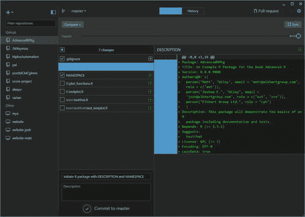

图 6-5. GitHub 桌面客户端选择更改的文件、添加提交信息并提交到主分支

接下来，我们添加`plot_functions.R`和`textplot.R`，并添加提交信息：R 函数的初始提交。最后，我们添加`testthat.R`和`test_textplot.R`，并添加提交信息：添加质量控制测试。当然，您也可以在文件创建时随时提交它们。如果我们切换到 GitHub 桌面客户端的历史记录标签页，可以看到所做的更改。如果我们对将它们公开感到满意，则点击同步按钮，该按钮会将 GitHub 仓库的更改拉取到本地仓库，并将所有已提交的更改从本地仓库推送到 GitHub 仓库。请注意，在同步之前，所有更改都应该已提交，因为同步的不是目录中的实际文件，而是 Git 仓库。只有在提交后，对文件的更改才会被添加到本地 Git 仓库中，因此如果不提交，更新就不会添加到本地仓库，也就不会被推送到远程（GitHub）仓库。图 6-6 展示了这个情况。

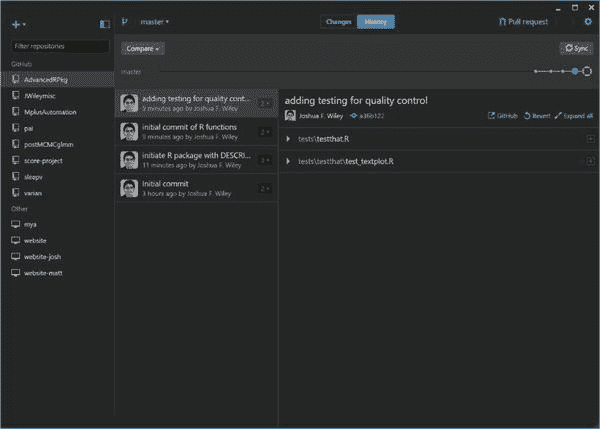

图 6-6. GitHub 桌面客户端显示提交历史记录和右上角的同步按钮

我们只触及了测试的皮毛，显然，我们的包在得到全面测试之前还有很长的路要走。然而，这些工具应该能让您在测试和质量控制方面走上正确的轨道（并且领先于 CRAN 上的大多数 R 包）。下一个关键部分是文档，这是我们接下来要讨论的主题。

## 使用 roxygen2 进行文档编制

R 中函数、数据、类和方法文档位于包的`man`子目录中，通过使用扩展名为`.Rd`的特殊 R 文档文件来完成。然而，对于程序员来说，这可能更困难，因为文档与实际 R 代码是分离的。还有许多必须编写的标记，这些只是标准模板的一部分。`roxygen2`包完全自动化了这个过程，包括子目录的创建，并通过在 R 代码旁边使用特殊格式的注释，提供了一种更简单的编写文档的方法。然后运行`roxygen2`包，将这些特定的注释转换为`man`目录中适当格式的`.Rd`文件，从而使 R 具备了为包函数创建帮助文件所需的一切。在本节中，我们将学习如何为包括函数、数据、类和方法在内的多种对象类型编写文档。

## 函数

要使用 `roxygen2` 记录对象，文档应添加在以特殊注释引导 `##'` 或 `#'` 之后。由于 `#` 是 R 语言的注释符号，R 会忽略其内容，但引导中的单引号向 `roxygen2` 表明此信息应被处理为文档。请注意，此语法排除了在代码块内添加常规注释的可能。所有这些代码都添加到 `plot_functions.R` 文件中 `meanPlot()` 函数代码的上方。

如前所述，由于语法限制，无法添加常规注释；因此内容的顺序变得至关重要。要理解哪部分映射到哪个参数，只需记住有三个部分，仅通过换行符分隔：`title`（标题）、`description`（描述）和 `details`（详情）。`details` 部分是可选的。为了便于阅读，我们在换行符之间添加了空格。函数参数通过使用 `@param argument_name 参数的简要描述` 来指定。此处列出的参数名称必须与函数中定义的命名参数完全匹配。`@return` 部分用于说明函数返回何种对象。在本例中，调用该函数主要为了生成绘图这一副作用，其返回值并不重要。`@author` 之后可以添加任意文本来标明函数的作者。通常，如果作者与整个包的作者相同，则无需 `@author` 部分。要使函数公开可用，必须导出它。这是通过指令 `@export` 完成的。`roxygen2` 包会将其转换为 `NAMESPACE` 文件中的一行额外代码，指示该函数应被导出。`@keywords` 部分是可选的。最后，对读者最有用的是 `@examples` 部分，它为读者提供可执行的示例，是展示如何使用函数的最简单方法之一。

```
##' 用于绘制数据和均值摘要的函数
##'
##' 这是一个简单的函数，旨在便于绘制原始数据以及表示每个 x 轴值处均值的点。
##'
##' 尽管此函数可以与任何适用于\code{plot}的数据类型一起使用，但当 x 轴值是离散值时效果最佳，
##' 这样同一 x 轴值处会有多个 y 值，从而可以对多个值取均值。
##'
##' @param formula 一个公式，指定要用于 y 轴和 x 轴的变量。
##' @param d 一个包含\code{formula}中指定变量的`data.frame`类对象。
##' @return 调用该函数以创建绘图的副作用。
##' @author Wiley
##' @export
##' @keywords plot
##' @examples
##' # meanPlot 的使用示例
##' meanPlot(mpg ∼ factor(cyl), d = mtcars)
```

现在要生成文档，我们可以运行 `roxygen2` 包。这可以直接通过使用 `roxygenize()` 函数并指定包目录的路径来实现，或者通过使用 `devtools` 包中的 `document()` 函数来完成。我们指定包目录，其余部分会自动完成。输出显示已写入一个文档文件（`meanPlot.Rd`）和 `NAMESPACE` 文件：

```
document("AdvancedRPkg")
更新 AdvancedRPkg 文档
加载 AdvancedRPkg
在 ∼\RFiles\AdvancedRPkg/DESCRIPTION 中更新 roxygen 版本
写入 NAMESPACE
写入 meanPlot.Rd
```

当构建或安装包时，R 文档文件会被转换为 HTML 和 PDF 格式。但是，您已经可以预览文档的开发版本。在 R 控制台中，现在应该可以使用获取函数帮助的常规方式：

```
?meanPlot
```

如果您使用 RStudio，也可以打开文件并预览它。构建包后生成的 HTML 文件如图 6-7 所示。考虑到此函数的简单性以及篇幅，我们撰写的文档相当精简。通常，为了用户和未来参考，进行更详尽的文档记录并仔细解释每个参数可以接受和不能接受什么是很有帮助的。如果函数实现了新的过程或统计方法，通常还会使用 `@` `references` 部分包含一些参考文献。

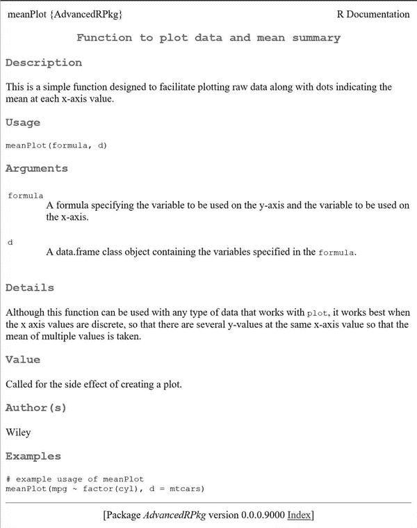

图 6-7. 函数 `meanPlot()` 的 R 文档文件的 HTML 输出

### 数据

在我们能够记录数据之前，需要向包中添加一些数据。首先，我们在包文件夹中创建一个 `data` 子目录，位于 `AdvancedRPkg/data/`。然后，我们创建一个小的示例数据框，并在 `chapter06.R` 文件中使用以下代码将其保存为 `.rda` 文件。再次注意，需要根据 R 的当前工作目录给出到 `AdvacedRPkg/data/` 的正确文件路径：

```
sampleData <- data.frame(
Num = 1:10,
Letter = LETTERS[1:10])
save(sampleData, file = "AdvancedRPkg/data/sampleData.rda")
```

我们添加以下代码来记录数据，代码位于 `R` 子目录中的一个新文件 `sampledata.R` 中（即 `AdvancedRPkg/R/sampledata.R`）。这提供了数据的标题和详细信息，以及特殊参数 `@format` 来说明数据的格式或类型，`@source` 来说明其来源。最后，在引号中给出了对象的名称。

```
##' 数字和字母。
##'
##' 一个包含 10 个数字和字母的示例数据集，包含两个变量：
##'
##' \itemize{
##'   \item Num. 一个数字。
##'   \item Letter. 一个大写字母（A 到 J）
##' }
##'
##' @format 一个包含 10 行和 2 个变量的数据框
##' @source 作为样本创建
"sampleData"
```

通过使用 `document()` 函数重新对包进行 roxygenize 处理后，得到的 HTML 如图 6-8 所示，同样可以使用构建完整包后的帮助工具或通过 RStudio 预览来查看。

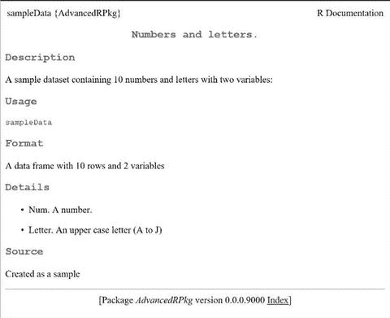

图 6-8. 数据集 `sampleData` 的 R 文档文件的 HTML 输出

### 类

S3 类是非正式的，通常不进行记录。S4 类的记录则很简单。它们的文档直接放在我们对 `textplot.R` 文件（`AdvancedRPkg/R/textplot.R`）中 `setClass()` 调用的上方，包含一个标题、一个详细信息部分，然后是一些参数——每个槽位一个 `@slot`，详细说明槽位的名称和功能。要在包中使用 S4 系统，我们还需要添加 `methods` 包，我们通过添加 `@import` `methods` 并同时将其添加到 `DESCRIPTION` 文件的 `Imports` 字段中来实现。更新后的 `DESCRIPTION` 文件带有新的 `Imports` 字段如下所示；通常，`Imports` 部分紧接在 `Depends` 部分之后：

```
Imports:
methods
```

该类的完整文档如下所示：

```
##' 用于存放文本和用于绘图的笛卡尔坐标的 S4 类
##'
##' 设计用于存放创建文本图所需数据的类，其中基于 x 和 y 坐标绘制字符串。
##'
##' @slot x 包含 x 轴坐标的数值。
##' @slot y 包含 y 轴坐标的数值。
##' @slot labels 包含要绘制的文本的字符串
##' @import methods
```

通过使用 `document()` 函数重新对包进行 roxygenize 处理后，得到的 HTML 如图 6-9 所示。

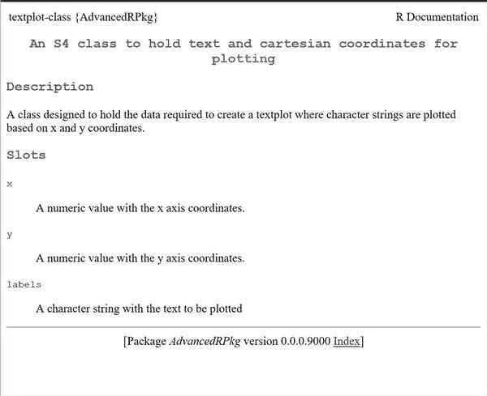

图 6-9. S4 类 `textplot` 的 R 文档文件的 HTML 输出

## 文档化方法

方法的文档化过程与常规函数的文档化类似。S3 方法可以选择不进行文档化，或者作为一个函数来文档化。以下是添加到 `ggplot.lm` 方法中的 `roxygen2` 风格文档。这段代码直接放置在 `AdvancedRPkg/R/plot_functions.R` 文件的函数定义上方。请注意，这里我们导入了 `ggplot2` 包以确保其可用。我们还将 `ggplot2` 包添加到 `DESCRIPTION` 文件的 `Imports` 部分，与包所依赖的 R 版本之间用逗号分隔。更新后的 `DESCRIPTION` 文件 `Imports` 部分如下所示：

```
Imports:
methods,
ggplot2
```

通过导入它，`roxygen2` 将自动将适当的导入代码添加到 `NAMESPACE` 文件中：

```
##' Method for plotting linear models
##'
##' Simple method to plot a linear model using ggplot
##' along with 95% confidence intervals.
##'
##' @param data The linear model object from \code{lm}
##' @param mapping Regular mapping, see \code{ggplot} and \code{aes} for details.
##' @param vars A list of variable values used for prediction.
##' @param \ldots Additional arguments passed to \code{ggplot}
##' @return A ggplot class object.
##' @export
##' @import ggplot2
##' @examples
##' ggplot(
##'   lm(mpg ∼ hp * qsec, data = mtcars),
##'   aes(hp, mpg, linetype = factor(qsec)),
##'   vars = list(
##'     hp = min(mtcars$hp):max(mtcars$hp),
##'     qsec = round(mean(mtcars$qsec) + c(-1, 1) * sd(mtcars$qsec)), 1)) +
##'   geom_ribbon(aes(ymin = LL, ymax = UL), alpha = .2) +
##'   geom_line() +
##'   theme_bw()
```

S4 方法可以单独文档化，与泛型函数一起文档化，或者与类一起文档化。这可以通过使用 `@describeIn` 参数来实现，它用于替代标题。对于我们的 S4 方法，我们将它们与类一起文档化。`roxygen2` 代码相对简洁。我们可以添加更多细节，但并非必需。`roxygen2` 包负责注册方法，所以我们真正需要做的是添加任何特殊说明并记录参数的使用。`show()` 方法的文档如下：

```
##' @describeIn textplot show 方法
##'
##' @param object 要显示的对象
```

接着是 `` 运算符方法的文档。注意我们也导出 `[` 方法并添加了一个别名，这只是用户查找该方法的另一种方式：

```
##' @describeIn textplot 提取方法
##'
##' @param x 要子集化的对象
##' @param i 要子集化的行（可选）
##' @param j 要子集化的列（可选）
##' @param drop 应为缺失值
##' @export
##' @aliases [,textplot-method
```

使用 `document()` 重新生成 roxygen 文档后，更新后的 HTML 帮助文件如图 [6-10 所示，其中包括类及其附加方法的文档。

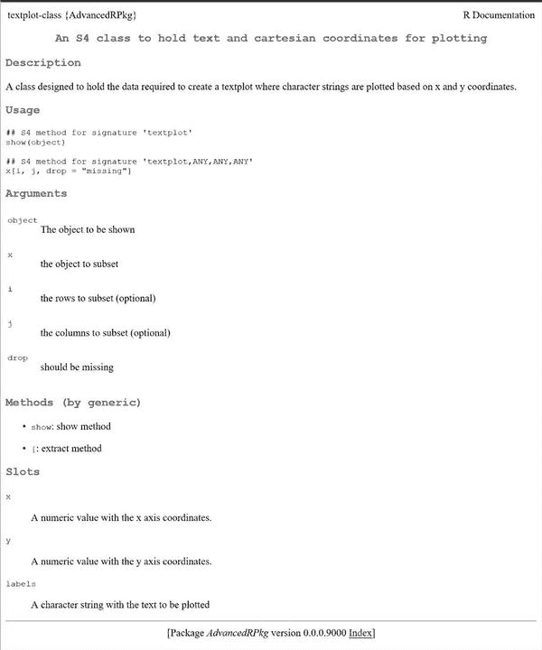

**图 6-10.**

添加了方法文档的 S4 类 `textplot` 的 R 文档文件的 HTML 输出

# 构建、安装和分发 R 包

与 Git 类似，在构建 R 包时，忽略目录中的某些文件可能会很有帮助。我们在主目录 `AdvancedRPkg/` 下创建一个名为 `.Rbuildignore` 的文件，包含以下代码。该文件应与 `DESCRIPTION` 文件位于同一层级：

```
desktop.ini
.Rhistory
.RData
```

再次运行 `document("AdvancedRPkg")` 确保文档是最新的之后，我们就差不多准备好了。此时，我们已经做了一些更改，因此最好将更改添加到 Git 仓库并进行提交（如果你一开始选择了使用 Git）。虽然你可以通过运行 `git add` 一次性添加所有文件，但根据相似主题分块提交更改，能提供更多信息，并且在需要时也更容易回滚。例如，我们为以下每一项使用了单独的提交，这些都在后续代码中以分块形式展示：

*   更新后的代码文件（`AdvancedRPkg/R/` 目录下的每个文件）、`DESCRIPTION` 和 `NAMESPACE`，提交信息为 "添加 roxygen 样式文档"
*   示例数据，提交信息为 "添加示例数据"
*   更新后的文档文件（`AdvancedRPkg/man/` 目录下的每个文件），提交信息为 "重新运行 roxygen 生成包文档"
*   `.Rbuildignore` 文件，提交信息为 "添加文件以在包构建时忽略某些文件"

现在，我们可以在 `chapter06.R` 文件中使用 `devtools` 包中的 `build()` 函数将包构建成一个压缩的源代码 tar 包。输出显示了构建过程，并在最后生成了一个 `.tar.gz` 文件：

```
build("AdvancedRPkg")
"c:/usr/MRO/MRO-3.3.1/bin/x64/R" --no-site-file --no-environ  \
--no-save --no-restore --quiet CMD build "∼\Apress_AdvancedR\RFiles\AdvancedRPkg"  \
--no-resave-data --no-manual
* checking for file '∼\Apress_AdvancedR\RFiles\AdvancedRPkg/DESCRIPTION' ... OK
* preparing 'AdvancedRPkg':
* checking DESCRIPTION meta-information ... OK
* checking for LF line-endings in source and make files
* checking for empty or unneeded directories
* looking to see if a 'data/datalist' file should be added
* building 'AdvancedRPkg_0.0.0.9000.tar.gz'
[1] "∼/Apress_AdvancedR/RFiles/AdvancedRPkg_0.0.0.9000.tar.gz"
```

我们可以安装并使用它。但是，再运行一组检查可能会很有帮助。`devtools` 包中的 `check()` 函数会对包运行 `Rcmd check`。参数 `cran = TRUE` 会使用针对 CRAN 的测试。以下代码应在我们的 `chapter06.R` 文件中运行。输出内容非常广泛，因此我们省略了许多按预期工作的部分，并突出显示了一些可能表明我们需要处理的问题的检查。省略的输出用 `[. . .]` 表示。

```
check("AdvancedRPkg", cran = TRUE)
Updating AdvancedRPkg documentation
Loading AdvancedRPkg
[. . .]
* using R version 3.3.1 (2016-06-21)
[. . .]
* checking R code for possible problems ... NOTE
ggplot.lm: no visible global function definition for 'formula'
ggplot.lm: no visible global function definition for 'predict'
ggplot.lm: no visible binding for global variable 'fit'
ggplot.lm: no visible global function definition for 'qnorm'
ggplot.lm: no visible binding for global variable 'se.fit'
meanPlot: no visible global function definition for 'plot'
meanPlot: no visible global function definition for 'points'
show,textplot: no visible global function definition for 'head'
Undefined global functions or variables:
fit formula head plot points predict qnorm se.fit
Consider adding
importFrom("graphics", "plot", "points")
importFrom("stats", "formula", "predict", "qnorm")
importFrom("utils", "head")
to your NAMESPACE file.
[. . .]
* checking examples ... ERROR
Running examples in 'AdvancedRPkg-Ex.R' failed
The error most likely occurred in:
> base::assign(".ptime", proc.time(), pos = "CheckExEnv")
> ### Name: ggplot.lm
> ### Title: Method for plotting linear models
> ### Aliases: ggplot.lm
>
> ### ** Examples
>
> ggplot(
+   lm(mpg ∼ hp * qsec, data = mtcars),
+   aes(hp, mpg, linetype = factor(qsec)),
+   vars = list(
+     hp = min(mtcars$hp):max(mtcars$hp),
+     qsec = round(mean(mtcars$qsec) + c(-1, 1) * sd(mtcars$qsec)), 1)) +
+   geom_ribbon(aes(ymin = LL, ymax = UL), alpha = .2) +
+   geom_line() +
+   theme_bw()
Error: could not find function "ggplot"
Execution halted
* checking for unstated dependencies in 'tests' ... OK
* checking tests ...
Running 'testthat.R'
OK
* DONE
Status: 1 ERROR, 1 NOTE
See
'∼ /Temp/RtmpEnhRD4/AdvancedRPkg.Rcheck/00check.log'
for details.
R CMD check results
1 error  | 0 warnings | 1 note
```

`check()` 函数包含几个步骤。它首先确保文档是最新的，然后构建一个源代码包的 tar 包，接着对其运行 `Rcmd check`。在这里我们可以看到，检查捕获了不少问题。所有问题基本上都可以归结为没有明确告诉 R 需要导入或依赖哪些函数或包。大多数问题源于包和交互式 R 工作方式的差异。在交互式会话中，默认会加载 `base`、`methods`、`graphics`、`utils` 和 `stats` 等包，即使没有显式调用 `library(stats)`。这意味着在交互式会话中，许多函数默认就在搜索路径上。在包中，R 在最近的版本中变得更加严格，要求 `base` 包之外的所需函数必须被显式导入。检查甚至建议我们可以在命名空间中添加什么。我们使用的是 `roxygen2` 包，所以与其将这些添加到命名空间，不如将它们添加到 R 代码文件中。具体来说，在 `AdvancedRPkg/R/plot_functions.R` 中，紧接在 `@export roxygen2` 语句之后，我们为 `meanPlot()` 添加如下内容：

```
##' @importFrom graphics plot points
##' @importFrom stats formula
```

在同一文件中，为 `ggplot.lm()` 方法添加：

```
##' @importFrom stats predict qnorm
```

在 `AdvancedRPkg/R/textplot.R` 中，紧接在 `@param object roxygen2` 语句之后，为 `show()` 方法添加：

```
##' @importFrom utils head
```

此外，对于某些全局变量，也出现了类似的“未找到可见绑定”问题。这来自 `ggplot.lm()` 方法；因为它使用了 `within()`，所以 R 无法判断这些变量已被定义，即使它们是在包含它们的数据框环境中查找的。虽然这是一个有点虚假的提示，但清除所有提示是很好的做法。一种解决方案是在我们的 R 文件中的某个地方添加一个 `globalVariables()` 调用。在 `AdvancedRPkg/R/plot_functions.R` 的顶部，我们添加以下内容：

```
globalVariables(c("fit", "se.fit"))
```

最后指出的问题是，在一个示例中找不到 `ggplot()` 函数。因为我们的包导入了 `ggplot2` 包，所以 `ggplot()` 函数对我们包内部的代码是可用的。然而，如果用户只加载我们的包，`ggplot2` 函数并不会加载到用户的搜索路径上。函数的示例是作为用户运行的，因此该函数不可用，R 会抛出错误。这里的最佳前进路径比较复杂。我们可以省略这个示例，但那样文档就缺少了帮助性。我们可以将 `ggplot2` 从 `DESCRIPTION` 文件的 `Imports` 字段移到 `Depends` 字段。依赖的包会在加载一个包之前被加载。这种方法的缺点是强制用户在使用我们的包时必须加载 `ggplot2`。这增加了用户遇到函数屏蔽的机会，因为它强制加载了许多包。我们也可以确保代码不被运行。最后，我们可以通过添加 `ggplot2::function()` 来显式指向 `ggplot2` 包。这很繁琐，因为我们在那个示例中使用了多个 `ggplot2` 函数，并且需要在整个示例中添加。但是，这确保了示例能够工作，并且避免了将 `ggplot2` 加载到用户的搜索路径上。当然，用户如果愿意，也可以通过自己显式调用 `library(ggplot2)` 来自由加载 `ggplot2`。在 `AdvancedRPkg/R/plot_functions.R` 文件中，我们编辑 `ggplot.lm()` 示例的 `roxygen2` 代码，如下所示：

```
##' @examples
##' ggplot2::ggplot(
##'   lm(mpg ∼ hp * qsec, data = mtcars),
##'   ggplot2::aes(hp, mpg, linetype = factor(qsec)),
##'   vars = list(
##'     hp = min(mtcars$hp):max(mtcars$hp),
##'     qsec = round(mean(mtcars$qsec) + c(-1, 1) * sd(mtcars$qsec)), 1)) +
##'   ggplot2::geom_ribbon(ggplot2::aes(ymin = LL, ymax = UL), alpha = .2) +
##'   ggplot2::geom_line() +
##'   ggplot2::theme_bw()
```

接下来我们重新运行 `check()` 函数。如果一切顺利，我们应该得到一个 OK 的状态，如下所示：

```
check("AdvancedRPkg", cran = TRUE)
Updating AdvancedRPkg documentation
[. . .]
* DONE
Status: OK
R CMD check results
0 errors | 0 warnings | 0 notes
```

此时，我们可以将所有更改提交到 Git 仓库，并与 GitHub 同步。我们也可以安装这个包。首先，打开一个终端，导航到包含我们包的文件夹（不是包目录本身，而是包含包目录的目录）。在支持 R 的终端（例如 Windows 命令提示符，如果你确保安装 R 时已将其添加到系统路径，则可以是任何终端）中，我们可以运行 `R CMD INSTALL`：

```
R CMD INSTALL AdvancedRPkg
```

现在，如果你愿意，`library(AdvancedRPkg)` 在 R 中就可以工作了：

```
library(AdvancedRPkg)
```

你也可以分享由 `devtools` 包的 `build()` 创建的压缩 tar 包。如果你将包放在 GitHub 上，也可以通过运行以下代码轻松安装，将 `ElkhartGroup` 替换为你的用户名，并在 R 控制台（不是操作系统终端！）中运行此代码：

```
library(devtools)
install_github("ElkhartGroup/AdvancedRPkg")
```

如果需要，你可以编辑包的 `README` 文件。这不是必需的，但可以作为一个有用的参考。它是使用 Markdown 标记语言编写的。如果编辑了，它也会显示在 GitHub 上。我们编辑 `README.md` 文件，添加以下文本和标记。简而言之，Markdown 使用不同数量的井号 (`#`) 来表示标题级别：例如，`#` 表示一级标题，`##` 表示二级标题。星号 `*` 之间的文本被强调（斜体）。方括号 `[ ]` 和圆括号 `( )` 用于添加 URL 链接，三重反引号 (\` \` \`) 用于显示代码块的开始和结束。

## AdvancedRPkg

这是一个示例 R 包，伴随*高级 R：数据编程与云端*的第六章发布。
了解更多信息，请查看该[书籍](http://www.apress.com/9781484220764)。

## 安装

您可以通过运行以下命令来安装和测试此包：

```r
library(devtools)
install_github("ElkhartGroup/AdvancedRPkg")
```

最后，如果您愿意，可以将您的包提交到 CRAN。第一步是仔细阅读其当前所有政策，这些政策位于 CRAN 仓库政策网站（[`https://cran.r-project.org/web/packages/policies.html`](https://cran.r-project.org/web/packages/policies.html)）。一旦您确认您的包符合规定并已修正任何不符合之处，即可在[`https://cran.r-project.org/submit.html`](https://cran.r-project.org/submit.html)提交给 CRAN。CRAN 规模庞大，拥有数千个包，每天有海量的更新。它是由志愿者为社区运行的免费服务。因此，即使某些要求可能繁琐，如果您希望将您的包发布在 CRAN 上，遵守其规则并尽一切可能方便他们是唯一公平的做法。否则，GitHub 是一个相对容易托管和分发包源代码的地方。

## 总结

本章涵盖了开发、测试、文档化和发布 R 包的流程。虽然这个过程不一定涉及复杂的 R 代码，但处理好诸多方面并确保所有部分正常协同工作可能具有挑战性。这项工作的回报是用户安装和使用的便利性，以及高质量的文档和对代码按预期运行的保证。如果您计划继续开发 R 包，有用的进一步阅读资源是官方手册《编写 R 扩展》（[`https://cran.r-project.org/doc/manuals/R-exts.html`](https://cran.r-project.org/doc/manuals/R-exts.html)）以及使用`roxygen2`的文档（[`https://cran.r-project.org/web/packages/roxygen2/vignettes/roxygen2.html`](https://cran.r-project.org/web/packages/roxygen2/vignettes/roxygen2.html)）。`roxygen2`的小册子对于本章未涵盖的主题尤其有用，例如格式化文档和排序顺序（当包中的某些类或函数需要在其他类或函数之前加载时，这是必需的）。表 6-3 列出了本章使用的函数摘要。

表 6-3.
本章描述的关键函数

| 函数 | 功能说明 |
| --- | --- |
| `setup()` | 创建一个新包（在我们的示例中，是`AdvancedRPkg`）。 |
| `list.files()` | 如其名所示——相当于 Unix 或 Windows 的`ls`命令。 |
| `load_all()` | 在包构建或安装之前，`library()`无法工作；此函数可临时模拟该过程。 |
| `context()` | 我们用于`test_textplot.R`的`testthat`包的一部分。 |
| `test_that()` | 我们用于`test_textplot.R`的`testthat`包的一部分。 |
| `expect_*()` | 一个用于测试代码的函数家族。这些函数检查输出是否符合特定预期，例如输出的类别、代码是否返回错误或警告等等。有关完整列表，请在加载`testthat`包后，在控制台运行`apropos("expect_")`。 |
| `apropos()` | 用于搜索部分记住的函数名很有用。 |
| `test()` | 运行`testthat`测试；在我们的`chapter06.R`文件中运行。 |
| `package_coverage()` | 计算包的测试覆盖率；通常目标是 100%。 |
| `document()` | 用于为 R 包构建`roxygen2`文档。 |
| `build()` | 用于构建 R 包。 |
| `check()` | 用于检查 R 包；我们在示例中使用了 CRAN 选项。 |

本章也是本书中最后一个专门关注 R 编程及其软件开发工具的章节。本书的剩余部分将重点介绍高级层面使用 R 进行数据管理和应用分析。虽然我们会运用您在本部分学到的许多 R 编程知识并编写许多函数，但在后续章节中我们不会开发任何新的包。


# 7. 使用 `data.table` 进行数据管理入门

我们已经简要介绍过`data.table`包。这个包是本章的核心，涵盖了在广义的数据管理范畴下访问、编辑和处理数据的基础知识。虽然数据管理并不光鲜亮丽，但它是数据可视化或分析至关重要的第一步。此外，特定分析项目的大部分时间可能都花在数据管理上。例如，一旦数据清洗完毕并符合 R 中`lm()`函数所期望的格式，运行线性模型可能只需要一行代码。数据管理可能具有挑战性，因为原始数据有各种类型、形状和格式；数据缺失很常见；并且您可能还需要合并或融合不同的数据源。在本章中，我们将介绍处理数据管理的机械技巧和哲学思维。本章使用的所有包都已包含在我们的`checkpoint.R`文件中。因此，您只需执行该文件即可开始。

在本章中，我们使用`data.table` R 包（Dowle, Srinivasan, Short, and Lianoglou, 2015）。以下代码加载`checkpoint`包（Microsoft Corporation, 2016）以控制所用 R 包的确切版本，然后加载`data.table`包：

```
library(checkpoint)
checkpoint("2016-05-10")
library(data.table)
```

```
# 加载检查点及所需包

library(checkpoint)
checkpoint("2016-09-04", R.version = "3.3.1")
library(data.table)
options(width = 70) # 每行仅显示 70 个字符
```

### data.table 简介

使用数据表（data table）而非内置的数据框（data frame）类对象的好处之一是，数据表内存效率更高，操作和修改速度更快。`data.table` 包在很大程度上是通过在内存中就地修改数据表来实现这一点的，而对于数据框，R 通常会对数据进行复制、修改然后存储。无论数据的所有列是否被更改，例如 100 列中的 1 列，都会发生完整的复制。因此，与数据表上的类似操作相比，对数据框的操作往往耗时更长，占用内存更多。为了展示数据管理的概念，我们使用小型数据，因此内存和处理器时间不是问题。然而，我们强调使用数据表而非数据框，是因为数据表能优雅地扩展到比数据框大得多的数据量。数据表还有其他优点，包括无需引用所有变量名，我们将在本章中展示这些优点。相比之下，数据框的主要优势在于它们属于 R 的基础部分，并且更多的人熟悉如何使用它们（例如，在分享代码时，这很有帮助）。

数据表可以非常大。查看数据的`head()`和`tail()`通常比查看全部数据更有帮助。在 R 中通过键入其名称显示数据表时，默认会返回前五行和最后五行。R 还默认打印七位有效数字，这可能会使我们的数值条目显得混乱。为了清晰起见，我们使用`options()`函数来控制一些全局选项，以便只打印前三行和后三行（如果数据表总行数超过 20 行——否则，显示所有行）；此外，我们的数值条目仅显示两位有效数字。在设置这些选项的同时，我们引入埃德加·安德森的鸢尾花数据集。该数据涉及三种鸢尾花物种的萼片和花瓣的长度和宽度（单位：厘米）。

在将鸢尾花数据转换为数据表之前，我们将把物种名称转换为字符类型而非因子类型。在以下代码中，我们设置选项，强制物种名称转换为字符类型，并创建我们的数据表`diris`：

```
options(stringsAsFactors = FALSE,
datatable.print.nrows = 20, ## 若行数超过 20
datatable.print.topn = 3, ## 打印前 3 行和后 3 行
digits = 2) ## 减少 R 打印的位数
iris$Species <- as.character(iris$Species)
diris <- as.data.table(iris)
diris
```

我们的数据共有`150`行，包含三个物种：`setosa`、`versicolor`和`virginica`。每个物种有`50`组测量数据。R 在内存中运行，对于巨大的数据表，这可能会引起问题。`tables()`命令显示内存中的所有数据表及其大小。实际上，`tables()`本身就是一个数据表。注意该函数提供了关于数据表名称、行数、列数、以`MB`为单位的大小以及是否有键的信息。我们将在后面几段讨论带键的数据表。目前，注意到`1MB`不太可能给我们带来内存问题：

```
tables()
```

如果我们想了解每列数据类型的更多信息，可以在感兴趣的数据表上调用`sapply()`命令和`class()`函数。回想一下，`*apply`类函数将第二个形参指定的函数应用到第一个形参的元素上，并返回结果。在我们的例子中，对`diris`调用`class()`，我们看到`diris`各列中存储了哪些类型的值：

```
sapply(diris, class)
```

数据表相对于其他数据格式有一个强大的概念优势。即，数据表可以被设置键。有了键，就可以使用二分查找。对于不熟悉二分查找的人来说，想象一下需要在电话簿中查找一个名字。阅读每个名字会花费相当长的时间。然而，因为我们知道电话簿是按字母顺序排列的，我们可以立即找到一个位于字母表中部的名字，判断我们搜索的名字属于该名字之前还是之后，并在这个过程中排除掉一半的电话簿。我们可以对剩余的一半重复这个算法，在仅仅两次查找后就只留下原始数据的四分之一需要搜索！更数学化地说，虽然搜索数据框的所有条目会基于行数`n`呈线性复杂度，但在数据表中，最坏情况下的复杂度为`log n`。在作者们使用的几个新表中，数据量翻倍仅使代码运行时间增加几分钟，而不是使运行时间翻倍。这是一个巨大的优势。

在`data.table`中，键是一个索引，它可能唯一也可能不唯一，由一个或多个数据列创建。数据按键排序，允许使用键进行非常快速的操作。示例操作包括子集化或筛选、为每个唯一的键值执行计算（例如，变量的平均值）以及合并两个或多个数据集。

当然，为数据表设置键确实需要时间，因此这取决于你在做这种选择之前访问数据的频率。另一个考虑因素是使用什么作为键。一个表只有一个键，尽管该键可以由多个列组成。函数`setkey()`以一个数据表作为第一个形参，然后接收不定数量的列名来设置一个键。要查看数据表是否有键，...

### 处理需要忽略的内容，例如删除空格、句点、连字符

```
rawpool <- pool
for (v in ignore) {
  index <- gsub(v, "", index)
  pool <- gsub(v, "", pool)
}
```

### 如果忽略大小写，则转换为小写

```
if (ignore.case) {
  index <- tolower(index)
  pool <- tolower(pool)
}
```

```
if (!identical(split, FALSE)) {
  index2 <- strsplit(index, split = split)[[1]]
  index2 <- index2[nzchar(index2)]
  pool2 <- strsplit(pool, split = split)
  pool2 <- lapply(pool2, function(x) x[nzchar(x)])

  ## 计算距离，默认为 Damerau-Levenshtein 距离
  distances <- sapply(pool2, function(x) {
    sum(apply(stringdistmatrix(index2, x, method = method),
              1, min, na.rm = TRUE))
  })
} else {
  ## 计算距离，默认为 Damerau-Levenshtein 距离
  distances <- stringdist(index, pool, method = method)
}
```

### 某些方法会导致无穷大的结果，将这些设为缺失值

```
distances[!is.finite(distances)] <- NA
```

### 获取最佳和最差距离

```
best <- min(distances, na.rm = TRUE)
worst <- max(distances, na.rm = TRUE)
```

### 如果使用模糊匹配，则获取在最佳与最差距离差值`fuzz`百分比范围内的所有距离

```
if (fuzz) {
  usedex <- which(distances <= (best + ((worst - best) * fuzz)))
} else {
  usedex <- which(distances == best)
}
```

### 定义一个距离阈值，低于此阈值被视为完全匹配或精确匹配

```
perfect <- distances[usedex] < .01
out <- rawpool[usedex]
```

### 计算完全匹配的数量

```
count <- sum(perfect)
```

### 函数继续到下一页

```
if (any(perfect)) {
  ## 如果存在完全匹配，则只使用一个
  match <- out[perfect][1]

  ## 返回一个包含完全匹配和完全匹配数量的数据表（可能为 1）
  data.table(
    Match = match,
    N = count,
    Written = NA_character_)
} else {
  ## 如果没有完全匹配，则返回近似匹配的列表，用逗号分隔并保持原始书写
  data.table(
    Match = paste(out, collapse = ", "),
    N = count,
    Written = index)
}
```

现在我们遍历每个观察到的名称，并尝试将其与参考名称中最佳匹配的 5%（`.05`）范围内的名称进行匹配。由于输出总是相同的，我们可以按行组合它们。

```
output <- lapply(observed.Names, function(n) {
  matchIt(index = n, pool = reference.Names, ignore = c("\\.", "-"), split = "\\s", fuzz = .05)
})
output <- do.call(rbind, output)
output
```

```
Match                  N   Written
1:               This Test 1        NA
2:               This Test 1        NA
3:               Test Thas 0 test that
4:               Jane Mary 1        NA
5:               Jane Mary 0  mary sou
6:            Jack Dun-Dee 0  jack dee
7: Jane Mary, Jack Dun-Dee 0 jane jack
```

我们可以看到`This Test`出现在两行中，因此我们进行聚合并打印最终输出。`This Test`有两个完全匹配。`Test Thas`没有完全匹配，但在`Uncertain`列下列出了一个近似匹配。最后，`jack dee`是`Jack Dun-Dee`的一个近似但不确定的匹配，`jane jack`是`Jane Mary`或`Jack Dun-Dee`的一个不确定匹配。

```
finaloutput <- output[, .(
  N = sum(N),
  Uncertain = paste(na.omit(Written), collapse = ", ")),
  by = Match]
finaloutput
```

```
Match                  N Uncertain
1:               This Test 2
2:               Test Thas 0 test that
3:               Jane Mary 1  mary sou
4:            Jack Dun-Dee 0  jack dee
5: Jane Mary, Jack Dun-Dee 0 jane jack
```

虽然很难涵盖所有示例和用例，但结合使用这些基本工具应该足以应对许多类型的数据管理任务。

## 总结

在本章中，您学习了如何基于精确的正则表达式或模糊匹配来定位文本。此外，您还学习了如何用新的字符串片段替换旧的字符串片段。最后，我们讨论了在`data.table`中创建新变量的方法。表 8-1 总结了本章介绍的关键函数。

**表 8-1. 本章描述的关键函数**

| 函数 | 功能描述 |
| --- | --- |
| `read.dta()` | 读取 Stata 文件 |
| `str()` | 显示 R 对象的结构 |
| `grep()` | 模式匹配，返回显示哪些元素匹配的向量 |
| `grepl()` | 模式匹配，返回显示`x`中所有值布尔值的向量 |
| `gsub()` | 匹配模式并进行替换，返回更改后的原始向量 |
| `rowMeans()`, `rowSums()` | 计算数据表或矩阵中每行的平均值或总和 |
| `Reduce()` | 接受一个二元函数作为第一个参数，并将其应用于其余参数 |
| `.SD` | `data.table`中的保留名称，可用于指代数据表中的所有变量作为一个列表 |
| `.SDcols` | `data.table`的参数，允许指定要包含在`.SD`中的变量 |
| `strsplit()` | 根据特定的分隔字符拆分字符串 |
| `stringdistmatrix()` | 创建一个包含观测值与期望值之间距离的矩阵 |
| `amatch()` | 提供一个向量，显示期望值中哪个索引最接近观测值 |
| `tolower()` | 将给定字符串中的所有字符强制转换为小写 |

# 9. 其他数据管理工具

比较数据框和数据表会引出一个有趣的问题。如果存在更多类型的数据呢？尤其是，如果有不同方式存储的数据，而这些方式本质上都是某种表格，会怎么样？除了数据框或表之外，还有许多存储数据的方法，其中很多只是表格。`dplyr`（Wickham 和 Francois，2015）背后的理念是，无论数据后端可能是什么，我们的体验都应该是一样的。为了实现这一点，`dplyr`为常见的数据管理任务实现了泛型函数。对于每个泛型函数，都会编写特定的方法，将通用操作转换为特定后端所需的任何代码或语言。使用抽象层可以确保用户获得一致的体验，无论使用的具体数据格式或后端是什么。这也使得`dplyr`具有可扩展性，因为可以通过简单地编写额外的函数或方法来添加对新格式的支持。用户体验无需改变。对于本章，我们的`checkpoint`头文件需要安装并添加`tibble`和`dplyr`包：

```
library(checkpoint)
checkpoint("2016-09-04", R.version = "3.3.1")
library(dplyr)
library(tibble)
```

`dplyr`包中的函数命名基于完成特定动作的动词。也就是说，`dplyr`不是有几个能完成许多任务的函数，而是有许多通常只完成特定任务的函数。与`data.table`（Dowle、Srinivasan、Short 和 Lianoglou，2015）不同，`dplyr`是函数式的，因为它总是接收输入并返回输出，在这里输出是数据。它不像`data.table`那样直接在内存中修改数据。然而，它仍然相当快，因为许多函数都经过了优化，用 C++ 编写，并且`dplyr`尽量避免不必要的拷贝。

和之前一样，我们设置一些选项来减少打印的行数。`dplyr`的默认数据格式是`tibble`（Wickham、Francois 和 Müller，2016）。Tibble 在`tibble`包中实现。从本质上讲，tibbles 是数据框的扩展，它们有一些额外的限制（例如默认为字符串而不是将字符串强制转换为因子），以及更友好的打印或屏幕显示方法。数据操作由`dplyr`处理，而`tibble`处理数据的实际存储。从技术上讲，`tibble`包实现了 R 对象的`class`以及 tibbles 的一些基本方法。

```
options(stringsAsFactors = FALSE,
tibble.print_max = 20, ## if over 20 rows
tibble.print_min = 5, ## print first 5
digits = 2) ## reduce digits printed by R
iris$Species
1          5.1         3.5          1.4         0.2  setosa
2          4.9         3.0          1.4         0.2  setosa
3          4.7         3.2          1.3         0.2  setosa
4          4.6         3.1          1.5         0.2  setosa
5          5.0         3.6          1.4         0.2  setosa
```

# 数据输出示例
```
# ... with 145 more rows
```

对于 `data.table`，我们使用 `sapply()` 来获取每列或每个变量的类向量。虽然我们可以对 `tibbles` 做同样的事情，但 `tibbles` 会自动提供每列数据类型或类的信息以及总列数和行数（例如，`<dbl>` 表示双精度或数值，`<chr>` 表示字符类数据）。我们将注意力转向处理数据的常见目标：排序、子集筛选、排序、计算和重塑。考虑 `dplyr` 的一个有用方式是它使用动词来描述对数据的操作。

## 排序

我们在 `dplyr` 中通过 `arrange()` 函数进行排序，该函数将数据集作为其第一个参数。第一个参数之后的附加参数提供了按那些其他列排序的功能。默认是递增顺序，这可以通过第二个函数调用 `desc()` 来修改以提供递减顺序。

```
diris
1          4.3         3.0          1.1         0.1  setosa
2          4.4         2.9          1.4         0.2  setosa
3          4.4         3.0          1.3         0.2  setosa
4          4.4         3.2          1.3         0.2  setosa
5          4.5         2.3          1.3         0.3  setosa
```

# ... with 145 more rows
`diris`
```
1          4.3         3.0          1.1         0.1  setosa
2          4.4         3.2          1.3         0.2  setosa
3          4.4         3.0          1.3         0.2  setosa
4          4.4         2.9          1.4         0.2  setosa
5          4.5         2.3          1.3         0.3  setosa
```

# 数据去重操作

```
# ... with 145 more rows
```

可以通过 `anyDuplicated()` 查看出现重复时的第一行索引，无论是针对整个数据集还是仅针对特定列。在整个数据集上调用此函数时，它会查找所有列之间的匹配，这在此数据集中的第 `78` 行和第 `79` 行发生。在以下代码中显示，萼片长度中的重复变量出现在第三行：

```
anyDuplicated(diris)
[1] 79
anyDuplicated(diris$Sepal.Length)
[1] 3
```

而 `anyDuplicated()` 返回第一个重复项的行索引，`duplicated` 只是告诉我们在我们的表中有多少次这样的重复发生。查看我们的代码，我们看到对于所有列的完全匹配，第 `79` 行是唯一一次出现这种情况。另一方面，萼片长度的重复可能第一次出现在第 `3` 行，但还有很多其他的重复。

```
table(duplicated(diris))
FALSE  TRUE
149     1
table(duplicated(diris$Sepal.Length))
FALSE  TRUE
35   115
```

如果我们想查看仅包含不同值的表结果，`distinct()` 的工作方式很像 `arrange()`。第一个形式参数是针对数据的，其余的参数指定列名变量。如果没有指定列名，`distinct()` 对所有列进行操作。从 `duplicated()` 调用中回忆，有 `149` 个唯一的行。

```
distinct(diris)
```

# A tibble: 149 x 5

```
Sepal.Length Sepal.Width Petal.Length Petal.Width Species

1          4.3         3.0          1.1         0.1  setosa
2          4.4         3.2          1.3         0.2  setosa
3          4.4         3.0          1.3         0.2  setosa
4          4.4         2.9          1.4         0.2  setosa
5          4.5         2.3          1.3         0.3  setosa
```

## ... with 144 more rows
```
类似地，回想一下，如果我们只考虑萼片长度，只有`35`个唯一的行。因此，使用`distinct()`的第二个形式参数来保存`Sepal.Length`列，我们的`tibble`中只有`35`行。我们在这里展示这些行的前五行：

```
distinct(diris, Sepal.Length)
```

# A tibble: 35 x 1
## `Sepal.Length`

```
1          4.3
2          4.4
3          4.5
4          4.6
5          4.7
```

# ... with 30 more rows

本节最后再调用一次 `distinct()`，展示在第二个和第三个形式参数中调用多个列。在这里，当 `Sepal.Length` 和 `Sepal.Width` 都不重复时，一行才是唯一的。特别注意第 `2` 到第 `4` 行，它们有相同的 `Sepal.Length`，但这些行并没有重复，因为它们的 `Sepal.Widths` 是不同的：

```
distinct(diris, Sepal.Length, Sepal.Width)
```

# 选择与子集选取

# A tibble: 117 x 2
Sepal.Length Sepal.Width

1          4.3         3.0
2          4.4         3.2
3          4.4         3.0
4          4.4         2.9
5          4.5         2.3
```

在`dplyr`中选取存储数据的部分，与`data.table`的方法论有所不同。请记住，`dplyr`通过函数调用工作。这些函数被设计为独立于底层数据结构。尽管如此，我们仍希望得到相同的最终结果。

按位置选择行是通过`slice()`函数完成的，它接受两个形式参数。第一个是数据对象，在我们的例子中是`diris`，第二个参数允许我们选择特定的行。我们首先只选择前五行：

```
slice(diris, 1:5)
```

# A tibble: 5 x 5

Sepal.Length Sepal.Width Petal.Length Petal.Width Species
1          4.3         3.0          1.1         0.1  setosa
2          4.4         3.2          1.3         0.2  setosa
3          4.4         3.0          1.3         0.2  setosa
4          4.4         2.9          1.4         0.2  setosa
5          4.5         2.3          1.3         0.3  setosa

如前所见，`-` 可用于取反。因此，我们也可以通过删除第 `1` 到 `145` 行来只保留最后五行：

```r
slice(diris, -(1:145))
```

# 目录

## 第 1 章：编程基础

- 高级 R 软件选择
- 复现结果
- 对象类型
- 基础运算符与函数
- 数学运算符与函数
- 参考文献

## 第 2 章：编程工具

- 帮助与文档
- 系统与文件
- 输入
- 输出
- 参考文献

## 第 3 章：编程自动化

- 循环
- 流程控制
- `*apply` 函数族
- 最终思考

## 第 4 章：编写函数

- 函数的组成部分
- 作用域
- 函数的函数
- 调试
- 总结

## 第 5 章：编写类与方法

- S3 系统
- S3 类
- S3 方法
- S4 系统
- S4 类
- S4 类继承
- S4 方法
- 总结

## 第 6 章：编写包

- 入门准备
- 版本控制
- R 包基础
- 使用 DevTools 创建包
- 添加 R 代码
- 测试
- 使用 `roxygen2` 编写文档
- 函数
- 数据
- 类
- 方法
- 构建、安装与分发 R 包
- 总结

## 第 7 章：使用 `data.table` 进行数据管理入门

- `data.table` 简介
- 数据选择与子集
- 使用第一种形式
- 使用第二种形式
- 使用第二和第三种形式
- 变量重命名与排序
- 数据计算与创建变量
- 数据合并与重塑
- 合并数据
- 重塑数据
- 总结

## 第 8 章：使用 `data.table` 进行数据清洗

- 数据清洗
- 重新编码数据
- 重新编码数值
- 创建新变量
- 模糊匹配
- 总结

## 第 9 章：其他数据管理工具

- 排序
- 选择与子集
- 变量重命名与排序
- 数据计算与创建变量
- 数据合并与重塑
- 总结

## 第 10 章：读取大数据（库）

- SQLite
- 在 Windows 上安装 SQLite
- SQLite 与 R
- PostgreSQL
- 在 Windows 上安装 PostgreSQL
- PostgreSQL 与 R
- MongoDB
- 在 Windows 上安装 MongoDB
- MongoDB 与 R
- 总结

## 第 11 章：上云

- 免责声明
- 启动亚马逊云服务
- 访问实例的命令行
- 向实例上传文件
- 最终思考

## 第 12 章：面向 Windows 用户的云 Ubuntu

- 常用命令
- 超级用户与安全性
- 安装与使用 R
- 安装与使用 RStudio Server
- 安装 Microsoft R
- 安装 Java
- 在云上安装 Shiny
- 最终思考

## 第 13 章：每朵云都有闪亮的内衬

- Shiny 的基础知识
- 动态 Shiny
- 将用户文件上传到 Shiny
- 在云上托管 Shiny
- 最终思考

## 第 14 章：Shiny 仪表盘示例

- 仪表盘的骨架
- 仪表盘标题栏
- 仪表盘侧边栏
- 仪表盘主体
- 云上的仪表盘
- 完整示例代码
- 参考文献

## 第 15 章：动态报告与云

- 所需软件
- 本地机器
- 云实例
- 动态文档
- 动态文档与 Shiny
- `server.R`
- `ui.R`
- `report.Rmd`
- 上传到云
- 总结

参考文献

索引

## 内容速览

- 关于作者
- 关于技术审校
- 致谢
- 前言

## 参考文献

## 索引

## 关于作者与技术审校

- 关于作者
- 关于技术审校

# A tibble: 5 x 5

| Sepal.Length | Sepal.Width | Petal.Length | Petal.Width | Species |
|------------|------------|-------------|-------------|---------|
| 7.7        | 3.8        | 6.7         | 2.2         | virginica |
| 7.7        | 3.0        | 6.1         | 2.3         | virginica |
| 7.7        | 2.8        | 6.7         | 2.0         | virginica |
| 7.7        | 2.6        | 6.9         | 2.3         | virginica |
| 7.9        | 3.8        | 6.4         | 2.0         | virginica |

我们也可以不直接选择行，而是对它们设置逻辑条件。同样，这类参数属于函数调用的第二个形式参数。但是，在这种情况下，我们使用`filter()`而不是`slice()`。`filter()`函数使用逻辑索引。通过编写逻辑测试，很容易选择`Species`等于（或不等）`setosa`的所有行：

```r
filter(diris, Species == "setosa")
```

# A tibble: 50 x 5

| Sepal.Length | Sepal.Width | Petal.Length | Petal.Width | Species |
|:------------|:------------|:-------------|:------------|:--------|
| 4.3         | 3.0         | 1.1          | 0.1         | setosa  |
| 4.4         | 3.2         | 1.3          | 0.2         | setosa  |
| 4.4         | 3.0         | 1.3          | 0.2         | setosa  |
| 4.4         | 2.9         | 1.4          | 0.2         | setosa  |
| 4.5         | 2.3         | 1.3          | 0.3         | setosa  |

# ... with 45 more rows

```
filter(diris, Species != "setosa")
```

# A tibble: 100 x 5
Sepal.Length Sepal.Width Petal.Length Petal.Width    Species

1          4.9         2.5          4.5         1.7  virginica
2          4.9         2.4          3.3         1.0 versicolor
3          5.0         2.3          3.3         1.0 versicolor
4          5.0         2.0          3.5         1.0 versicolor
5          5.1         2.5          3.0         1.1 versicolor

```
# ... with 95 more rows
```

除了逻辑索引外，也可以基于数值使用不等式、等式或非等式来选择行。数值和字符测试可以混合和匹配，以精确提取所需的行：

```
filter(iris, Sepal.Length  .2)
Sepal.Length Sepal.Width Petal.Length Petal.Width    Species
1          4.6         3.4          1.4         0.3     setosa
2          4.5         2.3          1.3         0.3     setosa
3          4.8         3.0          1.4         0.3     setosa
4          4.9         2.4          3.3         1.0 versicolor
5          4.9         2.5         4.5         1.7  virginica
```

```
filter(diris, Sepal.Length == 4.3 | Sepal.Width != 4.4)
```

# A tibble: 149 x 5
```
Sepal.Length Sepal.Width Petal.Length Petal.Width Species
1          4.3         3.0          1.1         0.1  setosa
2          4.4         3.2          1.3         0.2  setosa
3          4.4         3.0          1.3         0.2  setosa
4          4.4         2.9          1.4         0.2  setosa
5          4.5         2.3          1.3         0.3  setosa
```

# ... with 144 more rows

```
# ... with 144 more rows
```

如果我们寻求多个匹配项，可以使用`%in%`运算符以及我们感兴趣的列表。这允许我们将指示我们选择兴趣的编码分离出来，然后基于该兴趣进行筛选：

```r
interest <- c(4.3, 4.4, 4.5)
filter(diris, Sepal.Length %in% interest)
```

```
# A tibble: 4 x 5
Sepal.Length Sepal.Width Petal.Length Petal.Width Species

1          4.3         3.0          1.1         0.1  setosa
2          4.4         3.2          1.3         0.2  setosa
3          4.4         3.0          1.3         0.2  setosa
4          4.4         2.9          1.4         0.2  setosa
```

或者，如果我们希望排除具有特定特征的行，可以通过取反来实现。这对于移除异常值或错误数据点很有用：

```
filter(diris, !Sepal.Length %in% interest)
```

# A tibble: 146 x 5
`Sepal.Length` `Sepal.Width` `Petal.Length` `Petal.Width` `Species`

1 4.5 2.3 1.3 0.3 setosa
2 4.6 3.6 1.0 0.2 setosa
3 4.6 3.4 1.4 0.3 setosa
4 4.6 3.2 1.4 0.2 setosa
5 4.6 3.1 1.5 0.2 setosa

# ... with 141 more rows

我们展示的最后一个过滤器示例使用了几个参数。使用多个参数不是必需的，但可以是一种将代码分解成人类可读块的有用方式。多个参数在逻辑上等同于 `&`。

```
filter(diris,
       Sepal.Length == 4.3 | Sepal.Length == 4.4,
       Petal.Width == 0.2)
```

# 1. 编程基础

电子补充材料：本章的在线版本（doi：[10.1007/978-1-4842-2077-1_1](http://dx.doi.org/10.1007/978-1-4842-2077-1_1)）包含补充材料，仅供授权用户使用。
与大多数语言一样，更高级的用法需要深入理解其底层结构。本章涵盖这些编程基础，本书第一部分（至第 6 章）将讲解一些高级编程技术。我们从 R 语言的基本构建块开始，这些构建块将奠定我们编程、数据管理和云分析的基础。
在深入探讨 R 语言之前，有必要遵循一些通用原则。首先，乐于尝试是好的。动手实践学习比单纯阅读要有效得多。请下载本书附带的源文件，并尝试新事物！
其次，熟悉 `?` 函数会很有帮助。只需在 R 控制台中输入 `?` 后紧跟文本，即可调出某种形式的帮助文档。我们稍后会详细介绍函数，但这个功能太有用了，不能等到那时才用。
最后，在进入你购买本书的真正原因之前，有一点提醒：这是一本应用型书籍。可能会跳过或忽略 R 语言的某些主题和领域。虽然作为作者，我们倾向于认为这是因为经过精心筛选，但也可能是由于我们认知有限。可能存在完成这些任务的其他方法，或者还有其他值得学习的好主题。我们的目标是让你尽快掌握一些实用技能。祝你好运！

## 高级 R 软件选择

本书是为 R 语言高级用户编写的。需要指出的是，在大部分示例中，我们继续像《R 语言入门：统计编程导论》（Apress, 2015）那样使用 RStudio（[www.rstudio.com/products/rstudio/download/](http://www.rstudio.com/products/rstudio/download/)）。我们也假设你在使用微软 Windows（[www.microsoft.com](http://www.microsoft.com)）操作系统，但后续章节中，我们通过 Ubuntu（[www.ubuntu.com](http://www.ubuntu.com)）来深入探讨在云中使用 R。不同之处在于底层的 R 发行版。
我们将使用 Microsoft R Open (MRO)，它与当前版本的 R 完全兼容。这带来了后台运行的性能增强。我们还使用 Intel 数学核心函数库（Intel MKL），该库可在与 MRO 相同的网站（[`mran.microsoft.com/download/`](https://mran.microsoft.com/download/)）下载。事实上，在本书付印之际，这两个软件已在最新版本中整合。希望这一趋势能延续下去。这些下载过程非常简单，我们预计熟悉 R 和 RStudio 的读者能够轻松完成安装。在 Windows（以及基于 Linux 的操作系统）上，MKL 会用优化后的系统替代默认的线性代数系统，并允许对线性代数操作（如许多统计算法中使用的矩阵乘法和分解）进行隐式并行处理。
如果尚未安装，你需要安装 Java。本书使用的是 64 位 Java 8 Update 91。Java 可在[www.oracle.com/technetwork/java/javase/](http://www.oracle.com/technetwork/java/javase/)下载；具体来说，请获取 Java 开发工具包（JDK）。
虽然这些选择可能产生一些微小影响，但我们的目标是提供通用的指导，使其在不同环境中仍然足够准确。尽管如此，某些包和预构建函数偶尔也会出现一些奇怪的问题。我们将致力于确保你能轻松重现我们的结果。

## 重现结果

R 语言的一个有用特性是其拥有大量由全球专家编写的包。这同时也是 R 语言的潜在弱点：从 R 语言本身的版本到特定包的版本，很多代码细节都在不断变化。你的代码可能今天能用明天就失效，更不用说本书出版前数月我们编写的代码了。为了解决这个问题，我们使用了 Revolution Analytics 的`checkpoint`包（Microsoft Corporation, 2016），该包使用存储在服务器上的 CRAN 快照将我们的代码“锁定”到特定版本和日期。要了解其技术细节，请访问本章末尾“参考文献”部分中的链接。我们将从基础开始教你如何使用。
本书中，我们使用了 R 语言版本 3.3.1（"Bug in Your Hair"），以及 Windows 10 Professional x64 操作系统。随着这个版本从当前版本变为历史版本，CRAN 会维护一个过去版本的存档。因此，`checkpoint`包可以随时访问 R 的早期版本以及所有包。你需要做的是，在项目目录中的第 1 章 R 文件顶部添加以下代码：
```
## 取消注释以安装 checkpoint 包
## install.packages("checkpoint")
library(checkpoint)
checkpoint("2016-09-04", R.version = "3.3.1")
library(data.table)
```
我们在每章项目文件的开头，调用 `checkpoint` 库之后，放置所有的库调用。通过包含 2016 年 9 月 4 日这个日期，我们确保在该截止日期之前的所有包的最新版本被安装并由 `checkpoint` 运行。首次运行时，在请求许可后，`checkpoint` 会创建一个文件夹来存放所用包的所需版本。因此，只要你以正确的库调用开始每章的代码文件，你就使用了与我们所用版本相同的包。

## A tibble: 1 x 5
```
Sepal.Length Sepal.Width Petal.Length Petal.Width Species
1          4.4           3          1.4         0.2  setosa
```

到目前为止，我们是从所有列中选择行。如果我们只希望选择特定的列，`select()` 函数将数据框作为其第一个形式参数，列信息放在其余的形式参数中。对于表格数据结构中已命名的列，选择一列或多列就像列出列名一样简单。也可以按位置选择。对比这些命名与位置列参数，并认识到两者都可以按所需顺序进行列选择：

```r
select(diris, Sepal.Length, Sepal.Width)
```

# A tibble: 150 x 2
`Sepal.Length` `Sepal.Width`

1          4.3         3.0
2          4.4         3.2
3          4.4         3.0
4          4.4         2.9
5          4.5         2.3

# ... with 145 more rows

`select(diris, 1, 5, 2)`

# A tibble: 150 x 3

| `Sepal.Length` | `Species` | `Sepal.Width` |
|----------------|-----------|---------------|
| 4.3            | setosa    | 3.0           |
| 4.4            | setosa    | 3.2           |
| 4.4            | setosa    | 3.0           |
| 4.4            | setosa    | 2.9           |
| 4.5            | setosa    | 2.3           |

# ... with 145 more rows

到目前为止，特定的列是直接命名的。如果列需要根据程序或用户需求而变化怎么办？在这种情况下，字符串引用是可取的，因为字符串很容易转换为变量。我们展示了直接调用`select_()`和使用变量`v`来达到相同结果的两种方法。请务必注意函数名中添加了下划线！使用`select_()`时，多个变量名字符串可以作为单独的参数传递。

```
select_(diris, "Sepal.Length", "Sepal.Width")
```

# A tibble: 150 × 2

| Sepal.Length | Sepal.Width |
|--------------|--------------|
| 5.1 | 3.5 |
| 4.9 | 3.0 |
| 4.7 | 3.2 |
| 4.6 | 3.1 |
| 5.0 | 3.6 |

# ... with 145 more rows

```
我们的变量 `v` 可以包含多个列名。但是，如果以默认方式使用，将只返回列表中的第一个变量。要返回所有变量，当传递一个包含变量名向量的对象时，应将其传递给 `.dots` 形式参数，如下面的第二个例子所示：

```r
v <- c("Sepal.Length", "Sepal.Width")
select_(diris, v[1])
```

# A tibble: 150 x 1
Sepal.Length

1          4.3
2          4.4
3          4.4
4          4.4
5          4.5

```markdown
# ... with 145 more rows

```r
select_(diris, .dots = v)
```
```

# A tibble: 150 × 2
```
Sepal.Length Sepal.Width
1          5.1         3.5
2          4.9         3.0
3          4.7         3.2
4          4.6         3.1
5          5.0         3.6
```

# 对象的类型

首先，我们需要构建语言的基础元素，在 R 语言中，这些元素被称为`对象`。我们从五种非常常见的对象类型开始介绍。

## 逻辑型
`Logical`（逻辑型）对象只有两个值：`TRUE`（真）或 `FALSE`（假）。计算机是二进制机器，数据也常常在全有或全无的世界中进行记录和建模。这些逻辑值会很有用，其中 `TRUE` 的值为 `1`，`FALSE` 的值为 `0`：
```
TRUE
[1] TRUE
FALSE
[1] FALSE
```

## 数值类型
或许你还记得代数教授快速念叨的评论，数字有许多类型或“风格”。整数包括零以及负数值。用集合符号表示，即 {…, -2, -1, 0, 1, 2, …}，这些数字对于人数统计或其他索引非常有用（当然，也适用于其他情况）。在 R 语言中，整数带有大写字母 `L` 后缀。如果需要小数，则应使用双精度数值型对象。这些数字适用于等比率数据类型。复数也具有有用的属性，你可以完全按照预期理解它们，只需在虚数部分加上 `i` 后缀即可。R 语言非常友好地支持所有这些数字，你只需输入所需的数字（记得根据需要添加 `L` 或 `i` 后缀）：
```
42L
[1] 42
1.5
[1] 1.5
2+3i
[1] 2+3i
```

## 字符型
名义级别的数据可以通过 `character`（字符型）类来存储，并用引号指定：
```
"a" ## 字符型
[1] "a"
```

## 缺失值
当然，数值数据可能存在缺失值。这些缺失值的类型与该数据集中其余数据的类型一致（我们稍后会讨论数据存储）。不过，了解如何手动编写逻辑型、整型、双精度型、复数型或字符型的缺失值可能会有所帮助：
```
NA
[1] NA
NA_integer_
[1] NA
NA_real_
[1] NA
NA_character_
[1] NA
NA_complex_
[1] NA
```

## 因子
`Factor`（因子）是一种特殊的对象，对通用编程不太有用，但在统计学中使用相当频繁。一个因子变量表示该变量应被当作离散值处理。因子以整数形式存储，并带有标签来指示原始值：
```
factor(1:3)
[1] 1 2 3
Levels: 1 2 3
factor(c("a", "b", "c"))
[1] a b c
Levels: a b c
factor(letters[1:3])
[1] a b c
Levels: a b c
```

现在我们转向数据结构，它可以存储我们刚才讨论过的对象类型（当然也包括更多类型）。

## 向量与矩阵
向量是一种相对简单的数据存储对象。创建向量的一种简单方法是使用连接函数 `c()`：
```
c(1, 2, 3)
[1] 1 2 3
```
正如数学中那样，标量是长度仅为 1 的向量。在这个连续体的另一端，矩阵是一个同时具有行和列两个维度的向量。请注意矩阵填充数字 1 到 6 的方式，即按列逐个计数：
```
c(1)
[1] 1
matrix(c(1:6), nrow = 3, ncol = 2)
[,1] [,2]
[1,]    1    4
[2,]    2    5
[3,]    3    6
```
所有向量，无论是标量、向量还是矩阵，都只能有一种数据类型（例如，整型、逻辑型或复数型）。

## 列表
如果需要多种类型的数据，那么将数据存储在列表中可能更有意义。`list`（列表）是一个对象向量，其中列表的每个元素可以是不同的类型。在下面的示例中，我们构建了一个包含字符型、向量和矩阵元素的列表：
```
list(
+   c("a"),
+   c(1, 2, 3),
+   matrix(c(1:6), nrow = 3, ncol = 2)
+   )
[[1]]
[1] "a"
[[2]]
[1] 1 2 3
[[3]]
[,1] [,2]
[1,]    1    4
[2,]    2    5
[3,]    3    6
```

## 数据框
列表的一种特殊类型是数据框，其中列表的每个元素长度相同（尽管对象类型不一定相同）。请看以下带有输出的说明性示例：
```
data.frame(1:3, 4:6)
X1.3 X4.6
1    1    4
2    2    5
3    3    6
## 使用不等长对象会导致问题
data.frame( 1:3, 4:5)
Error in data.frame(1:3, 4:5) :
arguments imply differing number of rows: 3, 2
data.frame( 1:3, letters[1:3])
X1.3 letters.1.3.
1    1            a
2    2            b
3    3            c
```

## 数据表
由于速度快，我们在 R 语言中使用来自 `data.table` 包的数据表对象。数据表类似于数据框，但设计上更节省内存且速度更快。尽管我们推荐使用数据表，但我们也会展示一些使用数据框的示例，因为当你使用 R 语言时，许多其他人的代码包含数据框，并且实际上数据表继承了许多来自数据框的方法。
```
library(data.table)
data.table( 1:3, 4:6)
V1 V2
1:  1  4
2:  2  5
3:  3  6
```

在探索了多种对象类型之后，我们将注意力转向使用运算符和函数来操作这些对象的方法。

## 基本运算符与函数

仅有对象对一门语言而言是不够的；有些事情需要动作来完成。运算符和函数就是编程世界中的动词。我们先从赋值开始，赋值有两种方式。与书面语言类似，更优雅的措辞往往比简单的平铺直叙更有帮助。因此，尽管 `=` 和 `<-` 都是赋值运算符，功能相同，但由于 `=` 在函数内部用于设置参数，为了清晰起见，我们建议在一般赋值时使用 `<-`。不过，我们还是会演示两种赋值技巧。赋值操作可以让对象拥有合理的名称；这能显著提升代码的可读性（对您未来的自己以及其他用户都是如此）。

除了为变量赋值，您还可以通过使用函数来检查具体信息。R 中的函数通常遵循这样的格式：函数名，后跟括号，括号内放入输入值，然后 R 给出输出。示例如下：
```
x <- 5
y = 3
x
[1] 5
y
[1] 3
is.integer(x)
[1] FALSE
is.double(y)
[1] TRUE
is.vector(x)
[1] TRUE
```

一旦对象被赋值，您就可以使用方括号来访问特定的对象元素。大多数计算机语言的索引从 `0` 或 `1` 开始。R 的索引从 `1` 开始。同时，请注意，您可以轻松地更改先前的赋值，几乎不会遇到麻烦，也不会收到警告；因此，谨慎地观察变量名称并认真地为代码添加注释是明智之举。
```
x <- c("a", "b", "c")
x[1]
[1] "a"
is.vector(x)
[1] TRUE
is.vector(x[1])
[1] TRUE
is.character(x[1])
[1] TRUE
```

向量可能只需要一个索引，而更复杂的结构则需要更多的索引。对于您之前遇到的矩阵，第一个索引是行，第二个索引是列的位置。请注意，在构建并赋值一个矩阵之后，有多种方法可以访问元素的各种组合。这种仅访问部分元素的过程有时被称为子集化：
```
x2 <- matrix(c(1:6), nrow = 3, ncol = 2)
x2
[,1] [,2]
[1,]    1    4
[2,]    2    5
[3,]    3    6
x2[1, 2] ## 第 1 行，第 2 列
[1] 4
x2[1, ] ## 第 1 行所有列
[1] 1 4
x2[, 1] ## 第 1 列所有行
[1] 1 2 3
x2[c(1, 2), ] ## 第 1 行和第 2 行
[,1] [,2]
[1,]    1    4
[2,]    2    5
x2[c(1, 3), ] ## 第 1 行和第 3 行
[,1] [,2]
[1,]    1    4
[2,]    3    6
x[-2] ## 删除第二个元素
[1] "a" "c"
x2[, -2] ## 删除第二列
[1] 1 2 3
x2[-1, ] ## 删除第一行
[,1] [,2]
[1,]    2    5
[2,]    3    6
is.vector(x2)
[1] FALSE
is.matrix(x2)
[1] TRUE
```

访问和子集化列表可能稍显复杂，但对于后续技术的学习和掌握却至关重要。在单层方括号中使用单个索引会返回该位置上的整个元素（回想一下，对于列表，每个元素可能是一个向量或只是一个单独的对象）。使用双层方括号则返回该列表元素内部的对象——仅此而已。

因此，以下代码实际上是一个包含元素 `"a"` 的向量。同样，使用数据类型检查函数有助于学习如何解释各种代码片段。
```
y <- list( c("a"), c(1:3))
y[1]
[[1]]
[1] "a"
is.vector(y[1])
[1] TRUE
is.list(y[1])
[1] TRUE
is.character(y[1])
[1] FALSE
```

将此与下面的代码进行对比，下面的代码仅仅是元素 `"a"` 本身：
```
y[[1]]
[1] "a"
is.vector(y[[1]])
[1] TRUE
is.list(y[[1]])
[1] FALSE
is.character(y[[1]])
[1] TRUE
```

实际上，您可以链式使用方括号，因此，可以访问列表的第二个元素（一个包含数字 1 到 3 的向量），然后在该向量内访问第三个元素：
```
y[[2]][3]
[1] 3
```

根据对象的类型，方括号几乎总是有效的，但可能还有其他访问组件的方法。对于有名称的数据框和列表，可以使用 `$` 运算符。请注意以下代码中方括号和美元符号是如何实现相同功能的：
```
x3 <- data.frame( A = 1:3, B = 4:6)
y2 <- list( C = c("a"), D = c(1, 2, 3))
x3$A
[1] 1 2 3
y2$C
[1] "a"
x3[["A"]]
[1] 1 2 3
y2[["C"]]
[1] "a"
```

请注意，尽管数据框和列表都是列表，但它们都不是矩阵：
```
is.list(x3)
[1] TRUE
is.list(y2)
[1] TRUE
is.matrix(x3)
[1] FALSE
is.matrix(y2)
[1] FALSE
```

此外，尽管不是矩阵，但由于其特殊性（即所有元素长度相等），数据框和数据表可以像矩阵一样进行索引：
```
x3[1, 1]
[1] 1
x3[1, ]
A B
1 1 4
x3[, 1]
[1] 1 2 3
```

任何有名称的对象都可以通过使用名称而非位置编号来进行索引，前提是这些名称已经被设置：
```
x3[1, "A"]
[1] 1
x3[, "A"]
[1] 1 2 3
```

这同样适用于列名和行名，并且这些名称可以在构建矩阵之后建立：
```
rownames(x3) <- c("first", "second", "third")
x3["second", "B"]
[1] 5
```

数据表使用略微不同的方法。选择行的方式几乎完全相同，但选择列则不需要引号。此外，您可以通过使用 `.()` 运算符，不带引号地按名称选择多个列。如果需要使用引号，可以通过设置 `with = FALSE` 选项来访问数据表，如下所示：
```
x4 <- data.table( A = 1:3, B = 4:6)
x4[1, ]
A B
1: 1 4
x4[, A]
[1] 1 2 3
x4[1, A]
[1] 1
x4[1:2, .(A, B)]
A B
1: 1 4
2: 2 5
x4[1, "A", with = FALSE]
A
1: 1
```

从技术上讲，方括号运算符也是函数。虽然通常不作为函数使用，但它们确实可以。大多数函数是有名称的，但方括号是一个特例，在常规函数格式中需要使用单引号，如以下示例所示：
```
`[`(x, 1)
[1] "a"
`[`(x3, "second", "A")
[1] 2
```

尽管我们一直在使用 `is.datatype()` 函数来更好地说明对象的类型，但实际上我们能做的更多。具体来说，您可以使用 `is.na()` 函数来检查某个值是否缺失：
```
is.na(NA) ## 可以工作
[1] TRUE
```

当然，上面的代码片段通常接受一个向量或矩阵元素作为参数，以判断其是否被填充。我们目前要介绍的最后（就目前而言）一个探索性函数是 `inherits()` 函数。当没有现成的 `is.class()` 函数可用时（这可能发生在开发了除您目前所见的核心类之外的其他特定类时），这个函数会很有帮助：
```
inherits(x3, "data.frame")
[1] TRUE
inherits(x2, "matrix")
[1] TRUE
```

您还可以将较低类型强制转换为较高类型。这种强制转换可能很有用，但也可能带来意想不到的后果。如果您将一个更高级的数据对象强制转换为较低级的类型，风险尤其大（请特别注意将整数强制转换的行为）。
```
as.integer(3.8)
[1] 3
as.character(3)
[1] "3"
as.numeric(3)
[1] 3
as.complex(3)
[1] 3+0i
as.factor(3)
[1] 3
Levels: 3
as.matrix(3)
[,1]
[1,]    3
as.data.frame(3)

1 3
as.list(3)
[[1]]
[1] 3
as.logical("a")
[1] NA
as.logical(3)
[1] TRUE
as.numeric("a")
[1] NA
Warning message:
NAs introduced by coercion
```

强制转换可能很有用。尽管如此，必须谨慎使用。在您结束本部分的学习之前，如果这些内容有任何新东西，请务必尝试我们之前示例中使用的不同输入进行实验！实验永远没有坏处，并且可以是学习的有力途径。

现在，让我们把注意力转向数学和逻辑运算符与函数。

## 数学运算符与函数

多个运算符可用于比较。这些将在后续学习循环和构建自定义函数时派上用场。同样实用的还有符号逻辑形式。我们先从一些基本比较开始，并承认我们对数字 4 有一种奇怪的偏爱：

```
4 > 4
[1] FALSE
4 >= 4
[1] TRUE
4 < 4
[1] FALSE
4 <= 4
[1] TRUE
4 == 4
[1] TRUE
4 != 4
[1] FALSE
```

现在有必要指出，尽管上述代码可能有用，但数值之间往往只存在微小差异——尤其是在依赖计算机浮点（无理数）表示的编程环境中。因此，我们经常检查数值是否在容差范围内接近：

```
all.equal(1, 1.00000002, tolerance = .00001)
[1] TRUE
```

在符号逻辑中，`AND` 和 `OR` 是对两个对象进行的有用比较。在 R 语言中，我们使用 `&` 表示 `AND`，使用 `|` 表示 `OR`。复杂的逻辑测试可以由这些简单结构构建：

```
TRUE | FALSE
[1] TRUE
FALSE | TRUE
[1] TRUE
TRUE & TRUE
[1] TRUE
TRUE & FALSE
[1] FALSE
```

到目前为止提到的所有逻辑测试同样适用于向量和单个对象：

```
1:3 >= 3:1
[1] FALSE  TRUE  TRUE
c(TRUE, TRUE) | c(TRUE, FALSE)
[1] TRUE TRUE
c(TRUE, TRUE) & c(TRUE, FALSE)
[1]  TRUE FALSE
```

如果你只想要单个结果（例如用于 `if`-`else` 流程控制），可以使用 `&&` 或 `||`，它们一旦确定最终结果就会停止评估。请仔细研读以下代码和输出：

```
W
Error: object 'W' not found
TRUE | W
Error: object 'W' not found
TRUE || W
[1] TRUE
W || TRUE
Error: object 'W' not found
FALSE & W
Error: object 'W' not found
FALSE && W
[1] FALSE
```

请注意，双运算符实际上并非向量化操作。它们仅使用任何向量的第一个元素：

```
c(TRUE, TRUE) || c(TRUE, FALSE)
[1] TRUE
c(TRUE, TRUE) && c(TRUE, FALSE)
[1] TRUE
```

`any()` 和 `all()` 函数在这些上下文中也同样有用：

```
any(c(TRUE, FALSE, FALSE))
[1] TRUE
all(c(TRUE, FALSE, TRUE))
[1] FALSE
all(c(TRUE, TRUE, TRUE))
[1] TRUE
```

现在我们将注意力转向数学运算符而非逻辑运算符。R 在数学方面功能强大，可以执行大多数数学计算。因此，虽然我们介绍了一些函数，但仍有许多未涉及。更多详情可参考 `?Arithmetic`。（一如既往地）了解计算机执行数学计算的方式非常重要。能够直接编写定制解决方案固然强大，但自由的定制也伴随着相应的责任。请仔细查看以下数学运算（由于实现方式的选择，它们的行为可能与预期不同）：

```
3 + 3
[1] 6
3 - 3
[1] 0
3 * 3
[1] 9
3 / 3
[1] 1
(-27) ^ (1/3)
[1] NaN
4 %/% .7
[1] 5
4 %% .3
[1] 0.1
```

R 还有一些名称直观的常用函数：

```
sqrt(3)
[1] 1.732051
abs(-3)
[1] 3
exp(1)
[1] 2.718282
log(2.71)
[1] 0.9969486
```

三角函数也有其用武之地，`?Trig` 可以调出相关函数的完整列表。为简洁起见，我们展示了余弦函数的调用 `cos()`。请注意余弦函数输出中再次出现的微小误差：

```
cos(3.1415)
[1] -1
```

我们以矩阵运算的简短示例来结束本节及本章。标量运算使用基本算术运算符。要执行矩阵乘法，我们使用 `%*%`：

```
x2
[,1] [,2]
[1,]    1    4
[2,]    2    5
[3,]    3    6
x2 * 3
[,1] [,2]
[1,]    3   12
[2,]    6   15
[3,]    9   18
x2 + 3
[,1] [,2]
[1,]    4    7
[2,]    5    8
[3,]    6    9
x2 %*% matrix(c(1, 1), 2)
[,1]
[1,]    5
[2,]    7
[3,]    9
```

矩阵还有一些在线性代数中相当常用的操作。我们假设你对建模中某些应用背后的数学有一定的了解，并将在后续章节中根据需要讨论相应数量的数学内容。尽管如此，这里似乎是展示如何编写转置、叉积和转置叉积代码的好时机。我们既展示了实现叉积和转置叉积的原始代码，也展示了可能用到的更简易的函数调用。顺便提一下，这种情况在 R 中相当常见。通过各类扩展包，许多技术都以相当清晰的函数调用形式实现。以下是示例：

```
t(x2)
[,1] [,2] [,3]
[1,]    1    2    3
[2,]    4    5    6
t(x2) %*% x2
[,1] [,2]
[1,]   14   32
[2,]   32   77
crossprod(x2)
[,1] [,2]
[1,]   14   32
[2,]   32   77
x2 %*% t(x2)
[,1] [,2] [,3]
[1,]   17   22   27
[2,]   22   29   36
[3,]   27   36   45
tcrossprod(x2)
[,1] [,2] [,3]
[1,]   17   22   27
[2,]   22   29   36
[3,]   27   36   45
```

我们以一些总结性思考结束本章。首先，正如你刚刚所见，在 R 中，常常已经有其他人完成了繁重的工作，通过编写一个能直接生成所需结果的函数来实现。当然，这些友好程序员的工作成果仅受 R 自身底层约束及其获取免费 GitHub 账户能力的限制。因此，至少理解一些使 R 得以运行的基础命令和运算符会很有帮助。其次，R 运行在计算机上，对于那些尚未接触过计算机逻辑的人而言，由于硬件结构（以及随之而来的软件实现选择）的不同，会存在差异。

接下来，让我们专注于理解实现细节，以及如何快速将数据读入和导出 R 环境。

## 编程实用工具

使用 R 执行更高级的操作需要创建可能从未存在过的新事物。要创造新事物，需要对预构建函数的具体工作方式有细致入微的理解。本章将讨论如何以及从哪里为现有功能寻找帮助和文档，R 如何与你的计算机系统和文件交互，以及数据输入输出的方方面面。和之前一样，请根据需求自由选择阅读本章的哪些部分。我们从帮助文件和文档开始。

注意：本书中，粗体代码表示需要运行的代码。非粗体代码代表命令行输出结果，或仅为提供信息而不必实际运行的代码。

## 帮助与文档

R 语言社区拥有众多资源来帮助用户。从预构建的函数到软件包中按主题分类的整套函数，支持方式多种多样。`?` 和 `help` 都是访问对象或函数信息的有效途径。对于常见对象，R 不仅提供了关于输入（函数）等具体内容的详尽文档，还详细说明了这些输入预期接收的内容。此外，通常还会有详细的示例来展示具体用法。图 2-1 展示了使用这两个函数并配合加法运算符时输出的结果：


图 2-1. 算术运算符的帮助文档

```
?'+'
help("+")
```

请注意图 2-1 底部内容，算术运算符的文档甚至贴心地提供了具体信息，指出输出结果可能因平台而异。值得注意的是，并非所有函数都拥有如此完整的现成文档，但对于大多数常见函数和软件包而言，均可获取到极为丰富的信息。编写能够复现预期结果且不依赖平台和环境的代码并非总是可行。稍后讨论调试时，这种对各函数的高级了解将会很有帮助。

当然，当你已经知道要使用的对象或函数，只需要更多细节时，这种帮助更为有用。当需要实现全新的功能时，参考手册会有所帮助。其中一个站点是由 R 核心开发团队维护的 `https://cran.r-project.org/manuals.html`。

现在，我们将注意力转向 R 访问系统文件的方式。

## 系统与文件

在 Windows 环境中，R 可能是实现文件操作自动化的非常有效的方式。大多数 IT 部门都愿意安装 R，并且 R 拥有与你相同的文件权限。从创建文件、移动文件到检查日期，R 提供了多种便捷函数，用于从系统获取信息并实现文件管理自动化。我们的观察是，基于 Unix 的系统可能拥有更优雅的方式来通过命令行处理此类场景。

R 访问系统的一个有用特性是，它可以发现运行 R 的系统的当前日期、时间和时区。这有助于检测新文件，或用于给文件添加时间戳（后续会详述）。需要注意的是，这些信息当然依赖于系统环境的准确性，因此在用于高风险项目时应谨慎。

```
Sys.Date()
[1] "2016-02-13"
Sys.time()
[1] "2016-02-13 16:58:36 CST"
Sys.timezone()
[1] "America/Chicago"
```

这些命令的帮助文档提出了有用的建议来提高输出精度，甚至可能达到毫秒或微秒级别。

现在让我们把注意力转向各种文件管理函数。它们都采用 `file.*` 格式，并将一个字符向量作为其第一个参数，该字符向量应该是当前工作目录下的文件名或是一个路径加文件名。我们从工作目录中的一个文本文件 `ch02_text.txt` 开始。

函数 `file.exists()` 只接受一个字符串输入，即文件名或路径加文件名。如果只是文件名，它只检查工作目录。该工作目录可通过 `getwd()` 函数验证。如果想要检查其他目录中的文件，可以通过在字符串中提供完整文件路径来实现。该函数返回一个逻辑值，即 `TRUE` 或 `FALSE`。根据用户对特定文件的权限，你可能无法获得该文件的预期结果。

```
getwd()
[1] "C:/Books/Apress_AdvancedR/RFiles"
file.exists("ch02_text.txt")
[1] TRUE
file.exists("NOSUCHFILE.FAKE")
[1] FALSE
file.exists("C:/Books/Apress_AdvancedR/Apress_AdvancedR_Proposal.docx")
[1] TRUE
```

前面的函数检查的是文件是否存在，而另一个函数则测试我们是否有权访问一个文件。函数 `file.access` 接受类似的输入，但它还接受第二个参数。要测试是否存在，第二个参数为 `0`。要测试可执行权限，使用 `1`；要测试写入权限，使用 `2`。如果你想测试读取文件的能力，使用 `4`。该函数返回一个整数向量，`0` 表示具有相应权限，`-1` 表示不具有相应权限。注意，该函数的默认设置是测试文件是否存在。以下是 `file.access` 的示例：

```
file.access("ch02_text.txt")
ch02_text.txt

file.access("ch02_text.txt", mode = 0)
ch02_text.txt

file.access("ch02_text.txt", mode = 1)
ch02_text.txt

file.access("ch02_text.txt", mode = 2)
ch02_text.txt

file.access("ch02_text.txt", mode = 4)
ch02_text.txt

```

接下来，我们将注意力转向使用 `file.info` 函数获取关于文件修改、变更或访问时间的更详细信息。该函数也接受字符串作为输入。其输出提供有关文件大小的信息；是否为目录；按读取、写入和执行顺序排列的文件权限整数；最后修改时间；最后变更时间；最后访问时间；最后，文件是否可执行：

```
file.info("ch02_text.txt", "chapter01.R")
size isdir mode               mtime               ctime               atime exe
ch02_text.txt   31 FALSE  666 2016-02-13 17:00:16 2016-02-13 16:59:57 2016-02-13 16:59:57  no
chapter01.R   7983 FALSE  666 2016-01-01 02:53:17 2016-01-05 12:26:39 2016-01-01 02:53:17  no
```

请注意，你可以通过 `sys.setFileTime` 函数修改修改时间。这在某些时候会很有用，尽管其精确度和准确度取决于环境。以下是一个示例：

```
newTime<-Sys.time()-20
newTime
[1] "2016-02-13 20:25:53 CST"
file.info("ch02_text.txt")
size isdir mode               mtime               ctime               atime exe
ch02_text.txt   31 FALSE  666 2016-02-13 17:00:16 2016-02-13 16:59:57 2016-02-13 16:59:57  no
Sys.setFileTime("ch02_text.txt", newTime)
file.info("ch02_text.txt")
size isdir mode               mtime               ctime               atime exe
ch02_text.txt   31 FALSE  666 2016-02-13 20:25:53 2016-02-13 16:59:57 2016-02-13 16:59:57  no
```

接下来，我们把注意力转向文件的创建和删除。`file.create` 和 `file.remove` 函数的功能正如你所期待的那样。它们会返回逻辑值 `TRUE` 或 `FALSE`，甚至可以提供更多细节：

```
file.create("ch02_created.docx", showWarnings = TRUE)
[1] TRUE
file.remove("ch02_created.docx")
[1] TRUE
file.remove("NOSUCHFILE.FAKE")
[1] FALSE
Warning message:
In file.remove("NOSUCHFILE.FAKE") :
cannot remove file 'NOSUCHFILE.FAKE', reason 'No such file or directory'
```

文件还可以被复制和重命名。`file.copy` 函数可以被授予覆盖权限，甚至可以通过 `recursive=TRUE` 选项来复制整个文件夹及其子文件夹。此外，它还可以选择复制文件的模式（或权限），以及复制文件的日期数据（当然，也可以让副本拥有新的修改日期）。以下代码示例展示了这一切是如何工作的：

```
Sys.time()
[1] "2016-02-13 21:05:29 CST"
file.copy("ch02_text.txt", "ch02_copy.txt", overwrite = TRUE, recursive = FALSE, copy.mode = TRUE, copy.date = TRUE)
[1] TRUE
file.info("ch02_copy.txt")
size isdir mode               mtime               ctime               atime exe
ch02_copy.txt   31 FALSE  666 2016-02-13 20:25:53 2016-02-13 21:05:30 2016-02-13 21:05:30  no
file.rename("ch02_copy.txt", "ch02.txt")
[1] TRUE
```

`file.append` 函数用于将两个文件拼接在一起。这对于某些文件类型来说效果不错。但如果简单使用，可能会产生不幸的后果。虽然下面的代码展示了如何执行此操作，但请特别注意图 2-2 和图 2-3。对于文本文件来说，这个过程运行得很好。但对于 Microsoft PowerPoint 文件，情况就没那么理想了。请记住，这里关注 PowerPoint 文件本身的意义不大（两位作者都不认为有人会真的用 R 来处理这类文件），更多的是想强调，文件操作中的细微差别通常需要谨慎对待。请注意，R 认为这两个操作都成功了：


图 2-3. R 认为第二个操作成功了，但打开文件时却发现并未生效


图 2-2. R 认为第一个操作成功了，并且打开文件后也正常

```
file.append("ch02_text.txt", "ch02.txt")
[1] TRUE
file.append("ch02_pp.pptx", "ch02_pp2.pptx")
[1] TRUE
```

# R 语言中的文件操作

你不仅可以用 R 操作文件，还可以创建目录（即文件夹）。相应的函数是`dir.create`，它的行为正如你所期望的那样。这里我们展示了一个函数示例，其创建的目录如图 2-4 所示：


图 2-4.

创建的`folder1`目录

```
dir.create("folder1")
```

这些命令适用于用户有权访问和操作的任何文件。其中一位作者就用这些命令将数据从不同部门拥有的多个共享驱动器中移动出来，最终将结果文件发布到一个网站上。一旦你理解了后续章节中的循环和函数，你将能够自动化大部分文件管理工作。

## 输入

将新数据导入 R 是接下来的挑战。数据集通常很大，尽管一些高效的技术也适用于较小的数据集。以制表符或逗号分隔的文本文件是导入 R 的最直接方式。接下来，常见的数据文件类型包括 Microsoft Excel、SPSS、SAS 和 Stata。更一般地说，可以相当肯定地认为，可能存在一个 R 包可以处理你想要的任何文件类型的导入。如有需要，甚至可以输入 PDF 和 Microsoft Word 文件（从词云到更具预测性的应用的文本分析自然会想到这一点）。对于大多数这类记录，输入过程都是相似的，因此也许没有必要面面俱到，更重要的是建立扎实的原则。请务必访问本书的 Apress 网站下载本书的代码包。在接下来的示例，我们使用了第 [02](http://dx.doi.org/10.1007/978-1-4842-2077-1_02) 章文件夹中的文件；其中使用了`Counties in Illinois`文件（伊利诺伊州所有县，2016 年）和`rscfp2013`文件（DADS，2016 年）。

我们从 R 中的一个函数`read.table()`开始，它可以读取几种更基本的文件类型，并将其作为数据框读入。与大多数输入函数一样，它有几个选项，但并非所有选项在任何特定情况下都是必需的。根据读入 R 的数据类型，可能需要多次尝试才能以方便使用和操作的方式成功读取数据。在这种情况下，`View`函数会很有帮助，其输出如图 2-5 所示。


图 2-5.

`View()`函数的输出

```
countiesILCSV<-read.table("Ch02/Counties_in_Illinois.csv", header = TRUE, sep = ",")
View(countiesILCSV)
```

我们使用三个包——`Hmisc`（Harrell，2016 年）、`xlsx`（Dragulescu，2014 年）和`foreign`（R 核心团队，2015 年）——来演示从各种文件类型的输入。一个观察结果是，文件类型实际上可能非常大。如图 2-6 所示，`read.dta`能够快速、便捷地导入包含超过 30,000 条记录的 Stata 文件。


图 2-6.

一个较大的 Stata `.dta` 文件成功导入 R，包含数千条记录

```
library(checkpoint)
checkpoint("2016-09-04", R.version = "3.3.1")
library(Hmisc)
library(foreign)
library(xlsx)
rscfpData <- read.dta("Ch02/rscfp2013.dta")
View(rscfpData)
```

我们还可以通过`spss.get`函数导入 SPSS 文件。即使出现警告，数据也常常能够成功导入。如果数据导入不成功，请搜索警告消息以获取具体信息。在这种情况下，从我们的表头视图来看，一切正常。为简洁起见，我们截断了部分表头输出。

`countiesILSPSS <- spss.get("Ch02/Counties_in_Illinois.sav")`

```
警告信息：
在 read.spss(file, use.value.labels = use.value.labels, to.data.frame = to.data.frame, 中 :
Ch02/Counties_in_Illinois.sav: 系统文件中遇到无法识别的记录类型 7，子类型 18
```

`head(countiesILSPSS)`

```
   county.name total.population median.income
1              亚当斯县, 伊利诺伊州             67030         43824
2              亚历山大县, 伊利诺伊州              8449         28833
3              邦德县, 伊利诺伊州                17904         51946
4              布恩县, 伊利诺伊州               53567         61210
5              布朗县, 伊利诺伊州                6897         38696
6              比罗县, 伊利诺伊州              35083         45692
   less.than.high.school high.school some.college bachelors.or.higher
1            0.06938496   0.3663752    0.3155484          0.24869141
2            0.17821309   0.3999044    0.3251314          0.09675108
3            0.08590590   0.3386204    0.3054077          0.27006600
4            0.12358696   0.3577536    0.2985507          0.22010870
5            0.24846045   0.3012790    0.3270962          0.12316438
6            0.09044028   0.3910391    0.3542198          0.16430076
```

我们将使用最后一个包`xlsx`，通过 Excel 再做一个最终示例。这个包依赖于`rJava`（Urbanek, 2016），而这一点与您使用的 R 版本有关。我们这些大多无所畏惧的作者尽可能坚持使用 64 位版本，这需要安装 64 位版本的 Java。如果未安装，R 会毫不客气地频繁报错。请注意，工作表名称可以具体指定，这使得`read.xlsx`函数非常适合提取特定数据片段。

```
countiesILExcel <- read.xlsx("Ch02/Counties_in_Illinois.xlsx", sheetName = "Counties_in_Illinois")
```

这三个包，加上 R 本身能够读取存储在文本文件中、使用各种分隔符的表格数据的能力，使得大多数可能已预先整理或收集的数据都能轻松输入。让 R 直接在线查找文件也并不困难，这样一位研究人员可以更新记录，而这些结果也能迅速传递给其他人。稍后，在其他示例中，我们将包含一些从互联网实时下载的文件。现在，我们将注意力转向输出。

## 输出

输出有多种形式。或许是由于需要与其他研究人员或合作伙伴协作，就需要适应其他软件系统。与前面关于输入的部分类似，R 可以轻松输出为多种文件类型。更有趣的是，可以设置 R 将特定的控制台输出发送到指定文件。这使得一台机器可以查看在另一台计算机上运行的分析结果。在本节中，我们将演示将数据输出到 SPSS、Stata 和 Excel 的几个示例。然后，我们会处理控制台输出。请您记住，还有许多其他创建方式和文件类型，在后续更大的示例中，我们将展示多种类型，包括各种文档文件和图形。

要将文件输出到 Excel、SPSS 或 Stata，只需正确调用`xlsx`或`foreign`包即可。如图 2-7 所示，R 可以轻松创建输出。


图 2-7.

从 R 创建 Excel、SPSS 和 Stata 文件格式的输出

```
write.xlsx(countiesILExcel, "Ch02/Output1.xlsx")
write.foreign(countiesILExcel, "Ch02/Output2.txt", "Ch02/Output2.sps",   package="SPSS")
警告信息：
在 writeForeignSPSS(df = list(county_name = c(1L, 2L, 3L, 4L, 5L,  : 中
某些变量名被缩写
write.dta(countiesILExcel, "Ch02/Output3.dta")
警告信息：
在 write.dta(countiesILExcel, "Ch02/Output3.dta") 中：
变量名被缩写
```

`sink`函数用于获取控制台输出并将其定向到文件。因此，R 进程的结果可以存储起来供日后观察，或保存到共享驱动器供他人查看。控制台仅将输出发送到文件，而不发送输入。请仔细查看以下代码与图 2-8 中`Output4.txt`截图的区别：


图 2-8.

`sink()`函数输出到文本文件的结果

```
sink("Ch02/Output4.txt", append = TRUE, split = TRUE)
x <- 10
xSquared <- x²
x
[1] 10
xSquared
[1] 100
unlink("Ch02/Output4.txt")
```

我们先暂时将注意力从输出上移开，因为我们知道在后续几章中会再次探讨这个主题。各种类型的输出都是必要的，而且它们往往取决于目标和具体情况。

下一章将提供一些工具，用于快速重复执行类似操作，以及根据环境进行过程修正。这些技术与本章方法相结合，可以相当便捷地在相对较大的规模上实现文件管理的自动化。

# ... with 145 more rows
```

# ... 还有 145 行

使用我们原始的 `select()` 函数达到相同结果的另一种方法是使用选择辅助函数之一。共有七个这样的辅助函数，我们目前需要的是 `one_of()`，它用于处理字符向量：

```
select(diris, one_of(v))
```

# A tibble: 150 x 1

## `Sepal.Length`

1          4.3
2          4.4
3          4.4
4          4.4
5          4.5

# 使用dplyr进行数据处理的注意事项

当使用 `dplyr` 的数据结构 `tibble` 时，类似数据表中使用的方法有效。但这并不能保证在整个 `dplyr` 使用过程中都能如此顺利地转换。似乎最好以 `dplyr` 的原生方式进行操作。然而，为了完整性，下面给出了接下来的两个函数调用：

```r
diris[, v]
```

# A tibble: 150 x 1

`Sepal.Length`

1          4.3
2          4.4
3          4.4
4          4.4
5          4.5

... with 145 more rows
`diris[, 1]`

# A tibble: 150 x 1
```
Sepal.Length

1          4.3
2          4.4
3          4.4
4          4.4
5          4.5
```

# 从 `tibble` 提取向量

到目前为止，我们所有的操作都返回另一个 `tibble` 作为输出。将原始数据提取为向量使用了多种技术。如果我们知道包含所需数据的列名，直接输入名称很容易。如果我们的列可能是可变的，我们为第三种方法重用变量 `v`。无论使用哪种方法，控制台打印的数据都是相同的。请注意，这些数据是向量，而不是数据表结构。

```
head(diris[["Sepal.Length"]])
[1] 4.3 4.4 4.4 4.4 4.5 4.6
head(diris$Sepal.Length)
[1] 4.3 4.4 4.4 4.4 4.5 4.6
head(diris[[v]])
[1] 4.3 4.4 4.4 4.4 4.5 4.6
```

排除一列或多列可能比选择某些列更令人感兴趣。排除操作使用几种形式的取反。具体来说，要排除的列可以通过名称或位置来指定：

```
select(diris, -1)
```

# A tibble: 150 x 4

| `Sepal.Width` | `Petal.Length` | `Petal.Width` | `Species` |
| :--- | :--- | :--- | :--- |
| 3.0 | 1.1 | 0.1 | setosa |
| 3.2 | 1.3 | 0.2 | setosa |
| 3.0 | 1.3 | 0.2 | setosa |
| 2.9 | 1.4 | 0.2 | setosa |
| 2.3 | 1.3 | 0.3 | setosa |

# ... with 145 more rows

```r
select(diris, -Sepal.Length, -Petal.Width)
```

# A tibble: 150 x 3
```
Sepal.Width Petal.Length Species

1         3.0          1.1  setosa
2         3.2          1.3  setosa
3         3.0          1.3  setosa
4         2.9          1.4  setosa
5         2.3          1.3  setosa
```

# 3. 编程自动化

有人说，重复做同一件事却期望得到不同的结果，是疯狂的定義。尽管速查牛津词典并未找到这个定义，但我们有一个类似的前提：为了避免抓狂，让您的计算机去重复执行同一操作，并期待相同的结果吧！

本章的目标是让您开始在代码中构建自动化功能。代码的强大之处在于，它能不知疲倦、不犯错误地按要求重复执行同一操作。代码的另一个有用特性是能够将逻辑编织到编程流程中。人类在最佳状态下，自然会运用这种逻辑。例如，如果父亲的钥匙在挂钩上，那他一定在家。否则，父亲肯定还在外面。再举个例子：如果 `p` 小于 `alpha`，则拒绝原假设；否则，不拒绝原假设。

由于此类自动化允许进行海量重复，因此必须关注效率。代码运行需要多长时间？能否以不同的方式编写代码以使操作运行得更快？在编程中，就像在生活中一样，我们往往很少有完美的答案，更多的是在选项与结果之间进行权衡。我们生活在一个崭新的世界中，新的、更强大的硬件通常比为了挤出一点效率而付出的人力成本要便宜。另一方面，我们的新世界也拥有数十亿条记录的数据集；将每次计算缩短一毫秒，就能节省数百小时的计算时间。我们尽力采取一种平衡的方法，首先演示一些更易于理解的结构，然后介绍更快速的方法。

当我们审视第一种自动化方法时，我们提醒您，编程既是一门科学，也是一门艺术。更清晰、更具可读性的代码可能不是最快的。唯一的“快”的定义是足够快。如果某种特定类型的代码对您来说更容易理解，从而使您更有可能记住并使用它，那可能就足够好了。当然，如果不够快，那么进行一点研究来发现更快的替代方案就是有必要的。

## 循环

循环会重复执行其内部的代码。需要注意避免陷入无限循环——即永远持续下去的循环。大多数循环都内置了尝试停止的机制（尽管这些机制并非总能按计划工作）。在下一节中，我们将讨论手动退出循环的方法。循环的另一个问题在于它们本质上是函数。虽然我们已经在使用这个词，但我们将把关于函数的坦诚讨论推迟到下一章。目前只需记住：在函数内部创建的任何内容，在函数结束时可能会消失。对于循环来说，这发生在它们停止重复时。因此，如果你希望保留结果，就需要在循环外部为这些结果构建容器。同样，我们将在下一章深入探讨具体细节。

`for` 循环是我们讨论的第一个（也许在 R 语言中争议最大）自动化机制。在许多计算机语言中，`for()` 被认为速度相当快，但在 R 语言中并非如此。尽管如此，这个函数易于理解和使用。可读性好的代码不应无故回避。然而，通常解决问题的方法不止一种，忽略其他方法也不明智。我们在代码中使用 `proc.time()` 函数来测量不同耗时；我们将通过计算停止时间与开始时间之差来得出运行时间。请看以下代码和输出：

```r
x <- seq(1,100000,1)
head(x)
[1] 1 2 3 4 5 6
forTime<- proc.time()
xCube <- NULL
for (i in 1:length(x) ) {
+   xCube[i] = x[i]³
+ }
forTime <- proc.time()-forTime
head(xCube)
[1]   1   8  27  64 125 216
forTime
user  system elapsed
11.04    0.17   11.25
```

你可以看到变量 `x` 中包含了从 `1` 到 `100,000` 的数字（通过调用 `head()` 函数显示了前六个）。接下来，我们创建一个变量来保存所有这些变量的立方值。同时，我们将当前时间存储在一个变量中，以便对操作进行计时。`for()` 函数的魔力现在开始！该函数接受一个索引（通常称为 `i`）和该索引操作的范围。我们从 `i` 等于 `1` 开始，循环开始运行。在循环结束时，`i` 自动递增 `1`，然后循环重复。循环重复直到到达范围的最后一部分。请注意，我们没有选择硬性限制；而是根据 `x` 的长度使循环具有适应性。你可以看到，循环确实将 `x` 中的每一项都进行了立方运算。在我们的系统上，这花费了 `11.25` 秒。

然而，这次耗时是可以改进的。请注意，虽然我们创建了一个变量 `xCube`，但它是一个空变量。`for` 循环的每次迭代不仅需要对 `x` 进行立方运算，还需要将 `xCube` 变量的大小增加 `1`。事实证明，这并不是一个微不足道的任务。如果我们预先创建好所需大小的 `xCube`，性能将显著提升。我们首先移除 `xCube`，以免被之前的任何数据所误导：

```r
rm(xCube)
forTime2<- proc.time()
xCube <- vector(mode = "numeric", length = length(x))
for (i in 1:length(x) ) {
+   xCube[i] = x[i]³
+ }
forTime2 <- proc.time()-forTime2
head(xCube)
[1]   1   8  27  64 125 216
forTime2
user  system elapsed
0.15    0.00    0.15
```

注意，现在我们的耗时仅为 `0.15` 秒——改进巨大！值得注意的是，即使我们创建了一个长度不够的虚拟 `xCube`，或者创建了一个过长而需要删除末尾一些空条目的 `xCube`，这种方法仍然更快。因此，即使在运行循环之前不可能或不方便知道所需变量的大小，预先创建一个可能足够大的容器来存储数据也可能是有益的。

现在，针对这个特定的例子，使用 `for` 循环是错误的做法。R 语言为其一些最简单的函数提供了强大而快速的底层代码。请注意，几乎没有任何流逝时间（当然，有一些时间，但取决于操作系统，某些差异并不明显）。另外，请注意 `head()` 函数可以接受负数，以便从末尾向前计数，如下所示：

```r
xCube <- NULL
vTime <- proc.time()
xCube <- x³
vTime <- proc.time()-vTime
head(xCube, -99994)
[1]   1   8  27  64 125 216
vTime
user  system elapsed
0       0       0
```

还存在其他类型的循环。`for` 循环最适合于运行特定次数的过程，并在到达末尾时停止。而 `while` 循环则最适合于运行一个不确定次数的过程，直到满足停止条件。通常，使用不同类型的循环（或者像你刚刚看到的，完全不使用循环）可能获得相同的结果。尽管如此，每种类型的循环在特定条件下往往有更自然的用途。作为你自己的练习，在研究了我们将给出的 `while` 循环示例后，看看你是否能复制之前的立方结果。

也许一个与所有研究人员心心相印的例子是**模拟**。毕竟，如果我们能模拟数据，那可能是理解真实世界结果的第一步。统计功能已深深嵌入 R 语言中，函数 `rnorm()` 最多接受三个输入。第一个参数控制我们想要从样本中返回的元素数量。第二个和第三个参数控制抽取样本的总体均值和标准差。让我们看看 `rnorm` 会给我们带来什么：

```r
for (i in 1:5 ) {
+   x <- rnorm(5,4,2)
+   print(x)
+   print(paste0("Xbar: ",mean(x)))
+   print(paste0("StdDev: ",sd(x)))
+ }
[1] 2.0287126 4.5664489 0.1310789 3.6347667 4.2465319
[1] "Xbar: 2.92150781627209"
[1] "StdDev: 1.84077667180739"
[1] 5.806652 2.707348 4.673238 4.646211 6.496605
[1] "Xbar: 4.86601066066082"
[1] "StdDev: 1.43952629897616"
[1] 1.6476375 0.8618630 0.2519337 0.6902068 1.0062915
[1] "Xbar: 0.8915864810408"
[1] "StdDev: 0.508764053558126"
[1] 5.162450 3.513966 6.503733 3.736576 5.503810
[1] "Xbar: 4.88410690747199"
[1] "StdDev: 1.25287757407054"
[1] 4.719578 1.197946 2.751889 4.451728 2.487819
[1] "Xbar: 3.12179207747434"
[1] "StdDev: 1.46300892878659"
```

我们发现从同一个总体（均值为 `4`，标准差为 `2`）中随机抽取了 `5` 个样本。然而，请注意每个样本的均值范围从 `0.89` 到 `4.88`。假设我们需要这样一个伪随机样本，但想向学生演示随机抽样点估计量需要谨慎使用。比方说，我们想找到一个从总体中抽取的随机样本，但其样本均值实际上等于或大于 `10`。好吧，`while` 循环可能正是答案：

```r
y <- 3
while(mean(y)< 10){y <- rnorm(5, mean = 4.0, sd = 2)}
```

我们让这段代码运行了大约一分钟才停止它。原因当然是，这种类型的搜索可能需要一段时间，并且非常接近无限循环的风险。均值为 `4`、标准差为 `2` 的正态总体中，等于或大于 `10` 的元素很少。随机抽取足够多的这些元素，使得样本均值等于或大于 `10` 的可能性开始变得很小。我们将 `y` 设置为 `3`，只是为了确保 `while` 代码至少运行一次。这里我们用更合理的情况重复循环——均值为 `6`：

```r
y <- 3
while(mean(y)< 6){y <- rnorm(5, mean = 4.0, sd = 2)}
mean(y)
[1] 6.188268
y
[1] 11.126657  4.807775  3.703673  3.966180  7.337056
```

注意 `y` 现在是一个相当奇怪的样本，与我们已知的总体情况相比。当然，这是支持更大样本量的论据，但它也提供了既符合事实又能检验假设的数据。反例和异常数据对于压力测试代码或模型非常有用。

我们目前要看的最后一个循环是 `repeat()`，它不同于 `while` 和 `for` 循环。特别是，`repeat` 与 `while` 或 `for` 不同，它不接受任何可能使其停止的参数。该函数会不断地重复。当然，必须有办法停止它，否则我们就有麻烦了。我们将在下一节“流程控制”中讨论这些技术。不过，首先来看一些关于循环的观察。

循环旨在根据需要多次执行某项任务。在 R 中，我们通过三种方式控制这些任务。如果任务需要执行到特定次数，`for` 循环可能是最佳选择。整数迭代器控制 `for` 循环的开始和停止。如果任务是希望一直执行直到满足特定条件，`while` 循环可能是最佳选择。特别是，`while` 循环在循环运行之前会测试决定循环是否运行的条件。这一点至关重要！如果条件已经满足，`while` 循环就永远不会运行。在你目前看到的简短示例中，这似乎不可能或不明显，这没关系。我们的目标是介绍它们，以便你在面对新问题时能轻松想到它们。尽管如此，还是要重复强调：`while` 循环首先检查是否需要运行，然后只运行一次，并再次检查，直到检查停止条件发生。我们讨论的最后一个循环 `repeat()` 则不同。它只是运行。现在，我们必须以某种方式停止它，我们将在下一节中手动操作。关键是，`repeat` 从不检查是否需要运行；它只是运行。因此，如果你希望某个进程至少运行一次，`repeat` 可能就是你要寻找的函数。

我们暂不给出 `repeat` 的示例，主要是为了避免无限循环。我们很快就会展示一个例子。首先，我们需要一种控制代码流程的方法。

### 流程控制

代码流程控制有多种方式，但我们关注其中四种（实际上只有三种）。这种控制通过执行测试来决定是否应采取某一操作，或修改你刚刚看到的循环的行为来工作。我们依次介绍每条命令，在本节末尾，我们将回到上一节提到的那个函数。

`if/else` 语句是逻辑的标准组成部分，它们也是编程的标准组成部分。实际上，`if/else` 使用频率极高，以至于有两种形式。当 `else` 部分是要像往常一样继续执行时，标准做法是根本不在代码中包含该部分。

让我们以那个我们强制其样本均值大于 `6` 的值样本为例。假设我们想在成功时看到该样本的箱线图和须状图，否则想看直方图。我们可能会从以下有问题的代码及其图 3-1 的输出开始：


**图 3-1.** 前面代码和以下代码的 `else` 输出

```r
if(y>6){
+   boxplot(y)
+ }
Warning message:
In if (y > 6) { :
the condition has length > 1 and only the first element will be used
else{
Error: unexpected 'else' in "else"
histogram(y)
}
Error: unexpected '}' in "}"
```

我们破坏这段代码有两个原因。第一个是为了演示，虽然流程控制是一个有用的特性，但其有效性取决于你的逻辑。我们原本想测试 `mean(y) > 6`，却测试了其他东西。R 很有帮助地警告我们可能有问题。尽管如此，我们还是要谨慎。第二个原因是要注意这个 `if/else` 语句编码不正确。`else` 部分总是运行；R 尽力再次警告我们 `else` 是意外的，因此我们应该注意。这组修改后的代码创建了两个图像，如图 3-1 和图 3-2 所示。我们展示如下代码以及图 3-2，这是成功执行的 `if` 部分的输出：


**图 3-2.** 前面代码的 `if` 输出，该代码已在控制层面修复，但 `else` 部分未修复

```r
if(mean(y)>6){
+   boxplot(y)
+ }
else{
Error: unexpected 'else' in "else"
histogram(y)
}
Error: unexpected '}' in "}"
```

这很有趣，原因有三点。第一，正如你在第一个有问题的示例中所见，`if` 完全可以作为一个独立的流程控制片段。控制部分求值，如果为 `true` 则运行代码，如果为 `false` 则不运行。第二，虽然用处不大，但 `else` 也是一个独立的代码片段（单独使用时什么也不控制）。第三，这是一个很好的实践课，说明流程控制的逻辑和代码的结构都必须正确设置才能正常工作。接下来，我们展示最初设想的代码。它只输出图 3-2 中的箱线图和须状图。注意，`else` 需要与 `if` 的闭合花括号 `}` 在同一行：

```r
if(mean(y)>6){
+   boxplot(y)
+ } else{
+   histogram(y)
+ }
```

我们使用的另外两个函数有些相似。我们使用 `next` 来跳过循环中的一次迭代，使用 `break` 来完全结束循环。两者都保持代码运行；它们只控制被调用时所在循环内部的行为。看看以下代码会发生什么：

```r
i <- 0
while(i < 5){
+   i <- i + 1
+   if(i ==2) {next()}
+   print(i)
+ }
[1] 1
[1] 3
[1] 4
[1] 5
```

重要的是要认识到 `next` 的位置很重要。我们可以用六种方式排列 `while` 函数内部的那三行代码。至少一种方式会产生无限循环，至少一种方式没有任何明显影响。当然，正如你刚才所见，还有一种方式会使其跳过数字 `2`。这也表明 `while` 与 `for` 函数可以非常相似。

我们以对 `repeat` 函数的真正了解来结束本节。当不清楚某个操作可能需要重复多少次时，这个函数是理想的选择。再次强调，`repeat` 类似于 `while`，但区别在于代码至少运行一次。而且，拥有多个退出条件也可能更容易。诚然，`break` 也可以在 `while` 中使用来创建多个退出规则。然而，对于人类可读的代码，将多个 `break` 语句放在彼此附近可能更容易理解。在以下代码中，我们重用了迭代器 `i`，以便清楚地看到需要 `377` 次尝试才能找到我们随机抽取的、距离均值超过三个标准差的值：

```r
z < - 10.69076
i < - 378
```

# ... with 145 more rows

同样，当需要可变排除时，我们设置一个变量来保存向量，并可以使用 `paste0()` 在其前面加上取反符号，然后使用 `select_()` 调用来处理字符串。或者，我们可以在常用的 `select()` 函数中结合选择辅助函数 `one_of()` 使用取反。无论哪种方式，我们都能得到相同的结果：

```
ex
1         3.0          1.1         0.1  setosa
2         3.2          1.3         0.2  setosa
3         3.0          1.3         0.2  setosa
4         2.9          1.4         0.2  setosa
5         2.3          1.3         0.3  setosa
```

# ... with 145 more rows

`select(diris, -one_of(v))`

# A tibble: 150 x 4
| Sepal.Width | Petal.Length | Petal.Width | Species |
|-------------|--------------|-------------|---------|
| 3.0         | 1.1          | 0.1         | setosa  |
| 3.2         | 1.3          | 0.2         | setosa  |
| 3.0         | 1.3          | 0.2         | setosa  |
| 2.9         | 1.4          | 0.2         | setosa  |
| 2.3         | 1.3          | 0.3         | setosa  |

# ... with 145 more rows

既然我们已经多次使用了这个选择便利函数，我们简要地再看其中四个。这四个函数的目标是帮助我们无需完整键入列名即可选择变量。无论顺序如何，`starts_with()`、`ends_with()`、`contains()` 和 `matches()` 都使用正则表达式，默认在当前变量列表中查找，并且默认忽略字母大小写，尽管这是一个可以关闭的功能。我们不演示所有这些，以下代码展示了两个使用 `starts_with()` 的例子。`dplyr` 方法的一个好处是，它创建了以动词命名的聚焦函数，每个函数完成一项特定任务，这使得从其名称就能轻松判断函数的功能。其余的辅助函数操作方式与 `starts_with()` 类似，并完全如其名称所示：

```
select(diris, starts_with("s"))
```

# A `tibble`: 150 x 3

```
Sepal.Length Sepal.Width Species
1          4.3         3.0  setosa
2          4.4         3.2  setosa
3          4.4         3.0  setosa
4          4.4         2.9  setosa
5          4.5         2.3  setosa
```

# ... with 145 more rows
select(diris, starts_with("s", ignore.case = FALSE))

# A tibble: 150 x 0
```

通过最后这段代码，我们在`dplyr`中进行数据子集选取的旅程就结束了。现在我们将注意力转向变量重命名和排序。

## 变量重命名与排序

列名需要重命名或重新排序，这在数据维护中是一个令人遗憾但又常规的操作。在一个数据库中有意义（或“合法”）的名称，在另一个数据库中可能行不通。许多专有数据管理系统有固定的名称，这些名称很繁琐。

查看与`dplyr`对象关联的名称需要使用通常在数据集`diris`上调用的`names()`或`colnames()`函数。无论使用哪种方法，对于当前的列顺序，我们都会得到相同的结果：

```
names(diris)
[1] "Sepal.Length" "Sepal.Width"  "Petal.Length" "Petal.Width"  "Species"
colnames(diris)
[1] "Sepal.Length" "Sepal.Width"  "Petal.Length" "Petal.Width"  "Species"
```

要更改名称，在数据对象上调用`rename()`函数，并按以下格式在第二个形参中设置新名称：`新名称 = 旧名称`。可以通过传递额外的参数（例如，在第三个、第四个形参中）一次性重命名多个列。通过比较`names()`的新结果与旧结果来确认更改是否生效。在以下代码中，我们移除了数据中`Sepal`和`Length`之间的句点：

```
diris <- rename(diris, SepalLength = Sepal.Length)
names(diris)
[1] "SepalLength"  "Sepal.Width"  "Petal.Length" "Petal.Width"  "Species"
```

要将列重新排序，使长度和宽度成对排列，只需使用`select()`函数并为你的数据对象重新赋值。请务必记住我们已经将`SepalLength`重命名，中间不再有句点！

```
diris
1         4.3          1.1         3.0         0.1  setosa
2         4.4          1.3         3.2         0.2  setosa
3         4.4          1.3         3.0         0.2  setosa
4         4.4          1.4         2.9         0.2  setosa
5         4.5          1.3         2.3         0.3  setosa
```

前面提到，数字选择的调用可以重新排序列，因此我们用最后一个重新排序的例子来结束本节。在这里，我们使用一个变量来保存数字位置，尽管我们同样可以用字符名称代替数字。然后我们使用 `select_()` 函数将我们的列重新组织回原始顺序。

```
v
1         4.3         3.0          1.1         0.1  setosa
2         4.4         3.2          1.3         0.2  setosa
3         4.4         3.0          1.3         0.2  setosa
4         4.4         2.9          1.4         0.2  setosa
5         4.5         2.3          1.3         0.3  setosa
```

# ... 还有 145 行数据

## 数据计算与变量创建

既然你已经对如何在 `dplyr` 中管理原始数据有了较好的理解，我们现在开始聚焦于如何从旧数据创建新数据。为简单起见，我们从原始的 `iris` 数据集重新创建了我们的 `diris` 数据集。然后，我们将准备使用新函数 `mutate()` 来创建或替换列。该函数以通常的第一个参数，后面的形参则表达创建新列需要执行的操作。无论是一个还是多个操作，只需创建表达式让 `dplyr` 知道要向 `tibble` 中追加什么：

```
diris
1          5.1         3.5          1.4         0.2  setosa     0     1     2
2          4.9         3.0          1.4         0.2  setosa     0     1     2
3          4.7         3.2          1.3         0.2  setosa     0     1     2
4          4.6         3.1          1.5         0.2  setosa     0     1     2
5          5.0         3.6          1.4         0.2  setosa     0     1     2
```

# ... 还有 145 行数据

当然，新数据不一定意味着创建全新的列。相反，我们可能基于现有信息创建新的计算列。也许我们想要一个名为 `V` 的新列，它是 `Petal.Length` 和 `Petal.Width` 的乘积。为清晰起见，我们首先移除之前刚刚添加的三个列：

```
diris
1          5.1         3.5          1.4         0.2  setosa  0.28
2          4.9         3.0          1.4         0.2  setosa  0.28
3          4.7         3.2          1.3         0.2  setosa  0.26
4          4.6         3.1          1.5         0.2  setosa  0.30
5          5.0         3.6          1.4         0.2  setosa  0.28
```

## 145 行数据

更复杂的计算可以通过仅在特定条件发生时执行来实现。在这种情况下，`if_else()` 接受三个参数。第一个是用于测试 if/else 语句的逻辑条件。第二个和第三个形参分别指示在 `if` 或 `else` 时要做什么。此外，`mutate()` 不仅允许我们创建包含数据的列，还可以更改现有列的数据。因此，如果我们第一次创建的 `V2` 列（它对 `setosa` 品种采用了花瓣宽度和长度的乘积关系）还不够，我们可以将其扩展为对 `virginica` 品种进行平方根运算。为了确保我们看到每个品种的样本，我们使用 `slice()` 函数来查看三个特定的行：

```
diris
1          5.1         3.5          1.4         0.2     setosa  0.28  0.28
2          7.0         3.2          4.7         1.4 versicolor  6.58    NA
3          6.3         3.3          6.0         2.5  virginica 15.00  3.87
```

创建新列并非必要；可以简单地使用 `summarise()` 函数在表格上计算信息。和往常一样，第一个形参告诉函数使用哪个数据，而其余形参则用于保存各个计算。请注意，可以编码一个或多个计算。在这里，我们演示两个这样的计算：算术平均值和标准差：

```
summarise(diris, M = mean(Sepal.Width), SD = sd(Sepal.Width))
```

# `apply` 函数家族

本章我们要介绍的最后一系列函数是 `apply` 函数。一般来说，这些函数接收两种主要类型的输入：一种是包含多个元素的输入，另一种是依次应用于这些元素的函数。不同变体处理不同的使用场景，我们还会尽可能引入一些错误检查机制。

我们从 `lapply` 开始，它接收一个列表输入，并将给定的函数应用于列表中的每个元素。正如其前缀所示，该函数返回一个列表，其中包含应用输入函数后的结果：

```
xL <- 1:5
xL
[1] 1 2 3 4 5
### 返回一个列表
lapply(xL, is.integer)
[[1]]
[1] TRUE
[[2]]
[1] TRUE
[[3]]
[1] TRUE
[[4]]
[1] TRUE
[[5]]
[1] TRUE
```

如你所见，这相当混乱。为了简化，我们使用几乎相同的函数调用，但加上 `s` 前缀（代表 simple，简化版），如下所示：

```
sapply(xL, is.integer)
[1] TRUE TRUE TRUE TRUE TRUE
```

尽管这两个函数本身都很有用，但它们依赖于正确的输入。当然，我们的代码也依赖于这种正确输入（所谓“垃圾进，垃圾出”）。不过，我们可以通过 `vapply` 函数向 R 表明我们期望的结果类型。它接收第三个输入，用于设定我们期望的输出类型。当函数没有返回正确的值类型时会发生什么呢？这里我们运行两行代码，告诉函数我们期望 `logical`（逻辑型）输入，因为默认情况下 `NA` 是 `logical` 类型。在第二次尝试中，R 仍然期望相同的类型，但实际得到的是 `double`（双精度型）：

```
vapply(xL, is.integer, FUN.VALUE = NA)
[1] TRUE TRUE TRUE TRUE TRUE
vapply(xL, mean, FUN.VALUE = NA)
Error in vapply(xL, mean, FUN.VALUE = NA) :
values must be type 'logical',
but FUN(X[[1]]) result is type 'double'
```

我们运行一组类似的代码，这次告诉 R 期望每个结果是一个长度为 `2` 的向量。但实际上它得到了一个长度为 `1` 的向量，类型正确但长度错误：

```
vapply(xL, is.integer, FUN.VALUE = c(NA, NA))
Error in vapply(xL, is.integer, FUN.VALUE = c(NA, NA)) :
values must be length 2,
but FUN(X[[1]]) result is length 1
```

让我们看看一个更有趣的列表。注意，在这个列表 `yL` 中，我们既有整数也有字符：

```
yL <- list(  a = 1:5,  b = c("6", "7", "8"),  c = c(9:10))
yL
$a
[1] 1 2 3 4 5
$b
[1] "6" "7" "8"
$c
[1]  9 10
yL$b[2]
[1] "7"
is.character(yL$b[2])
[1] TRUE
is.integer(yL$b[2])
[1] FALSE
```

假设我们对列表中每个元素的汇总统计信息感兴趣。我们当然可以对每个元素应用 `summary()` 函数，R 会很乐意执行，甚至不会报错！

```
lapply(yL, summary)
$a
   Min. 1st Qu.  Median    Mean 3rd Qu.    Max.
      1       2       3       3       4       5
$b
   Length     Class      Mode
        3 character character
$c
   Min. 1st Qu.  Median    Mean 3rd Qu.    Max.
   9.00    9.25    9.50    9.50    9.75   10.00
```

然而，请注意这里存在一些问题。根据数据在实地采集和编码的方式，这是一种很容易出现的数据收集类型错误。幸运的是，如果我们使用更好的 `apply` 函数，并提前告知 R 期望什么，我们或许可以避免以后的一些麻烦。在代码中构建某种形式的数据验证会很有帮助。当然，这无论如何也无法阻止所有问题；它只是让生活更安全一些。

```
vapply(yL, summary, c(Min. = 0, `1st Qu.` = 0, Median = 0, Mean = 0, `3rd Qu.` = 0, Max. = 0))
Error in vapply(yL, summary, c(Min. = 0, `1st Qu.` = 0, Median = 0, Mean = 0,  :
values must be length 6,
but FUN(X[[2]]) result is length 3
```

`mtcars` 数据框来自 1974 年的一本杂志。我们对每加仑英里数和气缸数感兴趣。使用这个数据集是理解 R 中各种函数的有用方式，因为它在 R 中很容易获取。这里我们查看前六条记录，以更好地理解原始数据：

```
head(mtcars[, c("mpg", "cyl")])
                   mpg cyl
Mazda RX4         21.0   6
Mazda RX4 Wag     21.0   6
Datsun 710        22.8   4
Hornet 4 Drive    21.4   6
Hornet Sportabout 18.7   8
Valiant           18.1   6
```

我们在 `mtcars` 数据框上运行 `tapply`，并按气缸数进行分组。在图 3-3 中，我们展示了以柱状图形式呈现的结果。


图 3-3. 按气缸数分组的 `mtcars` 数据框

注意，这一次在函数调用中，我们明确按名称指定了每个输入。也就是说，`X`、`INDEX` 和 `FUN` 分别是数据、分组输入和所应用函数的原始名称。我们还展示了几乎相同的代码，但使用了 `simplify = FALSE` 选项，该选项会返回一个列表：

```
tapply(
+   X = mtcars$mpg,
+   INDEX = mtcars$cyl,
+   FUN = mean)
       4        6        8
26.66364 19.74286 15.10000
tapply(
+   X = mtcars$mpg,
+   INDEX = mtcars$cyl,
+   FUN = mean,
+   simplify = FALSE)
$`4`
[1] 26.66364
$`6`
[1] 19.74286
$`8`
[1] 15.1
```

当我们的数据结构是数据框、矩阵或数组时，`apply()` 函数通常是个不错的选择。由于这些结构往往有更多维度，该函数接收三个输入：数据、我们感兴趣应用的边距，以及要执行的函数。我们首先按列、然后按行对整个 `mtcars` 数据集执行此操作，以计算标准差。我们还首先展示了 `mtcars` 数据的整体样子。注意，按列执行可能更有意义。因为我们既不是汽车爱好者，也不是特别懂机械，所以这最后一组代码和输出可能意义不大：

```
head(mtcars)
                   mpg cyl disp  hp drat    wt  qsec vs am gear carb
Mazda RX4         21.0   6  160 110 3.90 2.620 16.46  0  1    4    4
Mazda RX4 Wag     21.0   6  160 110 3.90 2.875 17.02  0  1    4    4
Datsun 710        22.8   4  108  93 3.85 2.320 18.61  1  1    4    1
Hornet 4 Drive    21.4   6  258 110 3.08 3.215 19.44  1  0    3    1
Hornet Sportabout 18.7   8  360 175 3.15 3.440 17.02  0  0    3    1
Valiant           18.1   6  225 105 2.76 3.460 20.22  1  0    3    1
apply(mtcars, MARGIN = 2, FUN = sd)
        mpg         cyl        disp          hp        drat          wt        qsec          vs          am        gear        carb
6.0269481   1.7859216 123.9386938  68.5628685   0.5346787   0.9784574   1.7869432   0.5040161   0.4989909   0.7378041   1.6152000
apply(mtcars, MARGIN = 1, FUN = sd)
          Mazda RX4       Mazda RX4 Wag          Datsun 710      Hornet 4 Drive   Hornet Sportabout             Valiant
          53.53888            53.51210            38.86999            79.40933           113.70330            69.95729
          Duster 360           Merc 240D            Merc 230            Merc 280           Merc 280C          Merc 450SE
         122.86626            44.43599            46.68811            57.31739            57.33609            92.42901
         Merc 450SL         Merc 450SLC  Cadillac Fleetwood Lincoln Continental   Chrysler Imperial            Fiat 128
          92.40957            92.46342           147.34689           145.04382           141.16366            28.06702
        Honda Civic      Toyota Corolla       Toyota Corona    Dodge Challenger         AMC Javelin          Camaro Z28
          25.10753            26.43470            42.34211            99.84844            96.05271           120.45178
   Pontiac Firebird           Fiat X1-9       Porsche 914-2        Lotus Europa      Ford Pantera L        Ferrari Dino
         124.56688            27.95293            41.26033            40.34473           123.53038            62.68824
       Maserati Bora          Volvo 142E
         126.32051            44.49888
```

当我们需要对多组数据应用相同的函数时，就涉及多变量场景。在这种情况下，`mapply()`是我们的函数调用。与之前的例子不同，`mapply()`将我们要应用的函数作为第一个变量，然后接收长度严格为正的输入。我们将在图 3-4 中展示以下代码的绘图结果。正如你可能从《R 入门》中学到的，`par()`函数提供了一种将多个图形嵌入到单个图像中的方法：


图 3-4. 应用于 `mtcars` 两个子集的 `plot` 函数

```r
par(mfrow = c(2, 1))
mapply(plot, mtcars[, c("mpg", "hp")], mtcars[, c("disp", "qsec")])
$mpg
NULL
$hp
NULL
```

递归是一种强大的编程思想，我们将在后续章节中进一步探讨。现在，先考虑这个例子：假设有一排人沿着建筑物的拐角排成一列，你不确定队伍有多长。你可以离开自己的位置，慢慢走到队伍前面，数一数人数。这是常规的迭代——就像循环一样，`apply`函数大多在为我们做这件事。另一方面，你可以保持自己的位置，问前面的人：“你前面有多少人？”如果那个人重复你的问题，最终会传到队伍最前面，那个人可能会转过身说：“零！”然后沿着队伍传回你这里，你就能得到答案。

让我们看看列表`zL`。如果我们对其使用`lapply()`会怎样？这并不好，因为`lapply()`会将每个元素传递给`mean()`，而`mean()`无法处理列表！我们在以下代码中展示了这一点，其中包括我们的列表以及首次尝试计算算术平均值：

```r
zL <- list( a = list(1, 2, 3:5), b = list(8:12))
zL
$a
$a[[1]]
[1] 1
$a[[2]]
[1] 2
$a[[3]]
[1] 3 4 5
$b
$b[[1]]
[1]  8  9 10 11 12
lapply(zL, FUN = mean)
$a
[1] NA
$b
[1] NA
Warning messages:
1: In mean.default(X[[i]], ...) :
argument is not numeric or logical: returning NA
2: In mean.default(X[[i]], ...) :
argument is not numeric or logical: returning NA
```

递归应用函数`rapply()`是解决方案。根据所需的具体结果，该函数有一些有趣的选项。强烈建议查阅帮助文件，不过我们在此不再深入探讨该函数。

```r
rapply(zL, f = mean)
a1 a2 a3  b
1  2  4 10
```

可以使用比`mean()`或`sd()`更“高级”的函数。在下一章中，我们将深入探讨这些函数可能的形式及其功能。现在，让我们花点时间讨论环境。

环境是函数和变量所处的“世界”。我们主要处于全局环境中。实际上，我们的循环以某种方式创建了微型环境。这就是为什么如果我们希望在循环结束后保留某些信息，需要创建那些空的占位符变量。通过使用`environment()`和`ls()`函数，我们可以查看环境并列出当前使用的变量。注意，我们处于全局环境中，使用的大多数变量都存在：

```r
environment()

ls()
[1] "forTime"  "forTime2" "i"        "vTime"    "x"        "xCube"    "xL"       "y"        "yL"       "z"        "zL"
```

当然，这仅仅是另一个列表。有时，对此进行操控和使用也很方便。因此，我们的最后一个函数是`eapply()`。这里我们查看环境中所有对象的类；这些类型应该在前面的章节中已经熟悉：

```r
eapply(env = environment(), FUN = class)
$xCube
[1] "numeric"
$x
[1] "numeric"
$forTime2
[1] "proc_time"
$y
[1] "numeric"
$z
[1] "numeric"
$forTime
[1] "proc_time"
$yL
[1] "list"
$vTime
[1] "proc_time"
$i
[1] "numeric"
$xL
[1] "integer"
$zL
[1] "list"
```

## 最终思考

你已经看到了几种强大的自动化工具——从控制重复执行（以及执行频率）的各种循环，到专门处理数据集中常见元素的专业化工具。这些技术非常有用且经常使用。然而，这还不够。如果开发出新技术怎么办？`mean()`是如何工作的？如果我们需要创建自己的函数呢？在下一章中，我们将从理论框架和实际应用两个角度探讨函数。自定义函数与循环的结合，是让计算机替我们完成繁琐工作的核心方法。

# A tibble: 1 x 2
M    SD

1   3.1  0.44

```

与`data.table`不同，`dplyr`通过函数工作。此外，尽管你的数学教授可能花了些时间讲解函数组合（以及那种将一个函数嵌套在另一个函数内的技术有其用武之地），但`dplyr`中有一种更清晰的外观。使用`%>%`操作符将多个函数链接在一起可以让我们在操作结束时得到想要的结果。假设我们想获取我们的数据，只使用`virginica`品种，并计算萼片宽度的平均值。结果应该是一个只包含一个变量的`tibble`，即我们寻求的平均值。请注意，当使用`%>%`操作符时，数据集会作为第一个参数传递。因此，尽管在下面的代码中我们看起来指定了`filter()`的第一个形参，但因为我们使用了`%>%`操作符，该函数被修改了，数据集作为第一个参数传递，而我们写的`Species == "virginica"`则作为第二个参数传递：

```
diris %>% filter(Species == "virginica") %>% summarise(M = mean(Sepal.Width))
```

# A tibble: 1 x 1
M

1     3
```

这种一步一步进行的思路可以修改以处理各种数据操作。回顾我们对 `data.table` 的研究，该结构的第三个形参 `by =` 允许我们按列的元素进行组织。对于 `dplyr`，我们在列名上使用 `group_by()` 来完成相同的任务。将我们的均值示例扩展到所有三个品种，我们现在有一个两列的 `tibble`，每个品种一行。我们还可以获取多个原始列的均值。注意 `virginica` 的萼片宽度均值是 `3`，无论我们如何计算。

```
diris %>%  group_by(Species) %>%  summarise(M1 = mean(Sepal.Width), M2 = mean(Petal.Width))
```

# A tibble: 3 x 3
```
Species    M1    M2
1     setosa   3.4  0.25
2 versicolor   2.8  1.33
3  virginica   3.0  2.03
```

这种链式结构，就像数据表的链式结构一样，可以无限（或接近无限）地进行下去。要在上述数据中找到一个相关性，我们只需在链的末尾再添加一个步骤：

```r
diris %>%
  group_by(Species) %>%
  summarise(M1 = mean(Sepal.Width), M2 = mean(Petal.Width)) %>%
  summarise(r = cor(M1, M2))
```

# A tibble: 1 x 1
`r`

1 -0.76

变量也可以创建其他变量。我们根据花瓣宽度是否大于该品种花瓣宽度的中位数来创建一个新变量。这可能让它的外观有些变化，但这仍然是一个 `tibble`：

```
diris %>%
  group_by(Species) %>%
  mutate(MedPW = Petal.Width > median(Petal.Width))
diris
Source: local data frame [150 x 8]
Groups: Species [3]

  `Sepal.Length` `Sepal.Width` `Petal.Length` `Petal.Width` `Species`     V    V2 `MedPW`
1          5.1         3.5          1.4         0.2  setosa  0.28  0.28  FALSE
2          4.9         3.0          1.4         0.2  setosa  0.28  0.28  FALSE
3          4.7         3.2          1.3         0.2  setosa  0.26  0.26  FALSE
4          4.6         3.1          1.5         0.2  setosa  0.30  0.30  FALSE
5          5.0         3.6          1.4         0.2  setosa  0.28  0.28  FALSE
```

... 还有 145 行数据

按多个变量进行分组也很容易。按品种和花瓣宽度中位数布尔值进行分组，我们重新计算萼片和花瓣宽度的平均值：

```
diris  %>%
  group_by(Species, MedPW) %>%
  summarise( M1 = mean(Sepal.Width),  M2 = mean(Petal.Width))
Source: local data frame [6 x 4]
Groups: Species [?]

  Species  MedPW    M1    M2
1  setosa  FALSE   3.4  0.19
2  setosa   TRUE   3.5  0.38
3  versicolor FALSE   2.6  1.19
4  versicolor  TRUE   3.0  1.50
5  virginica FALSE   2.8  1.81
6  virginica  TRUE   3.1  2.27
```

同样，总是可以在链式操作中添加更多操作：

```
diris %>%
  group_by(Species, MedPW) %>%
  summarise(
    M1 = mean(Sepal.Width),
    M2 = mean(Petal.Width)) %>%
  group_by(MedPW) %>%
  summarise(r = cor(M1, M2))
```

# 数据合并与重塑

无需重复我们在 `data.table` 章节中关于数据合并与重塑的讨论，我们注意到 `merge()` 函数调用在一定程度上仍然有效。该函数与 `data.table` 中的函数相同，并且由于我们使用 `dplyr` 对 `tibble` 进行操作（而 `tibble` 是基于数据框构建的），因此它能够工作。然而，在进行此操作后，它们会失去其 `tibble` 状态。因此，我们也引入了 `*join()` 系列函数，这些函数更接近一些更传统的数据库语言。

再次说明，我们首先运行一小段代码来创建四个独立的数据对象。请注意，在实际应用中这通常是不必要的，因为我们的数据通常来自不同的数据库：

```
diris %  group_by(Species) %>%  select(Species, Sepal.Width) %>%  slice(1:3)
diris
Source: local data frame [9 x 2]
Groups: Species [3]
Species Sepal.Width

1     setosa         3.5
2     setosa         3.0
3     setosa         3.2
4 versicolor         3.2
5 versicolor         3.2
6 versicolor         3.1
7  virginica         3.3
8  virginica         2.7
9  virginica         3.0
diris2        
1     setosa         3.5
2 versicolor         3.2
3  virginica         3.3
dalt1      
1     setosa     wide  TRUE
2     setosa     wide FALSE
3 versicolor     wide  TRUE
4 versicolor     wide FALSE
5  virginica   narrow  TRUE
6  virginica   narrow FALSE
7      other moderate  TRUE
8      other moderate FALSE
dalt2   
1     setosa  wide  TRUE
2 versicolor  wide  TRUE
```

`merge()` 函数对两个数据集进行操作。对于像 `diris2` 和 `dalt2` 这样的一对一数据，`merge` 本身只保留同时匹配两个数据集的行。我们可以看到，对于这两个对象，`diris2` 中的 `virginica` 行被丢弃了：

```
merge(diris2, dalt2)
Species Sepal.Width Type MedPW
1     setosa         3.5 wide  TRUE
2 versicolor         3.2 wide  TRUE
```

如果我们希望保留 `diris2` 的所有三行，那么在合并后就会有一些缺失数据。在这种情况下，由于我们任意选择 `diris2` 作为第一个形式参数，设置 `all.x = TRUE` 会保留 `diris2` 的所有行：

```
merge(diris2, dalt2, all.x = TRUE)
Species Sepal.Width Type MedPW
1     setosa         3.5 wide  TRUE
2 versicolor         3.2 wide  TRUE
3  virginica         3.3     NA
```

也可以设置第二个参数，即 `all.y = TRUE`，尽管在此例中这没有明显的区别。根据两个特定表的匹配程度，可能会产生不同的缺失变量模式。同样，也可以声明我们希望保留所有表中的所有行。这可能导致出现最多的缺失数据位置；在我们的示例中，这样的合并将与前面示例中显示的三行结果相同。

如前所述，这些结果不再是 `tibble`。如果我们希望合并后仍返回 `tibble`，可以将其用 `as_tibble()` 包装。然而，正如你将在我们的数据库章节中看到的，`dplyr` 也操作于数据库风格的对象上。特别是，可以通过 `dplyr` 访问结构化查询语言（SQL）。SQL 中有连接（join）操作，我们现在来看四种类型的连接。大体上概括，`merge()` 侧重于某种方式的匹配，而连接则侧重于对象 1 和对象 2 的行与列。

在 `left_join()` 中，第一个对象的所有行以及第一个和第二个对象的所有列都会被返回。由于这是一个 `dplyr` 函数调用，我们得到的输出是一个 `tibble`。如你所见，这与 `all.x=TRUE` 类似（尽管并非在所有情况下都完全等同）：

```
left_join(diris2,dalt2)
Joining, by = "Species"
Source: local data frame [3 x 4]
Groups: Species [?]
Species Sepal.Width  Type MedPW

1     setosa         3.5  wide  TRUE
2 versicolor         3.2  wide  TRUE
3  virginica         3.3      NA
```

`right_join()` 与左连接非常相似，只是它返回第二个对象的所有行。同时，仍然返回两个对象的所有列。在这种情况下，这种连接类型与 `merge()` 函数没有太大区别。然而，这种情况并非所有情况。互联网上有许多图表声称解释了连接的工作原理。根据我们的经验，这些解释的准确性时好时坏。我们的建议是，使用几个小数据表，或者像我们在这里一样自己构建几个。然后开始进行连接操作。在这个过程中，经过多次实践，你将逐渐掌握哪种技术能让你最接近想要的数据形态。

```
right_join(diris2,dalt2)
Joining, by = "Species"
Source: local data frame [2 x 4]
Groups: Species [?]
Species Sepal.Width  Type MedPW

1     setosa         3.5  wide  TRUE
2 versicolor         3.2  wide  TRUE
```

与基本 `merge()` 函数最接近的匹配是 `inner_join()` 函数，在此例中将产生与前面右连接相同的结果。相反，从合并的角度来看，最奇特的连接是 `anti-join()`。`anti_join()` 返回第一个数据库中所有在第二个数据对象中没有匹配值的行。至于列，它只返回第一个对象的列。

```
anti_join(diris2,dalt2)
Joining, by = "Species"
Source: local data frame [1 x 2]
Groups: Species [3]
Species Sepal.Width

1 virginica         3.3
```

在连接与合并之间，有许多选项可以将数据组合成单个对象。记住，你的目标最终是得到分析所需的精确数据。有时，首先将一个或多个数据集合并到一个表中是有意义的，然后使用本章前面介绍的技术将其精简到所需的数据集。当然，如果你更熟悉合并操作，它们通常也能很好地工作。如果你确实需要 `dplyr`，`as_tibble()` 始终可以作为包装函数使用，将你的对象强制转换回应有的形态。毕竟，`data.table` 和 `dplyr` 的 `tibble` 都是数据框的扩展。

我们的最后一个目标是数据重塑，这在每行有唯一标识符（ID）时效果更好。我们首先再次刷新我们的数据集。然后介绍 `n()`，这是一种引用行数的特殊方式，很像数据表中的 `.N`：

```
diris                           
1          5.1         3.5          1.4         0.2  setosa     1
2          4.9         3.0          1.4         0.2  setosa     2
3          4.7         3.2          1.3         0.2  setosa     3
4          4.6         3.1          1.5         0.2  setosa     4
5          5.0         3.6          1.4         0.2  setosa     5
```

# ... with 145 more rows

要将数据 `reshape()` 为长格式，我们使用基础 R 函数。然后，我们用 `varying` 标签来指定在长数据集中需要重复测量的变量或我们希望堆叠的变量。`timevar` 标签用于指定指示行属于哪个堆叠的变量名。之所以这样命名，是因为这些变量通常基于时间排序。使用 `v.names` 为新堆叠的变量指定名称，并使用 `idvar` 指定 ID 变量。任何未在 `varying` 中列出的变量将被视为非变化变量，并会简单地被重复。

```
diris.long     
1  setosa     1     1   5.1   1.4
2  setosa     2     1   4.9   1.4
3  setosa     3     1   4.7   1.3
4  setosa     4     1   4.6   1.5
5  setosa     5     1   5.0   1.4
```

# 一个包含 2 行 5 列的 tibble

此时，可能不清楚 `Type` 是什么。`Type` 告诉我们当前数据是属于萼片还是花瓣的长度或宽度。当我们的数据从宽格式堆叠为长格式时，其长度会翻倍。现在，`Sepal` 和 `Petal` 列必须承担双重职责，而 `Type` 的存在就是为了让我们知道具体是哪一种。看看我们数据的这个 `slice()` 切片：

```
slice(diris.long, c(1, 151))
```

```
物种      ID  类型 萼片 花瓣
1  setosa     1     1   5.1   1.4
2  setosa     1     2   3.5   0.2
```

`Type` 根据其表示的是长度还是宽度，会在 `1` 和 `2` 之间变化。然而，该信息并未编码在我们的数据中，因此我们使用 `mutate()` 函数来处理 `tibble`，以确保它理解 `Type` 是一个具有两个水平的因子，一个是 `Length`，另一个是 `Width`。请注意，经过这次清理后，我们的切片现在看起来合理多了。

```
diris.long     
1  setosa     1 Length   5.1   1.4
2  setosa     2 Length   4.9   1.4
3  setosa     3 Length   4.7   1.3
4  setosa     4 Length   4.6   1.5
5  setosa     5 Length   5.0   1.4
```

# ... 还有 295 行

```
slice(diris.long, c(1, 151))
```

# 一个包含 2 行 5 列的 tibble

```
物种      ID    类型 萼片 花瓣

1  setosa     1 Length   5.1   1.4
2  setosa     1  Width   3.5   0.2
```

我们处理了宽数据并将其变长。现在我们通过再次使用 `reshape()` 函数来逆转这个过程，这次将 `direction` 形参设置为 `wide`。由于我们要转换为宽格式，我们不需要 `varying` 参数，因为我们即将通过这个过程获得它们。我们需要 `ids = diris.long$ID`，以便将行 `1` 和 `151` 合并到同一个宽行中。

```
diris.wide2
1  setosa     1          5.1          1.4         3.5         0.2
2  setosa     2          4.9          1.4         3.0         0.2
3  setosa     3          4.7          1.3         3.2         0.2
4  setosa     4          4.6          1.5         3.1         0.2
5  setosa     5          5.0          1.4         3.6         0.2
```

# 4. 编写函数

在 R 中编写自己的函数，使你能够将一组 R 命令组合成一个易于调用且可泛化的函数。函数是 R 的基础。要成为更高级的 R 用户或开发者，深入理解函数是什么以及如何编写至关重要。广义上讲，函数接收一个或多个输入，对其进行处理，并生成和返回输出。

并非每个编程任务都应转为函数。然而，当你发现自己第三次复制粘贴某行代码时，很可能应该编写一个函数。另一个“毫无疑问”需要编写函数的时机是当代码超过 100 行左右时。长段代码可能变得几乎无法阅读和理解。相反，我们编写具有良好描述性名称的函数，使代码更易读。然后，在单独的传递中，我们使用这些函数来编写代码。这种系统的美妙之处在于，更容易在每个函数内编写专注的代码，解决挑战中的特定部分。这种方法的另一个好处是，如果需要更高的效率，可以确定哪些函数消耗最多的处理能力或花费最长时间，然后针对该部分研究如何提高效率。

在本章中，我们使用`Hmisc`R 包（Harrell Jr, 2016）。以下代码加载`checkpoint`（Microsoft Corporation, 2016）包以控制所用 R 包的精确版本，然后加载`Hmisc`包：

```r
## load checkpoint and required packages
library(checkpoint)
checkpoint("2016-09-04", R.version = "3.3.1")
library(Hmisc)
options(width = 70) # only 70 characters per line
```

## 函数的组成部分

除少数例外情况外，R 语言中的大多数函数都由三个部分组成：

- `Formals`（形式参数）：函数的参数或输入
- `Body`（函数体）：处理输入的命令
- `Environment`（环境）：函数的位置或上下文，决定了它查找变量的位置

每个部分都可以使用专门的函数进行检查。首先，我们编写一个示例函数：

```r
### 创建新函数 f()
f <- function(x, y = 5) {
x + y
}
```

该函数接受两个参数：`x` 和 `y`。第一个参数 `x` 没有默认值，但第二个参数 `y` 的默认值为 `5`。虽然我们可以轻松看到这些（部分原因是我们编写了这个函数），但也可以使用 `formals()` 和 `args()` 函数来检查函数的**形式参数**（即参数）：

```r
formals(f)
$x
$y
[1] 5
args(f)
function (x, y = 5)
NULL
```

要查看用于处理形式参数的实际 R 代码或命令，我们使用 `body()` 函数：

```r
body(f)
{
x + y
}
```

这些命令始终包含在开闭花括号 `{ }` 中。在这个例子中，R 代码仅仅是 `x + y`，但有些函数可能有数百行代码。函数的最后一个关键部分是它的环境。函数的环境决定了它在哪里查找变量或对象，这可以包括数据和函数。要查看函数的环境，我们使用 `environment()` 函数：

```r
environment(f)
```

在这种情况下，该函数位于全局环境中，也就是我们创建函数的地方。对于其他函数，情况会有所不同。例如，如果我们查看 `install.packages()` 函数的环境，它是 `utils` 包的命名空间：

```r
environment(install.packages)
```

这为讨论 R 函数提供了一种通用语言。在本章的剩余部分，我们将更深入地探讨编写函数的方法，以及可用于函数的特殊代码和工具。

### 作用域

在 R 中，作用域决定了在哪里查找特定的变量。例如，当我们输入 `plot` 时，R 如何解析这段代码？R 在哪里查找它？作用域是 R 对语言中“上下文”这一概念的回答。如果我说“我买了一个新的**球棒**”，你可能会认为我指的是板球球棒，而不是会飞的哺乳动物。对 R 而言，上下文来源于作用域和环境。因此，不同的环境可能导致不同的结果。

编写 R 函数的大多数方面与交互式使用 R 并无不同。但有一个区别是函数拥有自己的环境。此外，函数通常位于不同的环境中。例如，在交互式使用 R 时，几乎所有命令都在全局环境中执行。相比之下，许多函数是作为 R 包的一部分编写的，在这种情况下，函数的环境由该 R 包定义。因此，在开始编写函数之前，理解作用域会很有帮助。考虑以下两个例子：

```r
plot
function (x, y, ...)
UseMethod("plot")

plot <- 5
plot
[1] 5
```

在第一个例子中，R 在 `graphics` 包中找到了 `plot`。在第二个例子中，R 在全局环境中找到了 `plot`。请注意，将 `5` 赋值给变量 `plot` 并不会覆盖 `plot()` 函数。相反，它会创建另一个与函数同名的 R 对象。创建这个新变量后，当我们在控制台输入 `plot` 时，R 返回的是数值而不是函数，因为赋值操作 `plot <- 5` 发生在全局环境中，而 R 在检查不同包的环境之前会先搜索全局环境。`search()` 函数按 R 搜索的顺序返回环境。你的环境可能有所不同，但可能会存在一些相似之处：

```r
search()
[1] ".GlobalEnv"            "package:Hmisc"
[3] "package:ggplot2"       "package:Formula"
[5] "package:survival"      "package:lattice"
[7] "package:devEMF"        "package:checkpoint"
[9] "ESSR"                  "package:stats"
[11] "package:graphics"      "package:grDevices"
[13] "package:utils"         "package:datasets"
[15] "package:RevoUtilsMath" "package:methods"
[17] "Autoloads"             "package:base"
```

从输出中，我们可以看到 R 首先在全局环境（`.GlobalEnv`）中查找，然后在 `Hmisc` 包中查找，依此类推，直到到达 `base` 包。我们可以再次使用 `environment()` 函数来查看当前环境。R 总是从当前或局部环境开始查找。然后，它会逐步向上查找父环境。我们可以通过 `parent.env()` 函数找到给定环境的父环境：

```r
environment()

parent.env(.GlobalEnv)

attr(,"name")
[1] "package:Hmisc"
attr(,"path")
[1] "C:/Users/Authors/.checkpoint/2016-09-04/lib/x86_64-w64-mingw32/3.3.1/Hmisc"
```

回到函数上来，每个函数除了本身位于某个环境中之外，还有自己的局部环境。以下代码展示了函数的局部环境及其父环境。我们可以粗略地将函数中的变量分为三种类型：

- 形式变量
- 在函数内部定义的局部变量
- 既非形式变量也非局部变量的自由变量或其他变量

以下代码依次演示了每种类型：

```r
a

[1] "free variable"
[1] "formal variable"
[1] "local variable"
```

变量 `x` 是一个形式变量，其默认值为 `y`，`y` 是在函数体中定义的局部变量，而 `a` 是在函数父环境中定义的变量。尽管函数可以依赖搜索路径中的对象，而不是在形式参数或局部变量中指定的对象，但这并非明智之举。编写依赖于函数父环境或搜索路径的代码可能会导致特别棘手的错误和意外行为。这会给用户或以后的你带来混乱，因为当环境中看似与函数无关的某个内容发生变化时，即使函数的代码和输入看起来没有改变，输出结果也可能会突然不同。

尽管到目前为止的例子都相对简单，但在使用嵌套函数调用时，作用域会变得更加棘手。在以下代码中，可能很难预测每段评估代码的结果。接下来的例子设置两个函数，然后使用全局环境中的三个不同变量来调用这些函数：

```r
f1 <- function(y = "f1 var") {
x <- y
a1 <- f2(x)
rm(x)
a2 <- f2(x)
}
f2 <- function(x) {
if (nchar(x) < 10) {
x <- "f2 local var"
}
print(x)
return(x)
}
x <- "global var"
f1()
[1] "f2 local var"
[1] "global var"
x <- "g var"
f1()
[1] "f2 local var"
[1] "f2 local var"
rm(x)
f1()
[1] "f2 local var"
Error in nchar(x) (from #2) : object 'x' not found
```

值得反复试验作用域，直到理解其原理，因为它对于确保找到正确的对象至关重要。在编写和开发包，或者使用出现在多个包中的函数时，这可能是一个特别的挑战。

## 函数的函数

在你编写的函数中，除了常规的 R 代码和函数外，还存在一些特殊的函数。这些函数仅用于或主要用于其他函数内部。即使你是一位经验丰富的 R 用户，如果你以前没有编写过函数，这些函数也可能让你感到陌生。

`match.arg()` 函数用于对参数进行模糊匹配。它的另一个好处是，如果参数与任何有效选项都不匹配（即无效），则会抛出一个错误。以下代码展示了两个相似的函数，其中一个使用了 `match.arg()` 函数。示例演示了模糊匹配以及使用无效参数时会发生什么：

```r
f1 <- function(type = c("first", "second")) {
type
}
f2 <- function(type = c("first", "second")) {
type <- match.arg(type)
type
}
f1("fi")
[1] "fi"
f2("fi")
[1] "first"
f1("test")
[1] "test"
f2("test")
Error in match.arg(type) : 'arg' should be one of "first", "second"
```

参数匹配对于确保传入文本字符串时只使用有效选项也非常有用，并且如果传入无效选项，会抛出信息丰富的错误信息。以下代码对我们之前构建的未使用 `match.arg()` 的函数进行了扩展：当 `type = "first"` 时计算均值，当 `type = "second"` 时计算标准差。然而，当向 `type` 参数传递一个无效选项时，我们得到的是相对隐晦的错误信息“找不到对象 `x`”：

```r
f1b <- function(type = c("first", "second")) {
if (type == "first") {
x <- mean(1:5)
} else if (type == "second") {
x <- sd(1:5)
}
return(x)
}
f1b("test")
Error in f1b("test"): object 'x' not found
```

另一个专用于函数参数的函数是 `missing()`。它返回一个逻辑值，指示函数调用中是否缺少某个特定参数。这在编写可能以不同方式使用的函数时很有帮助。以下是一个计算 Cohen's d 效应量的函数示例，对于单组数据，它定义为变量均值除以标准差。Cohen's d 也可以用于重复测量数据，例如干预前后测量的同一组数据。这通过计算两个变量的差值来完成，然后按照之前的方法继续处理。我们使用 `missing()` 函数来判断用户是传入单个变量 `x`，还是两个变量 `x` 和 `y`，这样我们的函数就能优雅地处理单样本和重复测量数据的 Cohen's d 计算：

```r
cohend <- function(x, y) {
if (!missing(y)) {
x <- y - x
}
mean(x) / sd(x)
}
cohend(x = c(0.61, 0.99, 1.47, 1.52, 0.45,
3.34, 1.05, -1.47, 1.3, 0.33),
y = c(-0.69, 1.6, 0.44, 1, 0.88,
1.17, 2.4, 1.21, 0.87, 2.15))
[1] 0.09522249
cohend(x = c(0.61, 0.99, 1.47, 1.52, 0.45,
3.34, 1.05, -1.47, 1.3, 0.33))
[1] 0.796495
```

与确定函数调用特征相关的另一个函数是 `match.call()`。`missing()` 判断的是特定参数是否缺失，`match.arg()` 判断的是参数是否与有效选项之一匹配，而 `match.call()` 捕获的是整个函数调用。这可能演示比解释更容易理解。以下小函数计算变异系数，即样本标准差除以样本均值。它还通过 `match.call()` 捕获并返回了函数调用：

```r
cv <- function(x, na.rm = FALSE) {
fcall <- match.call()
est <- sd(x, na.rm = na.rm) / mean(x, na.rm = na.rm)
return(list(CV = est, Call = fcall))
}
cv(1:5)
$CV
[1] 0.5270463
$Call
cv(x = 1:5)
cv(1:8, na.rm = TRUE)
$CV
[1] 0.5443311
$Call
cv(x = 1:8, na.rm = TRUE)
```

从这两个示例的输出中可以看到，`match.call()` 精确地捕获了对函数的调用，但它添加了显式的参数名称。这对于记录生成特定输出时的确切调用有时非常有用。在 R 中，此功能最常见的应用场景可能是回归模型的输出。例如，以下代码展示了一个线性模型，其输出中回显了函数调用，这是通过 `match.call()` 实现的：

```r
lm(mpg ∼ hp, data = mtcars)
Call:
lm(formula = mpg ∼ hp, data = mtcars)
Coefficients:
(Intercept)           hp
30.09886     -0.06823
```

`return()` 函数通常用于函数末尾以返回特定对象，正如你在之前的一些示例中已经看到的那样，尽管我们没有明确讨论它。然而，`return()` 也可以用于从函数内的任意点返回值，从而终止函数的执行。以下函数有一个 `if` 语句，如果条件为真，则会导致函数提前终止。注意，如果条件不成立，最终结果甚至没有用 `return()` 包裹。R 默认返回函数中的最后一个对象，因此，严格来说，并非必须显式调用 `return()`：

```r
f <- function(x) {
if (x < 4) return("I'm done!")
paste(x, "- Fin!")
}
f(10)
[1] "10 - Fin!"
f(3)
[1] "I'm done!"
```

尽管你可以在函数中提前使用 `return()`，但不鼓励这样做，因为这对于用户以及其他阅读或调试代码的人来说可能会感到意外。前面代码中的相同效果可以通过使用流程控制来实现：

```r
f <- function(x) {
if (x < 4) {
"I'm done!"
} else {
paste(x, "- Fin!")
}
}
f(10)
[1] "10 - Fin!"
f(3)
[1] "I'm done!"
```

除了不要在函数中途使用 `return()` 之外，有些人也认为不应当在函数末尾显式调用 `return()`，因为它是不必要的。这仍然是一个个人偏好问题，因为它有助于引起对函数末尾确切返回内容的关注。

虽然并非专用于函数，但 `invisible()` 函数经常与函数返回的对象一起使用。之前我们创建了一个计算变异系数并返回函数调用的函数。我们可以修改该函数，使其打印变异系数并不可见地返回其余部分，如下代码所示。使用 `invisible()` 意味着，即使函数返回了与之前相同的对象，该对象也不会显示出来。`invisible()` 函数可能最常用于设计用于创建有吸引力输出的函数，例如对 `summary()` 或绘图函数的调用。这些函数的主要目的是显示摘要或图形，但以防有人想要或需要编辑该对象，实际对象会被不可见地返回，从而可以被捕获并保存以供后续使用：

```r
cv <- function(x, na.rm = FALSE) {
fcall <- match.call()
est <- sd(x, na.rm = na.rm) / mean(x, na.rm = na.rm)
print(est)
return(invisible(list(CV = est, Call = fcall)))
}
cv(1:8, na.rm = TRUE)
[1] 0.5443311
res <- cv(1:8, na.rm = TRUE)
[1] 0.5443311
res$Call
cv(x = 1:8, na.rm = TRUE)
```

`on.exit()`函数可用于确保函数退出或完成时执行一组特定命令。即使函数发生错误或未正常完成，`on.exit()`中的表达式也会执行。以下代码中第二个小函数的用例展示了这一点：错误导致函数终止，随即`on.exit()`中的表达式被执行。当函数修改了自身以外的任何值时，使用`on.exit()`尤其有价值。例如，有时绘图函数会修改默认绘图参数，并在完成后将它们恢复为原始状态。使用`on.exit()`可以确保，即使出现问题或函数失败，用户仍保有所有原始设置：

```r
f <- function(x) {
on.exit(print("Game over"))
x + 5
}
f(3)
[1] "Game over"
[1] 8
f("a")
Error in x + 5 (from #3) : non-numeric argument to binary operator
[1] "Game over"
```

我们要讲解的最后一组特定于函数的功能，与向软件或用户发送信号相关。按严重程度排序，它们是`stop()`、`warning()`和`message()`。接下来的示例稍显实际，它计算变量的均值，可以是原始尺度，也可以是变换后的尺度，然后再反向变换回均值。对数尺度对异常值的抵抗力相对较强。如果使用对数变换，示例代码通过`stop()`函数检查变量是否有负值（负值未定义且会引发完整错误）。传递给`stop()`的参数是要显示的错误消息。`warning()`也遵循类似的流程，传递要在警告中显示的消息。警告与错误不同。通过`stop()`引发的错误会导致函数停止评估并终止。警告在最后发出，但允许函数继续评估。最后，`message()`可用于向用户发送消息或信号，但不会像警告那样指示真实或可能存在的问题。虽然未展示，但一个相关的便捷函数是`stopifnot()`，它允许传入一个逻辑表达式，如果表达式评估结果不为真，则会发出错误。尽管此选项有助于节省代码，但缺点是你无法编写自定义错误消息来准确指出问题所在。

使用警告或消息（而非仅调用`print()`或`cat()`让函数打印消息）的一个原因是，可以通过函数`suppressWarnings()`和`suppressMessages()`（可选）抑制警告和消息。以下代码演示了所有这些函数：

```r
f <- function(x, trans = c("identity", "log")) {
trans <- match.arg(trans)
if (trans == "log") {
if (any(x < 0)) stop("Log is not defined for negative values")
if (any(x < 1e-16)) warning("Some x values close or equal to zero, results may be unstable")
x <- log(x)
message("x successfully log transformed")
exp(mean(x))
} else {
mean(x)
}
}
f(c(1, 2, 100))
[1] 34.33333
f(c(1, 2, 100), trans = "log")
x successfully log transformed
[1] 5.848035
suppressMessages(f(c(1, 2, 100), trans = "log"))
[1] 5.848035
f(c(0, 1, 2, 100), trans = "log")
x successfully log transformed
[1] 0
Warning message:
In f(c(0, 1, 2, 100), trans = "log") :
Some x values close or equal to zero, results may be unstable
suppressWarnings(f(c(0, 1, 2, 100), trans = "log"))
x successfully log transformed
[1] 0
f(c(-1, 1, 2, 100), trans = "log")
Error in f(c(-1, 1, 2, 100), trans = "log") (from chapter04.R!79246pw#5) :
Log is not defined for negative values
```

### 调试

到目前为止，演示的函数都能正常工作，或者存在意图明显、易于发现的错误。有时，查找错误或调试代码和编写的函数需要更长时间。幸运的是，有一些工具可以帮助这一过程，并且有一些实践方法可以缩小问题范围。

虽然调试适用于任何代码（而不仅仅是函数），但函数在没有额外工具的情况下尤其难以调试，因为通常它的所有代码都会不间断地执行，没有机会查看中间过程。在本节中，我们编写一个函数，该函数使用公式按另一个变量的水平计算变量的均值，使用之前在第 3 章中介绍过的`tapply()`，然后绘制原始数据并用点表示均值，代码如下，结果如图 4-1 所示：


**图 4-1.** 带有原始数据（空心点）和均值（大蓝点）的散点图，显示错误结果

```r
meanPlot <- function(formula, d) {
v <- all.vars(formula)
m <- tapply(d[, v[1]], d[, v[2]],
FUN = mean, na.rm = TRUE)
plot(formula, data = d, type = "p")
points(x = unique(d[, v[2]]), y = m,
col = "blue", pch = 16, cex = 2)
}
meanPlot(mpg ~ cyl, d = mtcars)
```

均值看起来有些不对劲。`cyl = 8` 时的均值看起来没问题，但另外两个似乎落在了极端值上。`debug()`函数允许我们调试函数，并逐行执行代码。要使用它，我们首先在要调试的函数上调用`debug()`：

```r
debug(meanPlot)
```

然后，当我们使用原始函数时，会触发 R 进入调试模式。第一步，R 告诉我们正在调试的函数调用及其位置：

```r
meanPlot(mpg ~ cyl, d = mtcars)
debugging in: meanPlot(mpg ~ cyl, d = mtcars)
debug at c:/Temp/chapter04.R!79246wk#1: {
v <- all.vars(formula)
m <- tapply(d[, v[1]], d[, v[2]], FUN = mean, na.rm = TRUE)
plot(formula, data = d, type = "p")
points(x = unique(d[, v[2]]), y = m, col = "blue", pch = 16, cex = 2)
}
debug at #2: v <- all.vars(formula)
debug at #3: m <- tapply(d[, v[1]], d[, v[2]], FUN = mean, na.rm = TRUE)
debug at #5: plot(formula, data = d, type = "p")
Browse[2]> m
       4        6        8
26.66364 19.74286 15.10000
Browse[2]> unique(d[, v[2]])
[1] 6 4 8
Browse[2]> Q
```

现在我们知道了问题所在，可以通过首先对数据进行排序来修复函数，使`tapply()`和`unique()`以相同顺序给出结果。代码如下所示，结果如图 4-2 所示：


**图 4-2.** 带有原始数据（空心点）和均值（大蓝点）的散点图，显示修正后的结果

```r
meanPlot <- function(formula, d) {
v <- all.vars(formula)
d <- d[order(d[, v[2]]), ] ## sorting first
m <- tapply(d[, v[1]], d[, v[2]],
FUN = mean, na.rm = TRUE)
plot(formula, data = d, type = "p")
points(x = unique(d[, v[2]]), y = m,
col = "blue", pch = 16, cex = 2)
}
meanPlot(mpg ~ cyl, d = mtcars)
```

如果你正在调试函数，并且不想逐行执行代码，可以将`browser()`函数插入到函数代码中。然后，当函数执行到该点时，会调用一个浏览器，你可以检查函数局部环境中变量的当前状态。在以下示例代码中，我们在函数中添加了对`browser()`的调用，使用`ls()`检查当前可用的对象，检查对象`v`的内容，并再次输入大写`Q`退出调试：

```r
meanPlot <- function(formula, d) {
v <- all.vars(formula)
d <- d[order(d[, v[2]]), ]
m <- tapply(d[, v[1]], d[, v[2]], FUN = mean, na.rm = TRUE)
plot(formula, data = d, type = "p")
browser()
points(x = unique(d[, v[2]]), y = m, col = "blue", pch = 16, cex = 2)
}
debug at #9: plot(formula, data = d, type = "p")
Browse[2]> ls()
[1] "d"       "formula" "m"       "v"
Browse[2]> v
[1] "mpg" "cyl"
Browse[2]> Q
```

`traceback()`是一个在交互式调试时非常有用的函数。例如，当你调用`lm()`等函数后遇到错误信息，有时很难确切知道错误发生的位置或原因。错误通常甚至不直接来自你调用的函数，因为你经常使用的函数可能会在内部调用许多其他函数。下面的示例展示了如何在导致错误的代码之后立即使用`traceback()`。输出显示了调用栈，追踪了从初始调用到最终生成错误的代码的路径。如果需要查看代码以确定错误原因，这些信息会很有用：

```r
> lm(mpg ∼ jack, data = mtcars)
Error in eval(expr, envir, enclos) : object 'jack' not found
> traceback()
7: eval(expr, envir, enclos)
6: eval(predvars, data, env)
5: model.frame.default(formula = mpg ∼ jack, data = mtcars, drop.unused.levels = TRUE)
4: stats::model.frame(formula = mpg ∼ jack, data = mtcars, drop.unused.levels = TRUE)
3: eval(expr, envir, enclos)
2: eval(mf, parent.frame())
1: lm(mpg ∼ jack, data = mtcars)
```

最后，有时代码错误并不在你的代码中，而是在你使用的其他代码中，例如来自另一个 R 包。虽然在推荐的 R 包中发现错误的情况很少见，但在成千上万个其他 R 包中错误更为常见。此外，有时问题本身并非错误，而是你使用函数的方式与原始作者设想的使用方式存在差异。尽管 CRAN 上所有 R 包的源代码都可以公开下载和编辑，但仅仅为了看看在一个函数中稍作改动是否能解决问题，就去下载整个包的源代码、编辑并重新安装，可能会非常麻烦。

考虑以下挑战。假设你使用的数据有时会由于某种原因包含无穷大（`Inf`），但你只想包含有限的情况。以下代码展示了使用`Hmisc`包中`wtd.quantile()`函数的一个例子：

```r
> wtd.quantile(c(1, 2, 3, Inf, NA),
+ weights = c(.6, .9, .4, .2, .6))
0%  25%  50%  75% 100%
NaN  Inf  Inf  Inf  Inf
```

如果我们查看`wtd.quantile()`的代码（通过在 R 控制台中不带括号地输入它），我们可以看到另一个函数`wtd.table()`负责主要的计算，如下所示：

```markdown
## 正文

使用同样的方法，我们可以检查`wtd.table()`函数。检查时我们发现，尽管它可以自动移除缺失值，但它没有检查或移除非有限值（`Inf`）的方法。直接更改数据似乎更容易，但有时数据是自动生成并传递的，因此修改函数比修改数据更简单。我们可以将`wtd.table()`的代码复制粘贴到 R 编辑器中并进行修改，如下所示：

```r
> revised.wtd.table <- function(x, weights = NULL, type = c("table", "list"),
  normwt = FALSE, na.rm = FALSE) {
  if (na.rm) {
    s <- !is.na(x)
    x <- x[s]
    if (!length(weights))
      weights <- rep(1, length(x))
    else
      weights <- weights[s]
  }
  x <- as.factor(x)
  lev <- levels(x)
  x <- as.integer(x)
  if (!length(weights))
    weights <- rep(1, length(x))
  if (normwt) {
    weights <- weights / sum(weights) * length(x)
  }
  if (length(weights) != length(x))
    stop("x and weights must be same length")
  levused <- lev[unique(x)]
  if (any(is.na(weights))) {
    if (length(levused) && any(is.na(weights)))
      weights <- weights[!is.na(weights)]
    if (length(weights) != length(levused))
      stop("program logic error")
    names(weights) <- levused
  }
  if (!length(names(weights)))
    stop("program logic error")
  if (type == "table")
    return(weights)
  x <- all.is.numeric(names(weights), "vector")
  if (isdate)
    attributes(x) <- c(attributes(x), ax)
  names(weights) <- NULL
  return(list(x = x, sum.of.weights = weights))
}
```

与原始的`wtd.table()`函数不同，修改后的函数完全按照我们的期望工作：

```r
> wtd.table(c(1, 2, 3, Inf, NA),
+ weights = c(.6, .9, .4, .2, .6))
$x
[1]   1   2   3 Inf
$sum.of.weights
[1] 0.6 0.9 0.4 0.2
> revised.wtd.table(c(1, 2, 3, Inf, NA),
+ weights = c(.6, .9, .4, .2, .6))
$x
[1] 1 2 3
$sum.of.weights
[1] 0.6 0.9 0.4
```

然而，挑战在于`wtd.quantile()`函数和`Hmisc`包中其他使用`wtd.table()`的函数仍然无法按我们希望的方式工作，因为它们并未使用我们修改后的函数。将我们的函数赋值给全局环境中的名称`wtd.table()`是不够的，因为作用域规则意味着`Hmisc`函数会优先从`Hmisc`包的环境中访问`wtd.table()`函数，而不是从全局环境。这就像你的电脑上有同名但位于两个不同文件夹的文件一样。为了让所有使用`wtd.table()`的`Hmisc`函数都能用上我们修改后的函数，我们不仅要正确命名它，还要把它放在正确的位置。我们可以通过`assignInNamespace()`函数将对象赋值到特定的命名空间：

```r
> assignInNamespace(x = "wtd.table",
+ value = revised.wtd.table,
+ ns = "Hmisc")
> wtd.quantile(c(1, 2, 3, Inf, NA),
+ weights = c(.6, .9, .4, .2, .6))
0%   25%   50%   75%  100%
2.000 2.225 2.450 2.675 2.900
> wtd.Ecdf(c(1, 2, 3, Inf, NA),
+ weights = c(.6, .9, .4, .2, .6))
$x
[1] 1 1 2 3
$ecdf
[1] 0.0000000 0.3157895 0.7894737 1.0000000
```

尽管`assignInNamespace()`函数没有输出，但我们可以看到，在此之后，`wtd.quantile()`函数和依赖于`wtd.table()`的其他函数（如`wtd.Ecdf()`）就能按我们期望的方式工作了。关于`assignInNamespace()`的一个注意事项是：你无法将任何对象赋值给该命名空间中不存在的对象（即只能覆盖已存在的对象）。此外，对于任何你打算提交到 CRAN 的包，不允许使用`assignInNamespace()`。尽管这有时是一个便捷的方法，但如果人们将其作为一般规则，那么情况会变得混乱。如果发生这种情况，包 A 中函数的定义将取决于你是否加载了包 B，因为包 B 可以覆盖（不仅仅是遮蔽）包 A 中的函数定义。请注意，你通过这种方式做出的任何更改都是临时的，在重启 R 后会消失。然而，这可以是一种调试现有包的有用技术，因为它是一种相对简单的方法，可以确保使用`wtd.quantile()`时遇到的问题确实通过对`wtd.table()`的建议修改而被“修复”。此时，如果这确实是一个错误，或者即使只是一个理想的功能，你可以给包维护者发送电子邮件建议修改，并且确信建议的代码是有效的。要查看当前的维护者，你可以直接输入`maintainer("Hmisc")`，或者任何你感兴趣的包的名字。

## 总结

本章我们介绍了大量函数及其相关知识！如果你需要回顾某个具体函数，表 4-1 列出了本章介绍的关键函数及其简要说明。当然，你也可以查阅官方帮助文件获取更多信息。

**表 4-1.** 本章描述的关键函数

| 函数 | 作用 |
| --- | --- |
| `formals()` | 允许查看你所构建函数的形式参数。 |
| `args()` | 显示所创建函数参数的默认值和名称。 |
| `body()` | 显示函数体（即`{`和`}`之间的代码）。 |
| `environment()` | 显示函数所在的环境（目前通常为全局环境）。 |
| `search()` | 显示函数的搜索顺序。请记住，其他人可能已经使用了你的函数名！ |
| `parent.env()` | 接收一个环境，并追踪其上一级环境。 |
| `match.arg()` | 允许对函数参数进行模糊匹配。 |
| `missing()` | 测试是否有值传递给函数。注意，在`match.arg()`之后，此值将为`FALSE`。 |
| `match.call()` | 捕获整个函数调用；常用于回归分析。 |
| `return()` | 非必需，可能存在争议，但若使用，务必作为新函数的最后一部分。 |
| `invisible()` | 抑制输出。 |
| `on.exit()` | 无论函数执行成功与否，都执行其参数。 |
| `stop()`、`stopifnot()`、`warning()`、`message()` | 这些是不同严重级别的错误，从完全停止并报错，到较温和的警告，再到基本礼貌的消息。 |
| `suppressWarnings()`、`suppressMessages()` | 这两个函数的作用如其名。一旦你熟悉了某个函数，警告或消息可能会显得烦人或可以安全忽略。 |
| `debug()` | 用于开始调试无法正常工作的函数。 |
| `browser()` | 进入函数体，位于待调试部分之前。 |
| `traceback()` | 提供导致错误根源的表达式列表。 |
| `assignInNamespace()` | 允许用本地编写的函数临时替换某个函数。 |
| `maintainer()` | 针对包调用，显示用于故障排除的联系人姓名和电子邮箱。 |

虽然函数各部分的正式名称并非绝对关键，但学会高效使用和编写函数可能是你学习 R 语言的最佳投资之一。编写函数提供了一种摆脱编写重复代码的方法。虽然没有严格规则，但如果你发现自己经常执行相同的任务，那么很可能值得为此编写一个函数。它可能是一项涉及多个部分的大任务，也可能是一个小任务。例如，在心理学中，通常需要报告连续变量的“高”值和“低”值，这些值通常定义为均值 +/– 1 个标准差。在 R 中，使用`mean()`和`sd()`函数可以轻松实现。如果你经常这样做，那么编写一个简短的单行函数，使你不用输入`mean(x) + sd(x)`，而只需输入`msd(x)`或你命名的其他函数名，可能会很值得。如果你对操作函数和编写自己的函数感到不自在，那么在进入第 5 章和第 6 章之前，最好多进行一些练习，因为我们假设你已熟练掌握函数。
```

# 总结

`dplyr` 和 `tibble` 包使数据处理变得更加容易。通过将我们对数据的操作与数据本身分离，我们可以学习数量相对有限的操作，并将这些操作应用于任何数据。在幕后，`dplyr` 会转换这些函数调用来修改数据。在下一章中，您将看到这如何使我们能够快速访问大数据。

## 表 9-1. 本章描述的关键函数

| 函数 | 功能描述 |
| --- | --- |
| `as_tibble()` | 将数据对象（例如数据框）转换为 `tibble`。 |
| `arrange()` | 按指定列升序排列，如果在列名上使用 `desc()` 则降序排列。 |
| `distinct()` | 这是 `dplyr` 中替代 `unique()` 的函数。它只返回那些不重复的行。 |
| `slice()` | 从 tibble 中切出所需的行。 |
| `filter()` | 根据匹配的特征过滤掉行。 |
| `select()` | 根据名称选择特定的列。可以通过辅助函数扩展功能：`one_of()`, `starts_with()`, `ends_with()`, `contains()`, `matches()`, `num_range()`, 和 `everything()`。 |
| `select_()` | `select()` 的一个更便于编程的版本，它接受字符串或包含字符串的 R 对象。 |
| `rename()` | 重命名列。 |
| `mutate()` | 允许对现有的 tibble 进行更改或变异。添加/删除/修改列数据是常见的用途。 |
| `summarise()` | 基于原始 tibble 的计算创建一个新的 tibble。 |
| `%>%` | 管道操作符避免了函数组合，允许用更简洁的代码链接多个函数。 |
| `group_by()` | 允许按列分组。对应于 `data.table` 的第三个形参 (`by =`)。 |
| `left_join()` | 连接是 SQL 处理数据的一种方式。左连接保留第一个对象的所有行。 |
| `right_join()` | 保留第二个对象的所有行。 |
| `inner_join()` | 返回两个变量的所有列以及第一个对象中与第二个数据对象有匹配项的所有行。 |
| `anti_join()` | 仅返回第一个数据对象中唯一的、无法连接的部分。如果第二个对象旨在扩展第一个对象的信息，这将非常有帮助，因为它提供了一种快速查看剩余部分的方法。 |
| `reshape()` | 根据选择 `direction = "wide"` 还是 `direction = "long"`，将数据重塑为宽格式或长格式。这是一个基础 R 函数，要保留 tibble 格式需要使用 `as_tibble()`。 |

至此，你可以看到 `reshape()` 是基础 R 的一部分，并不是一种非常 `dplyr` 风格的做法。然而，它可能更强大和通用。因此，我们决定展示如何使用它，而不是采用更多 `dplyr` 风格的方法，例如 `tidyr`。事实上，`tidyr` 大约只有两年的历史，它很可能将成为管理此类转换的新方式。考虑到技术发展的速度，当您，我们亲爱的读者，拿到这本书时，我们所有人都应该准备好更新这一章了。

# 10. 读取大数据（库）

现在您已经了解了如何在 R 内部管理数据，让我们考虑一下数据的位置。较小的数据通常存在于逗号分隔值（CSV）文件或易于转换为该格式的文件中，而较大的数据则往往存储在其他地方。本章讨论大数据，或者至少是可能较大的数据。大数据带来的挑战是什么？R 在内存，即随机存取存储器中工作，而不是硬盘。快速检查您的系统设置应该会显示您拥有的内存量。我们作者在实际系统中使用 4GB 到 32GB 不等，较大的内存量是一种有些昂贵的习惯。R 无法分析超过可用 RAM 大小的数据。

# 使用 R 访问数据库

这带来了两种可能性。虽然可以保存 R 数据对象并逐个加载它们，但 R 并非设计用于作为全职数据库。此外，大数据通常由分析团队以外的其他小组管理。大数据是现实，并且其中大部分都存在于某种数据库中。现在，虽然大多数数据库都有能力将文件导出为 CSV 格式，但这并不总是很方便。我们的目标是为你提供足够的信息，使你能够访问一些流行且常见的数据库。如果你是一名数据使用者，在本章结束时，你将能够从几个常见数据库中访问数据。如果你是大数据所有者，你将获得将新收集的数据写入数据库的能力。在此过程中，我们将展示允许你将数据子集加载到 R 中的命令。我们还会讨论读与写的权限。最后（实际上是首先），我们将与你一起安装这些数据库，以便你准备好练习使用大数据。温馨提示：我们的目标不是提供数据库管理方面的专业知识。在本章中，我们确实有一些书籍推荐，以供了解更详细的信息。

本章有三个主要部分，每个部分都遵循相同的模式：安装数据库软件，然后通过 R 与该数据库进行交互。前两个数据库系统是 SQLite 和 PostgreSQL，它们都是关系型数据库。因此，它们与前面讨论数据的章节很好地契合，因为到目前为止我们使用的是表格数据。表格数据是固定的列和可变的行。新数据被整齐地放入新行，因此大多数数据都有严格的格式。此外，虽然可能不止一个表，但往往存在允许我们将表（以及这些表中的行）相互匹配的公共键。我们演示的最后一个数据库是 MongoDB，它是一个文档存储的例子。在文档存储中，每个数据片段或块都可能是唯一的。没有理由相信存在任何键或关系；当然，也没有理由相信不存在任何相似之处。

在本章中，我们使用以下软件包：`devEMF`、`DBI`、`RSQLite`、`jsonlite`、`tm`、`wordcloud`、`RMongo`、`RPostgreSQL` 和 `data.table`。以下代码加载 `checkpoint` 包以控制所用 R 包的确切版本，然后加载软件包：

```r
```

```

# 加载检查点与所需包
```r
library(checkpoint)
checkpoint("2016-09-04", R.version = "3.3.1")
library(devEMF)
library(RPostgreSQL)
library(DBI)
library(RSQLite)
library(jsonlite)
library(tm)
library(wordcloud)
library(RMongo)
library(data.table)
options(width = 70) # 每行仅 70 个字符
```

本章并非关于在 R 中整理大数据，更非专门探讨在 R 中整理大数据。相反，本章将引导你学习如何使用 R 与一些流行的开源数据库进行交互。在深入具体数据库之前，有一条建议：如果你希望学习这三种数据库，请先阅读各节的安装说明。按照说明操作，完成后再重启电脑以确保安全。

## SQLite

SQLite 既异常小巧又极其高效，并且（截至撰写本文时及过去 16 年间）完全免费。虽然我们推荐阅读 Grant Allen 和 Mike Owens 合著的《SQLite 权威指南》（Apress, 2010），但 SQLite 主要识别五种数据类型（与 R 相比）：空值、整数、实数、文本和二进制大对象。

每个 SQLite 数据库仅以一个文件的形式存在，因此非常便于移植。这类数据库没有用户、无需密码，且连接结构简单。其缺点也恰恰源于这些优点：由于没有用户权限，读取信息和修改数据之间没有区别。

这种缺乏用户权限的情况需要特别警示。我们在本章中构建的数据库均使用模拟数据。在实际工作中，数据库并非用于练习。第一次直接连接到真实数据库时，难免会感到紧张——尤其是当你一个误操作就可能删除团队或客户的数据时。由于 SQLite 只是一个文件，如果可能的话，明智的做法是先在真实数据的副本上进行尝试。或者，像我们这样，先在完全安全的环境下练习。

### 在 Windows 上安装 SQLite

SQLite 无需安装，只需下载文件即可。访问 SQLite 官网[`www.sqlite.org/download.html`](https://www.sqlite.org/download.html)即可；我们下载了`sqlite-tools-win32-VERSION.zip`文件，其中`VERSION`对应当前产品和版本。接着，将`sqliteV.exe`（`V`代表版本号）解压到你希望存放数据的磁盘文件夹中。我们将它解压到了`C:/sqlite`文件夹。请确保磁盘有足够的空间；这个数据库最终会占用一定空间。

这就是在系统上启动并运行 SQLite 所需的全部操作。在实际场景中，也许别人已经创建了 SQLite 数据库，而你拥有数据库副本或通过网络共享驱动器访问。我们的目标是从数据库中读取数据，并将数据从 R 存储到数据库中。这与使用“正确”技术管理 SQLite 数据库并不相同，效率也不如后者。尽管如此，这能让我们快速上手使用数据库！

### SQLite 与 R

我们的首要任务是连接到数据库。连接使用`DBI`包库来建立与数据库的链接。对于 SQLite，无需用户名或密码。但我们需要告诉链接数据库的位置以及数据库的类型。回想一下，我们选择了一个位置来存放 SQLite，该位置必须与当前路径匹配。我们将第一个连接命名为`con1`，然后使用`RSQLite`库中的`dbIsValid()`函数来测试它是否成功启动。结果显示为有效，因此我们可以开始了：

```r
con1 = dbConnect(SQLite(), dbname = "C:/sqlite/LiteDB.db")
dbIsValid(con1)
[1] TRUE
```

我们的目标是让你快速连接到这个数据库。我们将熟悉的鸢尾花数据推送到 SQLite，以便验证系统是否正常工作。SQLite 中的数据存储在表中，表内包含字段。这对应于 R 中的数据表，数据表有名称和列。我们假设你已经非常熟悉 iris 数据集，并将显示将 iris 的数据表版本写入 SQLite 的结果。`dbWriteTable()`函数需要三个必需参数：连接、新表的名称以及要写入该表的 R 对象名称。R 对象应为数据框。还可以传递其他参数，包括决定如果数据库中已存在同名表时是覆盖还是追加的设置。在第一次尝试中，我们将两者都设置为默认值`FALSE`：

```r
dbWriteTable(con1, name = "Iris", diris, overwrite = FALSE, append = FALSE)
[1] TRUE
dbListTables(con1)
[1] "Iris"
dbListFields(con1, "Iris")
[1] "Sepal.Length" "Sepal.Width"  "Petal.Length" "Petal.Width"  "Species"
```

现在这些数据已经存储在我们的 SQLite `Iris`表中；我们可以将其读回 R。我们的目标是让你学习如何将整个表读入 R，并确认我们的存储是无损或准确的。使用`dbReadTable()`函数，通过`con1`连接和 SQLite 中的`Iris`表，即可访问我们的数据。该函数返回一个数据框：

```r
diris_lite1 <- dbReadTable(con1, "Iris")
diris_lite1 <- as.data.table(diris_lite1)
all.equal(diris, diris_lite1)
[1] TRUE
```

`all.equal()`函数确认没有数据丢失。这提供了一种存储大型数据的简便方法。R 中的数据表可以轻松存储，并且通过合理使用`overwrite`、`append`或`name`参数，我们可以在对 SQLite 了解最少的情况下，足够好地管理这些数据。如果你需要处理大型表格数据，这无疑是一种简单的跟踪方法。本书一位作者拥有一系列偶尔会随时间变化但高度相似的表格数据。添加一列当前日期，就可以轻松地将大量数据写入 SQLite，形成一种永久存档。现在，这样做的主要好处是，可以只读取表的一部分到 R 中，而不是整个表。

读取表的一部分是我们的目标，但这并不像我们之前做的那样简单。根据你对结构化查询语言的熟悉程度，这一步可能容易也可能困难。如果你不太熟悉 SQL，那完全没问题。在这种情况下，我们的建议是，首先对 SQLite 表进行广泛查询，然后使用 R 删除你不需要或不想要的更多行或列。另一方面，如果你对 SQL 更熟悉，完全可以精确选择你需要的部分。这里，我们给出几个例子，这些例子应该足以应对 SQL 初学者的需求。再次强调，我们推荐其他书籍来深入学习 SQL。

一个基本的 SQL 查询：`SELECT`特定列，`FROM`特定表，`WHERE`特定列的特定行满足某个条件。我们使用`dbSendQuery()`将查询发送到 SQLite 并执行。然后，使用`dbFetch()`将结果获取到 R 中。最后，使用`dbClearResult()`清除 SQLite 中的缓冲区，为后续查询做准备。

```r
query <- dbSendQuery(con1, "SELECT [Sepal.Length] FROM Iris WHERE Species = 'setosa'")
diris_lite2 <- dbFetch(query, n=-1)
head(diris_lite2)
Sepal.Length
1          5.1
2          4.9
3          4.7
4          4.6
5          5.0
6          5.4
dbClearResult(query)
[1] TRUE
```

上述代码返回了`setosa`品种的`50`条花萼长度观测数据。在`dbFetch()`中，我们引用已执行的查询，`n`参数告诉我们要选择的行数。这里，我们要求返回所有行。相反，我们也可以要求返回所有不是`setosa`的`100`行。命令类似，如下所示：

```r
query <- dbSendQuery(con1, "SELECT [Sepal.Length], Species FROM Iris WHERE Species != 'setosa'")
diris_lite3 <- dbFetch(query, n=-1)
head(diris_lite3)
Sepal.Length    Species
1          7.0 versicolor
2          6.4 versicolor
3          6.9 versicolor
4          5.5 versicolor
5          6.5 versicolor
6          5.7 versicolor
dbClearResult(query)
[1] TRUE
```

注意，由于`Sepal`和`Length`之间存在句点，我们必须将该变量用方括号括起来，而 Species 则不需要。值得一提的是，SQL 有一些语言特性和保留字符（某种程度上与 R 类似）。事实上，对于 SQL 经验不足的人来说，这可能是最大的风险。记住，一旦你使用`dbSendQuery`，SQLite 就会愉快地接收并执行该查询。由于 SQLite 没有用户身份验证，无法使用最低限度的只读权限。最好的情况是，错误的命令没有任何效果。最坏的情况是，你可能删除、覆盖或以其他方式损坏数据。我们来之不易的建议是：始终在数据的本地副本上工作，特别是如果你正在阅读本章以启动你的大数据项目。否则，如果你对 SQL 不熟悉，请与数据库所有者或管理员沟通。

我们最后一个 iris 示例使用`*`通配符返回所有列，而不是列出所有列。同样，我们要求返回所有不是`setosa`的行：

```r
query <- dbSendQuery(con1, "SELECT * FROM Iris WHERE Species != 'setosa'")
diris_lite4 <- dbFetch(query, n=-1)
diris_lite4 <- as.data.table(diris_lite4)
diris_lite4
Sepal.Length Sepal.Width Petal.Length Petal.Width    Species
1:          7.0         3.2          4.7         1.4 versicolor
2:          6.4         3.2          4.5         1.5 versicolor
3:          6.9         3.1          4.9         1.5 versicolor

98:          6.5         3.0          5.2         2.0  virginica
99:          6.2         3.4          5.4         2.3  virginica
100:          5.9         3.0          5.1         1.8  virginica
dbClearResult(query)
```

SQLite 的用途或许在于允许处理可能超出物理 RAM 容量的数据。正如我们所演示的，它可以分块读取，或者我们可以将大量数据从 R 推送出去以释放内存。下一个示例提供了一个选择。如果你的系统 RAM 有足够的可用空间，请按原样执行 2 亿行数据的示例。否则，要么将`rnorm()`中的变量数改小一些，要么使用我们提供的在线代码来运行 7000 万行数据的较小示例。

以下代码创建了 2 亿个完全虚构的数据观测值，均值为 1，默认标准差为 1。如你所见，其大小约为 1.6 GB。当然，数据可以更大，但作为测试用例，足以让你看到其对系统的影响。在你的系统上运行大约需要 5 分钟，所以请做好等待的准备。

```r
BiggerData <- rnorm(200000000, 1)
BiggerData <-as.data.table(BiggerData)
object.size(BiggerData)
1600001088 bytes
dbWriteTable(con1, "BiggerData", BiggerData)
[1] TRUE
dbListTables(con1)
[1] "BiggerData" "Iris"
```

可以从 R 中删除 SQLite 中的表。请注意，我们的数据库中有两个表列出。`BiggerData`是一个大表，所以不是瞬间完成的。尽管如此，操作速度还是相当快的。SQLite 不会因为此操作而减少硬盘上数据库文件的大小。它会在内部释放该空间，这样数据库就不会再增长。但是，该空间在 SQLite 外部并不能自由使用。用 SQL 术语来说，需要对数据库执行`VACUUM`操作。此过程可能需要多达文件大小的两倍空间，并且再次强调，空间已释放以供新使用——只是不能在数据库外部使用。无论如何，在我们看来，这最好在 R 外部完成。

```r
dbRemoveTable(con1, "BiggerData")
[1] TRUE
dbListTables(con1)
[1] "Iris"
```

我们最后的代码片段关闭了与数据库的连接。函数调用是`dbDisconnect()`，我们对连接`con1`调用该函数。成功调用返回`TRUE`，并且我们还通过`dbIsValid()`看到它确实已关闭。在继续下一个数据库之前，我们还删除了一些不需要的数据。

```r
dbDisconnect(con1)
[1] TRUE
dbIsValid(con1)
[1] FALSE
rm(diris_lite1, diris_lite2, diris_lite3, diris_lite4)
```

我们之前说过空间没有释放。由于这是虚构的数据，要释放系统空间，只需在完成后使用 Windows 资源管理器删除`C:/sqlite`文件夹中的`LiteDB.db`文件。需要重申的是，数据库管理不应通过 R 进行。相反，R 可以在必要时本地存储一些数据，或访问数据的子集进行分析。

## PostgreSQL

PostgreSQL 既开源又流行（根据某些来源，在所有数据库中排名第五）。这个数据库非常高级，内部支持超过 30 种数据类型。我们推荐 Neil Matthew 和 Richard Stones 合著的《PostgreSQL 入门》（Apress, 2005）。与 SQLite 一样，我们将带你完成在本地机器上安装实践版本的过程。我们的目标是让你尽快开始使用 R 处理该数据库中的数据。更高级的数据库操作很可能不应在 R 中完成。

当数据完整性、可靠性以及不同级别用户访问的需求可能有用时，推荐使用这种格式。另一方面，如果你只需要对更静态但体积较大的数据进行快速读取，这可能不是最佳选择。当然，我们承认，数据库的选择往往与我们想要什么关系不大，而与数据在哪里发现关系更大。关于 PostgreSQL 的一个警告是，它确实有用户，并且这些用户拥有某些权限。在我们的示例中，我们有一个超级用户。从安全角度来看，这并不明智，从现实角度来看，数据库所有者不太可能授予分析师这样的权限。如果你打算在此环境中进行大量工作并希望获得更多练习，一个简单的方法是在我们简短的安装过程中创建比我们更多的用户级别。然后，练习使用这些用户名和密码在 R 中访问你的数据库。

### 在 Windows 上安装 PostgreSQL

访问 PostgreSQL 网站（[`www.postgresql.org/download/windows/`](https://www.postgresql.org/download/windows/)）并选择一个安装程序选项。我们为 64 位架构选择了最新的稳定版本（非测试版）。下载后，你应该会得到一个名为`postgresql-9.5.4-windows-x64.exe`的文件，这就是你的安装程序。当然，你的版本号很可能高于 9.5.4，因为那是我们撰写本章时的版本。

继续安装程序，根据需要点击“下一步”，并接受安装目录的默认设置。安装程序会要求为名为`postgres`的数据库超级用户设置密码，我们将其设置为`advancedr`。如果你选择了不同的密码，请务必安全地记录下来。顺便说一下，这也会创建一个与超级用户同名的数据库。PostgreSQL 默认使用端口 5432，如果该端口没有显示为默认选项，则说明你的计算机上可能运行着另一个版本的 PostgreSQL。虽然我们会在 R 中配置端口，但我们强烈建议在初次练习时尽可能使用默认设置。再点击几次“下一步”，接受默认设置，应该就会进入安装环节。在最后一个屏幕上，你可能会被问到是否安装 Stack Builder；它不是必需的，你可以在点击“完成”之前取消选中该选项。

至此，PostgreSQL 安装完毕，并且正在你的计算机上运行。如果你熟悉这个数据库，你可以直接向其中添加数据（而且可能不需要本入门指南）。我们将通过 R 添加数据，并快速访问这些数据的子集。

### PostgreSQL 与 R

我们的首要任务是连接到数据库。这使用`DBI`包库来建立与数据库的链接。对于 PostgreSQL，我们需要用户名和密码。我们还需要告诉链接数据库的位置以及数据库的类型。这个数据库是一个服务器，我们不需要告诉它文件位置，而是需要主机位置和端口。我们将第二个连接命名为`con2`，然后使用`RPostgreSQL`库中的`dbGetInfo()`函数来测试它是否成功启动。我们的连接返回了大量信息，因此我们可以开始了：

```
drv <- dbDriver("PostgreSQL")
con2 <- dbConnect(drv, dbname = "postgres", host = "localhost",
+                  port = 5432, user = "postgres", password = "advancedr")
dbGetInfo(con2)
$host
[1] "localhost"
$port
[1] "5432"
$user
[1] "postgres"
$dbname
[1] "postgres"
$serverVersion
[1] "9.5.4"
$protocolVersion
[1] 3
$backendPId
[1] 14220
$rsId
list()
```

值得一提的是，这次我们在代码中直接以明文形式包含了`dbConnect()`的密码。这可能不是最安全的方法，需要小心处理（尤其是这种情况下，因为这是我们的超级用户）。尽管如此，我们的连接正在工作，它正确连接到了端口`5432`（虽然这是此数据库的默认端口，但并不总是这个端口），并且我们的主机是`localhost`。如果你要连接到在线数据库，则需要将地址更改为该数据库的地址。现在连接正常，我们查看数据库中有哪些表，并添加熟悉的鸢尾花数据集：

```
dbListTables(con2)
character(0)
diris <- as.data.table(iris)
dbWriteTable(con2, "iris", diris, overwrite = TRUE)
[1] TRUE
dbListTables(con2)
[1] "iris"
dbListFields(con2, "iris")
[1] "row.names"    "Sepal.Length" "Sepal.Width"  "Petal.Length"  "Petal.Width"  "Species"
```

这些函数的一个不错的特点是它们名符其实。尽管如此，我们还是要提请你注意`dbWriteTable()`函数。虽然写入不是我们的主要关注点，但该函数提供了`overwrite`和`append`选项，均可以设置为`FALSE`或`TRUE`。两者在适当的情况下都很方便。我们将注意力转向从该数据库读取数据，并通过直观检查我们的数据，确认我们成功地将 PostgreSQL 中的数据拉取到 R 中：

```
diris_gre1 <- dbReadTable(con2, "iris")
diris_gre1 <- as.data.table(diris_gre1)
diris_gre1
Sepal.Length Sepal.Width Petal.Length Petal.Width   Species
1:          5.1         3.5          1.4         0.2    setosa
2:          4.9         3.0          1.4         0.2    setosa
3:          4.7         3.2          1.3         0.2    setosa

148:          6.5         3.0          5.2         2.0 virginica
149:          6.2         3.4          5.4         2.3 virginica
150:          5.9         3.0          5.1         1.8 virginica
```

一个基本的 `SQL` 查询：`SELECT`特定列，`FROM`特定表，`WHERE`特定列的特定行满足某个条件。我们使用`dbSendQuery()`将查询发送到 PostgreSQL 并执行。然后，使用`dbFetch()`将结果获取到 R 中。请注意，当我们获取时，我们只选择了满足该条件的前三行。最后，我们使用`dbClearResult()`清除 PostgreSQL 中的缓冲区，为后续查询做准备。

```
query <- dbSendQuery(con2, 'SELECT * FROM iris WHERE "Sepal.Width" > 2')
diris_gre2 <- dbFetch(query, n=3)
head(diris_gre2)
row.names Sepal.Length Sepal.Width Petal.Length Petal.Width    Species
1        51          7.0         3.2          4.7         1.4 versicolor
2        52          6.4         3.2          4.5         1.5 versicolor
3        53          6.9         3.1          4.9         1.5 versicolor
dbClearResult(query)
[1] TRUE
```

这与我们之前用 SQLite 所做的非常相似，因为这两个数据库都是存储表格数据的 `SQL` 数据库。或者，如果我们只需要一列数据，我们可以`SELECT`特定列，而不是使用通配符值：

```
query <- dbSendQuery(con2, 'SELECT "Petal.Length" FROM iris')
diris_gre3 <- dbFetch(query, n=6)
head(diris_gre3)
Petal.Length
1          1.4
2          1.4
3          1.3
4          1.5
5          1.4
6          1.7
dbClearResult(query)
[1] TRUE
```

下一个查询返回 `iris` 数据集中的`Sepal.Length`和`Species`列，条件是花萼宽度不等于`2.2`（一个任意数字）。值得注意的是，这只返回了`147`行，而不是全部的`150`行，当然也只返回了两列而不是五列。将这个想法扩展，你可以很容易地看到大数据如何被分解成相关的分析块。我们将`query`改为`qu`只是为了少打几个字符，以提高查询文本中这行代码的可读性。

```
qu <- dbSendQuery(con2, 'SELECT "Sepal.Length", Species FROM iris WHERE "Sepal.Width" <> 2.2')
diris_gre5 <- dbFetch(qu, n=-1)
head(diris_gre5)
Sepal.Length Species
1          5.1  setosa
2          4.9  setosa
3          4.7  setosa
4          4.6  setosa
5          5.0  setosa
6          5.4  setosa
dbClearResult(qu)
[1] TRUE
```

`PostgreSQL` 的用途或许在于允许处理可能超出物理 `RAM` 容量的数据。正如我们所演示的，它可以分块读取，或者我们可以将大量数据从 R 推送出去以释放内存。下一个示例提供了一个选择。如果你的系统 `RAM` 有足够的可用空间，请按原样执行 2 亿行数据的示例。否则，要么将`rnorm()`中的变量数改小一些，要么使用我们提供的在线代码来运行 7000 万行数据的较小示例。

以下代码创建了 2 亿个完全虚构的数据观测值，均值为 1，默认标准差为 1。如你所见，其大小约为 1.6 `GB`。当然，数据可以更大，但作为测试用例，足以让你看到它如何在你的系统上工作。运行大约需要 5 分钟，所以请做好等待的准备。如果你已经在之前的步骤中运行过此代码，则无需重复。

```
BiggerData <- rnorm(200000000, 1)
BiggerData <-as.data.table(BiggerData)
dbWriteTable(con2, "BiggerData", BiggerData)
[1] TRUE
dbListTables(con2)
[1] "iris"       "BiggerData"
```

再次强调，虽然我们（至少拥有超级用户权限时）能够`DROP`一个表，但 PostgreSQL 并不会释放空间给我们（因此也不会释放硬盘空间）。同样，我们建议将`VACUUM`命令留给实际的数据库管理（因此建议直接在数据库上使用 `SQL`，而不是在 R 中）。

```
dbListTables(con2)
[1] "iris"       "BiggerData"
dbRemoveTable(con2, "BiggerData")
[1] TRUE
dbListTables(con2)
[1] "iris"
```

要关闭此连接，需要两步而不是一步，因为我们必须断开与 PostgreSQL 的连接并卸载允许`DBI`建立连接的驱动程序。如果成功，两者都将返回`TRUE`。

```
dbDisconnect(con2)
[1] TRUE
dbUnloadDriver(drv)
[1] TRUE
```

至此，我们对 PostgreSQL 和表格数据库的演示结束。使你现有知识更强大的真正方法是更深入地学习 `SQL` 语法，以便在更复杂的查询中使用`dbSendQuery()`。不过现在，读取一小部分数据到 R 中进行分析应该是可行的。我们将注意力转向另一种类型的数据库。

### MongoDB

如前所述，MongoDB 是不同的。这是一个文档存储数据库，是一种非关系型数据库。它避免了表的概念，转而使用称为对象的文档。这些文档是 `JavaScript` 对象表示法的二进制版本；由于是二进制版本，MongoDB 称它们为 `BSON` 对象。这种类型的数据库用于可能是半结构化或非结构化的数据。这更接近于数据湖的概念（数据科学中一个日益流行的流行词），它意味着可能需要存储和访问各种类型的数据。

`JSON` 和半结构化数据的一个强大功能是能够在一个地方为一个特定实例收集所有信息。例如，假设我们将所有患者记录放在一个地方。不是用几十个表，每个表占用患者的一行，每个表类似于地址或诊断，而是将一个患者的所有记录存储在一个大对象中。当然，大多数患者都有地址，但也许并非所有患者的诊断部分都需要三种类型的血检报告。这就是半结构化数据。另一方面，如果你只是从网络上收集关于一家喜爱的公司的数据——包括新闻文章、社交媒体帖子或点赞，以及股票市场表现数据——那么这些数据元素之间可能几乎没有相似之处。无论哪种情况，MongoDB 都可以存储它，我们可以访问它。

#### 在 Windows 上安装 MongoDB

访问 MongoDB 网站（ [`www.mongodb.com/download-center`](http://www.mongodb.com/download-center) ）会显示一个选项，可以下载支持 `SSL` 的 64 位版本 MongoDB（截至撰写本文时为 3.2.8 版）。见图 10-1。下载后，继续开始安装过程。选择“下一步”，阅读并同意许可文档，然后继续。我们使用了完整安装，然后点击了“安装”按钮。片刻之后，请点击“完成”。

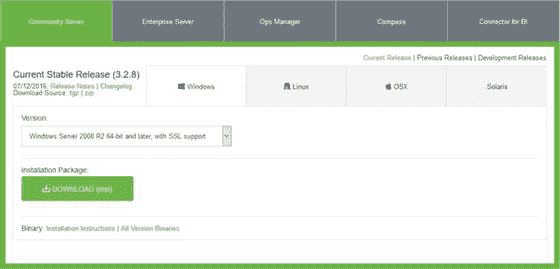

图 10-1。下载 MongoDB

我们还需要为 MongoDB 下载示例数据库。我们将使用 MongoDB 的“导入示例数据集”页面（位于[`https://docs.mongodb.com/getting-started/shell/import-data/`](https://docs.mongodb.com/getting-started/shell/import-data/)）步骤 1（`primer-dataset.json`）中提供的 `restaurants` 数据集。我们还将使用`Ch10_MOCK_DATA.json`作为另一个数据集。这两个文件也可以作为本章代码包的一部分从本书网站获取。继续下载这两个文件，并将它们存储在`C:\Program Files\MongoDB\Server\3.2\bin`中。请记住，你使用的可能是 3.3 或更高版本，因此请根据需要更改此文件路径中的版本号。至此，MongoDB 已安装完毕，我们有了数据集。图 10-2 显示了该文件夹。

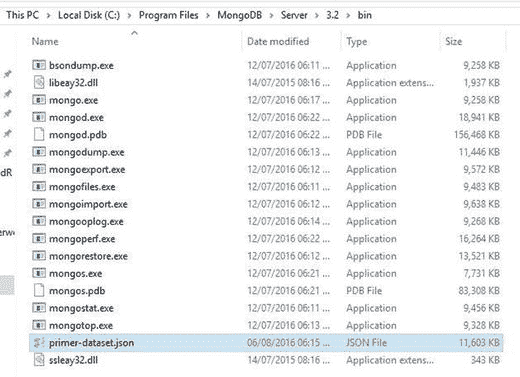

图 10-2。`MongoDB\Server\3.2\bin` 文件夹

现在，按下 Windows 键，按住不放，然后按 `R` 键。这会打开“运行”对话框。输入`cmd`，然后按 `Enter/Return` 键。需要为你的数据库创建一个数据目录。默认情况下，它在主文件路径中（例如，通常是 Windows 的 `C` 盘）。在命令提示符下，输入`md \data\db`来创建默认目录。注意`md`和`\data\db`之间的空格。接下来，仍在命令提示符下，输入`cd C:\Program Files\MongoDB\Server\3.2\bin`并按 `Enter/Return` 键。如果本书出版前发布了 3.3 版本，请将前面文件路径中的 3.2 改为 3.3。然后，输入`mongod.exe`并按 `Enter/Return` 键。如果一切顺利，最后一行应该是`waiting for connections on port 27017`。保持此窗口打开（否则，我们的服务器将无法提供文件服务）。

接下来，再次保持第一个控制台打开，按住 Windows 键并按 `R` 键，打开第二个“运行”对话框。这次，很可能`cmd`已经填好了，所以按 `Enter/Return` 键打开第二个命令提示符。在命令提示符下，再次输入`cd C:\Program Files\MongoDB\Server\3.2\bin`并按 `Enter/Return` 键。我们现在使用 MongoDB 本身来导入这两个数据集。运行以下代码（加粗部分），输出结果如下：

```
mongoimport --db test --collection restaurants --drop --file primer-dataset.json
2016-09-25T11:11:24    connected to: localhost
2016-09-25T11:11:24    dropping: test.restaurants
2016-09-25T11:11:26    imported 25359 documents
mongoimport --db test --collection mock --drop --file Ch10_MOCK_DATA.json
2016-09-25T11:19:45    connected to: localhost
2016-09-25T11:19:45    dropping: test.mock
2016-09-25T11:19:45    imported 1000 documents
```

请注意，该数据库有一个名为`test`的数据库，并且该数据库内现在有两个集合。这些集合，即`restaurants`和`mock`，是通过导入 `JSON` 文件创建的。如果这两个集合已经存在于我们的`test`数据库中，那么`--drop`命令将会清除它们。使用名为`test`或`temp`的数据库作为标志，表明期望在此类地方进行实验，这在一定程度上是标准做法。

继续关闭第二个命令提示符窗口（要小心——你必须保持第一个窗口打开，它应该正在向你提供服务器`COMMAND`和`NETWORK`反馈）。关闭第二个窗口后，我们将注意力转向 R。

## MongoDB 与 R

MongoDB 确实有用户名、密码和多个数据库的选项。由于我们尚未设置任何这些，我们只需连接到本地服务器上的第三个连接`con3`。与我们前两个连接不同，这使用了一个新命令`mongoDbConnect()`，来自`RMongo`包。另外，请注意，该命令要求主机为`localhost`，并且也指定了端口。如果你要通过网络连接到 MongoDB 实例，请务必确定其 IP 地址和端口。当然，还要向管理员询问你要访问的数据库名称。最后，查明你是只有读取权限还是更多。不要在别人的数据库上进行实验！

```
con3<-mongoDbConnect("test", host = "127.0.0.1", port=27017)
```

如果需要身份验证，你需要运行第二个命令。在你的 R 会话中输入并运行`dbAuthenticate(con3, username, password)`。这里需要提醒一句：根据所访问的 MongoDB 版本、本地机器上安装的 Java 版本以及数据库管理员设置的身份验证协议，此功能可能有效也可能无效。我们意识到这是一个模糊的说法。在撰写本书时，身份验证似乎是可能的，但似乎有迹象表明并非对所有用户都适用。

更糟糕的是，目前，函数调用`dbShowCollections()`在最新版本的 MongoDB 上不起作用。如果你连接到一个成熟的数据库，它可能正在使用较旧的版本，你可能能够看到集合。`RMongo`包大约有三年历史，我们期待有更新。现在，我们只能提供一个无奈的见解：连接到数据库和数据整理通常很少是容易的。幸运的是，我们知道我们的集合存储在`restaurants`和`mock`中。

因此，我们可以继续从集合中访问一些数据，以确认我们确实能够将数据从 MongoDB 读入 R。请注意，函数调用`dbGetQuery()`至少需要三个参数。首先，它需要连接；其次，它需要一个包含`collection`信息的文本字符串。第三个参数是用于访问我们数据的搜索词。在第一个例子中，我们没有定义任何搜索词，因此该形式参数只包含`{}`包装器。最后两个参数是可选的。`0`表示我们从列表的开头开始，`8`表示我们只想要接下来的八个条目。换句话说，我们不跳过任何条目，并将返回的条目限制为八个。为了可读性，我们编辑了最终输出，并在图 10-3 中显示了`View()`结果的一部分。

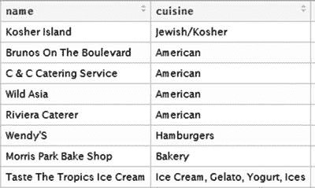

图 10-3。

View(output1)命令结果的一部分

```
output1 <- dbGetQuery(con3, 'restaurants' , "{}", 0,8 )
is.data.frame(output1)
[1] TRUE
names(output1)
[1] "address"  "restaurant_id"  "name"  "cuisine"      "X_id"  "borough"      "grades"
output1[1,]
address
{ "building" : "2206" , "coord" : [ -74.1377286 , 40.6119572] , "street" : "Victory Boulevard" , "zipcode" : "10314"}
restaurant_id   name           cuisine        X_id                            borough
40356442        Kosher Island  Jewish/Kosher  57e7f9a275bec64c417b9ab2        Staten Island
grades
[ { "date" : { "$date" : "2014-10-06T00:00:00.000Z"} , "grade" : "A" , "score" : 9} ,
{ "date" : { "$date" : "2014-05-20T00:00:00.000Z"} , "grade" : "A" , "score" : 12} ,
{ "date" : { "$date" : "2013-04-04T00:00:00.000Z"} , "grade" : "A" , "score" : 12} ,
{ "date" : { "$date" : "2012-01-24T00:00:00.000Z"} , "grade" : "A" , "score" : 9}]
View(output1)
```

这些数据似乎包含关于位置、食物类型和餐馆名称的信息。利用这些知识，我们优化搜索标准，查找`American`菜肴类型。这很有趣，因为我们移除了起始位置和限制参数，并调整了查询条件。数据卫生在此变得至关重要。天真地，我们尝试了`dbGetQuery(con3, 'restaurants' , '{"cuisine":`

### `用户界面绘制饼图的主面板`

```r
ui <- shinyUI(fluidPage(
  # 页面标题
  titlePanel("用户控制图表"),

# 侧边栏，包含由用户控制的数字、文本和复选框输入
  sidebarLayout(
    sidebarPanel(
      numericInput("pie",
        "饼图百分比",
        min = 0,
        max = 100,
        value = 50),
      textInput("pietext", "文本输入", value = "默认标题",
        placeholder = "在此处输入您的标题"),
      checkboxInput("pieChoice",
        "  我想要饼图而不是条形图。", value = FALSE)
    ),

# 显示绘图
    mainPanel(
      plotOutput("piePlot")
    )
  )
))
```

### `服务器端创建饼图或条形图的 R 代码，对用户隐藏`

```r
server <- shinyServer(function(input, output) {
  output$piePlot <- renderPlot({
    # 根据用户的 input$pie 生成饼图比例
    y <- c(input$pie, 100-input$pie)

# 使用指定的比例和标签绘制饼图或条形图
    if(input$pieChoice == FALSE){
      barplot(y, ylim = c(0,100),
        names.arg = c(input$pietext, paste0(input$pietext, "的补集")))
    }else{
      pie(y, labels = c(input$pietext, paste0(input$pietext, "的补集")))}
  })
})
```

### `运行应用程序`

```r
shinyApp(ui = ui, server = server)
```

在深入研究那部分代码之前，让我们先看看它的实际运行效果。在 RStudio 控制台中输入并运行以下代码，在您的本地 Windows 机器上安装 Shiny：

```
install.packages("shiny")
```

现在，进入您仔细输入的`app.R`文件，并一次性运行那段代码。代码区域右上角附近甚至应该有一个“运行应用”的播放按钮。无论如何，应该会出现类似图 13-1 的内容。

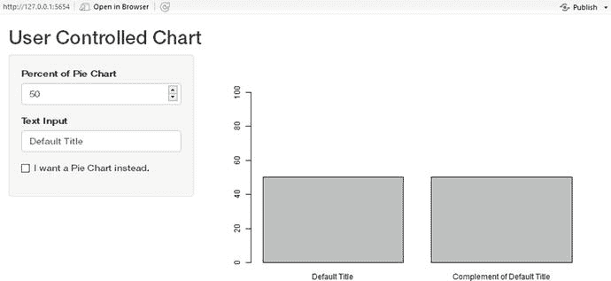

图 13-1. 本地托管的 Shiny 应用，用于查看我们具体获得了什么功能

继续输入各种数字和文本值。尝试使用 Shiny，看看它能做什么。在此过程中，请认识到 Shiny 所做的是在您和 R 之间提供了一个接口。目前，这个特定的运行实例是由 RStudio 在您的本地机器上托管的。请注意，控制台中显示正在监听，您可能需要选择一个停止按钮才能输入任何新代码。

那么发生了什么？假设您将饼图百分比数字更改为 75。这个`numericInput()`是一个响应式值。当您更改它时，后台会发送一个信号，通知服务器`input$pie`已经改变。然后服务器会通知任何使用`input$pie`的响应式函数，告知它们某些内容已更改。在我们的例子中，`renderPlot()`是一个响应式函数。它现在知道`input$pie`不同了，因此它查询该值，获取新值，并再次运行其所有代码。由于那是一个输出值，这个循环会反过来通过`output$piePlot`重复，结果是用户端的`plotOutput()`会刷新。

关于这一切，有一些重要的事情需要注意。我们刚刚描述的过程会再次运行`renderPlot()`内部的所有代码——全部代码。在其他条件不变的情况下，没有必要再查找`input$pietext`和`input$pieChoice`。我们的响应式函数知道这些值，因为它们是最新的，虽然它们会被再次使用，但它们不会被再次调用。然而，如果我们在`renderPlot()`内部有比一个减法运算和一些绘图更密集的操作，我们可能会发现进行任何更改的性能成本相对较高。虽然这段代码相当紧凑，但您仍然可以看到三个可以放置 R 代码的地方。一个是放置`library(shiny)`的地方。这位于我们的`shinyServer()`之外。放在这里的代码，比如我们的库调用，每个会话会运行一次。单个会话可以有多个用户与其交互（尽管这在目前有些深奥）。尽管如此，每个新用户至少会执行`shinyServer()`内部的所有代码一次。最后，正如我们刚刚看到的，在`renderPlot()`这样的响应式函数内部的代码，会在任何连接的响应式输入值每次更新时运行一次。这意味着，为了效率，请考虑将尽可能多的代码放在响应式函数之外。此外，如果您预计会有大量用户流量，也请尽可能将代码放在服务器函数之外。

现在，让我们介绍一些新函数。请记住，有用户输入端、服务器端和整个 Shiny 应用。在本质上，Shiny 就由这三部分组成。实际上，这里有一个相当基础的 Shiny 应用程序：

```r
library(shiny)
```

# 定义用户界面

```
ui <- shinyUI(fluidPage())
```

# 定义服务器
```r
`server` <- `shinyServer`(`function`(`input`, `output`) {})
```

# 运行应用程序

```r
shinyApp(ui = ui, server = server)
```

您可以运行此代码，得到一个漂亮的空白页面。虽然这可能没有之前的代码那么令人兴奋，但这有助于您快速开始编写此接口的代码。在用户界面部分，我们看到的是`fluidPage()`函数调用，其内部放置我们所有面向用户的文本。这部分代码是 Shiny 中最不熟悉的部分，因为这是创建用户看到的 HTML 的代码。在参考部分，我们放置了所有 Shiny UI 函数的链接。然而，在本章中，我们坚持在一个相当自适应或`流体`的页面内使用相同的基本布局，这取决于浏览器的查看区域。请注意，这是一个 R 函数，而 R 中的函数接受由逗号分隔的参数。我们不断增长的应用程序的每个方面都包含在这个包装函数内，它负责所有到网页就绪标记的转换。对于图 13-1 中的第一个应用程序，我们使用了侧边栏布局。这个函数反过来需要两个参数：控制应用程序的侧边栏面板，然后是绘制图表的主面板。编辑我们的用户界面，我们得到以下代码：

```r
```

# 定义用户界面

这段代码很好地展示了函数组合这个数学概念的强大功能。我们的目标最终是让用户能够向我们的 R 代码输入一些东西，比如图 13-1 示例中的文本或复选框。用户将这些值输入到尚未命名的函数中，这些函数提供可视化输出，这些输出又被输入到`sidebarPanel()`函数中，该函数提供网页输出，再被输入到`fluidPage()`中，最终输出给用户的网页界面。我们可以在图 13-2 中看到结果，尽管它们是空白的。

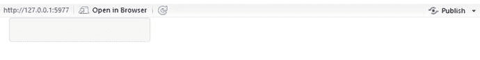

图 13-2. 一个大部分空白的 Shiny 应用，带有`sidebarPanel()`

从这一点出发，我们可以使用三个输入函数快速构建用户的输入。这些输入函数中的每一个都遵循特定的格式，即`blargInput(输入标识, 供用户阅读的文本标签, 与 blarg 所代表的特定类型输入相关的设置)`。正式来说，我们的三个输入函数布局如下，请注意它们的相似之处！

```r
numericInput(inputId, label, value, min = NA, max = NA, step = NA,  width = NULL)
textInput(inputId, label, value = "", width = NULL, placeholder = NULL)
checkboxInput(inputId, label, value = FALSE, width = NULL)
```

继续为我们的代码填充一些具体细节，我们可以为每个输入设置一个对我们后续服务器代码有用的变量标识。因为我们确实计划构建一个饼图（并且，亲爱的读者们，请不要因为我们选择饼图而讨厌我们），所以将数字输入限制在`0`到`100`之间是合理的。因为我们的服务器代码在启动时运行一次，所以为数字输入以及文本输入提供默认值也是有意义的。在我们不断发展的用户界面代码基础上进一步构建，现在我们有了：

```r
ui <- shinyUI(fluidPage(
  sidebarLayout(
    sidebarPanel(
      numericInput(inputId = "num", label = "Enter a number", value = 50, min = 0, max = 100),
      textInput(inputId = "text", label = "Enter some text", value = "Hello Shiny!"),
      checkboxInput(inputId = "check", label = "Check this box", value = FALSE)
    ),
    mainPanel()
  )
))
```

# 用户界面绘制饼图

```R
ui <- shinyUI(fluidPage(
  # 由用户控制的包含数值、文本和复选框输入的侧边栏
  sidebarLayout(
    sidebarPanel(
      numericInput("pie", "百分比饼图",
                   min = 0, max = 100, value = 50),
      textInput("pietext", "文本输入", value = "默认标题",
                placeholder = "在此输入您的标题"),
      checkboxInput("pieChoice", "  我想要一个饼图。", value = FALSE)
    ),
    mainPanel()
  )
))
```

同样，完成这些修改后，再次运行整个应用程序是有意义的，我们将看到图 13-3 中的新结果。请注意，在我们的代码中，`mainPanel()`目前是空的，事实上，在图 13-3 中，右侧我们什么也看不到。

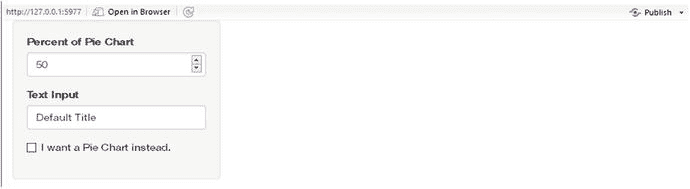

图 13-3.

用户界面即将完成，侧边栏的输入部分确实已完成

既然我们已经捕获了用户输入，我们就可以在服务器端使用它了。请记住，Shiny 是一个 R 包装器，它接收输入，当输入发生变化时，会通知服务器端的某个反应式函数发生了变化。在幕后，Shiny 负责知道输入何时变化，并通知服务器上正确的反应式函数；我们无需担心这些事情。我们的服务器定义了一个新的函数，该函数将输入和输出作为形式参数，并在函数体中使用它们。如果需要，可以快速回顾一下第 4 章，以刷新关于函数是什么的记忆。由于我们想要做的就是绘制条形图或饼图，我们的大部分代码正是使用非常常见的 R 代码来实现这一点。事实上，唯一不那么常规的 R 代码部分是我们的反应式函数`renderPlot()`。由于我们希望输出图形，所以我们使用该函数。

反应式函数总是在等待 Shiny 通知它们来自用户界面端的输入的任何变化。当输入发生变化时，如果其函数体中至少包含一个发生改变的值，反应式函数就会收到通知。如果确实如此，那么反应式函数将再次运行其代码，这次使用新的值。我们在下面的代码中可以看到这一点。唯一另外的部分是，`renderPlot()`的输出存储在一个输出变量中，我们选择将其命名为`piePlot`（尽管根据复选框的选择，它可能不会输出饼图——这完全是我们选择了一个糟糕的名称的错）。

```R
# 代码内容待补充
```

# 创建饼图或条形图的服务器端 R 代码

```R
server <- shinyServer(function(input, output) {
  output$piePlot <- renderPlot({
    # 根据用户的 input$pie 生成饼图比例
    y <- c(input$pie, 100-input$pie)

    # 用指定的比例和标签绘制饼图或条形图
    if(input$pieChoice == FALSE){
      barplot(y, ylim = c(0,100),
              names.arg = c(input$pietext, paste0("Complement of ", input$pietext)))
    }else{
      pie(y, labels = c(input$pietext, paste0("Complement of ", input$pietext)))
    }
  })
})
```

本质上就是这样。当我们的服务器运行时，它会通知用户界面函数`plotOutput("piePlot")`更新图像。该函数位于`mainPanel()`区域。在Shiny的这种简单模型下，侧边栏是接收用户输入的地方，服务器端是R在幕后处理输入的地方，而主面板是用户查看处理结果的地方。仅此一次，我们在图13-1中展示Shiny为我们创建并提供服务的完整HTML代码：

```html
json2[2014.02.04];jquery[1.11.3];shiny[0.13.1];bootstrap[3.3.5]

用户控制的图表

用户控制的图表 ShinyHTML 代码，创建

饼图百分比

文本输入

我想要一个饼图。
```

现在，请回过头仔细查看本节开头展示的第一个代码块，那是整个Shiny应用程序，并意识到正是那段代码创建了前面所有的HTML和JavaScript。这就是Shiny的全部内容。在本例中，我们的R代码并不特别令人印象深刻。尽管如此，原则才是最重要的。用户现在可以与数据交互，并且不难想象更富趣味的应用程序。

在接下来的几节中，我们将介绍一些其他有趣且有用的Shiny输入函数以及一些基本的反应式函数。最后，我们将它们全部上传到云端，以便您可以在网络上实时查看。

## 动态的 Shiny

既然我们对Shiny的功能有了更好的理解，那么理解网页相对于打印报告所具有的动态潜力就很重要。其中一位作者是数学教授，数学教学面临的挑战之一是，一旦数据超出三维，学生就很难对信息进行概念化。自然地，作为人，学生并不独特于他们的高维视觉障碍。时间可以提供第四维度，而Shiny可以为我们提供这种时间感。

我们之前提到的Shiny的另一个特性是，将R代码放在三个不同的位置是合理的。第一个位置是所有代码的开头，在编写用户界面或服务器端代码之前。放在此区域的代码每个实例运行一次。虽然在本地机器上其价值可能不那么明显，但当您的代码托管在云端时，特定的R会话可能同时有多个用户与之交互。这就是我们在前一章安装的Shiny服务器的工作方式。这是读入任何静态数据或执行任何一次性计算的绝佳位置。这是计算效率最高的位置。虽然我们在本例中没有这样做，但代码也可以放在服务器代码内部，但在任何反应式函数之外，这部分代码会在用户连接到会话时每个用户运行一次。最后，位于服务器函数内部、反应式函数内部的代码，会在其引用的任何输入数据每次发生变化时执行。

让我们看看如何随时间变化数据。从用户界面端，有一个作为数字线滑动条的输入函数。与所有输入函数一样，我们需要给它一个名称，以便我们的反应式函数知道去哪里寻找输入更新。与上一节的`numericInput()`类似，我们为此函数提供以年为单位的最大值和最小值。最后，我们将为我们的`sliderInput()`函数添加动画效果。看看我们在用户界面中使用的代码。我们的代码使用了包含`interval`（以毫秒为单位）的动画选项，并使动画保持循环播放。

```R
sliderInput("ayear", "学年：",
            min = 2014, max = 2017,
            value = 2014, step = 1,
            animate = animationOptions(interval=600, loop=T) )
```

虽然此应用程序也展示了如何对静态数据和用户输入执行R计算，但从R代码的角度来看，这确实又相当简单。事实上，除了`titlePanel()`命令以及我们的滑块代码外，这非常像我们的第一个Shiny应用程序。我们在图13-4中同时展示了代码和最终结果。

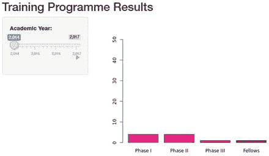

图 13-4.

一个带有播放按钮功能的滑块输入，展示动态数据

```R
library(shiny)
slider_data <- read.csv("slider_data.csv", header = TRUE, sep = ",")
Phase1    <- slider_data[,2]
Phase2    <- slider_data[,3]
Phase3    <- slider_data[,4]
Phase4    <- slider_data[,5]
```


# 定义用于绘制条形图的应用程序的 UI

```R
ui <- shinyUI(fluidPage(
  # 应用程序标题
  titlePanel("培训计划结果"),
```

# 侧边栏带滑块输入用于设置分组数量

```R
sidebarLayout(
  sidebarPanel(
    sliderInput("ayear", "Academic Year:",
                min = 2014, max = 2017,
                value = 2014, step = 1,
                animate = animationOptions(interval=600, loop=T) )  ),
  mainPanel(plotOutput("barPlot") )
)
```

## 定义绘制柱状图所需的服务器逻辑

```R
server <- shinyServer(function(input, output) {
  output$barPlot <- renderPlot({
    cap<-input$ayear*100
    x <- c(sum(Phase1<cap), sum(Phase2<cap), sum(Phase3<cap), sum(Phase4<cap))
    barplot(x, names.arg = c("Phase I", "Phase II", "Phase III", "Fellows"),
            col = c("deeppink1","deeppink2","deeppink3","deeppink4"), ylim=c(0,50))
  })
})
```

## 运行应用程序

```R
shinyApp(ui = ui, server = server)
```

## 将用户文件上传到 Shiny

本章最后一个示例表明，用户可以通过 Shiny 上传文件，然后通过 R 进行处理。当然，与之前两个示例不同，这稍微有点风险，因为上传的文件不受我们控制。数据可能是任何文件，不一定适用于我们的结果。可以在代码中构建各种错误检查功能；实际上，我们在讨论函数时曾部分提到这些技术。但是，为了让代码专注于严格的新特性，我们暂时假设生活在一个完美的世界里。我们在这本书的 Apress 网站上提供了一个示例文件，它只是一个包含数字 1 到 10 的逗号分隔值文件。

或许并不意外，为了接收文件输入，Shiny 中的命令是`fileInput()`。除了`inputId`，也许最有趣的功能是它甚至可以接受`multiple`上传，尽管在我们的示例中我们将其保留为默认值`FALSE`。并非所有浏览器都支持上传多个文件。同样在用户界面区域，我们使用了一个新的输出函数`tableOutput()`，它与`plotOutput()`一起，允许我们为用户提供图表和图形输出。在讨论允许我们与用户文件交互的服务器端代码之前，我们先看看上传的 CSV 文件给我们带来了什么。图 13-5 是我们上传 CSV 文件后的视图，下面仅展示用户界面的代码：

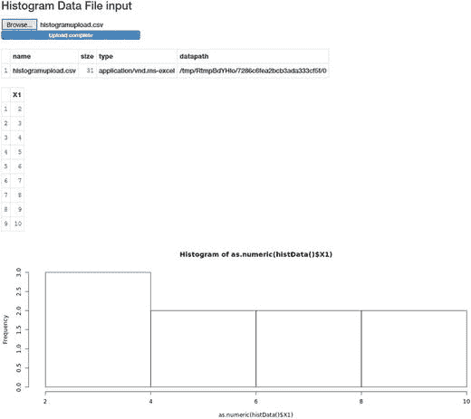
图 13-5. 文件上传结果

```R
ui <- shinyUI(fluidPage(
  fileInput("file", label = h3("Histogram Data File input")),
  tableOutput("tabledf"),
  tableOutput("tabledf2"),
  plotOutput("histPlot1")
))
```

首先，请注意第一个表格。它包含四个变量，这些变量是直接访问`input$file`变量的结果。这可能会与我们之前的示例相悖，在其他示例中，用户输入可以直接从`input$inputId`访问。然而，这确实表明我们的用户输入实际上是一个数据框，并且可以像访问任何文件位置一样访问临时数据路径。注意：如果用户上传另一个文件，由于我们在临时目录中，旧文件很可能会被覆盖。接下来，请注意我们文件的真实数据在第二个表格中，并且如直方图所示，该信息可用于我们可能选择编码的任何 R 计算。

接下来让我们重点看服务器端，因为这不像之前的示例那么简单。有时，您处理的输入比单个数字或文本值需要更多管理。因为该数据是输入数据，如果它发生变化，需要一个响应式函数来通知。但是，您可能更倾向于使用相当简洁的代码。幸运的是，Shiny 提供了一个基本的响应式函数，名为`reactive()`。在下面的代码中，我们创建自己的响应式函数来处理一个新场景，即我们想要的场景。当文件上传时，Shiny 会通知我们的响应式函数`reactive()`：`input$file`已经改变。该函数自然会查询输入以查看现在是什么，并将该数据框存储到变量`file1`中。我们希望访问 CSV 文件内部的数据，因此需要对该文件调用`read.csv()`，这自然需要知道文件的位置。该位置存储在名为`datapath`的最后一列中。我们得到的是一个在后续代码中可以像数据框一样处理的对象。

```R
histData<-reactive({
  file1<-input$file
  read.csv(file1$datapath,header=TRUE ,sep = ",")
})
```

除此之外，我们现在可以在其他响应式函数中使用我们的数据，即使是熟悉的函数。我们再展示一个新的响应式函数`renderTable()`，以及一个熟悉的`renderPlot()`。您还应该注意`histData()$X1`。请注意，它有函数括号，但元素仍然通过熟悉的`$`访问。这是用响应式函数构建的，因此，我们必须承认它既是一个接收用户输入的函数，也是一个可访问数据的存储对象。

```R
output$tabledf2<-renderTable({
  histData()
})
output$histPlot1<-renderPlot({
  hist(as.numeric(histData()$X1))
})
```

以上就是对代码的分析。为了完整性，我们以完整的代码结束本节，但现在您已经掌握了在 Shiny 中启动和运行的技术。在本节结束之前，我们指出，参考文献部分的第一条链接是大多数或许多 Shiny 函数的参考网站。如果您想做某事，请先查看那里。它非常直观。同样值得注意的是，本章下一节展示了如何将应用程序文件上传到云端并使其实时运行。最后，请注意用户界面中`fileInput()`函数内部的`h3()`函数。Shiny 有一整套函数，可以复制各种常见的 HTML 特性，如标题。对于本章，我们将这些视为次要事项。在第 14 章中，我们将更多地关注使我们的用户界面（为了找一个更好的词）更加美观。

```R
library(shiny)
ui <- shinyUI(fluidPage(
  fileInput("file", label = h3("Histogram Data File input"), multiple = FALSE),
  tableOutput("tabledf"),
  tableOutput("tabledf2"),
  plotOutput("histPlot1")
))
server <- shinyServer(function(input, output) {
  output$tabledf<-renderTable({
    input$file
  })
  histData<-reactive({
    file1<-input$file
    read.csv(file1$datapath, header=TRUE ,sep = ",")
  })
  output$tabledf2<-renderTable({
    histData()
  })
  output$histPlot1<-renderPlot({
    hist(as.numeric(histData()$X1))
  })
})
```

# 运行应用程序

```R
shinyApp(ui = ui, server = server)
```

请注意，在这段代码中，我们并没有关注侧边栏或主面板之类的区分；相反，我们将用户界面端（既包括请求的输入也包括生成的输出）全部混杂在一起。值得注意的是，如果你有一个侧边栏，就需要一个主面板来容纳侧边栏不承载的任何输出内容。

## 在云端托管 Shiny 应用

我们最后一项任务是将文件从本地机器传输到云端实例。请记住，在前面的章节中，我们不仅使用 `PuTTY` (Tatham, 2016) 在云端服务器上安装了 Shiny Server，还使用 `WinSCP` (Prikryl, 2007) 将文件上传到云端。我们启动 `WinSCP`，重新连接，并确保左侧（本地端）位于 Shiny 应用程序文件夹中，而右侧（云端服务器端）位于 `/home/ubuntu` 目录下。我们在图 13-6 中展示了这一过程的结果。

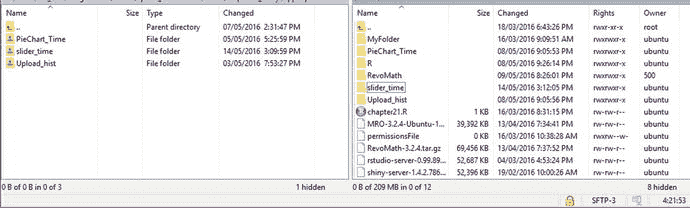

图 13-6. 已将 PieChart_Time、slider_time 和 Upload_hist 等 Shiny 应用程序全部上传的 WinSCP 界面

在此之后，我们通过 `PuTTY` 访问云端服务器，并在命令行中逐一运行以下代码：

```bash
sudo cp -R ∼/PieChart_Time /srv/shiny-server/
sudo cp -R ∼/slider_time /srv/shiny-server/
sudo cp -R ∼/Upload_hist /srv/shiny-server/
```

这就只剩最后一步了。回想一下，当我们最初设置云端实例时，我们只谨慎地开放了少数几个端口，并仅允许少数几个 IP 地址访问。你需要重新登录 AWS，再次进入 EC2 控制面板。从那里，在左侧导航菜单中，回到“安全组”并选择你的 `AdvancedR` 组。选中该组后，点击“入站”选项卡，然后点击“编辑”→“添加规则”。你需要使用“自定义 TCP 规则”，添加端口 `3838`，最后将其锁定到你的 IP 地址。然后点击“保存”。结果如图 13-7 所示。

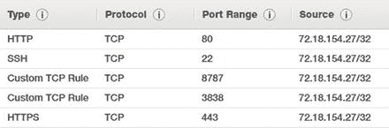

图 13-7. AWS 入站规则表，其中 Shiny Server 端口 3838 仅对一个本地 IP 地址开放

你现在可以通过在任何浏览器中输入以下 URL 来验证你的应用程序是否正常工作：

`http://你的.实例.IP.地址:3838/PieChart_Time/`

`http://你的.实例.IP.地址:3838/slider_time/`

`http://你的.实例.IP.地址:3838/Upload_hist/`

如果你希望允许其他人或全世界访问你的应用程序，请仅为端口 `3838` 将入站规则中的源 IP 地址更改为 `0.0.0.0/0`。不允许外部世界访问你的 SSH 端口是一项安全措施。当然，如果你现在开放了端口 `3838` 供全世界访问，你的服务器就是可见且已知的。为不同的独立活动使用不同的云端实例可能是有益的。我们建议不要在可公开访问的服务器上存放机密数据。再次强调，云端安全超出了本书的范围。

## 最终思考

我们似乎花了些时间讨论云端安全。这背后有两个原因。第一，纯粹是我们天生偏执的习性。然而，相当一部分数据可能包含机密信息。合乎道德地使用数据，包括采取合理的防护措施，是很重要的。最近几个月，AWS 在 EC2 上创建更安全的环境方面取得了长足进步。一如既往，安全是一个合理性的问题。你的数据越重要，就越有必要采取更好的措施来保护这些信息。

抛开这些担忧不谈，这确实是一项前所未有的能力，允许用户以如此开放的方式与数据分析进行交互。是的，根据我们的经验，这可能会导致一些数据消费者做出缺乏依据的决策。尽管如此，通过 Shiny 这类技术实现透明度所带来的好处，远远超过了其缺点。这是一个令人兴奋的世界，我们渴望探索。

# 14. Shiny 仪表板示例集

本章内容并非理解本书其他章节所必需的。虽然我们会介绍一些新技术，但你主要会发现的是一个完整的仪表板示例，可以直接修改以满足你的需求。

这个示例集具体做什么？它将我们在前一章中使用的应用程序以一种引人入胜、交互式的格式呈现出来。重要的是要记住，虽然我们通常以图形化输出来展示这些应用程序，但可以对这些数据执行任何 R 处理过程。目标是让信息消费者（无论是研究评审员、上级主管还是董事会成员）能够自然地与实时数据交互。

与上一章类似，我们在 Windows 系统中的 `RStudio` (RStudio Team, 2015) 内介绍这个示例。我们既提供了一个理解这个仪表板的框架，也提供了一些专业技巧。重要的是，要将这个示例集视为某种创造力的孵化器。我们希望你能从中看到你喜欢的东西，并且更重要的是，意识到如何最好地展示你的数据。

我们将从仪表板的基本结构开始。

## 仪表板的骨架

回想一下我们在前一章中创建的最简单的 `shiny` (Chang, Cheng, Allaire, Xie, and McPherson, 2016) 应用程序：

```R
library(shiny)
```

# 定义用户界面

```
ui <- shinyUI(fluidPage())
```

# 5. 编写类和方法

让函数根据传入对象的类型表现出不同行为通常很有帮助。例如，在汇总变量时，为数值数据或字符串数据创建不同的汇总方式是有意义的。可以为每种对象类型使用不同的函数，但这样用户必须记住许多函数名，而且为了保持名称唯一，函数名可能会更长。面向对象编程（OOP）基于对象，并在 R 中（与大多数编程语言一样）通过使用两个概念来实现：类和方法。类定义了一个模板或蓝图，描述对象的变量和特征，并确定哪些方法适用于它。例如，房子可以定义为有地板、四面墙、屋顶和一扇门。具体数据代表这些属性，例如每面墙的尺寸和颜色。方法是可以在特定对象类型上执行的行为或操作。例如，房子可以粉刷，从而改变其颜色，但房子不能吃。R 有三种面向对象系统：S3、S4 和 R5。本章将介绍最常见的 S3 和 S4 系统。

在本章中，我们将使用`ggplot2`R 包（Wickham, 2009）。以下代码加载了`checkpoint`（Microsoft Corporation, 2016）包以控制所用 R 包的具体版本，然后加载了`ggplot2`包：

```r
## 加载 checkpoint 及所需包
library(checkpoint)
checkpoint("2016-09-04", R.version = "3.3.1")
library(ggplot2)
options(width = 70) # 每行仅 70 个字符
```

## S3 系统

S3 系统是最常见的面向对象系统。它也是最容易上手、最简单的系统。S3 系统易于使用，部分原因在于它相当非正式，并且主要关注函数或方法。这些优势同时也是局限，因为 S3 系统没有提供正式的框架来确保对象满足类的要求。有关使用 S3 系统进行 R 编程的更深入指南，请参阅 W.N. Venables 和 B.D. Ripley 所著的《S Programming》（Springer, 2004）。

### S3 类

在 R 中，默认情况下可以使用某些类型或类别的对象，并且几乎所有对象都可以被视为向量或泛型向量。例如，矩阵和数组本质上是带有表示维度属性的向量。列表是泛型向量，其中向量的每个元素可能包含另一个向量。数据框是列表，其中每个元素都是一个向量，但所有向量长度相等，因此具有表格格式。向量可以保存特定类型的数据，例如逻辑型、整型、数值型（实数）或字符型。这些基础对象和类由基础包提供。S3 类是通过在基础包提供的对象和类基础上构建而创建的。

**注意**

S3 类是使用常规的 R 对象（例如，向量或列表）和类（例如，逻辑型或数值型）创建的。S3 类通过使用 `class(object) <- "class name"` 设置类名来定义。S3 对象的元素通常通过使用 `$`、`[` 或 `[[` 来访问。

实际创建 S3 类很简单。首先，创建一个满足该类要求或特性的 R 对象，然后通过使用类名标记该对象来定义 S3 类。由于 S3 类与其他 R 对象的区别仅在于具有特殊的名称或属性，因此它们可以通过使用 `$`、`[` 和 `[[` 以与其他基础 R 对象相同的方式进行访问和操作。要检查对象的类，我们可以使用 `class()` 函数。在以下示例中，查询了 `mtcars` 对象以确定其具有数据框类：

```r
class(mtcars)
[1] "data.frame"
```

要查看对象的类是如何设置的，我们可以查看基础 R 中的许多函数，例如 `table()`。在这里，我们打印 `table()` 函数的源代码，为了节省空间省略了中间部分：

```r
table
function (..., exclude = if (useNA == "no") c(NA, NaN), useNA = c("no",
"ifany", "always"), dnn = list.names(...), deparse.level = 1)
{
[为了节省篇幅而省略]
y
```

最后返回的对象 `y` 是一个数组，但具有 `table` 类。对象类是使用惯用语 `class(object) <- "class name"` 设置的。也可以为一个对象分配多个类。这与分配单个类的方式大致相同，并按优先顺序进行。以下示例将调用 `table()` 的结果存储在对象 `x` 中，然后设置两个类，首先是 `newclass`，然后是原始 `table` 类：

```r
x <- table(mtcars$cyl)
class(x) <- c("newclass", "table")
class(x)
[1] "newclass" "table"
```

分配多个类的价值在于提供了一种备份，主要用于方法。例如，如果您创建一个新类，它是表或数据框的变体，您可以为打印编写专用方法，但依赖原始类的方法来处理其他功能，例如绘图或汇总。

您可以编写的类类型几乎是无穷无尽的。一个简单的入门方法是创建现有类的特殊或增强案例。在以下示例中，我们创建了一个特殊的数据框案例，其中包含 x 和 y 坐标以及文本标签，称为 `textplot`。“创建”该类的最简单方法是创建一个数据框，然后更改其类。如果我们只使用新的类标签，调用 `print()` 函数将导致使用默认方法，但如果我们同时使用新的 `textplot` 标签和其次的数据框标签进行标记，那么调用 `print()` 将回退到数据框的方法：

```r
d <- data.frame(
x = c(1, 3, 5),
y = c(1, 2, 4),
labels = c("First", "Second", "Third")
)
class(d) <- "textplot"
print(d)
$x
[1] 1 3 5
$y
[1] 1 2 4
$labels
[1] First  Second Third
Levels: First Second Third
attr(,"row.names")
[1] 1 2 3
attr(,"class")
[1] "textplot"
class(d) <- c("textplot", "data.frame")
print(d)
x y labels
1 1 1  First
2 3 2 Second
3 5 4  Third
```

在 S3 系统中，没有正式的方法从特定类创建对象。然而，创建特定类对象的最常见方式是作为函数的输出。可以编写专用函数来创建特定类的对象，或者编写执行操作并将结果输出为特定类对象的函数。在 R 中使用 S3 系统时，后一种方法更为典型。

当您创建一个新类时，某些所需的特性或元素可能存在于现有类中。如果是这种情况，那么在现有类的基础上进行构建或扩展可能是有意义的。例如，数据框建立在列表的基础上，要求列表的每个元素都是长度相同的向量。同样，我们之前创建的 `textplot` 类建立在数据框的基础上，要求三个元素分别命名为 `x`、`y` 和 `labels`。在这种情况下，我们说 `textplot` 继承自 `data.frame`。也就是说，`textplot` 是父类 `data.frame` 的子类（注意，父类也称为超类或基类）。如果一个类只继承自另一个类，则称为单继承（即只有一个父类）。如果一个类继承自多个类，则称为多继承（即具有多个父类）。如果一个类继承自另一个类，它可能继承数据的存储特性，也可能继承方法，即用于操作特定类对象的函数。继承方法对于避免重复造轮子尤其有用。

**注意**

继承是指通过在现有类的特性和方法基础上进行构建来创建一个新类。新类称为子类，而新类派生自的类称为父类或超类。子类既可以继承父类的特性，也可以使用父类的方法。

在下一个示例中，我们编写一个小函数，使用公式接口从数据框构建一个 `textplot` 对象。该函数有两个参数：公式，称为 `f`；以及数据，称为 `d`。代码的第一部分使用第 4 章介绍的 `stopifnot()` 函数来检查传递给函数的对象类是否符合预期。为了测试类，我们使用 `inherits()` 函数，该函数评估特定对象是否属于指定的类或从其继承。例如，我们的 `textplot` 类别是数据框，因此使用 `inherits(object, "data.frame")` 进行测试的结果将为 `TRUE`。当我们构建 S4 类时，我们会看到更正式的定义和类继承系统。函数的下一部分从指定的数据框中按顺序获取公式中的所有变量，重命名列，应用我们的 `textplot` 类，并返回对象：

```r
textplot_data <- function(f, d) {
stopifnot(inherits(d, "data.frame"))
stopifnot(inherits(f, "formula"))
newdata <- get_all_vars(formula = f, data = d)
colnames(newdata) <- c("y", "x", "labels")
class(newdata) <- c("textplot", "data.frame")
return(newdata)
}
### 使用示例
textplot_data(f = mpg ∼ hp | cyl, d = mtcars[1:10, ])
y   x labels
Mazda RX4         21.0 110      6
Mazda RX4 Wag     21.0 110      6
Datsun 710        22.8  93      4
Hornet 4 Drive    21.4 110      6
Hornet Sportabout 18.7 175      8
Valiant           18.1 105      6
Duster 360        14.3 245      8
Merc 240D         24.4  62      4
Merc 230          22.8  95      4
Merc 280          19.2 123      6
```

这些示例展示了使用 S3 系统创建类是如此的容易。接下来，我们将探讨如何为现有类或新类编写方法。

### S3 方法

方法是可对特定类别的对象执行的函数或操作。即使你不编写自定义类，也可能需要编写自己的方法。编写 S3 方法就像编写我们在第 4 章中介绍的函数一样。唯一的区别在于，S3 方法具有特殊的命名约定，并且需要为用户提供一个通用函数（generic function），该函数负责将调用分派到相应的方法。

**注意**： S3 方法是遵循特定命名约定的常规 R 函数：`foo.classname()`。用户调用通用函数 `foo()`，该函数会根据作为参数传入的对象的类别，将其分派到相应的方法。如果尚不存在通用函数，则必须编写一个包含 `UseMethods()` 调用的通用函数，由它来处理实际的方法分派。

首先，让我们为我们开发的 `textplot` 对象类别编写一个简单的绘图方法。要创建一个 S3 绘图方法，我们使用函数名（此处为 `plot`），后跟类别名——`function.classname()`，或者在此例中为 `plot.textplot()`。只要我们的函数以这种方式命名，并且存在一个通用的 `plot()` 函数（我们稍后将讨论此主题），它就可以作为 S3 方法工作。

我们的绘图函数如下所示。调用 `par()` 函数可以调整图形的默认边距，以减少图形顶部和右侧的过多空白空间。结果存储在对象 `op` 中，因为它存储了原始的图形参数。然后，当函数退出时，可以在退出时调用 `par(op)` 来恢复用户的原始图形参数状态，这是你在第 4 章中学习过的一个函数。接下来，我们通过调用 `plot.new()` 创建一个新的绘图区域，并通过调用 `plot.window()` 设置新绘图的尺寸，其 x 和 y 轴范围由数据的范围决定。接着，我们使用 `text()` 函数绘制标签，该函数接收坐标和标签。最后，我们在底部（`side = 1`）和左侧（`side = 2`）添加坐标轴。原始的 `textplot` 数据对象将在函数末尾以不可见的方式返回。

```r
plot.textplot <- function(d) {
op <- par(mar = c(4, 4, 1, 1))
on.exit(par(op))
plot.new()
plot.window(xlim = range(d$x, na.rm = TRUE),
ylim = range(d$y, na.rm = TRUE))
text(d$x, d$y, labels = d$labels)
axis(side = 1, range(d$x, na.rm = TRUE))
axis(side = 2, range(d$y, na.rm = TRUE))
invisible(d)
}
```

接下来，我们需要创建一些数据，然后对它们调用 `plot()`。请注意，因为它是一个方法，我们无需使用其全名 `plot.textplot()` 来调用该函数。我们只需调用 `plot()`，R 就会根据对象类别 `textplot` 将数据对象分派到正确的方法。结果如图 5-1 所示，代码如下：


**图 5-1.** 在特定坐标处绘制文本标签的图形，演示了为自定义类使用自定义方法

```r
dat <- textplot_data(f = mpg ∼ hp | cyl, d = mtcars[1:10, ])
plot(dat)
```

这个例子展示了使用 S3 系统是多么容易。几乎不需要特殊的函数或付出额外的努力。只需以你喜欢的任何方式创建一个常规的 R 对象，添加一个自定义的类别标签，编写一个函数，并给它取一个特殊的名字——基本上这就是全部所需。不过，S3 方法也有一些特殊的函数和工具。首先，让我们看看查看 `plot()` 的源代码时会发现什么。这个通用函数只包含三个参数。函数体仅包含对 `UseMethod()` 的调用，它的作用是告诉 R 检查参数类别并分派到适当的方法。如果你正在编写方法，并且尚不存在通用函数，那么你还需要编写这个通用函数。在 S3 系统中编写通用函数是一项直截了当的任务，只需要考虑包含的默认参数：

```r
plot
function (x, y, ...)
UseMethod("plot")
```

要查看可用的方法，我们使用 `methods()` 函数。结果显示 `plot()` 有许多具体的方法，包括我们刚刚编写的 `plot.textplot`：

```r
methods(plot)
[1] plot,ANY-method               plot,color-method
[为节省空间省略]
[71] plot.table*                   plot.textplot
[为节省空间省略]
[81] plot.varclus                  plot.xyVector*
see '?methods' for accessing help and source code
```

某些函数后面带有星号，表示这些方法不是公开的或无法直接访问，例如 `plot.table()`。例如，如果我们键入其名称，会得到一个找不到该函数的错误：

```r
plot.table
Error: object 'plot.table' not found
```

**注意**： `::` 运算符用于引用特定包中公开导出的函数，主要用于多个包导出同名函数的情况：`package::foo()`。`:::` 运算符用于访问包命名空间中未导出的函数。应谨慎使用非公开函数，因为它们可能会在没有通知的情况下更改。

不公开或未从包命名空间导出的函数仍然可以作为方法访问。这些函数也可以通过指定其来源包并使用 `:::` 运算符来直接访问，从而显示函数源代码：

```r
graphics:::plot.table
function (x, type = "h", ylim = c(0, max(x)), lwd = 2, xlab = NULL,
ylab = NULL, frame.plot = is.num, ...)
{
xnam
```

除了为新类编写方法外，有时为现有类编写方法也很有帮助。例如，流行的 `ggplot2` 包没有用于处理线性模型或回归对象的默认方法。首先，我们使用内置的 `mtcars` 数据建立一个简单的回归模型。然后，我们通过调用 `factor()`，根据 `hp`、`vs`、它们的交互项（由 `hp * vs` 创建，展开为主效应项及其交互项或乘积项）以及虚拟编码的 `cyl` 来预测 `mpg`。通过对对象调用 `summary()` 来显示结果：

```r
m <- lm(mpg ~ hp * vs + factor(cyl), data = mtcars)
summary(m)
```

```r
...
Coefficients:
Estimate Std. Error t value Pr(>|t|)
(Intercept)  26.92908    2.71758   9.909 2.56e-10 ***
hp           -0.01519    0.01554  -0.978  0.33718
vs            8.53352    4.95297   1.723  0.09678 .
factor(cyl)6 -4.21121    1.93887  -2.172  0.03916 *
factor(cyl)8 -8.65096    2.69738  -3.207  0.00354 **
hp:vs        -0.09101    0.04363  -2.086  0.04692 *

Signif. codes:  0 '***' 0.001 '**' 0.01 '*' 0.05 '.' 0.1 ' ' 1
Residual standard error: 3.007 on 26 degrees of freedom
Multiple R-squared:  0.7913,  Adjusted R-squared:  0.7511
F-statistic: 19.71 on 5 and 26 DF,  p-value: 4.181e-08
```

我们可以使用以下代码检查对象的类别，并确认当前没有 `ggplot()` 方法：

```r
class(m)
[1] "lm"
methods(ggplot)
[1] ggplot.data.frame* ggplot.default*    ggplot.summaryP
[4] ggplot.transcan
see '?methods' for accessing help and source code
```

尽管 `fortify()` 函数有一个用于线性模型的方法，该方法能创建一个适用于 `ggplot()` 的数据框，但它只提取原始数据、拟合值和残差。为了展示模型的效果，将预测值绘制为其中一个变量在其他变量取特定值时的函数可能会很有帮助。下面的方法实现了一个实现此功能的系统。

它采用与 `ggplot()` 相同的基本参数，但增加了 `vars` 参数，并且模型中使用的每个变量都通过一组特定值传递，以便在预测时保持这些值。通过使用 `do.call()` 函数将列表作为参数传递给 `expand.grid()`，可以创建所有可能的变量值组合。然后，从模型公式中提取因变量（即 `yvar`）并将其转换为字符。随后生成新的预测值及其标准误。基于拟合值或预测值以及正态分位数乘以拟合标准误，生成包含下限 `LL` 和上限 `UL` 的 95%置信区间。最后，将列名从 `fit` 更改为因变量的实际名称，然后将用于预测的数据与预测值合并成一个新的数据框。最终传递给 `ggplot()`，该函数会调度到数据框的 `ggplot()` 方法。

```r
ggplot.lm <- function(data, mapping, vars, ...) {
newdat <- do.call(expand.grid, vars)
yvar <- as.character(formula(data)[[2]])
d <- as.data.frame(predict(data, newdata = newdat, se.fit = TRUE))
d <- within(d, {
LL <- fit + qnorm(.025) * se.fit
UL <- fit + qnorm(.975) * se.fit
})
colnames(d)[1] <- yvar
data <- cbind(newdat, d[, c(yvar, "LL", "UL")])
ggplot(data = data, mapping = mapping, ...)
}
```

有了这个方法，我们可以轻松地从线性回归模型生成一些图形。以下代码使用了我们的新方法，指定了预测变量的确切值，通过 `geom_line()` 添加线条，并使用 `theme_bw()` 应用黑白主题。结果如图 5-2 所示；代码如下：


**图 5-2.** 使用 `ggplot.lm()` 方法从模型预测的回归线。

```r
ggplot(m, aes(hp, mpg), vars = list(
hp = min(mtcars$hp):max(mtcars$hp),
vs = mean(mtcars$vs),
cyl = 8)) +
geom_line(size=2) +
theme_bw()
```

因为在我们的方法中使用 `expand.grid()` 创建了所有可能的预测变量组合，所以我们可以生成多条预测线，例如将 `vs` 保持在 `0` 和 `1`，如下例代码和图 5-3 所示：


**图 5-3.** 使用 `ggplot.lm()` 方法从模型预测的回归线（含置信区间）。

```r
ggplot(m, aes(hp, mpg, linetype = factor(vs), group = factor(vs)), vars = list(
hp = min(mtcars$hp):max(mtcars$hp),
vs = c(0, 1),
cyl = 8)) +
geom_ribbon(aes(ymin = LL, ymax = UL), alpha = .25) +
geom_line(size=2) +
theme_bw()
```

这些示例简要介绍了编写新类和方法或扩展现有类和方法时可以完成的工作。由于 S3 系统是 R 中最常用的系统，它可能是最重要的要学习的系统；它应用广泛，并且可以扩展许多对象类。

### S4 系统

与 S3 系统相比，S4 系统是一个正式的系统。这种形式化的好处是，能够更大程度地确保特定类的对象包含完全符合预期的内容。形式化的缺点是更高的复杂性：需要更多函数来设置类和方法，并且编程要求更加严格。S3 系统允许编写快速且粗略的代码，而 S4 系统则需要更周密的计划，并且开销更高。

对象包含三个组成部分：类（class）、槽（slot）和方法（method）。对象的名称和结构——即它所包含的内容——称为类。对象中存储的变量或其他对象称为槽。最后，可以对对象进行操作的函数称为其方法。在本节中，我们将逐一介绍这些组件。关于 S4 系统的进一步阅读，推荐 John Chambers 所著的《用于数据分析的软件：使用 R 进行编程》（Springer，2010 年）。

### S4 类

因为 S4 类更加形式化，在编写新类之前需要预先规划。与 S3 类不同，在 S4 中必须指定要包含的每个变量的名称和类型。之前我们使用 S3 系统定义了一个名为 `textplot` 的类。我们可以使用 S4 系统定义相同的类。`x` 和 `y` 参数应为数值类型，`labels` 参数应为字符型。我们还知道所有参数的长度应相同。最后，我们可能需要断言，虽然允许缺少标签，但不允许出现空白标签。所有这些都需要提前考虑和指定——因为在 S3 系统中，这些都无法控制，而在 S4 系统中，我们可以在创建类时定义所有内容。为了创建我们的第一个 S4 类，我们使用 `setClass()` 函数，如下例所示。并非每个参数都是必需的，但在定义新类时尽可能明确被认为是一种良好实践。

注意

通过调用 `setClass()` 创建 S4 类。`Class` 和 `slots` 参数是必需的。类名指定为字符向量，槽（保存变量）定义为一个命名字符向量；名称对应槽名，值对应每个槽的类。可以使用 `prototype` 参数指定一个“空”对象，并且可以通过向 `validity` 参数传递一个函数来设置有效性检查。

第一个参数 `Class` 提供类的名称。接下来，使用一个命名向量定义 `slots`，其中名称指示槽名，值指示每个槽的类型。`prototype` 参数不是必需的，但定义它有助于确定如何创建一个“空”对象，或者在没有指定具体数据时如何创建该类的一个对象。`validity` 参数也不是必需的，但允许进行明确的检查，以确保对象符合预期。R 默认确保将适当类型的对象传递给槽，但可以添加许多其他测试和有效性检查，以减少创建无法按预期工作的对象的机会。以下是 `setClass()` 示例：

```
setClass(
Class = "textplot",
slots = c(
x = "numeric",
y = "numeric",
labels = "character"),
prototype = list(
x = numeric(0),
y = numeric(0),
labels = character(0)),
validity = function(object) {
stopifnot(
length(object@x) == length(object@y),
length(object@x) == length(object@labels))
if (!all(nchar(object@labels) > 0, na.rm = TRUE)) {
stop("All labels must be missing or non zero length characters")
}
return(TRUE)
}
)
```

要在 S4 系统中创建特定类的新对象，我们使用 `new()` 函数。在接下来的代码中，我们检查创建新对象的三种尝试。首先，我们创建一个正确且有效的对象。然后，我们查看如果尝试使用错误类型的参数会发生什么。最后，我们查看一个测试我们所创建有效性函数的示例。

```
new("textplot",
x = c(1, 3, 5),
y = c(1, 2, 4),
labels = c("First", "Second", "Third"))
An object of class "textplot"
Slot "x":
[1] 1 3 5
Slot "y":
[1] 1 2 4
Slot "labels":
[1] "First"  "Second" "Third"
new("textplot",
x = c(1, 3, 5),
y = c(1, 2, 4),
labels = 1:3)
Error in validObject(.Object) :
invalid class "textplot" object: invalid object for slot "labels" in class "textplot": got class "integer", should be or extend class "character"
new("textplot",
x = c(1, 3, 5),
y = c(1, 2, 4),
labels = c("First", "Second", ""))
Error in validityMethod(object) (from #16) :
All labels must be missing or non zero length characters
```

如果我们使用 `S3` 系统定义类，则不会发生这些错误，因为不会进行类型检查或有效性检查。在前面的示例中，每次尝试创建新对象时最多出现一个错误。下一个示例有两个错误：传递给 `y` 槽位的向量与其他两个向量的长度不同，并且存在一个零长度的字符标签。然而，按照当前的写法，只有第一个错误被捕获，因为有效性函数在出现任何问题时就会停止：

```
new("textplot",
x = c(1, 3, 5),
y = c(1, 2),
labels = c("First", "Second", ""))
Error: length(object@x) == length(object@y) is not TRUE
```

编写有效性函数的另一种方法是，该函数不针对任何问题立即抛出错误，而是收集所有问题并在最后统一返回。在修改有效性函数时，我们还可以思考如何让错误信息更具信息性。目前，问题本身相当直观，但或许并非一目了然地看到具体问题是什么。例如，很明显长度不相等，但到底是 `x` 太长还是 `y` 太短？这在修订后的类定义代码中得到了实现。

然而，在深入改进有效性函数之前，我们需要简要了解如何在 `R` 中创建和格式化字符串。首先，在编写文本时，可以通过包含特殊字符 `\n` 来插入换行符。为了查看示例，我们使用 `cat()` 函数，该函数代表连接并打印，将文本输出到 `R` 控制台（如果指定了文件，则输出到其他位置）。以下两个示例除了第二个示例中 `a` 和 `b` 之间的换行符外完全相同：

```
cat("ab", fill = TRUE)
ab
cat("a\nb", fill = TRUE)
a
b
```

一个常用的函数是 `paste()`，它可以合并向量或将它们折叠起来。以下第一个示例展示了合并操作。两个向量通过 `sep` 参数定义的分隔符（本例中为空字符串）进行合并。在第二个示例中，一个包含多个元素的向量被折叠成一个单一的字符串。向量元素如何合并成一个字符串由 `collapse` 参数决定——在我们的示例中，该参数是换行符。

```
paste(c("a", "b"), c(1, 2), sep = "")
[1] "a1" "b2"
paste(c("a", "b"), collapse = "\n")
[1] "a\nb"
```

这些函数在我们编写有效性检查函数时非常有用，因为它们允许我们根据需要将多个错误合并成一个带换行符的字符串。

我们使用的另一个关键函数是 `sprintf()`。它的第一个参数是用户定义的字符串，其中包含总是以百分号（`%`）开头的特殊符号，表示需要在此处替换值。后续参数是要替换的值。用一个例子可以最清晰地展示其用法。这里，`%d` 用于表示替换一个整数，然后 `R` 会依次替换为 `98`、`80` 和 `75`。替换的顺序就是出现的顺序。

```
sprintf("First (%d), Second (%d), Third (%d)", 98, 80, 75)
[1] "First (98), Second (80), Third (75)"
```

常用的替换格式选项包括：`%d` 用于整数，`%f` 用于定点小数，`%s` 用于字符串，`%%` 用于字面上的百分号。每个选项都在下一个示例中得到了展示，更多文档可在帮助页面 `?sprintf` 中找到。对于数值，我们使用 `0.2` 来指定数字应四舍五入到两位小数。

```
sprintf("Integer %d, Numeric %0.2f, String %s, They won by 58%%",
5, 3.141593, "some text")
[1] "Integer 5, Numeric 3.14, String some text, They won by 58%"
```

掌握了 `paste()` 和 `sprintf()` 之后，我们可以着手修改 `textplot` 类的有效性函数，以提供更具信息性的错误信息，并运行所有检查，在过程中收集错误，最后一次性返回所有错误。最后一点说明：之前，我们使用 `new("classname", arguments)` 这个习语来创建特定类的新对象。虽然这完全可行，但存在一种快捷方式。函数 `setClass()` 的主要作用是通过副作用来定义一个新类，但它也会不可见地返回一个构造函数。如果我们保存对 `setClass()` 的调用结果（按照惯例，使用与类同名的对象），就可以使用结果对象来创建该类的新对象：

```
textplot <- setClass("textplot", 
    representation(x = "numeric", y = "numeric", labels = "character"),
    validity = function(object) {
        errors <- character()
        if (length(object@x) != length(object@y)) {
            errors <- c(errors, sprintf(
                "x (length %d) and y (length %d) are not equal",
                length(object@x), length(object@y)))
        }
        if (any(nchar(object@labels) == 0, na.rm = TRUE)) {
            errors <- c(errors, sprintf(
                "%d label(s) are zero length. All labels must be missing or non zero length",
                sum(nchar(object@labels) == 0, na.rm = TRUE)))
        }
        if (length(errors)) {
            stop(paste(c("\n", errors), collapse = "\n"))
        } else {
            return(TRUE)
        }
    }
)
```

现在，当我们创建同一个包含多个问题的对象时，我们将获得更多信息并节省一些按键操作。我们可以看到 `x` 和 `y` 的长度，同时也了解到标签存在问题：

```
textplot(
    x = c(1, 3, 5),
    y = c(1, 2),
    labels = c("First", "Second", ""))
Error in validityMethod(object) (from #30) :
x (length 3) and y (length 2) are not equal
1 label(s) are zero length. All labels must be missing or non zero length
```

### S4 类继承

到目前为止，你已经了解了如何定义新的 S4 类。S4 系统可能看起来比 S3 系统需要更多的工作，并且除了更正式的数据验证和错误检查之外，几乎没有其他好处。S4 系统的强大特性之一便是继承。

**注意**

S4 类可以通过调用 `setClass()` 并增加参数 `contains = "要继承的 S4 类"` 来继承现有的 S4 类。现有的槽、原型和有效性检查都会被继承。在新的 `setClass()` 调用中，只需指定新的槽以及对应的原型/有效性检查。

我们之前创建了一个简单的 `textplot` 类。现在假设尽管我们的简单类有时已经足够，但在其他时候我们可能需要更多功能。例如，有时我们可能希望深入挖掘数据，并根据某个分组变量为数据的不同子集创建一个面板图。为此，我们需要一个 `groupedtextplot` 类。然而，我们唯一需要额外增加的数据就是一个槽。一种选择是复制并粘贴我们旧的代码，然后根据需要进行修改。在本节中，我们将探讨如何利用继承来重用和扩展现有类。当一个类继承自另一个类时，前一个类中的所有槽以及有效性检查都会被继承。接下来，我们创建 `groupedtextplot` 类。这与创建一个新类类似，但我们只定义新的槽，然后通过使用 `contains` 参数来指定继承关系。由于有效性检查也会被继承，我们只需要为新的槽指定有效性检查。

```
groupedtextplot <- setClass(
Class = "groupedtextplot",
slots = c(
group = "factor"),
prototype = list(
group = factor()),
contains = "textplot",
validity = function(object) {
if (length(object@x) != length(object@group)) {
stop(sprintf("x (长度 %d) 与 group (长度 %d) 不相等",
length(object@x), length(object@group)))
}
return(TRUE)
}
)
```

只需这些少量的代码，我们就可以使用我们的新类了。在下面两个例子中，第一个例子展示了正确创建的新对象，第二个例子则展示了当我们试图创建一个无效对象时常见的错误信息：

```
gdat <- groupedtextplot(
group = factor(c(1, 1, 1, 1, 2, 2, 2, 2)),
x = 1:8,
y = c(1, 3, 4, 2, 6, 8, 7, 10),
labels = letters[1:8])
gdat
An object of class "groupedtextplot"
Slot "group":
[1] 1 1 1 1 2 2 2 2
Levels: 1 2
Slot "x":
[1] 1 2 3 4 5 6 7 8
Slot "y":
[1]  1  3  4  2  6  8  7 10
Slot "labels":
[1] "a" "b" "c" "d" "e" "f" "g" "h"
groupedtextplot(
group = factor(c(1, 1, 1, 1, 2, 2, 2, 2)),
x = 1:8,
y = c(1, 3, 4, 2, 6, 8, 7),
labels = c(letters[1:7], ""))
Error in validityMethod(as(object, superClass)) (from #30) :
x (长度 8) 与 y (长度 7) 不相等
1 个标签长度为零。所有标签必须缺失或长度非零
```

在这种情况下，`textplot` 被称为父类，而 `groupedtextplot` 被称为子类。这种关系可以用图表示（有时对于复杂的继承关系，画图会很有帮助）。按照惯例，这种关系在图形上用箭头表示，箭头从子类指向父类，例如 `textplot <- groupedtextplot`。同样按照惯例，父类通常放在左边，或者如果从上到下绘图则放在上方。尽管本书只涉及单亲继承，但类可以从多个父类继承，而这些父类也可以从其他父类继承，以此类推。正是在这些情况下，可视化图表会特别有用。使用继承而非编写一个全新的类的另一个好处是，方法也会被继承。这意味着我们可以重用父类的槽以及为父类编写的方法，这是下一节将讨论的主题。

### S4 方法

除了之前看到的用于显示给定函数可用方法的 `methods()` 函数之外，在 S4 系统中，我们可以使用 `showMethods()` 来查找方法。由于有了更正式的类系统，`showMethods()` 可以用来显示特定函数的所有方法，或者通过使用 `classes = "class name"` 参数来显示特定类（针对任何函数）的所有方法。如果你正在使用一个新类，并且想知道已经有哪些方法被编写并可用，这将非常有帮助。

`注意`

可以通过使用 `showMethods("泛型函数")` 来检查可用的 S4 方法。新的 S4 方法通过调用 `setMethod()` 来定义。主要的三个参数是 `f`、`signature` 和 `definition`，分别包含泛型函数的名称（字符串）、将分派到此方法的 S4 类名称（字符串）以及作为实际方法的函数。

要在 S3 系统中编写新方法，我们只需编写具有特殊命名约定的函数。要定义 S4 方法，我们使用 `setMethod()` 函数。我们可以为现有类编写新方法，当然也可以为新类编写方法。对于一个新类，需要为 `show()` 提供一个方法。当在控制台中简单地输入一个对象时，R 通过调用 `show()` 来显示它。如果没有为新类提供 `show()` 方法，默认的打印输出会相当难看，正如你到目前为止在我们的示例中看到的那样。

在下面的代码中，我们为 `textplot` 类定义了一个新方法。第一个参数是我们为其创建方法的函数名称。下一个参数是签名，即类的名称。在这种情况下，因为 `show()` 只接受一个参数，所以只需要指定一个类名。对于具有多个参数的函数，签名可能会变得更加复杂，根据多个参数的类有不同的方法。最后，我们编写函数，即方法的定义。代码相对简单，使用 `cat()` 函数来显示值。参数 `fill = TRUE` 的作用是添加换行符，以便每行以 `X:` 或变量标签开头，然后是值。使用 `head()` 函数来获取最多前五个值，如果值更少则获取全部。

```r
setMethod(
f = "show",
signature = "textplot",
definition = function(object) {
cat("     X: ")
cat(head(object@x, 5), fill = TRUE)
cat("     Y: ")
cat(head(object@y, 5), fill = TRUE)
cat("Labels: ")
cat(head(object@labels, 5), fill = TRUE)
})
[1] "show"
```

R 回显了我们刚刚为其创建方法的泛型函数 `show()` 的名称。现在，当我们创建一个 `textplot` 类对象时，会得到更漂亮的输出：

```r
dat <- textplot(
x = 1:4,
y = c(1, 3, 5, 2),
labels = letters[1:4])
dat
X: 1 2 3 4
Y: 1 3 5 2
Labels: a b c d
```

一旦我们开始定义方法，类继承的好处就变得更加明显。因为 `groupedtextplot` 继承自 `textplot`，如果没有为 `groupedtextplot` 定义方法，它会回退到 `textplot` 的方法（如果可用的话）。尽管并不完美（因为没有显示分组信息），但这仍然比默认输出要好：

```r
gdat
X: 1 2 3 4 5
Y: 1 3 4 2 6
Labels: a b c d e
```

接下来，我们为 `[` 函数定义一个方法，该函数用于子集化数据。这个函数更复杂，因为我们必须构建一个逻辑树来处理几种可能的参数组合。函数的第一个参数 `x` 是要被创建子集的对象。按照惯例，`i` 指行或观测值，`j` 指列或变量。如果只有 `i` 不缺失（即指定了行或观测值），通常包含所有变量。如果只指定了 `j`（变量），通常包含所有观测值。如果两者都指定了，则只包含选定的变量和观测值。这是通过使用一系列 `if` 和 `else if` 语句来实现的。这里涉及到三个新函数：

- `validObject()` 是一个通用函数，用于对特定对象类执行有效性检查（如果存在）。
- `slotNames()` 返回一个字符向量，给出每个槽位的名称。
- `slot()` 的工作方式与 `@` 运算符类似，但可以使用字符串按名称提取槽位。

设置方法后，展示了其使用的几个示例：

```r
setMethod(
f = "[",
signature = "textplot",
definition = function(x, i, j, drop) {
if (missing(i) & missing(j)) {
out <- x
validObject(out)
} else if (!missing(i) & missing(j)) {
out <- textplot(
x = x@x[i],
y = x@y[i],
labels = x@labels[i])
validObject(out)
} else if (!missing(j)) {
if (missing(i)) {
i <- seq_along(x@x)
}
if (is.character(j)) {
out <- lapply(j, function(n) {
slot(x, n)[i]
})
names(out) <- j
} else if (is.numeric(j)) {
n <- slotNames(x)
out <- lapply(j, function(k) {
slot(x, n[j])[i]
})
names(out) <- n[j]
} else {
stop("j is not a valid type")
}
}
return(out)
})
dat[]
X: 1 2 3 4
Y: 1 3 5 2
Labels: a b c d
dat[i = 1:2]
X: 1 2
Y: 1 3
Labels: a b
dat[j = 1]
$x
[1] 1 2 3 4
dat[j = "y"]
$y
[1] 1 3 5 2
dat[i = 1:2, j = c("x", "y")]
$x
[1] 1 2
$y
[1] 1 3
```

在为我们定义的 `textplot` 类定义了 `show` 和 `subsetting` 方法后，我们可以通过按组循环对象、子集化并显示每个子集，轻松利用这些方法来为我们的 `groupedtextplot` 类编写一个 `show` 方法：

```r
setMethod(
f = "show",
signature = "groupedtextplot",
definition = function(object) {
n <- unique(object@group)
i <- lapply(n, function(index) {
cat("Group: ", index, fill = TRUE)
show(object[which(object@group == index)])
})
})
gdat
Group:  1
X: 1 2 3 4
Y: 1 3 4 2
Labels: a b c d
Group:  2
X: 5 6 7 8
Y: 6 8 7 10
Labels: e f g h
```

## 总结

本章介绍了用于开发新类和方法 的 R 语言中的 S3 和 S4 系统。特别是 S4 系统可能比较复杂，涉及多重父类继承以及针对多个参数类进行特化的方法。即使你使用并在 R 中进行开发，你可能也很少开发新类，因为大多数数据类型都已经有现成的类。然而，开发或扩展现有方法通常很有帮助，至少理解类和方法的运作方式可以让你更容易地使用现有功能。

希望本章足以让你开始使用这些系统并了解其能力。表 5-1 描述了本章涵盖的关键函数。在第 6 章中，我们将函数、类和方法捆绑在一起，制作我们自己的 R 包。重点在于制作一个 R 包，因此你无需对类和方法的掌握过于熟练。如果你的工作能受益于 S4 系统的使用，你可以从 John Chambers 的“How S4 Methods Work”（在线获取于 `http://developer.r-project.org/howMethodsWork.pdf`）中获得更深入的介绍。如果你打算使用 S4 系统并需要深入学习，我们推荐《Software for Data Analysis: Programming with R》一书。另一本更侧重于通用 R 编程和较旧的 S3 系统的好书是《S Programming》。

**表 5-1.** 本章描述的关键函数

| 函数 | 功能 |
| --- | --- |
| `class()` | 返回对象的类（S3/S4）。 |
| `inherits()` | 检查对象是否属于某个类或继承自该类。 |
| `methods()` | 返回给定函数的可用方法列表。 |
| `showMethods()` | 返回给定函数的可用方法列表，或者如果使用了 `classes` 参数，则返回给定类的任何函数的可用方法列表。 |
| `:::` | 允许访问包中未导出（非公共）函数的运算符。 |
| `function.class()` | 命名 S3 方法的通用方案，使用函数名，后跟一个点，再跟应用该方法的对象类名。 |
| `setClass()` | 定义一个新的 S4 类。 |
| `setMethod()` | 为特定 S4 类的特定函数定义方法。 |
| `@` | 在 S4 系统中按名称访问对象槽位的底层方式，类似于其他 R 对象或 S3 类对象的 `$`。 |
| `new()` | 创建一个特定类的新的 S4 对象。 |
| `paste()` | 拼接字符串。可以对多个向量进行操作，或将单个向量的所有元素拼接在一起。 |
| `sprintf()` | 格式化字符串，并允许将数字和其他字符串代入已定义的模板中。用于生成信息丰富的错误消息或其他用户消息。 |
| `show()` | 显示 R 对象的通用函数。也是你在 R 控制台输入对象名时调用的默认函数。 |
| `[]` | 用于子集化数据或访问特定变量/行的运算符/通用函数。在 S4 系统中，对于新类，必须定义方法，否则该函数不可用。 |
| `head()` | 列出对象的前几个元素或行。 |
| `validObject()` | 通用函数，通过使用创建类时指定的有效性检查（如果有），来检查 S4 类对象是否有效。在对象创建时默认调用，也可以在修改对象后显式调用以检查其是否仍然有效。 |
| `slotNames()` | 返回 S4 类对象的所有槽位名称，类似于其他 R 对象或 S3 类对象的 `names()`。 |
| `slot()` | 可用于访问 S4 对象的特定槽位。 |

# 定义服务器

```
server <- shinyServer(function(input, output) {})
```

# 运行应用程序

这段代码从一开始就值得一看，因为它突显了所有 Shiny 应用程序都由用户界面和承载 R 代码逻辑的服务器端组成——这两者本身都是作为一个 R 进程运行的（可能在云服务器上）。我们打算在这个结构中添加的，只是用户界面端的一些代码。这应该很容易理解，因为仪表板更多关乎用户界面，而非任何新的代码逻辑。其目标是让分析和统计推断对用户来说易于获取。为此需要安装一个新的库，但只有一个，那就是 `shinydashboard` (Chang, 2015)。在 RStudio 的命令行中，继续运行以下代码：

```
install.packages("shinydashboard")
```

安装好这个新包后，我们现在可以看看最简单的 Shiny 仪表板应用程序了。仪表板包含一个标题栏、一个带有各种菜单项的侧边栏，以及容纳应用程序不同对象的主体部分。请对比这个仪表板代码布局与单个应用程序的代码。两个版本几乎相同。在代码之后，请查看图 14-1 中它们生成的效果。

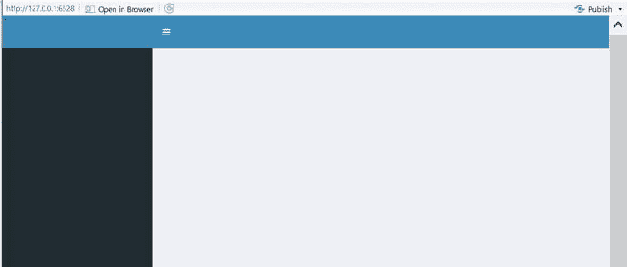

图 14-1. 最简单的 Shiny 仪表板相当空旷

```
library(shiny)
library(shinydashboard)

shinyApp(ui = ui, server = server)
```

# 定义用户界面

```r
ui <- dashboardPage(
    dashboardHeader(),
    dashboardSidebar(),
    dashboardBody()
)
```

# shinydashboard 组件

如前面代码所示，我们定义了服务器 `server <- shinyServer(function(input, output) {})` 并运行了应用程序 `shinyApp(ui = ui, server = server)`。我们有三个函数：`dashboardHeader()`、`dashboardSidebar()` 和 `dashboardBody()`。它们为我们的仪表板提供了良好的结构。它们都位于 `dashboardPage()` 内部，作为页面函数的五个形式参数中的前三个。最后两个参数包括 `title`（默认为 `NULL`）和 `skin`（取值为 `blue`、`black`、`purple`、`green`、`red` 或 `yellow` 颜色之一）。正如您可以通过 `formals(dashboardPage)` 命令自己看到的那样，该页面函数确实足够简单。`title` 参数控制浏览器本身（或在大多数流行浏览器中打开的多个标签页上的浏览器标签页）中的标题。`skin` 颜色选项控制仪表板的整体调色板。前三个形式参数本身也是函数，并且变得相当复杂。尽管如此，我们将依次讨论所有这三个。

### 仪表板标题

`dashboardHeader()` 函数也接受一个 `title` 形式参数，用于将用户定义的文本添加到标题区域，以及一个 `titleWidth` 参数来控制该文本的宽度。标题还接受其他几个 Shiny 用户界面风格的函数来控制页面导航，以及一些更专门的函数，允许更交互式的导航。在本章以及本书中，我们基本上忽略这些函数，以将 `shiny` 和 `shinydashboard` 作为向数据消费者提供已经熟悉的 R 代码的方式，而不是一次学习太多新功能。事实上，我们为这个函数提到的最后一个参数是 `disable`，它默认为 `FALSE`，当设置为 `TRUE` 时会完全隐藏标题。在我们的示例中，我们将以几乎空白的状态保留标题。

### 仪表板侧边栏

接下来是 `dashboardSidebar()` 函数，唯一明确列出的形式参数同样是 `disable` 选项和一个 `width` 参数。然而，这里除了列出的函数外，还有更多可能的函数。首先要知道的是，来自 `shiny` 的任何用户界面函数都可以在侧边栏中使用。因此，如果在菜单中放置滑块或下拉输入函数有意义，那是可能的。不过，也有一些仪表板库独有的函数适合放置在侧边栏区域。

第一个是 `sidebarMenu()` 函数。与 `dashboardSidebar()` 本身类似，该函数主要接受其他输入，并以高效的方式处理它们的组织。特别值得注意的是 `menuItem()` 函数，它在 `sidebarMenu()` 内部被调用。在这个示例中，我们将前一章创建的每个应用程序都放在它们自己的 `menuItem()` 调用中。如以下代码所示，此函数有几个形式参数：

```R
formals(menuItem)
$text
$...
$icon
NULL
$badgeLabel
NULL
$badgeColor
[1] "green"
$tabName
NULL
$href
NULL
$newtab
[1] TRUE
$selected
NULL
```

在上述函数和形式参数中，`text` 接受带引号的文本字符串，为该菜单上的特定项目提供文本信息或链接名称。`icon` 参数被赋予一个 `Font-Awesome` 图标的名称。我们在本章的参考部分提供了一个在线库的链接，展示了所有可能的图标选择。我们也可以切换到不同的图标库；我们将此类探索留给你们。`badgelabel` 调用在侧边栏的最右侧放置一个内联徽章，用于容纳一小段文本。徽章在将查看者的注意力吸引到特定菜单项目并因此吸引到底层应用程序方面做得很好。这些形式参数中有许多是可选的；但是，必须有一个与仪表板主体中的相关 `tabItem()` 链接的 `tabName`，或者必须为 `href` 命令提供一个 `URL`。如果提供的是 `URL` 而不是 `tabName`，那么如果您希望查看者在访问该页面时离开您的站点，可以将 `newtab` 从默认值 `TRUE` 更改为 `FALSE`。最后，通过将 `selected` 设置为 `TRUE`，可以将默认选项卡从第一个 `menuItem()` 强制更改为特定选项卡。

当我们把注意力转向仪表板的主体时，提醒您侧边栏也可以接受任何 Shiny 函数，例如 `img()` 函数，它指向一个必须包含在仪表板应用程序文件夹内名为 `www` 的文件夹中的图像。我们展示了我们示例菜单的一个代码片段（尚未运行）以及图 14-2 中的结果。前三个菜单项的名称应该从前一章中熟悉。

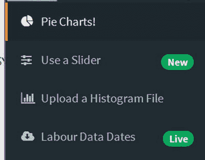
图 14-2. 一些 `sidebarMenu()` 和 `menuItem()` 函数的结果

```R
sidebarMenu(
menuItem("Pie Charts!", tabName = "PieChart_Time", icon = icon("pie-chart")),
menuItem("Use a Slider", tabName = "slider_time", icon = icon("sliders"), badgeLabel = "New"),
menuItem("Upload a Histogram File", tabName = "Upload_hist", icon = icon("bar-chart")),
menuItem("Labour Data Dates", tabName = "labour", icon = icon("cloud-download"), badgeLabel = "Live")
)
```

### 仪表板主体

如前面的代码所示，每个菜单项都有一个 `tabName`。我们现在将讨论 `dashboardBody()` 函数内部的代码，该代码将捕获那个 `tabName`。请查看以下代码和图 14-3 中的小（虽然不是最小的）Shiny 仪表板，然后我们将逐步介绍新行。

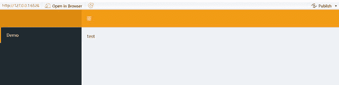
图 14-3. 一个侧边栏中有 `menuItem()`、主体中有 `tabItem()` 的仪表板。注意匹配的 First。

```R
library(shiny)
library(shinydashboard)
```

# 定义用户界面

```r
ui <- dashboardPage(
    dashboardHeader(),
    dashboardSidebar(sidebarMenu(menuItem("Demo", tabName = "First"))),
    dashboardBody(tabItems(tabItem(tabName = "First", "test"))),
    skin = "yellow")
```

# 定义服务器

```r
server <- shinyServer(function(input, output) {})
```

# 运行应用

```r
shinyApp(ui = ui, server = server)
```

仪表盘主体中可以放置许多项目。但是，如果我们想使用在侧边栏部分编写的标签页，就需要调用`tabItems()`。这个函数除了单个的`tabItem()`函数调用外不接受任何参数；每个`tabItem()`调用都需要有一个唯一的`tabName`，与`sidebarMenu()`中的唯一`tabName`相匹配。

每个`tabItem()`里面放什么呢？就像在 Shiny 中一样，使布局足够灵活，以便仪表盘能够适应不同大小的浏览器窗口是有好处的。因此，常用的`fluidRow()`函数会再次出现。回想一下，`fluidRow()`设置的最大行宽为 12。记住这一点，请密切注意我们将要讨论的用于填充这些行的三个框对象的默认宽度。当然，不止这三个对象；我们的目标是让您快速达到能够通过云端向用户或利益相关者提供数据服务的水平。

## 框对象

行中最基本的输入元素是`box()`。在这个函数内部，我们可以放置前一章中使用的任何应用代码，无论是用于获取用户输入还是输出响应式内容。不过，`box()`也接受九个特定参数。自然地，每个`box()`可以接受一个`title`值，这是一个用户定义的文本字符串，应简洁地描述框的内容或所需的操作。框的底部还有一个`footer`，也可以接受一个文本字符串。框还有一个`status`，可以设置为`primary`、`success`、`info`、`warning`或`danger`。每个状态值都有一个关联的颜色，这些颜色是默认层叠样式表结构的一部分，使得`shinydashboard`看起来相当美观。颜色相当一致，尽管根据您为整个仪表盘选择的颜色可能会有一些差异。

`solidHeader`的默认值是`FALSE`，当然，这可以改为`TRUE`。选择`TRUE`只会将状态的颜色增强为`title`文本的狭窄横幅背景。如果您希望框的主体区域具有特定颜色，可以将`background`设置为大约 15 种有效颜色选择之一。顾名思义，任何输入代码和输出代码都位于该`background`之上。

框的默认`width`是`6`，所以除非采取措施缩小它们，否则两个框会填满一行。如果不注意保持`fluidRow()`总宽度为`12`，可能会导致一些奇怪的布局。框的`height`也可以设置为固定高度。如果您需要非常整齐的行，这会很有帮助。最后，框是`collapsible`的，并且可能已经`collapsed`，尽管这两个选项的默认值都是`FALSE`。

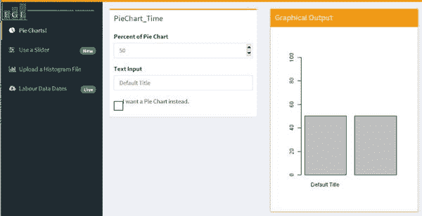
*图 14-4. 一个包含两个框和多个选项的熟悉应用——详见完整采样器代码*

### `valueBox()`

另一种类型的框是`valueBox()`，它接受六个正式参数。第一个是`value`，通常是一个短文本字符串或数值。`valueBox()`还接受一个`subtitle`参数，同样是一个文本字符串。您可以选择一个`icon`，尽管默认值是`NULL`。这些框的默认`color`是`aqua`，并且相当短，默认`width`仅为`4`。最后，`valueBox()`也接受一个`href`值，默认为`NULL`。我们在此展示采样器中数值框使用的代码：

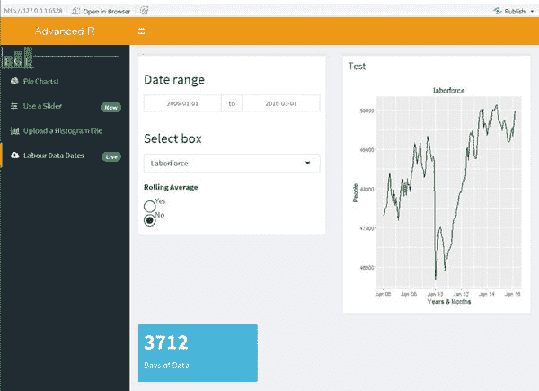
*图 14-5. 示例`valueBox()`，显示从网站实时获取的数据天数*

```r
valueBox(endYear-startYear, "Days of Data", icon = icon("calendar"))
```

### `infoBox()`

我们以`infoBox()`结束对`dashboardBody()`框的讨论，这是一个与`valueBox()`类似的框。这个框有一个接受文本字符串的`title`，一个在框中突出显示的`value`，可选的`subtitle`文本，以及默认的条形图`icon`。它的`color`默认也是`aqua`，`width`默认为`4`，`href`默认为`NULL`。不同之处在于`icon`更小，并且有一个`fill`选项（通常为`FALSE`），可以改变背景颜色的显示方式。我们不展示这个框，但它看起来与图 14-5 中的小框非常相似。根据我们的经验，这些框除了外观之外没有显著差异。

# 云端仪表盘

我们确实希望将这个仪表盘部署到云实例中，这涉及一组稍复杂的代码。我们再次使用`RStudio`在标准的`Shiny`文件夹中创建了它，因此它有自己的文件结构。在`Windows`上的文件结构如图 14-6 所示。我们的`shinydashboard_cloud`文件夹中有三个文件。注意`www`文件夹，它存放我们采样器的图像，然后是`app.R`文件，它包含我们整个`Shiny`应用以及`CSV`文件。

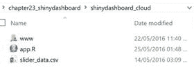
*图 14-6. `shinydashboard_cloud`的文件结构*

我们使用`WinSCP`将文件和文件夹上传到我们的`Ubuntu`云实例，如图 14-7 所示。

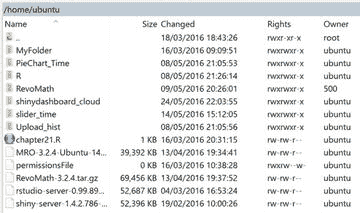
*图 14-7. `WinSCP`上传文件夹视图*

登录`PuTTY`后，我们确实有一些工作要做。我们的采样器使用了一些新的库，并且，当然，文件需要从用户文件夹移动到`Shiny`服务器期望它存放的位置。为简洁起见，我们只安装尚未在云实例上安装的包。

新包中的第一个是`XML`，这个包提供了从`Web`实时读取`HTML`表格的能力。各种政府和非营利机构将数据存储在此类表格中，以便公众轻松访问。我们还安装了`zoo`包，它为时间序列提供了方便的函数。已经熟悉的包是`ggplot2`和`data.table`，它们处理图形绘制并提供更高级的数据框结构。

以下命令在我们的实例上为所有用户逐一安装五个新库，然后复制文件以便可以通过浏览器访问。我们还安装了一些`Ubuntu`上必需的软件以允许`XML`包运行。为便于阅读，我们将其中一些命令分组。它们应在`PuTTY`中逐行运行，每个命令执行后屏幕上会打印一些文本。

```
sudo su - -c "R -e \"install.packages('shinydashboard', repos='https://cran.rstudio.com/')\""
sudo apt-get install libcurl4-openssl-dev libxml2-dev
sudo su - -c "R -e \"install.packages('XML', repos='https://cran.rstudio.com/')\""
sudo su - -c "R -e \"install.packages('zoo', repos='https://cran.rstudio.com/')\""
sudo su - -c "R -e \"install.packages('data.table', repos='https://cran.rstudio.com/')\""
sudo su - -c "R -e \"install.packages('ggplot2', repos='https://cran.rstudio.com/')\""
sudo cp -R ∼/shinydashboard_cloud /srv/shiny-server/
```

至此，我们关于`Shiny`和`Shiny`仪表盘的工作就完成了。您的仪表盘应该可以在`http://您的实例 IP 地址:3838/shinydashboard_cloud/`地址访问，并通过您的网络浏览器查看。在结束本章之前，我们还有几点说明。

首先，我们强烈建议您访问`Apress`网站上这本教科书的页面，并下载本章的代码包。它包含了完整、可用的文件和文件夹，如图 14-6 和图 14-7 所示。您无需手动键入所有这些代码来了解仪表板是否是您想要的功能。

其次，本章节中我们并未提供完整的示例代码。我们将这部分内容留到了最后，以确保所有内容在一个统一、连贯的整体中，并将您的注意力集中在示例代码中需要寻找的特定结构上。

第三，我们提醒您，如果您遵循了我们关于`AWS`服务器入站策略设置的安全建议，您可能需要更改这些设置，以允许除您自己之外的更多人查看您的最终仪表板项目。请记住，您需要在入站设置中更改的是允许从`0.0.0.0/0`（整个互联网）访问端口`3838`。请注意，整个互联网都将能够访问您的仪表板。如果您有敏感数据，甚至是不需要公开的信息，请考虑与`IT`专业人员或至少是`IT`高级用户合作。

最后，我们希望您和我们一样喜欢本章内容及成果。请务必探索“参考文献”部分的链接。您会找到有价值的信息，包括附加函数、完整的图标列表、第二个图标库，以及`shiny`和`shinydashboard`包的最新信息。这些包的更新相当频繁，新功能通常能带来出色的效果。

## 完整示例代码

```
library(shiny)
library(shinydashboard)
library(XML)
library(zoo)
library(data.table)
library(ggplot2)
#this code will run just once each time a session is instantiated - there may be multiple viewers in the same session.
slider_data=xlow]
yValue =4){  blsSub[,(yValue):=rollmean(get(yValue), k=3, na.pad = TRUE)] }
ggplot(data = blsSub, mapping = aes_string("Date", yValue)) +
geom_line()+
xlab("Years & Months")+
ylab("People")+
xlim(xlow, xhigh)+
ggtitle(yValue)+
scale_x_date(date_labels = "%b %y")
}) })

# Run the application
shinyApp(ui = ui, server = server)
```

# 15. 动态报告与云端

在前面的章节中，您了解了`Shiny`如何基于动态数据提供交互式环境。动态报告和实时仪表板有许多相似之处。另一方面，由于报告最终会生成为PDF，本章的交互性较低。报告是许多领域的常态，相关方通常需要的是时间点的快照，而非完全交互式的环境。通过`knitr`和`rmarkdown`包，我们可以基于数据输入创建文档（例如 PDF、HTML 或 Microsoft Word）。对于基于持续变化的数据但整体结构相同的定期报告来说，这是一个巨大的时间节省工具。

`rmarkdown`包（Xie, 2015）增加了将 R 流程嵌入此类文档的功能，允许一键分析，并使用多种样式进行精美的格式化。LaTeX 接口几乎可以实现任何所需的格式，尽管除了 PDF 还有其他选项。从基于从学生信息系统数据库实时拉取数据的招生董事会报告，到基于关键绩效指标绘制的战略计划行动表，当变量输入需要形成标准化输出时，动态报告效果最好。`knitr`和`formatR`包（Xie, 2015）也促进了这一点。

此外，在本章中，我们使用了`evaluate`包（Wickham, 2016）和`tufte`包（Xie, 2016）。这些包使我们能够更优雅地组织数据的布局和格式。我们还使用`ltm`包（Rizopoulos, 2006）进行心理测量测试。

本章的目标是增强我们本地和云端机器的软件环境，以便编译动态文档，探索独立`rmarkdown`的结构，开发一个允许用户上传数据然后下载 PDF 报告的 Shiny 页面，最后将所有内容推送到我们的云端实例。我们从所需软件开始。

## 所需软件

我们已经拥有了所需的大部分软件，即 R、`Shiny`包（Chang, Cheng, Allaire, Xie, and McPherson, 2016）、`PuTTY`以及我们在 Ubuntu 上的云实例。我们需要安装一些新的包——无论是在本地机器还是云端服务器上。

## 本地机器

首先，在您的 R 控制台中，重要的是运行以下代码，不依赖任何 R 文件：

```
install.packages("rmarkdown")
install.packages("tufte")
install.packages("knitr")
install.packages("evaluate")
install.packages("ltm")
install.packages("formatR")
```

安装完这些包之后，我们将注意力转向安装 `MiKTeX` (Schenk, 2009)，它能够创建 PDF 文件。只需快速访问 `MiKTeX` 网站 (`http://miktex.org/download`)，你就可以获取推荐的 basic 安装程序（32 位）或其他 basic 安装程序（64 位）。我们在系统上使用 64 位版本，尽管在本章中，不同版本之间可能不会有太大差异。下载完成后，在安装过程中接受所有默认设置。安装完成后，`MiKTeX` 包可能会有更新。要执行这些更新，请前往你的开始文件。在名为 `MiKTeX` 的文件夹中，你会在末尾附近找到 `Update` 选项。按照默认选项操作，然后选择所有包以更新到最新版本。虽然不是必须的，但我们建议在此次安装后重启计算机。

### 云实例

使用 `PuTTY` 访问你的云实例控制台。我们需要在控制台逐行运行以下代码。回想一下前面的章节，这些代码是为该服务器的所有用户（而不仅仅是你的用户）安装这些包。这是允许 `Shiny` 服务器访问正确包的关键。

```bash
sudo su - -c "R -e \"install.packages('rmarkdown', repos = 'http://cran.rstudio.com/')\""
sudo su - -c "R -e \"install.packages('tufte', repos = 'http://cran.rstudio.com/')\""
sudo su - -c "R -e \"install.packages('knitr', repos = 'http://cran.rstudio.com/')\""
sudo su - -c "R -e \"install.packages('ltm', repos = 'http://cran.rstudio.com/')\""
sudo su - -c "R -e \"install.packages('formatR', repos = 'http://cran.rstudio.com/')\""
sudo su - -c "R -e \"install.packages('data.table', repos = 'http://cran.rstudio.com/')\""
```

上述代码不会花费很长时间。然而，安装 `texlive`（Ubuntu 中用于替代 `MiKTeX` 的 LaTeX 解决方案）可能需要一些时间。它还需要相当大的磁盘空间，所以请确保你有足够的空间。在我们的试验中，需要完整版本。

```bash
sudo apt-get install texlive-full
```

之后，我们建议执行 `sudo reboot` 来重启你的云实例。这是做这件事的好时机，然后暂时关闭 `PuTTY`。当你的服务器重启时，你可以使用本地机器来探索动态文档。

## 动态文档

动态文档并非必须以任何方式链接到互联网。实际上，大多数报告可能都是内部的。在 `RStudio` 中，选择 File ➤ New File ➤ `R Markdown` 会打开一个向导。注意，其中有文档（例如，HTML、PDF 或 Word）以及演示文稿（例如，HTML 或 PDF）选项。通常需要提供一个标题，以及列出作者。当然，`RStudio` 并非必需；在 R 中创建一个以 `.Rmd` 后缀结尾的新文件就足够了。

我们打算采用一种混合的方法来介绍动态文档。也就是说，我们首先给出一个直观且信息丰富的示例，展示这类代码的样子，然后我们再对该代码的每个部分进行更深入的分析。我们从创建一个名为 `ch15_html.Rmd` 的新文件开始，并用以下代码填充它：

```
---
title: "ch15_html"
author: "Matt & Joshua Wiley"
date: "18 September 2016"
output: html_document
---

```{r echo=FALSE}
## notice the 'echo=FALSE'
## it means the following code will never make it to our knited html
library(data.table)
diris <- as.data.table(iris)
## it is still run, however, so we do have access to it.
```
# 这是一级标题；它不是注释。
这是纯文本，不是代码。
如果我们想要*斜体*或**粗体**，我们可以轻松地将它们添加到这些文档中。当然，我们可能需要提到 `rmarkdown` 是所使用的包，而内联代码很适合用来提及它。如果需要数学公式，那么可能需要 $x_1^2 + x_2^2 = 1$。
## 使用二级标题来调用数学公式
另一方面，我们可能需要显式地调用数学公式，在这种情况下，$x^{2} + y^{2}= \pi$ 是实现它的方式。
### 我喜欢删除线；我不太确定三级标题的用法。
在撰写报告时，我经常发现我想说某事是~~绝对愚蠢的~~与关键利益相关者明显相关的。
###### 如果你曾经写过需要六级标题的内容
那么我相信，正如这个无序列表所暗示的：
* 你需要从现在开始拥抱更少的秩序
- 你是否考虑过其他职业？
```{r echo=FALSE}
summary(diris)
```
然而，请注意，可以同时包含代码和控制台输出：
```{r}
hist(diris$Sepal.Length)
```
```

编织上述代码的结果如图 15-1 所示。


**图 15-1.** 一个简单动态文档的 HTML 输出

正如你所想象的，正是摘要数据或图形可以根据任何输入轻松地重新生成。事实上，其中一位作者使用动态文档为入门统计学课程的学生创建了案例研究（以及案例研究答案）。使用不同的种子生成伪随机数据非常容易，这允许每个学生拥有独特的数据集（以及几个主题）。它还允许为快速评分提供解答密钥。

现在你已经对 `Rmarkdown` 有了一个概览，让我们以合理的代码块来探索之前的代码。第一个代码块是 YAML，它代表 Yet Another Markup Language 或者可能是递归定义的 `YAML Ain’t Markup Language` (YAML, 2016) 头部。在最简单的情况下，它可能只包含关于标题、作者、日期和输出类型的信息。在这里，对于本文档，我们选择了 `html_document`。然而，如前所述，还有更多的选项，例如 `pdf_document`、`word_document`、`odt_document`、`rtf_document` 和 `beamer_presentation`（仅举几例——实际上还有更多）。这些类型分别创建 HTML 页面、PDF、Microsoft Word 文件、OpenDocument 或富文本，以及 Beamer PDF 幻灯片。`Beamer` 和 PDF 都需要我们之前完成的 `MiKTeX` 安装。要更改编译的文档类型，只需更改输出！值得注意的是，第一次使用 `MiKTeX` 时，编译可能需要更长时间，因为可能需要在后台安装一两个包。这无需任何用户干预；只是需要时间。同样值得注意的是，如果你使用 `beamer_presentation`，则需要考虑一张幻灯片上能放什么和不能放什么。在这种情况下，一个回车符后跟 `----`，再跟另一个回车符，表示演示文稿中的新幻灯片。

```
---
title: "ch15_html"
author: "Matt & Joshua Wiley"
date: "18 September 2016"
output: html_document
---
```

头部可以比这更复杂。可以使用 `` `r code goes here` `` 格式内联注入 R 代码。因此，我们可以通过在我们的代码中将 `date: "18 September 2016"` 替换为 ``date: "`r Sys.Date()`"`` 来使日期更具动态性。有数十种渲染选项可与 YAML 头部一起使用，比我们更聪明的人已经创建了使用这些头部变体以及设置多个不错选项的模板。就像在 `Shiny` 中一样，几乎可以无限制地自定义文档的输出和显示方式。

我们的 Markdown 代码接下来的部分是一个代码块。代码块以 ````{r }`` 开头，以 ```` ``` ```` 结束。这两者之间的内容就是你的代码。现在，在 `{r }` 内部有几个有用的选项。如果你的部分代码计算量大且大部分是静态的，你可能希望设置 `cache = TRUE` 而不是默认的 `FALSE`。这会存储结果。我们经常使用 `echo=FALSE`，它可以防止显示代码本身，但不会阻止代码结果的显示。请注意，在接下来的第一个代码块中，我们的最终文档里没有任何代码运行过的迹象。然而，第二个代码块仍然显示了 `summary(diris)` 的结果。

```
```{r echo=FALSE}
library(data.table)
diris <- as.data.table(iris)
```

```{r echo=FALSE}
summary(diris)
```
```

对于涉及图表或图形的代码块，也有许多选项。`fig.align` 选项可以设置为 `right`、`centre` 或 `left`。对于图形，还有 `fig.height` 或 `fig.width` 的高度和宽度设置，默认单位为英寸。

```
```{r fig.align="right"}
hist(diris$Sepal.Length)
```
```

最后，是文本本身，我们在此不再重复，因为其重要性稍低。我们确实注意到，代码既可以像在标题中那样内联编写。稍后，当我们想根据计算结果提供不同的叙述文本时，你会发现这个选项非常有用。

## 动态文档与 Shiny

我们现在将注意力转向提供不仅仅是动态文档，而且是一个他人可以通过动态输入进行控制的文档。我们构建了一个简单的 `Shiny` 环境，允许用户上传一个包含学生测验成绩数据的 CSV 文件。数据编码如下：列代表测验中的具体问题；行代表每个学生；测验为多项选择题，正确回答编码为 `1`，错误回答编码为 `0`。

与前一节一样，我们将查看实现该功能所需的三个文件的所有代码。然后，我们逐行分解这些代码。对于已经熟悉 `Shiny` 的读者，请随意跳到最后一部分。我们将此代码构建在一个名为 `Chapter15` 的文件夹中。稍后，当我们上传到 Ubuntu 服务器时，我们会上传整个文件夹。

### server.R

在 `Shiny` 服务器端，我们调用各种库，然后构建所需的系统来上传我们的 CSV 文件，向用户确认其文件已上传，将该文件读入 R，将所需信息传递到我们的标记文档中，然后允许用户将该文档下载为 PDF。只需要以下 55 行代码：

```r
##Dynamic Reports and the Cloud
library(shiny)
library(ltm)
library(data.table)
library(rmarkdown)
library(tufte)
library(formatR)
library(knitr)
library(evaluate)
function(input, output) {
output$contents <- renderTable({
inFile <- input$file1
if (is.null(inFile))
return(NULL)
read.csv(inFile$datapath, header = input$header,
sep = input$sep, quote = input$quote)
})
scores <- reactive({
inFile <- input$file1
if (is.null(inFile))
return(NULL)
read.csv(inFile$datapath, header = input$header,
sep = input$sep, quote = input$quote)
})
output$downloadReport <- downloadHandler(
filename = function() {
paste('quiz-report', sep = '.', 'pdf')
},
content = function(file) {
src <- normalizePath('report.Rmd')
owd <- setwd(tempdir())
on.exit(setwd(owd))
file.copy(src, 'report.Rmd', overwrite = TRUE)
knitr::opts_chunk$set(tidy = FALSE, cache.extra = packageVersion('tufte'))
options(htmltools.dir.version = FALSE)
out <- render('report.Rmd')
file.rename(out, file)
}
)
}
```

上述代码以调用所有库开始，然后迅速进入 Shiny 的 `function(input, output) {}` 服务器端包装器。之后，主要有三个代码块。我们依次查看每一个，从 `renderTable({})` 调用开始。这会在用户界面端生成输出。具体来说，它创建了一个表格。这是一个交互式函数，当用户在用户端上传文件时，Shiny 会提醒该函数其某个输入已发生变化。这会触发代码的运行。从入口端来看，`input$datapath` 是服务器上 Shiny 存储上传文件的位置。假设确实存在一个文件，`read.csv` 可以访问该文件的数据路径，并获取有关数据是否有标题、使用了何种分隔符以及用户设置的其他一些信息。实际上，可以向用户提出更多要求，以实现更定制化的分析。在此，我们保持示例简单而有效。这次读取的结果创建了一个表格，并将该表格存储在名为 `contents` 的输出变量中。这会产生一个净效果，即 Shiny 现在会提醒用户界面端有可用的输出。我们将在本章后面看到该输出去了哪里。

```r
output$contents <- renderTable({
inFile <- input$file1
if (is.null(inFile))
return(NULL)
read.csv(inFile$datapath, header = input$header,
sep = input$sep, quote = input$quote)
})
```

除了创建一个表格以便用户能立即看到其文件上传是否成功（并且我们设想在真实场景中，或许可以在用户界面上添加评论，让用户发现上传失败），我们还必须以允许我们的 Markdown 文件使用这些数据的格式来读取数据。我们将数据读入一个名为 `scores` 的变量。这是一个响应式函数，始终警惕相关输入变量的变化（在此例中，即文件的上传）。

```r
scores <- reactive({
inFile <- input$file1
if (is.null(inFile))
return(NULL)
read.csv(inFile$datapath, header = input$header,
sep = input$sep, quote = input$quote)
})
```

服务器端的最后一部分最为复杂，它控制着用户可访问的下载文件。本区块的第一部分控制用户下载的报告名称。我们将其命名为`quiz-report.pdf`，这看似复杂，但该代码为我们提供了未来调整报告类型或性质的灵活性，便于更改文件类型或名称。注意，如果使用 RStudio 的内部浏览器，报告下载时会使用不同的名称。接下来，我们对 Markdown 文件调用`normalizePath()`，该函数返回当前工作目录的路径，并在参数后附加文件名。具体而言，它会根据代码所在的操作系统环境返回路径。这很重要，原因有二：首先，它使得代码可在 Windows 和 Ubuntu（或任何操作系统）之间移植；其次，我们即将更改工作目录，因此直接调用`report.Rmd`将不再有效。

更改工作目录是必要的，因为我们即将创建一个新的 PDF 文件。在拥有管理权限的本地机器上，创建新文件毫无问题。然而，我们的目标是上传到云端，而并非所有服务器都能确保拥有此类权限。因此，我们将工作目录更改为服务器的临时目录。在 R 中，`setwd(tempdir())`执行两项操作：它同时复制并返回当前工作目录，然后更改目录为参数指定的目录。因此，`owd`代表旧工作目录。我们设置`on.exit()`参数，以确保`downloadHandler`完成后，工作目录恢复到原来状态，从而避免 Shiny 网站崩溃。

现在，我们将 Markdown 文件从旧工作目录的原始位置复制到临时区域，使其能在该临时目录中运行并生成 PDF。我们还为`knitr`（负责生成 Markdown PDF）设置了一些环境选项，以支持`tufte`格式（以 Edward Tufte 命名，参见[`rmarkdown.rstudio.com/tufte_handout_format.html`](http://rmarkdown.rstudio.com/tufte_handout_format.html)）。剩下的工作就是`render()`我们的 Markdown 文档，然后将文件重命名为所需名称。

```r
output$downloadReport <- downloadHandler(
  filename = function() {
    paste('quiz-report', sep = '.', 'pdf')
  },
  content = function(file) {
    src <- normalizePath('report.Rmd')
    owd <- setwd(tempdir())
    on.exit(setwd(owd))
    file.copy(src, 'report.Rmd', overwrite = TRUE)
    knitr::opts_chunk$set(tidy = FALSE, cache.extra = packageVersion('tufte'))
    options(htmltools.dir.version = FALSE)
    out <- render('report.Rmd')
    file.rename(out, file)
  }
)
```

我们已看到，Shiny 服务器端需要能够根据相应的输入信息（例如是否存在表头）读取用户上传的文件，并负责启动`Rmarkdown`进程。诚然，要让该进程在任何计算机上工作，需要更改工作目录以及对布局和格式选项进行一些调整。我们在此部分结束时指出，简单的 PDF 设置起来会更简单（尽管我们承认更喜欢更简洁的`tufte`布局）。现在，我们将注意力转向用户界面。

### ui.R

对于这个非常简单的 Shiny 应用程序，用户界面相当简洁。仅用 40 行代码（实际上我们本可以移除一些选项），用户就可以上传 CSV 文件，查看该文件渲染的表格，并下载文件的分析结果。像之前一样，我们先给出完整代码，然后逐一说明每个区块：

```r


# Dynamic Reports and the Cloud User Interface

```r
shinyUI(
  fluidPage(
    title = 'Score Control Panel',
    sidebarLayout(
      sidebarPanel(
        helpText("Upload a wide CSV file where
          each column is 0 or 1 based on whether the student
          got that question incorrect or correct."),
        fileInput('file1', 'Choose file to upload',
          accept = c(
            'text/csv',
            'text/comma-separated-values',
            'text/tab-separated-values',
            'text/plain',
            '.csv',
            '.tsv'
          )
        ),
        tags$hr(),
        checkboxInput('header', 'Header', TRUE),
        radioButtons('sep', 'Separator',
          c(Comma=',',
            Semicolon=';',
            Tab='\t'),
          ','),
        radioButtons('quote', 'Quote',
          c(None='',
            'Double Quote'='"',
            'Single Quote'="'"),
          '"'),
        tags$hr(),
        helpText("This is where helpertext goes"),
        downloadButton('downloadReport')
      ),
      mainPanel(
        tableOutput('contents')
      )
    )
  )
)
```

与往常一样，用户界面包含`fluidPage()`以及`sidebarPanel()`和`mainPanel()`。主要事件发生在侧边栏内，因此我们首先查看那里。`fileInput()`函数用于获取输入文件。我们可以控制接受的文件类型，并将范围限制为逗号分隔值或制表符分隔值。我们将上传控件命名为`file1`，回顾一下，在服务器端我们使用`input$file1`来读取文件。

```
fileInput('file1', 'Choose file to upload',
  accept = c(
    'text/csv',
    'text/comma-separated-values',
    'text/tab-separated-values',
    'text/plain',
    '.csv',
    '.tsv'
  )
),
```

另一个主要的关注点是下载区域。其理解起来并不复杂：

```
downloadButton('downloadReport')
```

虽然有辅助文本框向用户进行说明，并且我们确实建议实际中设置示例布局，以便用户理解可接受的输入，但我们选择将此用户界面尽可能保持精简。在转向实际的报告文件之前，我们在图 15-2 中展示了上传`scores.csv`文件（该文件可在 Apress 网站上获取）后 Shiny 应用程序的界面。

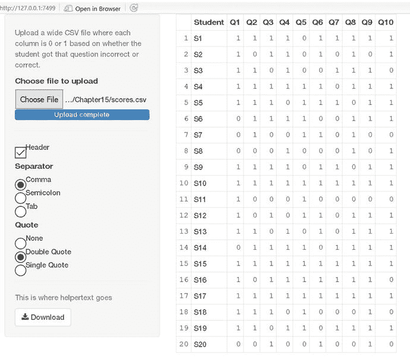

图 15-2. 本地托管网站上的 Shiny 用户界面

### report.Rmd

本报告涉及测验或其他考试中每个问题的学生得分。我们的目标是将图 15-2 中所示的输入转换为关于问题和测试有效性的可操作摘要信息。在阅读首次展示的全部代码之前，请花一点时间将此代码与独立的 Markdown 文件进行比较。两者没有重大区别。实际上，判断此文件是否由 Shiny 应用程序渲染的唯一方法是查看读取`scores <- scores()` 的这一行代码。

```
title: "Example Scoring Report"
subtitle: "Item-Level Analysis"
date: "`r Sys.Date()`"
output:
  tufte::tufte_handout: default
```

# Raw Data
Here is a sample of the data uploaded including the first few and last rows, and first few and last columns:

```
scores <- scores()
```

```
if (ncol(scores) > 6) {
  row.index <- c(1:3, (nrow(scores)-2):nrow(scores))
  col.index <- c(1:3, (ncol(scores)-2):ncol(scores))
  scores[row.index, col.index]
} else scores[1:min(nrow(scores), 6), ]
```

# 6. 编写一个包

包是记录、共享和分发 R 代码和数据的基本方式。我们的目标是编写自己的包，需要提醒的是，由于 R 包开发过程中会用到许多软件工具，本章会特别复杂。

在本章中，我们使用了四个包。`devtools`包（Wickham and Chang, 2016）提供了一系列函数来帮助搭建、文档化和管理 R 包的开发。`roxygen2`包（Wickham, Danenberg, and Eugster, 2015）通过允许使用注释在函数旁边内联编写函数文档，极大地简化了 R 包文档的编写。我们还使用了另外两个不那么关键的包。`testthat`包（Wickham, 2011）不是必需的，但它提供的函数通过测试函数是否返回预期值来促进质量控制。同样，`covr`包（Hester, 2016）通过测试被测试执行的包代码的百分比（覆盖率）来促进质量控制。理想情况下，100%的代码都应被测试覆盖，尽管实际上许多 R 包没有测试，因此任何覆盖率都优于平均水平。在包中，我们使用了第[5 章中用于`ggplot2`的方法之一，因此我们还包含了大家熟悉的`ggplot2`（Wickham, 2009）包。

编写包可能是一个复杂的过程。熟悉最终产品可能会有所帮助，该产品可在[`https://github.com/ElkhartGroup/AdvancedRPkg`](https://github.com/ElkhartGroup/AdvancedRPkg)在线获取。在阅读本章时，如果你不确定某个文件位置是否正确或设置是否正确，我们也建议参考我们官方 GitHub 上的包记录。以下代码加载了`checkpoint`（Microsoft Corporation, 2016）包以控制所用 R 包的精确版本，然后加载所需的包：

```r
## load checkpoint and required packages
library(checkpoint)
checkpoint("2016-09-04", R.version = "3.3.1")
library(testthat)
library(devtools)
library(roxygen2)
library(covr)
library(ggplot2)
options(width = 70) # only 70 characters per line
```

## 开始之前

本章涵盖编写 R 包的一些基础知识，并介绍一些工具来简化官方手册《编写 R 扩展》（在线地址：[`https://cran.r-project.org/doc/manuals/R-exts.html`](https://cran.r-project.org/doc/manuals/R-exts.html)）中未包含的流程。该手册技术性可能较强，但它是一份权威指南。如果你计划向`CRAN`提交 R 包，这是必读材料；即使你只打算为自己或更有限的用户群体（如你的公司或实验室小组）开发包，也建议阅读。

许多 R 包包含来自其他编程语言的代码，例如`C`、`C++`、`Fortran`或`Java`。这通常是因为像`C`这样的语言可以被编译和优化，运行速度远快于`R`，因此包开发者可能会选择将计算密集型的代码部分用编译型且高效的语言编写。然而，本章我们只讨论如何编写包含纯`R`代码或数据的 R 包，因为其流程几乎相同，大多数差异仅在于所包含语言的特殊性（例如`makefiles`）。

在开发 R 包之前，需要一些工具。实际上，对于那些不习惯软件开发的人来说，编写 R 包可能需要一套相当令人生畏的工具链。如果你使用的是 Linux 系统，很可能已经安装了其中许多工具，或者可以轻松安装它们。在 Windows 和 Mac OS 上，可能需要更多设置。无论哪种系统，这些工具都必须可访问，这意味着要将它们添加到系统路径中，以便在命令行调用时能够找到。

如果使用 Windows，所需的主要工具（一些命令行工具以及编译器）可从二进制安装程序获得，地址为[`https://cran.r-project.org/bin/windows/Rtools/`](https://cran.r-project.org/bin/windows/Rtools/)。在安装的最后一步之前，有两个复选框，其中一个可能未被选中，它负责将这些工具添加到系统路径。请将两个复选框都选中。另外，你还需要`LaTeX`，一个排版系统。`MiKTeX`是一个流行的选择（[`www.miktex.org/`](http://www.miktex.org/)）；如果你的系统是 64 位，请务必选择 64 位选项。虽然在大多数情况下，这两个软件的默认选项已经足够，但我们建议`MiKTeX`用户将“即时安装默认包”的选项改为“是”。关于所需工具链的更多详细信息，请参见 R 手册：[`https://cran.r-project.org/doc/manuals/R-admin.html#The-Windows-toolset`](https://cran.r-project.org/doc/manuals/R-admin.html#The-Windows-toolset)。

如果使用 Mac OS，请从 App Store 获取`Xcode`（开发者工具）。你可能还需要获取`XQuartz`（[`https://xquartz.macosforge.org/`](https://xquartz.macosforge.org/)）。与 Windows 一样，你需要`LaTeX`。`MacTeX`是一个选择（[`www.tug.org/mactex/`](http://www.tug.org/mactex/)）。其他详细信息请参见 R 手册（[`https://cran.r-project.org/doc/manuals/R-admin.html#OS-X`](https://cran.r-project.org/doc/manuals/R-admin.html#OS-X)）。

在着手编写第一个 R 包之前，还需要做两个决定。首先，给 R 包起什么名字？这项看似简单的任务变得复杂，因为目前`CRAN`上有超过 8000 个 R 包，而且数量正在快速增长（[`https://cloud.r-project.org/web/packages/available_packages_by_name.html`](https://cloud.r-project.org/web/packages/available_packages_by_name.html)）。虽然你可以给一个不打算上传到`CRAN`的包起一个与`CRAN`上已存在的包相同的名字，但如果你将来使用该`CRAN`包或任何依赖它的其他包，这样做就会产生问题。即使你的包不提交到`CRAN`，将来也可能有其他人编写一个同名包并提交到`CRAN`。出于这些原因，选择包名需要深思熟虑。在本章中，所有示例都将构建一个名为`AdvancedRPkg`的 R 包。第二个决定是给包使用什么许可证。如果你计划提交到`CRAN`，许可证必须与`CRAN`兼容。即使包永远不会提交到`CRAN`，许可证可能仍然相关。在本章中，我们使用`GPLv3`许可证。

## 版本控制

到目前为止，我们讨论的都是相对随意的代码开发、一些基础编程、函数和类。开发新的 R 包则更为复杂，需要管理更多的文件。面对这种更高的复杂性，拥有一个高效的系统来备份文件并回溯到早期版本会很有帮助。版本控制系统提供了一种绝佳的方式，既能备份代码，又能将更改回滚到之前的版本（例如，当实现新功能的修改破坏了旧功能或引入了 bug 时）。目前存在多种版本控制系统，但当下最流行的或许是开源软件`Git`，它最初是为 Linux 内核提供版本控制而开发的。`Git`可以直接通过命令行使用，也可以通过多种图形界面使用。许多人使用`GitHub`（<https://github.com/>），这是一项基于`Git`的服务，它在线托管仓库，且对公共项目免费。`GitHub`也为 Windows 和 Mac OS 提供了图形界面（<https://desktop.github.com/>）。然而，如果你不想学习或使用`Git`或其他版本控制系统，可以放心地忽略本节以及本章中所有仅与版本控制相关的命令。

我们在本章中使用`Git`（和`GitHub`）为 Windows 环境下的示例 R 包提供版本控制。具体来说，本书使用的是 Windows 版 GitHub 桌面客户端 v3.3.0。`Git`仓库可以只在本机使用，但配合`GitHub`使用可以方便地协作开发包，并轻松地与其他人共享早期包代码。

可以通过命令行设置`Git`仓库，但对于新用户来说，最直观的方式或许是在线直接通过`GitHub`创建一个新的`Git`仓库。我们为本章开发的 R 包创建了一个新仓库，并将其命名为`AdvancedRPkg`。该仓库初始化时包含一个`README`文件，稍后我们将对其进行编辑。我们可以通过将某些文件或具有特定扩展名的文件添加到一个名为`.gitignore`的文件中，来告诉`Git`忽略它们。每个文件或扩展名单独占一行。我们可以稍后编辑它，但现在，我们只需让`GitHub`创建一个。图 6-1 展示了进行此操作的步骤。


**图 6-1.** 用于创建`AdvancedRPkg`仓库的 GitHub 页面

如果一切按计划进行，结果应该类似于图 6-2。该仓库除了`README`和`.gitignore`文件外是空的。


**图 6-2.** 显示已创建的`AdvancedRPkg`仓库的 GitHub 页面

接下来，我们可以将这个仓库克隆到本地计算机上。这实质上创建了一个本地副本，我们将在其中进行包的编写。为此，请打开 GitHub 桌面客户端，点击 + 号，选择“克隆”（Clone），然后选择该仓库，如图 6-3 所示。


**图 6-3.** GitHub 桌面客户端克隆`AdvancedRPkg`仓库

点击“克隆”后，我们会看到一个选项，可以选择要将仓库克隆到的目录。请注意，无论您选择哪个目录，系统都会为仓库创建一个与仓库同名的（即`AdvancedRPkg`）新目录。仓库的设置可以通过终端进行管理，或者点击 GitHub 桌面客户端中的齿轮图标并选择“仓库设置”（Repository Settings）进行管理。其中一项设置会显示当前被忽略的文件。文件是根据`.gitignore`文件被忽略的，由于我们在创建仓库时较早地选择了 R，因此默认包含了一些通常希望忽略的默认文件扩展名（图 6-4）。


**图 6-4.** GitHub 桌面客户端显示`AdvancedRPkg`仓库的设置，包括被 Git 仓库忽略的各种文件扩展名

Windows 经常在目录中创建临时（有时是隐藏的）文件`desktop.ini`。为了避免包含这些文件，我们可以编辑仓库设置，在末尾添加新的一行并输入`desktop.ini`。这样这些文件就会被忽略。被忽略的文件是那些 Git 仓库不跟踪且不存储其随时间变化内容的文件。它们仍然存在于目录中；Git 只是不监控和版本管理它们。

除了设置一个新的 Git 仓库，你可能经常使用 Git 执行的任务是提交对仓库的更改，以及将仓库的本地副本与在线（GitHub）版本同步。提交可以被认为是拍摄提交时文件状态的快照。为了避免冗余，提交只会对自上次提交以来发生更改的文件进行快照。尽管即使是略微修改过的二进制文件也可能难以比较，但像 R 代码这样的纯文本文件则易于比较。Git 在随时间跟踪文本文件的更改方面效率极高，并允许你查看所做的更改或回退到过去的特定时间点。访问项目（仓库）的变更历史在代码中引入错误或 bug 时尤其有用，这样可以精确定位 bug 是什么时候引入的（例如，有多少基于该代码的结果可能受到影响？），并查看之前的代码工作版本。

在稍微复杂一些的用例中，Git 可以有效地用于管理代码的不同版本。例如，常见的情况是拥有一个项目，并定期发布稳定版或生产就绪版的代码，同时继续进行开发。在 Git 中，这是通过使用同一仓库的不同分支，并定期将一个分支（例如，开发分支）的部分更改合并到稳定分支来实现的。

在本章中，我们还会展示一些相关的 Git 命令。关于使用 Git 的更多背景知识，一个极好的免费资源是 Scott Chacon 和 Ben Straub 合著的 *Pro Git*（Apress, 2014），可从 <https://progit.org/> 获取。要查找问题和答案，Stack Overflow（<http://stackoverflow.com>）是一个不错的资源。很可能已经有人问过与您类似的问题，如果没有，您可以提问并获得答案。另请注意，如果您使用 RStudio 来编写 R 代码，它内置了一些与 Git 的集成功能。更多信息，请参阅 RStudio 支持页面：<https://support.rstudio.com/hc/en-us/articles/200532077-Version-Control-with-Git-and-SVN>。最后，请注意，您可以在 <https://github.com/ElkhartGroup/AdvancedRPkg> 公开访问在线仓库。

## R 包基础

一个 R 包本质上就是一个包含特定文件的目录。尽管 R 包的核心无疑是 R 代码，但其中许多文件并非严格意义上的 R 代码。表 6-1 列出了可能出现在 R 包目录根目录下的主要文件。根据包的其他特性，并非所有这些文件都是必需的。本章稍后我们将借助`devtools`包来帮助创建其中的一些文件。

表 6-1. 可能用于 R 包根目录的文件

| 文件 | 描述 |
| --- | --- |
| `DESCRIPTION`* | 提供关于包的通用信息。必填字段包括：Package（包名）、Version（版本）、License（许可证）、Title（包描述）、Author（作者）和 Maintainer（维护者，可与作者相同或不同）。除非包是独立的，否则通常还包括依赖关系信息。 |
| `NAMESPACE`* | 控制包的命名空间，包括导出哪些对象以及从其他包导入哪些对象。虽然是必需文件，但我们将通过`roxygen2`包自动生成。 |
| `README`/`README.md` | 非必需，R 会忽略此文件，但对读者和用户有帮助。提供关于包的通用信息（如获取帮助的途径、简要概述、安装指南，或任何其他在简短文档中有用的内容）。 |
| `NEWS` | 提供关于包变更或新闻的信息。通常包括新功能、错误修复，以及与先前版本相比的其他重大变化。 |
| `LICENSE` | 如果未使用常见许可证或需要额外信息，则提供许可证文件。 |
| `INDEX` | 可选，由文档文件自动生成。但如果指定，则会在每一行以名称和描述的形式列出所有有趣/有用的对象。 |
| `configure`、`cleanup` | 可选的 Bourne Shell 脚本，分别在 Unix 系统（例如 Linux、Unix）安装前后运行。 |

* 表示必需文件

除了根级别的文件外，R 包中还可以包含多个子目录。这些子目录列于表 6-2 中，并附有简要说明。对于我们相对简单的包，我们只用到其中少数几个，包括`R`、`man`和`tests`。

表 6-2. R 包子目录

| 子目录 | 描述 |
| --- | --- |
| `R`* | 包含所有函数、类、方法等 R 源代码的目录。 |
| `man`* | 包含 R 文档文件的目录。我们通过`roxygen2`包自动生成这些文件。 |
| `tests` | 可选目录，包含用于测试包是否按预期工作的 R 代码。 |
| `data` | 可选目录，包含随包一起分发的数据。通常包含的数据集较小，用于演示包的特性，而非作为共享数据的主要方式。 |
| `demo` | 可选目录，包含 R 包的演示内容，以 R 源代码文件形式存在。 |
| `exec` | 可包含其他必需的可执行脚本。仅包含文件，不包含子目录。 |
| `inst` | 可包含在安装包时复制到安装目录的其他文件。例如，可用于与用户共享`NEWS`文件，或包含图片及其他非标准文档。 |
| `po` | 用于添加 C 和 R 错误消息的翻译以及其他本地化相关任务。 |
| `src` | 通常包含其他语言（如 C、C++或 Fortran）的源代码。这些代码通常需要编译；如果你使用它，通常需要指定一个 Makefile。 |
| `tools` | 不常用，但可用于提供配置所需的其他文件。 |
| `vignettes` | 用于提供一个或多个软件包使用手册或指南。与通常仅针对特定函数的函数文档相比，软件包使用手册通常包含更多入门背景和关于如何使用整个包的完整示例。虽然不是必需，但对用户非常有帮助。 |

* 表示必需子目录

### 使用 DevTools 启动一个包

在包的根目录下，你至少需要`DESCRIPTION`和`NAMESPACE`文件。你还需要一个名为`R`的子目录，顾名思义，这是放置 R 代码的地方。这不足以将包提交到 CRAN，但足以启动一个供私人使用的功能性包。然而，即使仅供私人使用，适当的文档也极有帮助。包的目录和文件结构相当复杂，尤其是用文字描述时。因此，作为参考，以下是我们包在学完本章后应具备的最终目录结构，该结构位于`AdvancedRPkg`目录内：

```
.
├── data
│   └── sampleData.rda
├── DESCRIPTION
├── man
│   ├── ggplot.lm.Rd
│   ├── meanPlot.Rd
│   ├── sampleData.Rd
│   └── textplot-class.Rd
├── NAMESPACE
├── R
│   ├── plot_functions.R
│   ├── sampledata.R
│   └── textplot.R
├── README.md
└── tests
    ├── testthat
    │   └── test_textplot.R
    └── testthat.R
5 directories, 13 files
```

对于初始设置，我们使用`setup()`函数。我们可以指定更多信息，但最小要求是路径。我们还设置了`rstudio = FALSE`，以便代码能适用于任何编辑器，而不仅仅是 RStudio。要查看已创建的内容，我们可以使用`list.files()`函数，该函数会显示已创建了`DESCRIPTION`和`NAMESPACE`文件以及一个`R`目录。对于以下代码，请在 R 命令行中运行，或创建一个新的 R 文件（我们将其命名为`chapter 06.R`）。请注意，调整`path`参数以指向包含 Git 仓库的目录非常重要，即你在本地机器上克隆该仓库的位置。在我们的例子中，R 的工作目录（你可以通过调用`getwd()`函数来检查）位于`AdvancedRPkg`目录的上一级目录。如果你的 R 会话不在该目录，请调整`path`参数，或使用`setwd()`函数将 R 的工作目录更改为`AdvancedRPkg`的父目录：

```r
setup(
    path = "AdvancedRPkg/",
    rstudio = FALSE)
```

```
Creating package 'AdvancedRPkg' in '~/Apress_AdvancedR/RFiles'
No DESCRIPTION found. Creating with values:
Package: AdvancedRPkg
Title: What the Package Does (one line, title case)
Version: 0.0.0.9000
Authors@R: person("First", "Last", email = "first.last@example.com", role = c("aut", "cre"))
Description: What the package does (one paragraph).
Depends: R (>= 3.3.1)
License: What license is it under?
Encoding: UTF-8
LazyData: true
```

```r
list.files("AdvancedRPkg")
```

```
[1] "DESCRIPTION" "NAMESPACE"   "R"           "README.md"
```

输出还显示了一些字段以及用于填充这些字段的信息。由于这些大多是占位符，我们需要使用文本编辑器（任何编辑器均可，包括 RStudio）打开文件并进行修改。根据目录，`setup()`函数推测了包名，但其余内容需要填写。我们使用编辑器将这些字段修改为如下内容：

```
Package: AdvancedRPkg
Title: An Example R Package for the Book Advanced R
Version: 0.0.0.9000
Authors@R: c(
person("Matt", "Wiley", email = "matt@elkhartgroup.com", role = c("aut")),
person("Joshua F.", "Wiley", email = "josh@elkhartgroup.com", role = c("aut", "cre")),
person("Elkhart Group Ltd.", role = "cph")
)
Description: This package will demonstrate the basics of an R
package including documentation and tests.
Depends: R (>= 3.3.1)
License: GPL (>= 3)
Encoding: UTF-8
LazyData: true
```

注意版本号，其格式为`Major.Minor.Patch.DevelopmentVersion`。关于确定软件版本因素的精彩概述，请参见语义化版本规范（[http://semver.org/](http://semver.org/)）。该规范在建议方面相当有指导性，但拥有一套固定的规则来确定软件的主版本号或次版本号通常很有帮助。最后一部分`DevelopmentVersion`仅存在于开发版本中，并在发布时被移除。尽管有这些规则和指南，但许多 R 包的实际版本情况却更加多样和不一致（并非每个人都同意这些规则，即使同意的人也并非总是严格遵守）。

接下来是作者信息，使用`person()`函数描述。除了每个人的姓名和电子邮件外，还使用三个字母的缩写来描述角色和关系。所有可能性都在 MARC 关系者代码列表中列出（[www.loc.gov/marc/relators/relaterm.html](http://www.loc.gov/marc/relators/relaterm.html)）。然而，最常用的缩写包括：`aut`代表作者，`cre`代表创建者（即项目负责人，或者用 R 术语来说，是遇到问题时要投诉的人——维护者），以及`cph`代表版权持有者。然后，我们用几句话描述包，指定包所依赖的 R 版本、许可证，以及数据可以按需加载（以节省启动时间）。

#### 添加 R 代码

有了包的基本结构后，是时候开始添加一些 R 代码了，这正是包的核心所在！由于本章的重点是打包代码，我们将复用前面章节中的一些函数和类。第一步，我们在`AdvancedRPkg/R/`目录下创建两个文件：`plot_functions.R`和`textplot.R`。

接下来，我们从第 4 章复制最终的`meanPlot()`函数，用于绘制带有均值的图表。我们将此函数的代码以及在第 5 章编写的 S3 方法`ggplot.lm()`一起添加到`plot_functions.R`中。然后，我们将第 5 章中`textplot`类的类和方法（`show`和`subset`，即括号运算符`[`）复制到`textplot.R`中。由于容易复制错误的代码，我们建议从我们的 GitHub 仓库（[https://github.com/ElkhartGroup/AdvancedRPkg](https://github.com/ElkhartGroup/AdvancedRPkg)）复制和粘贴代码。如果一切正常，它应该看起来像这样：

```r
list.files("AdvancedRPkg/R")
```

```
[1] "plot_functions.R" "textplot.R"
```

顺便提一下，决定分成多少个单独的文件可能比较困难。这对 R 本身没有影响，但对开发过程有影响。将所有代码放在一个文件中不好，将每个函数、类和方法都拆分成单独的文件也不好。如果结果文件不太长，我们尝试将相关的函数（如绘图函数）归为一组，并将相关的类和方法归为一组。根据常识，即使可以，也不要给文件起仅通过大小写区分的相同名称；在文件名中使用特殊字符或符号通常也是个坏主意。

现在我们已经有了一个基本的包模板，可以使用`devtools`包中的`load_all()`函数来加载这些函数。我们只需要指定包的路径即可。然后，我们可以看到一些函数在包的命名空间中可用，这通过使用`ls()`函数并指定要列出可用对象的位置来实现：

```r
load_all("AdvancedRPkg")
```

```
Loading AdvancedRPkg
```

```r
ls(name = "package:AdvancedRPkg")
```

```
[1] "ggplot.lm" "meanPlot"  "textplot"
```

在第 4 章中，我们简要讨论了作用域问题。编写包时，理解作用域变得更加重要。包的作者可以编写与其他包中函数同名的函数。虽然这些函数不会互相覆盖，但明确你想要调用哪个函数可能会让人困惑。这时包命名空间就很有帮助了。命名空间控制从其他包导入哪些函数（因此被该包内的代码使用），以及从该包导出哪些函数，使其对包的公开可用。你可以使用`import`功能从其他包中导入特定函数。如果你需要另一个包中的许多函数，你可以决定让你的包依赖于那个包，在这种情况下，该包的所有公共函数对你的包都是可用的。导入和依赖另一个包之间的另一个区别在于包加载时发生的情况。如果包 B 依赖于包 A，当用户调用`library(B)`时，包 B 和包 A 都会被加载并附加。如果包 B 从包 A 导入函数，当用户调用`library(B)`时，包 B 会被加载并附加，而包 A 会被加载但不会附加。因为包 A 被加载了，它的函数对于包 B 内部的代码是可用的，但由于包 A 未被附加，这些函数不会直接暴露给用户。即使包 A（或包 B）被加载并附加，也只有导出的函数对用户公开可用。这很有好处，因为它允许包开发者编写和记录仅供内部使用的函数。如果你不需要导出一个函数，那么最好不要导出它。如果两个 R 包导出了同名的函数，并且用户加载并附加了两个包，那么后加载的包中的函数会屏蔽先加载的包中的函数。对于用户来说，唯一的选择就是不加载并附加其中一个包，或者使用双冒号运算符`PkgA::foo()`、`PkgB::foo()`显式进行函数调用。面对成千上万的 R 包和更多的函数，只导出必要的函数有助于避免此类名称冲突和屏蔽问题。

所有这些都通过包的`NAMESPACE`文件进行控制。虽然我们没有查看，但我们的包确实有一个`NAMESPACE`文件，它是在我们运行`setup()`时创建的。然而，`load_all()`函数的独特之处在于，默认情况下，当它加载一个包时，它会导出所有对象。这是因为在开发过程中，能够调用所有函数（无论是否导出）通常很方便。

## 测试

随着我们为新包添加函数和方法，并能在 R 中运行，我们可以开始考虑质量控制问题。编写能运行的代码固然很棒，但代码能否实现预期功能同样至关重要。然而，“预期”和“期望”并不总是一回事（这就是文档发挥关键作用的地方，我们下一节会谈到）。即便如此，即使对于开发者来说，测试也能确保编写的代码能完成其应有的功能。

测试可以在包开发的任何阶段进行。如果函数、名称和特性正在发生根本性变化，那么此时开始编写大量测试可能为时过早。不过，即使一个包尚未完成，如果某些函数相对稳定，尽早编写测试也会很有帮助。尽早而非推迟编写测试之所以有益，是因为在编写函数之后立即编写测试通常更容易，此时该函数的目的和工作方式在你脑海中还记忆犹新。（如果你不知道或忘记了函数的工作方式，就很难对其进行充分的测试！）。这也有助于确保，如果后面的函数建立在前面的函数之上，那么沿途进行测试可以确保问题出在新编写的函数上，而不是之前的某个构建模块。

抛开好处不谈，编写测试的实际操作因`testthat`包而变得更加容易。首先，我们需要在包中创建一个名为`tests`的新子目录，位于`AdvancedRPkg/tests/`。接下来，在第一个子目录内创建第二个名为`testthat`的子目录（即`AdvancedRPkg/tests/testthat/`），我们将在其中创建运行各种测试的R源文件。注意，还有其他测试包的方法。这里我们主要关注使用`testthat`包范式进行测试。

正确测试绘图函数相当困难，因此对于我们的测试，我们检查`textplot`的子集方法是否能按预期工作。我们可以创建一个名为`test_textplot.R`的文件，位于`AdvancedRPkg/tests/testthat/`下。我们首先调用`context()`，这表示接下来的测试测试的是相关功能，然后我们为测试套件提供一个总名称`textplot`。接下来，我们设置一个简单的`textplot`类对象，然后运行一系列测试。这些测试包含两个部分。首先，是对`test_that()`的外部调用。第一个参数是对测试的描述，第二个参数是执行测试的代码。代码可以包含任何内容，但通常包括对某个`expect_*()`函数的调用，此类函数有很多。在做选择之前，我们使用`apropos()`函数调用来显示所有`expect_*()`选项：

```
apropos("expect_")
[1] "expect_cpp_tests_pass"     "expect_equal"
[3] "expect_equal_to_reference" "expect_equivalent"
[5] "expect_error"              "expect_failure"
[7] "expect_false"              "expect_gt"
[9] "expect_gte"                "expect_identical"
[11] "expect_is"                 "expect_length"
[13] "expect_less_than"          "expect_lt"
[15] "expect_lte"                "expect_match"
[17] "expect_message"            "expect_more_than"
[19] "expect_named"              "expect_null"
[21] "expect_output"             "expect_output_file"
[23] "expect_s3_class"           "expect_s4_class"
[25] "expect_silent"             "expect_success"
[27] "expect_that"               "expect_true"
[29] "expect_type"               "expect_warning"
```

我们选择`expect_is()`来检查对象的类，选择`expect_equal()`来检查其他特性。还可以使用`expect_error()`或`expect_warning()`来检查错误检查是否有效，如果代码产生了错误，这两个函数就会“通过”。我们将以下代码放入`test_textplot.R`文件中：

```
context("textplot")
dat <- textplot(
x = 1:4,
y = c(1, 3, 5, 2),
labels = letters[1:4])
test_that("textplot subset method works with rows only", {
tmp <- dat[i = 1:2, ]
expect_is(tmp, "textplot")
expect_equal(length(tmp@x), 2)
})
test_that("textplot subset method works with variables only", {
tmp <- dat[, j = c("x", "y")]
expect_is(tmp, "list")
expect_equal(length(tmp), 2)
expect_equal(length(tmp$x), 4)
})
test_that("textplot subset method works with rows and variables", {
tmp <- dat[1:2, j = c("x", "y")]
expect_is(tmp, "list")
expect_equal(length(tmp), 2)
expect_equal(length(tmp$x), 2)
})
```

我们可以直接运行这些代码测试。如果一切正常，则没有输出。只有在某些检查未通过时才会产生输出。不过，通常这些代码不会直接运行，而是批量运行。我们通过使用`devtools`包的`test()`函数以及我们的包名/路径来运行所有测试。`devtools`包了解`testthat`包的目录结构，因此它们能很好地协同工作。为了运行测试，`test()`首先使用`load_all()`加载包，然后执行测试。回到包目录上一级的文件夹，从我们章节级别的R文件`chapter06.R`中，我们通过执行以下代码来运行所有测试：

```
test("AdvancedRPkg")
Loading AdvancedRPkg
Testing AdvancedRPkg
textplot: ........
DONE =================================================================
```

如果存在错误，将会被注明。虽然我们可以直接使用`devtools`包来运行测试，但为了让R能运行它们，我们需要在`tests`目录（即`AdvancedRPkg/tests/`）中添加一个名为`testthat.R`的简短文件。在这个文件中，我们只需要添加几行代码，如下所示。我们不运行这段代码；这是由R运行的：

```
library(testthat)
library(AdvancedRPkg)
test_check("AdvancedRPkg")
```

现在，我们可以使用`covr`包来检查代码覆盖率。`covr`包（[`github.com/jimhester/covr`](https://github.com/jimhester/covr)）会检查执行测试时代码的不同部分是否被运行。例如，一个包含if/else语句的函数，其部分代码可能只被一个测试执行，除非派生出额外的测试来检查其他条件。同样，尽管开发包并非必需，但它是一个有用的工具，可以了解当前测试对包功能的覆盖程度。高覆盖率（目标是100%）是捕获错误、确保新代码开发不会破坏旧特性和功能的好方法；所有这些也有助于向用户保证你的包是一个好的选择。

虽然我们使用了`checkpoint`库来实现代码的可重复性，但测试的性质使得这种库的使用难以奏效。因此，需要同时安装`covr`和`testthat`。回到我们顶层的`chapter06.R`文件中，我们运行`package_coverage()`函数来测试我们的测试对我们小包的代码覆盖情况如何。唯一需要的参数是包所在的目录。在我们的例子中，R的工作目录是父目录`AdvancedRPkg/`。如果你的R实例的工作目录不同，你需要指定适当的路径来访问你机器上的`AdvancedRPkg/`目录：

```
install.packages(c("covr", "testthat"))
cov <- package_coverage("AdvancedRPkg")
```

输出（如下所示）表明，当前的测试覆盖率约为36%，这主要来自对`textplot.R`中代码的覆盖。还可以使用`as.data.frame(cov)`获得更详细的分析。输出内容很多，因此我们只展示几行几列，但如果你认为自己测试覆盖了所有内容，需要找出代码的哪些方面尚未被测试时，这是一个非常宝贵的资源。

```
AdvancedRPkg 覆盖率：35.85%
R/plot_functions.R：0.00%
R/textplot.R：52.78%
as.data.frame(cov)[1:3, c(1, 2, 3, 11)]
filename functions first_line value
1 R/plot_functions.R  meanPlot          2     0
2 R/plot_functions.R  meanPlot          3     0
3 R/plot_functions.R  meanPlot          4     0
```

要运行测试，我们需要指出我们的包依赖于`testthat`包。该包的核心功能并不依赖`testthat`，因此我们将它添加到`DESCRIPTION`文件的一个新部分`Suggests`下。再次使用任意文本编辑器，将`DESCRIPTION`修改为以下内容：

```
Package: AdvancedRPkgPackagetests
Title: An Example R Package for the Book Advanced R
Version: 0.0.0.9000
Authors@R: c(
person("Matt", "Wiley", email = "matt@elkhartgroup.com", role = c("aut")),
person("Joshua F.", "Wiley", email = "josh@elkhartgroup.com", role = c("aut", "cre")),
person("Elkhart Group Ltd.", role = "cph")
)
Description: This package will demonstrate the basics of an R
package including documentation and tests.
Depends: R (>= 3.3.1)
Suggests:
testthat
License: GPL (>= 3)
Encoding: UTF-8
LazyData: true
```

最后，完成对包的所有更改后，我们需要通过版本控制进行核查。这可以通过命令行完成，但我们使用的是GitHub桌面客户端。默认情况下，所有更改的文件都会被选中，但我们不会一次性提交所有更改，而是按照相关文件批次进行提交，并附上有意义的说明信息。提交信息会随每次提交一同记录，用于提醒你自己或告知他人所做更改的高层摘要或原因。没有必要详细记录每一处更改，因为Git会精确追踪哪些文件发生了更改以及内容如何变化。

首先，我们选择`DESCRIPTION`、`NAMESPACE`和`.gitignore`文件，并添加说明信息：使用DESCRIPTION和NAMESPACE初始化R包。该过程如图6-5所示。


图6-5.
GitHub桌面客户端选择更改的文件，添加提交信息，并提交到主分支。

接下来，我们添加`plot_functions.R`和`textplot.R`，并添加提交信息：R函数的初始提交。最后，我们添加`testthat.R`和`test_textplot.R`，并添加提交信息：添加质量控制的测试。当然，你也可以在文件创建过程中随时提交它们。如果切换到GitHub桌面客户端的“历史记录”标签页，我们可以查看所做的更改。如果我们希望将这些更改公开，则点击“同步”按钮，该操作会从GitHub仓库拉取更改到本地仓库，并将所有已提交的更改从本地仓库推送到GitHub仓库。请注意，在同步之前，所有更改都应已提交，因为同步的内容并非目录中的实际文件，而是Git仓库。只有当更改被提交时，它们才会被添加到本地Git仓库；因此，如果不提交，更新就不会被添加到本地仓库，也就不会被推送到远程（GitHub）仓库。图6-6展示了这种情况。


图6-6.
GitHub桌面客户端显示提交历史记录以及右上角的同步按钮。

我们只是浅尝了测试的皮毛，显然我们的包距离全面测试还有很长的路要走。不过，这些工具应该能让你在测试和质量控制方面走上正轨（并且领先于CRAN上的大多数R包）。下一个关键部分是文档，这是我们接下来要讨论的主题。

### 使用 roxygen2 编写文档

R中函数、数据、类及方法的文档位于包的`man`子目录中，通过使用扩展名为`.Rd`的特殊R文档文件完成。然而，对于程序员来说，这可能会更困难，因为文档与实际R代码是分离的。此外，还必须编写大量标记内容，而这些只是标准模板的一部分。`roxygen2`包完全自动化了这一过程，包括子目录的创建，并通过在R代码旁使用特殊格式的注释，提供了一种更简单的文档编写方式。运行`roxygen2`包后，这些特定注释会被转换为`man`目录中格式正确的`.Rd`文件，从而R包拥有了创建包函数帮助文件所需的一切。在本节中，我们将了解如何为多种类型的对象编写文档，包括函数、数据、类和方法。

## 函数

使用 `roxygen2` 记录对象时，文档需添加在特殊注释引导符 `##'` 或 `#'` 之后。由于 `#` 是 R 的注释符，R 会忽略它，但特殊的单引号会指示 `roxygen2` 将这些信息处理为文档。请注意，这种语法禁止了对该代码进行注释。所有这些代码都添加在 `meanPlot()` 函数代码上方的 `plot_functions.R` 文件中。

如前所述，由于语法原因，注释被禁止执行；因此，顺序变得至关重要。要了解哪部分对应哪个格式项，只需记住有三个部分仅通过换行符分隔：`title`（标题）、`description`（描述）和 `details`（详细信息）。`details` 部分是可选的。为了读者清晰起见，我们在换行符之间添加了空格。函数参数通过使用 `@param argument_name 参数的简要描述` 来指示。此处列出的参数名称必须与函数中的命名参数完全匹配。`@return` 部分用于指明函数返回何种类型的对象。在本例中，调用该函数是为了产生绘图这一副作用，其返回值并不重要。`@author` 之后可以添加任意文本，以指示函数的编写者。通常，如果作者与整体包的作者相同，则不需要 `@author` 部分。为了使函数公开可用，必须将其导出。这通过使用指令 `@export` 来实现。`roxygen2` 包会将其转换为 `NAMESPACE` 文件中的额外代码行，指示应导出该函数。`@keywords` 部分是可选的。最后，对读者最有用的部分之一是 `@examples` 部分，它为读者提供了可执行的示例，是演示如何使用函数的最简单方法之一。

```
##' 绘制数据及均值汇总的函数
##'
##' 这是一个简单的函数，旨在方便绘制原始数据
##' 以及在每个 x 轴数值处显示均值的点。
##'
##' 尽管此函数可用于任何适用于 \code{plot} 的数据类型，
##' 但当 x 轴数值为离散值时效果最佳，
##' 这样在同一个 x 轴数值处有多个 y 值，
##' 从而可以计算多个值的均值。
##'
##' @param formula 一个公式，指定用于 y 轴的变量
##'   和用于 x 轴的变量。
##' @param d 一个数据框类对象，包含 \code{formula} 中指定的变量。
##' @return 调用该函数是为了产生创建绘图这一副作用。
##' @author Wiley
##' @export
##' @keywords plot
##' @examples
##' # meanPlot 的使用示例
##' meanPlot(mpg ∼ factor(cyl), d = mtcars)
```

现在要生成文档，我们可以运行 `roxygen2` 包。这可以直接通过使用 `roxygenize()` 函数并为其提供包目录的路径来完成，也可以通过使用 `devtools` 包中的 `document()` 函数来完成。我们指定包目录，其余过程自动进行。输出显示已写入文档文件（`meanPlot.Rd`）并已写入 `NAMESPACE` 文件：

```
document("AdvancedRPkg")
Updating AdvancedRPkg documentation
Loading AdvancedRPkg
Updating roxygen version in  ∼\RFiles\AdvancedRPkg/DESCRIPTION
Writing NAMESPACE
Writing meanPlot.Rd
```

在构建或安装时，R 文档文件会被转换为 HTML 和 PDF 格式。不过，您已经可以预览文档的开发版本。在 R 控制台中，常规的获取函数帮助的方式现在应该可以工作了：

```
?meanPlot
```

如果您使用 RStudio，您也可以打开该文件并进行预览。生成的 HTML 文件（在构建包之后）如图 6-7 所示。由于此函数的简单性，同时也为了节省篇幅，我们编写了相当简洁的文档。通常，为用户和未来参考提供更详尽的文档，并仔细解释每个参数可以接受和不能接受的内容是很有帮助的。如果函数实现了新的过程或统计方法，通常也会通过使用 `@references` 部分包含一些参考文献。


图 6-7. `meanPlot()` 函数的 R 文档文件的 HTML 输出

## 数据

在记录数据之前，我们需要向包中添加一些数据。首先，在我们的包文件夹中创建一个 `data` 子目录，路径为 `AdvancedRPkg/data/`。然后，我们使用接下来的代码在我们的 `chapter06.R` 文件中创建一个小样本数据框，并将其保存为 `.rda` 文件。再次注意，该文件需要根据 R 的当前工作目录给出指向 `AdvancedRPkg/data/` 的正确路径：

```
sampleData <- data.frame(
Num = 1:10,
Letter = LETTERS[1:10])
save(sampleData, file = "AdvancedRPkg/data/sampleData.rda")
```

我们添加以下代码，在一个名为 `sampledata.R` 的新文件中记录数据，该文件位于 `R` 子目录（即 `AdvancedRPkg/R/sampledata.R`）中。这提供了数据的标题和详细信息，以及特殊参数 `@format` 以指示数据的格式或类型，以及 `@source` 以指示数据来源。在末尾的引号中，给出了对象的名称。

```
##' 数字与字母。
##'
##' 一个包含 10 个数字和字母的样本数据集，包含两个变量：
##'
##' \itemize{
##'   \item Num. 一个数字。
##'   \item Letter. 一个大写字母（A 至 J）
##' }
##'
##' @format 一个包含 10 行和 2 个变量的数据框
##' @source 创建为样本数据
"sampleData"
```

使用 `document()` 函数对包重新进行 roxygenize 后，生成的 HTML 如图 6-8 所示，同样是通过使用完全构建的包中的帮助工具或通过 RStudio 的预览功能获得。


图 6-8. `sampleData` 数据集的 R 文档文件的 HTML 输出

## 类

S3 类是非正式的，通常不记录文档。S4 类则很容易记录文档。它们的文档直接放置在 `textplot.R` 文件（`AdvancedRPkg/R/textplot.R`）中 `setClass()` 调用的上方，包含一个标题、一个详细信息部分，然后是一些参数——每个槽位名称对应一个 `@slot`，详细说明该槽位的名称和功能。要在包中使用 S4 系统，我们还需要添加 `methods` 包，通过添加 `@import methods` 并将其添加到 `DESCRIPTION` 文件的 `Imports` 字段中来实现。带有新 `Imports` 字段的更新后的 `DESCRIPTION` 文件如下所示；通常，`Imports` 部分紧跟 `Depends` 部分之后：

```
Imports:
methods
```

该类完整的文档如下代码所示：

```
##' 用于保存文本及笛卡尔坐标以进行绘图的 S4 类
##'
##' 一个旨在保存创建文本图所需数据的类，
##' 在该文本图中，基于 x 和 y 坐标绘制字符串。
##'
##' @slot x 一个数值，包含 x 轴坐标。
##' @slot y 一个数值，包含 y 轴坐标。
##' @slot labels 一个字符串，包含要绘制的文本
##' @import methods
```

使用 `document()` 函数对包重新进行 roxygenize 后，生成的 HTML 如图 6-9 所示。


图 6-9. S4 类 `textplot` 的 R 文档文件的 HTML 输出

## 方法

为方法编写文档与为常规函数编写文档类似。S3 方法可以没有文档，也可以作为函数进行文档化。以下是为 `ggplot.lm` 方法添加的 `roxygen2` 样式文档。该代码紧跟在 `AdvancedRPkg/R/plot_functions.R` 文件中的函数定义之上。请注意，我们在此处导入了 `ggplot2` 包，以便可以使用它。我们还将 `ggplot2` 包添加到 `DESCRIPTION` 文件的 `Imports` 部分下，并用逗号与包所依赖的 R 版本分隔开。新的 `DESCRIPTION` 文件的 `Depends` 部分如下所示：

```
Imports:
methods,
ggplot2
```

通过导入它，`roxygen2` 将自动将适当的导入代码添加到 `NAMESPACE` 文件中：

```
##' 绘制线性模型的方法
##'
##' 使用 ggplot 绘制线性模型并附带 95% 置信区间的简单方法。
##'
##' @param data 来自 \code{lm} 的线性模型对象
##' @param mapping 常规映射，详情请参阅 \code{ggplot} 和 \code{aes}。
##' @param vars 用于预测的变量值列表。
##' @param \ldots 传递给 \code{ggplot} 的附加参数。
##' @return 一个 ggplot 类对象。
##' @export
##' @import ggplot2
##' @examples
##' ggplot(
##'   lm(mpg ∼ hp * qsec, data = mtcars),
##'   aes(hp, mpg, linetype = factor(qsec)),
##'   vars = list(
##'     hp = min(mtcars$hp):max(mtcars$hp),
##'     qsec = round(mean(mtcars$qsec) + c(-1, 1) * sd(mtcars$qsec)), 1)) +
##'   geom_ribbon(aes(ymin = LL, ymax = UL), alpha = .2) +
##'   geom_line() +
##'   theme_bw()
```

S4 方法可以单独编写文档，也可以与泛型函数一起编写文档，或者与类一起编写文档。这可以通过使用 `@describeIn` 参数来实现，该参数用于替代标题。对于我们的 S4 方法，我们将它们与类一起编写文档。`roxygen2` 代码相对简洁。我们可以添加详细信息，但并非必需。`roxygen2` 包会负责注册这些方法，因此我们真正需要做的只是添加任何特殊注释并记录参数的使用。`show()` 方法的文档如下所示：

```
##' @describeIn textplot show 方法
##'
##' @param object 要显示的对象
```

接下来是 `` 运算符方法的文档。请注意，我们还导出了 `[` 方法并添加了一个别名，这是用户查找该方法的另一种方式：

```
##' @describeIn textplot 提取方法
##'
##' @param x 要子集化的对象
##' @param i 要子集化的行（可选）
##' @param j 要子集化的列（可选）
##' @param drop 应缺失
##' @export
##' @aliases [,textplot-method
```

通过使用 `document()` 重新运行 `roxygen2` 后，更新后的 HTML 帮助文件如图 [6-10 所示，其中包含了该类以及附加方法的文档。


图 6-10.

S4 类 `textplot` 的 R 文档文件的 HTML 输出（附带了方法文档）

好的，作为高级文档工程师和翻译员，我将遵循您提供的注意事项和示例，将给定的英文文本翻译成中文。

## 构建、安装和分发 R 包

与 Git 类似，在构建 R 包时，忽略目录中的某些文件会很有帮助。我们在主目录 `AdvancedRPkg/` 中创建一个名为 `.Rbuildignore` 的文件，其中包含以下代码。该文件应与 `DESCRIPTION` 文件处于同一层级：

```
desktop.ini
.Rhistory
.RData
```

在通过再次运行 `document("AdvancedRPkg")` 确保文档是最新的之后，我们就基本准备好了。此时，我们做了一些更改，因此将更改添加并提交到 Git 仓库（如果您一开始选择了这样做）是一个好主意。虽然您可以通过运行 `git add` 一次性添加所有文件，但根据相似主题将更改分块提交，信息更丰富，并且以后（如果需要）也更容易回退。例如，我们为以下每一项使用了单独的提交，这些提交在后面的代码中分块展示：

-   更新的代码文件（`AdvancedRPkg/R/` 目录中的每个文件）、`DESCRIPTION` 和 `NAMESPACE`，提交信息为“added roxygen style documentation”
-   示例数据，提交信息为“added sample data”
-   更新的文档文件（`AdvancedRPkg/man/` 目录中的每个文件），提交信息为“re-roxygenized package”
-   `.Rbuildignore` 文件，提交信息为“adding file to ignore files during package build”

现在，我们可以使用 `chapter06.R` 文件中来自 `devtools` 包的 `build()` 函数，将该包构建成一个压缩的源代码 tar 包。输出显示了构建过程，并在最后生成一个 `.tar.gz` 文件：

```
build("AdvancedRPkg")
"c:/usr/MRO/MRO-3.3.1/bin/x64/R" --no-site-file --no-environ  \
--no-save --no-restore --quiet CMD build "∼\Apress_AdvancedR\RFiles\AdvancedRPkg"  \
--no-resave-data --no-manual
* checking for file '∼\Apress_AdvancedR\RFiles\AdvancedRPkg/DESCRIPTION' ... OK
* preparing 'AdvancedRPkg':
* checking DESCRIPTION meta-information ... OK
* checking for LF line-endings in source and make files
* checking for empty or unneeded directories
* looking to see if a 'data/datalist' file should be added
* building 'AdvancedRPkg_0.0.0.9000.tar.gz'
[1] "∼/Apress_AdvancedR/RFiles/AdvancedRPkg_0.0.0.9000.tar.gz"
```

我们可以安装并使用它。然而，再运行一轮检查会很有帮助。`devtools` 包中的 `check()` 函数会对该包运行 `Rcmd check`。参数 `cran = TRUE` 使用针对 CRAN 的测试。以下代码应从我们的 `chapter06.R` 文件中运行。输出内容很多，因此我们省略了许多正常工作的部分，并重点突出一些可能表明存在需要解决的问题的检查。省略的输出用 `[. . .]` 表示。

# R 包检查与调试

## 检查结果与问题分析

`check("AdvancedRPkg", cran = TRUE)` 的输出如下：

```
check("AdvancedRPkg", cran = TRUE)
Updating AdvancedRPkg documentation
Loading AdvancedRPkg
[. . .]
* using R version 3.3.1 (2016-06-21)
[. . .]
* checking R code for possible problems ... NOTE
ggplot.lm: no visible global function definition for 'formula'
ggplot.lm: no visible global function definition for 'predict'
ggplot.lm: no visible binding for global variable 'fit'
ggplot.lm: no visible global function definition for 'qnorm'
ggplot.lm: no visible binding for global variable 'se.fit'
meanPlot: no visible global function definition for 'plot'
meanPlot: no visible global function definition for 'points'
show,textplot: no visible global function definition for 'head'
Undefined global functions or variables:
fit formula head plot points predict qnorm se.fit
Consider adding
importFrom("graphics", "plot", "points")
importFrom("stats", "formula", "predict", "qnorm")
importFrom("utils", "head")
to your NAMESPACE file.
[. . .]
* checking examples ... ERROR
Running examples in 'AdvancedRPkg-Ex.R' failed
The error most likely occurred in:
> base::assign(".ptime", proc.time(), pos = "CheckExEnv")
> ### Name: ggplot.lm
> ### Title: Method for plotting linear models
> ### Aliases: ggplot.lm
>
> ### ** Examples
>
> ggplot(
+   lm(mpg ∼ hp * qsec, data = mtcars),
+   aes(hp, mpg, linetype = factor(qsec)),
+   vars = list(
+     hp = min(mtcars$hp):max(mtcars$hp),
+     qsec = round(mean(mtcars$qsec) + c(-1, 1) * sd(mtcars$qsec)), 1)) +
+   geom_ribbon(aes(ymin = LL, ymax = UL), alpha = .2) +
+   geom_line() +
+   theme_bw()
Error: could not find function "ggplot"
Execution halted
* checking for unstated dependencies in 'tests' ... OK
* checking tests ...
Running 'testthat.R'
OK
* DONE
Status: 1 ERROR, 1 NOTE
See
'∼ /Temp/RtmpEnhRD4/AdvancedRPkg.Rcheck/00check.log'R Package check() function
for details.
R CMD check results
1 error  | 0 warnings | 1 note
checking examples ... ERROR
Running examples in 'AdvancedRPkg-Ex.R' failed
The error most likely occurred in:
> base::assign(".ptime", proc.time(), pos = "CheckExEnv")
> ### Name: ggplot.lm
> ### Title: Method for plotting linear models
> ### Aliases: ggplot.lm
>
> ### ** Examples
>
> ggplot(
+   lm(mpg ∼ hp * qsec, data = mtcars),
+   aes(hp, mpg, linetype = factor(qsec)),
+   vars = list(
+     hp = min(mtcars$hp):max(mtcars$hp),
+     qsec = round(mean(mtcars$qsec) + c(-1, 1) * sd(mtcars$qsec)), 1)) +
+   geom_ribbon(aes(ymin = LL, ymax = UL), alpha = .2) +
+   geom_line() +
+   theme_bw()
Error: could not find function "ggplot"
Execution halted
checking R code for possible problems ... NOTE
ggplot.lm: no visible global function definition for 'formula'
ggplot.lm: no visible global function definition for 'predict'
ggplot.lm: no visible binding for global variable 'fit'
ggplot.lm: no visible global function definition for 'qnorm'
ggplot.lm: no visible binding for global variable 'se.fit'
meanPlot: no visible global function definition for 'plot'
meanPlot: no visible global function definition for 'points'
show,textplot: no visible global function definition for 'head'
Undefined global functions or variables:
fit formula head plot points predict qnorm se.fit
Consider adding
importFrom("graphics", "plot", "points")
importFrom("stats", "formula", "predict", "qnorm")
importFrom("utils", "head")
to your NAMESPACE file.
```

`check()` 函数包含几个步骤。它首先确保文档是最新的，然后构建一个源代码包 tar 包，最后对其运行 `Rcmd check`。我们在这里可以看到，检查捕获了相当多的问题。所有这些问题基本上都可以归结为没有明确告诉 R 导入或需要哪些函数或包。大多数问题的出现是因为包和交互式 R 的工作方式存在差异。在交互式会话期间，即使没有调用 `library(stats)`，`base`、`methods`、`graphics`、`utils` 和 `stats` 包也会默认加载。这意味着在交互式会话中，搜索路径上默认有许多函数可用。在包中，R 在最近的版本中变得更加严格，需要显式导入 `base` 包之外的所需函数。这些检查甚至建议了我们可以在命名空间中添加什么。我们使用 `roxygen2` 包，因此我们不是将这些添加到的命名空间，而是将它们添加到 R 代码文件中。

具体来说，对于 `meanPlot()`，在 `AdvancedRPkg/R/plot_functions.R` 中，紧跟在 `@export` roxygen2 语句之后，我们添加：

```
##' @importFrom graphics plot points
##' @importFrom stats formula
```

对于同一文件中的 `ggplot.lm()` 方法，我们添加：

```
##' @importFrom stats predict qnorm
```

对于 `AdvancedRPkg/R/textplot.R`，紧跟在 `@param object` roxygen2 语句之后，我们对 `show()` 方法添加：

```
##' @importFrom utils head
```

此外，某些全局变量出现不可见绑定的类似问题。这来自 `ggplot.lm()` 方法；因为它使用了 `within()`，R 无法判断这些变量是否已定义，即使它们是在包含这些变量的数据框环境中查找的。尽管这是一个有些虚假的提示，但最好还是消除所有提示。一种解决方案是在我们的 R 文件的某处添加对 `globalVariables()` 的调用。在 `AdvancedRPkg/R/plot_functions.R` 的顶部，我们添加以下内容：

```
globalVariables(c("fit", "se.fit"))
```

指出的最后一个问题是，在其中一个示例中找不到 `ggplot()`。因为我们的包导入了 `ggplot2` 包，`ggplot()` 函数对我们的包内的代码是可用的。但是，如果用户只加载了我们的包，`ggplot2` 函数不会加载到用户的搜索路径中。函数的示例是以用户身份运行的，因此该函数不可用，R 会抛出错误。这里的最佳路径很复杂。我们可以省略该示例，但这样文档的帮助性就会降低。我们可以将 `ggplot2` 从 `DESCRIPTION` 文件的 `Imports` 字段移到 `Depends` 字段。依赖的包会在加载包之前被加载。这种方法的缺点是它会强制用户加载 `ggplot2`。这会增加用户函数屏蔽的可能性，因为它强制加载了许多包。我们也可以确保代码不被运行。最后，我们可以通过添加 `ggplot2::function()` 来显式指向 `ggplot2` 包。这很繁琐，因为我们在该示例中使用了几个 `ggplot2` 函数，并且需要在整个过程中添加。但是，这确保了示例能够正常工作，并避免将 `ggplot2` 加载到用户的搜索路径中。当然，用户可以通过自己显式调用 `library(ggplot2)` 来自由加载 `ggplot2`。

在 `AdvancedRPkg/R/plot_functions.R` 文件中，我们编辑了 `ggplot.lm()` 的 roxygen2 代码示例，如下所示：

```
##' @examples
##' ggplot2::ggplot(
##'   lm(mpg ∼ hp * qsec, data = mtcars),
##'   ggplot2::aes(hp, mpg, linetype = factor(qsec)),
##'   vars = list(
##'     hp = min(mtcars$hp):max(mtcars$hp),
##'     qsec = round(mean(mtcars$qsec) + c(-1, 1) * sd(mtcars$qsec)), 1)) +
##'   ggplot2::geom_ribbon(ggplot2::aes(ymin = LL, ymax = UL), alpha = .2) +
##'   ggplot2::geom_line() +
##'   ggplot2::theme_bw()
```

## 重新运行检查与后续步骤

接下来我们重新运行 `check()` 函数。如果一切顺利，我们应该会得到一个 OK 状态，如下所示：

```
check("AdvancedRPkg", cran = TRUE)
Updating AdvancedRPkg documentation
[. . .]
* DONE
Status: OK
R CMD check results
0 errors | 0 warnings | 0 notes
```

此时，我们可以将所有更改提交到 Git 仓库并与 GitHub 同步。我们也可以安装该包。首先，打开一个终端并导航到包含我们包的文件夹（不是包目录本身，而是包含包目录的目录）。在终端中，我们可以在支持 R 的终端（例如 Windows 命令提示符）上运行 `R CMD INSTALL`（如果您已确保在安装 R 时将其添加到了系统路径，那么这可以是任何终端）：

```
R CMD INSTALL AdvancedRPkg
```

现在，如果您愿意，`library(AdvancedRPkg)` 在 R 中可以正常工作：

```
library(AdvancedRPkg)
```

您也可以分享从 `devtools` 包的 `build()` 创建的压缩 tar 包。如果您将包放在 GitHub 上，也可以通过运行以下代码轻松安装它，将 `ElkhartGroup` 替换为您的用户名，并在 R 控制台（不是操作系统终端！）中运行此代码：

```
library(devtools)
install_github("ElkhartGroup/AdvancedRPkg")
```

如果您愿意，可以编辑包的 `README` 文件。这不是必需的，但可以作为一个有用的参考。它是用 Markdown 标记语言编写的。如果编辑了，它也会显示在 GitHub 上。我们编辑 `README.md` 文件并添加以下文本和标记语言。简而言之，Markdown 使用不同数量的井号（`#`）来表示标题级别：例如，`#` 表示一级标题，`##` 表示二级标题。星号 `*` 之间的文本会被强调（斜体化）。方括号 `[ ]` 和圆括号 `( )` 用于添加 URL 链接，而三个反引号 (```) 用于表示代码块的开始和结束。

### AdvancedRPkg

这是一个示例 R 包，与《高级 R：数据编程与云计算》第 6 章配套使用。如需了解更多信息，请查阅本书（[《高级 R：数据编程与云计算》](http://www.apress.com/9781484220764)）。

### 安装

您可以通过运行以下命令来安装和测试该包：

```r
library(devtools)
install_github("ElkhartGroup/AdvancedRPkg")
```

最后，如果您愿意，可以将您的包提交到 CRAN。第一步是仔细查看 CRAN 存储库策略站点（[`https://cran.r-project.org/web/packages/policies.html`](https://cran.r-project.org/web/packages/policies.html)）上所有当前的政策。在检查确保您的包符合要求并纠正所有不合规之处后，您可以将其提交到 CRAN，地址为 [`https://cran.r-project.org/submit.html`](https://cran.r-project.org/submit.html)。CRAN 非常庞大，拥有数千个包，且每天都有大量更新。这是一个由志愿者运营的社区免费服务。因此，即使有些要求很繁琐，如果您希望自己的包出现在 CRAN 上，遵守他们的规则并尽可能方便他们处理也是公平的。否则，GitHub 是一个相对容易托管和分发包源代码的地方。

## 总结

本章涵盖了开发、测试、文档编写和发布 R 包的流程。虽然该流程不一定涉及复杂的 R 代码，但处理众多方面并让所有部分正确交互可能颇具挑战性。这项工作的回报是用户易于安装和使用，同时拥有高质量的文档，并能确保代码按预期工作。如果您计划继续开发包，进一步阅读的有用资源包括官方手册《编写 R 扩展》（[`https://cran.r-project.org/doc/manuals/R-exts.html`](https://cran.r-project.org/doc/manuals/R-exts.html)）以及使用 `roxygen2` 的文档（[`https://cran.r-project.org/web/packages/roxygen2/vignettes/roxygen2.html`](https://cran.r-project.org/web/packages/roxygen2/vignettes/roxygen2.html)）。`roxygen2` 的 vignette 文档对于本章未涉及的主题特别有用，例如格式化文档和排序顺序（当您的包中某些类或函数必须比其他类或函数先加载时，这是必需的）。本章使用的函数简要总结见表 6-3。

**表 6-3.** 本章描述的关键函数

| 函数 | 功能 |
| --- | --- |
| `setup()` | 创建一个新包（在本例中为 `AdvancedRPkg`）。 |
| `list.files()` | 如其名——相当于 Unix 或 Windows 中的 `ls`。|
| `load_all()` | 在包被构建或安装之前，`library()` 不起作用；此函数在此期间模拟其功能。 |
| `context()` | 我们在 `test_textplot.R` 中使用的 `testthat` 包的一部分。 |
| `test_that()` | 我们在 `test_textplot.R` 中使用的 `testthat` 包的一部分。 |
| `expect_*()` | 一系列用于测试代码的函数。这些函数检查输出是否符合特定预期，例如输出类别、代码是否返回错误或警告，以及其他许多情况。完整列表可在加载 `testthat` 包后，在控制台运行 `apropos("expect_")` 查看。 |
| `apropos()` | 用于搜索部分记忆的函数调用。 |
| `test()` | 运行 `testthat` 测试；从我们的 `chapter06.R` 文件中运行。 |
| `package_coverage()` | 计算包已测试的覆盖率；通常目标是 100%。|
| `document()` | 用于为 R 包构建 `roxygen2` 文档。 |
| `build()` | 用于构建 R 包。 |
| `check()` | 用于检查 R 包；我们在检查中使用了 `CRAN` 选项。 |

本章也是专门关注 R 编程及 R 软件开发工具相关内容的最后一章。本书的其余部分将重点介绍如何高级使用 R 进行数据管理和应用分析。尽管我们会利用您在本节中学到的许多 R 编程知识并编写许多函数，但在接下来的章节中，我们不会开发任何新的包。

# 使用 `data.table` 进行数据管理简介

我们已经简要介绍过 `data.table` 包。该包是本章的核心，本章涵盖了在“数据管理”这个广义术语下访问、编辑和操作数据的基础知识。数据管理虽然不引人注目，但却是数据可视化或分析的关键第一步。此外，特定分析项目的大部分时间可能都花在数据管理上。例如，在 R 中运行线性模型，一旦数据清洗完毕并符合 R 中 `lm()` 函数期望的格式，只需一行代码。数据管理可能具有挑战性，因为原始数据有各种类型、形状和格式；缺失数据很常见；您可能还需要合并或整合不同的数据源。在本章中，我们将介绍处理数据管理的方法论和哲学技巧。本章中使用的所有包都已存在于我们的 `checkpoint.R` 文件中。因此，您只需加载该文件即可开始。

在本章中，我们将使用 `data.table` R 包（Dowle, Srinivasan, Short, and Lianoglou, 2015）。以下代码加载 `checkpoint`（Microsoft Corporation, 2016）包以控制所用 R 包的确切版本，然后加载 `data.table` 包：

## 加载检查点与所需包

```r
library(checkpoint)
checkpoint("2016-09-04", R.version = "3.3.1")
library(data.table)
options(width = 70) # 每行仅显示 70 个字符
```

## `data.table` 简介

使用数据表（而非内置的数据框类对象）的优势之一在于，数据表在内存利用率和操作修改速度上更为高效。`data.table` 包主要通过就地修改内存中的数据表来实现这一高效性；而对于数据框，R 通常会复制数据、修改后再存储，无论只改一列还是全部列都会完整复制。因此，与数据表相比，数据框的操作往往耗时更长、占用内存更多。为演示数据管理概念，我们使用小数据集，此时内存和处理器时间不成问题。但我们仍强调使用数据表而非数据框，因为数据表能平滑扩展至远超数据框可处理的更大数据量。数据表还有其他优势，例如无需为所有变量名加引号，这将在本章中展示。相比之下，数据框的主要优势在于它属于 R 基础包，且更多人熟悉其操作（例如在共享代码时这一点会很有帮助）。

数据表可能非常庞大。不必查看所有数据，通常只需查看 `head()` 和 `tail()` 即可。在 R 中直接输入数据表名称时，默认会返回前五行和后五行。R 还默认打印七位有效数字，这可能导致数值显示杂乱。为清晰起见，我们使用 `options()` 函数控制一些全局选项，使数据表在总行数超过 20 行时只打印前三行和后三行（否则显示全部行），同时数值只显示两位有效数字。设置完选项后，我们引入埃德加·安德森的鸢尾花数据。该数据包含三种鸢尾花的花萼与花瓣的长度和宽度（以厘米为单位）。

将鸢尾花数据转换为数据表之前，我们先将物种名称从因子类型转换为字符类型。在以下代码中，我们设置选项、将物种名强制转换为字符，并创建数据表 `diris`：

```r
options(stringsAsFactors = FALSE,
datatable.print.nrows = 20, ## 若超过 20 行
datatable.print.topn = 3, ## 打印前三行和后三行
digits = 2) ## 减少 R 打印的数字位数
iris$Species <- as.character(iris$Species)
diris <- as.data.table(iris)
diris
Sepal.Length Sepal.Width Petal.Length Petal.Width   Species
1:          5.1         3.5          1.4         0.2    setosa
2:          4.9         3.0          1.4         0.2    setosa
3:          4.7         3.2          1.3         0.2    setosa

148:          6.5         3.0          5.2         2.0 virginica
149:          6.2         3.4          5.4         2.3 virginica
150:          5.9         3.0          5.1         1.8 virginica
```

共有 `150` 行数据，包含三个物种：`setosa`、`versicolor` 和 `virginica`，每个物种有 `50` 组测量值。R 在内存中运行，对于庞大的数据表，这可能会引发问题。`tables()` 命令可显示内存中所有数据表及其大小。实际上，`tables()` 本身也是一个数据表。注意，该函数提供了数据表的名称、行数、列数、以 `MB` 为单位的大小，以及是否设有键。我们稍后将讨论带键的数据表。目前，注意到 `1MB` 不太可能造成内存问题：

```r
tables()
NAME  NROW NCOL MB
[1,] diris  150    5  1
COLS                                                      KEY
[1,] Sepal.Length,Sepal.Width,Petal.Length,Petal.Width,Species
Total: 1MB
```

如需了解更多关于各列数据类型的信息，可在目标数据表上调用 `sapply()` 命令并搭配 `class()` 函数。回忆一下，`*apply` 函数会对其第一个形式参数的元素调用第二个形式参数所命名的函数，并返回结果。此处，我们对 `diris` 调用 `class()`，可看到 `diris` 各列存储的值类型：

```r
sapply(diris, class)
Sepal.Length  Sepal.Width Petal.Length  Petal.Width      Species
"numeric"    "numeric"    "numeric"    "numeric"  "character"
```

数据表在其他数据格式之上有一个强大的概念优势：数据表可以设置键。设置键后便可使用二分搜索。对于不熟悉二分搜索的读者，可以想象在电话簿中查找一个名字。如果逐一阅读每个名字会非常耗时。但由于我们知道电话簿是按字母顺序排列的，我们可以迅速找到中间位置的名字，确定目标名字在该位置之前还是之后，并因此排除一半的电话簿。重复这个过程，每次都能将搜索范围减半：仅访问两次后，就只剩下原数据的四分之一需要搜索！从数学角度讲，对数据框进行全量搜索的时间复杂度是线性的（取决于行数 `n`），而在数据表中，最坏情况下的复杂度仅为 `log n`。在我们作者使用的几个新表中，数据量翻倍仅仅增加了数分钟的运行时间，而不是翻倍。这是一个重大优势。

> **注意**：在 `data.table` 中，键是一个索引，可以唯一也可以不唯一，由数据中的一个或多个列创建。数据按该键排序，从而允许基于键的极快操作。示例操作包括子集选择或过滤、对每个唯一键值执行计算（例如变量的均值），以及合并两个或多个数据集。

当然，为数据表设置键也需要时间，因此在做出此类选择之前，需考虑访问数据的频率。另一个考虑因素是选择什么作为键。一个表只有一个键，尽管该键可以由多个列组成。函数 `setkey()` 将数据表作为第一个形式参数，之后可接受不限数量的列名来设置键。要检查一个数据表是否已设键，只需在目标数据表上调用 `haskey()`。最后，若想了解键由哪些列构成，可在数据表上调用 `key()` 函数。以下代码行展示了如何在我们的数据表 `diris` 上执行这些命令：

```r
haskey(diris)
[1] FALSE
setkey(diris, Species)
key(diris)
[1] "Species"
haskey(diris)
[1] TRUE
```

键通常基于标识变量创建。例如，在研究项目中，每个参与者可能被分配唯一的 `ID`。在商业场景中，每个客户可能有一个 `ID` 号。数据表通常按此类 `ID` 设键，因为操作常基于这些 `ID` 进行。例如，在医疗场景中进行研究时，你可能有两个数据表：一个包含参与者填写的问卷，另一个包含医疗记录的数据。这两个表可以通过参与者 `ID` 进行连接。在商业场景中，每当客户进行新购买时，可能会在数据集中增加一行，包含购买金额和客户 `ID`。除了了解单次购买情况，了解每个客户的总购买金额（即每个客户 `ID` 的购买金额总和）也很有帮助。

设置键并非强制要求；二分排序的本质仅需要一个逻辑顺序。函数调用 `order()` 即可实现这一点。重要的是，数据表还有另一个优良特性。回到电话簿的类比，假设我们想按名字（而非姓氏）排序。复杂的方法是让电话簿中的每个人排好队，然后按新顺序重新排列。在此例中，人们就是数据。然而，更简单的方法是重新组织电话簿本身——这样涉及的数据量小得多。电话目录是对人们物理位置的引用。我们可以只移动引用表中的某些条目，而无需更改任何人的实际地址。这同样是一种更快的技术，避免了在内存中删除和重新保存数据。因此，当我们对数据表施加排序时，也是通过引用完成的。注意，这种新排序会取消我们的键，因为键的一个关键特性是数据按该键排序：

```r
diris <- diris[order(Sepal.Length)]
diris
Sepal.Length Sepal.Width Petal.Length Petal.Width   Species
1:          4.3         3.0          1.1         0.1    setosa
2:          4.4         2.9          1.4         0.2    setosa
3:          4.4         3.0          1.3         0.2    setosa

148:          7.7         3.0          6.1         2.3 virginica
149:          7.7         3.8          6.7         2.2 virginica
150:          7.9         3.8          6.4         2.0 virginica
haskey(diris)
[1] FALSE
```

此外，我们可以使用多个变量对数据表进行排序，甚至将默认的升序改为降序。要使用多列，只需对多个列调用 `order()`。在列名前加 `-` 表示按降序排序。以下代码根据升序的花萼长度和降序的花萼宽度对 `diris` 进行排序：

```r
diris <- diris[order(Sepal.Length, -Sepal.Width)]
diris
Sepal.Length Sepal.Width Petal.Length Petal.Width   Species
1:          4.3         3.0          1.1         0.1    setosa
2:          4.4         3.2          1.3         0.2    setosa
3:          4.4         3.0          1.3         0.2    setosa

148:          7.7         2.8          6.7         2.0 virginica
149:          7.7         2.6          6.9         2.3 virginica
150:          7.9         3.8          6.4         2.0 virginica
```

如果我们重置键，则会破坏当前的排序。虽然这在正常调用 `diris` 时不会直接体现，但如果查看特定行，会发现严格按花萼长度升序排列的顺序丢失了：

```r
setkey(diris, Species)
diris[49:52]
Sepal.Length Sepal.Width Petal.Length Petal.Width    Species
1:          5.7         3.8          1.7         0.3     setosa
2:          5.8         4.0          1.2         0.2     setosa
3:          4.9         2.4          3.3         1.0 versicolor
4:          5.0         2.3          3.3         1.0 versicolor
```

这告诉我们，关于排序和键的选择是有代价的。数据表速度提升的部分原因在于能执行快速搜索。选择键需要一次性计算成本，因此明智地选择键对我们有利。鸢尾花数据集足够小，在我们学习过程中这种成本可以忽略不计，但现实中的数据集通常不会如此宽容。选择键还会影响我们用来理解数据表某些方面的一些函数的默认行为。设置键不仅是对数据进行排序，更是表明我们将键作为数据决定性方面的意图。`anyDuplicated()` 函数的调用便是一个例子，该函数返回第一个重复行的索引。由于我们将键设为 `Species`，它默认只在该列中查找。注意，`Species` 的第一个重复出现在第二行，而第一个重复的花萼长度条目出现在第三行：

```r
anyDuplicated(diris)
[1] 2
anyDuplicated(diris$Sepal.Length)
[1] 3
```

受 `key` 影响的重复相关函数族中的其他函数包括 `duplicated()` 本身，它为每一行返回布尔值。在我们的案例中，对 `diris` 调用该函数会为第 `1`、`51` 和 `101` 行返回 `FALSE`，因为我们每个物种有 `50` 行且按物种排序。这会返回很多值，因此我们将其放入一个整洁的表中。如果我们没有设置键，`duplicated()` 仅当某行完全复制时才视为重复。请将带键的代码与不带键的示例进行对比（我们在后半段代码中临时移除了键）：

```r
haskey(diris)
[1] TRUE
table(duplicated(diris))
FALSE  TRUE
   3   147
```

## 移除键后的代码
```r
haskey(diris)
[1] FALSE
table(duplicated(diris))
FALSE  TRUE
149     1
anyDuplicated(diris)
[1] 79
diris[77:80]
Sepal.Length Sepal.Width Petal.Length Petal.Width    Species
1:          5.8         2.7          3.9         1.2 versicolor
2:          5.8         2.7          5.1         1.9  virginica
3:          5.8         2.7          5.1         1.9  virginica
4:          5.8         2.6          4.0         1.2 versicolor
```

如果我们将 `key` 恢复至数据集，最后讨论的函数将显示 `unique()` 返回的那三行。如果数据集未设置键，`unique()` 函数将仅移除第 `79` 行：
```r
unique(diris)
Sepal.Length Sepal.Width Petal.Length Petal.Width    Species
1:          4.3         3.0          1.1         0.1     setosa
2:          4.9         2.4          3.3         1.0 versicolor
3:          4.9         2.5          4.5         1.7  virginica
```

如本节所示，数据表的优势之一在于能够定义键。键的选择应能代表数据表的真正唯一性。对于某些类型的数据，`key` 可能显而易见。员工记录分析可能会使用员工身份证号或社会安全号码。但在其他场景（如本例）中，键可能不那么明显。实际上，正如我们在对已设键的 `diris` 数据表调用 `unique()` 后看到的结果所示，仅返回三行。这可能并不能真正代表任何意义上的唯一性。在这种情况下，使用多个列来创建键可能对我们更有利，但选择哪些列完全取决于可用数据以及最终分析的目标。我们暂时将这些思考放在一边，转而关注如何访问数据的特定部分。

## 数据的选择和子集

### 使用第一个形式参数

数据表的设计初衷是便于快速访问数据。实现方式之一是没有正式的行名。实际上，键的部分作用可视为提供有用的行名，而非任意索引。数据表对象的通用格式为 `Data.Table[i, j, by]`，其中 `i` 期望行信息。特别地，数据表具备一定的自感知能力：它能将列名视为变量，无需使用 `$` 运算符。如果未指定列变量，则默认按行进行操作，如下代码所示：

注意
从数据表中选择行通常通过传递一个向量来实现，向量可包含以下内容之一：(1) 指示要选择的行号的数字，`d[1:5]`；(2) 指示要排除的行号的负数，`d[-(1:5)]`；(3) 指示是否包含每一行的逻辑向量 `TRUE`/`FALSE`，`d[v == 1]`，通常是使用数据集中的列 `v` 进行逻辑测试。

```r
diris[1:5]
Sepal.Length Sepal.Width Petal.Length Petal.Width Species
1:          4.3         3.0          1.1         0.1  setosa
2:          4.4         3.2          1.3         0.2  setosa
3:          4.4         3.0          1.3         0.2  setosa
4:          4.4         2.9          1.4         0.2  setosa
5:          4.5         2.3          1.3         0.3  setosa
```

注意，如果这是数据框，我们会得到整个数据框，因为我们只调用了列（而实际上只有五列）。但在数据表的世界里，由于我们没有调用特定的列名，因此获取的是前五行。与升序或降序类似，我们也可以通过 `-` 运算符进行反向选择。在此例中，通过指定要获取第 `1:148` 行的补集，我们只得到最后两行。注意左侧的行号。这些是第 `149` 和 `150` 行，但由于数据表不关心行名，它们在打印到屏幕时会重新编号。在数据表中选择行时需谨慎。
```r
diris[-(1:148)]
Sepal.Length Sepal.Width Petal.Length Petal.Width   Species
1:          7.7         2.6          6.9         2.3 virginica
2:          7.9         3.8          6.4         2.0 virginica
```

更常见的是，我们通过列名或键来选择。由于已将键设为 `Species`，选择单个物种变得非常容易。我们只需请求匹配的字符串。在本章开头，我们确保物种是字符字符串。做出这一选择的原因在以下代码中显而易见：能够方便地选择所需的键值非常实用。注意，第二个命令使用了否定运算符 `!`，表示我们要选择所有不属于输入字符串的键元素：
```r
diris["setosa"]
Sepal.Length Sepal.Width Petal.Length Petal.Width Species
1:          4.3         3.0          1.1         0.1  setosa
2:          4.4         3.2          1.3         0.2  setosa
3:          4.4         3.0          1.3         0.2  setosa
48:          5.7         4.4          1.5         0.4  setosa
49:          5.7         3.8          1.7         0.3  setosa
50:          5.8         4.0          1.2         0.2  setosa
diris[!"setosa"]
Sepal.Length Sepal.Width Petal.Length Petal.Width    Species
1:          4.9         2.4          3.3         1.0 versicolor
2:          5.0         2.3          3.3         1.0 versicolor
3:          5.0         2.0          3.5         1.0 versicolor
98:          7.7         2.8          6.7         2.0  virginica
99:          7.7         2.6          6.9         2.3  virginica
100:          7.9         3.8          6.4         2.0  virginica
```

当然，虽然我们到目前为止都选择使用键元素，但这并非必须。逻辑索引在任何列上都非常自然。整体格式是将指定列的元素与逻辑测试进行比较。最终结果仅显示评估为 `TRUE` 的行子集。对于不等式、多个参数和严格相等（即通常的比较运算符），数据表的行为符合预期。另请注意，在数据表中，我们无需引用变量 `Sepal.Length` 所属的对象，它默认在数据表内部进行求值。
```r
diris[Sepal.Length < 5]
Sepal.Length Sepal.Width Petal.Length Petal.Width    Species
1:          4.3         3.0          1.1         0.1     setosa
2:          4.4         3.2          1.3         0.2     setosa
3:          4.4         3.0          1.3         0.2     setosa
20:          4.9         3.0          1.4         0.2     setosa
21:          4.9         2.4          3.3         1.0 versicolor
22:          4.9         2.5          4.5         1.7  virginica
diris[Sepal.Length < 5 & Petal.Width < .2]
Sepal.Length Sepal.Width Petal.Length Petal.Width Species
1:          4.3         3.0          1.1         0.1  setosa
2:          4.8         3.0          1.4         0.1  setosa
3:          4.9         3.6          1.4         0.1  setosa
4:          4.9         3.1          1.5         0.1  setosa
diris[Sepal.Length == 4.3 | Sepal.Length == 4.4]
Sepal.Length Sepal.Width Petal.Length Petal.Width Species
1:          4.3         3.0          1.1         0.1  setosa
2:          4.4         3.2          1.3         0.2  setosa
3:          4.4         3.0          1.3         0.2  setosa
4:          4.4         2.9          1.4         0.2  setosa
```

不过，也有一些新的运算符。在上述代码中，我们输入的内容稍显冗余，因为重复了 `Sepal.Length`。考虑到数据表存储的内容，假设我们有一个偶尔修改的员工列表。我们可以简单地将员工的唯一标识符存储到该列表中，并在需要时从数据表中提取。当然，在此例中，我们处理的是花萼长度而非员工，我们只想要列表中感兴趣的数值对应的行。相关命令是 `%in%`，左侧为列名，右侧为向量。自然地，我们可能还想要此类组的补集，此时使用否定运算符。以下代码展示了两种结果：
```r
interest <- c(4.3, 4.4)
diris[Sepal.Length %in% interest]
Sepal.Length Sepal.Width Petal.Length Petal.Width Species
1:          4.3         3.0          1.1         0.1  setosa
2:          4.4         3.2          1.3         0.2  setosa
3:          4.4         3.0          1.3         0.2  setosa
4:          4.4         2.9          1.4         0.2  setosa
diris[!Sepal.Length %in% interest]
Sepal.Length Sepal.Width Petal.Length Petal.Width   Species
1:          4.5         2.3          1.3         0.3    setosa
2:          4.6         3.6          1.0         0.2    setosa
3:          4.6         3.4          1.4         0.3    setosa
144:          7.7         2.8          6.7         2.0 virginica
145:          7.7         2.6          6.9         2.3 virginica
146:          7.9         3.8          6.4         2.0 virginica
```

### 使用第二个形式参数

到目前为止，我们提到数据表没有原生的行名，但我们已经通过各种方式选择了特定的行。回顾通用布局 `Data.Table[i, j, by]`，它允许我们在第一个形式参数中选择列对象。现在，我们将注意力转向第二个形式参数 `j` 的位置，目标是只选择部分列，而非全部列。请记住，数据表预设在其内部传递的变量存在于数据表的环境中。因此，请求单个列的所有变量变得非常容易。

注意
变量通过输入未加引号的变量名 `d[, variable]` 来选择，或通过 `.()` 内以逗号分隔的多个变量 `d[, .(v1, v2)]` 来选择。

```r
diris[,Sepal.Length]
[1] 4.3 4.4 4.4 4.4 4.5 4.6 4.6 4.6 4.6 4.7 4.7 4.8 4.8 4.8 4.8 4.8
[17] 4.9 4.9 4.9 4.9 5.0 5.0 5.0 5.0 5.0 5.0 5.0 5.0 5.1 5.1 5.1 5.1
[33] 5.1 5.1 5.1 5.1 5.2 5.2 5.2 5.3 5.4 5.4 5.4 5.4 5.4 5.5 5.5 5.7
[49] 5.7 5.8 4.9 5.0 5.0 5.1 5.2 5.4 5.5 5.5 5.5 5.5 5.5 5.6 5.6 5.6
[65] 5.6 5.6 5.7 5.7 5.7 5.7 5.7 5.8 5.8 5.8 5.9 5.9 6.0 6.0 6.0 6.0
[81] 6.1 6.1 6.1 6.1 6.2 6.2 6.3 6.3 6.3 6.4 6.4 6.5 6.6 6.6 6.7 6.7
[97] 6.7 6.8 6.9 7.0 4.9 5.6 5.7 5.8 5.8 5.8 5.9 6.0 6.0 6.1 6.1 6.2
[113] 6.2 6.3 6.3 6.3 6.3 6.3 6.3 6.4 6.4 6.4 6.4 6.4 6.5 6.5 6.5 6.5
[129] 6.7 6.7 6.7 6.7 6.7 6.8 6.8 6.9 6.9 6.9 7.1 7.2 7.2 7.2 7.3 7.4
[145] 7.6 7.7 7.7 7.7 7.7 7.9
is.data.table(diris[,Sepal.Length])
[1] FALSE
```

另一方面，如上向量返回结果所示，输入单个列名并不会返回数据表。如果需要返回数据表，则可以通过多种方式解决。回顾一下，数据表力求在计算速度和编程便捷性上都有优势。我们通过在列表中访问列来提取单列或多列，同时保留数据表结构。这一常见需求——将 `list()` 作为参数传递给数据——在数据表中有一个简洁的简写函数调用 `.()`。以下代码显示，我们可以传递包含一个或多个元素的列表，并指定列名。两者都返回数据表。
```r
diris[, .(Sepal.Length)]
Sepal.Length
1:          4.3
2:          4.4
3:          4.4
148:          7.7
149:          7.7
150:          7.9
diris[, .(Sepal.Length, Sepal.Width)]
Sepal.Length Sepal.Width
1:          4.3         3.0
2:          4.4         3.2
3:          4.4         3.0
148:          7.7         2.8
149:          7.7         2.6
150:          7.9         3.8
```

### 使用第二和第三个形式参数

我们一直将列名用作可直接访问的变量。它们在数据表 `diris` 的框架内进行求值。此功能可通过 `with` 参数开启或关闭，该参数是通用布局 `Data.Table[i, j, by]` 中最后一个形式参数的选项之一。默认值为 `with = TRUE`，即默认行为是在数据表 `diris` 的框架内对 `j` 形式参数进行求值。将值改为 `with = FALSE` 会改变默认行为。这种差异类似于在 R 交互式环境中的操作。我们将文本 `example` 赋值给变量 `x`。如果在 R 控制台中不加引号输入 `x`，R 会查找名为 `x` 的对象。如果加引号输入 `"x"`，R 会将其视为字符串而非 R 对象的名称。
```r
x <- "example"
x
[1] "example"
"x"
[1] "x"
```

当 `with = TRUE`（默认）时，数据表的行为类似于交互式 R 控制台。未加引号的变量名会被当作数据表中的变量进行搜索。加引号的变量名或数字则被直接作为向量进行字面求值。当 `with = FALSE` 时，数据表的行为更类似于数据框：不将数字或字符视为独立的向量，而是搜索与之匹配的列名或位置。在这种上下文中，数据表期望 `j` 是数字形式的列位置，或是包含列名的字符向量。在这两种情况下，仍会返回数据表。
```r
diris[, 1, with = FALSE]
Sepal.Length
1:          4.3
2:          4.4
3:          4.4
148:          7.7
149:          7.7
150:          7.9
diris[, "Sepal.Length", with = FALSE]
Sepal.Length
1:          4.3
2:          4.4
3:          4.4
148:          7.7
149:          7.7
150:          7.9
```

如果需要动态选择列，这将是一个非常实用的特性。字符串通过变量传递给数据表，如下代码所示：
```r
v <- "Sepal.Length"
diris[, v, with = FALSE]
Sepal.Length
1:          4.3
2:          4.4
3:          4.4
148:          7.7
149:          7.7
150:          7.9
```

当然，如果我们不通过第三个形式参数关闭默认行为，可能会导致意外结果。务必谨慎，以确保获得所需的数据。不过，请记住每种返回结果的含义；以下结果实际上并非错误或失误，它们证明是非常有用的。
```r
diris[, v]
[1] "Sepal.Length"
diris[, 1]
[1] 1
```

如您所见，我们可以根据需求以多种方式调用一个或多个列。回顾 `-` 运算符在数据表中用于减法的有用表示法，我们也可以从数据表中移除一个或多个列，从而访问其余所有列。特别注意，如果必要，我们可以使用变量 `v` 来存储多个列，从而方便地保留需要移除的列列表。例如，这可用于移除数据中从仅限内部使用变更为可供外部使用时的敏感信息。在以下减法示例中，我们均请求第一行以节省空间和墨水：
```r
diris[1, -"Sepal.Length", with=FALSE]
Sepal.Width Petal.Length Petal.Width Species
1:           3          1.1         0.1  setosa
diris[1, !"Sepal.Length", with=FALSE]
Sepal.Width Petal.Length Petal.Width Species
1:           3          1.1         0.1  setosa
diris[1, -c("Sepal.Length", "Petal.Width"), with=FALSE]
Sepal.Width Petal.Length Species
1:           3          1.1  setosa
diris[1, -v, with=FALSE]
Sepal.Width Petal.Length Petal.Width Species
1:           3          1.1         0.1  setosa
```

与此相对，有时我们确实希望像 `diris[,Sepal.Length]` 那样将列作为向量返回。在这种情况下，有足够简单的方法来获取该向量。此处，我们将所有函数调用示例与 `head()` 函数结合以截断输出。注意，第二个示例在需要以向量形式动态访问该列时非常方便，而最后一个示例提醒我们，数据表是建立在数据框之上的：
```r
head(diris[["Sepal.Length"]]) # 若拥有 R 变量则很方便
[1] 4.3 4.4 4.4 4.4 4.5 4.6
head(diris[[v]]) # 若拥有 R 变量则很方便
[1] 4.3 4.4 4.4 4.4 4.5 4.6
head(diris[, Sepal.Length]) # 便于输入
[1] 4.3 4.4 4.4 4.4 4.5 4.6
head(diris$Sepal.Length) # 便于输入
[1] 4.3 4.4 4.4 4.4 4.5 4.6
```

## 变量重命名与排序

数据表包含变量及列的排序。有时可能需要更改排序或重命名变量。本节将展示一些实现这些操作的技术，并保持注释简洁，让代码说话。

注意
数据表中的变量名可通过 `names(data)` 查看，通过 `setnames(data, oldnames, newnames)` 更改，并通过 `setnames(data, neworder)` 重新排序。

虽然本书尚未使用此函数，但 `names()` 是 R 基础代码的一部分，是一个通用函数。数据表只有列名，因此 `base` 包中的 `colnames()` 函数也会返回相同结果：
```r
names(diris)
[1] "Sepal.Length" "Sepal.Width"  "Petal.Length" "Petal.Width" "Species"
colnames(diris)
[1] "Sepal.Length" "Sepal.Width"  "Petal.Length" "Petal.Width" "Species"
```

对于 R 基础代码中的对象（如数据框），`names()` 甚至可用于设置新值。然而，数据表的操作方式不同，它使用不同的函数以实现内存效率。请记住，数据表在可能的情况下会避免复制数据，而只是更改引用指针。通常，在 R 中重命名一个对象会复制数据，这既耗时又占用内存空间。数据表

现在我们循环遍历每个观察到的名称，并尝试将其与最佳匹配的 5% 范围内的参考名称进行匹配（`.05`）。由于输出格式始终相同，我们可以按行合并它们。

```r
output <- lapply(observed.Names, function(n) {
  matchIt( index = n, pool = reference.Names, ignore = c("\\.", "-"), split = "\\s", fuzz = .05)
})
output <- do.call(rbind, output)
output
```

# Item Analysis

Item difficulty ranges from 0.0 to 1.0 and indicates the proportion of people who correctly answered the question. A difficulty of 1.0 means everyone answered correctly, indicating the item is too easy. A difficulty of 0.0 means everyone answered incorrectly, indicating the item is too hard. Item discrimination indicates the correlation of the item to the overall test score. Ideally, items should be positively correlated with the overall test score. If not, there is evidence the item is not functioning properly.

```{r, echo = FALSE}
library(psychometric)
scores <- na.omit(scores)
item.difficulty <- apply(scores, 2, function(x) sum(x)/length(x))
item.discrimination <- apply(scores, 2, function(x) {
  x <- na.omit(x)
  discrim(x, scores$total.score)
})
item.stats <- data.frame(item.difficulty, item.discrimination)
colnames(item.stats) <- c("Difficulty", "Discrimination")
item.stats
```


# Reliability for Classical Test Theory Cronbach's alpha of

`r round(alpha.results$alpha, 2)`, indicates `r ifelse(alpha.results$alpha > .6, "acceptable reliability", "low reliability")` of
`alpha` = `r format(alpha.results$alpha, FALSE, 2, 2)`.^[Alpha ranges from 0 to 1, with one indicating a perfectly reliable test.]

The graph shows the measurement error by level of
ability.^[Higher values indicate more measurement error, indicating the test is less reliable at very low and very high ability levels (scores).]

```
## The Standard Error of Measurement can be plotted by
vals <- plot(rasch.results, type = "IIC", items = 0, plot = FALSE)
plot(vals[, "z"], 1 / sqrt(vals[, "info"]),
  type = "l", lwd = 2, xlab = "Ability", ylab = "Standard Error",
  main = "Standard Error of Measurement")
```


# 项目分析

各项目的分析结果如下表所示。`*r*` 表示项目与总分的点二列相关系数。`正确率` 表示特定项目的正确回答百分比。项目按相关系数从高到低排序。

```{r, echo = FALSE, results = 'asis'}
kable(biserial.results)
```

现在，我们来逐一分解并解释这个 Markdown 文件的每个部分。这个标题比第一个稍高级一些。请注意，我们使用了内联 R 代码来将日期设置为当前日期。此外，我们的输出不再仅仅是 `pdf_document`，而是使用了默认的 `tufte_handout` 样式（这是一个包含样式信息的 PDF）。我们直接从其包中调用该样式（回想一下，`library(tufte)` 是在服务器端调用的）。

```
title: "示例评分报告"
subtitle: "项目层面分析"
date: "`r Sys.Date()`"
output:
  tufte::tufte_handout: default
```

接下来是将我们的分数数据读入 Markdown 文件。我们已经熟悉 `echo=FALSE`，它用于阻止代码显示。然而，我们还设置了 `include=FALSE`，这会阻止代码的任何输出显示。如前所述，我们使用 Shiny 服务器端的 `scores()` 变量，也就是我们使用 `read.csv()` 读取分数的地方。回想一下，在 Shiny 服务器上，我们将该变量简单地称为 `scores`。但在 `rmarkdown` 文件中，我们是将其作为函数调用的（毕竟它会动态更新）。为了避免继续将变量作为函数调用，我们在此使用同名的局部环境变量 `scores` 对其进行重命名：

```{r echo=FALSE, include = FALSE}
scores <- scores()
scores <- as.data.table(scores)
setnames(scores, 1, "Student")
```

我们的下一个代码块设置了 `results='asis'`，以防止对我们的 `knitr` 表格（称为 `kable`）进行进一步处理。此外，这段代码会将前五行和后两行与列输出到一个小的示例 `kable` 中。只有当行数或列数超过六时，它才会这样做。

```{r, echo = FALSE, results = 'asis'}
if (nrow(scores) > 6) {
  row.index <- c(1:3, (nrow(scores)-2):nrow(scores))
} else {
  row.index <- 1:nrow(scores)
}
if (ncol(scores) > 6) {
  col.index <- c(1:3, (ncol(scores)-2):ncol(scores))
}
kable(scores[row.index, col.index, with = FALSE])
```

从这里开始，我们可以使用 `ltm` 包计算测验或题目信度的若干指标。点二列相关系数是至关重要的；它使用更熟悉的皮尔逊相关系数，并针对测验题目是二分数据这一事实进行了调整。它允许比较学生在某个特定题目上的表现与他们在整个测验中的表现（因此我们将其与 `rowSums` 进行比较）。通过将这些数据从高到低排序，我们可以找出得分最低的测验题目。那些可能没有测量到我们测验主题的题目（诚然，这是极大的简化——心理测量学是一门远远超出本文范围的科学）。此外，我们还计算了克隆巴赫 α 系数和拉希模型，稍后会用到这些。再次强调，我们不打算直接将这些结果包含在我们的动态文档中；但我们可以在以后使用它们。

```{r, include = FALSE}
items <- names(scores)[-1]
scores[, SUM := rowSums(scores[, items, with = FALSE])]
## 现在计算点二列相关系数
## 首先将数据转换为长格式
scores.long <- melt(scores, id.vars = c("Student", "SUM"))
## 按项目计算点二列相关系数
## 从高到低排序
biserial.results <- scores.long[, .(
  r = round(biserial.cor(SUM, value, level = 2), 3),
  Correct = round(mean(value) * 100, 1)
), by = variable][order(r, decreasing = TRUE)]
alpha.results <- cronbach.alpha(scores[, !c("Student", "SUM"), with=FALSE])
rasch.results <- rasch(scores[,!c("Student", "SUM"), with=FALSE])
```

并非所有代码都必须放在正式的代码块中；代码也可以与文档正文内联。这很有用，因为我们可以设置临界分数（在本例中，半随意地设置为 `0.6`），并根据这些分数在最终报告中生成不同的文本。`tufte` 包允许使用 `^[]` 进行侧边栏注释。

```
整个测验具有 `r ifelse(alpha.results$alpha > .6, "可接受的信度", "信度较低")`，α = `r format(alpha.results$alpha, FALSE, 2, 2)`。^[Alpha 取值范围从 0 到 1，1 表示测验完全可靠。] 该图显示了按能力水平划分的测量误差。^[值越高表示测量误差越大，表明测验在非常低和非常高的能力水平（分数）下信度较低。]
```

回想一下我们之前的讨论，图形大小可以在代码块中进行控制。在这里，我们绘制了拉希模型图，并看到高水平和低水平学生的测量精确度较低：

```{r, echo = FALSE, fig.width = 5, fig.height = 4}
## 可以绘制测量标准误
vals <- plot(rasch.results, type = "IIC", items = 0, plot = FALSE)
plot(vals[, "z"], 1 / sqrt(vals[, "info"]),
     type = "l", lwd = 2, xlab = "能力", ylab = "标准误",
     main = "测量标准误")
```

代码最后以最后一个 `kable` 结尾，但我们之前已经看到过，不必赘述。现在我们在图 15-3 中展示的是下载的最终结果。请注意，所有被隐藏的代码都没有显示出来。同时，注意数据的样本，因为从图 15-2 中我们知道数据有多于六行或六列。最后，请注意自动编号的侧边注释，它们提供了更多细节。这些注释是使用文档文本区域中的 `^[]` 代码构建的。这使得提供详细但非关键性的洞察变得非常容易。

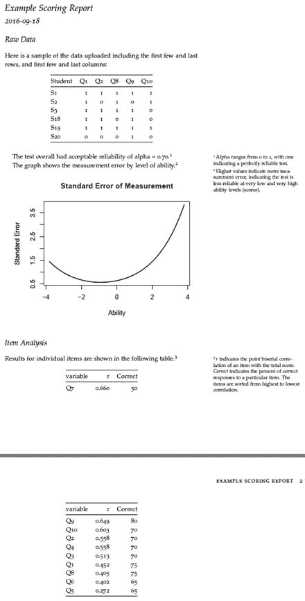

图 15-3. 下载的 PDF

## 上传至云端

我们的最后一项任务是将文件从本地机器上传到云实例。请记住，在前面的章节中，我们不仅使用 `PuTTY` 在云上安装了 Shiny Server，还使用 `WinSCP` 将文件上传到云。我们启动 `WinSCP`，重新连接，并确保左侧的本地端位于我们的 Shiny 应用程序文件夹中，而右侧的云服务器端位于 `/home/ubuntu`。我们回忆一下该过程的结果，如图 15-4 所示。


图 15-4. 已上传 PieChart_Time、slider_time 和 Upload_hist Shiny 应用程序的 WinSCP

从这里开始，我们访问 `PuTTY` 并从命令行运行以下代码：

```
sudo cp -R ∼/Chapter15 /srv/shiny-server/
```

请记住，在较早的章节中，我们调整了实例以允许从特定地址访问特定端口。您现在可以通过在任意浏览器中输入以下 URL 来验证您的应用程序是否正常工作：

```
http://Your.Instance.IP.Address:3838/Chapter15/
```

## 总结

在最后一章中，我们构建了一个可以基于新数据快速更新的动态文档。这种更新甚至可以扩展到图形和内联 `ifelse` 语句，允许叙述本身根据新数据发生变化。此外，我们构建了一个 Shiny 应用程序，允许有互联网连接的用户上传文件，为该报告提供新数据。此类报告可以以多种格式下载，尽管我们选择了 PDF。

在本文中，我们提供了高级数据管理技术，包括连接各种数据库。这些技术与动态文档能很好地融合，并具备将数据仓库中的信息轻松转化为可执行情报的能力。我们的最终结论是：随着数据变得越来越庞大，成功筛选并呈现有用数据的能力，在任何领域中都成为更加重要的技能。祝编码愉快！

# 索引 A

## AdvancedRPkg

高级 R 软件、JDK、MKL、MRO、RStudio、亚马逊云服务（AWS）账户创建、AdvancedR、AdvancedR 安全组、`AmazonEC2FullAccess`、CIDR、仪表盘、弹性计算云（EC2）、IAM、实例、密钥对设置与最终启动、安全组、安全组的入站规则、Ubuntu 服务器选择、用户、用户操作。

`anyDuplicated()`、`*apply` 函数、`eapply()`、`elements()`、`environment()`、错误检查、框架与矩阵/数组问题、`lapply`、`ls()`、`mapply()`、`mean()`、`cannot mean()/sd()`、`mtcars` 数据、`mtcars` 数据框、`par()`、`rapply()`、递归、`summary()`、类型、`vapply`、`X`、`INDEX` 和 `FUN`。

`arrange()` 函数、`assignInNamespace()` 函数。

## Automation

`*apply` 系列函数。参见 `*apply` 函数。

编码、定义、疯狂、流程控制、循环。参见循环、重复、工具。

## B

大数据（基础）挑战、CSV 文件、函数、软件安装、MongoDB。参见 MongoDB、包、R 数据对象与加载、严格格式、SQLite。参见 SQLite 数据库。

## C

云电子邮件、操作系统、公有 IP 地址、PuTTY、PuTTY 配置、PuTTYgen、PuTTY 安全警报、服务器指纹（RSA）、传输文件、Ubuntu 命令行、上传文件、WinSCP、Windows 环境。

云实例、云 Ubuntu、Windows 用户、命令、安装 Microsoft R、安装 R、安装 Shiny、Java 安装、RStudio Server、超级用户与安全。

逗号分隔值（CSV）文件。

综合 R 存档网络（CRAN）。

## D, E

云中的仪表盘主体、页眉、示例代码、侧边栏、`dashboardBody()` 函数、`dashboardHeader()` 函数、`dashboardSidebar()` 函数。

## 数据管理

数据与创建变量、`dplyr` 包、合并与重塑数据、`sapply()`、选择与子集化、排序、变量重命名与排序。

`data.table` 包、`anyDuplicated()` 函数、内置数据框类对象、检查点、创建、新变量、数据与创建变量、数据框、数据管理、数据整理/清洗、`Data.Table[i, j, by]`、`diris`、重复、族、模糊匹配、`head()` 和 `tail()`、合并数据、一次性转换、`order()`、重新编码数据、重新编码数值、重塑数据、`sapply()`、第二和第三形式参数、选择与子集化数据、`Sepal.Length`、`setkey()`、`setosa`、`versicolor` 和 `virginica` 物种、`unique()`、变量重命名与排序。

## 调试

`assignInNamespace()` 函数、`browser()` 函数、`debug()` 函数、散点图、`tapply()` 和 `unique()`、`traceback()`、`wtd.quantile()` 函数、`wtd.table()` 函数、`desc()`。

开发工具包（JDK）。

## DevTools

`distinct()`。

## 动态文档

`beamer_presentation`、案例研究、`ch15_html.Rmd`、云实例、代码块、HTML 输出、混合方法、本地机器、R Markdown 流程、R Markdown、Shiny 应用程序、`report.Rmd`、`server.R`、`ui.R`、用户界面、上传、云。

## F

## 函数组件

`Hmisc` R 包、`invisible()` 函数、`match.arg()` 函数、`match.call()`、`message()`、`missing()` 函数、`on.exit()` 函数、R 命令、`return()` 函数、作用域、`stop()` 函数、`stopifnot()`、`suppressMessages()`、`suppressWarnings()`、`warning()`。

模糊匹配。

## G

`ggplot2` R 包、GitHub、`group_by()`、`groupedtextplot`、`gsub()`。

## H

## 帮助与文档

`hist()` 函数、`Hmisc` 包、`Hmisc` R 包。

## I, J, K

身份与访问管理（IAM）、`img()` 函数、英特尔数学核心函数库（Intel MKL）、`invisible()` 函数。

## L

## 本地机器

循环控制、`for` 循环、`for()` 函数、`head()`、无限循环、`proc.time()`、`repeat()`、`rnorm` 模拟、类型、`while` 循环、`xCube`。

## M

`mainPanel()`、`match.arg()` 函数。

## 数学运算符与函数

计算、复杂逻辑测试、if-else 流程控制、循环、矩阵、操作、标量运算、符号逻辑形式、三角函数。

`meanPlot()` 函数、`menuItem()` 函数、`merge()` 函数。

微软公司。

Microsoft R Open（MRO）。

MiKTeX。

## MongoDB 与 R

BSON 查询语言、`dbAuthenticate (con3, username, password)`、`dbDisconnect()`、`dbGetQuery()`、`dbShowCollections()`、`fNames`、信息、位置、JSON 文件、模拟数据、`mongoDbConnect()`、结果、`RMongo` 包、非结构化数据、`View()`、数据目录、文档存储数据库、下载、文件夹、安装过程、JSON 与半结构化数据、JSON 文件、网站。

多继承。

`mutate()`。

## N

`NAMESPACE` 文件、`normalizePath()`。

## O

## 面向对象编程（OOP）

对象、复数、数据框、双精度、数值、因子、整数、逻辑、矩阵、缺失值、标量。

`on.exit()` 函数、`on.exit()` 参数。

## 运算符与函数

赋值、数据类型检查函数、数学。参见数学运算符与函数、子集化、`owSums()`。

## P, Q

## 包

添加 R 代码、`checkpoint`、`covr`、CRAN、`devtools` 包、devtools、`ggplot2`、MiKTeX、根目录、`roxygen2` 包、R 包、R 包、子目录、测试、`testthat`、版本控制。

`AdvancedRPkg` 仓库、`desktop.ini`、GitHub、GitHub Desktop、Linux 内核、`README` 和 `.gitignore` 文件、XQuartz。

`package_coverage()` 函数、`parent.env()` 函数、`paste0()`。

PostgreSQL 与 R 数据库、数据完整性与可靠性、Windows R。

`read.dta()`、`Reduce()`、`REFUSED`、`renderPlot()`、`reshape()`、`right_join()`、`rowMeans()` 函数。

`roxygen2` 类、数据、函数、方法。

### R 包

`AdvancedRPkg`、`check()` 函数、CRAN、`DESCRIPTION` 文件、`ggplot()` 函数、`meanPlot()`、`R CMD INSTALL`、`README` 文件、`show()` 方法、`.tar.gz` 文件。

RStudio Server。

## S

## S3 系统

类、数据框、多类、多继承、对象类、单继承、textplot 对象、向量或泛型向量。

方法、内置 `mtcars` 数据、自定义方法、`expand.grid()`、`fortify()` 函数、泛型函数、`ggplot()` 方法、`ggplot.lm()` 方法、线性回归模型、`methods()` 函数、`:::` 运算符、`par()` 函数、`plot()` 函数、`plot.table()`、`plot.textplot()`、`summary()`、`textplot` 对象类、`UseMethod()`。

## S4 系统

类、`new()`、`paste()`、`setClass()`、`sprintf()`、有效性函数、类继承。

方法、`select()` 函数、`Sepal.Length`、`setMethod()`。

## Shiny 应用程序

云中的参数、`fluidPage()` 函数、函数、`renderPlot()`、HTML 代码、创建、输入函数、`mainPanel()`、`numericInput()`、播放按钮功能、`plotOutput()`、`plotOutput("piePlot")`、R 计算、`renderPlot()`、RStudio、运行应用、播放按钮、`shinyServer()`、`sidebarPanel()` 函数、`sliderInput()` 函数、`titlePanel()` 命令、用户文件上传、用户界面代码、Web 应用框架。

## Shiny 仪表盘

示例代码、仪表盘骨架、仪表盘主体、仪表盘页眉、仪表盘侧边栏、最小 Shiny 仪表盘。

`showMethods()`、`sidebarMenu()`、`sidebarPanel()`。

单继承。

社会安全号码（SSN）。

## SPSS

输入文件、输出文件。

## SQLite 数据库

优缺点、与 R 的结合、`all.equal()`、`dbClearResult()`、`dbDisconnect()`、`DBI` 包库、`dbIsValid()`、`dbSendQuery`、`dbWriteTable()`、`iris` 数据、RAM、`rnorm()`、`RSQLite` 库、`sepal` 和 `length`、`setosa`、SQL、`VACUUM`、权威指南、安装 PostgreSQL。参见 PostgreSQL。

`stopifnot()` 函数、`str()` 函数、`stringdistmatrix()`、`strsplit()`。

结构化查询语言（SQL）。

`summary()` 函数。

## 系统与文件

准确性、自动化文件管理、创建、`file.access`、`file.append` 函数、`file.copy`、`file.create`、`file.exists()`、`file.info` 函数、`file.remove`、`getwd()`、高风险项目、PowerPoint、`recursive=TRUE` 选项、`sys.setFileTime` 函数、`TRUE` 或 `FALSE`。

## T

`table()`、`tapply()`、`test_textplot.R`、`tolower()`、`toupper()`。

## U

`unlist()`。

## V

`valueBox()`。

## W

WinSCP、WinSCP 上传文件夹视图。

`wtd.quantile()`。

## X, Y, Z

XQuartz。

# Match N Written

## 1: This Test 1 NA

## 2: This Test 1 NA

# Test Thas 0 test that

# 4: Jane Mary 1 NA

# 5:               Jane Mary 0  mary sou

# 6:            Jack Dun-Dee 0  jack dee

# 7: Jane Mary, Jack Dun-Dee 0 jane jack

```r
```

我们可以看到`This Test`出现在两行中，因此我们进行汇总并输出最终结果。`This Test`有两个精确匹配。`Test Thas`没有精确匹配，但`Uncertain`列下有一个近似匹配。最后，`jack dee`是`Jack Dun-Dee`的近似但不确信的匹配，而`jane jack`是`Jane Mary`或`Jack Dun-Dee`的不确信匹配。

```r
finaloutput <- output[, .(
  N = sum(N),
  Uncertain = paste(na.omit(Written), collapse = ", ")),
  by = Match]
finaloutput
```

# Match N Uncertain

# 1: This Test 2


# 2: Test Thas 0 test that


# 3: Jane Mary 1  mary sou

# 4: Jack Dun-Dee 0 jack dee

# 5: Jane Mary, Jack Dun-Dee 0 jane jack

虽然很难涵盖所有示例和用例，但这些基本工具组合起来足以应对许多类型的数据管理任务。

## 总结

在本章中，你了解了如何基于精确正则表达式或模糊匹配来定位文本。此外，你还学习了如何用新的字符串片段替换旧的字符串。最后，我们讨论了在 `data.table` 中创建新变量的方法。表 8-1 总结了本章介绍的关键函数。

**表 8-1.** 本章描述的关键函数

| 函数 | 功能 |
| --- | --- |
| `read.dta()` | 读取 Stata 文件 |
| `str()` | 显示 R 对象结构 |
| `grep()` | 模式匹配，返回显示哪些元素匹配的向量 |
| `grepl()` | 模式匹配，返回显示 `x` 中所有值布尔值的向量 |
| `gsub()` | 匹配模式并进行替换，返回更改后的原始向量 |
| `rowMeans()`, `rowSums()` | 计算数据表或矩阵每行值的平均值或总和 |
| `Reduce()` | 以二元函数作为第一个参数，并将其应用于其余参数 |
| `.SD` | `data.table` 中的保留名称，可用于将数据表中的所有变量作为列表引用 |
| `.SDcols` | `data.table` 的参数，允许指定要包含在 `.SD` 中的变量 |
| `strsplit()` | 基于特定分隔符拆分字符串 |
| `stringdistmatrix()` | 创建观测值与期望值之间距离的矩阵 |
| `amatch()` | 提供向量，显示期望值中哪个索引与观测值最匹配 |
| `tolower()` | 将给定字符串中的所有字符强制转换为小写 |

# 9. 数据管理的其他工具

比较数据框和数据表引出了一个有趣的问题：如果存在更多类型的数据会怎样？特别是，如果存在多种本质上都是某种表格的数据存储方式呢？除了数据框或数据表，还有许多存储数据的方式，其中很多就是表格。`dplyr`（Wickham 和 Francois，2015）背后的理念是，无论数据后端是什么，我们的体验应该是一致的。为此，`dplyr` 为常见的数据管理任务实现了通用函数。对于每个通用函数，都会编写特定的方法，将通用操作转换为特定后端所需的任何代码或语言。通过使用抽象层，可以确保用户获得一致的体验，无论使用哪种特定数据格式或后端。这也使得 `dplyr` 具有可扩展性，因为只需编写额外的函数或方法即可添加对新格式的支持，而用户体验无需改变。在本章中，我们的 `checkpoint` 标头需要同时安装并添加 `tibble` 和 `dplyr` 包：

```
library(checkpoint)
checkpoint("2016-09-04", R.version = "3.3.1")
library(dplyr)
library(tibble)
```

`dplyr` 包使用动词来命名函数，这些动词用于完成特定的操作。也就是说，`dplyr` 并非只有几个各自执行多项任务的函数，而是提供了许多通常只完成特定任务的函数。与 `data.table`（Dowle、Srinivasan、Short 和 Lianoglou，2015）不同，`dplyr` 是函数式的，它总是接收输入并返回输出（此处指数据）。它不会像 `data.table` 那样直接在内存中修改数据。然而，它的速度仍然很快，因为许多函数都经过了优化，用 C++ 编写，并且 `dplyr` 会尽量避免进行不必要的复制。

和之前一样，我们设置一些选项来减少打印的行数。`dplyr` 的默认数据格式是 `tibble`（Wickham、Francois 和 Müller，2016）。`Tibble` 在 `tibble` 包中实现。本质上，`tibble` 是数据框的扩展，它增加了一些额外的限制（例如默认使用字符串而不是将字符串强制转换为因子）并提供了更好的打印或屏幕显示方法。数据处理由 `dplyr` 处理，而 `tibble` 则处理实际的数据存储。用技术术语来说，`tibble` 包实现了 R 对象 `class` 以及一些用于 tibble 的基本方法。

```
options(stringsAsFactors = FALSE,
tibble.print_max = 20, ## 超过 20 行时
tibble.print_min = 5, ## 打印前 5 行
digits = 2) ## 减少 R 打印的小数位数
iris$Species                          
1          5.1         3.5          1.4         0.2  setosa
2          4.9         3.0          1.4         0.2  setosa
3          4.7         3.2          1.3         0.2  setosa
4          4.6         3.1          1.5         0.2  setosa
5          5.0         3.4          1.4         0.2  setosa
```

对于 `data.table`，我们使用 `sapply()` 来获取每一列或变量的类向量。虽然我们可以对 `tibble` 做同样的事情，但 `tibble` 会自动提供关于每列数据类型或类以及总列数和行数的信息（例如 `<dbl>` 表示双精度或数值，`<chr>` 表示字符类数据）。我们将注意力转向处理数据的常见目标：排序、子集选择、排列、计算和重塑。理解 `dplyr` 的一个有用方法是，它使用动词来描述对数据的操作。

## 排序

我们在 `dplyr` 中通过 `arrange()` 函数进行排序，该函数的第一个参数是一个数据集。第一个参数之后的其他参数用于按其他列进行排序。默认顺序是升序，可通过第二个函数调用 `desc()` 来指定降序。

```
diris                          
1          4.3         3.0          1.1         0.1  setosa
2          4.4         2.9          1.4         0.2  setosa
3          4.4         3.0          1.3         0.2  setosa
4          4.4         3.2          1.3         0.2  setosa
5          4.5         2.3          1.3         0.3  setosa
```

# ... 还有 145 行

```
diris                          
1          4.3         3.0          1.1         0.1  setosa
2          4.4         3.2          1.3         0.2  setosa
3          4.4         3.0          1.3         0.2  setosa
4          4.4         2.9          1.4         0.2  setosa
5          4.5         2.3          1.3         0.3  setosa
```

# ... 还有 145 行

可以通过 `anyDuplicated()` 查看整个数据集或仅特定列出现重复时的首行索引。当对整个数据集调用此函数时，它会查找所有列之间的匹配项，在本数据集中，第 78 行和第 79 行出现了这种情况。如下代码所示，萼片长度中重复的变量出现在第三行：

```
anyDuplicated(diris)
[1] 79
anyDuplicated(diris$Sepal.Length)
[1] 3
```

`anyDuplicated()` 返回第一个重复行的索引，而 `duplicated` 则简单地告诉我们表中发生了多少次重复。查看我们的代码，我们发现对于所有列的完全匹配，仅在第 79 行发生了一次。另一方面，重复的萼片长度可能在第三行首次出现，但还有更多重复。

```
table(duplicated(diris))
FALSE  TRUE
149     1
table(duplicated(diris$Sepal.Length))
FALSE  TRUE
35   115
```

如果我们希望仅查看具有不同值的表格结果，`distinct()` 的工作方式与 `arrange()` 非常相似。第一个形式参数用于数据，其余参数指定列名变量。如果未指定列名，`distinct()` 将对所有列进行操作。回想一下 `duplicated()` 调用，有 149 个唯一行。

```
distinct(diris)
```

# A tibble: 149 x 5

| Sepal.Length | Sepal.Width | Petal.Length | Petal.Width | Species |
|-------------|-------------|--------------|-------------|---------|
| 4.3         | 3.0         | 1.1          | 0.1         | setosa  |
| 4.4         | 3.2         | 1.3          | 0.2         | setosa  |
| 4.4         | 3.0         | 1.3          | 0.2         | setosa  |
| 4.4         | 2.9         | 1.4          | 0.2         | setosa  |
| 4.5         | 2.3         | 1.3          | 0.3         | setosa  |

# ... 还有 144 行

```

类似地，回想一下，如果我们只考虑萼片长度，则只有 `35` 个唯一行。因此，使用 `distinct()` 的第二个形式参数来包含 `Sepal.Length` 列，会在我们的 `tibble` 中仅产生 `35` 行。我们在此显示前五行：

```r
distinct(diris, Sepal.Length)
```

# A tibble: 35 x 1
```
Sepal.Length

1          4.3
2          4.4
3          4.5
4          4.6
5          4.7
```

# ... 还有 30 行

本部分以最后一次调用 `distinct()` 结束，该调用在第二和第三个形式参数中显示了多个列。在这里，只要 `Sepal.Length` 和 `Sepal.Width` 没有同时重复，一行就是唯一的。请特别注意第 `2` 行到第 `4` 行，它们具有相同的 `Sepal.Length`，但这些行没有重复，因为它们的 `Sepal.Width` 不同：

```
distinct(diris, Sepal.Length, Sepal.Width)
```

```markdown
A tibble: 117 x 2
Sepal.Length Sepal.Width

1          4.3         3.0
2          4.4         3.2
3          4.4         3.0
4          4.4         2.9
5          4.5         2.3

# ... 还有 112 行
```

## 选择与子集

在 `dplyr` 中选取存储数据的一部分与 `data.table` 的方法不同。请记住，`dplyr` 通过函数调用来工作。这些函数被设计为独立于底层数据结构。尽管如此，我们仍希望获得相同的结果。按位置选择行是通过 `slice()` 完成的，它接受两个形式参数。第一个是数据对象，在我们例子中是 `diris`，第二个允许我们选择特定行。我们首先只选择前五行：

```r
slice(diris, 1:5)
```

# A tibble: 5 x 5

```
Sepal.Length Sepal.Width Petal.Length Petal.Width Species
1          4.3         3.0          1.1         0.1  setosa
2          4.4         3.2          1.3         0.2  setosa
3          4.4         3.0          1.3         0.2  setosa
4          4.4         2.9          1.4         0.2  setosa
5          4.5         2.3          1.3         0.3  setosa
```

如前所述，`-`可用于取反。因此，我们也可以通过删除第`1`到`145`行来丢弃所有行，只保留最后五行：

```
slice(diris, -(1:145))
```

# A tibble: 5 x 5
Sepal.Length Sepal.Width Petal.Length Petal.Width   Species

1          7.7         3.8          6.7         2.2 virginica
2          7.7         3.0          6.1         2.3 virginica
3          7.7         2.8          6.7         2.0 virginica
4          7.7         2.6          6.9         2.3 virginica
5          7.9         3.8          6.4         2.0 virginica
```

除了直接选择行，我们也可以对它们设置逻辑条件。再次强调，这些类型的参数属于函数调用的第二个形式参数。但在此情况下，我们使用 `filter()` 而非 `slice()`。`filter()` 函数使用逻辑索引。通过编写一个逻辑测试，可以很容易地选择 `Species` 是（或不是）`setosa` 的所有行：

```
filter(diris, Species == "setosa")
```

# A tibble: 50 x 5
```
Sepal.Length Sepal.Width Petal.Length Petal.Width Species

1          4.3         3.0          1.1         0.1  setosa
2          4.4         3.2          1.3         0.2  setosa
3          4.4         3.0          1.3         0.2  setosa
4          4.4         2.9          1.4         0.2  setosa
5          4.5         2.3          1.3         0.3  setosa
```

# ... 还有 45 行

```
filter(diris, Species != "setosa")
```

# A tibble: 100 x 5

Sepal.Length Sepal.Width Petal.Length Petal.Width    Species

1          4.9         2.5          4.5         1.7  virginica
2          4.9         2.4          3.3         1.0 versicolor
3          5.0         2.3          3.3         1.0 versicolor
4          5.0         2.0          3.5         1.0 versicolor
5          5.1         2.5          3.0         1.1 versicolor

# ... 还有 95 行

也可以基于数值，使用不等式、等式或不等式的逻辑索引来选择行。数值和字符测试可以混合搭配，以精确提取所需的行：

```
filter(iris, Sepal.Length > 4.5 & Petal.Width > 0.2)
Sepal.Length Sepal.Width Petal.Length Petal.Width    Species
1          4.6         3.4          1.4         0.3     setosa
2          4.5         2.3          1.3         0.3     setosa
3          4.8         3.0          1.4         0.3     setosa
4          4.9         2.4          3.3         1.0 versicolor
5          4.9         2.5          4.5         1.7  virginica
filter(diris, Sepal.Length == 4.3 | Sepal.Width != 4.4)
```

# A tibble: 149 x 5

| Sepal.Length | Sepal.Width | Petal.Length | Petal.Width | Species |
|-------------|-------------|--------------|-------------|---------|
| 4.3         | 3.0         | 1.1          | 0.1         | setosa  |
| 4.4         | 3.2         | 1.3          | 0.2         | setosa  |
| 4.4         | 3.0         | 1.3          | 0.2         | setosa  |
| 4.4         | 2.9         | 1.4          | 0.2         | setosa  |
| 4.5         | 2.3         | 1.3          | 0.3         | setosa  |

如果我们寻找多个匹配项，可以使用 `%in%` 运算符以及我们感兴趣的列表。这允许我们将指示我们选择的编码分开，然后基于该兴趣进行过滤：

```r
interest <- c(4.3, 4.4, 4.5, 5.1, 5.2)
filter(diris, Sepal.Length %in% interest)
```

# A tibble: 12 x 5

```
Sepal.Length Sepal.Width Petal.Length Petal.Width Species

1          4.3         3.0          1.1         0.1  setosa
2          4.4         3.2          1.3         0.2  setosa
3          4.4         3.0          1.3         0.2  setosa
4          4.4         2.9          1.4         0.2  setosa
```

或者，如果我们希望排除具有特定特征的任何行，可以通过取反来实现。这对于移除异常值或错误数据点很有用：

```
filter(diris, !Sepal.Length %in% interest)
```

# A tibble: 146 x 5

| Sepal.Length | Sepal.Width | Petal.Length | Petal.Width | Species |
|---|---|---|---|---|
| 4.5 | 2.3 | 1.3 | 0.3 | setosa |
| 4.6 | 3.6 | 1.0 | 0.2 | setosa |
| 4.6 | 3.4 | 1.4 | 0.3 | setosa |
| 4.6 | 3.2 | 1.4 | 0.2 | setosa |
| 4.6 | 3.1 | 1.5 | 0.2 | setosa |

# 示例代码

我们展示的最后一个过滤示例使用了多个参数。使用多个参数不是必需的，但可以成为将代码分解为可读模块的有用方式。多个参数在逻辑上等同于`&`：

```
filter(diris,
Sepal.Length == 4.3 | Sepal.Length == 4.4,
Petal.Width > 0.2)
```

# A tibble: 3 x 5

```
Sepal.Length Sepal.Width Petal.Length Petal.Width Species

1          4.3           3          1.1         0.1  setosa
```

到目前为止，我们从所有列中选择了行。如果我们只想选择特定列，`select()` 函数将数据库作为其第一个形式参数，将列信息作为其余形式参数。对于表格数据结构中的命名列，选择一列或多列就像列出列名一样简单。也可以按位置选择。对比这些按名称和按位置的列参数，并认识到两者都可以按任何需要的顺序进行列选择：

```
select(diris, Sepal.Length, Sepal.Width)
```

# A tibble: 150 x 2

`Sepal.Length` `Sepal.Width`

1          4.3         3.0
2          4.4         3.2
3          4.4         3.0
4          4.4         2.9
5          4.5         2.3

# ... 还有 145 行

`select(diris, 1, 5, 2)`。在表达式 `cvar = avar + bvar` 中，加法运算符（`+`）将 `avar` 与 `bvar` 相加，得到它们的和 `cvar`。在 `List.of(arg0, arg1, arg2)` 中，`List` 接口的工厂方法 `of()` 接受一系列的元素，返回包含它们的只读列表。之后我们这样调用 `cmd` 命令：`cmd arg0 arg1 arg2`。

```
if (condVar > someVal) {console.log("xxx")}
```

进入 `/path/to/xxx` 目录，找到 `xxx.json`。

# A tibble: 150 x 3
`Sepal.Length` `Species` `Sepal.Width`

1          4.3  setosa         3.0
2          4.4  setosa         3.2
3          4.4  setosa         3.0
4          4.4  setosa         2.9
5          4.5  setosa         2.3

# ... 还有 145 行

到目前为止，特定列是直接命名的。如果列需要根据程序或用户需求而变化怎么办？在这种情况下，字符串引用是理想的，因为字符串可以轻松转换为变量。我们展示了直接调用 `select_()` 和使用变量 `v` 来实现相同结果的方法。务必注意函数名称中添加了下划线！当使用 `select_()` 时，多个变量名作为字符串可以作为单独参数传递：

```
select_(diris, "Sepal.Length", "Sepal.Width")
```

# A tibble: 150 × 2

```
Sepal.Length Sepal.Width

1          5.1         3.5
2          4.9         3.0
3          4.7         3.2
4          4.6         3.1
5          5.0         3.6
```

# ... 还有 145 行

```
```

我们的变量 `v` 可以包含多个列名。但是，如果以默认方式使用，则只会返回列表中的第一个变量。要返回所有变量，当传递一个包含变量名向量的对象时，它应该被传递给 `.dots` 形式参数，如下面的第二个示例所示：

```r
v <- c("Sepal.Length", "Sepal.Width")
select_(diris, v)
```

# A tibble: 150 × 1

`Sepal.Length`

```
1          4.3
2          4.4
3          4.4
4          4.4
5          4.5
```

# ... 还有 145 行

```
select_(diris, .dots = v)
```

# A tibble: 150 × 2

```
Sepal.Length Sepal.Width

1          5.1         3.5
2          4.9         3.0
3          4.7         3.2
4          4.6         3.1
5          5.0         3.6
```

好的，作为高级文档工程师和翻译员，我已根据您提供的格式要求和注意事项，将给定的英文文本翻译成中文。

# 变量重命名与排序

使用我们原始的 `select()` 函数实现相同结果的另一种方法是使用 `select` 辅助函数之一。共有七个这样的辅助函数，我们目前想要的是 `one_of()`，它用于管理字符向量：

```r
select(diris, one_of(v))

# A tibble: 150 x 1
Sepal.Length

1          4.3
2          4.4
3          4.4
4          4.4
5          4.5

# ... 还有 145 行
```

在使用 `dplyr` 的数据结构 `tibble` 时，像在数据表中使用的方法也能奏效。但这些方法并不能保证在 `dplyr` 的整个使用过程中都能顺利转换。最好还是用 `dplyr` 的“母语”来使用它。不过，为了完整性，下面给出两个函数调用示例：

```r
diris[, v]

# A tibble: 150 x 1
Sepal.Length

1          4.3
2          4.4
3          4.4
4          4.4
5          4.5

# ... 还有 145 行
diris[, 1]

# A tibble: 150 x 1
Sepal.Length

1          4.3
2          4.4
3          4.4
4          4.4
5          4.5

# ... 还有 145 行
```

到目前为止，我们所有的操作都会返回另一个 `tibble` 作为输出。要将原始数据提取为向量，需要使用几种不同的技术。如果我们知道包含所需数据的列名，直接键入名称很容易。如果我们的列名可能是可变的，则可以通过第三种方法重用我们的变量 `v`。无论使用哪种方法，控制台都会打印相同的数据。请注意，这些数据是向量，而不是数据表结构。我们用粗体标记了将列数据作为向量访问的代码，只是为了强调。

```r
head(diris[["Sepal.Length"]])
[1] 4.3 4.4 4.4 4.4 4.5 4.6
head(diris$Sepal.Length)       # easy to type
[1] 4.3 4.4 4.4 4.4 4.5 4.6
head(diris[[v]])               # easy if you have a R variable
[1] 4.3 4.4 4.4 4.4 4.5 4.6
```

排除某列或多列可能比选择特定列更有意义。排除操作使用多种格式的否定。特别是，要排除的列可以通过名称或位置来指定：

```r
select(diris, -1)

# A tibble: 150 x 4
Sepal.Width Petal.Length Petal.Width Species

1         3.0          1.1         0.1  setosa
2         3.2          1.3         0.2  setosa
3         3.0          1.3         0.2  setosa
4         2.9          1.4         0.2  setosa
5         2.3          1.3         0.3  setosa

# ... 还有 145 行
select(diris, -Sepal.Length, -Petal.Width)

# A tibble: 150 x 3
Sepal.Width Petal.Length Species

1         3.0          1.1  setosa
2         3.2          1.3  setosa
3         3.0          1.3  setosa
4         2.9          1.4  setosa
5         2.3          1.3  setosa

# ... 还有 145 行
```

同样，当需要进行变量排除时，我们设置一个变量来保存向量，并使用 `paste0()` 将否定符号粘贴到该变量的前面，然后使用 `select_()` 调用来处理字符串。或者，我们可以在常用的 `select()` 函数中使用 `select` 辅助函数 `one_of()` 进行否定操作。无论哪种方式，我们都能得到相同的结果：

```r
ex                   
1         3.0          1.1         0.1  setosa
2         3.2          1.3         0.2  setosa
3         3.0          1.3         0.2  setosa
4         2.9          1.4         0.2  setosa
5         2.3          1.3         0.3  setosa

# ... 还有 145 行
select(diris, -one_of(v))

# A tibble: 150 x 4
Sepal.Width Petal.Length Petal.Width Species

1         3.0          1.1         0.1  setosa
2         3.2          1.3         0.2  setosa
3         3.0          1.3         0.2  setosa
4         2.9          1.4         0.2  setosa
5         2.3          1.3         0.3  setosa

# ... 还有 145 行
```

现在我们已经多次使用这个 `select` 便捷函数，我们简要地看看另外四个这样的函数。这四个函数的目标是帮助我们选择变量，而无需键入完整的列名。按照不特定的顺序，`starts_with()`、`ends_with()`、`contains()` 和 `matches()` 都使用正则表达式，默认在当前变量列表中查找，并且默认忽略大小写，不过这个特性可以关闭。与其全部演示一遍，不如用下面的代码展示两个使用 `starts_with()` 的例子。`dplyr` 方法的一个优点是创建命名简洁、专注于单一任务的函数（通常以动词命名），这使得从函数名称就能很容易地知道它的功能。其余辅助函数的操作方式与 `starts_with()` 类似，并且其功能完全如其名称所示：

```r
select(diris, starts_with("s"))

# A tibble: 150 x 3
Sepal.Length Sepal.Width Species

1          4.3         3.0  setosa
2          4.4         3.2  setosa
3          4.4         3.0  setosa
4          4.4         2.9  setosa
5          4.5         2.3  setosa

# ... 还有 145 行
select(diris, starts_with("s", ignore.case = FALSE))

# A tibble: 150 x 0
```

通过这最后一段代码，我们对 `dplyr` 子集操作的探索就结束了。接下来，我们将注意力转向变量重命名和排序。

## 变量重命名与排序

列名需要重命名或重新排序是数据清理中常见且令人遗憾的一部分。在一个数据库中合理（或“合法”）的列名，在另一个数据库中可能行不通。许多专有数据管理系统都拥有固定但笨重的名称。

查看与 `dplyr` 对象关联的名称，需要使用常用的 `names()` 或 `colnames()` 函数，并将我们的数据集 `diris` 作为参数传入。无论使用哪种方式，都能在当前列顺序下得到相同的结果：

```r
names(diris)
[1] "Sepal.Length" "Sepal.Width"  "Petal.Length" "Petal.Width"  "Species"
colnames(diris)
[1] "Sepal.Length" "Sepal.Width"  "Petal.Length" "Petal.Width"  "Species"
```

要更改名称，请在数据对象上调用 `rename()` 函数，并使用以下格式设置第二个形参的新名称：`新名称 = 旧名称`。可以通过将更多列作为额外的参数（例如，在第三、第四个形参中）传递给函数，来同时重命名多个列。通过比较 `names()` 的结果与之前的旧结果，可以确认更改是否生效。在下面的代码中，我们删除了数据中 `Sepal` 和 `Length` 之间的句点：

```r
diris <- rename(diris, SepalLength = Sepal.Length)
names(diris)
[1] "SepalLength"  "Sepal.Width"  "Petal.Length" "Petal.Width"  "Species"
```

## 数据计算与创建变量

为了重新排序列，将长度和宽度配对在一起，只需使用`select()`函数并为你的数据对象重新赋值即可。请务必记住，我们已经将`SepalLength`重命名，中间不再有句点！

```
diris                          
1         4.3          1.1         3.0         0.1  setosa
2         4.4          1.3         3.2         0.2  setosa
3         4.4          1.3         3.0         0.2  setosa
4         4.4          1.4         2.9         0.2  setosa
5         4.5          1.3         2.3         0.3  setosa

# ... 还有 145 行
```

之前，你已经看到数字形式的`select`调用可以重新排序列，所以我们将用一个最后的重新排序示例来结束本节。在这里，我们使用一个变量来保存数字位置，尽管我们也可以使用字符名称来代替数字。然后，我们使用`select_()`函数将我们的列重新组织回它们原始的顺序。

```
v                          
1         4.3         3.0          1.1         0.1  setosa
2         4.4         3.2          1.3         0.2  setosa
3         4.4         3.0          1.3         0.2  setosa
4         4.4         2.9          1.4         0.2  setosa
5         4.5         2.3          1.3         0.3  setosa
```

```
# ... 还有 145 行
```

既然你已经对如何在`dplyr`中管理原始数据有了很好的了解，我们将开始关注如何从旧数据中创建新数据。为简化起见，我们从原始`iris`数据集重新创建`diris`数据集。然后，我们将准备好使用新函数`mutate()`来创建或替换列。该函数接受通常的第一个参数，后续参数则表达了创建新列所需的操作。无论是一个还是多个列，只需创建表达式，让`dplyr`知道要向`tibble`添加什么内容：

```
diris                             
1          5.1         3.5          1.4         0.2  setosa     0     1     2
2          4.9         3.0          1.4         0.2  setosa     0     1     2
3          4.7         3.2          1.3         0.2  setosa     0     1     2
4          4.6         3.1          1.5         0.2  setosa     0     1     2
5          5.0         3.6          1.4         0.2  setosa     0     1     2

# ... 还有 145 行
```

当然，新数据并不一定是创建全新的列。相反，我们可能会基于现有信息创建新的计算列。也许我们想要一个名为`V`的新列，它是`Petal.Length`和`Petal.Width`的乘积。为清晰起见，我们首先移除刚刚添加的三个列：

```
diris                           
1          5.1         3.5          1.4         0.2  setosa  0.28
2          4.9         3.0          1.4         0.2  setosa  0.28
3          4.7         3.2          1.3         0.2  setosa  0.26
4          4.6         3.1          1.5         0.2  setosa  0.30
5          5.0         3.6          1.4         0.2  setosa  0.28

# ... 还有 145 行
```

更复杂的计算是在特定条件下才执行。在这种情况下，`if_else()`接受三个参数。第一个是用于测试 if/else 语句的逻辑条件。第二个和第三个参数指示在`if`或`else`情况下该如何处理。此外，`mutate()`不仅允许我们创建包含数据的列，还可以更改现有列的数据。因此，如果我们在第一次尝试中创建的列`V2`不足以体现`setosa`物种花瓣宽度与长度的乘积关系，我们可以将其扩展为对`virginica`物种进行平方根运算。为了确保我们看到每个物种的样本，我们使用`slice()`函数仅查看三个特定行：

```
diris                               
1          5.1         3.5          1.4         0.2     setosa  0.28  0.28
2          7.0         3.2          4.7         1.4 versicolor  6.58    NA
3          6.3         3.3          6.0         2.5  virginica 15.00  3.87
```

不一定要创建新列；也可以使用`summarise()`函数直接在表格上计算信息。与往常一样，第一个参数告诉函数要使用哪些数据，其余参数则用于容纳各个计算。请注意，可以编写一个或多个计算。这里，我们演示了两种计算：算术平均值和标准差：

```
summarise(diris, M = mean(Sepal.Width), SD = sd(Sepal.Width))

# A tibble: 1 x 2
M    SD

1   3.1  0.44
```

与`data.table`不同，`dplyr`通过函数工作。此外，虽然你的数学教授可能花了一些时间讲解函数组合（并且将函数嵌套在彼此内部的技术有其用武之地），但在`dplyr`中有更清晰的写法。使用`%>%`操作符时，将多个函数链接在一起，我们便能得到期望的结果。假设我们想提取数据，仅使用`virginica`物种，并计算萼片宽度的平均值。结果应该是一个只包含一个变量（即我们寻找的平均值）的`tibble`。请注意，当使用`%>%`操作符时，数据集会被传递给第一个参数。因此，即使在下面的代码中，我们看起来指定了`filter()`的第一个形式参数，但由于使用了`%>%`操作符，函数被修改了：数据集作为第一个参数传递，而我们写的`Species == "virginica"`则作为第二个参数传递：

```
diris  %>%  filter(Species == "virginica") %>%  summarise(M = mean(Sepal.Width))

# A tibble: 1 x 1
M

1     3
```

这种一步接一步的思路可以进行调整以应对各种数据处理操作。回想一下我们对`data.table`的研究，其结构的第三个形式参数`by =`允许我们按列的元素进行分组。对于`dplyr`，我们使用`group_by()`并指定列名来完成相同的任务。将我们的平均值示例扩展到所有三个物种，现在我们得到一个两列的`tibble`，每个物种对应一行。我们还可以计算原始列中多个列的平均值。请注意，无论我们如何计算，`virginica`的萼片宽度平均值都是`3`。

```
diris %>%  group_by(Species) %>%  summarise(M1 = mean(Sepal.Width), M2 = mean(Petal.Width))

# A tibble: 3 x 3
Species    M1    M2

1     setosa   3.4  0.25
2 versicolor   2.8  1.33
3  virginica   3.0  2.03
```

这种链式结构，就像数据表的链式结构一样，可以无限进行下去（或接近无限）。要找出上述数据中的相关性，只需在链的末尾再添加一步：

```
diris %>%
group_by(Species) %>%
summarise( M1 = mean(Sepal.Width),  M2 = mean(Petal.Width)) %>%
summarise(r = cor(M1, M2))

# A tibble: 1 x 1
r

1 -0.76
```

变量也可以创建其它变量。我们根据花瓣宽度是否大于该物种花瓣宽度的中位数来创建一个新变量。这可能稍微改变了它的外观，但它仍然是一个`tibble`：

```
diris %
group_by(Species) %>%
mutate(MedPW = Petal.Width > median(Petal.Width))
diris
Source: local data frame [150 x 8]
Groups: Species [3]
Sepal.Length Sepal.Width Petal.Length Petal.Width Species     V    V2 MedPW

1          5.1         3.5          1.4         0.2  setosa  0.28  0.28 FALSE
2          4.9         3.0          1.4         0.2  setosa  0.28  0.28 FALSE
3          4.7         3.2          1.3         0.2  setosa  0.26  0.26 FALSE
4          4.6         3.1          1.5         0.2  setosa  0.30  0.30 FALSE
5          5.0         3.6          1.4         0.2  setosa  0.28  0.28 FALSE

# ... 还有 145 行
```

按多个变量分组也很容易。按物种和中位花瓣宽度布尔值分组，我们重新计算萼片宽度和花瓣宽度的平均值：

```
diris  %>%
group_by(Species, MedPW) %>%
summarise( M1 = mean(Sepal.Width),  M2 = mean(Petal.Width))
Source: local data frame [6 x 4]
Groups: Species [?]
Species MedPW    M1    M2

1     setosa FALSE   3.4  0.19
2     setosa  TRUE   3.5  0.38
3 versicolor FALSE   2.6  1.19
4 versicolor  TRUE   3.0  1.50
5  virginica FALSE   2.8  1.81
6  virginica  TRUE   3.1  2.27
```

同样，始终可以在链上继续添加更多操作：

```
diris %>%
group_by(Species, MedPW) %>%
summarise(
M1 = mean(Sepal.Width),
M2 = mean(Petal.Width)) %>%
group_by(MedPW) %>%
summarise(r = cor(M1, M2))
```

# 一个 tibble：2 行 x 2 列

| `MedPW` | `r`    |
|---------|--------|
| FALSE   | -0.78  |
| TRUE    | -0.76  |

## 数据合并与重塑

我们不会重复在 `data.table` 章节中关于合并与重塑数据的内容，只提一点：`merge()` 函数调用在某种程度上仍然有效。这个函数与 `data.table` 中的函数是同一个，因为我们使用 `dplyr` 对构建在数据框基础上的 `tibble` 进行操作，所以它能工作。然而，一旦这样做了，它们就会失去 `tibble` 的身份。因此，我们还引入了 `*join()` 函数，这些函数更接近于一些传统的数据库语言。

同样，我们先运行一段代码来创建四个独立的数据对象。请再次注意，在实际生活中这通常是不需要的，因为我们的数据通常来自不同的数据库：

```r
diris %>%  group_by(Species) %>%  select(Species, Sepal.Width) %>%  slice(1:3)
diris
Source: local data frame [9 x 2]
Groups: Species [3]
Species Sepal.Width

1     setosa         3.5
2     setosa         3.0
3     setosa         3.2
4 versicolor         3.2
5 versicolor         3.2
6 versicolor         3.1
7  virginica         3.3
8  virginica         2.7
9  virginica         3.0
diris2        
1     setosa         3.5
2 versicolor         3.2
3  virginica         3.3
dalt1      
1     setosa     wide  TRUE
2     setosa     wide FALSE
3 versicolor     wide  TRUE
4 versicolor     wide FALSE
5  virginica   narrow  TRUE
6  virginica   narrow FALSE
7      other moderate  TRUE
8      other moderate FALSE
dalt2   
1     setosa  wide  TRUE
2 versicolor  wide  TRUE
```

`merge()` 函数操作两个数据集。对于像 `diris2` 和 `dalt2` 这样的一对一数据，合并本身只保留两个数据集中都匹配的行。我们可以看到，对于这两个对象，`diris2` 中的 `virginica` 行被丢弃了：

```r
merge(diris2, dalt2)
Species Sepal.Width Type MedPW
1     setosa         3.5 wide  TRUE
2 versicolor         3.2 wide  TRUE
```

如果我们想保留 `diris2` 的全部三行，那么合并后会有一些缺失数据。在这种情况下，因为我们任意选择 `diris2` 作为我们的第一个形式，`all.x = TRUE` 会保留 `diris2` 的所有行：

```r
merge(diris2, dalt2, all.x = TRUE)
Species Sepal.Width Type MedPW
1     setosa         3.5 wide  TRUE
2 versicolor         3.2 wide  TRUE
3  virginica         3.3     NA
```

也可以设置第二个值，即 `all.y = TRUE`，尽管在这种情况下没有明显区别。根据两个特定表格匹配程度的不同，缺失变量的模式可能不同。类似地，也可以指定我们希望从所有表中获取所有行。这可能会产生最多的缺失数据位置；在我们的例子中，这样的合并将与前面示例中显示的三行完全相同。

如前所述，这些不是 `tibble`。如果我们希望合并后再强制转换回 `tibble`，可以用 `as_tibble()` 包装它们。然而，正如你将在我们的数据库章节中看到的，`dplyr` 也操作数据库风格的对象。特别是，可以通过 `dplyr` 访问结构化查询语言 (SQL)。SQL 有连接操作，我们现在来看四种类型的连接。笼统地说，`merge()` 侧重于某种方式的匹配。连接则侧重于对象 1 和对象 2 的行与列之间的关系。

`left_join()` 会返回第一个对象的所有行，以及第一个和第二个对象的全部列。因为这是一个 `dplyr` 函数调用，我们得到的是一个 `tibble` 作为输出。如你所见，这与 `all.x=TRUE` 类似（尽管并非在所有情况下都完全匹配）：

```r
left_join(diris2,dalt2)
Joining, by = "Species"
Source: local data frame [3 x 4]
Groups: Species [?]
Species Sepal.Width  Type MedPW

1     setosa         3.5  wide  TRUE
2 versicolor         3.2  wide  TRUE
3  virginica         3.3      NA
```

`right_join()` 与左连接非常相似，区别在于它返回第二个对象的所有行。同样，两个对象的所有列都会被返回。在这种情况下，这种连接与 `merge()` 函数没有太大区别。然而，这种情况并不代表所有情况。网上很多图表声称揭示了连接的工作原理。根据我们的经验，这些解释的准确性可能参差不齐。我们的建议是找几个小的数据表，或者像我们这样自己创建一些。然后开始尝试连接。在反复实践之后，你会逐渐掌握哪种技术最接近你想要的最终数据。

```r
right_join(diris2,dalt2)
Joining, by = "Species"
Source: local data frame [2 x 4]
Groups: Species [?]
Species Sepal.Width  Type MedPW

1     setosa         3.5  wide  TRUE
2 versicolor         3.2  wide  TRUE
```

与基本 `merge()` 函数最匹配的是 `inner_join()` 函数，在本例中，它会生成与之前的右连接相同的结果。相比之下，从合并的角度来看，最奇特的是 `anti_join()`。`anti_join()` 返回第一个数据库中在第二个数据对象中没有匹配值的所有行。至于列，它只返回第一个对象的列。

```r
anti_join(diris2,dalt2)
Joining, by = "Species"
Source: local data frame [1 x 2]
Groups: Species [3]
Species Sepal.Width

1 virginica         3.3
```

在连接和合并之间，有很多选项可以将数据组合成一个对象。记住，你的最终目标是获取分析所需的数据。有时，先将一个或多个数据集合合并成一个表格，然后使用本章前面介绍的技术将其缩减为你想要的数据集，是合理的做法。当然，如果你更熟悉合并，它们通常也能很好地工作。如果你确实需要使用 `dplyr`，`as_tibble()` 总是可以作为包装函数，将你的对象强制转换回应有的格式。毕竟，`data.table` 和 `dplyr` 的 `tibble` 都是数据框的扩展。

我们的最后一个目标是重塑数据，如果每行都有一个唯一的 ID，效果会更好。我们先再次刷新一下数据集。然后引入 `n()`，这是一种引用行数的特殊方式，就像数据表中的 `.N` 一样：

```r
diris                           
1          5.1         3.5          1.4         0.2  setosa     1
2          4.9         3.0          1.4         0.2  setosa     2
3          4.7         3.2          1.3         0.2  setosa     3
4          4.6         3.1          1.5         0.2  setosa     4
5          5.0         3.6          1.4         0.2  setosa     5

# ... 还有 145 行
```

要使用 `reshape()` 变长，我们使用基础 R 函数。然后，我们用 `varying` 标签来标明重复测量的变量或我们希望在长数据集中堆叠的变量。`timevar` 标签接收指示一行属于哪个堆栈的变量名。之所以这样命名，是因为这些变量通常按时间排序。用 `v.names` 指定新堆叠变量的名称，并用 `idvar` 指定 ID 变量。任何未在 `varying` 中列出的变量将被视为不变变量，并会简单重复。

```r
diris.long     
1  setosa     1     1   5.1   1.4
2  setosa     2     1   4.9   1.4
3  setosa     3     1   4.7   1.3
4  setosa     4     1   4.6   1.5
5  setosa     5     1   5.0   1.4

# ... 还有 295 行
```

此时，`Type` 的含义可能还不清楚。`Type` 告诉我们当前涉及的是花萼还是花瓣的长度还是宽度。当我们的数据从宽变长时，其长度翻倍。现在，`Sepal` 和 `Petal` 列必须承担双重任务，而 `Type` 就是用来区分它们的。来看看我们数据的一个 `slice()`：

```r
slice(diris.long, c(1, 151))
```

# 一个 2 x 5 的 `tibble` 数据框

| `Species` | ID | Type | Sepal | Petal |
|-----------|----|------|-------|-------|
| setosa    | 1  | 1    | 5.1   | 1.4   |
| setosa    | 1  | 2    | 3.5   | 0.2   |

`Type` 的取值从 `1` 到 `2`，取决于它是长度还是宽度。然而，该信息并未编码到我们的数据中，因此我们使用 `mutate()` 函数对 `tibble` 进行转换，以确保它能理解 `Type` 是一个包含两个水平的因子，这两个水平分别是 `Length` 和 `Width`。请注意，经过此番清理之后，我们的数据切片现在更有意义了。

```
diris.long     
1  setosa     1 Length   5.1   1.4
2  setosa     2 Length   4.9   1.4
3  setosa     3 Length   4.7   1.3
4  setosa     4 Length   4.6   1.5
5  setosa     5 Length   5.0   1.4

# ... 还有 295 行数据
slice(diris.long, c(1, 151))

# 一个 2 x 5 的 tibble 数据框
Species    ID   Type Sepal Petal

1  setosa     1 Length   5.1   1.4
2  setosa     1  Width   3.5   0.2
```

我们之前将宽数据变为了长数据。现在，我们再次使用 `reshape()` 函数来逆转这个过程，这次将 `direction` 形式参数设置为 `wide`。由于我们要变为宽格式，因此不需要 `varying` 参数，因为我们将通过这个转换过程得到这些变量。我们需要指定 `ids = diris.long$ID`，以便将第 `1` 行和第 `151` 行合并到同一个宽行中。

```
diris.wide2                                
1  setosa     1          5.1          1.4         3.5         0.2
2  setosa     2          4.9          1.4         3.0         0.2
3  setosa     3          4.7          1.3         3.2         0.2
4  setosa     4          4.6          1.5         3.1         0.2
5  setosa     5          5.0          1.4         3.6         0.2

# ... 还有 145 行数据
```

至此，你可以看到 `reshape()` 是基础 R 的一部分，并不是一种非常符合 `dplyr` 风格的方式。然而，它可能更加强大且用途广泛。因此，我们决定展示如何使用它，而不是使用更多 `dplyr` 风格的方法，例如 `tidyr`。事实上，`tidyr` 大约有两年历史了，它很可能会成为管理此类数据转换的新方式。考虑到技术发展的速度，当您，我们亲爱的读者，拿到这本书时，我们所有人都可能需要对本章内容进行更新了。

## 总结

`dplyr` 和 `tibble` 包使得数据处理更加容易。通过将对数据的操作与数据本身分离，我们可以学习相对有限的操作，并将其应用于任何数据。在底层，`dplyr` 会翻译这些函数调用来修改数据。在下一章中，你将看到这如何让我们快速访问大数据。

### 表 9-1. 本章描述的关键函数

| 函数 | 功能 |
| --- | --- |
| `as_tibble()` | 将数据对象（例如，数据框）转换为 `tibble`。 |
| `arrange()` | 将指定列按升序排列，如果在列名上使用 `desc()` 则按降序排列。 |
| `distinct()` | 这是 `dplyr` 版本的 `unique()`。它只返回那些不重复的行。 |
| `slice()` | 从一个 `tibble` 中切出所需行。 |
| `filter()` | 根据匹配的特征筛选出行。 |
| `select()` | 根据名称选择特定列。其功能可通过辅助函数进行扩展：`one_of()`、`starts_with()`、`ends_with()`、`contains()`、`matches()`、`num_range()` 和 `everything()`。 |
| `select_()` | 一个更易于编程的 `select()` 版本，它接受字符串或包含字符串的 R 对象。 |
| `rename()` | 重命名列。 |
| `mutate()` | 允许对现有的 `tibble` 进行更改或变异。添加/删除/修改列数据是常见用途。 |
| `summarise()` | 基于原始 `tibble` 的计算结果创建一个新的 `tibble`。 |
| `%>%` | 管道操作符，避免了函数组合，并允许更清晰的代码来串联多个函数。 |
| `group_by()` | 允许按列分组。对应于 `data.table` 的第三个形式参数（`by = `）。 |
| `left_join()` | 连接是 SQL 处理数据的方式。左连接保留第一个对象的所有行。 |
| `right_join()` | 保留第二个对象的所有行。 |
| `inner_join()` | 返回两个变量中的所有列，以及第一个对象中与第二个数据对象匹配的所有行。 |
| `anti_join()` | 仅返回第一个数据对象中无法关联的唯一部分。如果第二个对象意在扩展第一个对象的信息，这将非常有用，因为它提供了一种快速查看剩余部分的方法。 |
| `reshape()` | 根据选择 `direction = "wide"` 或 `direction = "long"`，将数据重构为宽格式或长格式。这是一个基础 R 函数，要保持 `tibble` 格式需要 `as_tibble()`。 |

# 10. 读取大数据（数据库）

既然你了解了如何在 R 内部管理数据，现在让我们考虑数据来自何处。虽然较小的数据可以在逗号分隔值（CSV）文件或易于转换为 CSV 的文件中找到，但较大的数据通常存在于其他地方。本章将讨论大数据，或者至少是可能很大的数据。大数据的挑战是什么？R 在内存（随机存取内存）中工作，而不是在硬盘上。快速检查你的系统设置应该能显示你拥有的内存量。我们，作者们，在实际系统中使用 4 到 32 GB 的内存，其中较大的内存是一种相当昂贵的习惯。R 无法分析超过可用 RAM 大小的数据。

这就引出了两种可能性。虽然我们可以保存 R 数据对象并逐个加载，但 R 并非为全职数据库而设计。此外，大型数据通常由分析人员以外的其他团队管理。大数据是现实存在的，其中大部分数据都存储在某种数据库中。虽然大多数数据库都具备将文件导出为 CSV 的功能，但这并不总是很方便。我们的目标是提供足够的信息，让你能够访问一些常用且流行的数据库。如果你是一个数据使用者，学完本章后，你将能够从几种常见的数据库中访问数据。如果你是一个大数据管理者，你将获得将新收集的数据写入数据库的能力。在此过程中，我们将演示如何将数据子集加载到 R 中的命令。我们还会讨论读取与写入权限。最后（实际上，首先是），我们将与你一起安装这些数据库，以便你准备好练习使用大数据。事先提醒：我们的目标并非提供数据库管理方面的专业知识。不过，我们会在本章中推荐一些书籍供你深入了解。

本章分为三个主要部分，每部分遵循相同的模式：安装数据库软件，然后通过 R 与该数据库交互。前两个数据库系统是 SQLite 和 PostgreSQL，它们都是关系型数据库。因此，它们与之前讨论数据的章节非常契合，因为到目前为止我们一直使用表格数据。表格数据具有固定的列和可变的行。新数据被整齐地插入新行，因此大多数数据具有严格的格式。此外，虽然可能存在多个表，但通常会有共同的键值，允许我们将表之间（以及这些表中的行之间）进行匹配。我们演示的最后一个数据库是 MongoDB，它是一个文档存储的例子。在文档存储中，每块（或称 blob）数据可能是独一无二的。没有理由认为存在任何键值或关系；当然，也没有理由认为它们之间没有任何相似之处。

本章我们使用以下包：`devEMF` (Johnson, 2015), `DBI` (R-SIG-DB, Wickham, and Kirill, 2016), `RSQLite` (Wickham, James, and Falcon 2014), `jsonlite` (Ooms, 2014), `tm` (Feinerer and Hornik, 2015), `wordcloud` (Fellows, 2014), `RMongo` (Cheng, 2013), `RPostgreSQL` (Conway, Eddelbuettel, Nishiyama, Prayaga, and Tiffin, 2016), and `data.table` (Dowle, Srinivasan, Short, and Lianoglou, 2015)。以下代码加载 `checkpoint` (Microsoft Corporation, 2016) 包以控制所使用的 R 包的精确版本，然后加载这些包：

```r
library(checkpoint)
checkpoint("2016-09-04", R.version = "3.3.1")
library(devEMF)
library(RPostgreSQL)
library(DBI)
library(RSQLite)
library(jsonlite)
library(tm)
library(wordcloud)
library(RMongo)
library(data.table)
options(width = 70) # 每行仅 70 个字符
```

## 加载检查点及所需包

本章不讨论大数据整理，更不是关于在 R 中整理大数据。相反，本章旨在让你学习如何使用 R 与一些流行的开源数据库进行交互。在深入了解具体数据库之前，有一句忠告：如果你想学习所有这三种数据库，请前往每个章节查看安装说明。按照说明操作，完成后，为保险起见，请重启电脑。

## SQLite

SQLite 不仅体积极小，而且效率极高。它也是免费提供的（截至本文撰写时及过去 16 年）。虽然我们推荐阅读 Grant Allen 和 Mike Owens 所著的 `《SQLite 权威指南》`（Apress，2010 年出版），但 SQLite 主要识别五种数据类型（与 R 相比）：空值、整数、实数、文本和二进制数据。

每个 SQLite 数据库仅以一个文件的形式存在，因此非常便携。这些数据库没有用户，不需要密码，并且连接结构简单。其缺点也正是这些优点所带来的一些后果。由于没有用户权限，读取信息和修改数据之间没有区别。

这种缺乏用户权限的情况值得提出一个重要警告。本章中我们用模拟数据构建了所使用的数据库。在实际工作中，数据库可不是用来练习的。首次直接连接到生产数据库时，会感到相当程度的恐惧，尤其是当你一个错误的 `drop` 调用就可能删除团队或客户的数据时。因为 SQLite 只是一个文件，如果可能的话，明智的做法是先在实际数据的副本上进行尝试。或者，像我们一样，先在一个完全安全的环境中进行练习。

### 在 Windows 上安装 SQLite

SQLite 不需要“安装”过程，而是直接下载文件。访问 SQLite 官网 `www.sqlite.org/download.html`；我们下载了 `sqlite-tools-win32-VERSION.zip` 文件，其中 `VERSION` 对应当前产品和版本。接着，将 `sqliteV.exe`（`V` 为版本号）解压到你希望存放数据的磁盘文件夹中。我们将其解压到了 `C:/sqlite` 文件夹。请确保磁盘上有足够的空间；这个数据库最终会占用一些空间。

这样，你就可以在系统上运行 SQLite 了。在实际工作中，也许其他人创建了 SQLite 数据库，而你拥有数据库副本或通过网络共享驱动器访问。我们的目标是使用数据库中的数据，并通过 R 将数据存储到数据库中。这与使用“正确”技术管理 SQLite 数据库不同，效率也不如前者。尽管如此，这能让我们快速上手使用数据库！

### SQLite 与 R

我们的首要任务是连接到数据库。连接使用 `DBI` 包库并建立到我们数据库的链接。对于 SQLite，无需用户名或密码。但我们确实需要告诉链接我们的数据库位置以及数据库类型。回想一下，我们之前对 SQLite 的存放位置做出了一些选择，并且该位置必须与我们的当前位置相匹配。我们将这个第一次连接命名为 `con1`，然后使用 `RSQLite` 库中的 `dbIsValid()` 函数来测试它是否正确启动。返回结果有效，因此我们可以开始操作：

```r
con1 = dbConnect(SQLite(), dbname = "C:/sqlite/LiteDB.db")
dbIsValid(con1)
[1] TRUE
```

我们的目标是让你快速连接到这个数据库。我们将熟悉的 `iris` 数据推送到 SQLite，这可以让我们看到系统是否正常工作。SQLite 中的数据存储在表中，表内包含字段。这对应于 R 中的数据表，数据表有名称和列。我们假设你已经非常熟悉 `iris` 数据，并展示将 `iris` 数据表版本写入 SQLite 的结果。`dbWriteTable()` 函数需要三个必需参数：连接、新表的名称以及要写入该表的 R 对象的名称。R 对象应为数据框。还可以传递其他参数，包括确定（如果数据库中已存在同名表）是覆盖还是追加的设置。第一次尝试时，我们将这两个参数都设置为默认值 `FALSE`：

```r
dbWriteTable(con1, name = "Iris", diris, overwrite = FALSE, append = FALSE)
[1] TRUE
dbListTables(con1)
[1] "Iris"
dbListFields(con1, "Iris")
[1] "Sepal.Length" "Sepal.Width"  "Petal.Length" "Petal.Width" "Species"
```

现在这些数据已存入我们的 SQLite `Iris` 表中；我们可以将其读回 R。我们的目标是让你学会如何将整个表读入 R，并确认我们的存储是无损或准确的。对 `con1` 连接以及 SQLite 中的 `Iris` 表使用 `dbReadTable()` 函数，我们就能访问数据。此函数返回一个数据框：

```r
diris_lite1 <- dbReadTable(con1, "Iris")
diris_lite1 <- as.data.table(diris_lite1)
all.equal(diris, diris_lite1)
[1] TRUE
```

`all.equal()` 函数确认数据没有丢失。这为存储大数据提供了一种简便方法。R 中的数据表可以轻松存储，并且通过正确使用 `overwrite`、`append` 或 `name` 参数，我们可以在对 SQLite 了解甚少的情况下，足够好地管理这些数据。假如你手头有大型表格数据，这无疑是一种简单的跟踪方式。本书的一位作者拥有一系列表格数据，这些数据偶尔会随时间变化，但高度相似。添加一列当前日期，就可以将大块数据轻易写入 SQLite，形成一种永久存档。现在，这样做的主要用途可能不是将整个表读入 R，而只是读取其中一部分。

读取部分表是我们的目标，但这并不像我们之前做的那么容易。根据你对结构化查询语言的熟悉程度，这一步可能会相对容易或困难。如果你对 SQL 不太熟悉，这完全没问题。在这种情况下，我们的建议是，首先对 SQLite 表进行广撒网式的查询，然后使用 R 移除你不需要或不想要的更多行或列。另一方面，如果你对 SQL 更熟悉，完全可以只精确选择你需要的部分。这里，我们给出几个例子，对于初级 SQL 水平应该足够了。再次强调，我们推荐其他书籍来深入学习 SQL。

一个基本的 SQL 查询 `SELECT` 某些特定列，`FROM` 一个特定表，`WHERE` 特定列的特定行具有某个特征。我们使用 `dbSendQuery()` 将查询发送到 SQLite 并执行。然后，使用 `dbFetch()` 将结果获取到 R 中。最后，我们使用 `dbClearResult()` 清除 SQLite 中的缓冲区，为后续查询做准备。

```r
query <- dbSendQuery(con1, "SELECT [Sepal.Length] FROM Iris WHERE Species = 'setosa'")
diris_lite2 <- dbFetch(query, n=-1)
head(diris_lite2)
Sepal.Length
1          5.1
2          4.9
3          4.7
4          4.6
5          5.0
6          5.4
dbClearResult(query)
[1] TRUE
```

上述代码返回了 `setosa` 品种的 50 个花萼长度观测值。在 `dbFetch()` 中，我们引用了已执行的查询，`n` 参数告诉我们要选择的行数。在此例中，我们请求所有行。相比之下，我们也可以请求所有非 `setosa` 的 100 行。命令类似，如下所示：

```r
query <- dbSendQuery(con1, "SELECT [Sepal.Length], Species FROM Iris WHERE Species <> 'setosa'")
diris_lite3 <- dbFetch(query, n=-1)
head(diris_lite3)
Sepal.Length    Species
1          7.0 versicolor
2          6.4 versicolor
3          6.9 versicolor
4          5.5 versicolor
5          6.5 versicolor
6          5.7 versicolor
dbClearResult(query)
[1] TRUE
```

注意，由于 `Sepal` 和 `Length` 之间存在句点，我们必须将该变量用方括号括起来，而 `Species` 则不需要。值得一提的是，SQL 有一些语言特性和保留字符（在某种程度上，R 也是如此）。事实上，对于 SQL 经验不足的人来说，这可能是最大的风险。请记住，一旦你使用了 `dbSendQuery`，SQLite 就会愉快地接收并执行该查询。由于 SQLite 没有用户认证，因此无法使用最少的只读权限。最好的情况是，错误的命令根本不会产生任何效果。最坏的情况下，你可能会删除、覆盖或以其他方式损坏数据。我们宝贵的建议是，始终在数据的本地副本上工作，特别是当你阅读本文是为了启动大数据项目时。否则，如果你是 SQL 新手，请与数据库所有者或管理员沟通。

我们最后一个 `iris` 示例使用 `*` 通配符返回所有列，而不是列出所有列。同样，我们请求所有非 `setosa` 的行：

```r
query <- dbSendQuery(con1, "SELECT * FROM Iris WHERE Species <> 'setosa'")
diris_lite4 <- dbFetch(query, n=-1)
diris_lite4 <- as.data.table(diris_lite4)
diris_lite4
Sepal.Length Sepal.Width Petal.Length Petal.Width    Species
1:          7.0         3.2          4.7         1.4 versicolor
2:          6.4         3.2          4.5         1.5 versicolor
3:          6.9         3.1          4.9         1.5 versicolor
...
98:          6.5         3.0          5.2         2.0  virginica
99:          6.2         3.4          5.4         2.3  virginica
100:          5.9         3.0          5.1         1.8  virginica
dbClearResult(query)
```

SQLite 的用途或许在于允许处理比物理内存所能容纳的更大的数据。可以像我们演示的那样分块读取，也可以将大量数据从 R 中推送出去以释放内存。下一个例子需要你做一个选择。如果你的系统 RAM 有足够的可用空间，请继续执行 2 亿行的示例。否则，请将 `rnorm()` 中的变量数量改为较小的值，或者使用我们在线提供的代码来运行 7000 万行的较小示例。

此代码创建 2 亿个完全虚构的数据观测值，均值为 1，默认标准差为 1。如你所见，其大小约为 1.6 GB。当然，数据可以也可能会更大，但这作为测试用例来观察对你系统的影响已经足够了。在你的系统上运行大约需要 5 分钟，所以请做好等待的准备。

```r
BiggerData <- rnorm(200000000, 1)
BiggerData <-as.data.table(BiggerData)
object.size(BiggerData)
1600001088 bytes
dbWriteTable(con1, "BiggerData", BiggerData)
[1] TRUE
dbListTables(con1)
[1] "BiggerData" "Iris"
```

从 SQLite 中删除表在 R 中是可行的。注意，我们的数据库中有两个表。`BiggerData` 是一个大表，所以删除操作不是瞬间完成的。尽管如此，操作还是相当快的。SQLite 不会因为此操作而减少硬盘上数据库文件的大小。不过，它确实会在内部释放该空间，因此它不需要再增长。但是，在 SQLite 之外，这部分空间是无法使用的。用 SQL 术语来说，需要对数据库执行 `VACUUM` 操作。此过程可能需要文件大小的两倍，并且再次强调，该空间已释放用于新用途——只是在数据库内部。无论如何，在我们看来，这最好在 R 外部完成。

```r
dbRemoveTable(con1, "BiggerData")
[1] TRUE
dbListTables(con1)
[1] "Iris"
```

最后一段代码关闭了与数据库的连接。函数调用是 `dbDisconnect()`，我们在连接 `con1` 上调用它。成功调用返回 `TRUE`，我们通过 `dbIsValid()` 也看到它确实已关闭。在继续下一个数据库之前，我们还会删除一些不需要的数据。

```r
dbDisconnect(con1)
[1] TRUE
dbIsValid(con1)
[1] FALSE
rm(diris_lite1, diris_lite2, diris_lite3, diris_lite4)
```

我们之前说过空间没有被释放。由于这些是虚构的数据，要释放系统空间，只需在完成后使用 Windows 资源管理器删除 `C:/sqlite` 文件夹中的 `LiteDB.db` 文件即可。值得重申的是，数据库管理不应通过 R 进行。相反，R 可以在必要时原生存储一些数据，或者访问数据子集进行分析。

## PostgreSQL

PostgreSQL 既开源又流行（根据某些来源，在所有数据库中排名第五）。这是一个非常先进的数据库，内部理解超过 30 种数据类型。我们推荐 Neil Matthew 和 Richard Stones 所著的《Beginning Databases with PostgreSQL》（Apress，2005 年出版）。与 SQLite 类似，我们将引导你在本地机器上安装一个用于练习的版本。我们的目标是让你尽快学会使用 R 处理此数据库中的数据。更高级的数据库操作很可能不应在 R 中进行。

当数据完整性、可靠性以及需要不同级别的用户访问权限时，推荐使用这种格式。另一方面，如果你只需要对静态但庞大的数据进行快速读取速度，这可能不是最佳选择。当然，我们承认，数据库的选择往往与我们想要什么关系不大，而更多地取决于数据存储在哪里。关于 PostgreSQL 的一个警告是，它确实有用户，并且这些用户拥有特定的权限。在我们的示例中，我们有一个超级用户。从安全角度来看，这是不明智的；从实际角度来看，数据库所有者不太可能授予分析师此类权限。如果你打算在这个环境中进行大量工作并希望获得更多练习，一个简单的方法是创建比我们简短的安装过程中所做的更多级别的用户。然后，在 R 中使用这些用户名和密码练习访问你的数据库。

### 在 Windows 上安装 PostgreSQL

访问 PostgreSQL 网站（[`www.postgresql.org/download/windows/`](https://www.postgresql.org/download/windows/)）并选择其中一个安装程序选项。我们选择了适用于 64 位架构的最新稳定版本（非测试版）。下载后，你应该会得到一个名为类似`postgresql-9.5.4-windows-x64.exe`的文件，这就是你的安装程序。当然，你的版本号可能高于 9.5.4，因为这是我们在撰写本章时的版本。

继续安装程序，根据需要点击“下一步”按钮，并接受安装目录的默认设置。安装程序会要求为名为`postgres`的数据库超级用户输入密码，我们将其设置为`advancedr`。如果你选择不同的密码，请务必安全地记录下来。顺便提一下，这也会创建一个与超级用户同名的数据库。PostgreSQL 默认端口为 5432，如果该端口未显示为默认选项，则你的计算机上可能已存在另一个版本的 PostgreSQL。虽然我们在 R 中配置端口，但我们强烈建议在初次练习时尽可能多地使用默认设置。再点击几次“下一步”接受默认设置，即可进入安装环节。在最后一步，你可能被询问关于 Stack Builder 的问题；它不是必需的，你可以在点击“完成”前取消选中该选项。

至此，PostgreSQL 安装完毕，并且正在你的计算机上运行。如果你熟悉这个数据库，你可以直接向其中添加数据（并且可能不需要这本入门书）。我们通过 R 添加数据，并快速开始访问这些数据的子集。

### PostgreSQL 与 R

我们的首要任务是连接到数据库。这需要使用`DBI`包库并建立到我们数据库的链接。对于 PostgreSQL，我们需要用户名和密码。我们还需要告诉链接数据库的位置以及数据库类型。这个数据库是一个服务器，我们不需要告诉它文件路径，而是需要告诉它主机位置和端口。我们将这个第二次连接命名为`con2`，然后使用`RPostgreSQL`库中的`dbGetInfo()`函数来测试它是否正确启动。返回了大量信息，因此我们可以开始操作：

```r
drv <- dbDriver("PostgreSQL")
con2 <- dbConnect(drv, dbname = "postgres", host = "localhost",
+                  port = 5432, user = "postgres", password = "advancedr")
dbGetInfo(con2)
$host
[1] "localhost"
$port
[1] "5432"
$user
[1] "postgres"
$dbname
[1] "postgres"
$serverVersion
[1] "9.5.4"
$protocolVersion
[1] 3
$backendPId
[1] 14220
$rsId
list()
```

值得提及的是，这次我们在代码中直接以明文形式包含了`dbConnect()`的密码。这可能不是最安全的方法，应格外小心（尤其在这种情况下，因为这是我们的超级用户）。尽管如此，我们的连接是有效的，它已正确连接到端口`5432`（虽然这是此数据库的默认端口，但并非总是如此），并且我们的主机是`localhost`。如果你要连接到在线数据库，则需要将地址更改为该数据库的地址。现在连接已生效，我们查看数据库中有哪些表，并添加熟悉的`iris`数据集：

```r
dbListTables(con2)
character(0)
diris <- as.data.table(iris)
dbWriteTable(con2, "iris", diris, overwrite = TRUE)
[1] TRUE
dbListTables(con2)
[1] "iris"
dbListFields(con2, "iris")
[1] "row.names"    "Sepal.Length" "Sepal.Width"  "Petal.Length"  "Petal.Width"  "Species"
```

这些函数的一个优点是它们名副其实。尽管如此，我们还是将你的注意力引向`dbWriteTable()`函数。虽然写入不是我们的主要关注点，但这个函数有`overwrite`和`append`选项，可以设置为`FALSE`或`TRUE`。两者在适当的情况下都很方便。我们将注意力转向从该数据库读取数据，并通过目视检查数据来确认我们成功地将 PostgreSQL 数据拉入了 R：

```r
diris_gre1 <- dbReadTable(con2, "iris")
diris_gre1 <- as.data.table(diris_gre1)
diris_gre1
Sepal.Length Sepal.Width Petal.Length Petal.Width   Species
1:          5.1         3.5          1.4         0.2    setosa
2:          4.9         3.0          1.4         0.2    setosa
3:          4.7         3.2          1.3         0.2    setosa
...
148:          6.5         3.0          5.2         2.0 virginica
149:          6.2         3.4          5.4         2.3 virginica
150:          5.9         3.0          5.1         1.8 virginica
```

一个基本的 SQL 查询`SELECT`某些特定列，`FROM`一个特定表，`WHERE`特定列的特定行具有某个特征。我们使用`dbSendQuery()`将查询发送到 PostgreSQL 并执行。然后，使用`dbFetch()`将结果获取到 R 中。请注意，当我们获取数据时，我们只选择了具有此特征的前三行。最后，我们使用`dbClearResult()`清除 PostgreSQL 中的缓冲区，为后续查询做准备。

```r
query <- dbSendQuery(con2, 'SELECT * FROM iris WHERE "Petal.Length" > 2')
diris_gre2 <- dbFetch(query, n=3)
head(diris_gre2)
row.names Sepal.Length Sepal.Width Petal.Length Petal.Width    Species
1        51          7.0         3.2          4.7         1.4 versicolor
2        52          6.4         3.2          4.5         1.5 versicolor
3        53          6.9         3.1          4.9         1.5 versicolor
dbClearResult(query)
[1] TRUE
```

这与我们之前对 SQLite 所做的非常相似，因为这两种数据库都是存储表格数据的 SQL 数据库。或者，如果我们只需要一列数据，我们会`SELECT`该特定列，而不是使用通配符值：

```r
query <- dbSendQuery(con2, 'SELECT "Petal.Length" FROM iris')
diris_gre3 <- dbFetch(query, n=6)
head(diris_gre3)
Petal.Length
1          1.4
2          1.4
3          1.3
4          1.5
5          1.4
6          1.7
dbClearResult(query)
[1] TRUE
```

下一个查询从我们的`iris`数据集中返回`Sepal.Length`和`Species`列，条件是花萼宽度不等于`2.2`（一个任意数值）。值得注意的是，这只返回了 147 行，而不是全部的 150 行，当然也只返回了两列而非五列。将这个思路放大，你可以看到大数据如何被分解成相关的块用于分析。我们将`query`改为`qu`只是为了减少几个字符，以提高查询文本行的可读性。

```r
qu <- dbSendQuery(con2, 'SELECT "Sepal.Length", "Species" FROM iris WHERE "Sepal.Width" <> 2.2')
diris_gre5 <- dbFetch(qu, n=-1)
head(diris_gre5)
Sepal.Length Species
1          5.1  setosa
2          4.9  setosa
3          4.7  setosa
4          4.6  setosa
5          5.0  setosa
6          5.4  setosa
dbClearResult(qu)
[1] TRUE
```

PostgreSQL 的用途或许在于允许处理比物理内存所能容纳的更大的数据。可以像我们演示的那样分块读取，也可以将大量数据从 R 中推送出去以释放内存。下一个例子需要你做一个选择。如果你的系统 RAM 有足够的可用空间，请继续执行编写好的 2 亿行示例。否则，请将`rnorm()`中的变量数量改为较小的值，或者使用我们在线提供的代码来运行 7000 万行的较小示例。

此代码创建 2 亿个完全虚构的数据观测值，均值为 1，默认标准差为 1。如你所见，其大小约为 1.6 GB。当然，数据可以更大，但这作为测试用例来观察其如何在你的系统上工作可能已经足够了。运行大约需要 5 分钟，所以请做好等待的准备。如果你已经在之前的步骤中运行过此代码，则无需重复。

```r
BiggerData <- rnorm(200000000, 1)
BiggerData <-as.data.table(BiggerData)
dbWriteTable(con2, "BiggerData", BiggerData)
[1] TRUE
dbListTables(con2)
[1] "iris"       "BiggerData"
```

再次强调，虽然我们能够（至少拥有超级用户权限）`DROP`表，但它不会在 PostgreSQL 中（进而在我们的硬盘上）释放空间。同样，我们建议将`VACUUM`命令留给实际的数据库管理（因此建议直接对数据库使用 SQL，而不是在 R 中）。

```r
dbListTables(con2)
[1] "iris"       "BiggerData"
dbRemoveTable(con2, "BiggerData")
[1] TRUE
dbListTables(con2)
[1] "iris"
```

要关闭此连接，需要两步而不是一步，因为我们必须断开与 PostgreSQL 的连接并卸载允许`DBI`建立该连接的驱动程序。如果成功，两者都将返回`TRUE`。

```r
dbDisconnect(con2)
[1] TRUE
dbUnloadDriver(drv)
[1] TRUE
```

我们对 PostgreSQL 和关系型数据库的演示到此结束。让你现在掌握的知识更强大的真正方法是深入研究 SQL 语法，在更复杂的查询中使用`dbSendQuery()`。不过目前，足够小量的数据应该能被读入 R，以便可以进行分析。我们将注意力转向一种不同类型的数据库。

## MongoDB

如前所述，MongoDB 是不同的。这是一个文档存储数据库，是一种非关系型数据库。它避免了使用表，而是使用称为对象的文档。这些文档是 JavaScript 对象表示法的二进制版本；由于它们是二进制的，MongoDB 将它们称为 BSON 对象。这种数据库用于可能是半结构化或非结构化的数据。这往往更接近于数据湖的概念（数据科学中日益流行的流行语），即可能需要存储和访问不同类型的数据。

JSON 和半结构化数据的一个强大功能是能够为一个特定实例将所有信息收集到一个地方。例如，假设我们将所有患者记录放在一个地方。不需要数十个表，其中每个患者占据一行，而每个表都类似于地址或诊断，我们将一个患者的全部记录存储在一个数据块中。当然，大多数患者都有地址，但也许并非所有患者的诊断部分都需要三种类型的血检面板。这就是半结构化数据。另一方面，如果你只是从网络上收集关于一家心仪公司的数据——包括新闻文章、社交媒体帖子或点赞，以及股市表现数据——那么这些数据的元素之间可能几乎没有相似性。尽管如此，MongoDB 可以存储它，并且我们可以访问它。

### 在 Windows 上安装 MongoDB

访问 MongoDB 网站（[`www.mongodb.com/download-center`](http://www.mongodb.com/download-center)）会看到一个选项，可以下载支持 SSL 的 64 位版本的 MongoDB（截至本文撰写时为版本 3.2.8）。参见图 10-1。下载后，继续启动安装过程。选择“下一步”，阅读并同意许可文档，然后继续。我们使用了完整安装，然后点击了“安装”按钮。稍后，请点击“完成”。

**图 10-1.** 下载 MongoDB

我们还需要下载 MongoDB 的示例数据库。我们将使用 MongoDB 的“导入示例数据集”页面 `https://docs.mongodb.com/getting-started/shell/import-data/` 步骤 1 中提供的 `restaurants` 数据集（`primer-dataset.json`）。我们还将使用 `Ch10_MOCK_DATA.json` 作为另一个数据集。这两个文件也可以作为本章代码包的一部分从本书网站获得。继续下载这两个文件，并将它们存储在 `C:\Program Files\MongoDB\Server\3.2\bin` 中。请记住，你使用的可能是版本 3.3 或更高版本，因此请务必根据需要更改此文件路径中的版本号。这样，MongoDB 就安装好了，我们也有了数据集。图 10-2 显示了该文件夹。

**图 10-2.** `MongoDB\Server\3.2\bin` 文件夹

现在按下 Windows 键，并保持按下状态，然后按 R 键。这将打开“运行”对话框。输入 `cmd` 并按回车。数据库需要一个数据目录。默认情况下，这位于主文件路径下（例如，Windows 下通常是 C 盘）。在命令提示符中，输入 `md \data\db` 来创建默认目录。注意 `md` 和 `\data\db` 之间的空格。接下来，仍在命令提示符中，输入 `cd C:\Program Files\MongoDB\Server\3.2\bin` 并按回车。如果在本书出版前版本 3.3 已经发布，请将上述文件路径中的 `3.2` 改为 `3.3`。然后，输入 `mongod.exe` 并按回车。如果一切顺利，最后一行应该是 `waiting for connections on port 27017`。保持此窗口打开（否则，我们的服务器将无法提供文件服务）。

接下来，再次保持第一个控制台窗口打开，按住 Windows 键并按 R 键打开第二个“运行”对话框。此时，很可能 `cmd` 已经填写好，直接按回车即可打开第二个命令提示符。在此命令提示符中，再次输入 `cd C:\Program Files\MongoDB\Server\3.2\bin` 并按回车。现在我们使用 MongoDB 本身来导入这两个数据集。运行如下代码，以下输出显示了结果：

```
mongoimport --db test --collection restaurants --drop --file primer-dataset.json
2016-09-25T11:11:24    connected to: localhost
2016-09-25T11:11:24    dropping: test.restaurants
2016-09-25T11:11:26    imported 25359 documents
mongoimport --db test --collection mock --drop --file Ch10_MOCK_DATA.json
2016-09-25T11:19:45    connected to: localhost
2016-09-25T11:19:45    dropping: test.mock
2016-09-25T11:19:45    imported 1000 documents
```

请注意，此数据库有一个名为 `test` 的数据库，并且在该数据库中现在有两个集合。这些集合，即 `restaurants` 和 `mock`，是通过导入 JSON 文件创建的。如果这两个集合已经存在于我们的 `test` 数据库中，那么 `--drop` 命令会清除它们。使用名为 `test` 或 `temp` 的数据库来表明预期在此进行实验是比较标准的做法。

继续关闭这第二个命令提示符窗口（小心——你必须保持第一个窗口打开，该窗口应正在向你提供服务器 `COMMAND` 和 `NETWORK` 反馈）。关闭第二个窗口后，我们将注意力转向 R。

### MongoDB 与 R

MongoDB 确实有设置用户名、密码和多个数据库的选项。由于我们没有设置这些，我们只需在第三个连接 `con3` 上连接到我们的本地服务器。与我们前两个连接不同，这使用来自 `RMongo` 包的新命令 `mongoDbConnect()`。此外，请注意它要求主机为 `localhost`，并指定了端口。如果你要通过网络连接到 MongoDB 实例，请确保识别 IP 地址及其端口。当然，还要向管理员询问你要访问的数据库名称。最后，查清你仅有读取权限还是更多权限。在别人的数据库上进行实验是不合适的！

```r
con3<-mongoDbConnect("test", host = "127.0.0.1", port=27017)
```

如果需要身份验证，你需要运行第二个命令。在你的 R 会话中输入并运行 `dbAuthenticate(con3, username, password)`。这里需要提醒一句：根据所访问 MongoDB 的版本、本地机器上安装的 Java 版本以及数据库管理员设置的身份验证协议，此功能可能有效也可能无效。我们知道这是一个模糊的表述。截至本书撰写时，身份验证似乎可行，但似乎有迹象表明并非对所有用户都总是如此。

更糟糕的是，目前，函数调用 `dbShowCollections()` 在最新版本的 MongoDB 上不起作用。如果你正在连接一个成熟的数据库，它可能正在使用较旧版本，你可能能够看到集合。`RMongo` 包大约有三年的历史了，我们希望它能得到更新。现在，我们只能提供一个冷酷的事实：连接到数据库和数据整理通常很少是容易的。幸运的是，我们知道我们的集合存储在 `restaurants` 和 `mock` 中。

因此，我们可以继续从我们的集合中访问一些数据，以确认我们确实能够将数据从 MongoDB 读取到 R 中。请注意，函数调用 `dbGetQuery()` 至少需要三个参数。首先，它需要连接；其次，它需要一个包含集合信息的文本字符串。第三个参数是用于访问我们数据的搜索项。在第一个案例中，我们没有定义任何搜索项，因此只使用 `{}` 作为该形式参数的占位符。最后两个参数是可选的。`0` 告诉我们从列表的开头开始，`8` 表示我们只想要接下来的八个条目。换句话说，我们没有跳过任何条目，并将返回的条目限制为八个。我们编辑了最终输出以提高可读性，并在图 10-3 中显示了 `View()` 的部分结果。

**图 10-3.** `View(output1)` 命令的部分结果

```r
output1 <- dbGetQuery(con3, 'restaurants' , "{}", 0,8 )
is.data.frame(output1)
[1] TRUE
names(output1)
[1] "address"  "restaurant_id"  "name"  "cuisine"      "X_id"  "borough"      "grades"
output1[1,]
address
{ "building" : "2206" , "coord" : [ -74.1377286 , 40.6119572] , "street" : "Victory Boulevard" , "zipcode" : "10314"}
restaurant_id   name           cuisine        X_id                            borough
40356442        Kosher Island  Jewish/Kosher  57e7f9a275bec64c417b9ab2        Staten Island
grades
[ { "date" : { "$date" : "2014-10-06T00:00:00.000Z"} , "grade" : "A" , "score" : 9} ,
{ "date" : { "$date" : "2014-05-20T00:00:00.000Z"} , "grade" : "A" , "score" : 12} ,
{ "date" : { "$date" : "2013-04-04T00:00:00.000Z"} , "grade" : "A" , "score" : 12} ,
{ "date" : { "$date" : "2012-01-24T00:00:00.000Z"} , "grade" : "A" , "score" : 9}]
View(output1)
```

这些数据似乎包含位置、食物类型和餐厅名称等信息。利用这些知识，我们细化搜索条件，查找美式菜系。这很有意思，因为我们移除了起始和限制参数，并调整了查询条件。这就是数据卫生变得至关重要的地方。天真地，我们首先尝试了 `dbGetQuery(con3, 'restaurants' , '{"cuisine": "American"}')`。这没有成功。因为我们不得不重写这一部分（之前我们最喜欢的用于此数据库的包已从 CRAN 移除），

### 用户界面绘制饼图 ShinymainPanel()

```r
ui <- shinyUI(fluidPage(
# 页面标题
titlePanel("用户控制的图表"),
# 侧边栏包含用户控制的数字、文本和复选框输入
sidebarLayout(
sidebarPanel(
numericInput("pie",
"饼图百分比",
min = 0,
max = 100,
value = 50),
textInput("pietext", "文本输入", value = "默认标题",
placeholder = "在此输入您的标题"),
checkboxInput("pieChoice",
"  改用饼图", value = FALSE)
),
# 显示图表
mainPanel(
plotOutput("piePlot")
)
)
))
# 服务器端 R 代码（隐藏于用户）创建饼图或条形图
server <- shinyServer(function(input, output) {
output$piePlot <- renderPlot({
# 根据用户输入的 input$pie 生成饼图比率
y <- c(input$pie, 100-input$pie)
# 使用指定比率和标签绘制饼图或条形图
if(input$pieChoice == FALSE){
barplot(y, ylim = c(0,100),
names.arg = c(input$pietext, paste0("补集 ", input$pietext)))
}else{
pie(y, labels = c(input$pietext, paste0("补集 ", input$pietext)))}
})
})
# 运行应用程序
shinyApp(ui = ui, server = server)
```

在深入探讨这段代码之前，我们先看看它的实际效果。在 RStudio 控制台中输入并运行以下代码，在本地 Windows 机器上安装 Shiny：

```r
install.packages("shiny")
```

现在，打开你精心输入的 `app.R` 文件，一次性运行所有代码。代码区域右上角附近应该会有一个"Run App"播放按钮。无论如何，屏幕上都会出现类似图 13-1 的内容。


图 13-1. 本地托管的 Shiny 应用，展示我们正在获得的成果

请随意输入各种数字和文本值。尝试使用 Shiny，看看它能做什么。在此过程中，你会意识到 Shiny 所做的是为你和 R 之间提供接口。现在，这个特定运行实例是由你本地机器上的 RStudio 托管的。注意控制台中显示"listening（监听）"，你可能需要点击"Stop（停止）"按钮才能输入新代码。

那么发生了什么？假设你将"饼图百分比"数字改为 75。这个 `numericInput()` 是一个响应式值。当你修改它时，后台会发送一个信号，通知服务器 `input$pie` 已更改。服务器随后通知所有使用 `input$pie` 的响应式函数，告知它们有内容变了。在我们的例子中，`renderPlot()` 是一个响应式函数。它现在知道 `input$pie` 不同了，于是查询该值，获取新值，并重新运行其所有代码。由于这是一个输出值，整个循环会通过 `output$piePlot` 反向重复，最终用户端的 `plotOutput()` 刷新显示。

关于这一切，有几个重要事项需要注意。我们刚才描述的过程会重新运行 `renderPlot()` 内的所有代码——全部代码。此时，在其他条件不变的情况下，无需重新查找 `input$pietext` 和 `input$pieChoice`。我们的响应式函数知道它们的值，因为这些值是最新的；虽然这些值被再次使用，但不会被再次调用。然而，如果我们在 `renderPlot()` 内部进行的操作比减法和绘图更复杂，那么做出任何更改都会带来相对较高的性能成本。虽然这段代码相当简洁，但你仍然可以看到三个放置 R 代码的位置。第一个是 `library(shiny)` 所在的位置。这位于我们的 `shinyServer()` 外部。位于此处的代码（如我们的库调用）在每次会话中只运行一次。单个会话可以有多个用户同时交互（尽管目前这有点深奥）。不过，每个新用户至少会执行一次 `shinyServer()` 内的所有代码。最后，正如我们刚刚看到的，响应式函数（如 `renderPlot()`）内的代码会在任何关联的响应式输入值更新时运行一次。这意味着，为了提高效率，应尽可能将代码放在响应式函数之外。此外，如果你预见到会有大量用户访问，也应尽可能将代码放在服务器之外。

现在，让我们介绍一些新函数。记住，有用户输入侧、服务器侧和整个 Shiny 应用。深入探究，Shiny 实际上就是这三个部分。事实上，下面是一个非常精简的 Shiny 应用：

```r
library(shiny)
### 定义用户界面
ui <- shinyUI(fluidPage())
### 定义服务器
server <- shinyServer(function(input, output) {})
### 运行应用程序
shinyApp(ui = ui, server = server)
```

你可以运行这段代码，得到一个漂亮的空白页面。虽然这可能没有之前的代码那么令人振奋，但这有助于你快速开始在这种界面中编写代码。在用户界面部分，我们看到的是 `fluidPage()` 函数调用，我们在其中放置所有面向用户的文本。这部分代码是 Shiny 中最不熟悉的，因为这是创建用户可见 HTML 的代码。在参考章节中，我们提供了所有 Shiny UI 函数的链接。不过，在本章中，我们坚持使用同一基本布局，这种布局在页面内具有相当好的自适应能力，或者说流式布局，具体取决于浏览器的显示区域。请注意，这是一个 R 函数，而 R 函数接受用逗号分隔的参数。我们不断扩展的应用的各个方面都包含在这个包装函数中，它负责将所有内容转换为网页就绪的标记语言。对于我们图 13-1 中的第一个应用，我们使用了侧边栏布局。这个函数需要两个参数：我们控制应用的侧边栏面板和绘制图表的主面板。编辑用户界面后，我们得到以下代码：

```r
### 定义用户界面
ui <- shinyUI(fluidPage(
sidebarLayout(
sidebarPanel(),
mainPanel()
)
))
```

这段代码完美诠释了数学中函数组合概念的力量。我们的目标是最终让用户通过某些尚未命名的函数向我们的 R 代码输入内容（如图 13-1 示例中的文本或复选框），这些函数生成可视化输出，然后输入到 `sidebarPanel()` 函数，该函数产生网页输出，再输入到 `fluidPage()`，最终输出完整的 Web 用户界面。我们可以看到结果，虽然仍是空白，如图 13-2 所示。


图 13-2. 一个近乎空白的 Shiny 应用，带有 `sidebarPanel()`

从这一点出发，我们可以使用三个输入函数快速构建用户的输入。每个输入函数都遵循特定格式，即 `blargInput(输入标识, 用户可读的文本标签, 与 blarg 所代表的特定输入类型相关的设置)`。正式地说，我们的三个输入函数具有以下布局，请注意它们的相似之处！

```r
numericInput(inputId, label, value, min = NA, max = NA, step = NA,  width = NULL)
textInput(inputId, label, value = "", width = NULL, placeholder = NULL)
checkboxInput(inputId, label, value = FALSE, width = NULL)
```

继续为我们的代码填写一些具体内容，我们可以为每个输入设置有用的标识变量，以便稍后在服务器代码中使用。既然我们打算构建一个饼图（亲爱的读者，请不要因为我们选择这个而讨厌我们），将数字输入限制在 `0` 到 `100` 之间是合理的。由于服务器代码在启动时运行一次，为数字输入提供默认值，以及文本输入提供默认值，也是有意义的。进一步构建我们迅速发展的用户界面代码，我们现在得到以下内容：

```r
## 用户界面绘制饼图
ui <- shinyUI(fluidPage(
## 由用户控制的数值、文本和复选框输入侧边栏
sidebarLayout(
sidebarPanel(
numericInput("pie", "饼图百分比",
min = 0, max = 100, value = 50),
textInput("pietext", "文本输入", value = "默认标题",
placeholder = "在此输入您的标题"),
checkboxInput("pieChoice",  "  我想要饼图。", value = FALSE)
),
mainPanel()
)
))
```

再次强调，进行这些修改后，重新运行整个应用是合理的，我们将看到图 13-3 中的新结果。请注意，我们代码中的 `mainPanel()` 当前是空的，确实，在图 13-3 中，我们看不到右侧有任何内容。


图 13-3.

用户界面已基本完成，侧边栏中的输入部分也确实完成了

现在我们已经捕获了用户输入，可以准备在服务器端使用它了。请记住，Shiny 是一个 R 语言封装器，它接收输入，并在输入发生变化时，提醒服务器端的响应函数有内容发生了改变。在后台，Shiny 会自动处理何时检测输入变化，并通知服务器上正确的响应函数；我们无需担心这些。我们的服务器定义了一个新函数，该函数将 `input` 和 `output` 作为形式参数，并在函数体中使用它们。如果需要，可以快速回顾一下第 4 章，以复习函数的定义。由于我们只想绘制条形图或饼图，因此大部分代码都是用非常常见的 R 代码精确完成这项任务的。实际上，唯一不太寻常的 R 代码部分是我们的响应函数 `renderPlot()`。因为我们希望生成图形输出，所以使用了该函数。

响应函数始终在等待 Shiny 通知它们用户界面侧的输入有任何变化。当某个输入发生变化时，如果响应函数的函数体中至少包含一个已更改的值，它们便会收到通知。如果是这样，那么这些响应函数就会使用新的值再次运行其代码。我们在以下代码中看到了这一点。唯一另一部分是，`renderPlot()` 的输出会存储在一个输出变量中，我们将其命名为 `piePlot`（尽管它可能不会输出饼图，具体取决于复选框的选择——这完全是我们选名不当的错）。

```r
## 服务器端 R 代码，创建饼图或条形图
server <- shinyServer(function(input, output) {
output$piePlot <- renderPlot({
## 根据用户输入的 input$pie 生成饼图比例
y <- c(input$pie, 100-input$pie)
```

## 使用指定的比例和标签绘制饼图或条形图

如果 `input$pieChoice == FALSE`，则调用 `barplot()` 函数并设置 `ylim = c(0, 100)`，`names.arg = c(input$pietext, paste0("互补项：", input$pietext))`。
否则，调用 `pie()` 函数并设置 `labels = c(input$pietext, paste0("互补项：", input$pietext))`。

基本上就是这样。当我们的服务器运行时，它会通知用户界面函数 `plotOutput("piePlot")` 生成新的图像。这个函数位于 `mainPanel()` 区域。在这个简单的 Shiny 模型下，侧边栏接收用户输入，服务器端在后台由 R 进行处理，而主面板则是用户查看处理后的输出结果的地方。仅此一次，我们展示一下 Shiny 为我们生成的、用于在图 13-1 中展示的完整 HTML 代码：

```html
json2[2014.02.04];jquery[1.11.3];shiny[0.13.1];bootstrap[3.3.5]

用户控制图表

用户控制图表 ShinyHTML 代码，创建

饼图百分比

文本输入

我想要饼图。
```

所以，现在请回头仔细查看我们在本节中展示的第一个代码块，也就是完整的 Shiny 应用，并意识到那段代码生成了上述所有 HTML 和 JavaScript。这就是 Shiny 的全部内容。在这个例子中，我们的 R 代码并不特别出彩。尽管如此，重要的还是原理。用户现在可以与数据交互，并且不难想象出更有趣的应用。

在接下来的几节中，我们将介绍一些其他有趣且实用的 Shiny 输入函数，以及一些必要的响应函数。最后，我们将把所有内容上传到云端，这样你就可以在网络上实时看到它们。

## 动态 Shiny

既然我们对 Shiny 的功能有了更好的理解，那么认识到网页相对于打印报告的动态潜力就很重要了。其中一位作者是数学教授，数学教学中的一个挑战是，一旦数据超过三维，学生就难以将这些信息概念化。自然，学生们并非唯一受困于高维盲点的人。时间可以提供第四维，而 Shiny 可以为我们提供这个时间维度。

我们之前提到的 Shiny 的另一个特点是，R 代码适合放置在三个不同的位置。第一个位置是在所有代码的开头，在编写用户界面或服务器端代码之前。放置在此处的代码每个实例运行一次。虽然在本地机器上这可能不那么明显，但当你的代码托管在云端时，一个特定的 R 会话可能有多个用户与之交互。这就是我们在上一章安装的 Shiny 服务器的工作方式。这是读取任何静态数据或执行任何一次性计算的理想位置，其计算效率最高。虽然在此例中我们没有这样做，但代码也可以放在服务器代码内部，但在任何响应函数之外，这样的代码会在每个用户连接到会话时运行一次。最后，服务器函数内部的响应函数内的代码，每次该函数引用的任何输入数据发生变化时都会执行一次。

让我们看看如何随时间改变数据。从用户界面侧来看，有一个输入函数是数字线滑块条。与所有输入函数一样，我们需要为它命名，以便我们的响应函数知道去哪里查找输入更新。与上一节中的 `numericInput()` 类似，我们为这个函数提供一些以年份为单位的最小值和最大值。最后，我们将为 `sliderInput()` 函数添加动画效果。看看我们在用户界面中使用的代码。我们的代码使用了一个动画选项，其中包括以毫秒为单位的 `interval`，并且动画设置为循环播放。

```r
sliderInput("ayear", "学年：",
            min = 2014, max = 2017,
            value = 2014, step = 1,
            animate = animationOptions(interval=600, loop=T) )
```

虽然这个应用也展示了如何对静态数据和用户输入执行 R 计算，但从 R 代码的角度来看，它实际上又相当简单。事实上，除了 `titlePanel()` 命令和当然还有我们的滑块代码之外，这与我们的第一个 Shiny 应用非常相似。我们在图 13-4 中展示了代码和最终结果。


图 13-4.

一个带有“播放”按钮功能的滑块条输入，显示随时间变化的数据

```r
library(shiny)
slider_data<-read.csv("slider_data.csv", header = TRUE, sep = ",")
Phase1    <- slider_data[,2]
Phase2    <- slider_data[,3]
Phase3    <- slider_data[,4]
Phase4    <- slider_data[,5]

### 定义用于绘制条形图的应用的用户界面
ui <- shinyUI(fluidPage(

### 应用标题
titlePanel("培训计划结果"),

### 带有分箱数量滑块输入的侧边栏
sidebarLayout(
  sidebarPanel(
    sliderInput("ayear", "学年:",
                min = 2014, max = 2017,
                value = 2014, step = 1,
                animate = animationOptions(interval=600, loop=T) )
  ),

### 显示条形图
  mainPanel(plotOutput("barPlot") )
  )
))

### 定义绘制条形图所需的服务器逻辑
server <- shinyServer(function(input, output) {
  output$barPlot <- renderPlot({

### 统计各个阶段中匹配正确日期的值数量。
    cap<-input$ayear*100
    x <- c(sum(Phase1<cap), sum(Phase2<cap), sum(Phase3<cap), sum(Phase4<cap))

### 绘制对应年份的条形图。
    barplot(x, names.arg = c("第一阶段", "第二阶段", "第三阶段", "研究员"),
            col = c("deeppink1","deeppink2","deeppink3","deeppink4"),  ylim=c(0,50))
  })
})

### 运行应用
shinyApp(ui = ui, server = server)
```

## 将用户文件上传到 Shiny

本章的最后一个示例表明，用户可以通过 Shiny 上传文件，然后由 R 进行处理。当然，与前两个示例不同，这样做有一定风险，因为这些上传的文件不受我们控制。数据可能是任何文件，不一定会与我们的结果真正匹配。可以在代码中构建各种错误检查功能；事实上，我们在讨论函数时已经部分提到了这些技术。然而，为了将我们的代码严格聚焦于新功能，我们暂时假设自己生活在一个完美的世界中。我们在 Apress 网站上有一个本书的示例文件，它只是一个逗号分隔的值文件，包含数字 1 到 10。

也许不足为奇的是，要在 Shiny 中接收文件输入，命令是 `fileInput()`。除了 `inputId` 之外，最有趣的功能可能是它甚至可以接受 `multiple`（多个）文件上传，尽管在我们的示例中，我们将其保留为默认值 `FALSE`。并非所有浏览器都支持上传多个文件。同样在用户界面区域，我们使用了一个新的输出函数 `tableOutput()`，它与 `plotOutput()` 一起，使我们能够为用户提供图表和图形两种输出。在讨论使我们能够与用户文件交互的服务器端代码之前，我们先看看 CSV 文件上传给我们带来了什么。图 13-5 是我们上传 CSV 文件后的视图，下面我们仅展示用户界面的代码：


图 13-5. 文件上传结果

```r
ui <- shinyUI(fluidPage(
  fileInput("file", label = h3("直方图数据文件输入")),
  tableOutput("tabledf"),
  tableOutput("tabledf2"),
  plotOutput("histPlot1")
))
```

首先，请注意第一个表格。它包含四个变量，这些变量是直接访问 `input$file` 变量的结果。基于我们之前的其他示例（其中用户输入可以直接从 `input$inputId` 访问），这可能会有点反直觉。然而，它确实表明，我们的用户输入实际上是一个数据框，并且临时数据路径可以像访问任何文件位置一样被访问。郑重提醒：如果用户上传另一个文件，由于我们是在临时目录中，旧文件很可能会被覆盖。接下来，请注意我们文件的实际数据位于第二个表格中，如直方图所示，这些信息可用于我们选择编写的任何 R 计算。

接下来让我们重点看看服务器端，因为这并不像我们之前的示例那么简单。有时，你遇到的输入比单个数值或文本值需要更多的管理。由于该数据是输入数据，因此需要一个响应式函数来感知其是否发生变化。然而，你可能更倾向于使用相当简洁的代码。幸运的是，Shiny 提供了一个基本的响应式函数，它就叫 `reactive()`。在下面的代码中，我们创建了自己的响应式函数来处理新场景，即我们想要的场景。当文件上传时，Shiny 会提醒我们的响应式函数 `reactive()`，`input$file` 已发生变化。该函数自然会查询输入以了解当前内容，并将该数据框存储到变量 `file1` 中。我们需要访问 CSV 文件中的数据，因此需要对该文件调用 `read.csv()`，这自然需要知道文件的位置。该位置存储在名为 `datapath` 的最后一列中。我们得到的是一个可以在后续代码中像数据框一样处理的对象。

```r
histData<-reactive({
  file1<-input$file
  read.csv(file1$datapath, header=TRUE, sep = ",")
})
```

除此之外，我们现在可以在其他响应式函数（甚至是熟悉的函数）中使用我们的数据。我们展示一个新的响应式函数 `renderTable()`，以及一个熟悉的函数 `renderPlot()`。你还应该注意 `histData()$X1`。请注意，它带有函数括号，但元素仍然通过熟悉的 `$` 访问。这是用响应式函数构建的，因此必须认识到，它既是一个从用户获取输入的函数，也是一个包含可访问数据的数据存储对象。

```r
output$tabledf2<-renderTable({
  histData()
})
output$histPlot1<-renderPlot({
  hist(as.numeric(histData()$X1))
})
```

至此，我们对代码的分析就结束了。为完整起见，我们在此节末尾给出整个代码，但现在你已经掌握了在 Shiny 中启动和运行的技术。在本节结束之前，我们指出，参考资料部分的第一链接是一个参考网站，涵盖了大部分甚至所有的 Shiny 函数。如果你有任何想做的事情，请先查阅那里。它是相当直观的。另外值得注意的是，本章的下一节将展示如何将应用文件上传到云端并使其在线运行。最后，请注意用户界面中 `fileInput()` 函数内部的 `h3()` 函数。Shiny 拥有一整套函数，可以复制各种常见的 HTML 功能，例如标题。在本章中，我们认为这些是无关紧要的。在第 14 章中，我们将更多地关注如何让用户界面变得“漂亮”（暂且这么说）。

```r
library(shiny)
ui <- shinyUI(fluidPage(

### 复制下面这行以创建一个文件上传管理器
  fileInput("file", label = h3("直方图数据文件输入"), multiple = FALSE),
  tableOutput("tabledf"),
  tableOutput("tabledf2"),
  plotOutput("histPlot1")
))
```

### 定义绘制图形所需的服务器逻辑
```r
server <- shinyServer(function(input, output) {
    output$tabledf<-renderTable({
        input$file
    })
    histData<-reactive({
        file1<-input$file
        read.csv(file1$datapath, header=TRUE ,sep = ",")
    })
    output$tabledf2<-renderTable({
        histData()
    })
    output$histPlot1<-renderPlot({
        hist(as.numeric(histData()$X1))
    })
})
```

### 运行应用程序
`shinyApp(ui = ui, server = server)`

请注意，在这段代码中，我们并未专注于侧边面板或主面板等区别；而是将用户界面端（包括请求的输入和生成的输出）全部混杂在一起。值得留意的是，如果你有一个侧边面板，则需要一个主面板来放置侧边面板未承载的所有输出。

## 在云端托管 Shiny
我们的最后一项任务是将文件从本地机器传输到云端实例。请记住，在前面的章节中，我们不仅使用了 `PuTTY`（Tatham, 2016）在云端安装 Shiny Server，还使用了 `WinSCP`（Prikryl, 2007）将文件上传到云端。我们启动 `WinSCP`，重新连接，并确保左侧本地目录位于 Shiny 应用程序文件夹中，而右侧云端服务器目录位于 `/home/ubuntu` 下。此过程的结果如图 13-6 所示。


图 13-6. WinSCP 界面，显示已上传的 PieChart_Time、slider_time 和 Upload_hist 三个 Shiny 应用程序

接下来，我们访问 `PuTTY`，并在命令行中依次运行以下代码：
```
sudo cp -R ∼/PieChart_Time /srv/shiny-server/
sudo cp -R ∼/slider_time /srv/shiny-server/
sudo cp -R ∼/Upload_hist /srv/shiny-server/
```

至此，只剩下最后一步。回想一下，当初我们首次设置云端实例时，曾谨慎地只允许少数几个 IP 地址访问少数几个端口。你需要重新登录 AWS 并再次进入 EC2 控制面板。在左侧导航菜单中，回到安全组并选择你的 AdvancedR 组。选中该组后，点击“入站”选项卡，然后点击“编辑”->“添加规则”。你需要使用自定义 TCP 规则，添加端口 3838，最后将其锁定到你的 IP 地址。然后点击“保存”。结果如图 13-7 所示。


图 13-7. AWS 入站规则表，Shiny Server 端口 3838 仅对单个本地 IP 地址开放

现在，你可以通过在任意浏览器中输入以下 URL 来验证你的应用程序是否正常运行：
`http://Your.Instance.IP.Address:3838/PieChart_Time/`
`http://Your.Instance.IP.Address:3838/slider_time/`
`http://Your.Instance.IP.Address:3838/Upload_hist/`

如果你希望允许其他人或互联网上的所有人访问你的应用程序，请将入站规则的源 IP 地址更改为 `0.0.0.0/0`（仅针对端口 `3838`）。作为一种安全措施，不允许外部世界访问你的 SSH 端口。当然，如果你现在托管了一个对全世界开放的 3838 端口，你的服务器将是可见和已知的。为不同活动使用不同的云端实例可能是有益的。我们建议不要在可公开访问的服务器上存放机密数据。再次强调，云安全超出了本书的讨论范围。

## 最终思考
我们似乎花了不少时间讨论云安全问题。这背后有两个原因。首先，这纯粹是我们多疑的天性使然。然而，相当一部分数据可能包含机密信息。合乎道德地使用数据，包括采取合理的安全措施，非常重要。最近几个月，AWS 在为 EC2 创建更安全的环境方面取得了长足进步。一如既往，安全是一个合理性的问题。你的数据越重要，就越需要采取更好的措施来保护这些信息。

抛开这些顾虑不谈，让用户以如此开放的方式与数据分析进行交互，这确实是一项前所未有的能力。是的，根据我们的经验，这可能会导致一些数据消费者做出不明智的决策。尽管如此，通过像 Shiny 这样的技术所能实现的透明度带来的好处，远远超过其缺点。这是一个令人兴奋的世界，我们渴望去探索。

# Shiny 仪表板示例
本章并非理解本书其他章节所必需的内容。虽然我们介绍了一些新技术，但本章的主要内容是一个完整的仪表板示例，你可以根据需要进行修改。

这个示例具体是做什么的？它将我们在前一章中使用的应用程序，以一种引人入胜的交互式格式呈现出来。重要的是要记住，虽然我们通常以图形输出的方式展示这些应用程序，但实际上可以对数据执行任何 R 语言的处理过程。其目标是让信息消费者能够自然地与实时数据进行交互，无论这些消费者是研究评审员、上级主管还是董事会成员。

与上一章类似，我们在 Windows 系统的 `RStudio`（RStudio Team, 2015）中介绍此内容。我们既提供了理解此仪表板的框架，也提供了一些专业提示。务必将此示例视为一种创意孵化器。我们希望你能看到自己喜欢的内容，更重要的是，意识到如何最好地展示你的数据。

我们将从仪表板的基本结构开始讲起。

## 仪表板的骨架
回顾一下前一章中最基础的 `shiny`（Chang, Cheng, Allaire, Xie, and McPherson, 2016）应用程序：
```r
library(shiny)

### 定义用户界面
ui <- shinyUI(fluidPage())

### 定义服务器
server <- shinyServer(function(input, output) {})

### 运行应用程序
shinyApp(ui = ui, server = server)
```

这段代码从一开始就很值得审视，因为它突出了所有 Shiny 应用程序都包含一个用户界面和一个服务器端（R 代码逻辑所在之处）——而这两者本身都作为 R 进程运行（可能运行在云服务器上）。我们打算向该结构添加的，只是用户界面端的一些代码。这应该合情合理，因为仪表板更像是关于用户界面，而非任何新的代码逻辑。其目标是让用户可以轻松获取分析结果和统计推断。为此，我们需要安装一个新的库，但也仅仅是一个库：`shinydashboard`（Chang, 2015）。在 RStudio 的命令行中，运行以下代码：
```
install.packages("shinydashboard")
```

安装好这个新包后，我们现在可以来看看最基础的 Shiny 仪表板应用程序。仪表板包括一个标题栏、一个带有各种菜单项的侧边栏，以及一个主体区域，应用程序的不同对象都位于主体中。将此仪表板代码布局与单一的应用程序代码进行比较和对比。这两个版本几乎相同。代码之后，请参见图 14-1 中它们生成的界面。


图 14-1. 最基础的 Shiny 仪表板，内容近乎空白
```r
library(shiny)
library(shinydashboard)

### 定义用户界面
ui <- dashboardPage(
    dashboardHeader(),
    dashboardSidebar(),
    dashboardBody()
)

### 定义服务器
server <- shinyServer(function(input, output) {})
```
### 运行应用程序
`shinyApp(ui = ui, server = server)`

如上述代码所示，我们使用了三个函数：`dashboardHeader()`、`dashboardSidebar()` 和 `dashboardBody()`。它们为我们的仪表盘提供了良好的结构。这三个函数都作为 `dashboardPage()` 的前三个正式参数（共五个）位于该页面函数内部。最后两个形式参数包括 `title`（默认为 `NULL`）以及 `skin`（可取值为 `blue`、`black`、`purple`、`green`、`red` 或 `yellow` 颜色）。正如你可以通过 `formals(dashboardPage)` 命令自行查看的那样，这个页面函数确实足够简单。`title` 参数控制浏览器本身的标题（或者在大多数流行浏览器中打开多个标签页时，控制浏览器标签页上的标题）。`skin` 颜色选项控制仪表盘的整体配色方案。现在，前三个形式参数本身就是函数，并且可能变得相当复杂。尽管如此，我们将依次介绍这三个函数。

## 仪表盘标题栏
`dashboardHeader()` 函数也接受一个 `title` 形式参数，用于将用户定义的文本添加到标题栏区域，以及一个控制该文本宽度的 `titleWidth` 参数。标题栏还接受其他几个 Shiny 用户界面样式的函数，用于控制页面导航，以及一些更专业的函数，用于实现更具交互性的导航。在本章乃至本书中，我们基本上会忽略这些函数，以推广使用 `shiny` 和 `shinydashboard` 作为向数据消费者提供已熟悉的 R 代码的方式，而不是一次性学习太多新特性。事实上，我们为这个函数提到的最后一个形式参数是 `disable`，它默认为 `FALSE`，当设为 `TRUE` 时则完全隐藏标题栏。在我们的示例应用中，我们将保持标题栏基本处于初始状态。

## 仪表盘侧边栏
接下来看 `dashboardSidebar()` 函数，显式列出的形式参数再次包含一个 `disable` 选项和一个 `width` 参数。然而，除了这些显式列出的参数外，还可以使用更多函数。首先需要知道的是，来自 `shiny` 的任何用户界面函数都可以在侧边栏中使用。因此，如果在你的菜单中放置一个滑块条或下拉输入函数是合理的，那也是可行的。不过，有一些仪表盘库特有的函数适合放置在侧边栏区域内。

其中第一个是 `sidebarMenu()` 函数。与 `dashboardSidebar()` 本身非常相似，这个函数主要接收其他输入，并以高效的方式处理它们的组织。特别需要注意的是 `menuItem()` 函数，它是在 `sidebarMenu()` 内部调用的。在此示例应用中，我们将前一章创建的每个应用程序都放在各自的 `menuItem()` 调用中。如下面的代码所示，这个函数有几个形式参数：
```r
formals(menuItem)
$text
$...
$icon
NULL
$badgeLabel
NULL
$badgeColor
[1] "green"
$tabName
NULL
$href
NULL
$newtab
[1] TRUE
$selected
NULL
```

在上述函数和形式参数中，`text` 接受一个带引号的文本字符串，用于提供该菜单项的文本信息或链接名称。`icon` 形式参数需要提供一个 `Font-Awesome` 图标的名称。我们在本章的参考资料部分提供了一个在线库的链接，该链接展示了所有可选的图标。我们也可以切换到其他图标库；我们把这个探索留给你自己。`badgelabel` 调用会在侧边栏的最右侧放置一个内联徽章，用于容纳一小段文本。徽章能很好地吸引观众对特定菜单项及其底层应用的注意。这些形式参数中的许多都是可选的；然而，必须有一个与仪表盘主体中的 `tabItem()` 相关联的 `tabName`，或者必须向 `href` 命令提供一个 `URL`。如果提供的是 `URL` 而不是 `tabName`，那么当你希望查看者访问该页面时离开你的站点时，可以将 `newtab` 从默认的 `TRUE` 更改为 `FALSE`。最后，可以通过将 `selected` 设置为 `TRUE`，将默认选中项强制指定为某个特定的标签页，而不是第一个 `menuItem()`。

在我们把注意力转向仪表盘主体时，我们提醒您，侧边栏也可以接收任何 Shiny 函数——例如 `img()` 函数，它指向一个必须存放在仪表盘应用文件夹内名为 `www` 的文件夹中的图像。我们在图 [14-2] 中展示了我们示例应用的菜单代码片段（尚未运行）以及结果。前三个菜单项的名称应该在前一章中见过。


图 14-2. 一些 `sidebarMenu()` 和 `menuItem()` 函数的结果
```r
sidebarMenu(
    menuItem("饼图！", tabName = "PieChart_Time", icon = icon("pie-chart")),
    menuItem("使用滑块", tabName = "slider_time", icon = icon("sliders"), badgeLabel = "New"),
    menuItem("上传直方图文件", tabName = "Upload_hist", icon = icon("bar-chart")),
    menuItem("劳动数据日期", tabName = "labour", icon = icon("cloud-download"), badgeLabel = "Live")
)
```

## 仪表盘主体
如上述代码所示，每个菜单项都有一个 `tabName`。我们现在将讨论 `dashboardBody()` 函数内部用于捕获该 `tabName` 的代码。请先看一下下面代码和图 [14-3] 中的这个小型（但不是最小）的 Shiny 仪表盘，然后我们将逐步讲解新增的代码行。


图 14-3. 一个侧边栏包含 `menuItem()`，主体部分包含 `tabItem()` 的仪表盘。注意匹配的 `First`。
```r
library(shiny)
library(shinydashboard)

### 定义用户界面
ui <- dashboardPage(
    dashboardHeader(),
    dashboardSidebar(sidebarMenu(menuItem("演示", tabName = "First"))),
    dashboardBody(tabItems(tabItem(tabName = "First", "test"))),
    skin = "yellow")
```

## 定义服务器

`server <- shinyServer(function(input, output) {})`

## 运行应用程序

`shinyApp(ui = ui, server = server)`

在仪表盘的主体部分，我们可以放置许多内容。然而，如果我们想使用之前在侧边栏部分编写好的选项卡，我们需要调用 `tabItems()` 函数。该函数不接受除单个 `tabItem()` 函数调用之外的任何参数；每个 `tabItem()` 都需要有一个唯一的 `tabName`，且该名称必须与 `sidebarMenu()` 中的某个唯一 `tabName` 相匹配。

每个 `tabItem()` 内部应该放些什么呢？与 Shiny 类似，将布局设置得足够灵活，以便仪表盘能够适应不同尺寸的浏览器窗口是很有好处的。因此，常用的 `fluidRow()` 函数再次出现。回想一下，`fluidRow()` 设置的行宽最多为 12。记住这一点，请密切关注我们将要讨论的三种盒对象（用于填充这些行）的默认宽度。当然，可用的对象不止这三种；同样，我们的目标是让你能够快速上手，以便通过云端将数据提供给用户或利益相关者。

行中最基本的输入元素是 `box()`。在这个函数内部，我们可以放置前一章中使用过的任何应用程序代码，无论是用于向用户请求输入，还是用于输出响应式内容。不过，`box()` 还接受九个特定的参数。自然，每个 `box()` 都可以设置一个 `title` 值，这是一个用户定义的文本字符串，应简洁地描述盒子的内容或所需操作。盒子底部有一个 `footer`，也可以接受一个文本字符串。盒子还可以设置一个 `status`，其值可以是 `primary`、`success`、`info`、`warning` 或 `danger`。每个状态值都有对应的颜色，这些颜色是默认层叠样式表结构的一部分，使得 `shinydashboard` 看起来相当美观。颜色相当一致，不过根据您为整个仪表盘选择的颜色，可能会有一些差异。`solidHeader` 的默认值是 `FALSE`，当然，也可以改为 `TRUE`。选择 `TRUE` 只会将状态的颜色增强为 `title` 文本的一个窄横幅背景。如果你希望盒子的主要区域具有特定的颜色，可以从大约 15 种有效的颜色中选择来设置 `background`。顾名思义，所有输入代码和输出代码都位于该 `background` 之上。盒子的默认 `width` 是 `6`，因此，除非你特意缩小宽度，否则两个盒子将占满一行。如果未能记住 `fluidRow()` 的总宽度为 `12`，则可能导致布局混乱。盒子的 `height` 也可以设置为固定高度。如果你需要行与行之间非常整齐，这会很有帮助。最后，盒子是 `collapsible`（可折叠）的，并且可以默认是 `collapsed`（已折叠）的，尽管这两个选项的默认值都是 `FALSE`。图 14-4 展示了这些不同设置的一些结果。


**图 14-4.** 一个熟悉的应用程序，显示在两个具有各种选项的盒子中——详情请参阅完整示例代码

另一种类型的盒子是 `valueBox()`，它接受六个形式参数。第一个是 `value`，通常是一个较短的文本字符串或数值，如图 14-5 所示。`valueBox()` 还接受一个 `subtitle` 参数，同样是一个文本字符串。你可以选择一个 `icon`，尽管默认值是 `NULL`。这些盒子默认 `color` 为 `aqua`，并且相当短，默认 `width` 仅为 `4`。最后，`valueBox()` 还接受一个 `href` 值，默认值为 `NULL`。我们在示例代码的 value box 中使用的代码展示如下：


**图 14-5.** 示例 `valueBox()` 显示从网站实时获取的数据的天数

```
valueBox(endYear-startYear, "Days of Data", icon = icon("calendar"))
```

我们用一个与 `valueBox()` 相似的盒子——`infoBox()`——来结束对 `dashboardBody()` 中盒子的讨论。这个盒子有一个接受文本字符串的 `title`，一个用于突出显示并展示在盒子中的 `value`，可选的 `subtitle` 文本，以及一个默认的条形图 `icon`。它还默认 `color` 为 `aqua`、`width` 为 `4`、`href` 为 `NULL`。不同之处在于，`icon` 更小，并且有一个通常为 `FALSE` 的 `fill` 选项，可以改变背景颜色的显示方式。我们没有展示这个盒子，但它看起来与图 14-5 中的小盒子非常相似。根据我们的经验，这些盒子除了外观之外，并没有显著的区别。

### 云端仪表盘

我们确实希望将这个仪表盘部署到我们的云实例上，这是一套稍微复杂一些的代码。同样，我们使用 RStudio 在标准 Shiny 文件夹中创建了它，因此它位于自己的文件中。在 Windows 上，文件结构如图 14-6 所示。我们的 `shinydashboard_cloud` 文件夹中有三个文件。请注意，`www` 文件夹存放了我们的示例图片，接着是 `app.R` 文件，其中包含了我们整个 Shiny 应用程序以及我们的 CSV 文件。


**图 14-6.** `shinydashboard_cloud` 的文件结构

我们使用 `WinSCP` 将文件和文件夹上传到我们的 Ubuntu 云实例，如图 14-7 所示。


**图 14-7.** `WinSCP` 上传文件夹视图

登录到 `PuTTY` 后，我们还有一些工作要做。我们的示例使用了一些新库，当然，文件需要从我们的用户文件夹移动到 Shiny 服务器期望的位置。为简洁起见，我们只安装云实例上尚未安装的包。

第一个新包是 `XML`（Lang, D. 等人, 2016），该包提供了从 Web 实时读取 HTML 表格的能力。各种政府和非营利机构将数据存储在这种表格中，以便公众轻松访问。我们还安装了 `zoo` 包（Zeileis 和 Grothendieck, 2005），该包为时间序列提供了便利的函数。已经熟悉的包是 `ggplot2`（Wickham, 2009）和 `data.table`（Dowle, Srinivasan, Short 和 Lianoglou, 2015），它们分别用于图形绘制和提供更高级的数据框结构。

以下命令在我们的实例上一次运行一个，为所有用户安装五个新库，然后复制文件，以便可以通过浏览器访问。我们还在 Ubuntu 上安装了一些软件，这些软件是运行 `XML` 包所必需的。为了清晰易读，我们将以下一些命令组合在一起。它们应该在 `PuTTY` 中逐行运行，每个命令运行后屏幕上都会打印一些文本。

```
sudo su - -c "R -e \"install.packages('shinydashboard', repos='https://cran.rstudio.com/')\""
sudo apt-get install libcurl4-openssl-dev libxml2-dev
sudo su - -c "R -e \"install.packages('XML', repos='https://cran.rstudio.com/')\""
sudo su - -c "R -e \"install.packages('zoo', repos='https://cran.rstudio.com/')\""
sudo su - -c "R -e \"install.packages('data.table', repos='https://cran.rstudio.com/')\""
sudo su - -c "R -e \"install.packages('ggplot2', repos='https://cran.rstudio.com/')\""
sudo cp -R ~/shinydashboard_cloud /srv/shiny-server/
```

至此，我们完成了 Shiny 和 Shiny 仪表盘的工作。您的仪表盘应该已在 `http://Your.Instance.IP.Address:3838/shinydashboard_cloud/` 上线，并可通过您的浏览器查看。在结束本章之前，我们还有一些补充说明。

首先，我们强烈建议您访问 Apress 网站中本教材对应的页面，并下载本章的代码包。其中包含图 14-6 所示且已上传至图 14-7 的完整且可用的工作文件和文件夹。无需手动输入所有这些代码，即可判断数据看板是否符合您的需求。

其次，本章中我们并未完全给出示例代码。我们将完整代码保留至末尾，以便将其整合为一个连贯的整体，并让您专注于该示例代码中需要关注的具体结构。

第三，我们提醒您，如果您已遵循我们关于 AWS 服务器入站策略设置的安全建议，则可能需要更改这些设置，以允许除您之外的更多人查看最终的数据看板项目。请记住，您需要在入站侧更改的设置是允许从 `0.0.0.0/0`（即整个互联网）访问端口 `3838`。请注意，这意味着整个互联网都能访问您的数据看板。如果您有敏感数据，或甚至只是无需公开的信息，请考虑与 IT 专业人员或至少是 IT 高级用户合作。

最后，我们希望您和我们一样享受本章内容及其成果。请务必查看“参考文献”部分中的链接。您将找到有价值的信息，包括其他函数、一整套图标列表、另一个完整的图标库，以及最新的 `shiny` 和 `shinydashboard` 包信息。这些包更新相当频繁，新功能通常能带来令人惊叹的效果。

### 完整示例代码

```
library(shiny)
library(shinydashboard)
library(XML)
library(zoo)
library(data.table)
library(ggplot2)
#此代码将在每次会话实例化时运行一次——同一会话中可能有多个查看者。
slider_data=xlow]
yValue =4){  blsSub[,(yValue):=rollmean(get(yValue), k=3, na.pad = TRUE)] }
ggplot(data = blsSub, mapping = aes_string("Date", yValue)) +
geom_line()+
xlab("Years & Months")+
ylab("People")+
xlim(xlow, xhigh)+
ggtitle(yValue)+
scale_x_date(date_labels = "%b %y")
}) })
```

# 15. 动态报告与云端

在前面的章节中，您已经看到 Shiny 如何基于动态数据提供交互式环境。动态报告与实时数据看板有许多相似之处。另一方面，本章由于报告最终生成的是 PDF 文件，因此交互性较弱。报告在许多领域都是客观存在的事实，利益相关者往往需要时间节点快照，而非完全交互式的环境。通过 `knitr` 和 `rmarkdown` 包，我们能够基于数据输入创建文档（例如 PDF、HTML 或 Microsoft Word）。对于基于持续变化的数据构建、但整体结构相同的常规报告而言，这能极大地节省时间。

`rmarkdown` 包（Xie, 2015）增加了将 R 处理过程嵌入此类文档的功能，从而支持一键式分析，并使用多种样式进行精美排版。LaTeX 界面几乎可以实现任何所需的格式化，不过除了 PDF 之外还有其他选择。从基于学生信息系统数据库实时拉取数据的招生管理董事会报告，到根据关键绩效指标绘制的战略计划行动表，当可变输入需要塑造成标准化输出时，动态报告能发挥最佳效果。这一过程也通过 `knitr` 和 `formatR` 包（Xie, 2015）得到了简化。

此外，在本章中，我们还将使用 `evaluate` 包（Wickham, 2016）和 `tufte` 包（Xie, 2016）。这些包使我们能够更优雅地组织数据的布局和格式。我们还会使用 `ltm` 包（Rizopoulos, 2006）进行心理测量测试。

本章的目标是：增强本地和云端机器上的软件环境，以便动态文档能够成功编译；探索独立 `rmarkdown` 的结构；开发一个允许用户上传数据并随后下载 PDF 报告的 Shiny 页面；最后将所有内容推送至我们的云端实例。我们从所需软件开始。

## 所需软件

我们已经拥有了大部分所需软件，即 R、Shiny 包（Chang, Cheng, Allaire, Xie, and McPherson, 2016）、`PuTTY` 以及运行 `Ubuntu` 的云端实例。我们还需要安装一些新包——既要在本地机器上安装，也要在云服务器上安装。

### 本地机器

首先，在 R 控制台中，务必独立于任何 R 文件运行以下代码：

```
install.packages("rmarkdown")
install.packages("tufte")
install.packages("knitr")
install.packages("evaluate")
install.packages("ltm")
install.packages("formatR")
```

安装好这些包之后，我们将注意力转向安装 `MiKTeX`（Schenk, 2009），它用于创建 PDF 文件。简单访问 `MiKTeX` 网站（[`http://miktex.org/download`](http://miktex.org/download)）即可获取推荐的基础安装程序（32 位）或其他基础安装程序（64 位）。我们为系统使用 64 位版本，尽管在本章中，各版本之间可能没有太大差异。下载后，在安装过程中接受所有默认设置。安装后，`MiKTeX` 包可能有更新。要执行这些更新，请进入开始菜单。在名为 `MiKTeX` 的文件夹中，你会找到靠近末尾的 `更新` 选项。按照默认选项操作，然后选择所有包更新到最新版本。虽然这不是必须的，但我们建议在安装后重启一次。

### 云实例

使用 `PuTTY` 访问你的云实例控制台。我们需要在控制台上逐行运行以下代码。回想一下前面的章节，这些代码是为该服务器的所有用户安装包的，而不仅仅是针对你的用户。这对于让 `Shiny` 服务器能够访问正确的包至关重要。

```
sudo su - -c "R -e \"install.packages('rmarkdown', repos = 'http://cran.rstudio.com/')\""
sudo su - -c "R -e \"install.packages('tufte', repos = 'http://cran.rstudio.com/')\""
sudo su - -c "R -e \"install.packages('knitr', repos = 'http://cran.rstudio.com/')\""
sudo su - -c "R -e \"install.packages('ltm', repos = 'http://cran.rstudio.com/')\""
sudo su - -c "R -e \"install.packages('formatR', repos = 'http://cran.rstudio.com/')\""
sudo su - -c "R -e \"install.packages('data.table', repos = 'http://cran.rstudio.com/')\""
```

上述代码不需要很长时间。但是，安装 `texlive`（`Ubuntu` 上用于替代 `MiKTeX` 的 LaTeX 解决方案）可能需要一些时间。它还需要相当大的磁盘空间，所以请确保你有足够的空间。在我们的试验中，需要完整版本。

```
sudo apt-get install texlive-full
```

在此之后，我们建议执行 `sudo reboot` 来重启云实例。这是一个执行重启的好时机，然后关闭 `PuTTY` 一会儿。在你的服务器重启期间，你可以使用本地机器来探索动态文档。

## 动态文档

动态文档并不需要以任何方式链接到互联网。事实上，大多数报告可能是内部使用的。在 `RStudio` 内部，选择 文件 ➤ 新建文件 ➤ R Markdown 会打开一个向导。请注意，这里有文档（例如 HTML、PDF 或 Word）以及演示文稿（例如 HTML 或 PDF）的选项。通常需要提供一个标题，以及列出作者。当然，并非必须使用 `RStudio`；在 R 中创建一个带有 `.Rmd` 后缀的新文件即可。

我们打算采用一种混合方式来介绍动态文档。也就是说，我们首先给出一个直观且信息丰富的示例，展示此类代码的样子，然后对代码的每一部分进行更深入的分析。我们从一个名为 `ch15_html.Rmd` 的新文件开始，并用以下代码填充它：

```
---
title: "ch15_html"
author: "Matt & Joshua Wiley"
date: "18 September 2016"
output: html_document
---

```{r echo=FALSE}
##注意 `echo=FALSE`
##这意味着以下代码永远不会出现在我们编织后的 html 文件中
library(data.table)
diris <- as.data.table(iris)
##但它仍然会运行，所以我们可以访问这些数据。
```
#这是一级标题；它不是注释。
这是纯文本，不是代码。
如果我们想要*斜体*或**粗体**，我们可以轻松地在这些文档中添加。当然，我们可能需要提到 `rmarkdown` 是所使用的包，内联代码很适合做这件事。
如果需要数学公式，也许 x~1~²^ + x~2~²^ = 1 是想要的。
##用二级标题调用数学公式
另一方面，我们可能需要显式地调用数学公式，在这种情况下，$x^{2} + y^{2}= \pi$ 是实现这一目的的方法。
###我喜欢删除线；我对三级标题不太确定。
在撰写报告时，我经常想说某件事是 ~~绝对愚蠢的~~ 对关键利益相关者明显相关的。
######如果你曾经写过需要六级标题的内容
那么我相信，正如这个无序列表所建议的：
* 你需要从现在开始拥抱更少的秩序
- 你有没有考虑过其他职业？
```{r echo=FALSE}
summary(diris)
```
然而，请注意，你可以同时包含代码和控制台输出：
```{r}
hist(diris$Sepal.Length)
```
```

编织上述代码的结果如图 15-1 所示。


图 15-1.

一个简单动态文档的 HTML 输出

正如你所想象的，正是摘要数据或图形可以根据任何输入轻松地重新生成。事实上，其中一位作者使用动态文档为入门统计学课程的学生创建案例研究（以及案例研究答案）。使用不同的种子生成伪随机数据非常容易，这样每个学生都可以拥有独特的数据集（以及多个主题）。这也便于快速生成供批改的解答。

现在你已经对 `Rmarkdown` 有了一个概览，让我们按照合理的模块来探索前面的代码。第一个模块是 YAML，它代表 Yet Another Markup Language 或者可能是递归定义的 `YAML Ain’t Markup Language`（YAML, 2016）头部。在最简单的情况下，它可能只包含标题、作者、日期和输出类型的信息。这里，对于本文档，我们选择了 `html_document`。然而，如前所述，还有更多选项，例如 `pdf_document`、`word_document`、`odt_document`、`rtf_document` 和 `beamer_presentation`（仅举几例——实际上还有更多）。这些类型分别创建 HTML 页面、PDF、Microsoft Word 文件、OpenDocument 或富文本文档，以及 Beamer PDF 幻灯片。Beamer 和 PDF 都需要我们之前安装的 `MiKTeX`。要更改编译的文档类型，只需更改输出！值得注意的是，第一次使用 `MiKTeX` 时，编译可能需要更长时间，因为可能需要在后台安装一个或两个包。这不需要任何用户干预，只是需要时间。同样值得注意的是，如果你使用 `beamer_presentation`，则需要考虑一张幻灯片上能容纳什么内容，不能容纳什么内容。在这种情况下，回车后紧跟 `----`，然后再跟一个回车，表示幻灯片组中的新幻灯片。

```
---
title: "ch15_html"
author: "Matt & Joshua Wiley"
date: "18 September 2016"
output: html_document
---
```

头部可以比这更复杂。R 代码可以使用 `` `r 代码` `` 格式内联注入。因此，我们可以通过在我们的代码中将 `date: "18 September 2016"` 替换为 `` date: "`r Sys.Date()`" `` 来使日期更具动态性。有数十种渲染选项可以与 YAML 头部配合使用，而且比我们更聪明的人已经创建了使用这些头部变体以及设置几个不错选项的模板。如同在 Shiny 中一样，几乎有无限的能力来精确自定义文档的呈现和显示方式。

我们 markdown 代码的下一个区域是一个代码块。代码块以 `` ```{r } ``` `` 开始，以 `` ``` `` 结束。这两者之间是你的代码。现在，在 `{r }` 内部，有几个有用的选项。如果你的部分代码计算量很大且基本是静态的，你可能希望设置 `cache = TRUE` 而不是默认的 `FALSE`。这会存储结果。我们经常使用 `echo=FALSE`，它会阻止代码本身显示，但不会阻止代码的结果显示。请注意，在接下来的第一个代码块中，我们的最终文档中没有代码运行的迹象。然而，第二个代码块仍然显示了 `summary(diris)` 的结果。

```
```{r echo=FALSE}
library(data.table)
diris <- as.data.table(iris)
```
```
```
```{r echo=FALSE}
summary(diris)
```
```
```

对于涉及绘图或图形的代码块，也有很多选项。`fig.align` 选项可以设置为 `right`、`centre` 或 `left`。对于绘图，可以使用 `fig.height` 或 `fig.width` 设置高度和宽度，其默认单位是英寸。

```
```{r fig.align="right"}
hist(diris$Sepal.Length)
```
```

最后，是文本本身，我们在此不再重复，因为它的趣味性较低。我们注意到，代码既可以写在行内，也可以像在标题中一样书写。稍后，当我们希望根据计算结果提供不同的叙述性文本时，您会发现这个选项非常有用。

## 动态文档与 Shiny

现在，我们将注意力转向不仅提供一个动态文档，而且提供一个让他人可以通过动态输入进行控制的文档。我们构建的是一个简单的 `Shiny` 环境，允许用户上传一个包含学生测验成绩数据的 CSV 文件。数据的编码方式如下：列代表测验中的特定问题；行代表单个学生；测验是多项选择题，正确回答编码为 1，错误回答编码为 0。

与前一节一样，我们查看实现此功能所需的三个文件中每个文件的所有代码。然后，我们逐行分解这些代码。对于已经熟悉 `Shiny` 的读者，请随意跳到最后一部分。我们将此代码构建在一个名为 `Chapter15` 的文件夹中。稍后，当上传到我们的 `Ubuntu` 服务器时，我们会上传整个文件夹。

## 参考文献

*   [`https://rstudio.github.io/shinydashboard/`](https://rstudio.github.io/shinydashboard/)
*   [`http://fontawesome.io/icons/`](http://fontawesome.io/icons/)
*   [`http://shiny.rstudio.com/reference/shiny/latest/`](http://shiny.rstudio.com/reference/shiny/latest/)
*   [`http://docs.rstudio.com/shiny-server/`](http://docs.rstudio.com/shiny-server/)
*   [`http://shiny.rstudio.com/gallery/`](http://shiny.rstudio.com/gallery/)
*   [`https://cran.r-project.org/web/packages/shiny/shiny.pdf`](https://cran.r-project.org/web/packages/shiny/shiny.pdf)

### `server.R`

在 Shiny 服务器端，我们调用库，然后构建上传 CSV 文件所需的系统，为用户提供文件已上传的确认，将该文件读入 R，将所需的信息传递给我们的标记文档，最后允许用户将该文档下载为 PDF。只需以下 55 行代码：

```r
##Dynamic Reports and the Cloud
library(shiny)
library(ltm)
library(data.table)
library(rmarkdown)
library(tufte)
library(formatR)
library(knitr)
library(evaluate)
function(input, output) {
output$contents <- renderTable({
inFile <- input$file1
if (is.null(inFile))
return(NULL)
read.csv(inFile$datapath, header = input$header,
sep = input$sep, quote = input$quote)
})
scores <- reactive({
inFile <- input$file1
if (is.null(inFile))
return(NULL)
read.csv(inFile$datapath, header = input$header,
sep = input$sep, quote = input$quote)
})
output$downloadReport <- downloadHandler(
filename = function() {
paste('quiz-report', sep = '.', 'pdf')
},
content = function(file) {
src <- normalizePath('report.Rmd')
owd <- setwd(tempdir())
on.exit(setwd(owd))
file.copy(src, 'report.Rmd', overwrite = TRUE)
knitr::opts_chunk$set(tidy = FALSE, cache.extra = packageVersion('tufte'))
options(htmltools.dir.version = FALSE)
out <- render('report.Rmd')
file.rename(out, file)
}    )  }
```

前面的代码从调用所有库开始，然后迅速进入 Shiny 的 `function(input, output) {}` 服务器端包装器。之后，只有三个主要的代码块。接下来，我们逐一查看这些代码块，从 `renderTable({})` 调用开始。这会生成用于用户界面的输出。具体来说，它创建了一个表格。它是一个交互式函数，当用户在用户端上传文件时，Shiny 会通知此函数其某个输入已更改。这会触发代码的运行。从输入方面来看，`input$datapath` 是服务器上 Shiny 存储上传文件的位置。假设确实存在一个文件，`read.csv` 可以访问该文件的数据路径，并获取关于数据是否有标题、使用了哪种分隔符以及用户设置的其他信息。实际上，可以向用户询问更多信息，以便进行更定制化的分析。在这里，我们保持示例简单而有效。此读取的结果创建了一个表格，并将该表格存储在名为 `contents` 的输出变量中。这带来的净效果是 Shiny 现在通知用户界面端可能有输出。我们将在本章后面看到该输出的去向。

```r
output$contents <- renderTable({
inFile <- input$file1
if (is.null(inFile))
return(NULL)
read.csv(inFile$datapath, header = input$header,
sep = input$sep, quote = input$quote)
})
```

除了创建一个表格以便用户能立即看到文件上传是否成功（并且我们设想在实际场景中，可能还会向用户界面添加注释，以允许用户发现上传失败的情况）之外，我们还必须以一种允许我们的 markdown 文件使用这些数据的格式来读取数据。我们将数据读入一个名为 `scores` 的变量中。这是一个响应式函数，它始终警惕相关输入变量的变化（在本例中，是文件的上传）。

```r
scores <- reactive({
inFile <- input$file1
if (is.null(inFile))
return(NULL)
read.csv(inFile$datapath, header = input$header,
sep = input$sep, quote = input$quote)
})
```

#### 服务器端实现

服务器端最后一部分的实现最为高级，它负责控制用户可下载的文件。该代码块的第一部分控制用户下载的报告名称。我们将报告命名为 `quiz-report.pdf`，虽然看起来复杂，但这为我们未来更改报告类型或性质提供了灵活性——无论是修改文件类型还是名称都轻而易举。请注意，如果你使用 RStudio 的内部浏览器，下载的报告会使用不同名称。接下来，我们在 markdown 文件上调用 `normalizePath()` 函数，该函数返回当前工作目录的文件路径，并附加参数中的文件名。具体来说，它会根据代码所在的操作系统环境返回相应路径。这一点非常重要，原因有二：首先，它确保了代码在 Windows 到 Ubuntu（或任何操作系统）之间的可移植性；其次，我们即将更改工作目录，因此直接调用 `report.Rmd` 将不再有效。

更改工作目录至关重要，因为我们即将创建新的 PDF 文件。在拥有管理权限的本地机器上创建新文件毫无问题。然而，我们的目标是部署到云端，但无法确保所有服务器都授予我们此类权限。因此，我们将工作目录更改为服务器的临时目录。在 R 中，`setwd(tempdir())` 完成两项操作：它首先复制并返回当前工作目录，然后将目录更改为参数指定的目录。因此，`owd` 保存的是旧的工作目录。我们设置 `on.exit()` 参数，确保 `downloadHandler` 完成后工作目录恢复原状，从而避免 Shiny 网站崩溃。

现在，我们将 markdown 文件从旧工作目录的原始位置复制到临时区域，使其能够在临时目录中运行并生成 PDF。我们同时设置了 `knitr`（用于生成 markdown PDF）的环境选项，以便能够使用 `tufte` 格式（以爱德华·塔夫特命名，详见 [`rmarkdown.rstudio.com/tufte_handout_format.html`](http://rmarkdown.rstudio.com/tufte_handout_format.html)）。剩下的工作就是使用 `render()` 渲染 markdown 文档，并将文件重命名为我们想要的名称。

```r
output$downloadReport <- downloadHandler(
filename = function() {
paste('quiz-report', sep = '.', 'pdf')
},
content = function(file) {
src <- normalizePath('report.Rmd')
owd <- setwd(tempdir())
on.exit(setwd(owd))
file.copy(src, 'report.Rmd', overwrite = TRUE)
knitr::opts_chunk$set(tidy = FALSE, cache.extra = packageVersion('tufte'))
options(htmltools.dir.version = FALSE)
out <- render('report.Rmd')
file.rename(out, file)
}    )
```

我们了解到，Shiny 服务器端需要能够使用适当的输入信息（例如是否存在标题行）读取用户上传的文件，然后负责启动 `Rmarkdown` 流程。诚然，要让这个过程在任何计算机上正常工作，需要更改工作目录，并对布局和格式选项进行一些调整。本节结束时需要指出的是，虽然设置简单的 PDF 更容易（尽管我们承认更偏爱简洁的 `tufte` 布局），但我们将把注意力转向用户界面。

### `ui.R`

对于这个非常简单的 Shiny 应用程序，用户界面相当简洁。仅用 40 行代码（实际上我们本可以删除几个选项），用户就能上传 CSV 文件、查看渲染后的数据表并下载文件分析结果。与之前一样，我们首先给出完整代码，然后逐一说明每个代码块：

```r
#动态报告与云用户界面
shinyUI(
fluidPage(
title = '成绩控制面板',
sidebarLayout(
sidebarPanel(
helpText("上传一个宽格式的 CSV 文件，其中每个列包含 0 或 1，分别代表学生该题答错或答对。"),
fileInput('file1', '选择要上传的文件',
accept = c(
'text/csv',
'text/comma-separated-values',
'text/tab-separated-values',
'text/plain',
'.csv',
'.tsv'
)
),
tags$hr(),
checkboxInput('header', '标题行', TRUE),
radioButtons('sep', '分隔符',
c(逗号=',',
分号=';',
制表符='\t'),
','),
radioButtons('quote', '引号',
c(无='',
'双引号'='"',
'单引号'="'"),
'"'),
tags$hr(),
helpText("此处显示帮助文本"),
downloadButton('downloadReport')
),
mainPanel(
tableOutput('contents')
))))
```

与用户界面的惯例相同，我们使用了 `fluidPage()` 以及 `sidebarPanel()` 和 `mainPanel()`。主要交互发生在侧边栏内，因此我们首先关注这部分。`fileInput()` 函数负责接收输入文件。我们可以控制接受的文件类型，这里限定为逗号分隔或制表符分隔的值。我们将上传控件命名为 `file1`，回想一下服务器端使用 `input$file1` 来读取文件。

```r
fileInput('file1', '选择要上传的文件',
accept = c(
'text/csv',
'text/comma-separated-values',
'text/tab-separated-values',
'text/plain',
'.csv',
'.tsv'
)
),
```

另一个我们主要关注的区域是下载部分，其理解起来并不复杂：

```r
downloadButton('downloadReport')
```

尽管有辅助文本框向用户进行解释，并且我们确实建议在实际应用中设置示例布局，以便用户理解可接受的输入格式，但我们仍选择将用户界面尽可能地精简。在将注意力转向实际报告文件之前，我们在图 15-2 中展示了上传 `scores.csv` 文件（该文件可在本书的 Apress 网站获取）后的 Shiny 应用程序。


图 15-2. Shiny 用户界面，在本地托管网站上的实时显示

### `report.Rmd`

这份报告是关于学生在测验或其他测试中每道题的得分情况。我们的目标是将图 15-2 所示的输入转换为可操作、总结性的信息，用于评估试题和测试的有效性。在阅读接下来的完整代码之前，请花点时间将这段代码与独立的 markdown 文件进行比较。两者没有重大差异。实际上，唯一能表明该文件是从 Shiny 应用程序渲染而来的，是 `scores <- scores()` 这一行代码。

```r
title: "示例评分报告"
subtitle: "试题级分析"
date: "`r Sys.Date()`"
output:
tufte::tufte_handout: default

## 原始数据

以下是上传数据的样本，包含前几行和后几行，以及前几列和后几列：

```{r echo=FALSE, include = FALSE}
scores <- scores()
```

```{r, echo = FALSE}
if (nrow(scores) > 6) {
row.index <- c(1:3, (nrow(scores) - 2):nrow(scores))
} else {
row.index <- 1:nrow(scores)
}
if (ncol(scores) > 6) {
col.index <- c(1:3, (ncol(scores) - 2):ncol(scores))
} else {
col.index <- 1:ncol(scores)
}
cbind(scores[row.index, col.index[1]], round(scores[row.index, col.index[2:length(col.index)]], 2))
```

## 试题分析

以下是试题级统计量，取值范围为 0 到 1：`format(describe(scores), digits = 2)`。容易的试题均值较高（平均得分，因为试题按 0/1 计分），而困难的试题均值较低（例如低于 0.7）。优质的试题具有较高的试题-总分相关（试题与总分之间的相关系数，`rit`）。最后，删除某道试题后的信度（`alpha.drop`）提供了从测试中移除该试题后测试的信度估计值。

```{r, echo = FALSE}
item.analysis <- function(x) {
total <- rowSums(x)
c(n = nrow(x),
mean = mean(x, na.rm = TRUE),
sd = sd(x, na.rm = TRUE),
rit = cor(x, total, use = "complete.obs"),
alpha.drop = alpha(x[, !names(x) %in% names(x)])$total$raw_alpha)
}
round(t(sapply(scores, item.analysis)), 3)
```

## 测试分析

### 信度与标准测量误差

整体信度为 `r ifelse(alpha.results$total$raw_alpha > 0.6, "可接受的信度", "较低的信度")`，alpha 系数 = `r format(alpha.results$alpha, FALSE, 2, 2)`。^[Alpha 系数取值范围为 0 到 1，值为 1 表示测试完全可靠。]

下图展示了不同能力水平的测量误差。^[数值越高表示测量误差越大，表明测试在极低和极高能力水平（分数）下信度较低。]

```{r, echo = FALSE, fig.width = 5, fig.height = 4}
```

### 标准测量误差可通过以下方式绘制

vals <- plot(rasch.results, type = "IIC", items = 0, plot = FALSE)
plot(vals[, "z"], 1 / sqrt(vals[, "info"]),
type = "l", lwd = 2, xlab = "能力", ylab = "标准误差",
main = "标准测量误差")

## 项目分析

各项目的分析结果如下表所示。`r` 表示项目与总分的点二列相关系数。*Correct* 表示某项目的正确回答百分比。项目按相关系数从高到低排序。

```{r, echo = FALSE, results = 'asis'}
kable(biserial.results)
```

现在我们逐段剖析并解释此 Markdown 文件的每个代码块。这个标题比第一个稍微高级一些。注意，我们使用内联 R 代码将日期设置为当前日期。此外，我们的输出不再只是 `pdf_document`。相反，我们采用了默认的 `tufte_handout` 样式（这是一种包含样式信息的 PDF）。我们正式从其包中调用该样式（回想一下，`library(tufte)` 已在服务器端被调用）。

```
title: "示例评分报告"
subtitle: "项目层面分析"
date: "`r Sys.Date()`"
output:
  tufte::tufte_handout: default
```

接下来是将我们的评分数据读入 Markdown 文件。我们已经熟悉 `echo=FALSE`，它可以防止代码显示。然而，我们还设置了 `include=FALSE`，这可以防止任何代码输出显示。如前所述，我们使用了来自 Shiny 服务器端的变量 `scores()`，这是我们通过 `read.csv()` 读取评分数据的地方。回想一下，在 Shiny 服务器上，我们只是将该变量称为 `scores`。但是，在 `rmarkdown` 文件中，我们将其作为函数调用（毕竟它会动态更新）。与其继续将变量作为函数调用，我们在这里使用一个同名的本地环境变量 `scores` 对其进行重命名：

```{r echo=FALSE, include = FALSE}
scores <- scores()
scores <- as.data.table(scores)
setnames(scores, 1, "Student")
```

我们的下一个代码块设置了 `results='asis'`，以防止对我们的 `knitr` 表格（称为 `kable`）进行进一步处理。此外，这段代码会将前三行和最后两行及列输出到一个小的样例 `kable` 中。只有当行或列数超过六行或六列时，才会执行此操作。

```{r, echo = FALSE, results = 'asis'}
if (nrow(scores) > 6) {
  row.index <- c(1:3, (nrow(scores)-2):nrow(scores))
}
if (ncol(scores) > 6) {
  col.index <- c(1:3, (ncol(scores)-2):ncol(scores))
}
kable(scores[row.index, col.index, with = FALSE])
```

从这里开始，我们可以使用 `ltm` 包来计算测验或试题信度的若干指标。点二列相关系数至关重要；它使用了更为熟悉的皮尔逊相关系数，并针对测验题目存在二分数据这一情况进行了调整。它能够比较学生在某个特定题目上的表现与其在整个测验中的表现（因此我们将其与 `rowSums` 进行比较）。通过将这些数据从高到低排序，我们可以找出得分最低的测验题目。这些题目可能并未测量我们测验的主要主题（诚然，这是一个极大的简化——心理测量学是一门远超本文范畴的科学）。此外，我们还计算了克隆巴赫α系数和拉希模型，以供后续使用。再次说明，我们并不打算将这些结果直接包含在我们的动态文档中；但我们可以访问它们，以备后用。

```{r, include = FALSE}
items <- names(scores)[-1]
scores[, SUM := rowSums(scores[, items, with = FALSE])]

### 现在计算点二列相关系数

### 首先将数据融为长格式
scores.long <- melt(scores, id.vars = c("Student", "SUM"))

### 按项目计算点二列相关系数

### 从高到低排序
biserial.results <- scores.long[, .(
  r = round(biserial.cor(SUM, value, level = 2), 3),
  Correct = round(mean(value) * 100, 1)
), by = variable][order(r, decreasing = TRUE)]
alpha.results <- cronbach.alpha(scores[, !c("Student", "SUM"), with=FALSE])
rasch.results <- rasch(scores[,!c("Student", "SUM"), with=FALSE])
```

并非所有代码都必须放在正式的代码块内；代码也可以与文档正文内联。这样做很有帮助，因为我们可以设定临界分数（本例中为半随意设定的 `0.6`），并根据这些分数在最终报告中生成不同的文本。`tufte` 包允许使用 `^[]` 指定侧边栏注释。

整个测验的α系数 = `r format(alpha.results$alpha, FALSE, 2, 2)`，总体而言具有`r ifelse(alpha.results$alpha > .6, "可接受的信度", "低信度")`。^[α系数取值范围为 0 到 1，1 表示测验具有完美的信度。] 该图显示了不同能力水平下的测量误差。^[值越大表示测量误差越大，表明测验在极低和极高能力水平（分数）下的信度较低。]

回想我们之前的讨论，图形大小可以在代码块中控制。在这里，我们绘制了拉希模型，可以看到高表现和低表现学生的测量精度较低：

```{r, echo = FALSE, fig.width = 5, fig.height = 4}

### 可以按如下方式绘制测量标准误
vals <- plot(rasch.results, type = "IIC", items = 0, plot = FALSE)
plot(vals[, "z"], 1 / sqrt(vals[, "info"]),
     type = "l", lwd = 2, xlab = "能力", ylab = "标准误",
     main = "测量标准误")
```

代码最后以另一个 `kable` 结尾，但我们已经见过它，无需赘述。我们在图 15-3 中展示的是下载的最终结果。请注意，所有被隐藏的代码都没有显示出来。同时，注意数据样例，因为我们从图 15-2 中得知有超过六行或六列。最后，注意自动编号的侧边注释，它们提供了更多细节。这些是通过在文档文本区域中使用 `^[]` 代码构建的。这使得提供详细但不重要的见解变得非常容易。


**图 15-3.** 下载的 PDF 文件

## 上传到云端

我们的最后一个任务是将文件从本地机器上传到云端实例。请记住，在之前的章节中，我们不仅使用了 `PuTTY` 在云服务器上安装 Shiny Server，还使用了 `WinSCP` 将文件上传到云服务器。我们启动 `WinSCP`，重新连接，并确保左侧本地方位于我们的 Shiny 应用文件夹，而右侧云服务器方位于 `/home/ubuntu` 目录。我们在图 15-4 中回顾了这一过程的结果。


**图 15-4.** WinSCP 已上传了 PieChart_Time、slider_time 和 Upload_hist 这三个 Shiny 应用

从这里开始，我们访问 `PuTTY` 并在命令行中运行以下代码：

```
sudo cp -R ~/Chapter15 /srv/shiny-server/
```

请记住，在之前的章节中，我们调整了实例以允许从特定地址访问特定端口。现在，您可以通过在任意浏览器中输入以下 URL 来验证您的应用是否正常工作：

```
http://Your.Instance.IP.Address:3838/Chapter15/
```

## 总结

在最后一章中，我们构建了一个可以根据新数据快速更新的动态文档。这种更新甚至可以扩展到图形和内联的 `ifelse` 语句，使得叙事结构本身也能根据新数据而改变。此外，我们还构建了一个 Shiny 应用，允许有互联网连接的用户上传文件，为这种报告提供新数据。此类报告可以下载为多种格式，不过我们选择了 PDF 格式。

贯穿本文，我们提供了高级数据管理技术，包括连接各种数据库。这些技术与动态文档融合得很好，并能轻松将数据仓库中的信息转化为可操作的洞察。我们最后的观察是，随着数据变得越来越庞大，在任何领域中，成功筛选和呈现有用数据的能力正变得愈发关键。祝编程愉快！

## 参考文献

本章收录了全书引用的所有资源的完整参考文献。

伊利诺伊大学厄巴纳-香槟分校图书馆。“LibGuides：SPSS 教程：关于本教程。” [`http://guides.library.illinois.edu/c.php?g=347869`](http://guides.library.illinois.edu/c.php?g=347869)。访问于 2016 年 9 月 27 日。

Chambers, J. *数据分析软件：使用 R 编程*。Springer 出版社，2009 年。

Chang, W. “shinydashboard：使用‘Shiny’创建仪表板。” R 包版本 0.5.1。 [`https://CRAN.R-project.org/package=shinydashboard`](https://cran.r-project.org/package=shinydashboard)。2015 年。

Chang, W., Cheng, J., Allaire, J., Xie, Y., and McPherson, J. “shiny：R 语言的 Web 应用框架。” R 包版本 0.11, 1。2015 年。

Chheng, T. “RMongo：R 语言的 MongoDB 客户端。” R 包版本 0.0.25。 [`https://CRAN.R-project.org/package=RMongo`](https://cran.r-project.org/package=RMongo)。2015 年。

Conway, J., Eddelbuettel, D., Nishiyama, T., Prayaga, S.K., and Tiffin, N. “RPostgreSQL：R 语言与 PostgreSQL 数据库系统的接口。” R 包版本 0.4-1。 [`https://CRAN.R-project.org/package=RPostgreSQL`](https://cran.r-project.org/package=RPostgreSQL)。2015 年。

美国人口普查局，American FactFinder。“数据获取与分发系统 (DADS)。” [`http://factfinder2.census.gov/faces/tableservices/jsf/pages/productview.xhtml?pid=ACS_10_5YR_B01003`](http://factfinder2.census.gov/faces/tableservices/jsf/pages/productview.xhtml?pid=ACS_10_5YR_B01003)。访问于 2016 年 9 月 27 日。

Dragulescu, A. A. “xlsx：读取、写入、格式化 Excel 2007 及 Excel 97/2000/XP/2003 文件。” R 包版本 0.5.7。 [`https://CRAN.R-project.org/package=xlsx`](https://cran.r-project.org/package=xlsx)。2014 年。

Dowle, M., Srinivasan A., Short T., and Lianoglou S.，感谢 R Saporta 和 E Antonyan 的贡献。“data.table：Data.frame 的扩展。” R 包版本 1.9.6。 [`https://CRAN.R-project.org/package=data.table`](https://cran.r-project.org/package=data.table)。2015 年。

Feinerer, I. and Hornik, K. “tm：文本挖掘包。” R 包版本 0.6-2。 [`https://CRAN.R-project.org/package=tm`](https://cran.r-project.org/package=tm)。2015 年。

Fellows, I. “wordcloud：词云。” R 包版本 2.5。 [`https://CRAN.R-project.org/package=wordcloud`](https://cran.r-project.org/package=wordcloud)。2014 年。

Friedl, J. E. F. *精通正则表达式，第三版*。O’Reilly 媒体，2006 年。

Harrell Jr, F. E.，感谢 Charles Dupont 及其他众多贡献者。“Hmisc：Harrell 杂项。” R 包版本 3.17-1。 [`https://CRAN.R-project.org/package=Hmisc`](https://cran.r-project.org/package=Hmisc)。2015 年。

Hester, J. “covr：包的测试覆盖率。” R 包版本 2.2.1。 [`https://CRAN.R-project.org/package=covr`](https://cran.r-project.org/package=covr)。2016 年。

Johnson, P. “devEMF：EMF 图形输出设备。” R 包版本 2.0。 [`https://CRAN.R-project.org/package=devEMF`](https://cran.r-project.org/package=devEMF)。2015 年。

Lang, D. T. and the CRAN Team. “XML：在 R 和 S-Plus 中解析和生成 XML 的工具。” R 包版本 3.98-1.4。 [`https://CRAN.R-project.org/package=XML`](https://cran.r-project.org/package=XML)。2016 年。

微软公司。"checkpoint：从 Checkpoint 服务器的快照安装包以实现可重复性。" R 包版本 0.3.16。 [`https://github.com/RevolutionAnalytics/checkpoint`](https://github.com/RevolutionAnalytics/checkpoint)。2016 年。
Ooms, J. "jsonlite 包：JSON 数据与 R 对象之间实用且一致的映射。" arXiv 预印本 arXiv:1403.2805。2014 年。
Prikryl, M. `WinSCP`——Windows 版免费 SFTP 和 SCP 客户端。2007 年。
R 核心团队。"foreign：读取由 Minitab、S、SAS、SPSS、Stata、Systat、Weka、dBase 等存储的数据。" R 包版本 0.8-66。 [`https://CRAN.R-project.org/package=foreign`](https://cran.r-project.org/package%3Dforeign)。2015 年。
Rizopoulos, D. "ltm：用于潜变量建模和项目反应理论分析的 R 包。" 统计软件杂志，17(5)，1–25。2016 年。
R 语言数据库特别兴趣小组 (R-SIG-DB)、Hadley Wickham 和 Kirill Müller。"DBI：R 数据库接口。" R 包版本 0.5。 [`https://CRAN.R-project.org/package=DBI`](https://cran.r-project.org/package%3DDBI)。2016 年。
RStudio 团队。"RStudio：用于 R 的集成开发环境。" [`www.rstudio.com`](http://www.rstudio.com)。2015 年。
亚马逊云服务。"设置 Amazon EC2。" [`http://docs.aws.amazon.com/AWSEC2/latest/UserGuide/get-set-up-for-amazon-ec2.html`](http://docs.aws.amazon.com/AWSEC2/latest/UserGuide/get-set-up-for-amazon-ec2.html)。访问于 2016 年 10 月 2 日。
Schenk, C. `MiKTeX` 项目页面。 [`http://miktex.org`](http://miktex.org)。2009 年。
Tatham, S. "PuTTY：免费的 SSH 和 Telnet 客户端。" [`www.chiark.greenend.org.uk/∼sgtatham/putty/`](http://www.chiark.greenend.org.uk/~sgtatham/putty/)。2016 年。
Urbanek, S. "rJava：R 语言的底层 Java 接口。" R 包版本 0.9-8。 [`https://CRAN.R-project.org/package=rJava`](https://cran.r-project.org/package%3DrJava)。2016 年。
美国人口普查局，American FactFinder。"B01003——总人口。伊利诺伊州所有县。2006–2010 美国社区调查 5 年估计值。" [`http://factfinder2.census.gov/faces/tableservices/jsf/pages/productview.xhtml?pid=ACS_10_5YR_B01003&prodType=table`](http://factfinder2.census.gov/faces/tableservices/jsf/pages/productview.xhtml%3Fpid%3DACS_10_5YR_B01003&prodType=table)。2010 年。
美国人口普查局，American FactFinder。"B23006——25 至 64 岁人口按就业状况划分的教育程度。范围：25 至 64 岁人口。伊利诺伊州所有县。2006–2010 美国社区调查 5 年估计值。" [`http://factfinder2.census.gov/faces/tableservices/jsf/pages/productview.xhtml?pid=ACS_10_5YR_B23006&prodType=table`](http://factfinder2.census.gov/faces/tableservices/jsf/pages/productview.xhtml%3Fpid%3DACS_10_5YR_B23006&prodType=table)。2010 年。
美国人口普查局，American FactFinder。"S1903——过去 12 个月的中位收入（按 2010 年通胀调整美元计）：伊利诺伊州所有县。2006–2010 美国社区调查 5 年估计值。" [`http://factfinder2.census.gov/faces/tableservices/jsf/pages/productview.xhtml?pid=ACS_10_5YR_S1903&prodType=table`](http://factfinder2.census.gov/faces/tableservices/jsf/pages/productview.xhtml%3Fpid%3DACS_10_5YR_S1903&prodType%3Dtable)。2010 年。
van der Loo, M. "用于近似字符串匹配的 `stringdist` 包。" R 杂志，6，pp. 111–122。 [`http://CRAN.R-project.org/package=stringdist`](http://cran.r-project.org/package%3Dstringdist)。2014 年。
Venables, W., and Ripley, B. D. S 编程。Springer 出版社，2004 年。
Wickham, H. "使用 `reshape` 包重塑数据。" 统计软件杂志，21(12)，pp. 1–20。2007 年。
Wickham, H. ggplot2：数据分析的优雅图形。Springer 出版社，2016 年。
Wickham, H. "`testthat`：开始测试。" R 杂志，3 (1)，pp. 5–10。
Wickham, H. "evaluate：提供比默认更多细节的解析和评估工具。" R 包版本 0.9。 [`https://CRAN.R-project.org/package=evaluate`](https://cran.r-project.org/package%3Devaluate)。2016 年。
Wickham, H., and Chang, W. "devtools：简化 R 包开发的工具。" R 包版本 1.12.0。 [`https://CRAN.R-project.org/package=devtools`](https://cran.r-project.org/package%3Ddevtools)。2016 年。
Wickham, H., Danenberg, P., 和 Eugster, M. "`roxygen2`: R 的源代码内文档工具。" R 包版本 5.0.1。 [`https://CRAN.R-project.org/package=roxygen2`](https://cran.r-project.org/package%3Droxygen2) 。2015 年。
Wickham, H. 和 Francois, R. "`dplyr`：数据操作语法。" R 包版本 0.4.3。 [`https://CRAN.R-project.org/package=dplyr`](https://cran.r-project.org/package%3Ddplyr) 。2015 年。
Wickham, H., Francois, R., 和 Müller, K. "`tibble`：简单数据框。" R 包版本 1.0。 [`https://CRAN.R-project.org/package=tibble`](https://cran.r-project.org/package%3Dtibble) 。2016 年。
Wickham, H., James, D. A., 和 Falcon S. "`RSQLite`：R 的 SQLite 接口。" R 包版本 1.0.0。 [`https://CRAN.R-project.org/package=RSQLite`](https://cran.r-project.org/package%3DRSQLite) 。2014 年。
Wiley, J. F. 和 Pace, L. R 语言入门：统计编程导论，第二版。Apress，2015 年。
Xie, Y. 使用 R 和 knitr 的动态文档。CRC Press，2015 年。
Xie, Y. 和 Allaire, J. J. "`tufte`：R Markdown 文档的 Tufte 风格。" R 包版本 0.2。 [`https://CRAN.R-project.org/package=tufte`](https://cran.r-project.org/package%3Dtufte) 。2016 年。
YAML：YAML 官方网站。 [`www.yaml.org`](http://www.yaml.org) 。检索于 2016 年 10 月 2 日。
Zeileis, A. 和 Grothendieck, G. "`zoo`：规则与不规则时间序列的 S3 基础设施。" 统计软件杂志 arXiv 预印本 math/0505527。

# 索引 A

- `AdvancedRPkg`
- `Advanced R 软件`
- `JDK`
- `MKL`
- `MRO`
- `RStudio`
- `Amazon Web Services (AWS)` 账户创建
- `AdvancedR`
- `AdvancedR` 安全组
- `AmazonEC2FullAccess`
- `CIDR`
- `Dashboard`
- `Elastic Compute Cloud (EC2)`
- `IAMS`
- `instance`
- `key pair` 设置与最终启动
- `security group`
- `security group` 的入站规则
- `Ubuntu server selection`
- `user`
- `user actions`
- `anyDuplicated()`
- `*apply` 函数
- `eapply()`
- `elements`
- `environment()`
- `error checking`
- `frame` 与 `matrix/array` 问题
- `lapply`
- `ls()`
- `mapply()`
- `mean()` 不能
- `mean()/sd()`
- `mtcars` 数据
- `mtcars` 数据框
- `par()`
- `rapply()`
- `recursion`
- `summary()` 类型
- `vapply`
- `X, INDEX, and FUN`
- `arrange()` 函数
- `assignInNamespace()` 函数

## 自动化

- `*apply` 函数族（见 `*apply` 函数）
- `coding` 定义，`insanity`
- `flow control` 循环（见循环）
- `repeats`
- `tools`

## B

### 大数据基础

- `challenges`
- `CSV files` 函数
- `software` 的 `installation`
- `MongoDB`（见 `MongoDB`）
- `packages`
- `R data objects` 与 `load rigid format`
- `SQLite`（见 `SQLite` 数据库）

## C

- `Cloud e-mail`
- `operating system`
- `public IP address`
- `PuTTY`
- `PuTTY configuration`
- `PuTTYgen`
- `PuTTY security alert`
- `server fingerprint (RSA)`
- `transfer files`
- `Ubuntu command line`
- `uploading files, WinSCP`
- `windows environment`
- `Cloud instance`
- `Cloud Ubuntu, Windows users`
- `commands`
   - 安装 `Microsoft R`
   - 安装 `R`
   - 安装 `Shiny`
   - `Java installation`
   - `RStudio Server`
   - `superuser` 与 `security`
- `Comma-separated values (CSV) files`
- `Comprehensive R Archive Network (CRAN)`

## D, E

- `Dashboard` 云端主体
- `header sampler`
- `code`
- `sidebar`
- `dashboardBody()` 函数
- `dashboardHeader()` 函数
- `dashboardSidebar()` 函数
- **数据管理**
   - `data` 与创建变量
   - `dplyr` 包
   - `merging` 与 `reshaping data`
   - `sapply()`
   - `selecting` 与 `subsetting`
   - `sorting`
   - `variable renaming` 与 `ordering`
   - `data.table` 包
   - `anyDuplicated()` 函数
   - 内建的 `data frame class objects`
   - `checkpoint`
   - `creatio`, 新变量
   - `data` 与创建变量
   - `data frame`
   - `data management`
   - `data munging/cleaning`
   - `Data.Table[i, j, by]`
   - `diris duplication family`
   - `fuzzy matching`
   - `head()` 与 `tail()`
   - `merging data`
   - `one-time conversions`
   - `order()`
   - `recoding data`
   - `recoding numeric values`
   - `reshaping data`
   - `sapply()`
   - `second` 与 `third formals`
   - `selecting` 与 `subsetting data`
   - `Sepal.Length`
   - `setkey()`
   - `setosa, versicolor, and virginica species`
   - `unique()`
   - `variable renaming` 与 `ordering`
- **调试**
   - `assignInNamespace()` 函数
   - `browser()` 函数
   - `debug()` 函数
   - `scatter plot`
   - `tapply()` 与 `unique()`
   - `traceback()`
   - `wtd.quantile()` 函数
   - `wtd.table()` 函数
- `desc()`
- `Development Kit (JDK)`
- `DevTools`
- `distinct()`
- **动态文档**
   - `beamer_presentation`
   - `case studies`
   - `ch15_html.Rmd`
   - `cloud instance`
   - `code chunks`
   - `HTML output`
   - `hybrid approach`
   - `local machine`
   - `Rmarkdown` 过程
   - `Rmarkdown`
   - `Shiny application`
   - `report.Rmd`
   - `server.R`
   - `ui.R`
   - `user interface`
   - `uploading, cloud`

## F

- **函数组件**
   - `Hmisc R package`
   - `invisible()` 函数
   - `match.arg()` 函数
   - `match.call()`
   - `message()`
   - `missing()` 函数
   - `on.exit()` 函数
   - `R commands`
   - `return()` 函数
   - `scoping`
   - `stop()` 函数
   - `stopifnot()`
   - `suppressMessages()`
   - `suppressWarnings()`
   - `warning()`
- `Fuzzy matching`

## G

- `ggplot2 R package`
- `GitHub`
- `group_by()`
- `groupedtextplot`
- `gsub()`

## H

- **帮助与文档**
   - `hist()` 函数
   - `Hmisc` 包
   - `Hmisc R package`

## I, J, K

- `Identity and access management (IAM)`
- `img()` 函数
- `Intel Math Kernel Library (Intel MKL)`
- `invisible()` 函数

## L

### 本地机器

- `Loops` 控制
- `for loop`
- `for()` 函数
- `head()`
- `infinite`
- `proc.time()`
- `repeat()`
- `rnorm` 模拟
- `types`
- `while loop`
- `xCube`

## M

- `mainPanel()`
- `match.arg()` 函数
### 数学运算符与函数

- `calculations`
- `complex logic tests`
- `if-else flow control`
- `loops`
- `matrices`
- `operations`
- `scalar operations`
- `symbolic logic forms`
- `trigonometric functions`

- `meanPlot()` 函数
- `menuItem()` 函数
- `merge()` 函数
- `Microsoft Corporation`
- `Microsoft R Open (MRO)`
- `MiKTeX`
### `MongoDB` 与 `R`

- `BSON query language`
- `dbAuthenticate(con3, username, password)`
- `dbDisconnect()`
- `dbGetQuery()`
- `dbShowCollections()`
- `fNames`
- `information, locations`
- `JSON file`
- `mock data`
- `mongoDbConnect()`
- `outcomes`
- `RMongo` 包
- `unstructured data`
- `View()` 数据目录
- `document store database`
- `downloading` 文件夹
- `installation` 过程
- `JSON and semistructured data`
- `JSON files`
- `website`

- `Multiple inheritance`
- `mutate()`

## N

- `NAMESPACE` 文件
- `normalizePath()`

## O

### 面向对象编程 (OOP)

#### 对象

- `complex numbers`
- `data frame`
- `double`
- `numeric`
- `factors`
- `integers`
- `logical`
- `matrix`
- `missing values`
- `scalar`

- `on.exit()` 函数
- `on.exit()` 参数

### 运算符与函数

- `assignments`
- `data-type-checking functions`
- `mathematical`（见数学运算符与函数）
- `subsetting`

- `owSums()`

## P, Q

### 包

- `adding R code`
- `checkpoint`
- `covr`
- `CRAN`
- `devtools` 包
- `devtools`
- `ggplot2`
- `MiKTeX root directory`
- `roxygen2` 包
- `R package`
- `R Package` 子目录
- `tests`
- `testthat`
- `version control`

- `AdvancedRPkg` 仓库
- `desktop.ini`
- `GitHub`
- `GitHub desktop`
- `linux kernel`
- `README` 与 `.gitignore` 文件
- `XQuartz`

- `package_coverage()` 函数

- `parent.env()` 函数
- `paste0()`
### `PostgreSQL` 与 `R` 数据库

- `data integrity` 与 `reliability`
- `windows R`

- `read.dta()`
- `Reduce()`
- `REFUSED`
- `renderPlot()`
- `reshape()`
- `right_join()`
- `rowMeans()` 函数
- `roxygen2`

- `classes`
- `data`
- `functions`
- `methods`

### `R Package AdvancedRPkg`

- `check()` 函数
- `CRAN`
- `DESCRIPTION` 文件
- `ggplot()` 函数
- `meanPlot()`
- `R CMD INSTALL`
- `README` 文件
- `show()` 方法
- `.tar.gz` 文件

- `RStudio Server`

## S

### S3 系统

#### 类

- `data frames`
- `multiple classes`
- `multiple inheritance`
- `object class`
- `single inheritance`
- `textplot object vectors` 或 `generic vectors`

#### 方法

- 内建的 `mtcars` 数据
- 自定义方法
- `expand.grid()`
- `fortify()` 函数
- `generic function`
- `ggplot()` 方法
- `ggplot.lm()` 方法
- `linear regression model`
- `methods()` 函数
- `::: operator`
- `par()` 函数
- `plot()` 函数
- `plot.table()`
- `plot.textplot()`
- `summary()`
- `textplot object class`
- `UseMethod()`

### S4 系统

#### 类

- `new()`
- `paste()`
- `setClass()`
- `sprintf()`
- `validity function`
- `class inheritance`

#### 方法

- `select()` 函数
- `Sepal.Length`
- `setMethod()`

### Shiny 应用

- `arguments` 云端
- `fluidPage()` 函数
- `function renderPlot()`
- `HTML code, creation`
- `input functions`
- `mainPanel()`
- `numericInput()`
- `play button feature`
- `plotOutput()`
- `plotOutput("piePlot")`
- `R calculations renderPlot()`
- `RStudio`
- `run App play button`
- `shinyServer()`
- `sidebarPanel()` 函数
- `sliderInput()` 函数
- `titlePanel()` 命令
- `user file uploading`
- `user-interface code`
- `web application framework`

### Shiny Dashboard

- `sampler coding dashboard` 的骨架
- `dashboard body`
- `dashboard header`
- `dashboard sidebar`
- `littlest Shiny dashboard`

- `showMethods()`
- `sidebarMenu()`
- `sidebarPanel()`
- `Single inheritance`
- `Social security number (SSN)`
### `SPSS`

- `input files`
- `output files`

### `SQLite` 数据库

- `advantages` 与 `disadvantages`
- `and R`
- `all.equal()`
- `dbClearResult()`
- `dbDisconnect()`
- `DBI package library`
- `dbIsValid()`
- `dbSendQuery`
- `dbWriteTable()`
- `iris data`
- `RAM`
- `rnorm()`
- `RSQLite library`
- `sepal` 与 `length`
- `setosa`
- `SQL VACUUM`
- `definitive guide`
- `installing PostgreSQL`（见 PostgreSQL）

- `stopifnot()` 函数
- `str()` 函数
- `stringdistmatrix()`
- `strsplit()`
- `Structured Query Language (SQL)`
- `summary()` 函数
### 系统与文件

- `accuracy`
- `automating file management`
- `creation`
- `file.access`
- `file.append` 函数
- `file.copy`
- `file.create`
- `file.exists()`
- `file.info` 函数
- `file.remove`
- `getwd()`
- `high-stakes projects`
- `PowerPoint`
- `recursive=TRUE` 选项
- `sys.setFileTime function`
- `TRUE` 或 `FALSE`

## T

- `table()`
- `tapply()`
- `test_textplot.R`
- `tolower()`
- `toupper()`

## U

- `unlist()`

## V

- `valueBox()`

## W

- `WinSCP`
- `WinSCP upload folder view`
- `wtd.quantile()`

## X, Y, Z

- `XQuartz`