# 10. 读取大数据（数据库）

既然你了解了如何在 R 内部管理数据，现在让我们考虑数据来自何处。虽然较小的数据可以在逗号分隔值（CSV）文件或易于转换为 CSV 的文件中找到，但较大的数据通常存在于其他地方。本章将讨论大数据，或者至少是可能很大的数据。大数据的挑战是什么？R 在内存（随机存取内存）中工作，而不是在硬盘上。快速检查你的系统设置应该能显示你拥有的内存量。我们，作者们，在实际系统中使用 4 到 32 GB 的内存，其中较大的内存是一种相当昂贵的习惯。R 无法分析超过可用 RAM 大小的数据。

这就引出了两种可能性。虽然我们可以保存 R 数据对象并逐个加载，但 R 并非为全职数据库而设计。此外，大型数据通常由分析人员以外的其他团队管理。大数据是现实存在的，其中大部分数据都存储在某种数据库中。虽然大多数数据库都具备将文件导出为 CSV 的功能，但这并不总是很方便。我们的目标是提供足够的信息，让你能够访问一些常用且流行的数据库。如果你是一个数据使用者，学完本章后，你将能够从几种常见的数据库中访问数据。如果你是一个大数据管理者，你将获得将新收集的数据写入数据库的能力。在此过程中，我们将演示如何将数据子集加载到 R 中的命令。我们还会讨论读取与写入权限。最后（实际上，首先是），我们将与你一起安装这些数据库，以便你准备好练习使用大数据。事先提醒：我们的目标并非提供数据库管理方面的专业知识。不过，我们会在本章中推荐一些书籍供你深入了解。

本章分为三个主要部分，每部分遵循相同的模式：安装数据库软件，然后通过 R 与该数据库交互。前两个数据库系统是 SQLite 和 PostgreSQL，它们都是关系型数据库。因此，它们与之前讨论数据的章节非常契合，因为到目前为止我们一直使用表格数据。表格数据具有固定的列和可变的行。新数据被整齐地插入新行，因此大多数数据具有严格的格式。此外，虽然可能存在多个表，但通常会有共同的键值，允许我们将表之间（以及这些表中的行之间）进行匹配。我们演示的最后一个数据库是 MongoDB，它是一个文档存储的例子。在文档存储中，每块（或称 blob）数据可能是独一无二的。没有理由认为存在任何键值或关系；当然，也没有理由认为它们之间没有任何相似之处。

本章我们使用以下包：`devEMF` (Johnson, 2015), `DBI` (R-SIG-DB, Wickham, and Kirill, 2016), `RSQLite` (Wickham, James, and Falcon 2014), `jsonlite` (Ooms, 2014), `tm` (Feinerer and Hornik, 2015), `wordcloud` (Fellows, 2014), `RMongo` (Cheng, 2013), `RPostgreSQL` (Conway, Eddelbuettel, Nishiyama, Prayaga, and Tiffin, 2016), and `data.table` (Dowle, Srinivasan, Short, and Lianoglou, 2015)。以下代码加载 `checkpoint` (Microsoft Corporation, 2016) 包以控制所使用的 R 包的精确版本，然后加载这些包：

```r
library(checkpoint)
checkpoint("2016-09-04", R.version = "3.3.1")
library(devEMF)
library(RPostgreSQL)
library(DBI)
library(RSQLite)
library(jsonlite)
library(tm)
library(wordcloud)
library(RMongo)
library(data.table)
options(width = 70) # 每行仅 70 个字符
```

## 加载检查点及所需包

本章不讨论大数据整理，更不是关于在 R 中整理大数据。相反，本章旨在让你学习如何使用 R 与一些流行的开源数据库进行交互。在深入了解具体数据库之前，有一句忠告：如果你想学习所有这三种数据库，请前往每个章节查看安装说明。按照说明操作，完成后，为保险起见，请重启电脑。

## SQLite

SQLite 不仅体积极小，而且效率极高。它也是免费提供的（截至本文撰写时及过去 16 年）。虽然我们推荐阅读 Grant Allen 和 Mike Owens 所著的 `《SQLite 权威指南》`（Apress，2010 年出版），但 SQLite 主要识别五种数据类型（与 R 相比）：空值、整数、实数、文本和二进制数据。

每个 SQLite 数据库仅以一个文件的形式存在，因此非常便携。这些数据库没有用户，不需要密码，并且连接结构简单。其缺点也正是这些优点所带来的一些后果。由于没有用户权限，读取信息和修改数据之间没有区别。

这种缺乏用户权限的情况值得提出一个重要警告。本章中我们用模拟数据构建了所使用的数据库。在实际工作中，数据库可不是用来练习的。首次直接连接到生产数据库时，会感到相当程度的恐惧，尤其是当你一个错误的 `drop` 调用就可能删除团队或客户的数据时。因为 SQLite 只是一个文件，如果可能的话，明智的做法是先在实际数据的副本上进行尝试。或者，像我们一样，先在一个完全安全的环境中进行练习。

### 在 Windows 上安装 SQLite

SQLite 不需要“安装”过程，而是直接下载文件。访问 SQLite 官网 `www.sqlite.org/download.html`；我们下载了 `sqlite-tools-win32-VERSION.zip` 文件，其中 `VERSION` 对应当前产品和版本。接着，将 `sqliteV.exe`（`V` 为版本号）解压到你希望存放数据的磁盘文件夹中。我们将其解压到了 `C:/sqlite` 文件夹。请确保磁盘上有足够的空间；这个数据库最终会占用一些空间。

这样，你就可以在系统上运行 SQLite 了。在实际工作中，也许其他人创建了 SQLite 数据库，而你拥有数据库副本或通过网络共享驱动器访问。我们的目标是使用数据库中的数据，并通过 R 将数据存储到数据库中。这与使用“正确”技术管理 SQLite 数据库不同，效率也不如前者。尽管如此，这能让我们快速上手使用数据库！

### SQLite 与 R

我们的首要任务是连接到数据库。连接使用 `DBI` 包库并建立到我们数据库的链接。对于 SQLite，无需用户名或密码。但我们确实需要告诉链接我们的数据库位置以及数据库类型。回想一下，我们之前对 SQLite 的存放位置做出了一些选择，并且该位置必须与我们的当前位置相匹配。我们将这个第一次连接命名为 `con1`，然后使用 `RSQLite` 库中的 `dbIsValid()` 函数来测试它是否正确启动。返回结果有效，因此我们可以开始操作：

```r
con1 = dbConnect(SQLite(), dbname = "C:/sqlite/LiteDB.db")
dbIsValid(con1)
[1] TRUE
```

我们的目标是让你快速连接到这个数据库。我们将熟悉的 `iris` 数据推送到 SQLite，这可以让我们看到系统是否正常工作。SQLite 中的数据存储在表中，表内包含字段。这对应于 R 中的数据表，数据表有名称和列。我们假设你已经非常熟悉 `iris` 数据，并展示将 `iris` 数据表版本写入 SQLite 的结果。`dbWriteTable()` 函数需要三个必需参数：连接、新表的名称以及要写入该表的 R 对象的名称。R 对象应为数据框。还可以传递其他参数，包括确定（如果数据库中已存在同名表）是覆盖还是追加的设置。第一次尝试时，我们将这两个参数都设置为默认值 `FALSE`：

```r
dbWriteTable(con1, name = "Iris", diris, overwrite = FALSE, append = FALSE)
[1] TRUE
dbListTables(con1)
[1] "Iris"
dbListFields(con1, "Iris")
[1] "Sepal.Length" "Sepal.Width"  "Petal.Length" "Petal.Width" "Species"
```

现在这些数据已存入我们的 SQLite `Iris` 表中；我们可以将其读回 R。我们的目标是让你学会如何将整个表读入 R，并确认我们的存储是无损或准确的。对 `con1` 连接以及 SQLite 中的 `Iris` 表使用 `dbReadTable()` 函数，我们就能访问数据。此函数返回一个数据框：

```r
diris_lite1 <- dbReadTable(con1, "Iris")
diris_lite1 <- as.data.table(diris_lite1)
all.equal(diris, diris_lite1)
[1] TRUE
```

`all.equal()` 函数确认数据没有丢失。这为存储大数据提供了一种简便方法。R 中的数据表可以轻松存储，并且通过正确使用 `overwrite`、`append` 或 `name` 参数，我们可以在对 SQLite 了解甚少的情况下，足够好地管理这些数据。假如你手头有大型表格数据，这无疑是一种简单的跟踪方式。本书的一位作者拥有一系列表格数据，这些数据偶尔会随时间变化，但高度相似。添加一列当前日期，就可以将大块数据轻易写入 SQLite，形成一种永久存档。现在，这样做的主要用途可能不是将整个表读入 R，而只是读取其中一部分。

读取部分表是我们的目标，但这并不像我们之前做的那么容易。根据你对结构化查询语言的熟悉程度，这一步可能会相对容易或困难。如果你对 SQL 不太熟悉，这完全没问题。在这种情况下，我们的建议是，首先对 SQLite 表进行广撒网式的查询，然后使用 R 移除你不需要或不想要的更多行或列。另一方面，如果你对 SQL 更熟悉，完全可以只精确选择你需要的部分。这里，我们给出几个例子，对于初级 SQL 水平应该足够了。再次强调，我们推荐其他书籍来深入学习 SQL。

一个基本的 SQL 查询 `SELECT` 某些特定列，`FROM` 一个特定表，`WHERE` 特定列的特定行具有某个特征。我们使用 `dbSendQuery()` 将查询发送到 SQLite 并执行。然后，使用 `dbFetch()` 将结果获取到 R 中。最后，我们使用 `dbClearResult()` 清除 SQLite 中的缓冲区，为后续查询做准备。

```r
query <- dbSendQuery(con1, "SELECT [Sepal.Length] FROM Iris WHERE Species = 'setosa'")
diris_lite2 <- dbFetch(query, n=-1)
head(diris_lite2)
Sepal.Length
1          5.1
2          4.9
3          4.7
4          4.6
5          5.0
6          5.4
dbClearResult(query)
[1] TRUE
```

上述代码返回了 `setosa` 品种的 50 个花萼长度观测值。在 `dbFetch()` 中，我们引用了已执行的查询，`n` 参数告诉我们要选择的行数。在此例中，我们请求所有行。相比之下，我们也可以请求所有非 `setosa` 的 100 行。命令类似，如下所示：

```r
query <- dbSendQuery(con1, "SELECT [Sepal.Length], Species FROM Iris WHERE Species <> 'setosa'")
diris_lite3 <- dbFetch(query, n=-1)
head(diris_lite3)
Sepal.Length    Species
1          7.0 versicolor
2          6.4 versicolor
3          6.9 versicolor
4          5.5 versicolor
5          6.5 versicolor
6          5.7 versicolor
dbClearResult(query)
[1] TRUE
```

注意，由于 `Sepal` 和 `Length` 之间存在句点，我们必须将该变量用方括号括起来，而 `Species` 则不需要。值得一提的是，SQL 有一些语言特性和保留字符（在某种程度上，R 也是如此）。事实上，对于 SQL 经验不足的人来说，这可能是最大的风险。请记住，一旦你使用了 `dbSendQuery`，SQLite 就会愉快地接收并执行该查询。由于 SQLite 没有用户认证，因此无法使用最少的只读权限。最好的情况是，错误的命令根本不会产生任何效果。最坏的情况下，你可能会删除、覆盖或以其他方式损坏数据。我们宝贵的建议是，始终在数据的本地副本上工作，特别是当你阅读本文是为了启动大数据项目时。否则，如果你是 SQL 新手，请与数据库所有者或管理员沟通。

我们最后一个 `iris` 示例使用 `*` 通配符返回所有列，而不是列出所有列。同样，我们请求所有非 `setosa` 的行：

```r
query <- dbSendQuery(con1, "SELECT * FROM Iris WHERE Species <> 'setosa'")
diris_lite4 <- dbFetch(query, n=-1)
diris_lite4 <- as.data.table(diris_lite4)
diris_lite4
Sepal.Length Sepal.Width Petal.Length Petal.Width    Species
1:          7.0         3.2          4.7         1.4 versicolor
2:          6.4         3.2          4.5         1.5 versicolor
3:          6.9         3.1          4.9         1.5 versicolor
...
98:          6.5         3.0          5.2         2.0  virginica
99:          6.2         3.4          5.4         2.3  virginica
100:          5.9         3.0          5.1         1.8  virginica
dbClearResult(query)
```

SQLite 的用途或许在于允许处理比物理内存所能容纳的更大的数据。可以像我们演示的那样分块读取，也可以将大量数据从 R 中推送出去以释放内存。下一个例子需要你做一个选择。如果你的系统 RAM 有足够的可用空间，请继续执行 2 亿行的示例。否则，请将 `rnorm()` 中的变量数量改为较小的值，或者使用我们在线提供的代码来运行 7000 万行的较小示例。

此代码创建 2 亿个完全虚构的数据观测值，均值为 1，默认标准差为 1。如你所见，其大小约为 1.6 GB。当然，数据可以也可能会更大，但这作为测试用例来观察对你系统的影响已经足够了。在你的系统上运行大约需要 5 分钟，所以请做好等待的准备。

```r
BiggerData <- rnorm(200000000, 1)
BiggerData <-as.data.table(BiggerData)
object.size(BiggerData)
1600001088 bytes
dbWriteTable(con1, "BiggerData", BiggerData)
[1] TRUE
dbListTables(con1)
[1] "BiggerData" "Iris"
```

从 SQLite 中删除表在 R 中是可行的。注意，我们的数据库中有两个表。`BiggerData` 是一个大表，所以删除操作不是瞬间完成的。尽管如此，操作还是相当快的。SQLite 不会因为此操作而减少硬盘上数据库文件的大小。不过，它确实会在内部释放该空间，因此它不需要再增长。但是，在 SQLite 之外，这部分空间是无法使用的。用 SQL 术语来说，需要对数据库执行 `VACUUM` 操作。此过程可能需要文件大小的两倍，并且再次强调，该空间已释放用于新用途——只是在数据库内部。无论如何，在我们看来，这最好在 R 外部完成。

```r
dbRemoveTable(con1, "BiggerData")
[1] TRUE
dbListTables(con1)
[1] "Iris"
```

最后一段代码关闭了与数据库的连接。函数调用是 `dbDisconnect()`，我们在连接 `con1` 上调用它。成功调用返回 `TRUE`，我们通过 `dbIsValid()` 也看到它确实已关闭。在继续下一个数据库之前，我们还会删除一些不需要的数据。

```r
dbDisconnect(con1)
[1] TRUE
dbIsValid(con1)
[1] FALSE
rm(diris_lite1, diris_lite2, diris_lite3, diris_lite4)
```

我们之前说过空间没有被释放。由于这些是虚构的数据，要释放系统空间，只需在完成后使用 Windows 资源管理器删除 `C:/sqlite` 文件夹中的 `LiteDB.db` 文件即可。值得重申的是，数据库管理不应通过 R 进行。相反，R 可以在必要时原生存储一些数据，或者访问数据子集进行分析。

## PostgreSQL

PostgreSQL 既开源又流行（根据某些来源，在所有数据库中排名第五）。这是一个非常先进的数据库，内部理解超过 30 种数据类型。我们推荐 Neil Matthew 和 Richard Stones 所著的《Beginning Databases with PostgreSQL》（Apress，2005 年出版）。与 SQLite 类似，我们将引导你在本地机器上安装一个用于练习的版本。我们的目标是让你尽快学会使用 R 处理此数据库中的数据。更高级的数据库操作很可能不应在 R 中进行。

当数据完整性、可靠性以及需要不同级别的用户访问权限时，推荐使用这种格式。另一方面，如果你只需要对静态但庞大的数据进行快速读取速度，这可能不是最佳选择。当然，我们承认，数据库的选择往往与我们想要什么关系不大，而更多地取决于数据存储在哪里。关于 PostgreSQL 的一个警告是，它确实有用户，并且这些用户拥有特定的权限。在我们的示例中，我们有一个超级用户。从安全角度来看，这是不明智的；从实际角度来看，数据库所有者不太可能授予分析师此类权限。如果你打算在这个环境中进行大量工作并希望获得更多练习，一个简单的方法是创建比我们简短的安装过程中所做的更多级别的用户。然后，在 R 中使用这些用户名和密码练习访问你的数据库。

### 在 Windows 上安装 PostgreSQL

访问 PostgreSQL 网站（[`www.postgresql.org/download/windows/`](https://www.postgresql.org/download/windows/)）并选择其中一个安装程序选项。我们选择了适用于 64 位架构的最新稳定版本（非测试版）。下载后，你应该会得到一个名为类似`postgresql-9.5.4-windows-x64.exe`的文件，这就是你的安装程序。当然，你的版本号可能高于 9.5.4，因为这是我们在撰写本章时的版本。

继续安装程序，根据需要点击“下一步”按钮，并接受安装目录的默认设置。安装程序会要求为名为`postgres`的数据库超级用户输入密码，我们将其设置为`advancedr`。如果你选择不同的密码，请务必安全地记录下来。顺便提一下，这也会创建一个与超级用户同名的数据库。PostgreSQL 默认端口为 5432，如果该端口未显示为默认选项，则你的计算机上可能已存在另一个版本的 PostgreSQL。虽然我们在 R 中配置端口，但我们强烈建议在初次练习时尽可能多地使用默认设置。再点击几次“下一步”接受默认设置，即可进入安装环节。在最后一步，你可能被询问关于 Stack Builder 的问题；它不是必需的，你可以在点击“完成”前取消选中该选项。

至此，PostgreSQL 安装完毕，并且正在你的计算机上运行。如果你熟悉这个数据库，你可以直接向其中添加数据（并且可能不需要这本入门书）。我们通过 R 添加数据，并快速开始访问这些数据的子集。

### PostgreSQL 与 R

我们的首要任务是连接到数据库。这需要使用`DBI`包库并建立到我们数据库的链接。对于 PostgreSQL，我们需要用户名和密码。我们还需要告诉链接数据库的位置以及数据库类型。这个数据库是一个服务器，我们不需要告诉它文件路径，而是需要告诉它主机位置和端口。我们将这个第二次连接命名为`con2`，然后使用`RPostgreSQL`库中的`dbGetInfo()`函数来测试它是否正确启动。返回了大量信息，因此我们可以开始操作：

```r
drv <- dbDriver("PostgreSQL")
con2 <- dbConnect(drv, dbname = "postgres", host = "localhost",
+                  port = 5432, user = "postgres", password = "advancedr")
dbGetInfo(con2)
$host
[1] "localhost"
$port
[1] "5432"
$user
[1] "postgres"
$dbname
[1] "postgres"
$serverVersion
[1] "9.5.4"
$protocolVersion
[1] 3
$backendPId
[1] 14220
$rsId
list()
```

值得提及的是，这次我们在代码中直接以明文形式包含了`dbConnect()`的密码。这可能不是最安全的方法，应格外小心（尤其在这种情况下，因为这是我们的超级用户）。尽管如此，我们的连接是有效的，它已正确连接到端口`5432`（虽然这是此数据库的默认端口，但并非总是如此），并且我们的主机是`localhost`。如果你要连接到在线数据库，则需要将地址更改为该数据库的地址。现在连接已生效，我们查看数据库中有哪些表，并添加熟悉的`iris`数据集：

```r
dbListTables(con2)
character(0)
diris <- as.data.table(iris)
dbWriteTable(con2, "iris", diris, overwrite = TRUE)
[1] TRUE
dbListTables(con2)
[1] "iris"
dbListFields(con2, "iris")
[1] "row.names"    "Sepal.Length" "Sepal.Width"  "Petal.Length"  "Petal.Width"  "Species"
```

这些函数的一个优点是它们名副其实。尽管如此，我们还是将你的注意力引向`dbWriteTable()`函数。虽然写入不是我们的主要关注点，但这个函数有`overwrite`和`append`选项，可以设置为`FALSE`或`TRUE`。两者在适当的情况下都很方便。我们将注意力转向从该数据库读取数据，并通过目视检查数据来确认我们成功地将 PostgreSQL 数据拉入了 R：

```r
diris_gre1 <- dbReadTable(con2, "iris")
diris_gre1 <- as.data.table(diris_gre1)
diris_gre1
Sepal.Length Sepal.Width Petal.Length Petal.Width   Species
1:          5.1         3.5          1.4         0.2    setosa
2:          4.9         3.0          1.4         0.2    setosa
3:          4.7         3.2          1.3         0.2    setosa
...
148:          6.5         3.0          5.2         2.0 virginica
149:          6.2         3.4          5.4         2.3 virginica
150:          5.9         3.0          5.1         1.8 virginica
```

一个基本的 SQL 查询`SELECT`某些特定列，`FROM`一个特定表，`WHERE`特定列的特定行具有某个特征。我们使用`dbSendQuery()`将查询发送到 PostgreSQL 并执行。然后，使用`dbFetch()`将结果获取到 R 中。请注意，当我们获取数据时，我们只选择了具有此特征的前三行。最后，我们使用`dbClearResult()`清除 PostgreSQL 中的缓冲区，为后续查询做准备。

```r
query <- dbSendQuery(con2, 'SELECT * FROM iris WHERE "Petal.Length" > 2')
diris_gre2 <- dbFetch(query, n=3)
head(diris_gre2)
row.names Sepal.Length Sepal.Width Petal.Length Petal.Width    Species
1        51          7.0         3.2          4.7         1.4 versicolor
2        52          6.4         3.2          4.5         1.5 versicolor
3        53          6.9         3.1          4.9         1.5 versicolor
dbClearResult(query)
[1] TRUE
```

这与我们之前对 SQLite 所做的非常相似，因为这两种数据库都是存储表格数据的 SQL 数据库。或者，如果我们只需要一列数据，我们会`SELECT`该特定列，而不是使用通配符值：

```r
query <- dbSendQuery(con2, 'SELECT "Petal.Length" FROM iris')
diris_gre3 <- dbFetch(query, n=6)
head(diris_gre3)
Petal.Length
1          1.4
2          1.4
3          1.3
4          1.5
5          1.4
6          1.7
dbClearResult(query)
[1] TRUE
```

下一个查询从我们的`iris`数据集中返回`Sepal.Length`和`Species`列，条件是花萼宽度不等于`2.2`（一个任意数值）。值得注意的是，这只返回了 147 行，而不是全部的 150 行，当然也只返回了两列而非五列。将这个思路放大，你可以看到大数据如何被分解成相关的块用于分析。我们将`query`改为`qu`只是为了减少几个字符，以提高查询文本行的可读性。

```r
qu <- dbSendQuery(con2, 'SELECT "Sepal.Length", "Species" FROM iris WHERE "Sepal.Width" <> 2.2')
diris_gre5 <- dbFetch(qu, n=-1)
head(diris_gre5)
Sepal.Length Species
1          5.1  setosa
2          4.9  setosa
3          4.7  setosa
4          4.6  setosa
5          5.0  setosa
6          5.4  setosa
dbClearResult(qu)
[1] TRUE
```

PostgreSQL 的用途或许在于允许处理比物理内存所能容纳的更大的数据。可以像我们演示的那样分块读取，也可以将大量数据从 R 中推送出去以释放内存。下一个例子需要你做一个选择。如果你的系统 RAM 有足够的可用空间，请继续执行编写好的 2 亿行示例。否则，请将`rnorm()`中的变量数量改为较小的值，或者使用我们在线提供的代码来运行 7000 万行的较小示例。

此代码创建 2 亿个完全虚构的数据观测值，均值为 1，默认标准差为 1。如你所见，其大小约为 1.6 GB。当然，数据可以更大，但这作为测试用例来观察其如何在你的系统上工作可能已经足够了。运行大约需要 5 分钟，所以请做好等待的准备。如果你已经在之前的步骤中运行过此代码，则无需重复。

```r
BiggerData <- rnorm(200000000, 1)
BiggerData <-as.data.table(BiggerData)
dbWriteTable(con2, "BiggerData", BiggerData)
[1] TRUE
dbListTables(con2)
[1] "iris"       "BiggerData"
```

再次强调，虽然我们能够（至少拥有超级用户权限）`DROP`表，但它不会在 PostgreSQL 中（进而在我们的硬盘上）释放空间。同样，我们建议将`VACUUM`命令留给实际的数据库管理（因此建议直接对数据库使用 SQL，而不是在 R 中）。

```r
dbListTables(con2)
[1] "iris"       "BiggerData"
dbRemoveTable(con2, "BiggerData")
[1] TRUE
dbListTables(con2)
[1] "iris"
```

要关闭此连接，需要两步而不是一步，因为我们必须断开与 PostgreSQL 的连接并卸载允许`DBI`建立该连接的驱动程序。如果成功，两者都将返回`TRUE`。

```r
dbDisconnect(con2)
[1] TRUE
dbUnloadDriver(drv)
[1] TRUE
```

我们对 PostgreSQL 和关系型数据库的演示到此结束。让你现在掌握的知识更强大的真正方法是深入研究 SQL 语法，在更复杂的查询中使用`dbSendQuery()`。不过目前，足够小量的数据应该能被读入 R，以便可以进行分析。我们将注意力转向一种不同类型的数据库。

## MongoDB

如前所述，MongoDB 是不同的。这是一个文档存储数据库，是一种非关系型数据库。它避免了使用表，而是使用称为对象的文档。这些文档是 JavaScript 对象表示法的二进制版本；由于它们是二进制的，MongoDB 将它们称为 BSON 对象。这种数据库用于可能是半结构化或非结构化的数据。这往往更接近于数据湖的概念（数据科学中日益流行的流行语），即可能需要存储和访问不同类型的数据。

JSON 和半结构化数据的一个强大功能是能够为一个特定实例将所有信息收集到一个地方。例如，假设我们将所有患者记录放在一个地方。不需要数十个表，其中每个患者占据一行，而每个表都类似于地址或诊断，我们将一个患者的全部记录存储在一个数据块中。当然，大多数患者都有地址，但也许并非所有患者的诊断部分都需要三种类型的血检面板。这就是半结构化数据。另一方面，如果你只是从网络上收集关于一家心仪公司的数据——包括新闻文章、社交媒体帖子或点赞，以及股市表现数据——那么这些数据的元素之间可能几乎没有相似性。尽管如此，MongoDB 可以存储它，并且我们可以访问它。

### 在 Windows 上安装 MongoDB

访问 MongoDB 网站（[`www.mongodb.com/download-center`](http://www.mongodb.com/download-center)）会看到一个选项，可以下载支持 SSL 的 64 位版本的 MongoDB（截至本文撰写时为版本 3.2.8）。参见图 10-1。下载后，继续启动安装过程。选择“下一步”，阅读并同意许可文档，然后继续。我们使用了完整安装，然后点击了“安装”按钮。稍后，请点击“完成”。

**图 10-1.** 下载 MongoDB

我们还需要下载 MongoDB 的示例数据库。我们将使用 MongoDB 的“导入示例数据集”页面 `https://docs.mongodb.com/getting-started/shell/import-data/` 步骤 1 中提供的 `restaurants` 数据集（`primer-dataset.json`）。我们还将使用 `Ch10_MOCK_DATA.json` 作为另一个数据集。这两个文件也可以作为本章代码包的一部分从本书网站获得。继续下载这两个文件，并将它们存储在 `C:\Program Files\MongoDB\Server\3.2\bin` 中。请记住，你使用的可能是版本 3.3 或更高版本，因此请务必根据需要更改此文件路径中的版本号。这样，MongoDB 就安装好了，我们也有了数据集。图 10-2 显示了该文件夹。

**图 10-2.** `MongoDB\Server\3.2\bin` 文件夹

现在按下 Windows 键，并保持按下状态，然后按 R 键。这将打开“运行”对话框。输入 `cmd` 并按回车。数据库需要一个数据目录。默认情况下，这位于主文件路径下（例如，Windows 下通常是 C 盘）。在命令提示符中，输入 `md \data\db` 来创建默认目录。注意 `md` 和 `\data\db` 之间的空格。接下来，仍在命令提示符中，输入 `cd C:\Program Files\MongoDB\Server\3.2\bin` 并按回车。如果在本书出版前版本 3.3 已经发布，请将上述文件路径中的 `3.2` 改为 `3.3`。然后，输入 `mongod.exe` 并按回车。如果一切顺利，最后一行应该是 `waiting for connections on port 27017`。保持此窗口打开（否则，我们的服务器将无法提供文件服务）。

接下来，再次保持第一个控制台窗口打开，按住 Windows 键并按 R 键打开第二个“运行”对话框。此时，很可能 `cmd` 已经填写好，直接按回车即可打开第二个命令提示符。在此命令提示符中，再次输入 `cd C:\Program Files\MongoDB\Server\3.2\bin` 并按回车。现在我们使用 MongoDB 本身来导入这两个数据集。运行如下代码，以下输出显示了结果：

```
mongoimport --db test --collection restaurants --drop --file primer-dataset.json
2016-09-25T11:11:24    connected to: localhost
2016-09-25T11:11:24    dropping: test.restaurants
2016-09-25T11:11:26    imported 25359 documents
mongoimport --db test --collection mock --drop --file Ch10_MOCK_DATA.json
2016-09-25T11:19:45    connected to: localhost
2016-09-25T11:19:45    dropping: test.mock
2016-09-25T11:19:45    imported 1000 documents
```

请注意，此数据库有一个名为 `test` 的数据库，并且在该数据库中现在有两个集合。这些集合，即 `restaurants` 和 `mock`，是通过导入 JSON 文件创建的。如果这两个集合已经存在于我们的 `test` 数据库中，那么 `--drop` 命令会清除它们。使用名为 `test` 或 `temp` 的数据库来表明预期在此进行实验是比较标准的做法。

继续关闭这第二个命令提示符窗口（小心——你必须保持第一个窗口打开，该窗口应正在向你提供服务器 `COMMAND` 和 `NETWORK` 反馈）。关闭第二个窗口后，我们将注意力转向 R。

### MongoDB 与 R

MongoDB 确实有设置用户名、密码和多个数据库的选项。由于我们没有设置这些，我们只需在第三个连接 `con3` 上连接到我们的本地服务器。与我们前两个连接不同，这使用来自 `RMongo` 包的新命令 `mongoDbConnect()`。此外，请注意它要求主机为 `localhost`，并指定了端口。如果你要通过网络连接到 MongoDB 实例，请确保识别 IP 地址及其端口。当然，还要向管理员询问你要访问的数据库名称。最后，查清你仅有读取权限还是更多权限。在别人的数据库上进行实验是不合适的！

```r
con3<-mongoDbConnect("test", host = "127.0.0.1", port=27017)
```

如果需要身份验证，你需要运行第二个命令。在你的 R 会话中输入并运行 `dbAuthenticate(con3, username, password)`。这里需要提醒一句：根据所访问 MongoDB 的版本、本地机器上安装的 Java 版本以及数据库管理员设置的身份验证协议，此功能可能有效也可能无效。我们知道这是一个模糊的表述。截至本书撰写时，身份验证似乎可行，但似乎有迹象表明并非对所有用户都总是如此。

更糟糕的是，目前，函数调用 `dbShowCollections()` 在最新版本的 MongoDB 上不起作用。如果你正在连接一个成熟的数据库，它可能正在使用较旧版本，你可能能够看到集合。`RMongo` 包大约有三年的历史了，我们希望它能得到更新。现在，我们只能提供一个冷酷的事实：连接到数据库和数据整理通常很少是容易的。幸运的是，我们知道我们的集合存储在 `restaurants` 和 `mock` 中。

因此，我们可以继续从我们的集合中访问一些数据，以确认我们确实能够将数据从 MongoDB 读取到 R 中。请注意，函数调用 `dbGetQuery()` 至少需要三个参数。首先，它需要连接；其次，它需要一个包含集合信息的文本字符串。第三个参数是用于访问我们数据的搜索项。在第一个案例中，我们没有定义任何搜索项，因此只使用 `{}` 作为该形式参数的占位符。最后两个参数是可选的。`0` 告诉我们从列表的开头开始，`8` 表示我们只想要接下来的八个条目。换句话说，我们没有跳过任何条目，并将返回的条目限制为八个。我们编辑了最终输出以提高可读性，并在图 10-3 中显示了 `View()` 的部分结果。

**图 10-3.** `View(output1)` 命令的部分结果

```r
output1 <- dbGetQuery(con3, 'restaurants' , "{}", 0,8 )
is.data.frame(output1)
[1] TRUE
names(output1)
[1] "address"  "restaurant_id"  "name"  "cuisine"      "X_id"  "borough"      "grades"
output1[1,]
address
{ "building" : "2206" , "coord" : [ -74.1377286 , 40.6119572] , "street" : "Victory Boulevard" , "zipcode" : "10314"}
restaurant_id   name           cuisine        X_id                            borough
40356442        Kosher Island  Jewish/Kosher  57e7f9a275bec64c417b9ab2        Staten Island
grades
[ { "date" : { "$date" : "2014-10-06T00:00:00.000Z"} , "grade" : "A" , "score" : 9} ,
{ "date" : { "$date" : "2014-05-20T00:00:00.000Z"} , "grade" : "A" , "score" : 12} ,
{ "date" : { "$date" : "2013-04-04T00:00:00.000Z"} , "grade" : "A" , "score" : 12} ,
{ "date" : { "$date" : "2012-01-24T00:00:00.000Z"} , "grade" : "A" , "score" : 9}]
View(output1)
```

这些数据似乎包含位置、食物类型和餐厅名称等信息。利用这些知识，我们细化搜索条件，查找美式菜系。这很有意思，因为我们移除了起始和限制参数，并调整了查询条件。这就是数据卫生变得至关重要的地方。天真地，我们首先尝试了 `dbGetQuery(con3, 'restaurants' , '{"cuisine": "American"}')`。这没有成功。因为我们不得不重写这一部分（之前我们最喜欢的用于此数据库的包已从 CRAN 移除），

### 用户界面绘制饼图 ShinymainPanel()

```r
ui <- shinyUI(fluidPage(
# 页面标题
titlePanel("用户控制的图表"),
# 侧边栏包含用户控制的数字、文本和复选框输入
sidebarLayout(
sidebarPanel(
numericInput("pie",
"饼图百分比",
min = 0,
max = 100,
value = 50),
textInput("pietext", "文本输入", value = "默认标题",
placeholder = "在此输入您的标题"),
checkboxInput("pieChoice",
"  改用饼图", value = FALSE)
),
# 显示图表
mainPanel(
plotOutput("piePlot")
)
)
))
# 服务器端 R 代码（隐藏于用户）创建饼图或条形图
server <- shinyServer(function(input, output) {
output$piePlot <- renderPlot({
# 根据用户输入的 input$pie 生成饼图比率
y <- c(input$pie, 100-input$pie)
# 使用指定比率和标签绘制饼图或条形图
if(input$pieChoice == FALSE){
barplot(y, ylim = c(0,100),
names.arg = c(input$pietext, paste0("补集 ", input$pietext)))
}else{
pie(y, labels = c(input$pietext, paste0("补集 ", input$pietext)))}
})
})
# 运行应用程序
shinyApp(ui = ui, server = server)
```

在深入探讨这段代码之前，我们先看看它的实际效果。在 RStudio 控制台中输入并运行以下代码，在本地 Windows 机器上安装 Shiny：

```r
install.packages("shiny")
```

现在，打开你精心输入的 `app.R` 文件，一次性运行所有代码。代码区域右上角附近应该会有一个"Run App"播放按钮。无论如何，屏幕上都会出现类似图 13-1 的内容。

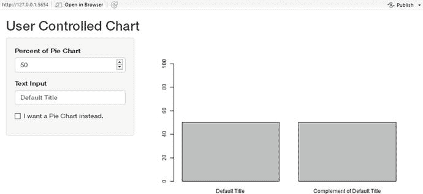

图 13-1. 本地托管的 Shiny 应用，展示我们正在获得的成果

请随意输入各种数字和文本值。尝试使用 Shiny，看看它能做什么。在此过程中，你会意识到 Shiny 所做的是为你和 R 之间提供接口。现在，这个特定运行实例是由你本地机器上的 RStudio 托管的。注意控制台中显示"listening（监听）"，你可能需要点击"Stop（停止）"按钮才能输入新代码。

那么发生了什么？假设你将"饼图百分比"数字改为 75。这个 `numericInput()` 是一个响应式值。当你修改它时，后台会发送一个信号，通知服务器 `input$pie` 已更改。服务器随后通知所有使用 `input$pie` 的响应式函数，告知它们有内容变了。在我们的例子中，`renderPlot()` 是一个响应式函数。它现在知道 `input$pie` 不同了，于是查询该值，获取新值，并重新运行其所有代码。由于这是一个输出值，整个循环会通过 `output$piePlot` 反向重复，最终用户端的 `plotOutput()` 刷新显示。

关于这一切，有几个重要事项需要注意。我们刚才描述的过程会重新运行 `renderPlot()` 内的所有代码——全部代码。此时，在其他条件不变的情况下，无需重新查找 `input$pietext` 和 `input$pieChoice`。我们的响应式函数知道它们的值，因为这些值是最新的；虽然这些值被再次使用，但不会被再次调用。然而，如果我们在 `renderPlot()` 内部进行的操作比减法和绘图更复杂，那么做出任何更改都会带来相对较高的性能成本。虽然这段代码相当简洁，但你仍然可以看到三个放置 R 代码的位置。第一个是 `library(shiny)` 所在的位置。这位于我们的 `shinyServer()` 外部。位于此处的代码（如我们的库调用）在每次会话中只运行一次。单个会话可以有多个用户同时交互（尽管目前这有点深奥）。不过，每个新用户至少会执行一次 `shinyServer()` 内的所有代码。最后，正如我们刚刚看到的，响应式函数（如 `renderPlot()`）内的代码会在任何关联的响应式输入值更新时运行一次。这意味着，为了提高效率，应尽可能将代码放在响应式函数之外。此外，如果你预见到会有大量用户访问，也应尽可能将代码放在服务器之外。

现在，让我们介绍一些新函数。记住，有用户输入侧、服务器侧和整个 Shiny 应用。深入探究，Shiny 实际上就是这三个部分。事实上，下面是一个非常精简的 Shiny 应用：

```r
library(shiny)
### 定义用户界面
ui <- shinyUI(fluidPage())
### 定义服务器
server <- shinyServer(function(input, output) {})
### 运行应用程序
shinyApp(ui = ui, server = server)
```

你可以运行这段代码，得到一个漂亮的空白页面。虽然这可能没有之前的代码那么令人振奋，但这有助于你快速开始在这种界面中编写代码。在用户界面部分，我们看到的是 `fluidPage()` 函数调用，我们在其中放置所有面向用户的文本。这部分代码是 Shiny 中最不熟悉的，因为这是创建用户可见 HTML 的代码。在参考章节中，我们提供了所有 Shiny UI 函数的链接。不过，在本章中，我们坚持使用同一基本布局，这种布局在页面内具有相当好的自适应能力，或者说流式布局，具体取决于浏览器的显示区域。请注意，这是一个 R 函数，而 R 函数接受用逗号分隔的参数。我们不断扩展的应用的各个方面都包含在这个包装函数中，它负责将所有内容转换为网页就绪的标记语言。对于我们图 13-1 中的第一个应用，我们使用了侧边栏布局。这个函数需要两个参数：我们控制应用的侧边栏面板和绘制图表的主面板。编辑用户界面后，我们得到以下代码：

```r
### 定义用户界面
ui <- shinyUI(fluidPage(
sidebarLayout(
sidebarPanel(),
mainPanel()
)
))
```

这段代码完美诠释了数学中函数组合概念的力量。我们的目标是最终让用户通过某些尚未命名的函数向我们的 R 代码输入内容（如图 13-1 示例中的文本或复选框），这些函数生成可视化输出，然后输入到 `sidebarPanel()` 函数，该函数产生网页输出，再输入到 `fluidPage()`，最终输出完整的 Web 用户界面。我们可以看到结果，虽然仍是空白，如图 13-2 所示。

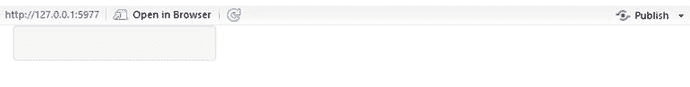

图 13-2. 一个近乎空白的 Shiny 应用，带有 `sidebarPanel()`

从这一点出发，我们可以使用三个输入函数快速构建用户的输入。每个输入函数都遵循特定格式，即 `blargInput(输入标识, 用户可读的文本标签, 与 blarg 所代表的特定输入类型相关的设置)`。正式地说，我们的三个输入函数具有以下布局，请注意它们的相似之处！

```r
numericInput(inputId, label, value, min = NA, max = NA, step = NA,  width = NULL)
textInput(inputId, label, value = "", width = NULL, placeholder = NULL)
checkboxInput(inputId, label, value = FALSE, width = NULL)
```

继续为我们的代码填写一些具体内容，我们可以为每个输入设置有用的标识变量，以便稍后在服务器代码中使用。既然我们打算构建一个饼图（亲爱的读者，请不要因为我们选择这个而讨厌我们），将数字输入限制在 `0` 到 `100` 之间是合理的。由于服务器代码在启动时运行一次，为数字输入提供默认值，以及文本输入提供默认值，也是有意义的。进一步构建我们迅速发展的用户界面代码，我们现在得到以下内容：

```r
## 用户界面绘制饼图
ui <- shinyUI(fluidPage(
## 由用户控制的数值、文本和复选框输入侧边栏
sidebarLayout(
sidebarPanel(
numericInput("pie", "饼图百分比",
min = 0, max = 100, value = 50),
textInput("pietext", "文本输入", value = "默认标题",
placeholder = "在此输入您的标题"),
checkboxInput("pieChoice",  "  我想要饼图。", value = FALSE)
),
mainPanel()
)
))
```

再次强调，进行这些修改后，重新运行整个应用是合理的，我们将看到图 13-3 中的新结果。请注意，我们代码中的 `mainPanel()` 当前是空的，确实，在图 13-3 中，我们看不到右侧有任何内容。

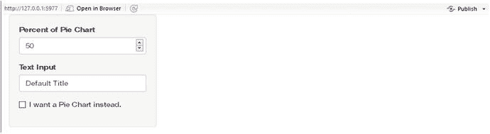

图 13-3.

用户界面已基本完成，侧边栏中的输入部分也确实完成了

现在我们已经捕获了用户输入，可以准备在服务器端使用它了。请记住，Shiny 是一个 R 语言封装器，它接收输入，并在输入发生变化时，提醒服务器端的响应函数有内容发生了改变。在后台，Shiny 会自动处理何时检测输入变化，并通知服务器上正确的响应函数；我们无需担心这些。我们的服务器定义了一个新函数，该函数将 `input` 和 `output` 作为形式参数，并在函数体中使用它们。如果需要，可以快速回顾一下第 4 章，以复习函数的定义。由于我们只想绘制条形图或饼图，因此大部分代码都是用非常常见的 R 代码精确完成这项任务的。实际上，唯一不太寻常的 R 代码部分是我们的响应函数 `renderPlot()`。因为我们希望生成图形输出，所以使用了该函数。

响应函数始终在等待 Shiny 通知它们用户界面侧的输入有任何变化。当某个输入发生变化时，如果响应函数的函数体中至少包含一个已更改的值，它们便会收到通知。如果是这样，那么这些响应函数就会使用新的值再次运行其代码。我们在以下代码中看到了这一点。唯一另一部分是，`renderPlot()` 的输出会存储在一个输出变量中，我们将其命名为 `piePlot`（尽管它可能不会输出饼图，具体取决于复选框的选择——这完全是我们选名不当的错）。

```r
## 服务器端 R 代码，创建饼图或条形图
server <- shinyServer(function(input, output) {
output$piePlot <- renderPlot({
## 根据用户输入的 input$pie 生成饼图比例
y <- c(input$pie, 100-input$pie)
```

## 使用指定的比例和标签绘制饼图或条形图

如果 `input$pieChoice == FALSE`，则调用 `barplot()` 函数并设置 `ylim = c(0, 100)`，`names.arg = c(input$pietext, paste0("互补项：", input$pietext))`。
否则，调用 `pie()` 函数并设置 `labels = c(input$pietext, paste0("互补项：", input$pietext))`。

基本上就是这样。当我们的服务器运行时，它会通知用户界面函数 `plotOutput("piePlot")` 生成新的图像。这个函数位于 `mainPanel()` 区域。在这个简单的 Shiny 模型下，侧边栏接收用户输入，服务器端在后台由 R 进行处理，而主面板则是用户查看处理后的输出结果的地方。仅此一次，我们展示一下 Shiny 为我们生成的、用于在图 13-1 中展示的完整 HTML 代码：

```html
json2[2014.02.04];jquery[1.11.3];shiny[0.13.1];bootstrap[3.3.5]

用户控制图表

用户控制图表 ShinyHTML 代码，创建

饼图百分比

文本输入

我想要饼图。
```

所以，现在请回头仔细查看我们在本节中展示的第一个代码块，也就是完整的 Shiny 应用，并意识到那段代码生成了上述所有 HTML 和 JavaScript。这就是 Shiny 的全部内容。在这个例子中，我们的 R 代码并不特别出彩。尽管如此，重要的还是原理。用户现在可以与数据交互，并且不难想象出更有趣的应用。

在接下来的几节中，我们将介绍一些其他有趣且实用的 Shiny 输入函数，以及一些必要的响应函数。最后，我们将把所有内容上传到云端，这样你就可以在网络上实时看到它们。

## 动态 Shiny

既然我们对 Shiny 的功能有了更好的理解，那么认识到网页相对于打印报告的动态潜力就很重要了。其中一位作者是数学教授，数学教学中的一个挑战是，一旦数据超过三维，学生就难以将这些信息概念化。自然，学生们并非唯一受困于高维盲点的人。时间可以提供第四维，而 Shiny 可以为我们提供这个时间维度。

我们之前提到的 Shiny 的另一个特点是，R 代码适合放置在三个不同的位置。第一个位置是在所有代码的开头，在编写用户界面或服务器端代码之前。放置在此处的代码每个实例运行一次。虽然在本地机器上这可能不那么明显，但当你的代码托管在云端时，一个特定的 R 会话可能有多个用户与之交互。这就是我们在上一章安装的 Shiny 服务器的工作方式。这是读取任何静态数据或执行任何一次性计算的理想位置，其计算效率最高。虽然在此例中我们没有这样做，但代码也可以放在服务器代码内部，但在任何响应函数之外，这样的代码会在每个用户连接到会话时运行一次。最后，服务器函数内部的响应函数内的代码，每次该函数引用的任何输入数据发生变化时都会执行一次。

让我们看看如何随时间改变数据。从用户界面侧来看，有一个输入函数是数字线滑块条。与所有输入函数一样，我们需要为它命名，以便我们的响应函数知道去哪里查找输入更新。与上一节中的 `numericInput()` 类似，我们为这个函数提供一些以年份为单位的最小值和最大值。最后，我们将为 `sliderInput()` 函数添加动画效果。看看我们在用户界面中使用的代码。我们的代码使用了一个动画选项，其中包括以毫秒为单位的 `interval`，并且动画设置为循环播放。

```r
sliderInput("ayear", "学年：",
            min = 2014, max = 2017,
            value = 2014, step = 1,
            animate = animationOptions(interval=600, loop=T) )
```

虽然这个应用也展示了如何对静态数据和用户输入执行 R 计算，但从 R 代码的角度来看，它实际上又相当简单。事实上，除了 `titlePanel()` 命令和当然还有我们的滑块代码之外，这与我们的第一个 Shiny 应用非常相似。我们在图 13-4 中展示了代码和最终结果。

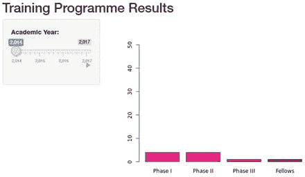

图 13-4.

一个带有“播放”按钮功能的滑块条输入，显示随时间变化的数据

```r
library(shiny)
slider_data<-read.csv("slider_data.csv", header = TRUE, sep = ",")
Phase1    <- slider_data[,2]
Phase2    <- slider_data[,3]
Phase3    <- slider_data[,4]
Phase4    <- slider_data[,5]

### 定义用于绘制条形图的应用的用户界面
ui <- shinyUI(fluidPage(

### 应用标题
titlePanel("培训计划结果"),

### 带有分箱数量滑块输入的侧边栏
sidebarLayout(
  sidebarPanel(
    sliderInput("ayear", "学年:",
                min = 2014, max = 2017,
                value = 2014, step = 1,
                animate = animationOptions(interval=600, loop=T) )
  ),

### 显示条形图
  mainPanel(plotOutput("barPlot") )
  )
))

### 定义绘制条形图所需的服务器逻辑
server <- shinyServer(function(input, output) {
  output$barPlot <- renderPlot({

### 统计各个阶段中匹配正确日期的值数量。
    cap<-input$ayear*100
    x <- c(sum(Phase1<cap), sum(Phase2<cap), sum(Phase3<cap), sum(Phase4<cap))

### 绘制对应年份的条形图。
    barplot(x, names.arg = c("第一阶段", "第二阶段", "第三阶段", "研究员"),
            col = c("deeppink1","deeppink2","deeppink3","deeppink4"),  ylim=c(0,50))
  })
})

### 运行应用
shinyApp(ui = ui, server = server)
```

## 将用户文件上传到 Shiny

本章的最后一个示例表明，用户可以通过 Shiny 上传文件，然后由 R 进行处理。当然，与前两个示例不同，这样做有一定风险，因为这些上传的文件不受我们控制。数据可能是任何文件，不一定会与我们的结果真正匹配。可以在代码中构建各种错误检查功能；事实上，我们在讨论函数时已经部分提到了这些技术。然而，为了将我们的代码严格聚焦于新功能，我们暂时假设自己生活在一个完美的世界中。我们在 Apress 网站上有一个本书的示例文件，它只是一个逗号分隔的值文件，包含数字 1 到 10。

也许不足为奇的是，要在 Shiny 中接收文件输入，命令是 `fileInput()`。除了 `inputId` 之外，最有趣的功能可能是它甚至可以接受 `multiple`（多个）文件上传，尽管在我们的示例中，我们将其保留为默认值 `FALSE`。并非所有浏览器都支持上传多个文件。同样在用户界面区域，我们使用了一个新的输出函数 `tableOutput()`，它与 `plotOutput()` 一起，使我们能够为用户提供图表和图形两种输出。在讨论使我们能够与用户文件交互的服务器端代码之前，我们先看看 CSV 文件上传给我们带来了什么。图 13-5 是我们上传 CSV 文件后的视图，下面我们仅展示用户界面的代码：

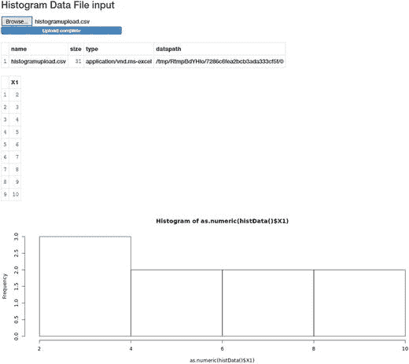

图 13-5. 文件上传结果

```r
ui <- shinyUI(fluidPage(
  fileInput("file", label = h3("直方图数据文件输入")),
  tableOutput("tabledf"),
  tableOutput("tabledf2"),
  plotOutput("histPlot1")
))
```

首先，请注意第一个表格。它包含四个变量，这些变量是直接访问 `input$file` 变量的结果。基于我们之前的其他示例（其中用户输入可以直接从 `input$inputId` 访问），这可能会有点反直觉。然而，它确实表明，我们的用户输入实际上是一个数据框，并且临时数据路径可以像访问任何文件位置一样被访问。郑重提醒：如果用户上传另一个文件，由于我们是在临时目录中，旧文件很可能会被覆盖。接下来，请注意我们文件的实际数据位于第二个表格中，如直方图所示，这些信息可用于我们选择编写的任何 R 计算。

接下来让我们重点看看服务器端，因为这并不像我们之前的示例那么简单。有时，你遇到的输入比单个数值或文本值需要更多的管理。由于该数据是输入数据，因此需要一个响应式函数来感知其是否发生变化。然而，你可能更倾向于使用相当简洁的代码。幸运的是，Shiny 提供了一个基本的响应式函数，它就叫 `reactive()`。在下面的代码中，我们创建了自己的响应式函数来处理新场景，即我们想要的场景。当文件上传时，Shiny 会提醒我们的响应式函数 `reactive()`，`input$file` 已发生变化。该函数自然会查询输入以了解当前内容，并将该数据框存储到变量 `file1` 中。我们需要访问 CSV 文件中的数据，因此需要对该文件调用 `read.csv()`，这自然需要知道文件的位置。该位置存储在名为 `datapath` 的最后一列中。我们得到的是一个可以在后续代码中像数据框一样处理的对象。

```r
histData<-reactive({
  file1<-input$file
  read.csv(file1$datapath, header=TRUE, sep = ",")
})
```

除此之外，我们现在可以在其他响应式函数（甚至是熟悉的函数）中使用我们的数据。我们展示一个新的响应式函数 `renderTable()`，以及一个熟悉的函数 `renderPlot()`。你还应该注意 `histData()$X1`。请注意，它带有函数括号，但元素仍然通过熟悉的 `$` 访问。这是用响应式函数构建的，因此必须认识到，它既是一个从用户获取输入的函数，也是一个包含可访问数据的数据存储对象。

```r
output$tabledf2<-renderTable({
  histData()
})
output$histPlot1<-renderPlot({
  hist(as.numeric(histData()$X1))
})
```

至此，我们对代码的分析就结束了。为完整起见，我们在此节末尾给出整个代码，但现在你已经掌握了在 Shiny 中启动和运行的技术。在本节结束之前，我们指出，参考资料部分的第一链接是一个参考网站，涵盖了大部分甚至所有的 Shiny 函数。如果你有任何想做的事情，请先查阅那里。它是相当直观的。另外值得注意的是，本章的下一节将展示如何将应用文件上传到云端并使其在线运行。最后，请注意用户界面中 `fileInput()` 函数内部的 `h3()` 函数。Shiny 拥有一整套函数，可以复制各种常见的 HTML 功能，例如标题。在本章中，我们认为这些是无关紧要的。在第 14 章中，我们将更多地关注如何让用户界面变得“漂亮”（暂且这么说）。

```r
library(shiny)
ui <- shinyUI(fluidPage(

### 复制下面这行以创建一个文件上传管理器
  fileInput("file", label = h3("直方图数据文件输入"), multiple = FALSE),
  tableOutput("tabledf"),
  tableOutput("tabledf2"),
  plotOutput("histPlot1")
))
```

### 定义绘制图形所需的服务器逻辑
```r
server <- shinyServer(function(input, output) {
    output$tabledf<-renderTable({
        input$file
    })
    histData<-reactive({
        file1<-input$file
        read.csv(file1$datapath, header=TRUE ,sep = ",")
    })
    output$tabledf2<-renderTable({
        histData()
    })
    output$histPlot1<-renderPlot({
        hist(as.numeric(histData()$X1))
    })
})
```

### 运行应用程序
`shinyApp(ui = ui, server = server)`

请注意，在这段代码中，我们并未专注于侧边面板或主面板等区别；而是将用户界面端（包括请求的输入和生成的输出）全部混杂在一起。值得留意的是，如果你有一个侧边面板，则需要一个主面板来放置侧边面板未承载的所有输出。

## 在云端托管 Shiny
我们的最后一项任务是将文件从本地机器传输到云端实例。请记住，在前面的章节中，我们不仅使用了 `PuTTY`（Tatham, 2016）在云端安装 Shiny Server，还使用了 `WinSCP`（Prikryl, 2007）将文件上传到云端。我们启动 `WinSCP`，重新连接，并确保左侧本地目录位于 Shiny 应用程序文件夹中，而右侧云端服务器目录位于 `/home/ubuntu` 下。此过程的结果如图 13-6 所示。

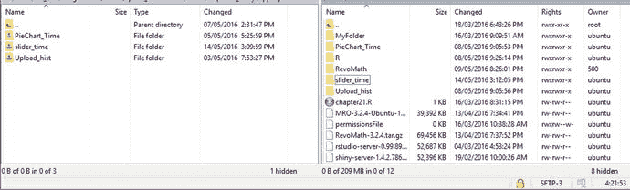
图 13-6. WinSCP 界面，显示已上传的 PieChart_Time、slider_time 和 Upload_hist 三个 Shiny 应用程序

接下来，我们访问 `PuTTY`，并在命令行中依次运行以下代码：
```
sudo cp -R ∼/PieChart_Time /srv/shiny-server/
sudo cp -R ∼/slider_time /srv/shiny-server/
sudo cp -R ∼/Upload_hist /srv/shiny-server/
```

至此，只剩下最后一步。回想一下，当初我们首次设置云端实例时，曾谨慎地只允许少数几个 IP 地址访问少数几个端口。你需要重新登录 AWS 并再次进入 EC2 控制面板。在左侧导航菜单中，回到安全组并选择你的 AdvancedR 组。选中该组后，点击“入站”选项卡，然后点击“编辑”->“添加规则”。你需要使用自定义 TCP 规则，添加端口 3838，最后将其锁定到你的 IP 地址。然后点击“保存”。结果如图 13-7 所示。

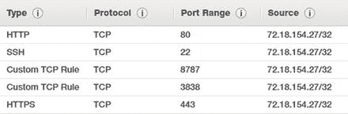
图 13-7. AWS 入站规则表，Shiny Server 端口 3838 仅对单个本地 IP 地址开放

现在，你可以通过在任意浏览器中输入以下 URL 来验证你的应用程序是否正常运行：
`http://Your.Instance.IP.Address:3838/PieChart_Time/`
`http://Your.Instance.IP.Address:3838/slider_time/`
`http://Your.Instance.IP.Address:3838/Upload_hist/`

如果你希望允许其他人或互联网上的所有人访问你的应用程序，请将入站规则的源 IP 地址更改为 `0.0.0.0/0`（仅针对端口 `3838`）。作为一种安全措施，不允许外部世界访问你的 SSH 端口。当然，如果你现在托管了一个对全世界开放的 3838 端口，你的服务器将是可见和已知的。为不同活动使用不同的云端实例可能是有益的。我们建议不要在可公开访问的服务器上存放机密数据。再次强调，云安全超出了本书的讨论范围。

## 最终思考
我们似乎花了不少时间讨论云安全问题。这背后有两个原因。首先，这纯粹是我们多疑的天性使然。然而，相当一部分数据可能包含机密信息。合乎道德地使用数据，包括采取合理的安全措施，非常重要。最近几个月，AWS 在为 EC2 创建更安全的环境方面取得了长足进步。一如既往，安全是一个合理性的问题。你的数据越重要，就越需要采取更好的措施来保护这些信息。

抛开这些顾虑不谈，让用户以如此开放的方式与数据分析进行交互，这确实是一项前所未有的能力。是的，根据我们的经验，这可能会导致一些数据消费者做出不明智的决策。尽管如此，通过像 Shiny 这样的技术所能实现的透明度带来的好处，远远超过其缺点。这是一个令人兴奋的世界，我们渴望去探索。

# Shiny 仪表板示例
本章并非理解本书其他章节所必需的内容。虽然我们介绍了一些新技术，但本章的主要内容是一个完整的仪表板示例，你可以根据需要进行修改。

这个示例具体是做什么的？它将我们在前一章中使用的应用程序，以一种引人入胜的交互式格式呈现出来。重要的是要记住，虽然我们通常以图形输出的方式展示这些应用程序，但实际上可以对数据执行任何 R 语言的处理过程。其目标是让信息消费者能够自然地与实时数据进行交互，无论这些消费者是研究评审员、上级主管还是董事会成员。

与上一章类似，我们在 Windows 系统的 `RStudio`（RStudio Team, 2015）中介绍此内容。我们既提供了理解此仪表板的框架，也提供了一些专业提示。务必将此示例视为一种创意孵化器。我们希望你能看到自己喜欢的内容，更重要的是，意识到如何最好地展示你的数据。

我们将从仪表板的基本结构开始讲起。

## 仪表板的骨架
回顾一下前一章中最基础的 `shiny`（Chang, Cheng, Allaire, Xie, and McPherson, 2016）应用程序：
```r
library(shiny)

### 定义用户界面
ui <- shinyUI(fluidPage())

### 定义服务器
server <- shinyServer(function(input, output) {})

### 运行应用程序
shinyApp(ui = ui, server = server)
```

这段代码从一开始就很值得审视，因为它突出了所有 Shiny 应用程序都包含一个用户界面和一个服务器端（R 代码逻辑所在之处）——而这两者本身都作为 R 进程运行（可能运行在云服务器上）。我们打算向该结构添加的，只是用户界面端的一些代码。这应该合情合理，因为仪表板更像是关于用户界面，而非任何新的代码逻辑。其目标是让用户可以轻松获取分析结果和统计推断。为此，我们需要安装一个新的库，但也仅仅是一个库：`shinydashboard`（Chang, 2015）。在 RStudio 的命令行中，运行以下代码：
```
install.packages("shinydashboard")
```

安装好这个新包后，我们现在可以来看看最基础的 Shiny 仪表板应用程序。仪表板包括一个标题栏、一个带有各种菜单项的侧边栏，以及一个主体区域，应用程序的不同对象都位于主体中。将此仪表板代码布局与单一的应用程序代码进行比较和对比。这两个版本几乎相同。代码之后，请参见图 14-1 中它们生成的界面。

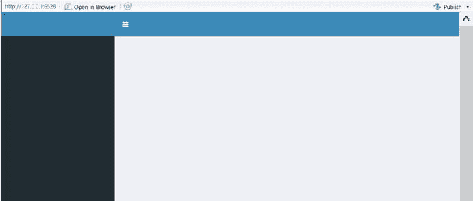
图 14-1. 最基础的 Shiny 仪表板，内容近乎空白
```r
library(shiny)
library(shinydashboard)

### 定义用户界面
ui <- dashboardPage(
    dashboardHeader(),
    dashboardSidebar(),
    dashboardBody()
)

### 定义服务器
server <- shinyServer(function(input, output) {})
```
### 运行应用程序
`shinyApp(ui = ui, server = server)`

如上述代码所示，我们使用了三个函数：`dashboardHeader()`、`dashboardSidebar()` 和 `dashboardBody()`。它们为我们的仪表盘提供了良好的结构。这三个函数都作为 `dashboardPage()` 的前三个正式参数（共五个）位于该页面函数内部。最后两个形式参数包括 `title`（默认为 `NULL`）以及 `skin`（可取值为 `blue`、`black`、`purple`、`green`、`red` 或 `yellow` 颜色）。正如你可以通过 `formals(dashboardPage)` 命令自行查看的那样，这个页面函数确实足够简单。`title` 参数控制浏览器本身的标题（或者在大多数流行浏览器中打开多个标签页时，控制浏览器标签页上的标题）。`skin` 颜色选项控制仪表盘的整体配色方案。现在，前三个形式参数本身就是函数，并且可能变得相当复杂。尽管如此，我们将依次介绍这三个函数。

## 仪表盘标题栏
`dashboardHeader()` 函数也接受一个 `title` 形式参数，用于将用户定义的文本添加到标题栏区域，以及一个控制该文本宽度的 `titleWidth` 参数。标题栏还接受其他几个 Shiny 用户界面样式的函数，用于控制页面导航，以及一些更专业的函数，用于实现更具交互性的导航。在本章乃至本书中，我们基本上会忽略这些函数，以推广使用 `shiny` 和 `shinydashboard` 作为向数据消费者提供已熟悉的 R 代码的方式，而不是一次性学习太多新特性。事实上，我们为这个函数提到的最后一个形式参数是 `disable`，它默认为 `FALSE`，当设为 `TRUE` 时则完全隐藏标题栏。在我们的示例应用中，我们将保持标题栏基本处于初始状态。

## 仪表盘侧边栏
接下来看 `dashboardSidebar()` 函数，显式列出的形式参数再次包含一个 `disable` 选项和一个 `width` 参数。然而，除了这些显式列出的参数外，还可以使用更多函数。首先需要知道的是，来自 `shiny` 的任何用户界面函数都可以在侧边栏中使用。因此，如果在你的菜单中放置一个滑块条或下拉输入函数是合理的，那也是可行的。不过，有一些仪表盘库特有的函数适合放置在侧边栏区域内。

其中第一个是 `sidebarMenu()` 函数。与 `dashboardSidebar()` 本身非常相似，这个函数主要接收其他输入，并以高效的方式处理它们的组织。特别需要注意的是 `menuItem()` 函数，它是在 `sidebarMenu()` 内部调用的。在此示例应用中，我们将前一章创建的每个应用程序都放在各自的 `menuItem()` 调用中。如下面的代码所示，这个函数有几个形式参数：
```r
formals(menuItem)
$text
$...
$icon
NULL
$badgeLabel
NULL
$badgeColor
[1] "green"
$tabName
NULL
$href
NULL
$newtab
[1] TRUE
$selected
NULL
```

在上述函数和形式参数中，`text` 接受一个带引号的文本字符串，用于提供该菜单项的文本信息或链接名称。`icon` 形式参数需要提供一个 `Font-Awesome` 图标的名称。我们在本章的参考资料部分提供了一个在线库的链接，该链接展示了所有可选的图标。我们也可以切换到其他图标库；我们把这个探索留给你自己。`badgelabel` 调用会在侧边栏的最右侧放置一个内联徽章，用于容纳一小段文本。徽章能很好地吸引观众对特定菜单项及其底层应用的注意。这些形式参数中的许多都是可选的；然而，必须有一个与仪表盘主体中的 `tabItem()` 相关联的 `tabName`，或者必须向 `href` 命令提供一个 `URL`。如果提供的是 `URL` 而不是 `tabName`，那么当你希望查看者访问该页面时离开你的站点时，可以将 `newtab` 从默认的 `TRUE` 更改为 `FALSE`。最后，可以通过将 `selected` 设置为 `TRUE`，将默认选中项强制指定为某个特定的标签页，而不是第一个 `menuItem()`。

在我们把注意力转向仪表盘主体时，我们提醒您，侧边栏也可以接收任何 Shiny 函数——例如 `img()` 函数，它指向一个必须存放在仪表盘应用文件夹内名为 `www` 的文件夹中的图像。我们在图 [14-2] 中展示了我们示例应用的菜单代码片段（尚未运行）以及结果。前三个菜单项的名称应该在前一章中见过。

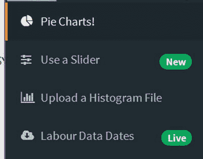
图 14-2. 一些 `sidebarMenu()` 和 `menuItem()` 函数的结果
```r
sidebarMenu(
    menuItem("饼图！", tabName = "PieChart_Time", icon = icon("pie-chart")),
    menuItem("使用滑块", tabName = "slider_time", icon = icon("sliders"), badgeLabel = "New"),
    menuItem("上传直方图文件", tabName = "Upload_hist", icon = icon("bar-chart")),
    menuItem("劳动数据日期", tabName = "labour", icon = icon("cloud-download"), badgeLabel = "Live")
)
```

## 仪表盘主体
如上述代码所示，每个菜单项都有一个 `tabName`。我们现在将讨论 `dashboardBody()` 函数内部用于捕获该 `tabName` 的代码。请先看一下下面代码和图 [14-3] 中的这个小型（但不是最小）的 Shiny 仪表盘，然后我们将逐步讲解新增的代码行。

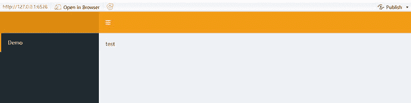
图 14-3. 一个侧边栏包含 `menuItem()`，主体部分包含 `tabItem()` 的仪表盘。注意匹配的 `First`。
```r
library(shiny)
library(shinydashboard)

### 定义用户界面
ui <- dashboardPage(
    dashboardHeader(),
    dashboardSidebar(sidebarMenu(menuItem("演示", tabName = "First"))),
    dashboardBody(tabItems(tabItem(tabName = "First", "test"))),
    skin = "yellow")
```

## 定义服务器

`server <- shinyServer(function(input, output) {})`

## 运行应用程序

`shinyApp(ui = ui, server = server)`

在仪表盘的主体部分，我们可以放置许多内容。然而，如果我们想使用之前在侧边栏部分编写好的选项卡，我们需要调用 `tabItems()` 函数。该函数不接受除单个 `tabItem()` 函数调用之外的任何参数；每个 `tabItem()` 都需要有一个唯一的 `tabName`，且该名称必须与 `sidebarMenu()` 中的某个唯一 `tabName` 相匹配。

每个 `tabItem()` 内部应该放些什么呢？与 Shiny 类似，将布局设置得足够灵活，以便仪表盘能够适应不同尺寸的浏览器窗口是很有好处的。因此，常用的 `fluidRow()` 函数再次出现。回想一下，`fluidRow()` 设置的行宽最多为 12。记住这一点，请密切关注我们将要讨论的三种盒对象（用于填充这些行）的默认宽度。当然，可用的对象不止这三种；同样，我们的目标是让你能够快速上手，以便通过云端将数据提供给用户或利益相关者。

行中最基本的输入元素是 `box()`。在这个函数内部，我们可以放置前一章中使用过的任何应用程序代码，无论是用于向用户请求输入，还是用于输出响应式内容。不过，`box()` 还接受九个特定的参数。自然，每个 `box()` 都可以设置一个 `title` 值，这是一个用户定义的文本字符串，应简洁地描述盒子的内容或所需操作。盒子底部有一个 `footer`，也可以接受一个文本字符串。盒子还可以设置一个 `status`，其值可以是 `primary`、`success`、`info`、`warning` 或 `danger`。每个状态值都有对应的颜色，这些颜色是默认层叠样式表结构的一部分，使得 `shinydashboard` 看起来相当美观。颜色相当一致，不过根据您为整个仪表盘选择的颜色，可能会有一些差异。`solidHeader` 的默认值是 `FALSE`，当然，也可以改为 `TRUE`。选择 `TRUE` 只会将状态的颜色增强为 `title` 文本的一个窄横幅背景。如果你希望盒子的主要区域具有特定的颜色，可以从大约 15 种有效的颜色中选择来设置 `background`。顾名思义，所有输入代码和输出代码都位于该 `background` 之上。盒子的默认 `width` 是 `6`，因此，除非你特意缩小宽度，否则两个盒子将占满一行。如果未能记住 `fluidRow()` 的总宽度为 `12`，则可能导致布局混乱。盒子的 `height` 也可以设置为固定高度。如果你需要行与行之间非常整齐，这会很有帮助。最后，盒子是 `collapsible`（可折叠）的，并且可以默认是 `collapsed`（已折叠）的，尽管这两个选项的默认值都是 `FALSE`。图 14-4 展示了这些不同设置的一些结果。

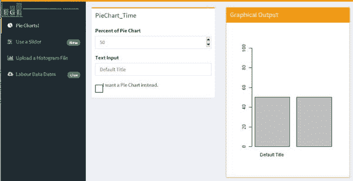

**图 14-4.** 一个熟悉的应用程序，显示在两个具有各种选项的盒子中——详情请参阅完整示例代码

另一种类型的盒子是 `valueBox()`，它接受六个形式参数。第一个是 `value`，通常是一个较短的文本字符串或数值，如图 14-5 所示。`valueBox()` 还接受一个 `subtitle` 参数，同样是一个文本字符串。你可以选择一个 `icon`，尽管默认值是 `NULL`。这些盒子默认 `color` 为 `aqua`，并且相当短，默认 `width` 仅为 `4`。最后，`valueBox()` 还接受一个 `href` 值，默认值为 `NULL`。我们在示例代码的 value box 中使用的代码展示如下：

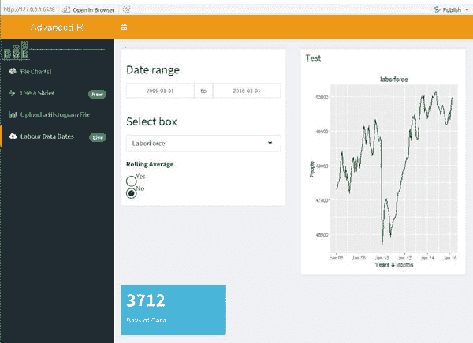

**图 14-5.** 示例 `valueBox()` 显示从网站实时获取的数据的天数

```
valueBox(endYear-startYear, "Days of Data", icon = icon("calendar"))
```

我们用一个与 `valueBox()` 相似的盒子——`infoBox()`——来结束对 `dashboardBody()` 中盒子的讨论。这个盒子有一个接受文本字符串的 `title`，一个用于突出显示并展示在盒子中的 `value`，可选的 `subtitle` 文本，以及一个默认的条形图 `icon`。它还默认 `color` 为 `aqua`、`width` 为 `4`、`href` 为 `NULL`。不同之处在于，`icon` 更小，并且有一个通常为 `FALSE` 的 `fill` 选项，可以改变背景颜色的显示方式。我们没有展示这个盒子，但它看起来与图 14-5 中的小盒子非常相似。根据我们的经验，这些盒子除了外观之外，并没有显著的区别。

### 云端仪表盘

我们确实希望将这个仪表盘部署到我们的云实例上，这是一套稍微复杂一些的代码。同样，我们使用 RStudio 在标准 Shiny 文件夹中创建了它，因此它位于自己的文件中。在 Windows 上，文件结构如图 14-6 所示。我们的 `shinydashboard_cloud` 文件夹中有三个文件。请注意，`www` 文件夹存放了我们的示例图片，接着是 `app.R` 文件，其中包含了我们整个 Shiny 应用程序以及我们的 CSV 文件。

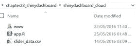

**图 14-6.** `shinydashboard_cloud` 的文件结构

我们使用 `WinSCP` 将文件和文件夹上传到我们的 Ubuntu 云实例，如图 14-7 所示。

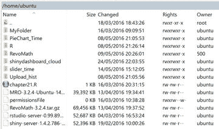

**图 14-7.** `WinSCP` 上传文件夹视图

登录到 `PuTTY` 后，我们还有一些工作要做。我们的示例使用了一些新库，当然，文件需要从我们的用户文件夹移动到 Shiny 服务器期望的位置。为简洁起见，我们只安装云实例上尚未安装的包。

第一个新包是 `XML`（Lang, D. 等人, 2016），该包提供了从 Web 实时读取 HTML 表格的能力。各种政府和非营利机构将数据存储在这种表格中，以便公众轻松访问。我们还安装了 `zoo` 包（Zeileis 和 Grothendieck, 2005），该包为时间序列提供了便利的函数。已经熟悉的包是 `ggplot2`（Wickham, 2009）和 `data.table`（Dowle, Srinivasan, Short 和 Lianoglou, 2015），它们分别用于图形绘制和提供更高级的数据框结构。

以下命令在我们的实例上一次运行一个，为所有用户安装五个新库，然后复制文件，以便可以通过浏览器访问。我们还在 Ubuntu 上安装了一些软件，这些软件是运行 `XML` 包所必需的。为了清晰易读，我们将以下一些命令组合在一起。它们应该在 `PuTTY` 中逐行运行，每个命令运行后屏幕上都会打印一些文本。

```
sudo su - -c "R -e \"install.packages('shinydashboard', repos='https://cran.rstudio.com/')\""
sudo apt-get install libcurl4-openssl-dev libxml2-dev
sudo su - -c "R -e \"install.packages('XML', repos='https://cran.rstudio.com/')\""
sudo su - -c "R -e \"install.packages('zoo', repos='https://cran.rstudio.com/')\""
sudo su - -c "R -e \"install.packages('data.table', repos='https://cran.rstudio.com/')\""
sudo su - -c "R -e \"install.packages('ggplot2', repos='https://cran.rstudio.com/')\""
sudo cp -R ~/shinydashboard_cloud /srv/shiny-server/
```

至此，我们完成了 Shiny 和 Shiny 仪表盘的工作。您的仪表盘应该已在 `http://Your.Instance.IP.Address:3838/shinydashboard_cloud/` 上线，并可通过您的浏览器查看。在结束本章之前，我们还有一些补充说明。

首先，我们强烈建议您访问 Apress 网站中本教材对应的页面，并下载本章的代码包。其中包含图 14-6 所示且已上传至图 14-7 的完整且可用的工作文件和文件夹。无需手动输入所有这些代码，即可判断数据看板是否符合您的需求。

其次，本章中我们并未完全给出示例代码。我们将完整代码保留至末尾，以便将其整合为一个连贯的整体，并让您专注于该示例代码中需要关注的具体结构。

第三，我们提醒您，如果您已遵循我们关于 AWS 服务器入站策略设置的安全建议，则可能需要更改这些设置，以允许除您之外的更多人查看最终的数据看板项目。请记住，您需要在入站侧更改的设置是允许从 `0.0.0.0/0`（即整个互联网）访问端口 `3838`。请注意，这意味着整个互联网都能访问您的数据看板。如果您有敏感数据，或甚至只是无需公开的信息，请考虑与 IT 专业人员或至少是 IT 高级用户合作。

最后，我们希望您和我们一样享受本章内容及其成果。请务必查看“参考文献”部分中的链接。您将找到有价值的信息，包括其他函数、一整套图标列表、另一个完整的图标库，以及最新的 `shiny` 和 `shinydashboard` 包信息。这些包更新相当频繁，新功能通常能带来令人惊叹的效果。

### 完整示例代码

```
library(shiny)
library(shinydashboard)
library(XML)
library(zoo)
library(data.table)
library(ggplot2)
#此代码将在每次会话实例化时运行一次——同一会话中可能有多个查看者。
slider_data=xlow]
yValue =4){  blsSub[,(yValue):=rollmean(get(yValue), k=3, na.pad = TRUE)] }
ggplot(data = blsSub, mapping = aes_string("Date", yValue)) +
geom_line()+
xlab("Years & Months")+
ylab("People")+
xlim(xlow, xhigh)+
ggtitle(yValue)+
scale_x_date(date_labels = "%b %y")
}) })
```

# 15. 动态报告与云端

在前面的章节中，您已经看到 Shiny 如何基于动态数据提供交互式环境。动态报告与实时数据看板有许多相似之处。另一方面，本章由于报告最终生成的是 PDF 文件，因此交互性较弱。报告在许多领域都是客观存在的事实，利益相关者往往需要时间节点快照，而非完全交互式的环境。通过 `knitr` 和 `rmarkdown` 包，我们能够基于数据输入创建文档（例如 PDF、HTML 或 Microsoft Word）。对于基于持续变化的数据构建、但整体结构相同的常规报告而言，这能极大地节省时间。

`rmarkdown` 包（Xie, 2015）增加了将 R 处理过程嵌入此类文档的功能，从而支持一键式分析，并使用多种样式进行精美排版。LaTeX 界面几乎可以实现任何所需的格式化，不过除了 PDF 之外还有其他选择。从基于学生信息系统数据库实时拉取数据的招生管理董事会报告，到根据关键绩效指标绘制的战略计划行动表，当可变输入需要塑造成标准化输出时，动态报告能发挥最佳效果。这一过程也通过 `knitr` 和 `formatR` 包（Xie, 2015）得到了简化。

此外，在本章中，我们还将使用 `evaluate` 包（Wickham, 2016）和 `tufte` 包（Xie, 2016）。这些包使我们能够更优雅地组织数据的布局和格式。我们还会使用 `ltm` 包（Rizopoulos, 2006）进行心理测量测试。

本章的目标是：增强本地和云端机器上的软件环境，以便动态文档能够成功编译；探索独立 `rmarkdown` 的结构；开发一个允许用户上传数据并随后下载 PDF 报告的 Shiny 页面；最后将所有内容推送至我们的云端实例。我们从所需软件开始。

## 所需软件

我们已经拥有了大部分所需软件，即 R、Shiny 包（Chang, Cheng, Allaire, Xie, and McPherson, 2016）、`PuTTY` 以及运行 `Ubuntu` 的云端实例。我们还需要安装一些新包——既要在本地机器上安装，也要在云服务器上安装。

### 本地机器

首先，在 R 控制台中，务必独立于任何 R 文件运行以下代码：

```
install.packages("rmarkdown")
install.packages("tufte")
install.packages("knitr")
install.packages("evaluate")
install.packages("ltm")
install.packages("formatR")
```

安装好这些包之后，我们将注意力转向安装 `MiKTeX`（Schenk, 2009），它用于创建 PDF 文件。简单访问 `MiKTeX` 网站（[`http://miktex.org/download`](http://miktex.org/download)）即可获取推荐的基础安装程序（32 位）或其他基础安装程序（64 位）。我们为系统使用 64 位版本，尽管在本章中，各版本之间可能没有太大差异。下载后，在安装过程中接受所有默认设置。安装后，`MiKTeX` 包可能有更新。要执行这些更新，请进入开始菜单。在名为 `MiKTeX` 的文件夹中，你会找到靠近末尾的 `更新` 选项。按照默认选项操作，然后选择所有包更新到最新版本。虽然这不是必须的，但我们建议在安装后重启一次。

### 云实例

使用 `PuTTY` 访问你的云实例控制台。我们需要在控制台上逐行运行以下代码。回想一下前面的章节，这些代码是为该服务器的所有用户安装包的，而不仅仅是针对你的用户。这对于让 `Shiny` 服务器能够访问正确的包至关重要。

```
sudo su - -c "R -e \"install.packages('rmarkdown', repos = 'http://cran.rstudio.com/')\""
sudo su - -c "R -e \"install.packages('tufte', repos = 'http://cran.rstudio.com/')\""
sudo su - -c "R -e \"install.packages('knitr', repos = 'http://cran.rstudio.com/')\""
sudo su - -c "R -e \"install.packages('ltm', repos = 'http://cran.rstudio.com/')\""
sudo su - -c "R -e \"install.packages('formatR', repos = 'http://cran.rstudio.com/')\""
sudo su - -c "R -e \"install.packages('data.table', repos = 'http://cran.rstudio.com/')\""
```

上述代码不需要很长时间。但是，安装 `texlive`（`Ubuntu` 上用于替代 `MiKTeX` 的 LaTeX 解决方案）可能需要一些时间。它还需要相当大的磁盘空间，所以请确保你有足够的空间。在我们的试验中，需要完整版本。

```
sudo apt-get install texlive-full
```

在此之后，我们建议执行 `sudo reboot` 来重启云实例。这是一个执行重启的好时机，然后关闭 `PuTTY` 一会儿。在你的服务器重启期间，你可以使用本地机器来探索动态文档。

## 动态文档

动态文档并不需要以任何方式链接到互联网。事实上，大多数报告可能是内部使用的。在 `RStudio` 内部，选择 文件 ➤ 新建文件 ➤ R Markdown 会打开一个向导。请注意，这里有文档（例如 HTML、PDF 或 Word）以及演示文稿（例如 HTML 或 PDF）的选项。通常需要提供一个标题，以及列出作者。当然，并非必须使用 `RStudio`；在 R 中创建一个带有 `.Rmd` 后缀的新文件即可。

我们打算采用一种混合方式来介绍动态文档。也就是说，我们首先给出一个直观且信息丰富的示例，展示此类代码的样子，然后对代码的每一部分进行更深入的分析。我们从一个名为 `ch15_html.Rmd` 的新文件开始，并用以下代码填充它：

```
---
title: "ch15_html"
author: "Matt & Joshua Wiley"
date: "18 September 2016"
output: html_document
---

```{r echo=FALSE}
##注意 `echo=FALSE`
##这意味着以下代码永远不会出现在我们编织后的 html 文件中
library(data.table)
diris <- as.data.table(iris)
##但它仍然会运行，所以我们可以访问这些数据。
```
#这是一级标题；它不是注释。
这是纯文本，不是代码。
如果我们想要*斜体*或**粗体**，我们可以轻松地在这些文档中添加。当然，我们可能需要提到 `rmarkdown` 是所使用的包，内联代码很适合做这件事。
如果需要数学公式，也许 x~1~²^ + x~2~²^ = 1 是想要的。
##用二级标题调用数学公式
另一方面，我们可能需要显式地调用数学公式，在这种情况下，$x^{2} + y^{2}= \pi$ 是实现这一目的的方法。
###我喜欢删除线；我对三级标题不太确定。
在撰写报告时，我经常想说某件事是 ~~绝对愚蠢的~~ 对关键利益相关者明显相关的。
######如果你曾经写过需要六级标题的内容
那么我相信，正如这个无序列表所建议的：
* 你需要从现在开始拥抱更少的秩序
- 你有没有考虑过其他职业？
```{r echo=FALSE}
summary(diris)
```
然而，请注意，你可以同时包含代码和控制台输出：
```{r}
hist(diris$Sepal.Length)
```
```

编织上述代码的结果如图 15-1 所示。


图 15-1.

一个简单动态文档的 HTML 输出

正如你所想象的，正是摘要数据或图形可以根据任何输入轻松地重新生成。事实上，其中一位作者使用动态文档为入门统计学课程的学生创建案例研究（以及案例研究答案）。使用不同的种子生成伪随机数据非常容易，这样每个学生都可以拥有独特的数据集（以及多个主题）。这也便于快速生成供批改的解答。

现在你已经对 `Rmarkdown` 有了一个概览，让我们按照合理的模块来探索前面的代码。第一个模块是 YAML，它代表 Yet Another Markup Language 或者可能是递归定义的 `YAML Ain’t Markup Language`（YAML, 2016）头部。在最简单的情况下，它可能只包含标题、作者、日期和输出类型的信息。这里，对于本文档，我们选择了 `html_document`。然而，如前所述，还有更多选项，例如 `pdf_document`、`word_document`、`odt_document`、`rtf_document` 和 `beamer_presentation`（仅举几例——实际上还有更多）。这些类型分别创建 HTML 页面、PDF、Microsoft Word 文件、OpenDocument 或富文本文档，以及 Beamer PDF 幻灯片。Beamer 和 PDF 都需要我们之前安装的 `MiKTeX`。要更改编译的文档类型，只需更改输出！值得注意的是，第一次使用 `MiKTeX` 时，编译可能需要更长时间，因为可能需要在后台安装一个或两个包。这不需要任何用户干预，只是需要时间。同样值得注意的是，如果你使用 `beamer_presentation`，则需要考虑一张幻灯片上能容纳什么内容，不能容纳什么内容。在这种情况下，回车后紧跟 `----`，然后再跟一个回车，表示幻灯片组中的新幻灯片。

```
---
title: "ch15_html"
author: "Matt & Joshua Wiley"
date: "18 September 2016"
output: html_document
---
```

头部可以比这更复杂。R 代码可以使用 `` `r 代码` `` 格式内联注入。因此，我们可以通过在我们的代码中将 `date: "18 September 2016"` 替换为 `` date: "`r Sys.Date()`" `` 来使日期更具动态性。有数十种渲染选项可以与 YAML 头部配合使用，而且比我们更聪明的人已经创建了使用这些头部变体以及设置几个不错选项的模板。如同在 Shiny 中一样，几乎有无限的能力来精确自定义文档的呈现和显示方式。

我们 markdown 代码的下一个区域是一个代码块。代码块以 `` ```{r } ``` `` 开始，以 `` ``` `` 结束。这两者之间是你的代码。现在，在 `{r }` 内部，有几个有用的选项。如果你的部分代码计算量很大且基本是静态的，你可能希望设置 `cache = TRUE` 而不是默认的 `FALSE`。这会存储结果。我们经常使用 `echo=FALSE`，它会阻止代码本身显示，但不会阻止代码的结果显示。请注意，在接下来的第一个代码块中，我们的最终文档中没有代码运行的迹象。然而，第二个代码块仍然显示了 `summary(diris)` 的结果。

```
```{r echo=FALSE}
library(data.table)
diris <- as.data.table(iris)
```
```
```
```{r echo=FALSE}
summary(diris)
```
```
```

对于涉及绘图或图形的代码块，也有很多选项。`fig.align` 选项可以设置为 `right`、`centre` 或 `left`。对于绘图，可以使用 `fig.height` 或 `fig.width` 设置高度和宽度，其默认单位是英寸。

```
```{r fig.align="right"}
hist(diris$Sepal.Length)
```
```

最后，是文本本身，我们在此不再重复，因为它的趣味性较低。我们注意到，代码既可以写在行内，也可以像在标题中一样书写。稍后，当我们希望根据计算结果提供不同的叙述性文本时，您会发现这个选项非常有用。

## 动态文档与 Shiny

现在，我们将注意力转向不仅提供一个动态文档，而且提供一个让他人可以通过动态输入进行控制的文档。我们构建的是一个简单的 `Shiny` 环境，允许用户上传一个包含学生测验成绩数据的 CSV 文件。数据的编码方式如下：列代表测验中的特定问题；行代表单个学生；测验是多项选择题，正确回答编码为 1，错误回答编码为 0。

与前一节一样，我们查看实现此功能所需的三个文件中每个文件的所有代码。然后，我们逐行分解这些代码。对于已经熟悉 `Shiny` 的读者，请随意跳到最后一部分。我们将此代码构建在一个名为 `Chapter15` 的文件夹中。稍后，当上传到我们的 `Ubuntu` 服务器时，我们会上传整个文件夹。

## 参考文献

*   [`https://rstudio.github.io/shinydashboard/`](https://rstudio.github.io/shinydashboard/)
*   [`http://fontawesome.io/icons/`](http://fontawesome.io/icons/)
*   [`http://shiny.rstudio.com/reference/shiny/latest/`](http://shiny.rstudio.com/reference/shiny/latest/)
*   [`http://docs.rstudio.com/shiny-server/`](http://docs.rstudio.com/shiny-server/)
*   [`http://shiny.rstudio.com/gallery/`](http://shiny.rstudio.com/gallery/)
*   [`https://cran.r-project.org/web/packages/shiny/shiny.pdf`](https://cran.r-project.org/web/packages/shiny/shiny.pdf)

### `server.R`

在 Shiny 服务器端，我们调用库，然后构建上传 CSV 文件所需的系统，为用户提供文件已上传的确认，将该文件读入 R，将所需的信息传递给我们的标记文档，最后允许用户将该文档下载为 PDF。只需以下 55 行代码：

```r
##Dynamic Reports and the Cloud
library(shiny)
library(ltm)
library(data.table)
library(rmarkdown)
library(tufte)
library(formatR)
library(knitr)
library(evaluate)
function(input, output) {
output$contents <- renderTable({
inFile <- input$file1
if (is.null(inFile))
return(NULL)
read.csv(inFile$datapath, header = input$header,
sep = input$sep, quote = input$quote)
})
scores <- reactive({
inFile <- input$file1
if (is.null(inFile))
return(NULL)
read.csv(inFile$datapath, header = input$header,
sep = input$sep, quote = input$quote)
})
output$downloadReport <- downloadHandler(
filename = function() {
paste('quiz-report', sep = '.', 'pdf')
},
content = function(file) {
src <- normalizePath('report.Rmd')
owd <- setwd(tempdir())
on.exit(setwd(owd))
file.copy(src, 'report.Rmd', overwrite = TRUE)
knitr::opts_chunk$set(tidy = FALSE, cache.extra = packageVersion('tufte'))
options(htmltools.dir.version = FALSE)
out <- render('report.Rmd')
file.rename(out, file)
}    )  }
```

前面的代码从调用所有库开始，然后迅速进入 Shiny 的 `function(input, output) {}` 服务器端包装器。之后，只有三个主要的代码块。接下来，我们逐一查看这些代码块，从 `renderTable({})` 调用开始。这会生成用于用户界面的输出。具体来说，它创建了一个表格。它是一个交互式函数，当用户在用户端上传文件时，Shiny 会通知此函数其某个输入已更改。这会触发代码的运行。从输入方面来看，`input$datapath` 是服务器上 Shiny 存储上传文件的位置。假设确实存在一个文件，`read.csv` 可以访问该文件的数据路径，并获取关于数据是否有标题、使用了哪种分隔符以及用户设置的其他信息。实际上，可以向用户询问更多信息，以便进行更定制化的分析。在这里，我们保持示例简单而有效。此读取的结果创建了一个表格，并将该表格存储在名为 `contents` 的输出变量中。这带来的净效果是 Shiny 现在通知用户界面端可能有输出。我们将在本章后面看到该输出的去向。

```r
output$contents <- renderTable({
inFile <- input$file1
if (is.null(inFile))
return(NULL)
read.csv(inFile$datapath, header = input$header,
sep = input$sep, quote = input$quote)
})
```

除了创建一个表格以便用户能立即看到文件上传是否成功（并且我们设想在实际场景中，可能还会向用户界面添加注释，以允许用户发现上传失败的情况）之外，我们还必须以一种允许我们的 markdown 文件使用这些数据的格式来读取数据。我们将数据读入一个名为 `scores` 的变量中。这是一个响应式函数，它始终警惕相关输入变量的变化（在本例中，是文件的上传）。

```r
scores <- reactive({
inFile <- input$file1
if (is.null(inFile))
return(NULL)
read.csv(inFile$datapath, header = input$header,
sep = input$sep, quote = input$quote)
})
```

#### 服务器端实现

服务器端最后一部分的实现最为高级，它负责控制用户可下载的文件。该代码块的第一部分控制用户下载的报告名称。我们将报告命名为 `quiz-report.pdf`，虽然看起来复杂，但这为我们未来更改报告类型或性质提供了灵活性——无论是修改文件类型还是名称都轻而易举。请注意，如果你使用 RStudio 的内部浏览器，下载的报告会使用不同名称。接下来，我们在 markdown 文件上调用 `normalizePath()` 函数，该函数返回当前工作目录的文件路径，并附加参数中的文件名。具体来说，它会根据代码所在的操作系统环境返回相应路径。这一点非常重要，原因有二：首先，它确保了代码在 Windows 到 Ubuntu（或任何操作系统）之间的可移植性；其次，我们即将更改工作目录，因此直接调用 `report.Rmd` 将不再有效。

更改工作目录至关重要，因为我们即将创建新的 PDF 文件。在拥有管理权限的本地机器上创建新文件毫无问题。然而，我们的目标是部署到云端，但无法确保所有服务器都授予我们此类权限。因此，我们将工作目录更改为服务器的临时目录。在 R 中，`setwd(tempdir())` 完成两项操作：它首先复制并返回当前工作目录，然后将目录更改为参数指定的目录。因此，`owd` 保存的是旧的工作目录。我们设置 `on.exit()` 参数，确保 `downloadHandler` 完成后工作目录恢复原状，从而避免 Shiny 网站崩溃。

现在，我们将 markdown 文件从旧工作目录的原始位置复制到临时区域，使其能够在临时目录中运行并生成 PDF。我们同时设置了 `knitr`（用于生成 markdown PDF）的环境选项，以便能够使用 `tufte` 格式（以爱德华·塔夫特命名，详见 [`rmarkdown.rstudio.com/tufte_handout_format.html`](http://rmarkdown.rstudio.com/tufte_handout_format.html)）。剩下的工作就是使用 `render()` 渲染 markdown 文档，并将文件重命名为我们想要的名称。

```r
output$downloadReport <- downloadHandler(
filename = function() {
paste('quiz-report', sep = '.', 'pdf')
},
content = function(file) {
src <- normalizePath('report.Rmd')
owd <- setwd(tempdir())
on.exit(setwd(owd))
file.copy(src, 'report.Rmd', overwrite = TRUE)
knitr::opts_chunk$set(tidy = FALSE, cache.extra = packageVersion('tufte'))
options(htmltools.dir.version = FALSE)
out <- render('report.Rmd')
file.rename(out, file)
}    )
```

我们了解到，Shiny 服务器端需要能够使用适当的输入信息（例如是否存在标题行）读取用户上传的文件，然后负责启动 `Rmarkdown` 流程。诚然，要让这个过程在任何计算机上正常工作，需要更改工作目录，并对布局和格式选项进行一些调整。本节结束时需要指出的是，虽然设置简单的 PDF 更容易（尽管我们承认更偏爱简洁的 `tufte` 布局），但我们将把注意力转向用户界面。

### `ui.R`

对于这个非常简单的 Shiny 应用程序，用户界面相当简洁。仅用 40 行代码（实际上我们本可以删除几个选项），用户就能上传 CSV 文件、查看渲染后的数据表并下载文件分析结果。与之前一样，我们首先给出完整代码，然后逐一说明每个代码块：

```r
#动态报告与云用户界面
shinyUI(
fluidPage(
title = '成绩控制面板',
sidebarLayout(
sidebarPanel(
helpText("上传一个宽格式的 CSV 文件，其中每个列包含 0 或 1，分别代表学生该题答错或答对。"),
fileInput('file1', '选择要上传的文件',
accept = c(
'text/csv',
'text/comma-separated-values',
'text/tab-separated-values',
'text/plain',
'.csv',
'.tsv'
)
),
tags$hr(),
checkboxInput('header', '标题行', TRUE),
radioButtons('sep', '分隔符',
c(逗号=',',
分号=';',
制表符='\t'),
','),
radioButtons('quote', '引号',
c(无='',
'双引号'='"',
'单引号'="'"),
'"'),
tags$hr(),
helpText("此处显示帮助文本"),
downloadButton('downloadReport')
),
mainPanel(
tableOutput('contents')
))))
```

与用户界面的惯例相同，我们使用了 `fluidPage()` 以及 `sidebarPanel()` 和 `mainPanel()`。主要交互发生在侧边栏内，因此我们首先关注这部分。`fileInput()` 函数负责接收输入文件。我们可以控制接受的文件类型，这里限定为逗号分隔或制表符分隔的值。我们将上传控件命名为 `file1`，回想一下服务器端使用 `input$file1` 来读取文件。

```r
fileInput('file1', '选择要上传的文件',
accept = c(
'text/csv',
'text/comma-separated-values',
'text/tab-separated-values',
'text/plain',
'.csv',
'.tsv'
)
),
```

另一个我们主要关注的区域是下载部分，其理解起来并不复杂：

```r
downloadButton('downloadReport')
```

尽管有辅助文本框向用户进行解释，并且我们确实建议在实际应用中设置示例布局，以便用户理解可接受的输入格式，但我们仍选择将用户界面尽可能地精简。在将注意力转向实际报告文件之前，我们在图 15-2 中展示了上传 `scores.csv` 文件（该文件可在本书的 Apress 网站获取）后的 Shiny 应用程序。

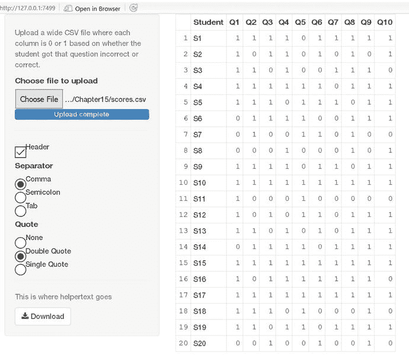

图 15-2. Shiny 用户界面，在本地托管网站上的实时显示

### `report.Rmd`

这份报告是关于学生在测验或其他测试中每道题的得分情况。我们的目标是将图 15-2 所示的输入转换为可操作、总结性的信息，用于评估试题和测试的有效性。在阅读接下来的完整代码之前，请花点时间将这段代码与独立的 markdown 文件进行比较。两者没有重大差异。实际上，唯一能表明该文件是从 Shiny 应用程序渲染而来的，是 `scores <- scores()` 这一行代码。

```r
title: "示例评分报告"
subtitle: "试题级分析"
date: "`r Sys.Date()`"
output:
tufte::tufte_handout: default

## 原始数据

以下是上传数据的样本，包含前几行和后几行，以及前几列和后几列：

```{r echo=FALSE, include = FALSE}
scores <- scores()
```

```{r, echo = FALSE}
if (nrow(scores) > 6) {
row.index <- c(1:3, (nrow(scores) - 2):nrow(scores))
} else {
row.index <- 1:nrow(scores)
}
if (ncol(scores) > 6) {
col.index <- c(1:3, (ncol(scores) - 2):ncol(scores))
} else {
col.index <- 1:ncol(scores)
}
cbind(scores[row.index, col.index[1]], round(scores[row.index, col.index[2:length(col.index)]], 2))
```

## 试题分析

以下是试题级统计量，取值范围为 0 到 1：`format(describe(scores), digits = 2)`。容易的试题均值较高（平均得分，因为试题按 0/1 计分），而困难的试题均值较低（例如低于 0.7）。优质的试题具有较高的试题-总分相关（试题与总分之间的相关系数，`rit`）。最后，删除某道试题后的信度（`alpha.drop`）提供了从测试中移除该试题后测试的信度估计值。

```{r, echo = FALSE}
item.analysis <- function(x) {
total <- rowSums(x)
c(n = nrow(x),
mean = mean(x, na.rm = TRUE),
sd = sd(x, na.rm = TRUE),
rit = cor(x, total, use = "complete.obs"),
alpha.drop = alpha(x[, !names(x) %in% names(x)])$total$raw_alpha)
}
round(t(sapply(scores, item.analysis)), 3)
```

## 测试分析

### 信度与标准测量误差

整体信度为 `r ifelse(alpha.results$total$raw_alpha > 0.6, "可接受的信度", "较低的信度")`，alpha 系数 = `r format(alpha.results$alpha, FALSE, 2, 2)`。^[Alpha 系数取值范围为 0 到 1，值为 1 表示测试完全可靠。]

下图展示了不同能力水平的测量误差。^[数值越高表示测量误差越大，表明测试在极低和极高能力水平（分数）下信度较低。]

```{r, echo = FALSE, fig.width = 5, fig.height = 4}
```

### 标准测量误差可通过以下方式绘制

vals <- plot(rasch.results, type = "IIC", items = 0, plot = FALSE)
plot(vals[, "z"], 1 / sqrt(vals[, "info"]),
type = "l", lwd = 2, xlab = "能力", ylab = "标准误差",
main = "标准测量误差")

## 项目分析

各项目的分析结果如下表所示。`r` 表示项目与总分的点二列相关系数。*Correct* 表示某项目的正确回答百分比。项目按相关系数从高到低排序。

```{r, echo = FALSE, results = 'asis'}
kable(biserial.results)
```

现在我们逐段剖析并解释此 Markdown 文件的每个代码块。这个标题比第一个稍微高级一些。注意，我们使用内联 R 代码将日期设置为当前日期。此外，我们的输出不再只是 `pdf_document`。相反，我们采用了默认的 `tufte_handout` 样式（这是一种包含样式信息的 PDF）。我们正式从其包中调用该样式（回想一下，`library(tufte)` 已在服务器端被调用）。

```
title: "示例评分报告"
subtitle: "项目层面分析"
date: "`r Sys.Date()`"
output:
  tufte::tufte_handout: default
```

接下来是将我们的评分数据读入 Markdown 文件。我们已经熟悉 `echo=FALSE`，它可以防止代码显示。然而，我们还设置了 `include=FALSE`，这可以防止任何代码输出显示。如前所述，我们使用了来自 Shiny 服务器端的变量 `scores()`，这是我们通过 `read.csv()` 读取评分数据的地方。回想一下，在 Shiny 服务器上，我们只是将该变量称为 `scores`。但是，在 `rmarkdown` 文件中，我们将其作为函数调用（毕竟它会动态更新）。与其继续将变量作为函数调用，我们在这里使用一个同名的本地环境变量 `scores` 对其进行重命名：

```{r echo=FALSE, include = FALSE}
scores <- scores()
scores <- as.data.table(scores)
setnames(scores, 1, "Student")
```

我们的下一个代码块设置了 `results='asis'`，以防止对我们的 `knitr` 表格（称为 `kable`）进行进一步处理。此外，这段代码会将前三行和最后两行及列输出到一个小的样例 `kable` 中。只有当行或列数超过六行或六列时，才会执行此操作。

```{r, echo = FALSE, results = 'asis'}
if (nrow(scores) > 6) {
  row.index <- c(1:3, (nrow(scores)-2):nrow(scores))
}
if (ncol(scores) > 6) {
  col.index <- c(1:3, (ncol(scores)-2):ncol(scores))
}
kable(scores[row.index, col.index, with = FALSE])
```

从这里开始，我们可以使用 `ltm` 包来计算测验或试题信度的若干指标。点二列相关系数至关重要；它使用了更为熟悉的皮尔逊相关系数，并针对测验题目存在二分数据这一情况进行了调整。它能够比较学生在某个特定题目上的表现与其在整个测验中的表现（因此我们将其与 `rowSums` 进行比较）。通过将这些数据从高到低排序，我们可以找出得分最低的测验题目。这些题目可能并未测量我们测验的主要主题（诚然，这是一个极大的简化——心理测量学是一门远超本文范畴的科学）。此外，我们还计算了克隆巴赫α系数和拉希模型，以供后续使用。再次说明，我们并不打算将这些结果直接包含在我们的动态文档中；但我们可以访问它们，以备后用。

```{r, include = FALSE}
items <- names(scores)[-1]
scores[, SUM := rowSums(scores[, items, with = FALSE])]

### 现在计算点二列相关系数

### 首先将数据融为长格式
scores.long <- melt(scores, id.vars = c("Student", "SUM"))

### 按项目计算点二列相关系数

### 从高到低排序
biserial.results <- scores.long[, .(
  r = round(biserial.cor(SUM, value, level = 2), 3),
  Correct = round(mean(value) * 100, 1)
), by = variable][order(r, decreasing = TRUE)]
alpha.results <- cronbach.alpha(scores[, !c("Student", "SUM"), with=FALSE])
rasch.results <- rasch(scores[,!c("Student", "SUM"), with=FALSE])
```

并非所有代码都必须放在正式的代码块内；代码也可以与文档正文内联。这样做很有帮助，因为我们可以设定临界分数（本例中为半随意设定的 `0.6`），并根据这些分数在最终报告中生成不同的文本。`tufte` 包允许使用 `^[]` 指定侧边栏注释。

整个测验的α系数 = `r format(alpha.results$alpha, FALSE, 2, 2)`，总体而言具有`r ifelse(alpha.results$alpha > .6, "可接受的信度", "低信度")`。^[α系数取值范围为 0 到 1，1 表示测验具有完美的信度。] 该图显示了不同能力水平下的测量误差。^[值越大表示测量误差越大，表明测验在极低和极高能力水平（分数）下的信度较低。]

回想我们之前的讨论，图形大小可以在代码块中控制。在这里，我们绘制了拉希模型，可以看到高表现和低表现学生的测量精度较低：

```{r, echo = FALSE, fig.width = 5, fig.height = 4}

### 可以按如下方式绘制测量标准误
vals <- plot(rasch.results, type = "IIC", items = 0, plot = FALSE)
plot(vals[, "z"], 1 / sqrt(vals[, "info"]),
     type = "l", lwd = 2, xlab = "能力", ylab = "标准误",
     main = "测量标准误")
```

代码最后以另一个 `kable` 结尾，但我们已经见过它，无需赘述。我们在图 15-3 中展示的是下载的最终结果。请注意，所有被隐藏的代码都没有显示出来。同时，注意数据样例，因为我们从图 15-2 中得知有超过六行或六列。最后，注意自动编号的侧边注释，它们提供了更多细节。这些是通过在文档文本区域中使用 `^[]` 代码构建的。这使得提供详细但不重要的见解变得非常容易。

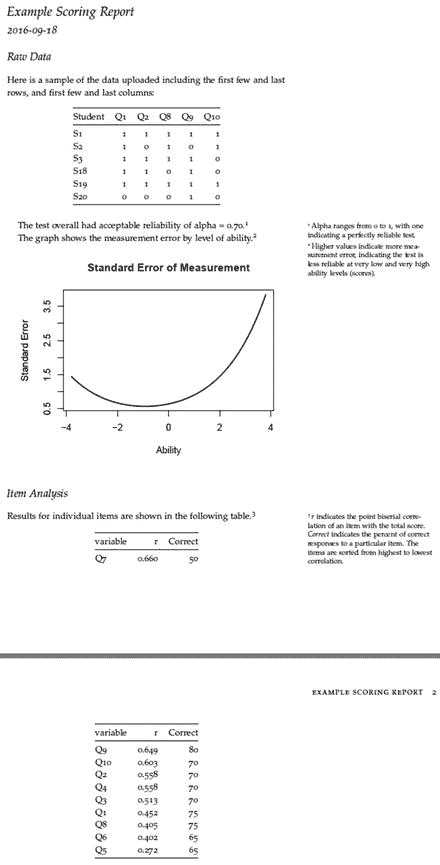

**图 15-3.** 下载的 PDF 文件

## 上传到云端

我们的最后一个任务是将文件从本地机器上传到云端实例。请记住，在之前的章节中，我们不仅使用了 `PuTTY` 在云服务器上安装 Shiny Server，还使用了 `WinSCP` 将文件上传到云服务器。我们启动 `WinSCP`，重新连接，并确保左侧本地方位于我们的 Shiny 应用文件夹，而右侧云服务器方位于 `/home/ubuntu` 目录。我们在图 15-4 中回顾了这一过程的结果。


**图 15-4.** WinSCP 已上传了 PieChart_Time、slider_time 和 Upload_hist 这三个 Shiny 应用

从这里开始，我们访问 `PuTTY` 并在命令行中运行以下代码：

```
sudo cp -R ~/Chapter15 /srv/shiny-server/
```

请记住，在之前的章节中，我们调整了实例以允许从特定地址访问特定端口。现在，您可以通过在任意浏览器中输入以下 URL 来验证您的应用是否正常工作：

```
http://Your.Instance.IP.Address:3838/Chapter15/
```

## 总结

在最后一章中，我们构建了一个可以根据新数据快速更新的动态文档。这种更新甚至可以扩展到图形和内联的 `ifelse` 语句，使得叙事结构本身也能根据新数据而改变。此外，我们还构建了一个 Shiny 应用，允许有互联网连接的用户上传文件，为这种报告提供新数据。此类报告可以下载为多种格式，不过我们选择了 PDF 格式。

贯穿本文，我们提供了高级数据管理技术，包括连接各种数据库。这些技术与动态文档融合得很好，并能轻松将数据仓库中的信息转化为可操作的洞察。我们最后的观察是，随着数据变得越来越庞大，在任何领域中，成功筛选和呈现有用数据的能力正变得愈发关键。祝编程愉快！

## 参考文献

本章收录了全书引用的所有资源的完整参考文献。

伊利诺伊大学厄巴纳-香槟分校图书馆。“LibGuides：SPSS 教程：关于本教程。” [`http://guides.library.illinois.edu/c.php?g=347869`](http://guides.library.illinois.edu/c.php?g=347869)。访问于 2016 年 9 月 27 日。

Chambers, J. *数据分析软件：使用 R 编程*。Springer 出版社，2009 年。

Chang, W. “shinydashboard：使用‘Shiny’创建仪表板。” R 包版本 0.5.1。 [`https://CRAN.R-project.org/package=shinydashboard`](https://cran.r-project.org/package=shinydashboard)。2015 年。

Chang, W., Cheng, J., Allaire, J., Xie, Y., and McPherson, J. “shiny：R 语言的 Web 应用框架。” R 包版本 0.11, 1。2015 年。

Chheng, T. “RMongo：R 语言的 MongoDB 客户端。” R 包版本 0.0.25。 [`https://CRAN.R-project.org/package=RMongo`](https://cran.r-project.org/package=RMongo)。2015 年。

Conway, J., Eddelbuettel, D., Nishiyama, T., Prayaga, S.K., and Tiffin, N. “RPostgreSQL：R 语言与 PostgreSQL 数据库系统的接口。” R 包版本 0.4-1。 [`https://CRAN.R-project.org/package=RPostgreSQL`](https://cran.r-project.org/package=RPostgreSQL)。2015 年。

美国人口普查局，American FactFinder。“数据获取与分发系统 (DADS)。” [`http://factfinder2.census.gov/faces/tableservices/jsf/pages/productview.xhtml?pid=ACS_10_5YR_B01003`](http://factfinder2.census.gov/faces/tableservices/jsf/pages/productview.xhtml?pid=ACS_10_5YR_B01003)。访问于 2016 年 9 月 27 日。

Dragulescu, A. A. “xlsx：读取、写入、格式化 Excel 2007 及 Excel 97/2000/XP/2003 文件。” R 包版本 0.5.7。 [`https://CRAN.R-project.org/package=xlsx`](https://cran.r-project.org/package=xlsx)。2014 年。

Dowle, M., Srinivasan A., Short T., and Lianoglou S.，感谢 R Saporta 和 E Antonyan 的贡献。“data.table：Data.frame 的扩展。” R 包版本 1.9.6。 [`https://CRAN.R-project.org/package=data.table`](https://cran.r-project.org/package=data.table)。2015 年。

Feinerer, I. and Hornik, K. “tm：文本挖掘包。” R 包版本 0.6-2。 [`https://CRAN.R-project.org/package=tm`](https://cran.r-project.org/package=tm)。2015 年。

Fellows, I. “wordcloud：词云。” R 包版本 2.5。 [`https://CRAN.R-project.org/package=wordcloud`](https://cran.r-project.org/package=wordcloud)。2014 年。

Friedl, J. E. F. *精通正则表达式，第三版*。O’Reilly 媒体，2006 年。

Harrell Jr, F. E.，感谢 Charles Dupont 及其他众多贡献者。“Hmisc：Harrell 杂项。” R 包版本 3.17-1。 [`https://CRAN.R-project.org/package=Hmisc`](https://cran.r-project.org/package=Hmisc)。2015 年。

Hester, J. “covr：包的测试覆盖率。” R 包版本 2.2.1。 [`https://CRAN.R-project.org/package=covr`](https://cran.r-project.org/package=covr)。2016 年。

Johnson, P. “devEMF：EMF 图形输出设备。” R 包版本 2.0。 [`https://CRAN.R-project.org/package=devEMF`](https://cran.r-project.org/package=devEMF)。2015 年。

Lang, D. T. and the CRAN Team. “XML：在 R 和 S-Plus 中解析和生成 XML 的工具。” R 包版本 3.98-1.4。 [`https://CRAN.R-project.org/package=XML`](https://cran.r-project.org/package=XML)。2016 年。

微软公司。"checkpoint：从 Checkpoint 服务器的快照安装包以实现可重复性。" R 包版本 0.3.16。 [`https://github.com/RevolutionAnalytics/checkpoint`](https://github.com/RevolutionAnalytics/checkpoint)。2016 年。
Ooms, J. "jsonlite 包：JSON 数据与 R 对象之间实用且一致的映射。" arXiv 预印本 arXiv:1403.2805。2014 年。
Prikryl, M. `WinSCP`——Windows 版免费 SFTP 和 SCP 客户端。2007 年。
R 核心团队。"foreign：读取由 Minitab、S、SAS、SPSS、Stata、Systat、Weka、dBase 等存储的数据。" R 包版本 0.8-66。 [`https://CRAN.R-project.org/package=foreign`](https://cran.r-project.org/package%3Dforeign)。2015 年。
Rizopoulos, D. "ltm：用于潜变量建模和项目反应理论分析的 R 包。" 统计软件杂志，17(5)，1–25。2016 年。
R 语言数据库特别兴趣小组 (R-SIG-DB)、Hadley Wickham 和 Kirill Müller。"DBI：R 数据库接口。" R 包版本 0.5。 [`https://CRAN.R-project.org/package=DBI`](https://cran.r-project.org/package%3DDBI)。2016 年。
RStudio 团队。"RStudio：用于 R 的集成开发环境。" [`www.rstudio.com`](http://www.rstudio.com)。2015 年。
亚马逊云服务。"设置 Amazon EC2。" [`http://docs.aws.amazon.com/AWSEC2/latest/UserGuide/get-set-up-for-amazon-ec2.html`](http://docs.aws.amazon.com/AWSEC2/latest/UserGuide/get-set-up-for-amazon-ec2.html)。访问于 2016 年 10 月 2 日。
Schenk, C. `MiKTeX` 项目页面。 [`http://miktex.org`](http://miktex.org)。2009 年。
Tatham, S. "PuTTY：免费的 SSH 和 Telnet 客户端。" [`www.chiark.greenend.org.uk/∼sgtatham/putty/`](http://www.chiark.greenend.org.uk/~sgtatham/putty/)。2016 年。
Urbanek, S. "rJava：R 语言的底层 Java 接口。" R 包版本 0.9-8。 [`https://CRAN.R-project.org/package=rJava`](https://cran.r-project.org/package%3DrJava)。2016 年。
美国人口普查局，American FactFinder。"B01003——总人口。伊利诺伊州所有县。2006–2010 美国社区调查 5 年估计值。" [`http://factfinder2.census.gov/faces/tableservices/jsf/pages/productview.xhtml?pid=ACS_10_5YR_B01003&prodType=table`](http://factfinder2.census.gov/faces/tableservices/jsf/pages/productview.xhtml%3Fpid%3DACS_10_5YR_B01003&prodType=table)。2010 年。
美国人口普查局，American FactFinder。"B23006——25 至 64 岁人口按就业状况划分的教育程度。范围：25 至 64 岁人口。伊利诺伊州所有县。2006–2010 美国社区调查 5 年估计值。" [`http://factfinder2.census.gov/faces/tableservices/jsf/pages/productview.xhtml?pid=ACS_10_5YR_B23006&prodType=table`](http://factfinder2.census.gov/faces/tableservices/jsf/pages/productview.xhtml%3Fpid%3DACS_10_5YR_B23006&prodType=table)。2010 年。
美国人口普查局，American FactFinder。"S1903——过去 12 个月的中位收入（按 2010 年通胀调整美元计）：伊利诺伊州所有县。2006–2010 美国社区调查 5 年估计值。" [`http://factfinder2.census.gov/faces/tableservices/jsf/pages/productview.xhtml?pid=ACS_10_5YR_S1903&prodType=table`](http://factfinder2.census.gov/faces/tableservices/jsf/pages/productview.xhtml%3Fpid%3DACS_10_5YR_S1903&prodType%3Dtable)。2010 年。
van der Loo, M. "用于近似字符串匹配的 `stringdist` 包。" R 杂志，6，pp. 111–122。 [`http://CRAN.R-project.org/package=stringdist`](http://cran.r-project.org/package%3Dstringdist)。2014 年。
Venables, W., and Ripley, B. D. S 编程。Springer 出版社，2004 年。
Wickham, H. "使用 `reshape` 包重塑数据。" 统计软件杂志，21(12)，pp. 1–20。2007 年。
Wickham, H. ggplot2：数据分析的优雅图形。Springer 出版社，2016 年。
Wickham, H. "`testthat`：开始测试。" R 杂志，3 (1)，pp. 5–10。
Wickham, H. "evaluate：提供比默认更多细节的解析和评估工具。" R 包版本 0.9。 [`https://CRAN.R-project.org/package=evaluate`](https://cran.r-project.org/package%3Devaluate)。2016 年。
Wickham, H., and Chang, W. "devtools：简化 R 包开发的工具。" R 包版本 1.12.0。 [`https://CRAN.R-project.org/package=devtools`](https://cran.r-project.org/package%3Ddevtools)。2016 年。
Wickham, H., Danenberg, P., 和 Eugster, M. "`roxygen2`: R 的源代码内文档工具。" R 包版本 5.0.1。 [`https://CRAN.R-project.org/package=roxygen2`](https://cran.r-project.org/package%3Droxygen2) 。2015 年。
Wickham, H. 和 Francois, R. "`dplyr`：数据操作语法。" R 包版本 0.4.3。 [`https://CRAN.R-project.org/package=dplyr`](https://cran.r-project.org/package%3Ddplyr) 。2015 年。
Wickham, H., Francois, R., 和 Müller, K. "`tibble`：简单数据框。" R 包版本 1.0。 [`https://CRAN.R-project.org/package=tibble`](https://cran.r-project.org/package%3Dtibble) 。2016 年。
Wickham, H., James, D. A., 和 Falcon S. "`RSQLite`：R 的 SQLite 接口。" R 包版本 1.0.0。 [`https://CRAN.R-project.org/package=RSQLite`](https://cran.r-project.org/package%3DRSQLite) 。2014 年。
Wiley, J. F. 和 Pace, L. R 语言入门：统计编程导论，第二版。Apress，2015 年。
Xie, Y. 使用 R 和 knitr 的动态文档。CRC Press，2015 年。
Xie, Y. 和 Allaire, J. J. "`tufte`：R Markdown 文档的 Tufte 风格。" R 包版本 0.2。 [`https://CRAN.R-project.org/package=tufte`](https://cran.r-project.org/package%3Dtufte) 。2016 年。
YAML：YAML 官方网站。 [`www.yaml.org`](http://www.yaml.org) 。检索于 2016 年 10 月 2 日。
Zeileis, A. 和 Grothendieck, G. "`zoo`：规则与不规则时间序列的 S3 基础设施。" 统计软件杂志 arXiv 预印本 math/0505527。

# 索引 A

- `AdvancedRPkg`
- `Advanced R 软件`
- `JDK`
- `MKL`
- `MRO`
- `RStudio`
- `Amazon Web Services (AWS)` 账户创建
- `AdvancedR`
- `AdvancedR` 安全组
- `AmazonEC2FullAccess`
- `CIDR`
- `Dashboard`
- `Elastic Compute Cloud (EC2)`
- `IAMS`
- `instance`
- `key pair` 设置与最终启动
- `security group`
- `security group` 的入站规则
- `Ubuntu server selection`
- `user`
- `user actions`
- `anyDuplicated()`
- `*apply` 函数
- `eapply()`
- `elements`
- `environment()`
- `error checking`
- `frame` 与 `matrix/array` 问题
- `lapply`
- `ls()`
- `mapply()`
- `mean()` 不能
- `mean()/sd()`
- `mtcars` 数据
- `mtcars` 数据框
- `par()`
- `rapply()`
- `recursion`
- `summary()` 类型
- `vapply`
- `X, INDEX, and FUN`
- `arrange()` 函数
- `assignInNamespace()` 函数

## 自动化

- `*apply` 函数族（见 `*apply` 函数）
- `coding` 定义，`insanity`
- `flow control` 循环（见循环）
- `repeats`
- `tools`

## B

### 大数据基础

- `challenges`
- `CSV files` 函数
- `software` 的 `installation`
- `MongoDB`（见 `MongoDB`）
- `packages`
- `R data objects` 与 `load rigid format`
- `SQLite`（见 `SQLite` 数据库）

## C

- `Cloud e-mail`
- `operating system`
- `public IP address`
- `PuTTY`
- `PuTTY configuration`
- `PuTTYgen`
- `PuTTY security alert`
- `server fingerprint (RSA)`
- `transfer files`
- `Ubuntu command line`
- `uploading files, WinSCP`
- `windows environment`
- `Cloud instance`
- `Cloud Ubuntu, Windows users`
- `commands`
   - 安装 `Microsoft R`
   - 安装 `R`
   - 安装 `Shiny`
   - `Java installation`
   - `RStudio Server`
   - `superuser` 与 `security`
- `Comma-separated values (CSV) files`
- `Comprehensive R Archive Network (CRAN)`

## D, E

- `Dashboard` 云端主体
- `header sampler`
- `code`
- `sidebar`
- `dashboardBody()` 函数
- `dashboardHeader()` 函数
- `dashboardSidebar()` 函数
- **数据管理**
   - `data` 与创建变量
   - `dplyr` 包
   - `merging` 与 `reshaping data`
   - `sapply()`
   - `selecting` 与 `subsetting`
   - `sorting`
   - `variable renaming` 与 `ordering`
   - `data.table` 包
   - `anyDuplicated()` 函数
   - 内建的 `data frame class objects`
   - `checkpoint`
   - `creatio`, 新变量
   - `data` 与创建变量
   - `data frame`
   - `data management`
   - `data munging/cleaning`
   - `Data.Table[i, j, by]`
   - `diris duplication family`
   - `fuzzy matching`
   - `head()` 与 `tail()`
   - `merging data`
   - `one-time conversions`
   - `order()`
   - `recoding data`
   - `recoding numeric values`
   - `reshaping data`
   - `sapply()`
   - `second` 与 `third formals`
   - `selecting` 与 `subsetting data`
   - `Sepal.Length`
   - `setkey()`
   - `setosa, versicolor, and virginica species`
   - `unique()`
   - `variable renaming` 与 `ordering`
- **调试**
   - `assignInNamespace()` 函数
   - `browser()` 函数
   - `debug()` 函数
   - `scatter plot`
   - `tapply()` 与 `unique()`
   - `traceback()`
   - `wtd.quantile()` 函数
   - `wtd.table()` 函数
- `desc()`
- `Development Kit (JDK)`
- `DevTools`
- `distinct()`
- **动态文档**
   - `beamer_presentation`
   - `case studies`
   - `ch15_html.Rmd`
   - `cloud instance`
   - `code chunks`
   - `HTML output`
   - `hybrid approach`
   - `local machine`
   - `Rmarkdown` 过程
   - `Rmarkdown`
   - `Shiny application`
   - `report.Rmd`
   - `server.R`
   - `ui.R`
   - `user interface`
   - `uploading, cloud`

## F

- **函数组件**
   - `Hmisc R package`
   - `invisible()` 函数
   - `match.arg()` 函数
   - `match.call()`
   - `message()`
   - `missing()` 函数
   - `on.exit()` 函数
   - `R commands`
   - `return()` 函数
   - `scoping`
   - `stop()` 函数
   - `stopifnot()`
   - `suppressMessages()`
   - `suppressWarnings()`
   - `warning()`
- `Fuzzy matching`

## G

- `ggplot2 R package`
- `GitHub`
- `group_by()`
- `groupedtextplot`
- `gsub()`

## H

- **帮助与文档**
   - `hist()` 函数
   - `Hmisc` 包
   - `Hmisc R package`

## I, J, K

- `Identity and access management (IAM)`
- `img()` 函数
- `Intel Math Kernel Library (Intel MKL)`
- `invisible()` 函数

## L

### 本地机器

- `Loops` 控制
- `for loop`
- `for()` 函数
- `head()`
- `infinite`
- `proc.time()`
- `repeat()`
- `rnorm` 模拟
- `types`
- `while loop`
- `xCube`

## M

- `mainPanel()`
- `match.arg()` 函数
### 数学运算符与函数

- `calculations`
- `complex logic tests`
- `if-else flow control`
- `loops`
- `matrices`
- `operations`
- `scalar operations`
- `symbolic logic forms`
- `trigonometric functions`

- `meanPlot()` 函数
- `menuItem()` 函数
- `merge()` 函数
- `Microsoft Corporation`
- `Microsoft R Open (MRO)`
- `MiKTeX`
### `MongoDB` 与 `R`

- `BSON query language`
- `dbAuthenticate(con3, username, password)`
- `dbDisconnect()`
- `dbGetQuery()`
- `dbShowCollections()`
- `fNames`
- `information, locations`
- `JSON file`
- `mock data`
- `mongoDbConnect()`
- `outcomes`
- `RMongo` 包
- `unstructured data`
- `View()` 数据目录
- `document store database`
- `downloading` 文件夹
- `installation` 过程
- `JSON and semistructured data`
- `JSON files`
- `website`

- `Multiple inheritance`
- `mutate()`

## N

- `NAMESPACE` 文件
- `normalizePath()`

## O

### 面向对象编程 (OOP)

#### 对象

- `complex numbers`
- `data frame`
- `double`
- `numeric`
- `factors`
- `integers`
- `logical`
- `matrix`
- `missing values`
- `scalar`

- `on.exit()` 函数
- `on.exit()` 参数

### 运算符与函数

- `assignments`
- `data-type-checking functions`
- `mathematical`（见数学运算符与函数）
- `subsetting`

- `owSums()`

## P, Q

### 包

- `adding R code`
- `checkpoint`
- `covr`
- `CRAN`
- `devtools` 包
- `devtools`
- `ggplot2`
- `MiKTeX root directory`
- `roxygen2` 包
- `R package`
- `R Package` 子目录
- `tests`
- `testthat`
- `version control`

- `AdvancedRPkg` 仓库
- `desktop.ini`
- `GitHub`
- `GitHub desktop`
- `linux kernel`
- `README` 与 `.gitignore` 文件
- `XQuartz`

- `package_coverage()` 函数

- `parent.env()` 函数
- `paste0()`
### `PostgreSQL` 与 `R` 数据库

- `data integrity` 与 `reliability`
- `windows R`

- `read.dta()`
- `Reduce()`
- `REFUSED`
- `renderPlot()`
- `reshape()`
- `right_join()`
- `rowMeans()` 函数
- `roxygen2`

- `classes`
- `data`
- `functions`
- `methods`

### `R Package AdvancedRPkg`

- `check()` 函数
- `CRAN`
- `DESCRIPTION` 文件
- `ggplot()` 函数
- `meanPlot()`
- `R CMD INSTALL`
- `README` 文件
- `show()` 方法
- `.tar.gz` 文件

- `RStudio Server`

## S

### S3 系统

#### 类

- `data frames`
- `multiple classes`
- `multiple inheritance`
- `object class`
- `single inheritance`
- `textplot object vectors` 或 `generic vectors`

#### 方法

- 内建的 `mtcars` 数据
- 自定义方法
- `expand.grid()`
- `fortify()` 函数
- `generic function`
- `ggplot()` 方法
- `ggplot.lm()` 方法
- `linear regression model`
- `methods()` 函数
- `::: operator`
- `par()` 函数
- `plot()` 函数
- `plot.table()`
- `plot.textplot()`
- `summary()`
- `textplot object class`
- `UseMethod()`

### S4 系统

#### 类

- `new()`
- `paste()`
- `setClass()`
- `sprintf()`
- `validity function`
- `class inheritance`

#### 方法

- `select()` 函数
- `Sepal.Length`
- `setMethod()`

### Shiny 应用

- `arguments` 云端
- `fluidPage()` 函数
- `function renderPlot()`
- `HTML code, creation`
- `input functions`
- `mainPanel()`
- `numericInput()`
- `play button feature`
- `plotOutput()`
- `plotOutput("piePlot")`
- `R calculations renderPlot()`
- `RStudio`
- `run App play button`
- `shinyServer()`
- `sidebarPanel()` 函数
- `sliderInput()` 函数
- `titlePanel()` 命令
- `user file uploading`
- `user-interface code`
- `web application framework`

### Shiny Dashboard

- `sampler coding dashboard` 的骨架
- `dashboard body`
- `dashboard header`
- `dashboard sidebar`
- `littlest Shiny dashboard`

- `showMethods()`
- `sidebarMenu()`
- `sidebarPanel()`
- `Single inheritance`
- `Social security number (SSN)`
### `SPSS`

- `input files`
- `output files`

### `SQLite` 数据库

- `advantages` 与 `disadvantages`
- `and R`
- `all.equal()`
- `dbClearResult()`
- `dbDisconnect()`
- `DBI package library`
- `dbIsValid()`
- `dbSendQuery`
- `dbWriteTable()`
- `iris data`
- `RAM`
- `rnorm()`
- `RSQLite library`
- `sepal` 与 `length`
- `setosa`
- `SQL VACUUM`
- `definitive guide`
- `installing PostgreSQL`（见 PostgreSQL）

- `stopifnot()` 函数
- `str()` 函数
- `stringdistmatrix()`
- `strsplit()`
- `Structured Query Language (SQL)`
- `summary()` 函数
### 系统与文件

- `accuracy`
- `automating file management`
- `creation`
- `file.access`
- `file.append` 函数
- `file.copy`
- `file.create`
- `file.exists()`
- `file.info` 函数
- `file.remove`
- `getwd()`
- `high-stakes projects`
- `PowerPoint`
- `recursive=TRUE` 选项
- `sys.setFileTime function`
- `TRUE` 或 `FALSE`

## T

- `table()`
- `tapply()`
- `test_textplot.R`
- `tolower()`
- `toupper()`

## U

- `unlist()`

## V

- `valueBox()`

## W

- `WinSCP`
- `WinSCP upload folder view`
- `wtd.quantile()`

## X, Y, Z

- `XQuartz`