# 搭建 PySpark 环境

本章专门讲解如何搭建 PySpark 环境。我们将讨论多种方案，你可以选择自己最喜欢的一种。如果你已经搭建好了环境，可以直接跳到本章后面的“基本操作”部分。

本章涵盖以下主题：

- 使用 Anaconda 进行本地安装
- 基于 Docker 的安装
- Databricks 社区版
- GitHub codespaces

## 使用 Anaconda 进行本地安装

---

**注意：** 以下内容摘自《Data Science with PySpark》一书（ISBN 979-8-8688-0819-7，电子书 ISBN 979-8-8688-0820-3，[`doi.org/10.1007/979-8-8688-0820-3`](https://doi.org/10.1007/979-8-8688-0820-3)），© Ramcharan Kakarla, Sundar Krishnan, Balaji Dhamodharan and Venkata Gunnu 2021, 2024。本作品受版权保护。所有权利均由出版商独家许可，无论涉及全部还是部分材料，具体包括翻译、重印、重用插图、朗诵、广播、微缩胶片复制或以任何其他物理方式复制，以及传输或信息存储与检索、电子改编、计算机软件，或现在已知或以后开发的类似或不同方法的权利。本出版物中使用的一般描述性名称、注册名称、商标、服务标志等，即使没有明确声明，也不意味着这些名称不受相关保护性法律和法规的约束，因此可供一般使用。出版商、作者和编辑可以假定，本书中的建议和信息在出版之日是真实准确的。出版商、作者或编辑均不对本文所含材料或可能存在的任何错误或遗漏提供明示或暗示的保证。对于已出版地图中的管辖权主张和机构隶属关系，出版商保持中立。

本 Apress 印记由注册公司 APress Media, LLC（Springer Nature 的一部分）出版。注册公司地址为：1 New York Plaza, New York, NY 10004, U.S.A.

### 引言

这本综合指南精选了日常使用案例，将引导你完成端到端的预测模型构建周期，包括最新的技术和行业诀窍。前三章从搭建环境开始，涵盖 PySpark 基础知识，并专注于数据操作。特征工程是数据科学专业人员花费 70% 时间的地方。在我们让你熟悉这门语言后，我们将在此基础上向你介绍现成的数学函数。在进入下一章之前，你将学习预测建模框架。

第 4 章深入探讨变量选择的艺术。它演示了 PySpark 中可用的各种选择技术。第 5、6 和 7 章将带你踏上机器学习算法的旅程，包括实现和微调技术。此外，这些章节解释了不同的验证指标以及如何使用它们来挑选最佳模型。第 8 章和第 9 章将引导你了解各种机器学习管道，包括可用于将模型投入生产并通过 Docker/API 提供服务的方法。第 10 章包含一些技巧，可以帮助你优化程序和机器学习管道。在第 11 章中，你将学习可用于从数据中释放全部价值的框架。最后，你将能够熟练地在数据科学应用中使用 PySpark。

本书推荐给希望通过处理大数据集来释放并行计算能力的数据科学爱好者。也强烈推荐给希望在大数据环境中从传统语言转向开源的专业人士。对于希望从事大数据工作的学生来说，这也是一项增值内容。

#### 你将学到什么：

- 端到端预测模型构建概述
- 多种变量选择技术及其实现
- 多种算法及其实现
- 模型投入生产
- 数据科学实验与技巧
- 建模框架

#### 本书包含：

- PySpark 数据科学解决方案的综合指南
- 专门设计的练习，帮助你练习所学知识
- 行业标准方法和流程，并通过示例实现
- 易于理解的结构，适合广泛的受众（从专业人士到学生）
- 将数据科学解决方案从传统语言迁移到 PySpark 的建议
- 精选的技巧和窍门，可帮助你完成日常工作

### 致谢

没有许多人的参与和帮助，这本书是不可能完成的。我深深感激并感谢我的朋友、家人和同事在困难时期给予我的所有支持。衷心感谢他们的贡献。

我要向俄克拉荷马州立大学商业分析硕士项目主任 Goutam Chakraborty 博士表示最深切的感谢，感谢他在十年前将我引入数据科学的世界。他的热情富有感染力，这本书正是这种热情的产物。

我还要感谢我的父母 Mohan Rao Kakarla 先生和 Venkata Rani 女士，感谢他们的热情和鼓励。我也非常感谢我的生活伴侣 Prasanthi 女士和我的女儿 Arha Kakarla，她们一直支持着我。我要感谢我的朋友 Sundar 先生，他是一位出色的合著者。我非常感谢 Subba Rao Mulakala 先生，他是一位出色的导师和支持者。感谢所有在这段旅程中支持我的朋友和家人。

> ——Ramcharan Kakarla

### 关于作者

### 关于技术审校者


### 安装 Anaconda

第一步是在 [`https://www.anaconda.com/download`](https://www.anaconda.com/download) 下载 Anaconda。你可以免费下载个人版。我们建议使用最新版本的 Python（Python 3.11），因为我们在所有示例中都使用这个版本。如果你安装了其他版本，请相应调整你的代码。安装 Anaconda 后，你可以在终端/Anaconda 提示符下执行以下命令，以确认安装已成功完成。

**注意：** Windows 用户应使用 Anaconda 提示符，而不是命令提示符。安装 Anaconda 后，此选项将可用。

```
conda info
```

输出应如下所示。

*终端/Anaconda 提示符中显示的输出*

```
(base) sundar@Sundars-MacBook-Pro / % conda info
active environment : base
active env location : /Users/sundar/anaconda3
shell level : 1
user config file : /Users/sundar/.condarc
populated config files : /Users/sundar/.condarc
conda version : 23.7.4
conda-build version : 3.26.1
python version : 3.11.5.final.0
virtual packages : __archspec=1=x86_64
__osx=10.16=0
__unix=0=0
base environment : /Users/sundar/anaconda3  (writable)
conda av data dir : /Users/sundar/anaconda3/etc/conda
conda av metadata url : None
channel URLs : https://repo.anaconda.com/pkgs/main/osx-64
https://repo.anaconda.com/pkgs/main/noarch
https://repo.anaconda.com/pkgs/r/osx-64
https://repo.anaconda.com/pkgs/r/noarch
package cache : /Users/sundar/anaconda3/pkgs
/Users/sundar/.conda/pkgs
envs directories : /Users/sundar/anaconda3/envs
/Users/sundar/.conda/envs
platform : osx-64
user-agent : conda/23.7.4 requests/2.31.0 CPython/3.11.5 Darwin/21.6.0 OSX/10.16 aau/0.4.2 c/1VatYgfffAMMKXQOgPBo-Q s/nX_yel1PDom6K2c64Czdcg e/u9Ki7wvzxHtwkihYPDu5wA
UID:GID : 501:20
netrc file : /Users/sundar/.netrc
offline mode : False
```

**注意：** 每个 `conda` 操作都以关键字 `conda` 开头。有关 `conda` 操作的更多信息，请在网络上搜索“Conda cheat sheet”，并遵循此处提供的文档：[`https://docs.conda.io/`](https://docs.conda.io/)。

### 创建 Conda 环境

通常，编程语言有各种版本。当你在特定版本上创建程序并尝试在另一个版本上运行它时，成功执行的可能性取决于两个版本之间的差异。这可能是一种具有挑战性的体验。由于依赖关系，在旧版本上开发的程序可能会在新版本上出错。这就是虚拟环境发挥作用的地方。这些环境将依赖关系隔离到独立的沙箱中，从而更容易在相应的环境中运行程序或应用程序。Anaconda 工具是一个开源平台，你可以在其中管理和运行你的 Python 程序和环境。你可以创建多个具有不同版本的环境，并根据需要在环境之间切换。在执行任何程序或应用程序之前，确定你当前所处的环境是一个好习惯。

我们重点关注 `conda` 速查表中用于创建环境的特定命令。语法如下：

```
conda create -–name ENVNAME python=3.11
```

在创建环境之前，使用另一个 Conda 命令列出你现有的环境。

```
conda env list
```

运行此命令后，你将获得以下输出。

*创建前的环境列表：*

```
# conda environments:
#
base                  *  /Users/sundar/anaconda3
```

`base` 环境在 Anaconda 中默认存在。`base` 是活动环境，由其右侧的小星号 `*` 符号表示。这意味着你执行的任何 `conda` 操作（`install`、`update` 或 `removal`）都将在默认的 `base` 环境中进行。

现在你了解了 `base` 环境是什么，你可以创建自己的 PySpark 环境。在此示例中，我们将 `ENVNAME` 替换为我们想要调用的环境名称（`pyspark_env`）。

```
conda create --name pyspark_env python=3.11
```

当提示用户输入时，键入 `y` 并按 Enter。最好手动键入此代码，而不是从文本中复制，因为缺少连字符可能会产生错误，例如 `"CondaValueError: The target prefix is the base prefix. Aborting"` 或 `"conda: error: unrecognized arguments: -–name."` 执行命令后，再次执行 `conda` 环境列表。这次，你会得到一个略有不同的输出。

*创建后的 Conda 环境*

```
# conda environments:
#
base                  *  /Users/sundar/anaconda3
pyspark_env              /Users/sundar/anaconda3/envs/pyspark_env
```

请注意，已创建一个名为 `pyspark_env` 的新环境。但是，`base` 仍然是活动环境。你可以使用以下命令激活新环境 `pyspark_env`。

*更改后的 Conda 环境*

```
conda activate pyspark_env
# conda environments:
#
base                     /Users/sundar/anaconda3
pyspark_env           *  /Users/sundar/anaconda3/envs/pyspark_env
```

请注意，`*` 表示当前环境。从现在开始，所有 `conda` 操作都将在新的 PySpark 环境中执行。下一节将介绍 Spark 的安装过程。

### 下载并解压 Apache Spark

你可以在 [`https://spark.apache.org/downloads.html`](https://spark.apache.org/downloads.html) 下载最新版本的 Apache Spark。本书使用 Spark 3.5.0。（本书中的特定示例可能使用其他 Spark 版本，但大多数用例都在 Spark 3.5.0 中展示。）访问该网站后，你可以选择一个 Spark 版本并下载相应的文件（参见图 1-1）。

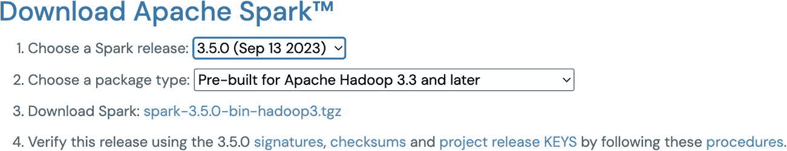

解压文件；你也可以选择将其移动到一个特定文件夹。

*Mac/Linux 用户*

```
tar -xzf spark-3.5.0-bin-hadoop3.tgz
mv spark-3.5.0-bin-hadoop3 /opt/spark-3.5.0
```

*Windows 用户*

```
tar -xzf spark-3.5.0-bin-hadoop3.tgz
move spark-3.5.0-bin-hadoop3 C:\Users\\spark-3.5.0
```

### 安装 Java 8 或更高版本

你可以通过在终端/Anaconda 提示符下键入以下内容来检查系统中现有的 Java 版本：

```
java -version
java version "21.0.2" 2024-01-16 LTS
Java(TM) SE Runtime Environment (build 21.0.2+13-LTS-58)
Java HotSpot(TM) 64-Bit Server VM (build 21.0.2+13-LTS-58, mixed mode, sharing)
```

最好使用 Java 8 或更高版本。你始终可以在 [`https://www.oracle.com/java/technologies/javase-downloads.html`](https://www.oracle.com/java/technologies/javase-downloads.html) 下载最新版本。建议使用 Java 8 JDK。当你使用高于 8 的 Java 版本时，启动 PySpark 时可能会收到警告。但是，可以忽略这些警告。

Mac/Linux 用户可以继续下一节，Windows 用户可以继续名为“Windows 用户”的章节。

### Mac 和 Linux 用户

假设你已经完成了 Spark 下载，现在必须更新 `~/.bash_profile` 或 `~/.bashrc` 文件，以便找到 Spark 安装位置。此示例使用 `bash_profile` 文件。在终端中，键入以下代码以打开文件：

```
vi ~/.bash_profile
```

文件打开后，键入 `i` 以插入内容。添加以下行来设置环境变量：

```
export SPARK_HOME=/opt/spark-3.5.0
export PATH=$SPARK_HOME/bin:$PATH
export PYSPARK_PYTHON=python3
```

添加这些配置后，按 ESC，键入 `:wq!`，然后按 Enter 保存文件。要将这些更改应用到 `pyspark_env` 环境中，请在终端中运行以下命令：

```
source ~/.bash_profile
```

当你重新启动系统时，将 `conda` 环境更改为 `pyspark_env` 以运行 PySpark。


### Windows 用户

假设您已完成 Spark 下载，还需执行一些操作以确保 PySpark 安装按预期工作。由于您运行了 `move` 选项，您的 Spark 文件夹应位于此处提供的路径中：

```
C:\Users\username\spark-3.5.0
```

通过 Anaconda 提示符导航到此路径并运行以下代码：

```
cd C:\Users\username\spark-3.5.0
mkdir hadoop\bin
```

目录创建完成后，您必须下载 `winutils.exe` 文件并将其添加到 Spark 安装中。如果没有 `winutils.exe` 文件，当您调用 PySpark 时，可能会遇到以下错误：

```
"ERROR Shell: Failed to locate the winutils binary in the hadoop binary path....."
```

此外，将来尝试使用 `spark-submit` 工具时也可能出现错误。要解决这些错误，请从 [`https://github.com/cdarlint/winutils`](https://github.com/cdarlint/winutils) 下载 `winutils.exe` 文件。根据您安装的 Hadoop 版本，您可能需要在此链接中选择合适的路径。导航到路径内的 `bin` 文件夹，点击 `winutils.exe` 下载文件（见图 1-2）。

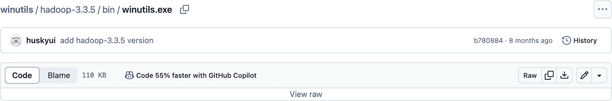

图 1-2

Winutils.exe

使用 Hadoop 3.3 版本的读者可以直接从此链接下载 `winutils.exe` 文件：[`https://github.com/cdarlint/winutils/blob/master/hadoop-3.3.5/bin/winutils.exe`](https://github.com/cdarlint/winutils/blob/master/hadoop-3.3.5/bin/winutils.exe)。将下载的文件放入您之前创建的 `hadoop\bin` 路径中。或者，您也可以使用以下命令执行相同操作：

```
move C:\Users\username\Downloads\winutils.exe C:\Users\username\spark-3.5.0\hadoop\bin
```

就是这样。您已基本完成。最后一步是配置环境变量。您可以在 Windows 中搜索“环境变量”，或通过选择系统属性 ➤ 高级 ➤ 环境变量来找到它们。在此示例中，我们在用户变量选项卡中添加几个变量。点击“新建”以查看图 1-3 中所示的选项。

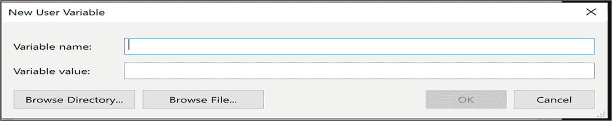

图 1-3

添加新的用户变量

您需要添加三项内容：`SPARK_HOME`、`HADOOP_HOME` 和 `PATH`。

*SPARK_HOME*

```
变量名 – SPARK_HOME
变量值 – C:\Users\username\spark-3.5.0
```

*HADOOP_HOME*

```
变量名 – HADOOP_HOME
变量值 – C:\Users\username\spark-3.5.0\hadoop
```

当用户变量选项卡中已存在 `PATH` 变量时，点击“编辑”并添加以下内容：

```
C:\Users\username\spark-3.5.0\bin
```

就这样。您现在可以运行 PySpark 了。有时，根据 Spark 版本的不同，您可能需要添加另外两个环境变量——`SPARK_LOCAL_HOSTNAME` 和 `JAVA_HOME`。这两个变量的设置如下：

*SPARK_LOCAL_HOSTNAME*

```
变量名 – SPARK_LOCAL_HOSTNAME
变量值 – localhost
```

*JAVA_HOME*

```
变量名 – JAVA_HOME
变量值 – C:\Program Files\Java\(您的 JDK 版本目录)
```

要应用所有这些环境更改，请重新启动 Anaconda 提示符，并将 `conda` 环境更改为 `pyspark_env`。

### 运行 PySpark

现在一切就绪。在调用 `pyspark` 之前，您需要确保 `conda` 环境已设置为 `pyspark_env`。只需在终端/Anaconda 提示符中调用 `pyspark`。您应该会看到以下弹出窗口。

*在终端/Anaconda 提示符中运行 PySpark*

```
Python 3.11.7 (main, Dec 15 2023, 12:09:04) [Clang 14.0.6 ] on darwin
Type "help", "copyright", "credits" or "license" for more information.
24/01/19 21:22:55 WARN Utils: Your hostname, Sundars-MacBook-Pro.local resolves to a loopback address: 127.0.0.1; using 192.168.68.53 instead (on interface en0)
24/01/19 21:22:55 WARN Utils: Set SPARK_LOCAL_IP if you need to bind to another address
Setting default log level to "WARN".
To adjust logging level use sc.setLogLevel(newLevel). For SparkR, use setLogLevel(newLevel).
24/01/19 21:22:56 WARN NativeCodeLoader: Unable to load native-hadoop library for your platform... using builtin-java classes where applicable
Welcome to
____              __
/ __/__  ___ _____/ /__
_\ \/ _ \/ _ `/ __/  '_/
/__ / .__/\_,_/_/ /_/\_\   version 3.5.0
/_/
Using Python version 3.11.7 (main, Dec 15 2023 12:09:04)
Spark context Web UI available at http://192.168.68.53:4040
Spark context available as 'sc' (master = local[*], app id = local-1705720977191).
SparkSession available as 'spark'.
>>>
```

太棒了！您现在可以进一步扩展设置，以便与 Jupyter IDE 配合使用。

### Jupyter Notebook 扩展

为此，您可能需要在 `pyspark_env` 环境中安装 Jupyter。您可以使用以下代码执行此操作。

*Mac/Linux 用户*

```
conda install jupyter
```

您需要将以下两行代码添加到您的 `~/.bash_profile` 或 `~/.bashrc` 设置中：

```
export PYSPARK_DRIVER_PYTHON=jupyter
export PYSPARK_DRIVER_PYTHON_OPTS='notebook'
```

确保使用相应的代码应用环境中的当前更改：

```
source ~/.bash_profile
source ~/.bashrc
```

从现在开始，每当您调用 `pyspark` 时，它应自动调用一个 Jupyter Notebook 会话。如果浏览器没有自动打开，您可以复制链接并将其粘贴到浏览器中。

*Jupyter 调用链接*

```
Jupyter Server 2.10.0 is running at:
[I 2024-01-19 21:55:24.577 ServerApp] http://localhost:8888/tree?token=b365126767afe1edb9d2ccddf00e203e1d3808b031e1a807
[I 2024-01-19 21:55:24.577 ServerApp]     http://127.0.0.1:8888/tree?token=b365126767afe1edb9d2ccddf00e203e1d3808b031e1a807
```

*Windows 用户*

您需要使用 Anaconda 提示符安装一个包。

```
python -m pip install findspark
```

从现在开始，当您从 Anaconda 提示符调用 `pyspark` 时，它应自动调用一个 Jupyter Notebook 会话。如果浏览器没有自动打开，您可以复制链接并将其粘贴到浏览器中。在浏览器中，您需要选择一个新的 Python 3 笔记本。要在 Windows 中测试 PySpark 安装，请在 Jupyter 中运行以下代码。

```
## 初始检查 Spark 安装
import findspark
findspark.init()
## 初始检查成功后运行这些代码
## 创建 Spark 会话并使用 spark.sql 进行测试
import pyspark
from pyspark.sql import SparkSession
spark = SparkSession.builder.getOrCreate()
df = spark.sql("select 'spark' as hello ")
df.show()
```

好了，设置到此为止。您可以跳到本章后面的“基本操作”部分。

## 基于 Docker 的安装

信不信由你，与本地安装相比，基于 Docker 的安装毫不费力。有些读者可能刚刚开始接触 Docker，而另一些读者可能已经很熟练了。本节向不熟悉 Docker 的读者介绍 Docker，并向您展示如何将 PySpark 与 Docker 结合使用。在进一步讨论之前，我们想澄清一点：Docker 是一个庞大的资源，本书无法涵盖所有内容。您可以阅读在线文章或购买一本专门介绍 Docker 的书籍。在这里，我们介绍使用 Docker 所需的基本概念。熟练的用户可以跳到本章的“创建简单的 Docker 镜像”部分。


### 为什么需要使用 Docker？

设想这样一个场景：你使用 `Python 2.7` 开发了一个应用程序。突然，你的学院或公司管理部门宣布要切换到 `Python 3.11` 或更高版本。你面临一个挑战：需要测试你的代码与新 Python 版本的兼容性，并在代码出错时进行更新。考虑到确保应用程序平稳运行所需的时间，这个过程可能会令人沮丧且繁琐。

在这种情况下，Docker 被证明非常有用。一旦你创建了一个 Docker 镜像，外部环境发生的变化就变得无关紧要了。你的应用程序在任何部署了 Docker 的地方都能无缝运行。这一特性使 Docker 变得异常强大，并成为数据科学专业人士的重要工具。

作为一名数据科学家，你可能会遇到需要开发和部署生产模型的情况。生产环境中的微小变化都有可能破坏你的代码和应用程序。因此，利用 Docker 可以简化你的工作，并确保操作更加顺畅。

### 什么是 Docker？

Docker 是一种平台即服务（PaaS）产品。你创建平台来运行你的应用程序。平台构建完成后，它可以托管在任何安装了 Docker 的地方。Docker 可以在多种主机操作系统上运行，包括 Mac、Windows、Linux 等。安装 Docker 应用程序后，你可以创建 Docker 镜像，这些镜像是构建容器和隔离系统环境的模板。在容器内部，你可以托管你的应用程序并安装其所有依赖项（`bins/libs`）。这种设置如图 1-4 所示。

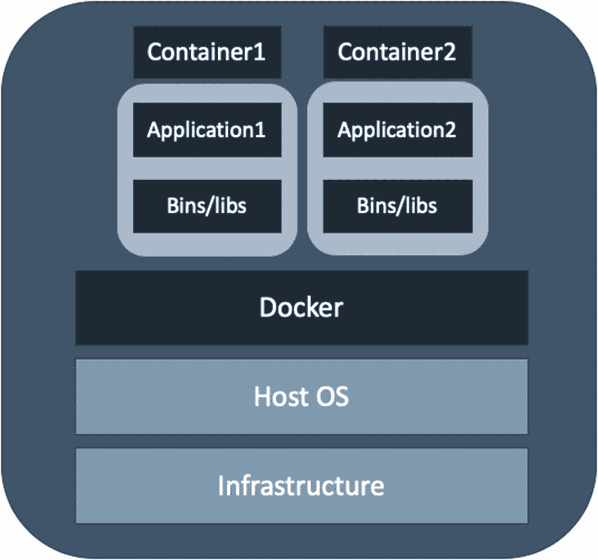

图 1-4 Docker

等等！这听起来像虚拟机。嗯，其实不是。Docker 的内部工作机制有所不同。虽然每个虚拟机都需要自己的操作系统，但 Docker 允许共享操作系统。此外，与 Docker 相比，虚拟机消耗更多的磁盘空间，并且具有更高的开销利用率。接下来，你将创建一个简单的 Docker 镜像。

### 创建一个简单的 Docker 镜像

在创建镜像之前，请按以下步骤开通一个 Docker 账户：

1.  在 [`https://hub.docker.com/signup`](https://hub.docker.com/signup) 创建一个 Docker Hub 账户。
2.  从 [`https://www.docker.com/get-started`](https://www.docker.com/get-started) 下载 Docker Desktop。
3.  安装 Docker Desktop，并使用 Docker Hub 的用户 ID/密码登录。

要创建 Docker 镜像，你需要一个 `Dockerfile`。Dockerfile 的命令可在此处获取：[`https://docs.docker.com/engine/reference/builder/`](https://docs.docker.com/engine/reference/builder/)。为了尝试一下，你将看到如何创建一个基本的 Python 镜像并在其中运行一个应用程序。使用文本编辑器，打开一个名为 `Dockerfile` 的新文件，并复制/粘贴以下命令：

```
FROM python:3.11-slim
COPY test_script.py /
CMD ["python", "./test_script.py"]
```

`test_script.py` 文件包含以下命令。为了使此代码正常工作，该文件应与 `Dockerfile` 位于同一位置：

```
import time
print("Hello world!")
print("The current time is - ", time.time())
```

这里发生了什么？你正在使用一个基础镜像，即 Python 3.11 的精简版。接下来，你将名为 `test_script.py` 的本地文件复制到 Docker 中。最后，你执行 `test_script.py` 文件。仅此而已。现在你可以使用 Docker 命令创建 Docker 镜像了。所有 Docker 命令都提供在此处：[`https://docs.docker.com/engine/reference/commandline/docker/`](https://docs.docker.com/engine/reference/commandline/docker/)。对于这个简单的镜像创建，我们将关注以下两个命令：

*   `docker build`：创建镜像
*   `docker run`：运行镜像

在终端/命令提示符中，导航到 `Dockerfile` 所在的文件夹，并运行以下命令：

```
# 使用指定的标签构建 Docker 镜像
docker build -t username/test_image .
# 运行一个 Docker 容器
docker run username/test_image
```

第一个命令创建镜像。`-t` 用于为镜像分配一个标签。你可以将 `username` 替换为你实际的 Docker Hub 用户名。确保在标签名称后面包含 `句点 (.)`。这将自动使用当前位置的 `Dockerfile` 来创建镜像。第二个命令运行镜像。执行后，你应该会看到输出显示 `"Hello, world! The current time is—` 等等等等。”

现在你应该对 Docker 有了基本的了解，接下来下载 PySpark Docker。

### 下载 PySpark Docker

按照以下步骤下载 PySpark Docker：

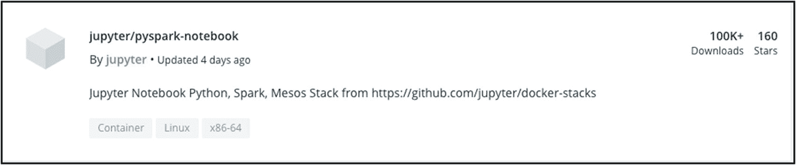

图 1-5 PySpark 镜像

1.  前往 [`https://hub.docker.com/`](https://hub.docker.com/) 并搜索 PySpark 镜像。
2.  导航到图 1-5 所示的镜像。
3.  在终端/Anaconda 提示符中，输入以下代码并按回车键：

    ```
    docker pull jupyter/pyspark-notebook
    ```

4.  镜像完全下载后，你可以运行以下代码来确认镜像存在：

    ```
    docker images
    ```

5.  值得注意的是，“latest”标签被应用于该镜像。此标签用于区分同名镜像的不同版本。


好的，作为一名高级文档工程师和翻译员，我将严格遵循您提供的注意事项和示例，将给定的英文文本翻译成中文。


### 理解 PySpark Docker 命令的逐步指南

1.  从基本的 Docker `run` 命令开始，如代码清单 1-1 所示。

```
docker run jupyter/pyspark-notebook:latest
[I 2024-01-21 19:09:27.110 ServerApp] http://79a9222b33d3:8888/lab?token=7b62b7b9c7f1aa378a6d1ebbdecc54cafbfcb877844e7ed9
[I 2024-01-21 19:09:27.110 ServerApp]     http://127.0.0.1:8888/lab?token=7b62b7b9c7f1aa378a6d1ebbdecc54cafbfcb877844e7ed9
代码清单 1-1
Docker 基础运行命令
```

调用此命令后，您会看到几行输出，并出现一个链接，如上所示。

当您在浏览器中复制并粘贴上述链接时，您将看不到 Jupyter 会话。这是因为 Docker 与外部世界之间没有建立连接。在下一步中，您将通过配置端口来设置连接。

2.  您可以使用以下命令建立一个端口：

```
docker run -p 7777:8888 jupyter/pyspark-notebook:latest
```

我们在此选择两个不同的端口仅用于解释说明。执行此命令后，您将看到与代码清单 1-1 中类似的输出。像之前一样复制粘贴链接，您仍然看不到任何会话。但是，如果使用端口 `7777` 而不是 `8888`，它就能正常工作。尝试使用此链接：`http://localhost:7777/`。您应该能够看到一个 Jupyter 会话。这是怎么回事呢？

在 Docker 内部，Jupyter Notebook 会话运行在端口 `8888` 上。然而，当我们建立 Docker 连接时，我们明确指定 Docker 应使用端口 `7777` 与外部世界通信。端口 `7777` 成为了入口，因此我们看到了输出。现在您清楚了端口语法，可以像下面这样为两侧分配相同的端口。这次，显示的链接应该可以直接使用。

```
docker run -p 8888:8888 jupyter/pyspark-notebook:latest
```

3.  如果您想在 Docker 中访问外部文件怎么办？这同样可以通过一个简单的命令来实现：

```
docker run -p 8888:8888 -v /Users/sundar/Desktop/Applied_DS_Second_Edition/: /home/jovyan/work/ jupyter/pyspark-notebook:latest
```

让我们深入分析这个命令。正如您之前看到的端口映射，请注意符号 `-v` 后面跟着由 `:`（冒号）分隔的路径。`-v` 表示在调用 `docker` 命令时要挂载的卷。左侧是本地目录（`/Users/sundar/Desktop/Applied_DS_Second_Edition/`），右侧是 Docker 中的目录（`/home/jovyan/work`）。在下一步中，您将看到如何以交互模式调用 Docker 容器。

4.  如何以交互/ bash 模式调用？使用以下命令：

```
docker run -it -p 8888:8888 -v /Users/sundar/Desktop/Applied_DS_Second_Edition/:/home/jovyan/work/ jupyter/pyspark-notebook:latest bash
```

观察此命令中的两个变化。首先，添加了 `-it` 标签，表示启动一个交互式会话。其次，包含了 `bash` 命令来触发 shell。执行此命令后，您不会看到 Jupyter 会话链接。相反，您会进入一个 Linux shell 环境，允许您执行其他命令。此功能在各种场景下都很有用。例如，您可以在 Linux 环境中安装所需的软件包。导航到之前映射的文件夹，并使用以下命令启动 Jupyter Notebook：

```
cd /home/joyvan/work
jupyter notebook
```

您应该能够在 Jupyter 会话中看到文件和文件夹。

5.  还有一些用于空间优化的标签。我们建议您在运行 Docker 时使用以下最终命令：

```
docker run -it --rm --shm-size=1g --ulimit memlock=-1 -p 8888:8888 -v /Users/sundar/Desktop/Applied_DS_Second_Edition/:/home/jovyan/work/ jupyter/pyspark-notebook:latest
```

`--rm` 标签会在完成指定任务后删除容器。这适用于短期运行的容器。您明确告诉 Docker 守护进程，一旦此容器运行完毕，它应该清理文件并将其删除以节省磁盘空间。第二个标签 `--shm-size` 用于增加/减少共享内存大小。对于内存密集型容器，您可以使用此选项指定共享内存大小，通过提供对已分配内存的额外访问权限，帮助容器运行得更快。最后一个标签是 `--ulimit memlock=-1`，它为容器提供了无限的锁定内存地址空间。这将在容器调用期间锁定最大可用共享内存。您不必使用所有这些选项；但是，了解它们是有好处的。现在，您已经拥有了一个可与 Docker 一起正常运行的 PySpark 会话。

## Databricks 社区版

这适用于希望使用 Databricks 的用户。如果您的工作场所已经有 Databricks 环境，您可以联系管理员创建一个帐户。对于打算自行安装的读者，请使用此链接注册：[`https://databricks.com/try-databricks`](https://databricks.com/try-databricks)。创建帐户后，您将获得一些可供使用的选项，如图 1-6 所示。

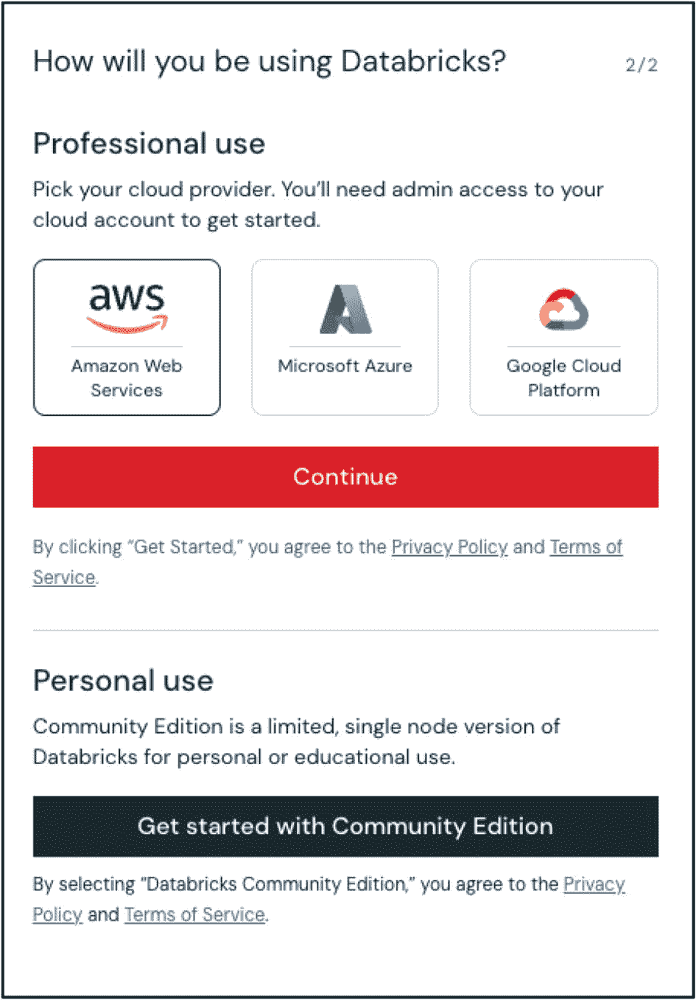

图 1-6 Databricks 选项

选择 **Get Started with Community Edition** 按钮。社区版是免费的。对于本书中的大部分章节，社区版就足够了。或者，您可以选择上述云提供商之一，并注册 14 天免费试用的专业版。专业版提供了比社区版更多的功能。但是，您需要一个底层的云平台（AWS、Azure 或 GCP）帐户。

需要提醒的是——当您选择 14 天免费试用选项时，您的 Databricks 帐户不会产生任何费用（在试用期间）。但是，您将产生来自云提供商的费用。请确保定期监控云计费成本，以免出现意外！

对于社区版，点击 **Get Started** 后，您应该会通过电子邮件收到说明。按照说明设置您的帐户。

### 创建 Databricks 帐户

总结：

-   在 [`https://databricks.com/try-databricks`](https://databricks.com/try-databricks) 创建一个帐户。
-   选择社区版。
-   在电子邮件中接收说明。完成身份验证，并使用您注册时使用的用户名和密码登录 Databricks 社区版。

### 创建新集群

图 1-7 显示了 Databricks 的登录页面。

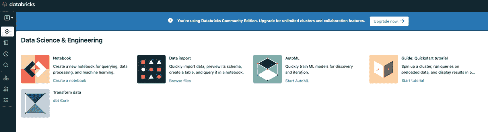

图 1-7 Databricks 登录页面

导航到左侧窗格中的 **Compute** 并创建一个新的计算实例。您必须提供一个集群名称（`pyspark_env`）并选择一个 Databricks 运行时版本（见图 1-8）。我们用于数据科学演示的软件包在 ML 运行时版本中可用。继续为此任务选择最新的运行时版本：`14.2 ML (Scala 2.12, Spark 3.5.0)` 并创建集群。

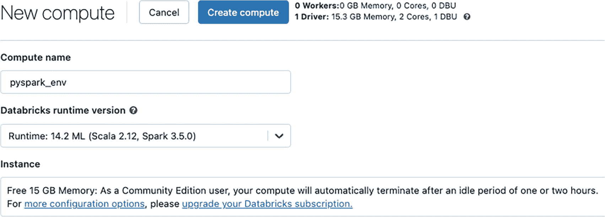

图 1-8 集群创建

点击 **Create Cluster** 后，启动集群需要一些时间。集群创建完成后，您会在集群名称前看到一个绿点，如图 1-9 所示。

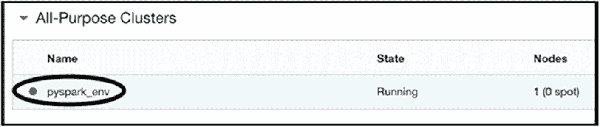

图 1-9 集群创建完成


### 创建笔记本

点击左上角的 Databricks 图标导航至欢迎页面（见图 1-7）。点击“创建笔记本”。你需要指定在前一个任务中创建的集群名称。如图 1-10 所示。


图 1-10

Databricks 笔记本

要在单元格中执行代码，请按 `Shift+Enter` 或使用右上角的“运行单元格”选项。

至此，你已经完成了在 Databricks 中运行 PySpark 笔记本的全部设置。很简单，对吧？但在结束本节之前，你还需要了解一件事：如何将数据导入 Databricks 环境？接下来我们看看。

### 将数据文件导入 Databricks 环境

在左侧面板中，点击“创建”并选择“表”。将打开“创建新表”屏幕，如图 1-11 所示。

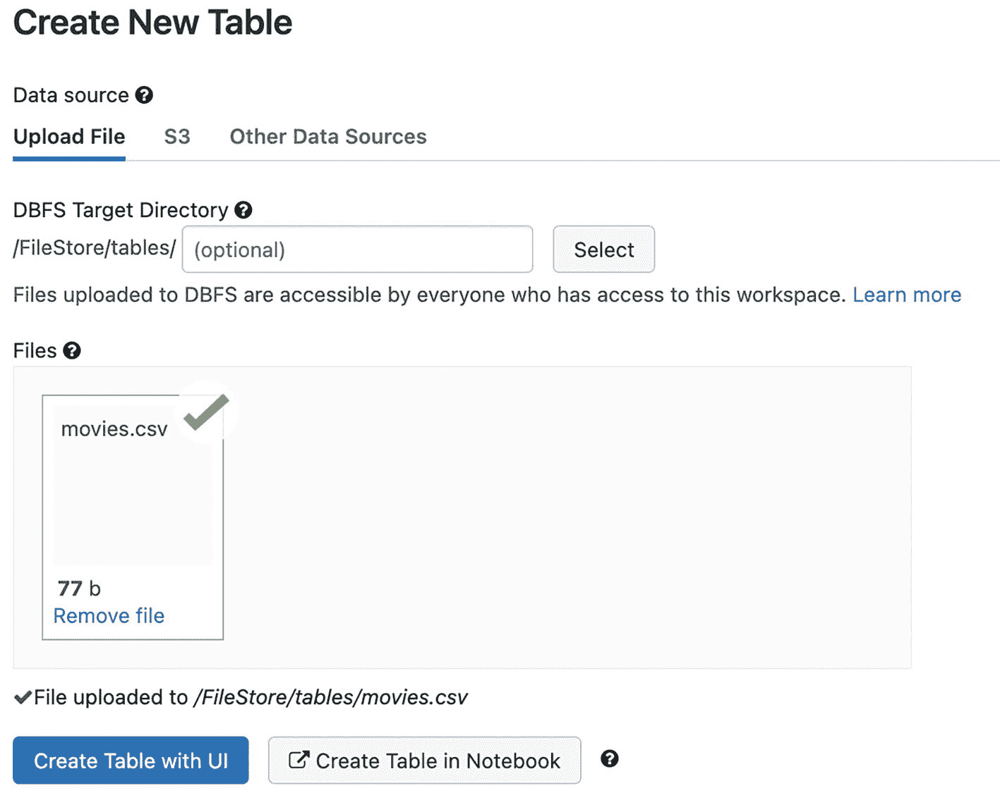

图 1-11

创建新表

最简单的选项是“上传文件”，这也是本书中最常用的方法。创建这个简单的 CSV 文件并尝试上传：

```
movie, year
The Godfather,1972
The Shawshank Redemption, 1994
Pulp Fiction, 1994
```

现在你可以上传文件，并选择“使用 UI 创建表”选项，然后选择你之前创建的集群（`pyspark_env`）。点击“预览表”查看图 1-12 所示的屏幕。

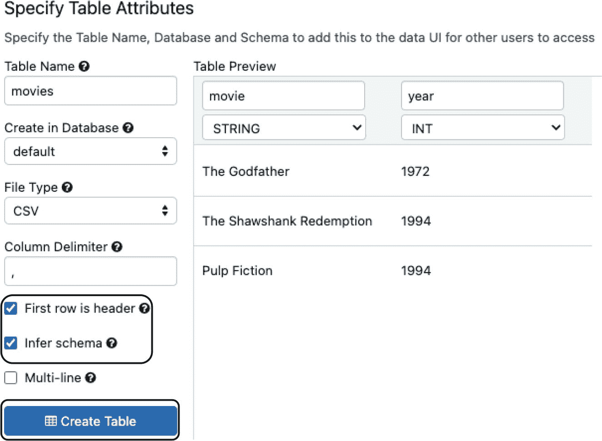

图 1-12

预览表

我们来解析一下图 1-12 所示预览屏幕中的各项内容。Databricks 会自动检测文件的分隔符。但是，如果自动检测失败，你可以自行指定分隔符。接下来，通过勾选复选框，明确说明第一行是表头。如果未选择此选项，列名将成为表的一部分。最后，在创建表之前，请确保数据类型正确。勾选“推断模式”选项，可以自动检测列并分配正确的数据类型。你也可以根据需要更改数据类型。指定完所有表属性后，点击“创建表”按钮。你会注意到在 `default` 数据库中新增了一个名为 `movie` 的表。

让我们使用左侧面板中的“工作区”选项返回笔记本，并尝试访问这些数据。通常，当你使用 PySpark SQL 选项访问表时，它会创建一个 PySpark 数据框。我们稍后会详细讨论这一点。现在，使用以下代码访问数据：

```
import pyspark
df = sqlContext.sql("select * from movies")
df.show()
```

你应该会得到如图 1-13 所示的输出。


图 1-13

Databricks PySpark 输出

很酷，对吧？你现在已经准备好使用 Databricks 版本了。

## GitHub Codespaces

Codespaces 是 GitHub 提供的即用型云端开发环境。只需点击几下，就可以在基于浏览器的 Visual Studio Code (VS Code) 中执行 GitHub 代码。个人 GitHub 账户可以免费使用 codespaces，但有使用配额限制。更多详情请参考此链接：[`https://docs.github.com/en/codespaces/overview`](https://docs.github.com/en/codespaces/overview)。

注册一个 GitHub 账户（如果你还没有的话）并登录。导航到本书关联的 GitHub 仓库：[`https://github.com/Apress/applied-data-science-using-pyspark`](https://github.com/Apress/applied-data-science-using-pyspark)。

选择“在 Main 上创建 Codespace”以在浏览器中启动 VS Code（见图 1-14）。

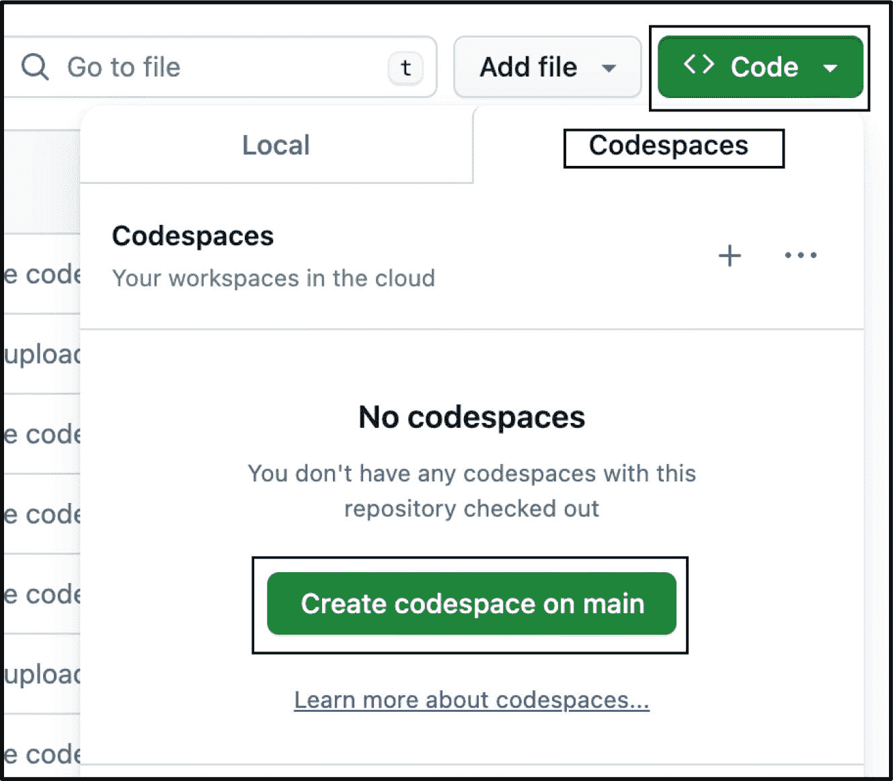

图 1-14

GitHub codespaces

VS Code 的登录页面如图 1-15 所示。导航至“设置”（左下角），并安装 Microsoft 提供的 Python 和 Jupyter 扩展（见图 1-16）。

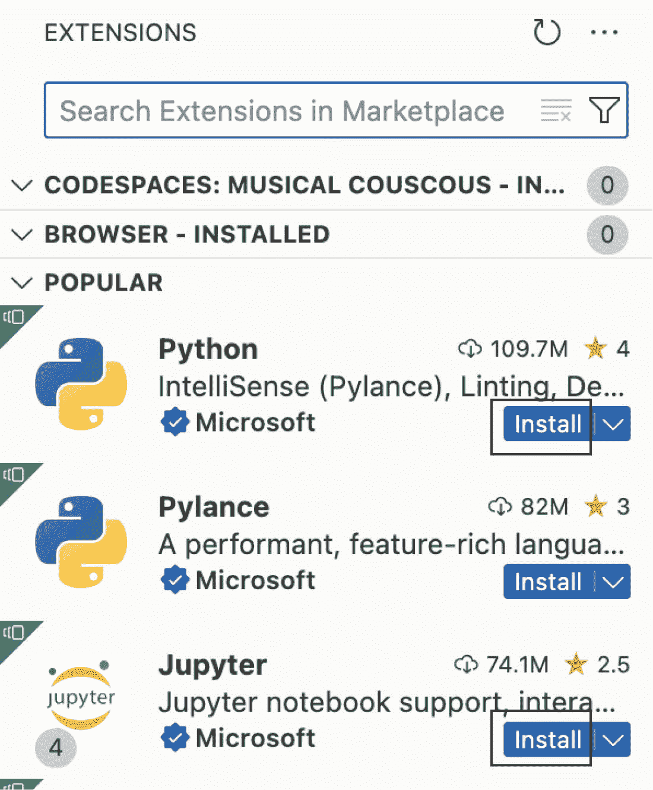

图 1-16

Microsoft Python 和 Jupyter 扩展

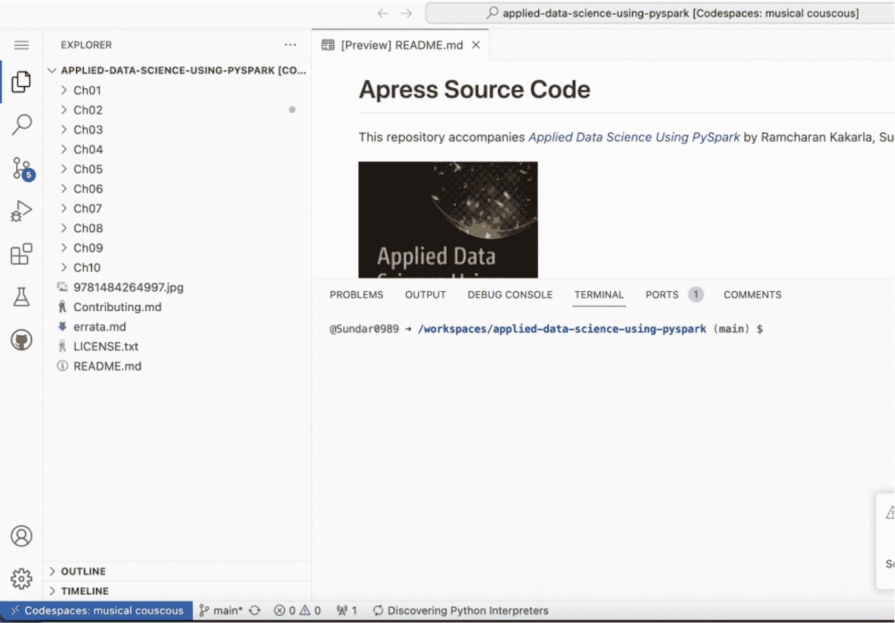

图 1-15

VS Code 登录页面（浏览器）

在终端中，运行 `pip install pyspark`，如图 1-17 所示。这将安装最新的 Spark 3.5.0 版本。

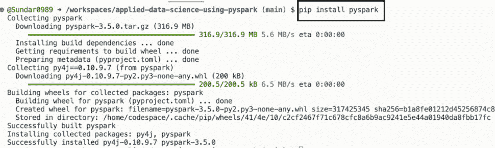

图 1-17

VS Code 终端

现在你可以在 VS Code 中测试代码执行。打开 `Ch02/Chapter2_Notebook` 文件夹以启动 `Spark_demonstration.ipynb` 笔记本。点击“选择内核”（右上角）。屏幕中央应出现一个弹出窗口。选择“Python 环境”和“推荐的 Python 版本”，如图 1-18 所示。

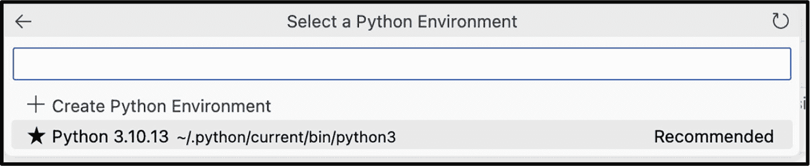

图 1-18

Python 环境

在此例中，Python 版本是 3.10.3，Spark 版本是 3.5.0。根据你运行笔记本的时间，你的 Python 和 Spark 版本可能略有不同。

你现在已经准备好执行代码了。运行前两个单元格以确保安装了所需的包。你应该会看到类似图 1-19 所示的结果。

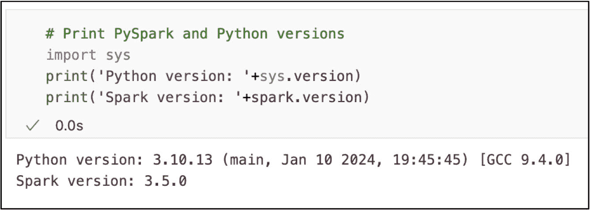

图 1-19

笔记本包验证

从这里开始，可能需要做一些小的调整才能成功执行代码。例如，在单元格 3 中，更新 `file_location` 以指向正确的文件位置，如下所示（见图 1-20）：

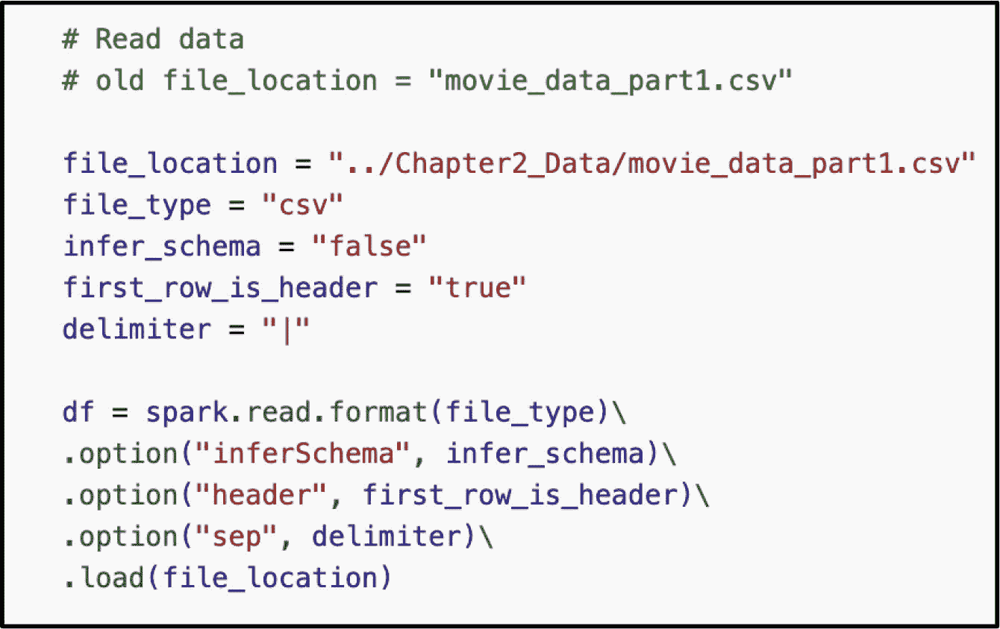

图 1-20

笔记本新的 file_location

```
file_location = "../Chapter2_Data/movie_data_part1.csv"
```

太好了，你现在已经准备好使用 GitHub codespaces 执行 PySpark 代码了。这消除了复杂本地环境设置和维护的需要。

## 基本操作

恭喜你完成了 PySpark 环境的设置。在本节中，你将使用一些示例代码来操作你刚刚创建的环境。无论你选择哪种设置选项，之后展示的所有演示都应该可以正常工作。

### 上传数据

本节适用于选择本地或基于 Docker 安装的用户。Databricks 用户应单独上传文件并在笔记本中引用它们。Codespace 用户可以将文件上传到 GitHub 并在代码中使用。

启动 Jupyter Notebook 后，你可以直接将数据上传到你的环境（见图 1-21）。现在创建一个简单的 CSV 文件并将其命名为 `movies.csv`。

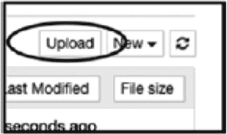

图 1-21

上传文件

```
movie, year
The Godfather,1972
The Shawshank Redemption, 1994
Pulp Fiction, 1994
```

### 访问数据

文件上传后，跳转到你的 PySpark 笔记本并运行以下代码：

```
from pyspark.sql import SparkSession
spark = SparkSession.builder.getOrCreate()
df = spark.read.csv("movies.csv", header=True, sep=',')
df.show()
```


### 计算圆周率

这是一个你在网上或教科书中常见的典型示例。它将使用 1 亿个样本计算圆周率的值，以测试 PySpark 操作。操作完成后，将为你提供圆周率的值。请使用以下代码：

```
# 从 PySpark 导入 SparkContext 模块
from pyspark import SparkContext
# 创建一个 SparkContext 对象
sc = SparkContext.getOrCreate()
# 导入 random 模块
import random
NUM_SAMPLES = 100000000 # 定义样本数量
# 检查点是否落在圆内的函数
def inside(p):
    x, y = random.random(), random.random()
    return x*x + y*y < 1
# 并行化计算
count = sc.parallelize(range(0, NUM_SAMPLES)).filter(inside).count()
# 计算圆周率的估计值
pi = 4 * count / NUM_SAMPLES
print("圆周率约为", pi)
```

## 总结

-   你通过以下方式之一创建了自己的 PySpark 实例：使用 Anaconda 进行本地安装、基于 Docker 的安装、Databricks 社区版或 GitHub codespaces。
-   你了解了在 Jupyter Notebook 环境中访问本地文件的步骤。
-   你使用`movies.csv`文件创建了一个 PySpark 数据框，并打印了输出结果。
-   你运行了一个小型的 PySpark 命令来计算圆周率的值。

做得好！在下一章中，我们将更深入地探讨 PySpark 操作，并带你了解一些有趣的主题，例如特征工程和可视化。请继续学习，保持关注。

