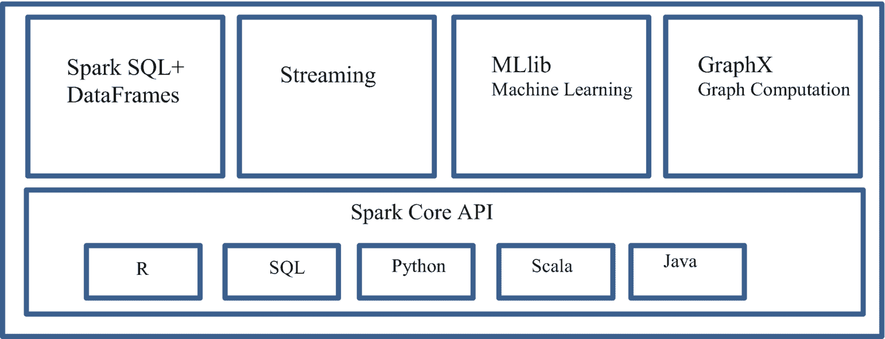
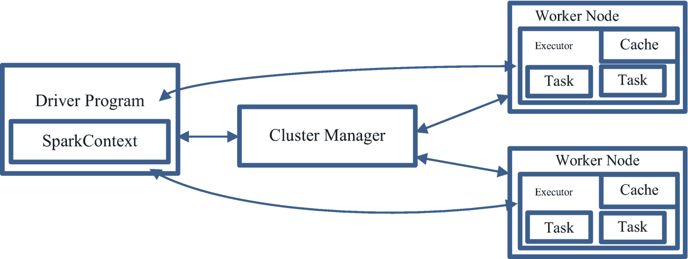

# 2. PySpark 基础

本章将帮助你理解 PySpark 的基本操作。我们鼓励你搭建 PySpark 环境，并在你选择的任何数据集上尝试以下操作，以加深理解。鉴于 Spark 的广度，我们将在深入探讨数据整理任务之前，先介绍基本概念。本章将阐述你在日常工作中可能遇到的最常见的 PySpark 数据操作。

本章涵盖以下主题：

-   PySpark 背景
-   PySpark 弹性分布式数据集（RDD）和数据框
-   数据操作

## PySpark 背景

在深入了解 PySpark 之前，你应该了解什么是 Spark 及其优势。Spark 是一个用于处理大量数据的引擎。它使用 Scala 编写，并在 Java 虚拟机上运行。Apache Spark 生态系统的详细表示如图 2-1 所示。

图 2-1 Spark 生态系统概览

Spark 核心是该平台底层的通用执行引擎。Spark 内置了用于 SQL、流处理、机器学习和 GraphX（图处理任务）的组件。

-   **Spark SQL** 最适合处理结构化数据。它使你能够以极快的速度运行 Hive 查询，在现有数据上速度可提升高达 100 倍。
-   **流处理** 支持非传统的实时数据集。它能够对流式数据进行交互式和分析性操作，并与包括 HDFS、Flume、Kafka 和 Twitter 在内的流行数据源良好集成。
-   **机器学习** 是一个基于 Spark 构建的可扩展库，使你能够针对特定用例运行不同的算法。它提供了大多数现成的广泛使用的算法。
-   **GraphX** 是一个基于 Spark 构建的图计算引擎，使你能够以交互方式大规模地创建、转换和推理图结构数据。

速度是 Spark 的代名词，也是其近期广受欢迎的关键驱动力之一。在核心层面，Spark 通过并行处理和内存计算来实现这种速度。Spark 是如何实现这种并行处理的呢？答案是其原生语言 Scala。Scala 基于函数式编程，非常适合并行处理。它在大数据集上进行数据转换的易用性使其成为首选工具。Spark 还拥有丰富的库集，包括机器学习、SQL 和流处理支持。它是在统一环境中驾驭大数据的最通用工具之一。

让我们退一步，看看 Spark 如何在集群上运行以实现并行处理。Spark 的基础源于 MapReduce。MapReduce 是一个用于处理大型数据集的流行框架。它包含两个主要阶段。map 阶段是将所有任务分配给不同计算机的阶段。reduce 阶段是所有键被逻辑地混洗，并进一步归约以计算有意义的聚合或进行数据转换的阶段。图 2-2 说明了 Spark 在集群模式下的工作方式。

图 2-2 Spark 集群模式概览

当 Spark 启动时，会生成一个独立的进程，并由`SparkContext`或`SparkSession`进行协调，如图 2-2 左侧所示。集群管理器将工作分配给工作节点。图 2-2 中显示了两个工作节点。在实践中，可能有*n*个工作节点。任务对数据集执行一个工作单元，并输出一个新的分区数据集。当对数据执行多个操作时，它们受益于跨这些操作缓存数据所驱动的内存计算。根据操作类型，聚合结果要么发送回驱动程序，要么可以保存到磁盘上。

有向无环图（DAG）是 Spark 中的一个基础概念，对于操作流程的表示和优化都至关重要。当代码提交到 Spark 控制台时，会生成一个算子图，随后在触发操作（如聚合或数据保存）时，该算子图会被转发给 DAG 调度器。然后，调度器将算子图划分为多个阶段。每个步骤可以包含多个数据分区，DAG 调度器会将所有这些单独的算子图捆绑在一起。工作节点的任务是在执行器上执行这些任务。

## Spark 概念与特性

在深入探讨 RDD 和 DataFrame 之前，我们先回顾一下 Spark 的一些概念和特性。你可能会在本书的不同章节中遇到这些术语：

- **不可变性（Immutable）：** 不可变对象可被视为一种数据单元，在转换后无法逆转。这对于实现计算的一致性至关重要，尤其是在并行计算环境中。
- **容错性（Fault-Tolerant）：** 如果在数据转换过程中工作节点发生故障，可以通过在血统中对相应分区重放转换来恢复数据，从而实现相同的计算。这消除了跨多个节点的数据复制。
- **惰性求值（Lazy Evaluation）：** Spark 中的所有转换都是惰性的，这意味着计算不会立即执行。相反，Spark 会记住所有转换逻辑，仅当调用行动操作时才会进行计算。行动操作可以是向驱动程序返回结果，也可以是保存数据集。
- **类型安全（Type Safety）：** 这表示编译器知道预期的列及其数据类型。
- **数据序列化（Data Serialization）：** 这是一种将数据结构转换为特定格式以有效管理数据源和目标的方法。默认情况下，Apache Spark 使用 Java 序列化。
- **数据本地性（Data Locality）：** 通过将执行代码放置在靠近待处理数据的位置来优化处理任务。
- **谓词下推（Predicate Pushdown）：** 此技术允许 Spark 通过使用过滤条件仅处理所需的数据。仅访问所需的文件和分区，从而减少磁盘 I/O。
- **累加器（Accumulators）：** 这些是分配给执行器的全局变量，可以通过结合律和交换律进行累加。
- **Catalyst 优化器（Catalyst Optimizer）：** 这是一个用于实现 Spark SQL 的可扩展优化器。它支持基于规则和基于成本的优化。

现在你可能想知道 PySpark 在这个生态系统中处于什么位置。PySpark 可以被视为 Scala API 之上基于 Python 的封装。PySpark 通过 Py4J 库与 Spark 基于 Scala 的 API 进行通信。该库允许 Python 与 Java 虚拟机代码进行交互。在下一节中，你将了解通过 RDD 和 DataFrame 在 PySpark 中与数据交互的方式。我们将更多地关注 DataFrame，并且你将在下一节中更深入地了解我们做出该决定的原因。

## PySpark 弹性分布式数据集 (RDD) 和 DataFrame

RDD 是数据的元素的不可变分布式集合。它跨集群中的节点进行分区，从而能够通过低级 API 进行并行处理。

RDD 在处理结构化、半结构化和非结构化数据方面非常灵活。它们最适合处理半结构化和非结构化数据。可以使用它们轻松访问这些数据元素，并控制任何低级转换。RDD 是 Spark 核心库的一部分，其操作仅需要 Spark 上下文。

RDD 也确实存在一些挑战。DataFrame 所提供的优化和性能提升在 RDD 中是不存在的。如果你处理的是结构化数据，那么首选始终应该是 DataFrame。只要你能定义模式，就可以随时将 RDD 转换为 DataFrame。

数据集是数据的分布式集合。它兼具 RDD 的优点（强类型、能够使用强大的 lambda 函数）和 Spark SQL 优化执行引擎的优点。数据集可以从 JVM 对象构建，然后通过函数式转换（`map`、`flatMap`、`filter` 等）进行操作。Dataset API 仅在 Scala 和 Java 中可用。Python 不支持 Dataset API。但由于 Python 的动态特性，Dataset API 的许多优点已经可用（例如，你可以自然地通过名称访问行的字段：`row.columnName`）。R 语言的情况类似。

DataFrame 是按列组织的数据集。它以列和行的格式保存数据，类似于表。你可以将列视为变量，将行视为相关的数据点。它在概念上等同于关系数据库中的表或 R/Python 中的数据框，但在底层具有更丰富的优化。DataFrame 可以从多种来源构建，例如结构化数据文件、Hive 中的表、外部数据库或现有的 RDD。DataFrame API 在 Scala、Java、Python 和 R 中均可用。编程操作 DataFrame 需要 `SQLContext`，因为它们位于 Spark 生态系统的 SparkSQL 区域。如果需要，你始终可以将 DataFrame 转换为 RDD。

表 2-1 简要总结了 RDD、DataFrame 和数据集之间的差异。请记住：在本书中，我们使用 DataFrame 作为与数据交互的主要方式。

**表 2-1** Spark 中 RDD、DataFrame 和数据集的功能特性

| 特性 | RDD | DataFrame | 数据集 |
| --- | --- | --- | --- |
| 不可变性 | 是 | 是 | 是 |
| 容错性 | 是 | 是 | 是 |
| 类型安全 | 是 | 否 | 是 |
| 模式 | 否 | 是 | 是 |
| 优化引擎 | 无 | Catalyst | Catalyst |
| 执行优化 | 否 | 是 | 是 |
| API 操作级别 | 低级 | 高级 | 高级 |
| 语言支持 | Java, Scala, Python, R | Java, Scala, Python, R | Java, Scala |

Spark SQL 的 `DataType` 类是所有数据类型的基类，它们主要用于所有 DataFrame 中（见表 2-2）。

**表 2-2** 数据类型

| 数据类型 | 广义分类 |
| --- | --- |
| `BooleanType` | 原子类型：这是一种内部类型，用于表示所有非 null、非数组、非结构体或非映射的内容。 |
| `BinaryType` | |
| `DateType` | |
| `StringType` | |
| `TimestampType` | |
| `ArrayType` | 非原子类型 |
| `MapType` | |
| `StructType` | |
| `CalendarIntervalType` | |
| `NumericType` | |
| `ShortType` | |
| `IntegerType` | |
| `LongType` | |
| `FloatType` | |
| `DoubleType` | |
| `DecimalType` | |
| `ByteType` | |
| `HiveStringType` | |
| `ObjectType` | |
| `NullType` | |

