# 3. 实用函数与可视化

在本章中，我们将探讨 PySpark 中几个高级函数的实用功能。为了加深理解，建议你回顾上一章，并在你选择的任意数据集上尝试以下操作。我们的重点是窗口函数以及其他对于开发和将 Spark 程序应用于大型数据集至关重要的主题。在本章结尾，我们还将介绍可视化和机器学习流程，为你顺利过渡到后续的机器学习章节做好准备。

本章涵盖以下主题：

- 其他数据操作
- 数据可视化
- 机器学习概述

## 其他数据操作

首先，我们来回顾上一章未涵盖的一些数据操作。

### 字符串函数

在本节中，我们将重新运行第 2 章中执行的命令。

```
# 重新运行以下命令以重新创建 budget_cat 变量
df_with_newcols = df.select('id', 'budget',' popularity').\
withColumn('budget_cat', when(df['budget']<10000000,'Small').when(df['budget']<100000000,'Medium').otherwise('Big')).\
withColumn('ratings', when(df['popularity']<3,'Low').when(df['popularity']<5,'Mid').otherwise('High'))
```

如果你想将 `budget_cat` 和 `ratings` 的值合并到单个列中，可以使用 `CONCAT` 函数来实现。此外，你还可以分别使用 `lower` 和 `trim` 函数将新列转换为小写并去除所有空白字符（参见图 3-1）。

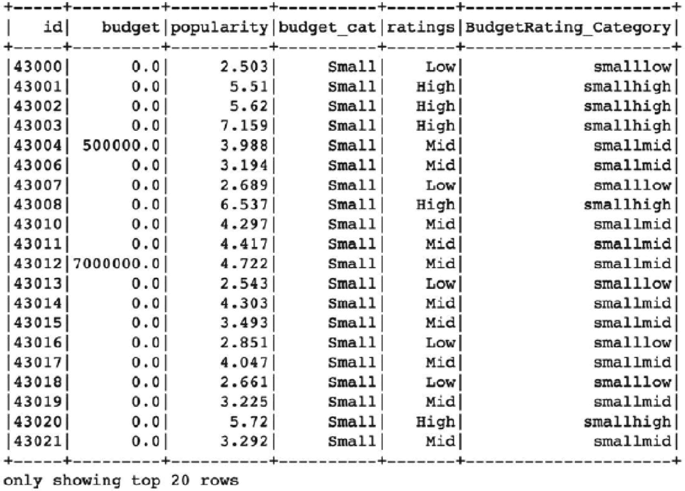

图 3-1 字符串函数的输出

```
# 连接两个变量
df_with_newcols=df_with_newcols.withColumn('BudgetRating_Category',concat(df_with_newcols.budget_cat,df_with_newcols.ratings))
# 将新变量转换为小写
df_with_newcols=df_with_newcols.withColumn('BudgetRating_Category',trim(lower(df_with_newcols.BudgetRating_Category)))
df_with_newcols.show()
```

### 注册 DataFrame

到目前为止，你一直在使用 DataFrame 及其函数。如果能对这些 DataFrame 使用 SQL 函数，那岂不是太棒了？幸运的是，PySpark 允许你在 DataFrame 上运行 SQL 查询。Spark 会处理所有操作。为此，你需要使用 `createOrReplaceTempView` 函数将 DataFrame 注册为临时表，这会创建一个内存表。请记住，此表仅在其创建的 Spark 会话中可访问，并且数据以 Hive 的列式格式存储。这种设置让你可以像访问普通 SQL 表一样访问所有列。你还可以用不同的数据覆盖现有的临时表。尝试将 DataFrame 注册为临时表，看看简单的 SQL 查询如何在不使用任何函数的情况下实现所需结果（如图 3-2a 所示）。

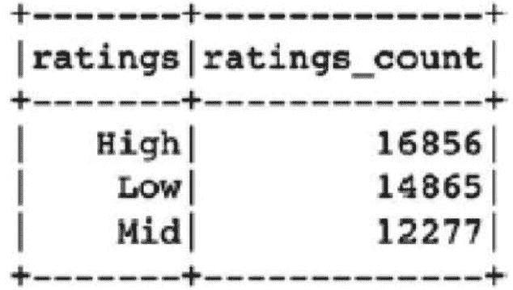

图 3-2a 在临时表上执行 Spark SQL 的输出

```
# 注册临时表
df_with_newcols.createOrReplaceTempView ('temp_data')
# 应用函数显示结果
spark.sql('select ratings, count(ratings) from temp_data group by ratings').show(False,10)
```

在最新版本的 Spark 中，你可以跳过此步骤，直接使用 `spark.sql` 查询内存中的 DataFrame，而无需注册。你会发现结果完全相同（参见图 3-2b）。

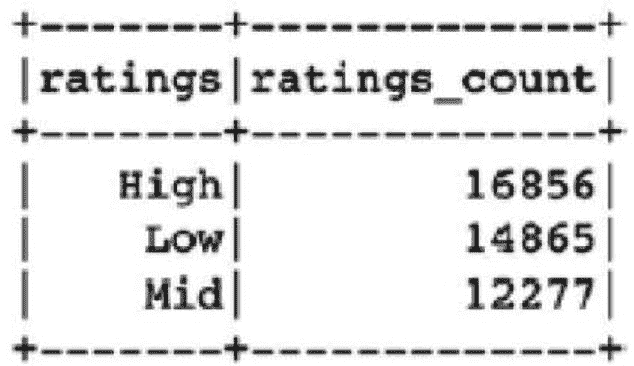

图 3-2b 在现有 DataFrame 上执行 Spark SQL 的输出

```
# 使用 Spark 最新功能
spark.sql('select ratings, count(ratings) as ratings_count from {temp_df} group by ratings',temp_df=df_with_newcols).show()
```

使用字符串格式进行动态插入的替代查询：

```
spark.sql('SELECT ratings, COUNT(ratings) AS ratings_count FROM {} GROUP BY ratings'.format(temp_df)).show()
```


### 窗口函数

窗口函数允许你跨一组与当前行相关的行执行计算。它们对于执行基于时间的分析函数特别有用。许多特征工程都依赖于窗口函数。这些函数可以分为三类：

1.  **聚合函数**：将多行分组以生成单个汇总值，例如 `sum`、`average`、`min`、`max` 或 `count`。
2.  **排名函数**
3.  **分析函数**

使用窗口函数时，你需要指定三个关键组件：

-   **分区**：确定哪些行与当前行位于同一分区中。例如，要计算每年预算最高的电影，你可以按年份进行分区。
-   **排序**：定义如何对每个分区内的行进行排序，可以是升序或降序。
-   **窗口框**：根据当前行的相对位置，指定在当前行上方或下方包含多少行。

`PySpark` 包含一组用于排名和分析操作的内置函数。表 3-1 提供了这些函数的简洁且有用的列表。

**表 3-1** 窗口函数类型

| 类型 | 函数 |
| --- | --- |
| 排名 | `rank`、`denseRank`、`percentRank`、`rowNumber`、`ntile` |
| 分析 | `lead`、`lag`、`lastValue`、`firstValue`、`cumeDist` |

通过以下图示，你将更好地理解这些概念。让我们计算流行度的十分位数。我们所说的十分位数是什么意思？如果你有分析背景，你可能已经了解十分位数。十分位数是将分布按升序或降序分成十个相等桶的过程。这些是评估预测模型性能的初始步骤。我们将在后续章节中更深入地探讨模型性能和验证统计信息。现在，让我们看看如何计算流行度的十分位数。

```
# 导入窗口函数
from pyspark.sql.window import *
# 步骤 1：过滤缺失值
df_with_newcols=df_with_newcols.filter( (df_with_newcols['popularity'].isNotNull()) & (~isnan(df_with_newcols['popularity'])) )
# 步骤 2：应用窗口函数计算十分位数
df_with_newcols = df_with_newcols.select("id","budget","popularity", ntile(10).over(Window.partitionBy().orderBy(df_with_newcols['popularity'].desc())).alias("decile_rank"))
# 步骤 3：显示值
df_with_newcols.groupby("decile_rank").agg(min('popularity').alias('min_popularity'),max('popularity').alias('max_popularity'),count('popularity')).show()
```

让我们分解一下步骤 2 中发生的事情。我们使用了 `ntile` 函数，它将变量分布划分为 *n* 个桶。此外，我们使用分区指定了如何拆分分布。在这种情况下，由于我们没有对数据指定任何分区，它将默认使用所有数据。然后，我们利用 `orderBy` 按流行度值降序排列数据中的所有行。最后，使用 `alias` 函数重命名十分位列。由于 Spark 采用惰性求值，执行此命令不会立即返回结果。

转到步骤 3，我们正在执行一个动作。当我们执行此步骤时，底层计划会被执行，并计算出十分位数。在步骤 3 中，我们从分组的 DataFrame 中收集要在 `agg` 函数中使用的所有统计信息。此外，我们还包含了聚合函数的最小值、最大值和计数值。我们期望每个十分位中的记录数大致相等，因此添加了 `count` 来验证这一点。结果如图 3-3 所示。

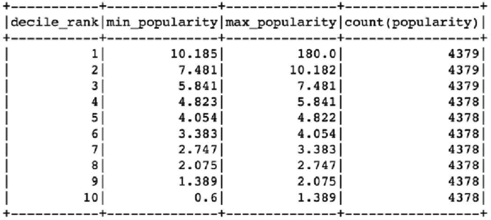

**图 3-3** 流行度十分位数的输出

现在，我们对流行度评分在十个均匀分布的桶中的变化情况有了一个清晰的认识。假设你想知道 1970 年第二受欢迎的电影是哪一部。如何使用你刚刚学到的函数找到它？

在开始之前，请使用内存中的 DataFrame。如果我已经覆盖了数据怎么办？好吧，此时，如果你已经覆盖了 DataFrame，你总是可以重新加载数据。但是，请记住将变量转换为适当的数据类型。

```
# 步骤 1：导入窗口函数
from pyspark.sql.window import *
# 步骤 2：选择所需的列子集
df_second_best = df.select('id', 'popularity', 'release_date')
# 步骤 3：从发布日期创建年份列
df_second_best=df_second_best.withColumn('release_year',year('release_date')).drop('release_date')
# 步骤 4：定义分区函数
year_window = Window.partitionBy(df_second_best['release_year']).orderBy(df_second_best['popularity'].desc())
# 步骤 5：应用分区函数
df_second_best=df_second_best.select('id', 'popularity', 'release_year',rank().over(year_window).alias("rank"))
# 步骤 6：查找 1970 年的第二高评分
df_second_best.filter((df_second_best['release_year']==1970) & (df_second_best['rank']==2)).show()
```

让我们回顾一下并观察前面步骤中发生的事情。首先，我们选择了所需的列，并从发布日期中提取了年份。从上一节中，你一定已经熟悉了这个步骤。在步骤 4 中，我们定义了窗口函数。我们想按年份对数据进行分区。这样做的原因是我们想知道 1970 年的第二高评分。这个分区将允许我们按年份对数据中的所有流行度评分进行排名。在步骤 5 中，我们使用了 `rank` 函数以及我们之前定义的 `window.partitionBy` 函数来得到所需的结果。等等——我们还没完成！我们想要识别 1970 年的结果，因此我们将数据过滤到 1970 年，并提取行排名为 2 的数据子集，如步骤 6 所示。结果如图 3-4 所示。

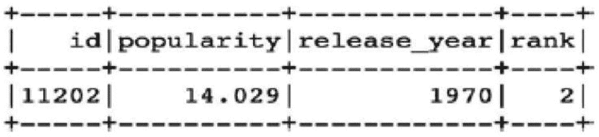

**图 3-4** 1970 年第二高流行度评分的输出

我们在这里使用了 `rank` 函数。`rank` 和 `denseRank` 之间有一个细微的区别——`rank` 给出有序分区内的排名，并列项被赋予相同的排名。并列项之后的排名会被赋予更高的排名。如果你有两行排名为 2，则下一个排名将是 4。在 `denseRank` 中，不会跳过任何排名，它们是连续的。你需要根据需求选择这些函数。

让我们更进一步。如果你的问题是，当年票房最高的电影与其他电影之间的收入差异是多少？你需要先找出当年的票房冠军，然后计算某部电影的收入差异。以下代码演示了如何实现这一点。结果如图 3-5 所示。

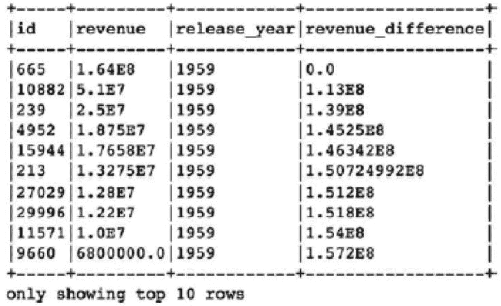

**图 3-5** 与每年最高收入相比的收入差异输出

```
# 步骤 1：导入窗口函数
from pyspark.sql.window import *
# 步骤 2：选择所需的列子集
df_revenue = df.select('id', 'revenue', 'release_date')
# 步骤 3：从发布日期创建年份列
df_revenue=df_revenue.withColumn('release_year',year('release_date')).drop('release_date')
# 步骤 4：定义分区函数及范围
windowRev =Window.partitionBy(df_revenue['release_year']).orderBy(df_revenue['revenue'].desc()).rangeBetween(-sys.maxsize, sys.maxsize)
# 步骤 5：应用分区函数计算收入差异
revenue_difference = (max(df_revenue['revenue']).over(windowRev) - df_revenue['revenue'])
# 步骤 6：最终数据
df_revenue.select('id', 'revenue', 'release_year',revenue_difference.alias("revenue_difference")).show(10,False)
```

你会注意到，在步骤 3 之前，与前面的示例相比没有太多变化。在步骤 4 中，除了 `window.partitionBy` 函数之外，我们还加入了 `rangeBetween` 函数。此函数用于定义起点和终点（均包含）之间的边界。`rangeBetween` 函数中的两个参数表示应包含该分区内的最小和最大可能值。转到步骤 5，我们识别窗口函数上的最大值，并从行值中减去它们。这产生了预期的输出，如步骤 6 所示。

窗口函数可能是一个开销较大的话题。然而，前面的示例应该能让你很好地了解如何利用这些函数的可能性。大多数 SQL 窗口函数都可以作为 `PySpark` 中的内置函数使用。


### 其他实用函数

在本节中，我们将介绍前面章节未提及的其他实用函数。根据具体使用场景，它们可能非常有效。

#### 收集列表（Collect List）

从之前的分析中我们知道，有些标题是重复的。假设你想找出所有重复出现标题“The Lost World”的年份。我们有一个名为`collect_list`的便捷函数可以实现此功能。在本演示中，我们将使用现有的 DataFrame。图 3-6 展示了之前的输出结果以供参考，而新的输出结果如图 3-7 所示。

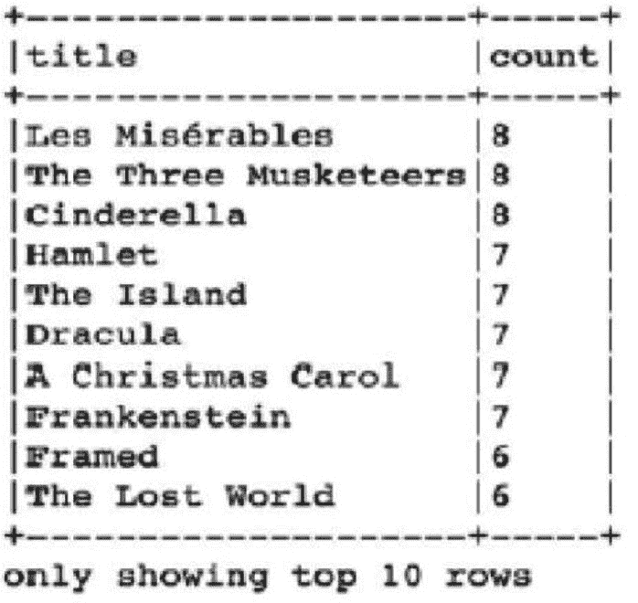

图 3-6

经过筛选、排序并包含单向频率的输出结果

```
# 步骤 1：从发布日期创建年份列
df=df.withColumn('release_year',year('release_date'))
# 步骤 2：应用 collect_list 函数收集所有出现项
df.filter("title=='The Lost World'").groupby('title').agg(collect_list("release_year")).show(1,False)
```

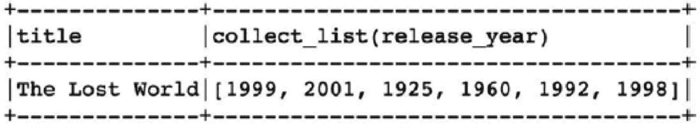

图 3-7

`collect_list` 的输出结果

我们来分解步骤 2：首先筛选出我们感兴趣的标题，然后按标题对 DataFrame 进行分组。这个特定标题出现了六次。`collect_list`函数收集了该标题对应的发布年份，并在输出中显示。

#### 抽样

抽样在数据分析中占有特殊地位。简单来说，*样本*是总体中的一个子集。但究竟什么是总体？*总体*代表全部数据。在考虑你要研究的总体时，精确界定至关重要。例如，如果你将总体定义为亚马逊的所有活跃用户，这涵盖了所有亚马逊用户，无论其地区、语言或性别。然而，在现实场景中，获取总体数据可能具有挑战性，有时甚至不切实际。

我们使用样本来推断总体中发生的情况。然而，如果抽样执行不当，可能会显著影响你的结果。广义上讲，可用的抽样方法可分为概率抽样和非概率抽样技术。概率抽样技术涉及随机选择来选取样本，而非概率抽样技术则依赖主观判断。在数据科学中，我们通常采用概率抽样技术来对样本做出明智的决策。概率抽样方法中一些流行的抽样技术包括：简单随机抽样、系统随机抽样、分层随机抽样和整群抽样。

在简单随机抽样中，样本中的每个观测值都是随机选择的，确保所有观测值被选中的机会均等。简单随机抽样有两种变体。

*   **有放回的简单随机抽样：** 在此方法中，一旦从总体中随机选择一个观测值，在选取第二个观测值之前，它会放回数据集中。换句话说，一个观测值的选择不会影响其他观测值的结果。

*   **无放回的简单随机抽样：** 在此方法中，一旦从总体中随机选择一个观测值，在选取第二个观测值之前，它不会放回数据集中。换句话说，一个观测值的选择会显著影响其他观测值的结果。

在分层抽样中，你从可以划分为子总体的总体中选取样本。例如，假设你知道在豪华车细分市场中，拥有特定品牌汽车的人口比例。那么，使用此技术选择样本时，你可以保持相同的比例。

现在，让我们探讨如何使用 PySpark 实现这些技术。

```
# PySpark 中的无放回简单随机抽样
df_sample = df.sample(False, 0.4, 11)
df_sample.count()
```

输出：

```

```

上述命令指定了三个参数。第一个参数`True/False`表示你是否希望进行有放回或无放回抽样。我们选择了`False`，表示希望进行无放回抽样。第二个参数是比例，表示你希望样本占总体的比例。第三个参数是种子，用于确保每次运行此代码段时都能得到相同的结果。

```
# PySpark 中的有放回简单随机抽样
df_sample = df.sample(True, 0.4, 11)
df_sample.count()
```

输出：

```

```

请注意，在这两种情况下，样本大小并不完全是我们请求的比例。这是因为 Spark 内部使用伯努利抽样技术来抽取样本。由于总体的每个元素都是单独被选入样本的，因此样本大小不是固定的，而是遵循二项分布。

```
# PySpark 中的分层抽样
df_strat = df.sampleBy("release_year", fractions={1959: 0.2, 1960: 0.4, 1961: 0.4}, seed=11)
df_strat.count()
```

输出：

```

```

分层抽样的语法与简单随机抽样略有不同。注意我们使用的是`sampleBy`函数而不是`sample`。这里的第一个参数是你想要分层的列。在这个例子中，我们使用的是发布年份。例如，假设我们知道 1960 年和 1961 年发行的电影数量是 1959 年的两倍；那么我们将使用这个比例来定义我们的样本。这体现在第二个参数中。


#### 缓存与持久化

缓存是 Spark 最重要的概念之一。如果使用得当，它能在运行大型程序时节省大量时间。那么什么是缓存呢？它是一种将数据临时保存在内存中的方式，这种做法在各类操作系统、软件和编程语言中都很常见。那么它为什么有用呢？因为如果你能将数据存储在内存中，就无需在每次访问 `DataFrame` 时重复计算，从而节省了昂贵的数据 I/O 操作成本。如果你要多次访问同一个 `DataFrame` 并执行多项操作，我们建议使用缓存。如果你只打算使用一次 `DataFrame`，或者数据很容易计算，那么缓存就没有必要了。

读取数据后，你可以对 `DataFrame` 上的第一个查询进行缓存。第一个查询会以正常速度运行，但后续操作将受益于计算速度的提升。值得注意的是，缓存是惰性的，这意味着你对 `DataFrame` 的第一次操作会花费一些时间。你可以使用 `cache` 函数缓存任何 `DataFrame`。

```
df.cache()
```

持久化具有类似的功能，或者可以看作是缓存的同义词。它们的区别在于存储级别设置。Spark 有五种存储类型。以下内容来自 Spark 文档。参见表 3-2。

*   `MEMORY_ONLY`：将 RDD 作为反序列化的 Java 对象存储在 JVM 中。如果 RDD 无法完全放入内存，则某些分区将不会被缓存，并在每次需要时重新计算。这是默认级别。
*   `MEMORY_ONLY_SER`：将 RDD 作为序列化的 Java 对象（每个分区一个字节数组）存储。这通常比反序列化对象更节省空间，尤其是在使用快速序列化器时，但读取时更消耗 CPU。
*   `MEMORY_AND_DISK`：将 RDD 作为反序列化的 Java 对象存储在 JVM 中。如果 RDD 无法完全放入内存，则将无法放入的分区存储在磁盘上，并在需要时从磁盘读取。
*   `MEMORY_AND_DISK_SER`：类似于 `MEMORY_ONLY_SER`，但将无法放入内存的分区溢出到磁盘，而不是在每次需要时重新计算。
*   `DISK_ONLY`：仅将 RDD 分区存储在磁盘上。

缓存将使用 `memory_only`。你可以使用 `persist` 函数对所有存储级别进行持久化：

```
df.persist()
```

如果你想手动移除存储级别中的数据，可以使用 `unpersist` 函数：

表 3-2  
Spark 中的存储级别

| 级别 | 占用空间 | CPU 时间 | 内存中 | 磁盘上 | 序列化 |
| --- | --- | --- | --- | --- | --- |
| `MEMORY_ONLY` | 高 | 低 | 是 | 否 | 否 |
| `MEMORY_ONLY_SER` | 低 | 高 | 是 | 否 | 是 |
| `MEMORY_AND_DISK` | 高 | 中 | 部分 | 部分 | 部分 |
| `MEMORY_AND_DISK_SER` | 低 | 高 | 部分 | 部分 | 是 |
| `DISK_ONLY` | 低 | 高 | 否 | 是 | 是 |

```
df.unpersist()
```

#### 保存数据

完成所有数据操作后，你有多种保存数据集的选项，可以保存为 Hive 表或文本文件。我们先来看一个示例，了解如何使用 `write` 和 `save` 方法将输出 `DataFrame` 保存为文本文件。在以下命令中，你可以指定输出文件的格式以及设置分隔符的选项。我们选择管道符作为分隔符用于演示，但你可以自定义并选择任何对数据集有意义的分隔符。

```
df.write.format('csv').option('delimiter', '|').save('output_df')
```

假设你在集群上工作，并且数据有多个分区，你可以使用 `coalesce` 函数将它们一起保存到单个文件中。在这种情况下，你可以将前面的命令修改如下：

```
df.coalesce(1).write.format('csv').option('delimiter', '|').save('output_coalesced_df')
```

如果你需要按某个列对数据进行分区以便于索引，可以在保存时使用 `partitionBy` 函数，如下所示：

```
df.write.partitionBy('release_year').format('csv').option('delimiter', '|').save('output_df_partitioned')
```

如果你想将数据保存为 Hive 表，可以使用 `saveAsTable` 函数：

```
df.write.saveAsTable('film_ratings')
```

#### Pandas 支持

是的，我们正在使用 PySpark。但有时你可能希望将 PySpark `DataFrame` 转换为 pandas `DataFrame`。你可以通过 `toPandas()` 函数来实现。警告：不要尝试在大型数据集上运行以下命令，否则会遇到内存问题。这是因为你正在将分布式数据集复制到本地内存。一旦创建了 pandas `DataFrame`，新创建的 pandas `DataFrame` 与 Spark 之间就没有任何连接了。

```
# Pandas 转 PySpark
df_pandas = df.toPandas()
# Pandas 转 PySpark
df_py = spark.createDataFrame(df_pandas)
```


#### 连接（Joins）

图 3-8 以图形方式快速展示了所有连接类型。下一节将教你每种连接的具体用法及其工作原理。

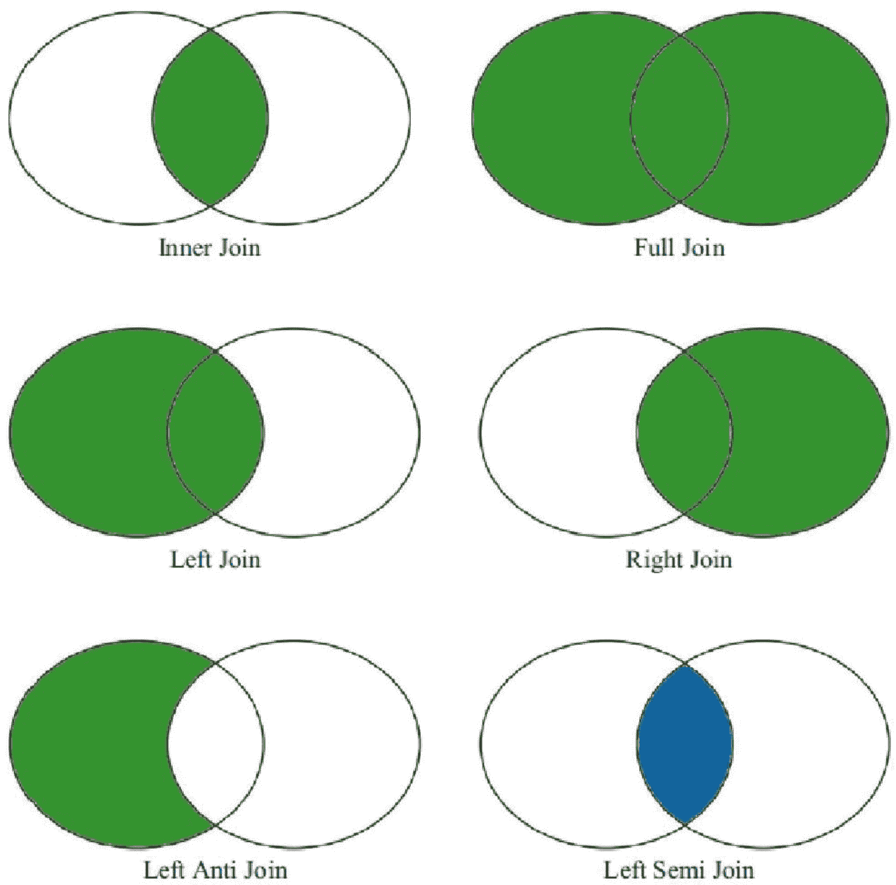

图 3-8 连接类型

连接是你在使用 DataFrame 时最频繁的操作之一。为了讲解连接，我们引入另一个包含额外信息的数据集，并将其与我们一直在使用的数据结合使用。详见表 3-3。

表 3-3 附加数据的元数据

| 变量 | 描述 |
| --- | --- |
| `id` | 电影的唯一标识符 |
| `cast` | 演员表列表 |
| `adult` | 指示电影是否为成人影片 |
| `directors` | 导演信息 |
| `vote_count` | 总投票数（用于衡量人气） |
| `spoken_languages` | 电影中使用语言的列表 |
| `Poster_path` | 电影海报图片的存储路径 |
| `homepage` | 电影网页（如果存在） |
| `imdb_id` | 电影对应的 IMDB ID |
| `genres` | 电影类型列表 |
| `video` | 网站上的视频指示器 |

首先，将此数据加载为一个新的 DataFrame，并选择所有 ID 非空的行，操作如下：

```
# 输入参数
file_location = "movie_data_part2.csv"
file_type = "csv"
infer_schema = "False"
first_row_is_header = "True"
delimiter = "|"
# 整合所有选项以读取 csv 文件
df_p1 = Spark.read.format(file_type) \
.option("inferSchema", infer_schema) \
.option("header", first_row_is_header) \
.option("sep", delimiter) \
.load(file_location)
# 将标识符转换为正确的数据类型
df_p1 = df_p1.withColumn('id',df_p1['id'].cast("integer"))
# 过滤缺失值
df_p1=df_p1.filter((df_p1['id'].isNotNull()) & (~isnan(df_p1['id'])))
```

显而易见，两个数据集中共有的变量是 ID。我们将能够使用此标识符来连接 DataFrame。PySpark 提供了多种连接方式，下面逐一介绍。

- **内连接（Inner join）：** 此操作基于标识符连接两个 DataFrame，仅保留两者共有的行和列（见图 3-9）。

```
# 内连接
df.join(df_p1, df['id'] == df_p1['id'],'inner').printSchema()
df.join(df_p1, df['id'] == df_p1['id']).count()
```

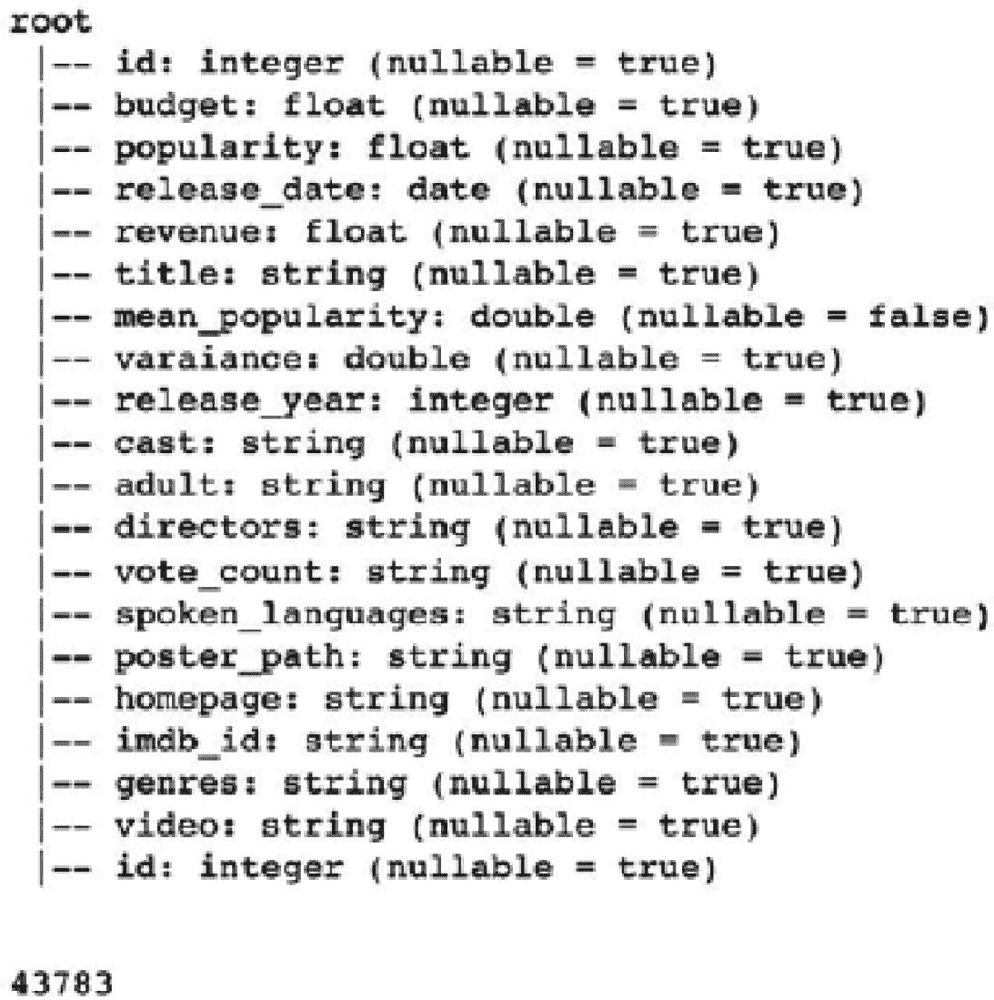

图 3-9 内连接的输出列和计数

Spark 处理了 DataFrame 的连接，并将标识符包含了两次。作为良好实践，你可以将标识符重命名为相同名称，或者直接删除重复的标识符。

默认情况下，如果未传递任何参数，Spark 会使用内连接。

- **左连接/左外连接（Left/Left outer join）：** 左连接基于标识符合并两个 DataFrame，保留左侧 DataFrame 的所有行，并匹配右侧 DataFrame 中与之共有的行。如果右侧 DataFrame 中没有对应的行，Spark 会在所有列中插入空值。

```
# 左连接
df.join(df_p1, df['id'] == df_p1['id'],'left').count()
```

输出：

- **右连接/右外连接（Right/Right outer join）：** 此操作基于标识符合并两个 DataFrame，保留右侧 DataFrame 的所有行，并匹配左侧 DataFrame 中与之共有的行。如果左侧 DataFrame 中没有对应的行，Spark 会在所有列中插入空值。

```
# 右连接
df.join(df_p1, df['id'] == df_p1['id'],'right').count()
```

输出：

- **全外连接（Full outer join）：** 此操作基于标识符连接两个 DataFrame，保留左侧和右侧 DataFrame 中具有相同标识符的所有行。如果任一 DataFrame 中没有对应的行，Spark 会在所有列中插入空值。

```
# 外连接
df.join(df_p1, df['id'] == df_p1['id'],'outer').count()
```

输出：

- **左反连接（Left Anti join）：** 此操作基于标识符连接两个 DataFrame，仅保留左侧 DataFrame 中存在于右侧 DataFrame 的那些行。同时，它只保留左侧 DataFrame 的模式（见图 3-10）。

```
# 左反连接
df.join(df_p1, df['id'] == df_p1['id'],'left_anti').printSchema()
df.join(df_p1, df['id'] == df_p1['id'],'left_anti').count()
```

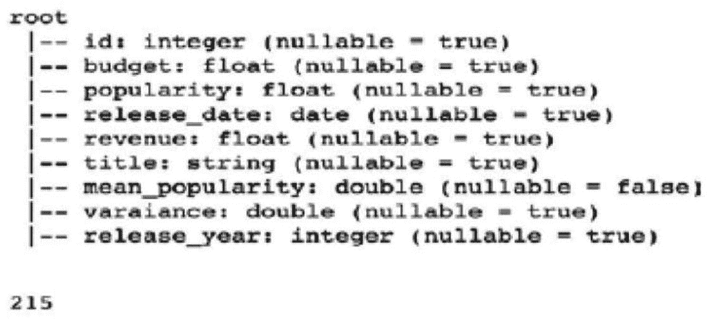

图 3-10 左反连接的输出列和计数

- **左半连接（Left Semi join）：** 此操作类似于内连接，区别在于它不会返回右侧 DataFrame 中的列（见图 3-11）。

```
# 左半连接
df.join(df_p1, df['id'] == df_p1['id'],'left_semi').printSchema()
df.join(df_p1, df['id'] == df_p1['id'],'left_semi').count()
```

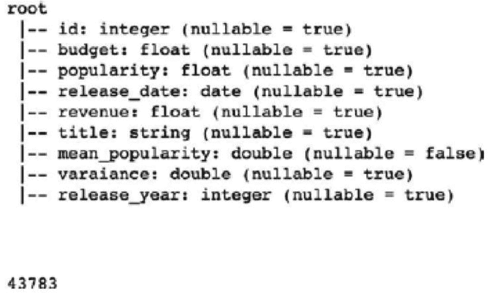

图 3-11 左半连接的输出列和计数

- **广播（Broadcasting）：** 有时你需要连接一个大型数据集（数百万行）和一个小型数据集（数百行）。为了高效地连接它们，Spark 提供了另一个名为 `broadcast` 的函数。较小的 DataFrame 会被复制到集群的所有节点中。这提高了效率，因为 Spark 无需对较大的数据集进行任何数据混洗。以下是一个工作示例：

```
# 广播连接
df.join(broadcast(df_p1), df['id'] == df_p1['id'],'left_semi').count()
```

输出：

#### 删除重复项（Dropping Duplicates）

在处理真实数据时，另一个你可能经常用到的便捷函数是 `dropDuplicates`。你可以删除单行或多行的重复项。假设你想删除 DataFrame 中所有标题和年份相同的重复行，可以使用以下命令：

```
# 删除重复项
df.dropDuplicates(['title','release_year']).count()
```

输出：

```
# 原始数据计数
df.count()
```

输出：


#### 数据可视化

Spark 没有内置的数据可视化包。Python 拥有丰富的数据可视化包库，例如 `matplotlib` 和 `seaborn`。你可以将这些包与 DataFrames 结合使用，创建所需的图表。

退一步来看，你会发现可视化主要使用的是聚合数据。如果你需要理解一个连续变量，最佳图表是直方图。同样，对于分类数据，你可能希望看到分组图。因此，你可以利用 Spark 的强大功能来计算这些聚合结果，然后借助 Python 中优秀的可视化包来呈现。

首先，让我们绘制流行度数据的直方图（见图 3-12）：

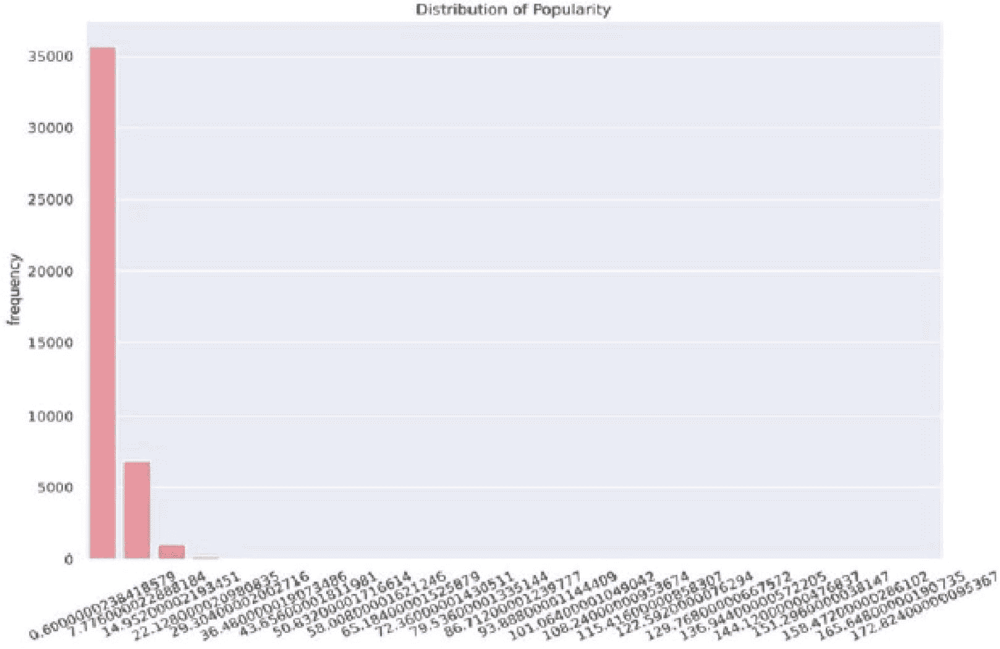

图 3-12：流行度直方图

```
# 步骤 1：导入所需库
%matplotlib inline
import pandas as pd
from matplotlib import pyplot as plt
import seaborn as sns
# 步骤 2：在 Spark 中处理数据。我们可以使用 RDD 中的 histogram 函数
histogram_data = df.select('popularity').rdd.flatMap(lambda x: x).histogram(25)
# 步骤 3：将计算出的直方图数据加载到 pandas DataFrame 中以便绘图
hist_df=pd.DataFrame(list(zip(*histogram_data)), columns=['bin', 'frequency'])
# 步骤 4：绘制数据
sns.set(rc={"figure.figsize": (12, 8)})
sns.barplot(hist_df['bin'],hist_df['frequency'])
plt.xticks(rotation=45)
plt.show()
```

我们来分解一下每个步骤中发生的事情。首先，我们导入了所需的库。所有与数据相关的繁重工作都在步骤 2 中完成。我们使用 RDD API 中提供的 `histogram` 函数来离散化分布并计算分箱。在此过程中，我们要求它将数据离散化为 25 个桶。在步骤 3 中，我们在数据之上创建了一个 pandas DataFrame，然后使用它进行绘图。这就是诀窍所在：我们并没有直接使用 Python 中的直方图函数；所有计算都在 Spark 中完成。我们在直方图数据之上使用条形图来查看分布。正如你所见，由于尾部数值稀疏，该分布难以解释。

让我们尝试过滤数据，看看是否能更好地了解分布情况。

```
# 过滤数据以更好地理解数据
df_fil=df.filter('popularity<22')
# 在 Spark 中处理数据。我们可以使用 RDD 中的 histogram 函数
histogram_data = df_fil.select('popularity').rdd.flatMap(lambda x: x).histogram(25)
# 将计算出的直方图加载到 pandas DataFrame 中以便绘图
hist_df=pd.DataFrame(list(zip(*histogram_data)), columns=['bin', 'frequency'])
# 绘制数据
sns.set(rc={'figure.figsize':(11.7,8.27)})
sns.barplot(hist_df['bin'],hist_df['frequency'])
plt.xticks(rotation=25)
plt.title('流行度分布 - 数据已过滤')
plt.show()
```

我们重复了相同的步骤，只是增加了过滤。现在我们得到了一个好得多的分布（见图 3-13）。

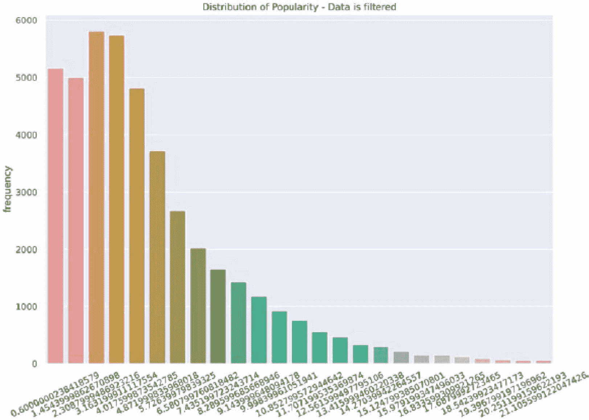

图 3-13：过滤后的流行度直方图

让我们尝试绘制另一个变量。假设你想知道数据集中 1960 年至 1970 年间每年上映的电影数量。你可以通过以下命令来确定（见图 3-14）：

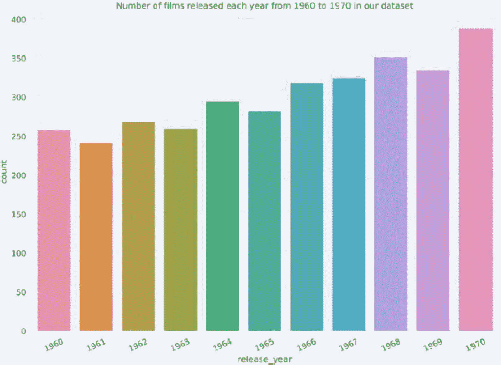

图 3-14：1960 年至 1970 年每年上映的电影数量

```
# 步骤 1：使用 Spark 函数准备数据并转换为 pandas DataFrame
df_cat=df.filter("(release_year>1959) and (release_year<1971)").groupby('release_year').count().toPandas()
# 步骤 2：对值进行排序以便显示
df_cat=df_cat.sort_values(by=['release_year'], ascending=False)
# 步骤 3：绘制数据
sns.set(rc={'figure.figsize':(11.7,8.27)})
sns.barplot(df_cat['release_year'],df_cat['count'])
plt.xticks(rotation=25)
plt.title('数据集中 1960 年至 1970 年每年上映的电影数量')
plt.show()
```

练习 3-1 使用以下数据集：[`https://www.kaggle.com/kakarlaramcharan/tmdb-data-0920`](https://www.kaggle.com/kakarlaramcharan/tmdb-data-0920)。

## 练习 3-1：数据操作

**问题 1：** 根据流行度，找出 2010 年第二受欢迎的电影。

**问题 2：** 找出所有重复出现的片名，并显示它们重复出现的年份。

**问题 3：** 找出所有年份中按流行度排名靠前的电影。

**问题 4：** 可视化 2014 年和 2015 年电影的预算。


## 机器学习简介

在踏入机器学习的世界之前，你需要了解分析的发展历程。分析是对数据或统计信息的计算性分析，用于发现、解读和传达数据中有意义的模式。你可能会听到许多与分析相关的术语和流行词，但它们都服务于收集洞察和做出明智决策这一目的。

分析大致可分为以下几类（见图 3-15）：

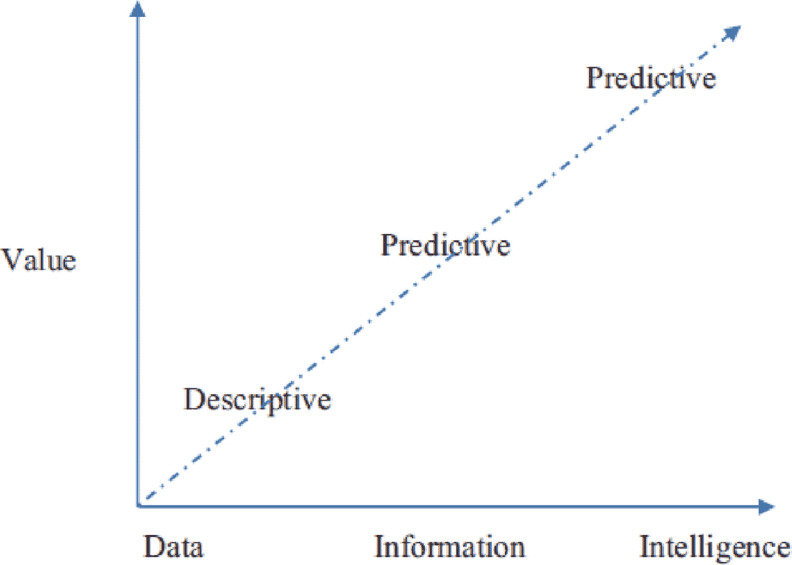

图 3-15

分析概览

*   **描述性分析：** 该分析领域专注于创建报告和图表，以理解数据。
*   **预测性分析：** 该分析领域与根据已发生事件估计未来会发生什么相关。它依赖历史数据进行预测。
*   **规范性分析：** 该分析领域专注于根据过去的数据确定需要采取什么行动。这包括决策优化。

这些术语的使用方式常常会让初学者感到困惑。当然，它们之间存在重叠。机器学习是计算机科学的一个子领域，也被视为人工智能的一个子集。*预测性分析*指的是统计建模，是保险、银行和营销行业中常见的术语。*机器学习*是一个更广泛的术语，涵盖多个类别，包括：

*   **监督学习：** 在这种学习类型中，算法会获得一个带有目标标签或事件的历史数据集。该研究领域通过准确度指标进行验证。这也包括任何时间序列建模。
*   **无监督学习：** 在这种学习类型中，算法会获得一个没有目标标签或事件的历史数据集。其目的是识别数据中隐藏的模式或分段。

在讨论监督和无监督方法中的学习技术类型之前，你需要了解数据类型。我们可以将数据大致分为定性数据和定量数据。

*定性数据*是无法测量的数据。这可以包括你车辆的颜色、婚姻状况、教育程度等。这些变量也可以称为分类变量。我们可以进一步将定性数据分类如下：

*   **名义数据** – 当数据有多个层级且没有自然顺序时，可视为名义数据。例如，你车辆的颜色或婚姻状况。
*   **有序数据** – 当数据存在内在顺序时，可视为有序数据。例如，教育程度。在教育程度中，可以有多个层级，如高中以下、高中、本科和研究生。这些层级具有关联的排序。我们知道研究生处于较高端，而高中以下处于较低端。

*定量数据*是可以测量的数据。这可以包括年龄、距离等。定量数据可以进一步分为离散数据和连续数据：

*   **离散数据** – 当数据为整数值时，可视为离散数据；例如，年龄（10, 20）。
*   **连续数据** – 当数据包含分数或小数时，可视为连续数据；例如，距离（40.71 英里, 59.82 英里）。

我们专门用一章来讲解无监督学习/聚类，你将在其中学习这些不同的技术和方法（见图 3-16）。

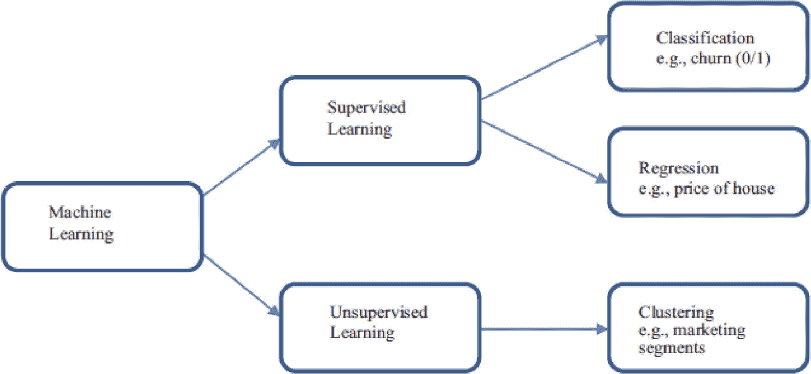

图 3-16

机器学习的分类

了解这些数据类型为什么重要？因为它将帮助你确定可以应用哪些类型的算法。某些算法是为特定数据类型设计的。在监督学习中，有两类不同的算法：分类和回归：

*   **分类：** 在这类机器学习中，目标/事件数据是离散的。例如，预测可能流失的客户（0/1）或可能贷款违约的客户（0/1）。
*   **回归：** 在这类机器学习中，目标/事件数据是连续的。例如，根据给定参数预测房价（$）或预测客户在某个月的购买量。

在后续章节中，我们将探讨哪些算法可以应用于这些方法中的每一种。

*聚类*可以定义为在数据集中对同质数据组进行分组。

大多数数据专业人士在进行预测建模时会遵循一些标准方法论。其中之一是 CRISP-DM，即跨行业数据挖掘标准流程（见图 3-17）。它包括六个主要阶段，如下所示：

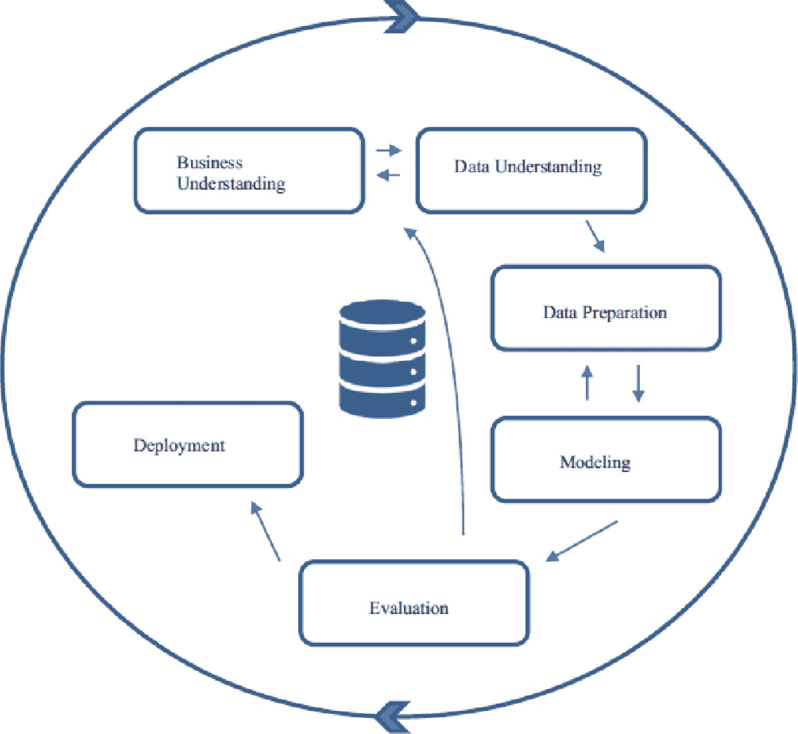

图 3-17

CRISP-DM 方法论

1.  **业务理解：** 这是重要的第一步，涉及理解问题陈述并将其转化为数据问题。这源于业务需求。
2.  **数据理解：** 此步骤包括数据收集和描述性数据分析，以探索数据并熟悉有趣的特征。
3.  **数据准备：** 这包括整合所有数据特征，并从数据集中创建额外的特征/变量。
4.  **建模：** 这包括应用适当的算法，并在必要时进行迭代以创建更多变量。
5.  **评估：** 在构建一个或多个模型后，根据设定的验证标准选择一个模型。我们有一个单独的章节来帮助你理解所有模型评估和验证技术。我们还会寻求业务反馈，以确认模型是否实现了预期功能。
6.  **部署：** 这涉及将模型投入生产，并使模型评分可供业务中的各个利益相关者使用。

数据从业者中另一种常见的标准框架是 SEMMA。SEMMA 代表抽样（Sample）、探索（Explore）、修改（Modify）、建模（Model）和评估（Assess）。该方法论由 SAS 在 CRISP-DM 之前引入。这种以建模为中心的方法不将业务输入作为其流程的一部分。如果你明确定义了业务目标，它在去中心化的组织中也能很好地发挥作用。

## 总结

*   你探索了创建窗口函数的可能性，并思考了特定的业务问题。
*   你学习了抽样、如何实现抽样以及其重要性。
*   你学习了 `cache` 和 `persist` 函数的机制以及何时使用它们。
*   你学习了一些简单的可视化技巧。
*   你现在已经掌握了机器学习的基础知识和框架。

干得好！下一章将介绍变量选择并讨论不同的技术。当你被数据淹没时，你总可以依靠变量选择这一章。它将帮助你识别信息量最大的关键变量。我们下一章见！


