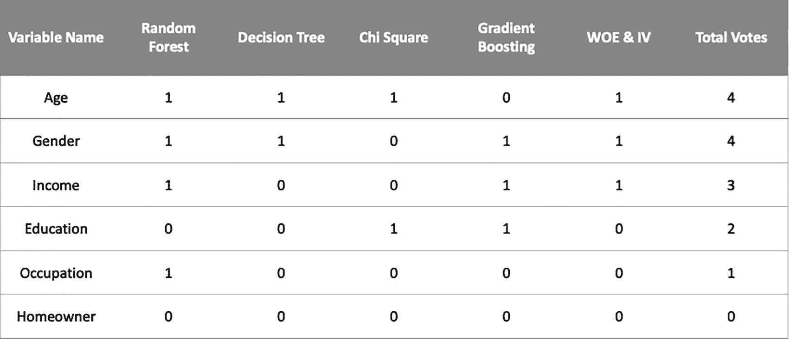
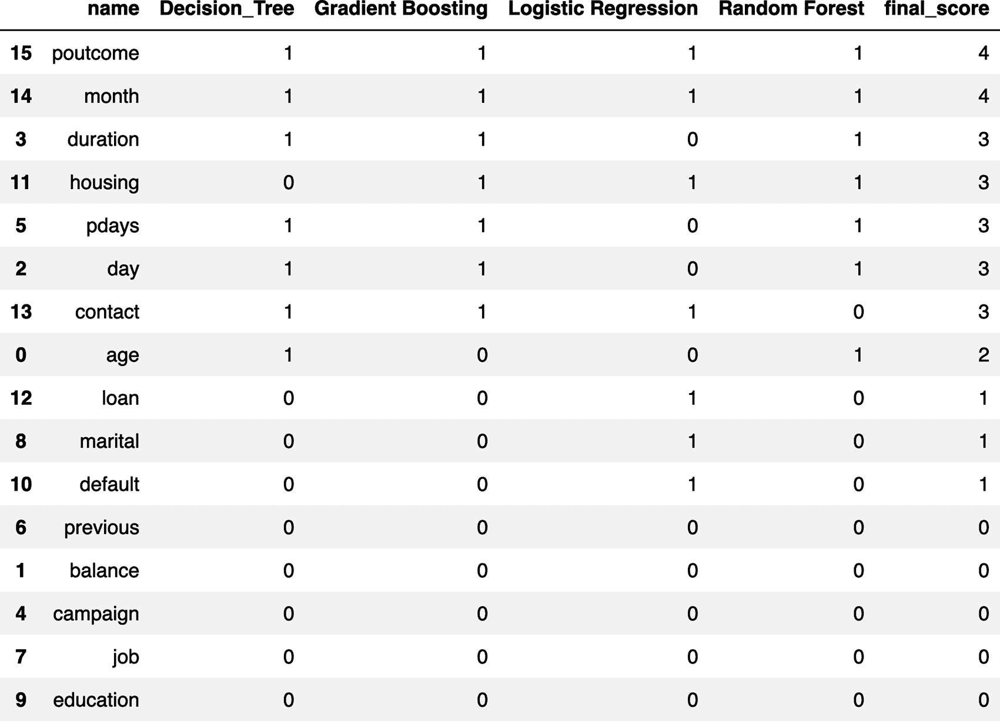

# 目标变量检查

```python
df.groupby(target_variable_name).count().show()
```

# 识别变量类型并执行一些操作

```python
def variable_type(df):
    vars_list = df.dtypes
    char_vars = []
    num_vars = []
    for i in vars_list:
        if i[1] in ('string'):
            char_vars.append(i[0])
        else:
            num_vars.append(i[0])
    return char_vars, num_vars

char_vars, num_vars = variable_type(df)
if dataset != 1:
    char_vars.remove('Address')
    char_vars.remove('SellerG')
    num_vars.remove('Date')
    char_vars.remove('Suburb')
    num_vars.remove(target_variable_name)

final_vars = char_vars + num_vars
```

# WOE 和 IV 代码

## 依赖导入

```python
from pyspark.sql import functions as F
import pandas as pd
import numpy as np
from pyspark.ml.feature import QuantileDiscretizer
from pyspark.ml.feature import VectorAssembler
import scipy.stats.stats as stats
```

## 默认参数

- 用于斯皮尔曼相关性的 `rho` 值。您可以调整此值：`custom_rho = 1`
- 初始分箱的最大数量。它将从此数量开始递减。可调参数：`max_bin = 20`

## 计算 WOE 和 IV 值

此函数基于 PySpark 输出计算 WOE 和 IV 值。注意：此部分代码基于 Python 实现，以提高效率。

```python
def calculate_woe(count_df, event_df, min_value, max_value, feature):
    # 实现 WOE 和 IV 计算图中所示的表格结构
    woe_df = pd.merge(left=count_df, right=event_df)
    woe_df['min_value'] = min_value
    woe_df['max_value'] = max_value
    woe_df['non_event'] = woe_df['count'] - woe_df['event']
    woe_df['event_rate'] = woe_df['event']/woe_df['count']
    woe_df['nonevent_rate'] = woe_df['non_event']/woe_df['count']
    woe_df['dist_event'] = woe_df['event']/woe_df['event'].sum()
    woe_df['dist_nonevent'] = woe_df['non_event']/woe_df['non_event'].sum()
    woe_df['woe'] = np.log(woe_df['dist_event']/woe_df['dist_nonevent'])
    woe_df['iv'] = (woe_df['dist_event'] -
                    woe_df['dist_nonevent'])*woe_df['woe']
    woe_df['varname'] = [feature]* len(woe_df)
    woe_df = woe_df[['varname','min_value', 'max_value', 'count', 'event', 'non_event', 'event_rate', 'nonevent_rate', 'dist_event','dist_nonevent','woe', 'iv']]
    # 将无穷大值替换为零以进行 IV 计算
    woe_df = woe_df.replace([np.inf, -np.inf], 0)
    # 特征 IV 值的总和
    woe_df['iv'] = woe_df['iv'].sum()
    return woe_df
```

## 与斯皮尔曼相关性一起实现的单调分箱函数

```python
def mono_bin(temp_df, feature, target, n = max_bin):
    r = 0
    while np.abs(r) < custom_rho and n > 1:
        try:
            # 分位数离散器将数据切割成相等数量的观测值
            qds = QuantileDiscretizer(numBuckets=n, inputCol=feature, outputCol='buckets', relativeError=0.01)
            bucketizer = qds.fit(temp_df)
            temp_df = bucketizer.transform(temp_df)
            # 创建 corr_df 是基于 Python 的实现，以提高效率；按组分组并计算特征和目标变量的平均值
            corr_df = temp_df.groupby('buckets').agg({feature:'avg', target:'avg'}).toPandas()
            corr_df.columns = ['buckets', feature, target]
            r, p = stats.spearmanr(corr_df[feature], corr_df[target]) #斯皮尔曼相关性
            # 如果未满足相关性条件，则减少分箱数量
            n = n - 1
        except Exception as e:
            n = n - 1
    return temp_df
```

## 对数据集中的所有变量执行 WOE

```python
def execute_woe(df, target):
    count = -1
    for feature in final_vars:
        # 如果特征不是目标列名则执行。作为额外检查提供。
        if feature != target:
            count = count + 1
            temp_df = df.select([feature, target])
            # 在进行 WOE 计算之前，对数值变量执行单调分箱
            if feature in num_vars:
                temp_df = mono_bin(temp_df, feature, target, n = max_bin)
            # 对数值变量进行分组
            grouped = temp_df.groupby('buckets')
        else:
            # 仅对分类变量进行分组
            grouped = temp_df.groupby(feature)
        #每个分组的计数和事件值
        count_df = grouped.agg(F.count(target).alias('count')).toPandas()
        event_df = grouped.agg(F.sum(target).alias('event')).toPandas()
        # 存储变量的最小值和最大值。对于分类变量，两者取相同值。
        if feature in num_vars:
            min_value = grouped.agg(F.min(feature).alias('min')).toPandas()['min']
            max_value = grouped.agg(F.max(feature).alias('max')).toPandas()['max']
        else:
            min_value = count_df[feature]
            max_value = count_df[feature]
        #计算 WOE 和 IV
        temp_woe_df = calculate_woe(count_df, event_df, min_value, max_value, feature)
        #创建最终数据集
        if count == 0:
            final_woe_df = temp_woe_df
        else:
            final_woe_df = final_woe_df.append(temp_woe_df, ignore_index=True)
    # 创建单独的 IV 数据集
    iv = pd.DataFrame({'IV':final_woe_df.groupby('varname').iv.max()})
    iv = iv.reset_index()
    return final_woe_df, iv
```

## 调用 WOE 和 IV 代码

```python
output, iv = execute_woe(df, target_variable_name)
```

以上就是全部内容。现在您已经完成了证据权重和信息值的计算。

### 自定义转换器

到目前为止，本章一直在介绍 Spark ML 中可用于执行变量选择的一些高级 API（前面讨论过的内置选择技术）。本节将创建一个自定义的 Spark ML 转换器来实现同样的功能。为什么我们需要讨论自定义转换器呢？

花点时间思考一下前面用于变量选择的 `RandomForest` 代码：

```python
from pyspark.ml.classification import RandomForestClassifier
rf = RandomForestClassifier(featuresCol='features', labelCol=target_variable_name)
rf_model = rf.fit(df)
rf_model.featureImportances
```

仅用几行代码，我们就完成了以下操作：(1) 调用了 `RandomForestClassifier`；(2) 定义了一个 `RandomForestClassifier` 对象的实例；(3) 在数据集上拟合模型；(4) 显示了重要性得分。这就是面向对象编程（OOP）的强大之处。以下是 OOP 概念的快速回顾：

1. *类* – 用户定义的蓝图，用于创建对象实例。在第 2 行中，`RandomForestClassifier` 是一个类，`rf` 是对象实例。

2. *方法* – 在类内部编写的函数。在第 3 行中，`fit` 函数就是一个方法。

3. *抽象* – 这是一种概念，通过它只向用户展示必要的信息。这被称为实现隐藏。在前面展示的 `RandomForestClassifier` 代码中，我们只提供了输入变量、目标和数据集来拟合模型。我们看不到关于随机森林模型如何在后台实现的任何细节。

4. *封装* – 这是一种向用户隐藏信息的概念。这被称为信息隐藏。任何变量/方法都可以使用这种技术进行隐藏。变量/方法可以是*受保护的*（前面加单下划线，不能在类外部访问，但可以在类及其子类中访问），或者是*私有的*（前面加双下划线，只能在类内部访问）。当你查看源代码时，你可能仍然能看到这些变量/方法。所以，它们在概念上是隐藏的，但在视觉上并非不可见。

5. *继承* – 这是一种概念，通过它你可以继承父类的特性来创建子类。想象一个正方形对象。从技术上讲，它是一个所有边都相等的矩形。在这种情况下，`rectangle` 是父类，`square` 是子类。

6. *多态* – 这是一种概念，通过它你可以改变对象的特性。这意味着你可以让同一个对象执行除常规操作之外的多种操作。想想加法（`+`）符号。最初，它只能对数值变量求和。在 Python 中，当你在字符串之间使用加法时，它会将它们连接起来。当你执行这段代码——`print("Hello " + "World")`——它会连接字符串以生成 `Hello World` 输出。在这种情况下，加法（`+`）符号既可以添加字符串，也可以添加数值。这就是多态的一个例子。

使用 OOP 概念，你可以创建一个强大的机器学习类对象。这使得最终用户可以轻松使用你自己的代码。这些对象也更容易组合成一个单一的流水线或工作流，从而创建一个高效的端到端流程。下一节将快速介绍用于创建此类自定义代码的主要概念。

### 流水线中的主要概念

- `DataFrame`：在一个单一的机器学习数据集中组织的不同数据类型的集合。
- `Estimator`：用于将一个函数*拟合*到 `DataFrame`。在 `RandomForestClassifier` 中，`fit` 函数就是 estimator。
- `Transformer`：用于将一个 `DataFrame` *转换*为另一个。有时，transformer 需要先拟合一个函数才能应用。在 `RandomForestClassifier` 中，`predict` 函数就是一个 transformer。
- `Pipeline`：一个机器学习工作流或一系列步骤，用于获得最终结果。
- `Parameter`：estimator 和 transformer 使用统一的 API 来指定参数。

本示例创建一个自定义的相关性 `class`，并将其用于变量选择。我们将演示流水线的用例。在查看任何实现之前，让我们快速浏览一下用于计算数据集相关性的代码。

```python
from pyspark.mllib.stat import Statistics
import pandas as pd
correlation_type = 'pearson' # 'pearson', 'spearman'
#transformer function
features_df = pd.DataFrame()
for k, v in df.schema["features"].metadata["ml_attr"]["attrs"].items():
    final = pd.DataFrame(v)
    features_df=features_df.append(final,ignore_index=True)
    column_names = list(features_df['name'])
    df_vector = df.rdd.map(lambda x: x['features'].toArray())
#generate correlation-matrix using  Statistics.corr
matrix = Statistics.corr(df_vector, method=correlation_type)
corr_df = pd.DataFrame(matrix, columns=column_names, index=column_names)
```

前面的代码生成了一个包含相关性结果的 pandas DataFrame。我们将添加更多代码来扩展其功能。我们包含了一个选项，可以使用外部参数来查找相关性最强的变量。

```python
#transformer continuation
final_corr_df = pd.DataFrame(corr_df.abs().unstack().sort_values(kind='quicksort')).reset_index()
final_corr_df.rename({'level_0': 'col1', 'level_1': 'col2', 0: 'correlation_value'}, axis=1, inplace=True)
final_corr_df = final_corr_df[final_corr_df['col1'] != final_corr_df['col2']]
correlation_cutoff = 0.65 #custom parameter
final_corr_df[final_corr_df['correlation_value'] > correlation_cutoff]
```

我们建议你在使用自定义 `class` 之前，先感受一下前面的代码。

```python
# Import the estimator and transformer classes
from pyspark.ml import Transformer
# Parameter sharing class. We will use this for input column
from pyspark.ml.param.shared import HasInputCol
# Statistics class to calculate correlation
from pyspark.mllib.stat import Statistics
import pandas as pd
# custom class definition
class CustomCorrelation(Transformer, HasInputCol):
    """
    一个用于计算两个变量之间相关性的自定义函数。
    参数：
        inputCol: 默认值 (None)
            用于相关性目的的特征列名称。输入列应为组装后的向量。
        correlation_type: 'pearson' 或 'spearman'
        correlation_cutoff: float, 默认值 (0.7), 接受值 0 到 1
            超过指定阈值的列将显示在输出数据框中。
    """
    # 初始化函数的参数
    def __init__(self, inputCol=None, correlation_type='pearson', correlation_cutoff=0.7):
        super(CustomCorrelation, self).__init__()
        assert inputCol, "请提供一个组装后的特征列名称"
        #self.inputCol 是类参数
        self.inputCol = inputCol
        assert correlation_type == 'pearson' or correlation_type == 'spearman', "请为相关性类型提供一个有效的选项。'pearson' 或 'spearman'。"
        #self.correlation_type 是类参数
        self.correlation_type = correlation_type
        assert 0.0 < correlation_cutoff < 1.0, "请为相关性阈值提供一个有效的值（0 到 1 之间）"
        self.correlation_cutoff = correlation_cutoff
    # 将数据转换为相关矩阵
    def _transform(self, df):
        # 计算相关性矩阵
        df_vector = df.rdd.map(lambda x: x[self.inputCol].toArray())
        corr_matrix = Statistics.corr(df_vector, method=self.correlation_type)
        column_names = df.columns
        corr_df = pd.DataFrame(corr_matrix, columns=column_names, index=column_names)
        # 筛选超过阈值的相关性
        final_corr_df = pd.DataFrame(corr_df.abs().unstack().sort_values(kind='quicksort')).reset_index()
        final_corr_df.rename({'level_0': 'col1', 'level_1': 'col2', 0: 'correlation_value'}, axis=1, inplace=True)
        final_corr_df = final_corr_df[final_corr_df['col1'] != final_corr_df['col2']]
        shortlisted_corr_df = final_corr_df[final_corr_df['correlation_value'] > self.correlation_cutoff]
        # 返回完整的相关矩阵和筛选后的矩阵
        return corr_df, shortlisted_corr_df
```

瞧！你现在有了一个自定义的相关性 `class`，它的工作方式与任何 Spark ML 对象类似。这段代码可以保存在一个名为 `customcorrelation.py` 的独立 Python 文件中。让我们来测试这个新类。

```python
from customcorrelation import CustomCorrelation
clf = CustomCorrelation(inputCol='features')
output, shorlisted_output = clf.transform(df)
```

仅此而已。你仅用三行代码就计算了数据集中输入特征之间的相关性。这与之前看到的 `RandomForestClassifier` 调用类似。有人可能会质疑，我们是否可以用用户自定义函数（`udfs`）实现同样的功能。从代码抽象的角度来看，你是对的；然而，`udfs` 无法融入管道工作流。到目前为止的所有努力，都是为了确保工作流管道的兼容性。那么，我们也来测试一下这个特性。为了演示这一特性，我们将向量组装步骤和相关性步骤合并到一个管道中。如果你需要重新运行代码，需要执行到本章前面讨论的“步骤 2：对字符列应用 `StringIndexer`”为止。

```python
from pyspark.ml.feature import VectorAssembler
from customcorrelation import CustomCorrelation
from pyspark.ml import Pipeline
# 移除特征向量
df = df.drop(*['features2','features'])
# 排除目标变量，选择所有其他特征向量
features_list = df.columns
features_list.remove(target_variable_name)
stages = []
# 组装向量
assembler = VectorAssembler(inputCols=features_list, outputCol='features')
custom_corr = CustomCorrelation(inputCol=assembler.getOutputCol())
stages = [assembler, custom_corr]
# 使用管道按顺序处理
pipeline = Pipeline(stages=stages)
# 管道模型
pipelineModel = pipeline.fit(df)
# 在数据上应用管道模型
output, shorlisted_output = pipelineModel.transform(df)
```

太棒了！现在，你可以实现自己的自定义转换器，并创建一个简洁的机器学习工作流。

### 基于投票的选择

到目前为止，我们已经讨论了多种变量选择技术。如果能将所有变量选择方案整合到一个流程中，那岂不是很好？你可以通过基于投票的架构来实现这一点。其思路是应用多种技术来选择变量。当一种变量选择技术选中某个变量时，你就为该变量分配一个分数。换句话说，该技术为这个变量投了一票。最后，你计算每个变量的总得分，并选择得分最高的变量（见图 4-20）。这样，你最终会从多种选择技术中挑选出“偏好度”最高的变量，这些技术如果单独使用，在某些情况下可能效果不佳。


图 4-20 基于投票的选择

本节要求你完成练习 4-2：基于模型的选择。为了便于演示，我们在此提供该练习的解决方案（见图 4-21）。我们使用了本章前面讨论的所有基于目标变量的选择技术。


图 4-21 基于投票的选择输出

```python
# 决策树算法 – 问题 1 的解决方案
from pyspark.ml.classification import DecisionTreeClassifier
dt = DecisionTreeClassifier(featuresCol='features', labelCol=target_variable_name)
dt_model = dt.fit(df)
dt_output = dt_model.featureImportances
features_df['Decision_Tree'] = features_df['idx'].apply(lambda x: dt_output[x] if x in dt_output.indices else 0)

# 梯度提升算法 – 问题 2 的解决方案
from pyspark.ml.classification import GBTClassifier
gb = GBTClassifier(featuresCol='features', labelCol=target_variable_name)
gb_model = gb.fit(df)
gb_output = gb_model.featureImportances
features_df['Gradient Boosting'] = features_df['idx'].apply(lambda x: gb_output[x] if x in gb_output.indices else 0)

# 逻辑回归算法 – 问题 3 的解决方案
from pyspark.ml.classification import LogisticRegression
lr = LogisticRegression(featuresCol='features', labelCol=target_variable_name)
lr_model = lr.fit(df)
lr_output = lr_model.coefficients
# 使用绝对值将负系数转换为正数。此操作仅应在特征重要性计算时进行。
features_df['Logistic Regression'] = features_df['idx'].apply(lambda x: abs(lr_output[x]))

# 随机森林 – 我们之前讨论过的技术
from pyspark.ml.classification import RandomForestClassifier
rf = RandomForestClassifier(featuresCol='features', labelCol=target_variable_name)
rf_model = rf.fit(df)
rf_model.featureImportances
rf_output = rf_model.featureImportances
features_df['Random Forest'] = features_df['idx'].apply(lambda x: rf_output[x] if x in rf_output.indices else 0)

## 基于投票的选择
features_df.drop('idx', axis=1, inplace=True)
num_top_features = 7 # 每个算法选取的前 n 个特征
columns = ['Decision_Tree', 'Gradient Boosting', 'Logistic Regression', 'Random Forest']
score_table = pd.DataFrame({},[])
score_table['name'] = features_df['name']
# 评估每个算法选出的前几个特征
for i in columns:
    score_table[i] = features_df['name'].isin(list(features_df.nlargest(num_top_features,i)['name'])).astype(int)
# 汇总最终得分
score_table['final_score'] = score_table.sum(axis=1)
score_table.sort_values('final_score',ascending=0)
```

### 总结

- 你详细了解了变量选择技术。
- 你学习了基于目标变量与不基于目标变量的选择技术。
- 你创建了自己的 Spark ML 转换器，并将其集成到机器学习工作流中。
- 最后，你结合了所有选择技术，创建了一种基于投票的选择技术。

干得漂亮！在下一章中，你将学习本书最激动人心的部分——机器学习模型。请继续学习，保持关注。