# 5. 监督学习算法

是时候基于数据进行一些学习了。大多数人认为机器学习就是将算法应用于给定数据并预测结果。嗯，事情并没有那么简单。百分之八十的工作涉及数据收集、预处理、清洗、特征工程、转换以及选择最佳特征。剩下的百分之二十则用于构建机器学习模型、验证和部署。整个操作被称为`MLOps`（机器学习运维）。它类似于`DevOps`，但专用于机器学习。为了理解和部署生产模型，你应该熟悉`MLOps`中的每个组件。前面的章节讨论了那百分之八十的工作。如果你跳过了这些章节，我们建议你在阅读本章之前先阅读它们。此外，业务和领域知识有助于你在整个过程中改进流程。

## 机器学习算法基础

本节讨论机器学习算法。这些算法大致分为三类：监督学习、无监督学习和强化学习（见表 5-1）。

表 5-1

机器学习算法类型

| | 监督学习 | 无监督学习 | 强化学习 |
| --- | --- | --- | --- |
| 是什么？ | 算法使用带标签的数据进行训练。 | 算法使用无标签的数据进行训练。 | 智能体根据每次行动获得的奖励进行训练。 |
| 应用场景？ | 回归、分类 | 聚类、分割、关联分析 | 基于奖励 |
| 使用什么类型的数据？ | 带标签的数据。例如：预测猫 vs 狗或预测房价 | 无标签数据；仅输入特征。例如：客户画像 | 无预定义数据。例如：自动驾驶汽车、游戏智能体 |
| 是否需要监督？ | 是 | 否 | 否 |
| 目标是什么？ | 利用已知的输入/输出映射关系，减少目标预测中的误差 | 理解数据中的模式和规律，以讲述数据故事 | 试错法。让智能体根据自身错误进行学习，并长期改善奖励。 |

除了上述类别，目前还有两种常见的算法：推荐系统和半监督算法。推荐系统可以是监督学习或无监督学习。你将在下一章了解更多相关内容。半监督算法结合了监督学习和无监督学习的方法。这种方法使用少量带标签的数据来对大量无标签数据进行分类。半监督算法和强化学习不在本书的讨论范围内。本章将介绍监督学习算法。在下一章中，我们将介绍无监督学习和推荐算法。

在监督学习算法中，包含以下类型：回归和分类（二分类、多分类和多标签分类）。

### 回归

在回归模型中，你预测的是连续值，例如房价。回归是一种用于金融、投资及其他学科的统计方法，旨在确定一个因变量（通常记为`Y`）与一系列其他变量（称为自变量）之间关系的强度和特征。

### 分类

在分类模型中，我们预测的是类别值，例如猫 vs 狗、垃圾邮件 vs 非垃圾邮件等。当类别数量为两个时，称为二分类。当类别数量超过两个时，称为多分类。二分类模型是多分类模型的一个子集。多分类模型的另一个子集是序数分类。在序数分类模型中，目标是有序的。例如，预测购买经济舱机票、商务舱机票还是头等舱机票的可能性。需要记住的重要一点是，在这些分类模型中，目标是互斥的。在某些情况下，单个观测值可能有多个目标，例如文章的分类。本书可以被归类为以下标题：“机器学习、数据科学、PySpark 应用”。这三个中的任何一个都是有效的目标。这种类型的任务属于多标签分类。

无论哪种情况（回归或分类），目标都是减少预测值与实际值之间的误差。我们从目标（减少误差）开始，介绍一些相关概念，然后深入探讨算法。

### 损失函数

损失函数是与每个监督学习算法相关的误差函数（见表 5-2）。在任何模型训练过程中，目标都是尽量最小化损失函数。为什么要最小化它？考虑一个预测人体体重的例子。原始体重值为 30、40 和 50。假设其中一个模型预测的体重分别为 32、46 和 57。

表 5-2

损失函数类型

| | 名称 | 公式 | 何时使用？ |
| --- | --- | --- | --- |
| 回归 | 平方误差损失 | `(y – y-hat)²` | 回归中常用的损失函数。该损失函数易于求导。 |
| | 绝对误差损失 | `|y - y-hat|` | 当数据中存在异常值时，使用绝对损失，因为它对异常值赋予相同的权重。 |
| | 伪 Huber 损失 | `x = { (y - y-hat)²; 当 x ≤ α | y - y-hat; 否则 }` | 结合了平方误差损失和绝对误差损失。调整超参数`α`以获得最佳结果。 |
| 分类 | 二元交叉熵损失 | `-(y log(p) + (1-y) log(1-p))` | 二分类目标。默认损失函数。 |
| | 分类交叉熵损失 | `-Σ p(x) log q(x)` (C - 类别数) | 多分类目标。默认损失函数。 |
| | KL 散度损失 | `-Σ p(x) log (q(x)/p(x))` (C - 类别数) | 多分类目标。注意：交叉熵 = 熵 + KL 散度 |
| | 合页损失 | `x = y * y-hat; max(0, 1 – x)` | 二分类目标。通常用于支持向量机。用于最大化类别间的间隔。 |

使用平方误差损失函数，该模型的总误差如下：

```
模型 1 误差 = (30 -32)² + (40 – 46)² + (50 – 57)² = 4 + 36 + 49 = 89
```

第二个模型预测的体重为 31、42 和 52。对于该模型，平方误差如下：

```
模型 2 误差 = (30 -31)² + (40 – 42)² + (50 – 52)² = 1 + 4 + 4 = 9
```

如你所见，当你开始最小化平方误差函数时，预测值开始接近原始值。因此，理解损失函数并选择合适的损失函数是模型训练过程中的一项重要任务。你可以在此处可视化损失函数：[`academo.org/demos/3d-surface-plotter/`](https://academo.org/demos/3d-surface-plotter/)。我们在图 5-1 中展示了一个使用平方误差损失的示例。

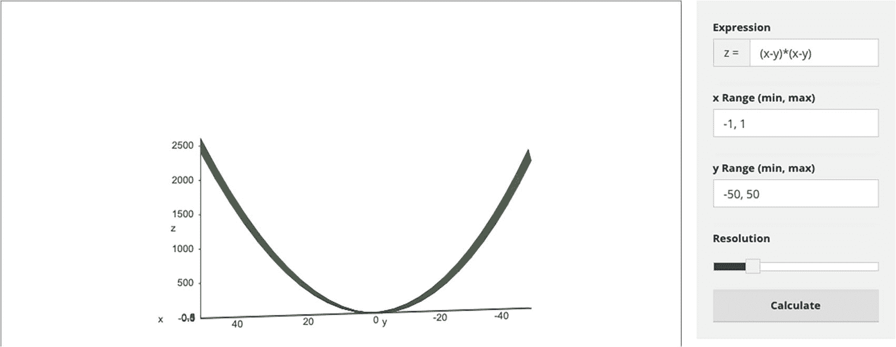

图 5-1

平方误差损失

当到达损失函数的底部时，平方误差值最小。在模型训练过程中，模型从一个误差值开始，然后逐步采取措施以达到曲线的底部值。这个过程称为梯度下降。另一个损失函数——绝对误差损失——如图 5-2 所示。

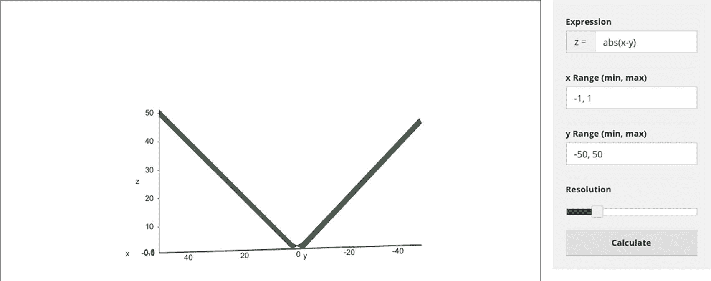

图 5-2

绝对误差损失

在后续章节中探索算法时，我们会根据模型切换损失函数。

### 优化器

优化器用于寻找函数的最小值。在上一节中，我们讨论了当损失函数达到最小值时，模型误差被最小化。由于我们试图找到损失函数的最小值，因此可以使用优化器来解决这些任务。产生最小误差的模型参数称为最优参数。整个过程如图 5-3 所示。

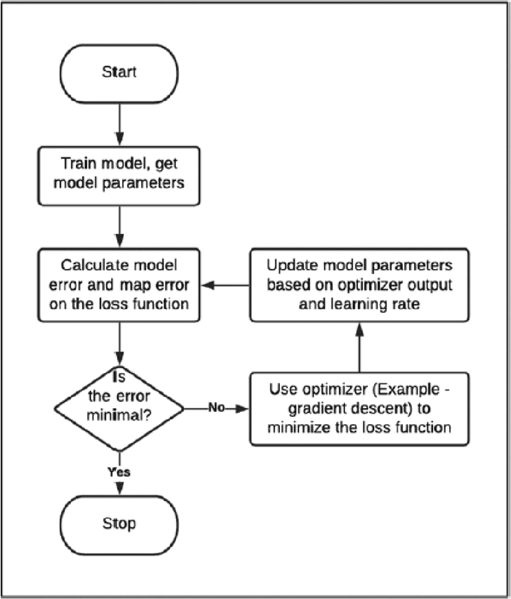

图 5-3

优化器流程图

在本节中，我们将深入探讨用于完成此任务的不同优化器。让我们从梯度下降开始。

#### 梯度下降

想象你正站在山顶上，目标是用最短的路径到达山脚。你不会直接从山顶跳下去，因为你不知道山的高度。那样做很疯狂，而且你极有可能会丧命。这个未知的知识——“山脚在哪里？”——就是你试图求解的函数。为了找到这个解，你开始沿着正确的方向迈出小步下山。这些渐进的移动让你能够适应地形，同时确保持续下降。你多次重复这个过程（小步走和持续下降），最终到达山脚。这整个想法概括了梯度下降的概念（见图 5-4）。

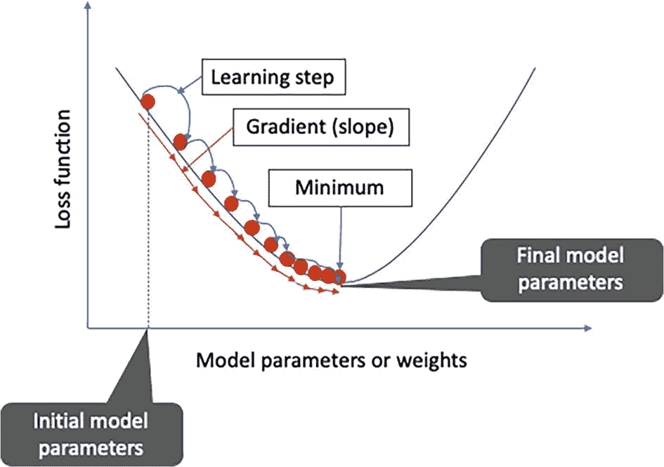

图 5-4

梯度下降

从数学上讲，梯度是优化器试图求解的函数的斜率值。因此，它被称为梯度下降。在图 5-4 中用橙色线表示。模型参数使用以下公式进行更新：

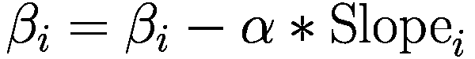

其中

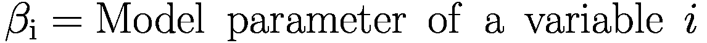

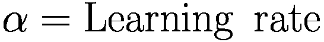

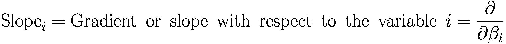

（误差）

在模型训练的初始阶段，斜率很大，当接近最优解时，斜率开始减小。当满足以下条件之一时，你可以停止模型训练过程：

1.  斜率（梯度）接近零。此时，模型参数更新产生相同的结果。
2.  达到指定的迭代次数或轮数（`epochs`）。
3.  模型改进低于指定阈值。为此，你需要比较前一次迭代与当前迭代的性能，以确定模型（增量）改进，并检查增量值是否低于指定阈值。

#### 选择学习率

你已经看到学习率被用于更新模型参数。问题是，“最佳学习率是多少？”

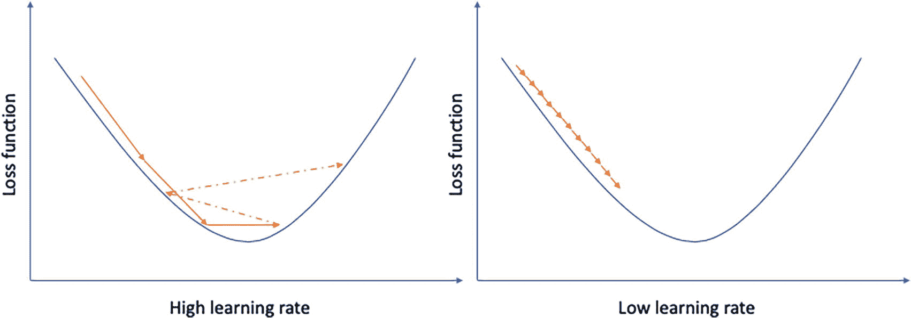

图 5-5

学习率

*   选择较高的学习率，你会下降得更快，但可能会错过曲线的底部。这在图 5-5 中用虚线表示。在这种情况下，模型开始产生混乱的结果。
*   然而，选择较低的学习率，你的模型将需要更多时间收敛到最优解。

当你的模型没有产生预期结果时，降低学习率并重新运行。这是一个超参数，可以根据你的数据和模型需求进行调整。另一种方法是使用自适应学习率。在这种情况下，学习率会根据曲线的斜率而变化。在模型训练初期，它从一个较高的学习率开始（当斜率较高时），随着沿斜率下降，学习率可以降低。这样，你可以更快地达到最优解，并兼得两者（高学习率和低学习率）的优点。自适应函数可以是线性的，也可以是数量级的。我们将在后面的章节中更详细地讨论自适应学习率。

#### 局部最小值与全局最小值

在图 5-6 中，你可以看到曲线真正的底部是全局最小值位置。使用梯度下降，你并不总能到达曲线的底部。根据初始参数的不同，模型可能从左侧或右侧开始下降。如果从右侧开始，它有很大机会达到全局最小值。然而，如果从左侧开始，它可能会陷入局部最小值，梯度下降操作就会停止。这是梯度下降的一个局限性。它无法区分局部最小值和全局最小值。你可以通过使用不同的超参数重新启动模型训练过程来避免这个问题。

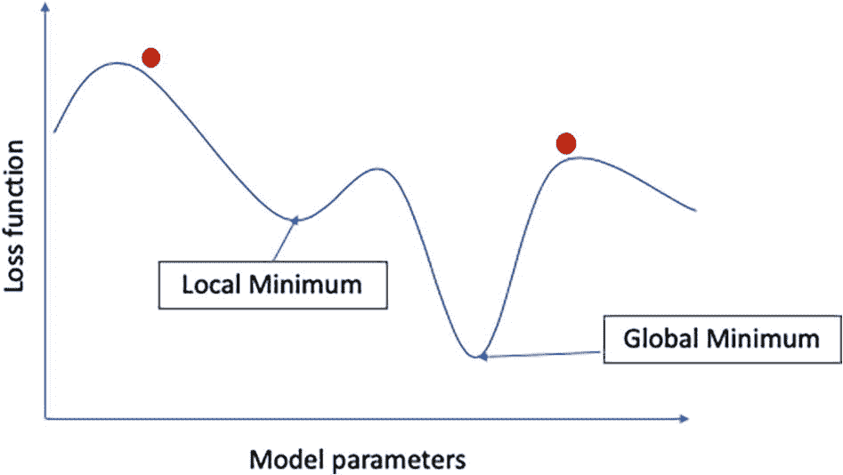

图 5-6

局部最小值与全局最小值

#### 模型训练时间

到目前为止，你应该知道，参数更新是在训练数据中的所有样本都经过梯度下降优化过程之后进行的。这种方法对于较小的数据集是可以接受的。然而，当处理数百万条记录时，梯度下降优化非常缓慢。随着数据量的增加，模型的训练时间会急剧增加。

#### 随机/小批量梯度下降

为了解决模型训练时间和局部最小值问题，我们来看一种梯度下降的变体。在随机梯度下降（SGD）中，参数更新是针对数据集中的每一个观测值进行的。如果你的数据集有 100 行，那么在一次遍历中，参数更新会发生 100 次。当数据集规模巨大时，这可以改善训练时间和模型收敛速度。此外，SGD 过程引入的随机性有助于模型逃离局部最小值，并达到全局（或更优的）最小值。尽管 SGD 有这些优点，但也存在一些缺点：

*   由于每次引入的随机性，优化器会采取有噪声的步骤来收敛到最小值。有时，这些有噪声的步骤可能会让你偏离方向，最终陷入某个局部最小值。
*   频繁的`SGD`更新计算成本很高。
*   `SGD`无法执行向量化更新，因为它一次只使用一个观测值。

梯度下降的另一个变体是小批量梯度下降。假设你的训练数据有 100 行。在一次遍历中，梯度下降使用所有 100 行进行一次权重更新，而`SGD`则对每个观测值进行一次权重更新（因此是 100 次）。有没有折中的办法？小批量梯度下降就是对这个问题的解答。在小批量梯度下降中，根据批量大小（例如，5），权重更新在每个批次处理完成后进行。在这个例子中，它会发生 20 次（100 行 / 5 批量大小 = 20）。一个最佳的批量大小可以帮助模型更快地训练并收敛到全局最小值。根据数据大小，一个好的默认批量大小是 32。显然，小批量梯度下降克服了`SGD`中列出的缺点。尽管如此，小批量梯度下降有时仍可能收敛到局部最小值，而不是全局最小值。

#### 动量

我们先来看一下动量优化器的公式，然后再详细讨论（见图 5-7）。

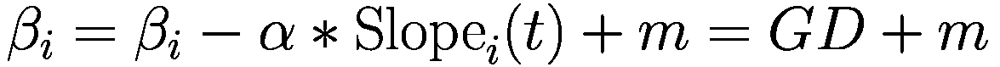

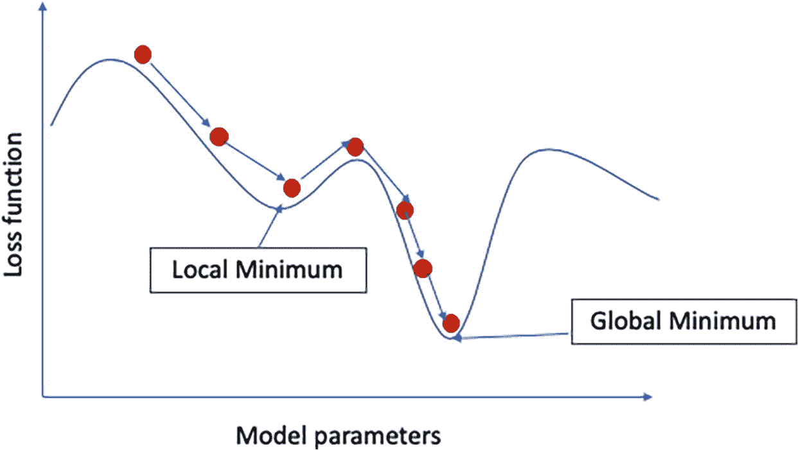

图 5-7

动量

我们来看一下公式

`m = w * (−α * Slope_i)`

其中

`i` = 变量`i`的模型参数

`(t)` = 当前更新

`GD` = 梯度下降

`m` = 动量值

`w` = 赋予上一次更新的权重（通常为 0.9）

`(t – 1)` = 上一次更新

为了克服局部最小值问题，你可以通过在梯度下降公式中添加一个动量分量来扩展它。你可以把动量想象成让一个球滚下山坡。球在下坡过程中会获得动量。即使球在途中遇到一个小凹陷（局部最小值），它仍然会继续滚动，直到到达一个平坦的表面（全局最小值）。如果没有动量，球会以恒定速度滚动，最终会停在小凹陷（局部最小值）里。有了动量，你就融入了球正在向下移动的知识。这是通过添加球在上一步滚动时的速度来实现的。权重分量（`w`）决定了赋予上一步的权重大小。`w`是一个超参数，可以针对最佳结果进行调整。

#### AdaGrad（自适应梯度）优化器

你也可以通过使用自适应学习率来逃离局部最小值。我们之前讨论过这个概念；在本节中，你将看到具体的细节。自适应梯度是通过将学习率除以一个指数递增的参数（`G_i`）来实现的。如下式所示：


而`G_i`由下式给出：

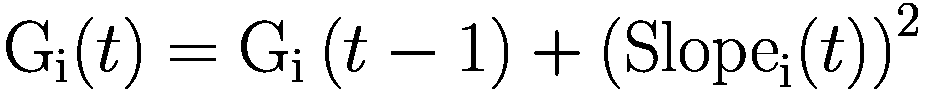

在初始模型训练时，`G_i = 0`。

斜率项始终为正，因此`G_i`在每次迭代中持续增加。由于你将学习率除以一个递增的数，学习率会持续下降。这就是`AdaGrad`背后的核心理念。epsilon（`ε`）参数被设置为一个非常小的值，以避免除以零。这确保了即使`G_i(t)`变得非常小，除法运算也能保持稳定，从而使`AdaGrad`能够可靠地运行。

#### 均方根传播（RMSprop）优化器

`RMSprop`是`AdaGrad`优化器的一个变体。请看下面的公式：

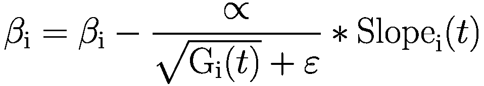

更新规则仍然相同。然而，变化体现在`G_i`参数上，如下所示：

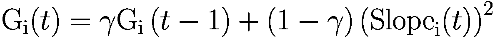

在初始模型训练时，`G_i = 0`。

`RMSprop`和`AdaGrad`之间的区别来自于 Gamma 参数（`γ`）。这是另一个可以优化的超参数。通常，`γ`的值设置为 0.9。`γ`参数为梯度分量引入了移动平均。由于你取的是移动平均的平方根，因此这个优化器被称为均方根优化器。

#### 自适应矩估计（Adam）优化器

自适应矩估计结合了`RMSprop`和动量，因此得名。这有助于通过一个优化器实现动量和学习率调度（自适应学习率）。更新公式如下：

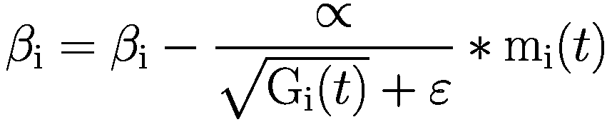

其中`m_i`是动量分量，使用以下公式计算：

`m_i = w ∗ m_i + (1 − w) ∗ Slope_i`

在初始模型训练时，`m_i = 0`。

`w`是动量公式中使用的权重参数。因此，`m_i`是一阶矩估计，而`G_i`是二阶矩估计。

#### 快速回顾

*   误差函数也称为损失函数。
*   当你到达损失函数的底部时，模型误差最小。此时，模型能更好地拟合数据。
*   你可以使用诸如梯度下降之类的优化器来最小化误差函数。
*   局部最小值和全局最小值问题可以通过添加动量或调整学习率来解决。在某些情况下，你可以同时改变动量和学习率。

## 激活函数

算法中的另一个组件是激活函数。理解激活函数的一个简单方法是观察生物神经元。当身体需要能量时，大脑会激活食物神经元。然后这个人就会想，“我想吃东西。”大脑通过激发这些激活信号来与这个人沟通，并促使他们据此采取行动。见图 5-8。

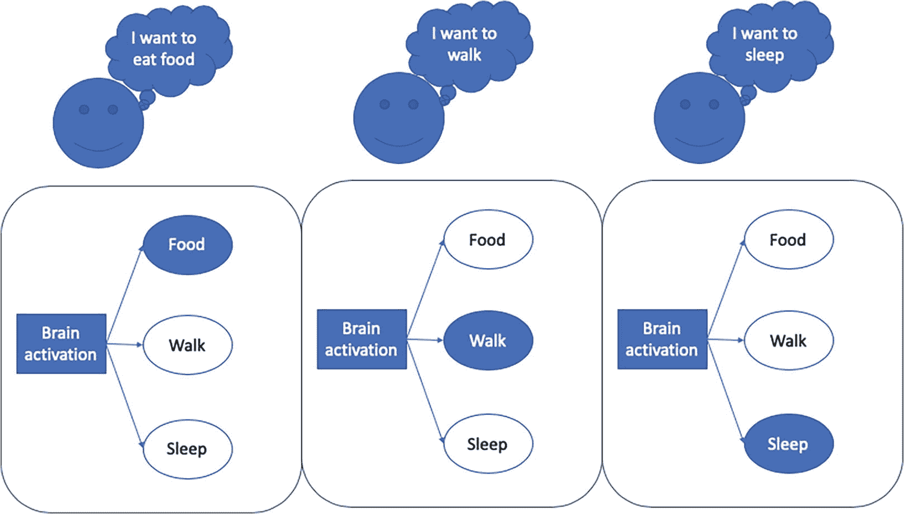
图 5-8 激活函数示意图

类似地，激活函数可以用来开启/关闭算法在训练过程中执行的某些操作。以下各节将详细讨论每一种激活函数。

### 线性激活函数

在线性激活中，输入数据不经任何改变直接传递。它由以下公式表示：

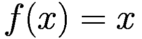

其中 `x` 是输入给激活函数的值。该函数的导数 `f'(x)` 等于 1。导数在反向传播中执行梯度下降更新时非常有用。我们将在后面的章节讨论反向传播。线性函数无法学习非线性数据类型（见图 5-9）。接下来的章节将从 Sigmoid 开始讨论非线性函数。

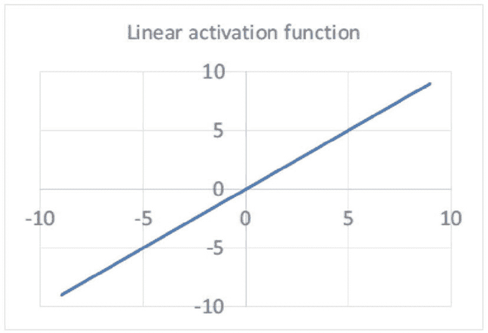
图 5-9 线性激活函数

### Sigmoid 激活函数

在 Sigmoid 函数中，输出被压缩在 0 和 1 之间，使用以下公式（见图 5-10）：

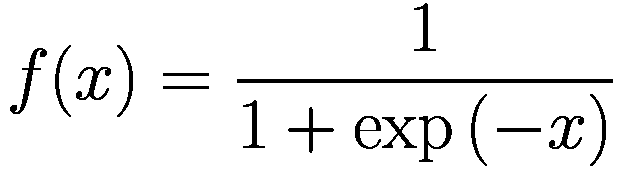

你可以使用自定义的阈值将 `f(x)` 值转换为开/关信号，如下所示：

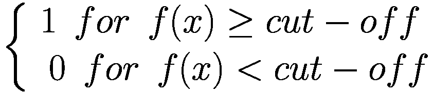

在二分类问题中，大多数算法使用 0.5 作为阈值。你可以根据具体需求调整它。该函数的导数为：

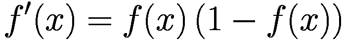

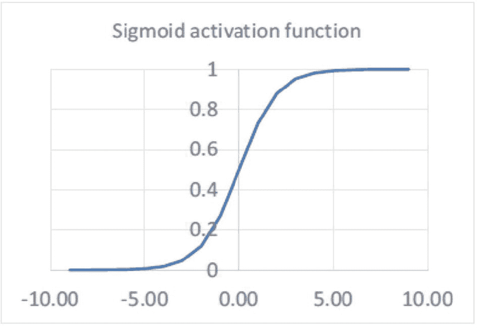
图 5-10 Sigmoid 函数

### 双曲正切函数（TanH）

在 TanH 函数中，输出值通过以下公式被压缩在 -1 到 1 之间（见图 5-11）：

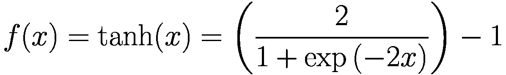

与 Sigmoid 函数类似，你可以使用自定义阈值（默认为 0）将输出转换为 0/1 的二值输出。该函数的导数为：

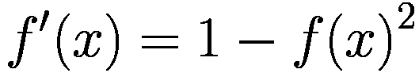

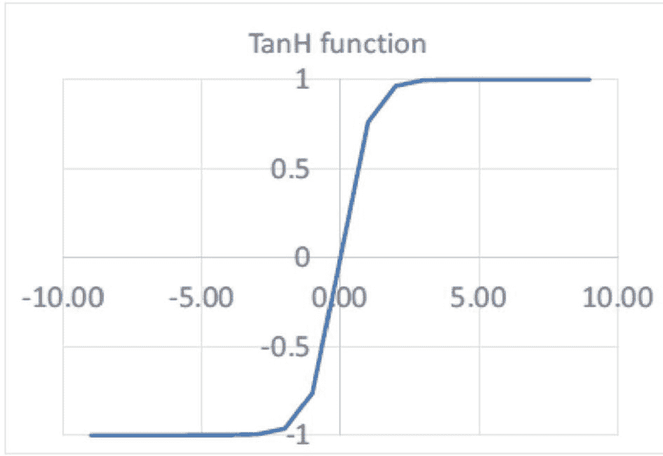
图 5-11 TanH 函数

### 修正线性单元函数（ReLu）

修正线性单元（ReLu）在输入为正时直接输出该输入（见图 5-12），否则输出零。这种修正线性激活函数克服了梯度消失问题，使模型能够更快地学习并获得更好的性能。

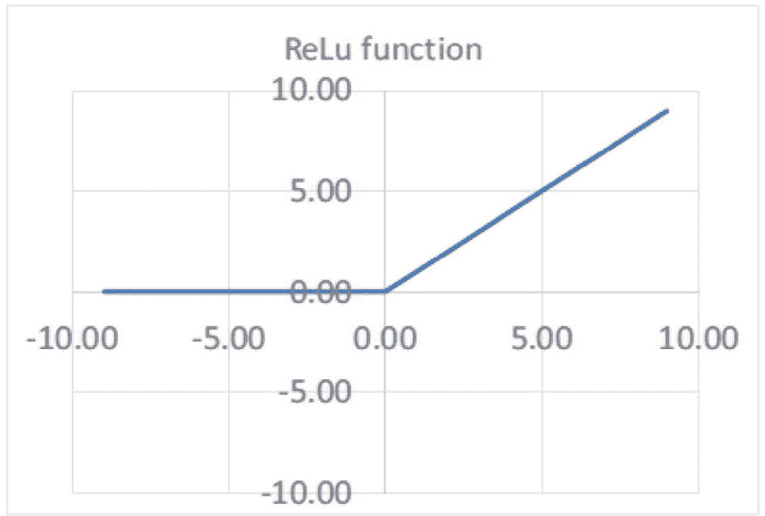
图 5-12 ReLu 函数

Sigmoid 和 TanH 函数的一个问题是，对于某些深层模型，其导数容易趋近于零。这会导致模型参数无法更新。ReLu 可用于解决此问题。在 ReLu 函数中，对于 `x` 的负值，输出为零；对于 `x` 的正值，输出与 `x` 相同。

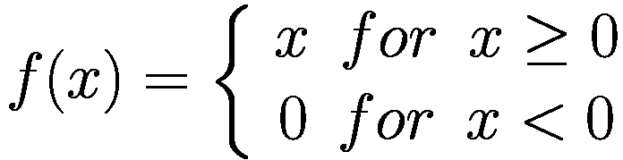

该函数的导数为：

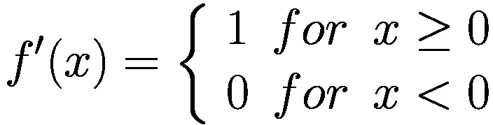

### 带泄露的 ReLu 或参数化 ReLu 函数

带泄露的 ReLu 与 ReLu 函数类似，但有一个微小的调整。进行调整的原因是，ReLu 函数有时会遇到“神经元死亡”问题，即在训练过程中某些神经元可能永久失活。

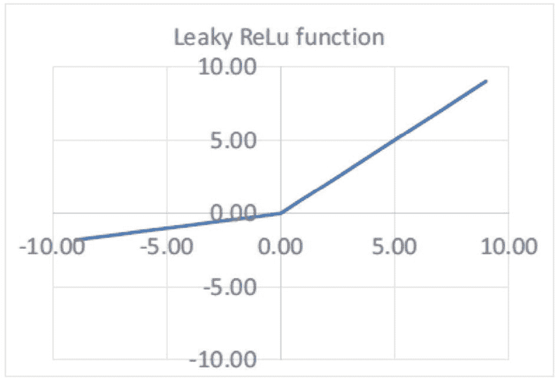
图 5-13 带泄露的 ReLu

在带泄露的 ReLu 函数中，对于 `x` 的负值，输出是 `x` 乘以一个常数因子；对于 `x` 的正值，输出与 `x` 相同（见图 5-13），其中 `α` 是常数因子。

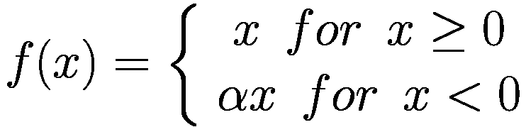

该函数的导数为：

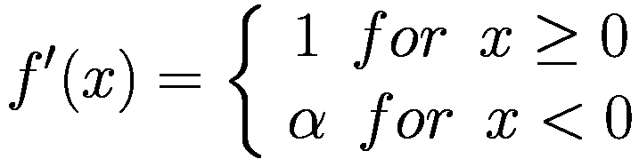

### Swish 激活函数

这是一个相对较新的激活函数，由 Google 团队于 2017 年提出。研究表明，用 Swish 函数替换 ReLu 函数后，`ImageNet` 模型的分类准确率提升了 0.9%，`Inception_ResNet-v2` 模型的分类准确率提升了 0.6%（见图 5-14）。该函数的公式如下：

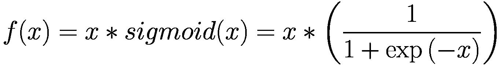

该函数的导数为：

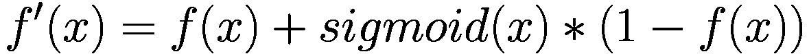

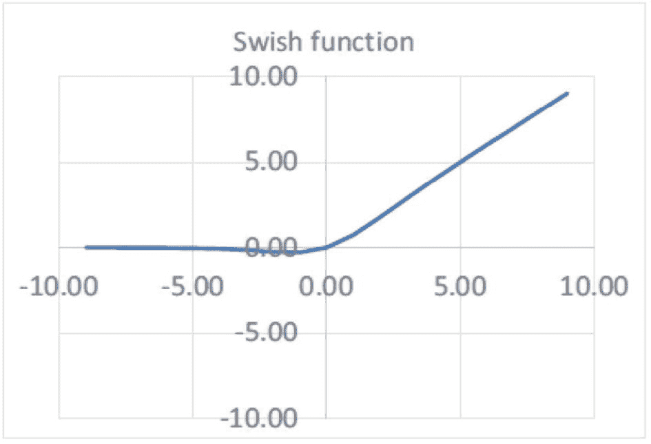
图 5-14 Swish 函数

### Softmax 函数

该函数的公式为：

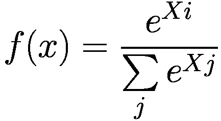

当类别数为三，且 `x` 值为 `[5, 4, 3]` 时，`f(x)` 的计算结果如下：

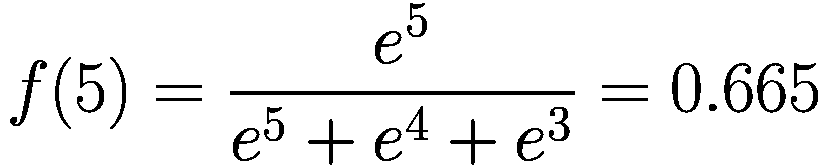

其他类别的值分别为 0.24 和 0.09。该激活函数用于多标签分类问题。概率最高的类别被选为最终输出。在此例中，模型将选择“类别 1”作为输出。

## 批量归一化

我们已经讨论了在模型训练过程中使用小批量（mini-batch）的优势。然而，当各批次间的输入分布发生变化时，情况会变得棘手。这会导致算法需要更长的训练时间才能达到最优解。你可以使用批量归一化来解决这个问题。其概念很简单：对每个批次的输入数据进行标准化，然后模型在标准化后的批次数据上进行训练。这将使模型的学习过程更加稳定，并且算法收敛速度会快得多。在训练深度神经网络时，这一概念尤为强大。

## Dropout

有时，模型在训练过程中可能会过度强调单个输入而忽略其他输入。这可能导致过拟合（我们将在下一章探讨此概念）并在学习过程中引入偏差。当你使用连续变量和二元输入变量来训练模型时，这种情况经常发生。假设你有 `age` 和 `gender` 作为输入。在这种情况下，模型会赋予 `age` 更高的权重，因为它具有更多唯一值，而不会给 `gender` 类似的权重。为了克服这个问题，你可以使用一种称为 `dropout` 的正则化技术。在训练过程中，部分隐藏层（神经网络）的输出会被随机丢弃。这样，算法就不会总是依赖 `age` 变量来预测输出，从而避免偏差和过拟合。

## 监督式机器学习算法

现在你已经学习了所有相关概念。本节将深入探讨每一种机器学习算法。整个部分都使用银行数据集。以下起始代码适用于所有机器学习算法。

```python
# 读取数据
filename = "bank-full.csv"
from pyspark.sql import SparkSession
spark = SparkSession.builder.getOrCreate()
data = spark.read.csv(filename, header=True, inferSchema=True, sep=';')
data.show()
# 组装特征向量
from pyspark.ml.feature import VectorAssembler
# 将各个列组装成一个列 - 'features'
def assemble_vectors(df, features_list, target_variable_name):
    stages = []
    # 组装向量
    assembler = VectorAssembler(inputCols=features_list, outputCol='features')
    stages = [assembler]
    # 选择所有列 + 目标列 + 新创建的 'features' 列
    selectedCols = [target_variable_name, 'features'] + features_list
    # 使用管道按顺序处理
    pipeline = Pipeline(stages=stages)
    # 组装器模型
    assembleModel = pipeline.fit(df)
    # 在数据上应用组装器模型
    df = assembleModel.transform(df).select(selectedCols)
    return df
```

### 线性回归

线性回归用于预测连续型结果，例如房价或客户终身价值。该算法假设输入与输出之间的关系是线性的。当使用一个输入来预测输出时，称为`简单线性回归`。当使用多个输入来预测输出时，称为`多元线性回归`。该概念如图 5-15 所示。

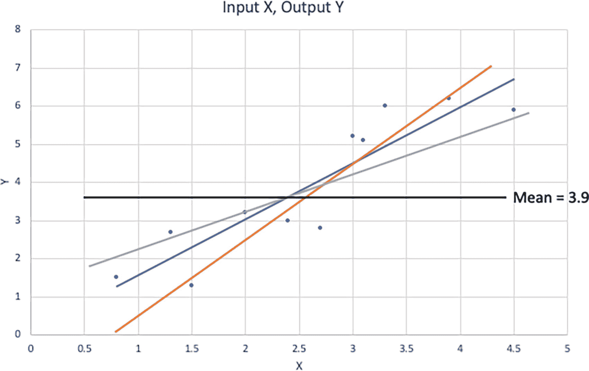

图 5-15 线性回归

观察该图，哪条线更贴合数据？目标是基于`X`值获得对`Y`的最佳估计。在此场景中，蓝色线比其他所有线条都更贴合数据。黑色线是`Y`值的均值，在此例中为 3.9。其他线条（橙色和灰色）拟合效果不佳。那么，我们是如何得出这个结论的呢？我们使用平方误差算法计算每条线的误差，并选择了误差最小的那条线。这些步骤用于识别一个简单线性回归模型。由于我们寻找的是具有最小平方误差的直线，因此这也被称为普通最小二乘法或`最小二乘回归`。默认情况下，`PySpark`使用`平方误差`作为损失函数。线性回归可以用以下方程表示：

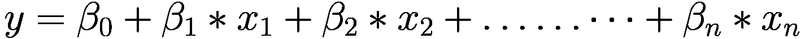

其中`β`[0] 是截距，`n` 是线性回归模型中变量的数量。让我们使用 `PySpark` 拟合一个线性回归模型并分析输出结果。目标变量是 `balance`，输入变量是其余连续变量：`age`、`day`、`duration`、`campaign`、`pdays` 和 `previous`。

```
#选择变量
linear_df = data.select(['age', 'balance', 'day', 'duration', 'campaign', 'pdays', 'previous'])
target_variable_name = 'balance'
#排除目标变量并选择所有其他特征向量
features_list = linear_df.columns
#features_list = char_vars #此选项仅用于 ChiSqselector
features_list.remove(target_variable_name)
# 对我们的 DataFrame 应用函数
df = assemble_vectors(linear_df, features_list, target_variable_name)
# 拟合回归模型
from pyspark.ml.regression import LinearRegression
reg = LinearRegression(featuresCol='features', labelCol='balance')
reg_model = reg.fit(df) # 拟合模型
# 查看每个变量的系数和截距
import pandas as pd
for k, v in df.schema["features"].metadata["ml_attr"]["attrs"].items():
features_df = pd.DataFrame(v)
# 打印系数和截距
print(reg_model.coefficients, reg_model.intercept)
features_df['coefficients'] = reg_model.coefficients
# 预测结果
pred_result = reg_model.transform(df)
```

回归系数如图 5-16（`features_df` 数据集）所示。

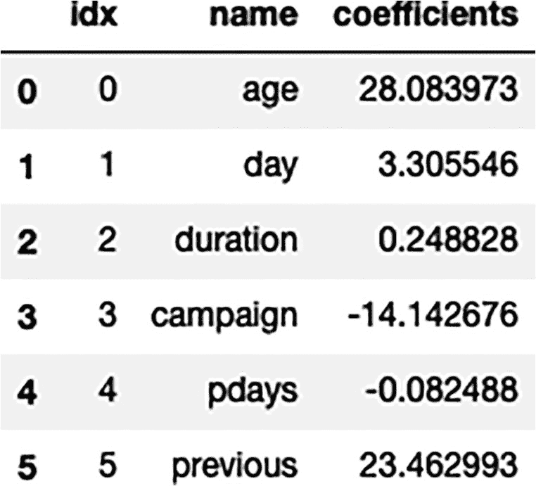

图 5-16 回归系数

要用方程表示该模型，可以写成如下形式：

```
Predicted_balance = 124.92 + 28.08 * age + 3.30 * day +
0.25 * duration + -14.14 * campaign
-0.08 * pdays + 23.46 * previous
```

#### 解释线性回归模型

让我们看看模型中 `age` 变量的显著性。为此，我们为每个输入取一些示例值，并将其代入上述方程。

```
{Age:33, day:5, duration:76, campaign:1, pdays:-1, previous:0}
Predicted_balance = 124.92 + 28.08 * 33 + 3.30 * 5 +
0.25 * 76 + -14.14 * 1
-0.08 * -1 + 23.46 * 0 = 1073
```

完美。现在，我们将年龄值增加到 34，并保持其他变量不变。再次进行相同的计算，我们得到：

```
Predicted_balance = 1101.8
因年龄增加导致的预测差异 = 1101.8 – 1073 = 28.08
```

现在你可以看到年龄的影响。通俗地说，当年龄增加 1 时，预测的余额增加 28（四舍五入后的值），反之亦然。这很容易转化为业务逻辑，并可以基于此值做出决策。你可以类似地解释其他输入变量。解释线性回归模型时需要考虑的主要事项如下：

1.  除了你试图解释的变量外，保持所有其他变量不变。
2.  选取该输入变量的系数，并用通俗的语言进行解释。

完美。然而，这里存在一个小问题，接下来讨论。

#### 多重共线性

在解释回归模型时，除了一个变量外，你保持所有其他变量不变。如果你试图解释的变量与数据集中的另一个输入变量相关，该怎么办？例如，假设数据中的 `age` 和 `duration` 是相关的。在这种情况下，当你增加 `age` 变量时，`duration` 值也会增加。在这种情况下，你无法保持 `duration` 变量不变。因此，解释性在此过程中丢失了。这个问题被称为`多重共线性`。

当两个或多个变量相关时，模型结果无法解释。在线性回归模型中，你应该避免多重共线性问题。否则，模型输出是无效的。

你可以使用方差膨胀因子（`VIF`）来检查多重共线性。`VIF` 值的行业标准是 10。你可以根据需求调整此值。当 `VIF` 值为 1 时，输入特征完全不相关。`PCA` 组件的 `VIF` 通常接近 1。在最终模型中，你应该包含 `VIF` 值小于 10 的输入变量。计算 `VIF` 的公式如下：

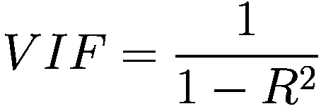

`PySpark` 中计算 `VIF` 的代码如下：

```
def vif_calculator(df, features_list):
vif_list = []
for i in features_list:
temp_features_list = features_list.copy()
temp_features_list.remove(i)
temp_target = i
assembler = VectorAssembler(inputCols=temp_features_list, outputCol='features')
temp_df = assembler.transform(df)
reg = LinearRegression(featuresCol='features', labelCol=i)
reg_model = reg.fit(temp_df) # 拟合模型
temp_vif = 1/(1 - reg_model.summary.r2)
vif_list.append(temp_vif)
return vif_list
features_df['vif'] = vif_calculator(linear_df, features_list)
print(features_df)
```

注意

这里提供的是 `linear_df` 而不是 `df`。请确保数据集没有名为 `features` 的列。否则，此函数将抛出错误。

所有输入的 `VIF` 都小于十（见图 5-17）。因此，模型特征中不存在多重共线性问题。当你想找到能产生最佳线性回归模型的最佳特征子集时，你需要查看马洛斯 `Cp` 因子。这个概念超出了本书的范围。下一章将探讨验证回归模型并选择最佳模型的不同方法。

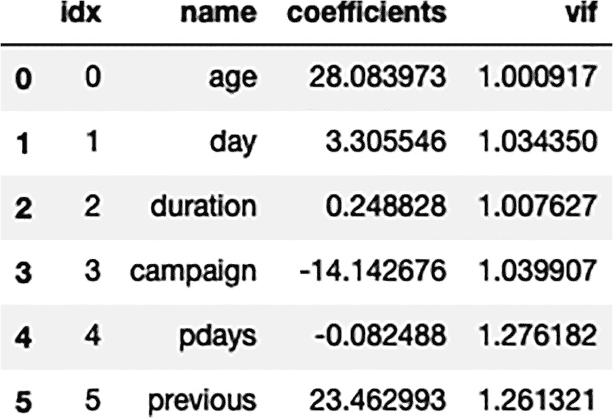

图 5-17 `VIF`

### 逻辑回归

逻辑回归是一种分类算法。你可以使用该算法来预测二元结果，例如某人是否会购买某物、是否流失、是否为垃圾邮件等。与线性回归类似，它会在数据上拟合一条线来区分二元结果。然而，最佳拟合线是基于最大似然估计来确定的。首先，我们来看一下逻辑回归模型的方程：

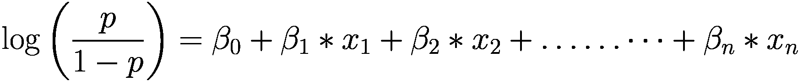

逻辑回归的方程与线性回归的方程在左侧部分有所不同。这个部分，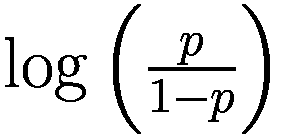，被称为`对数几率`。为什么是`对数几率`？请看图 5-18。

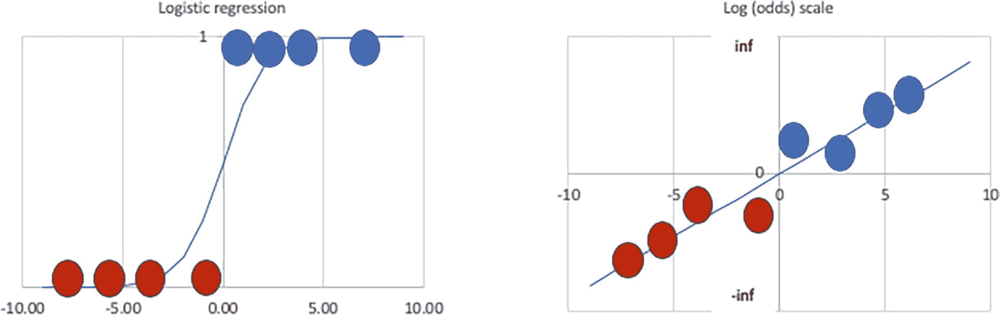

图 5-18

逻辑回归尺度与对数几率尺度对比

图 5-18 的左侧显示了你要拟合回归线的数据。通过将 0/1 尺度转换为`对数几率`尺度，你可以将数据映射到 (-∞, +∞) 的范围内。在这个尺度下，逻辑回归拟合出最佳直线。

```
Log(odds) 正数范围 = log(1/0) = log(1) – log(0) = +∞
Log(odds) 负数范围 = log(0/1) = log(0) = -∞
Log(odds = 0.5) = Log(0.5/0.5) = log(1) = 0
```

因此，0.5 的概率是中点。如前所述，最佳拟合是基于最大似然估计确定的。那么，它是什么呢？

#### 最大似然估计或最大对数似然 (MLE)

你选择一条候选直线，如图 5-19 右侧所示，并将你的数据点投影到这条线上。在这个过程中，你会根据这条线为每个数据点得到一个 `log(odds)` 值。你将 `log(odds)` 转换为概率尺度，以便将拟合的直线转换为类似左侧所示的 `Sigmoid` 函数。这是通过以下方程完成的：

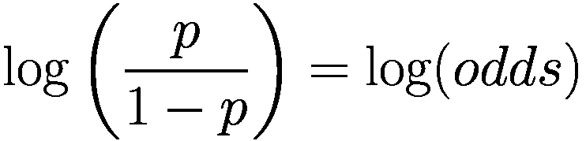

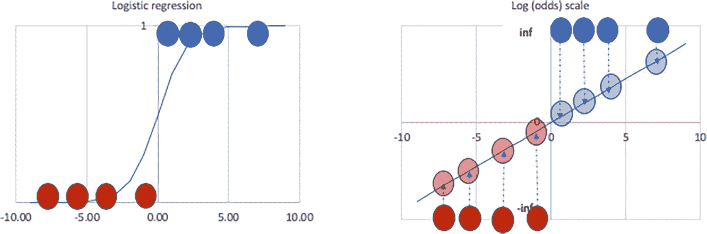

图 5-19

最大似然估计

你选择一条候选直线，如图右侧所示

这意味着

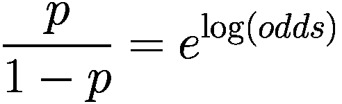

解这个方程，你得到

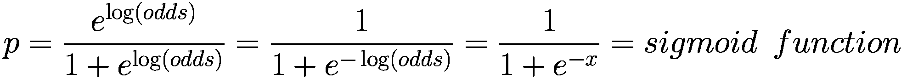

其中，`x` = `log(odds)`。你得到了每个观测值的概率值。让我们开始计算这条线的 `MLE`。

注意：在 `MLE` 计算过程中，当目标值为 1 时使用 `p`，当目标值为 0 时使用 1 - `p`。

```
似然 = 概率(第 1 个观测值) * 概率(第 2 个观测值) * ..... 概率(第 n 个观测值)
```

其中 `n` 是数据中观测值的总数，`prob` 是概率。两边取对数，得到以下结果：

```
对数似然 = log (概率 第 1 个) + log (概率 第 2 个) + ...... + log (概率 第 n 个)
```

这就是你在逻辑回归中试图最大化的方程。因此，你将这个过程称为最大对数似然估计。你通过旋转 `log(odds)` 直线并每次计算 `log(likelihood)` 来重复这个过程。最终，使 `log(likelihood)` 结果最大化的那条直线就是最佳拟合线。

#### 如何旋转直线以找到最佳拟合？

可以使用求解器来旋转直线，使其朝着最大化 `MLE` 值的方向旋转，并减少获得合适拟合所需的迭代次数。在 `PySpark` 中，默认的求解器是 `lbfgs`，也称为有限内存 `BFGS`。

#### 二元分类与多项分类

`Sigmoid` 函数由以下公式给出：

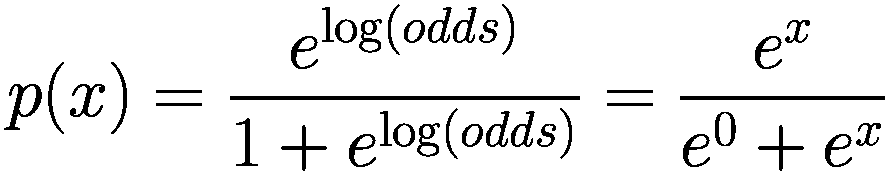

这里，`e`⁰ 对应于基线模型，即二元结果中的 0 类。`e`^(`x`) 对应于 1 类。类似地，你可以将相同的公式应用于多类问题。假设你有类别 `a`、`b` 和 `c`。每个类别的概率由下式给出：


对于其他类别，相应的 `e` 元素会出现在分子中。这就是前面讨论过的 `SoftMax` 函数。现在，你知道了 `Sigmoid` 和 `SoftMax` 之间的联系。二元分类与多类分类的另一个考虑因素是链接函数。通常，对于二元目标，你使用 `logit` ( 链接函数。对于多项分类，你可以对名义目标使用 `probit`，对有序目标使用 `clog-log`。在 `PySpark` 中，你可以通过在逻辑回归算法中设置 `family` 选项来完成二元或多项拟合。

## PySpark 代码

在本练习中，银行数据集的目标变量是 `y`，输入预测变量包括 `age`、`balance`、`day`、`duration`、`campaign`、`pdays` 和 `previous`。目标变量 `y` 是一个二分类变量。


```
target_variable_name = "y"
logistic_df = data.select(['age', 'balance', 'day', 'duration', 'campaign', 'pdays', 'previous', 'y'])
#排除目标变量并选择所有其他特征向量
features_list = logistic_df.columns
#features_list = char_vars #此选项仅用于 ChiSqselector
features_list.remove(target_variable_name)
# 对我们的数据框应用函数
df = assemble_vectors(logistic_df, features_list, target_variable_name)
# 使用字符串索引器。为了解决这个问题，我们必须执行此步骤
indexer = StringIndexer(inputCol='y', outputCol='y_index', handleInvalid='skip')
indexerModel = indexer.fit(df)
# 使用拟合的 StringIndexer 模型转换数据框
df = indexerModel.transform(df)
# 删除现有的"y"列，以便将新的"y_index"列重命名为"y"
df = df.drop(df.y)
# 将新的"y_index"列重命名为"y"
df = df.withColumnRenamed('y_index', 'y')
```

我们使用同一个目标变量展示了二项式和多项式拟合，尽管当目标变量类别超过两个时，更推荐使用多项式拟合。

```
# 展示二项式和多项式拟合的示例。
# 当目标变量类别超过两个时，优先使用多项式拟合。
import numpy as np
from pyspark.ml.classification import LogisticRegression
binary_clf = LogisticRegression(featuresCol='features', labelCol='y', family='binomial')
multinomial_clf = LogisticRegression(featuresCol='features', labelCol='y', family='multinomial')
binary_clf_model = binary_clf.fit(df) # 拟合二项式模型
multinomial_clf_model = multinomial_clf.fit(df) # 拟合多项式模型
np.set_printoptions(precision=3, suppress=True)
#二项式模型的系数
print(binary_clf_model.coefficients)
#多项式模型的系数
np.set_printoptions(precision=4, suppress=True)
print(multinomial_clf_model.coefficientMatrix)
print(binary_clf_model.intercept) #二项式模型的截距
#多项式模型的截距
print(multinomial_clf_model.interceptVector)
```

二项式模型的方程如下：

```
log(odds class1) = -3.47 + 0.008*age + 0*balance -0.0017*day + 0.0036*duration - 0.128*campaign + 0.0021*pdays + 0.0859*previous
```

类似地，多项式模型的方程如下：

```
log(odds class0) = 1.735 -0.004*age – 0*balance + 0.0008*day - 0.0018*duration + 0.064*campaign - 0.0011*pdays - 0.043*previous
```

以及

```
log(odds class1) = -1.735 +0.004*age + 0*balance - 0.0008*day + 0.0018*duration - 0.064*campaign + 0.0011*pdays + 0.043*previous
```

在多项式模型的输出中，当你用类别 0 的系数减去类别 1 的系数时，你会得到类别 1 的二项式模型系数。截距也是如此。好了，现在我们来解释模型结果。

### 解释模型结果

你遵循与解释线性回归系数相同的过程——保持所有其他变量不变，只改变你试图解释的变量。

#### 二分类变量解释

对于二分类变量，你使用上述方程计算两个类别的 `log(odds)`。例如，假设你的模型中包含性别（男性 = 0，女性 = 1）。那么，性别的影响通过以下方式衡量：

```
log(odds class 1|Male) = Intercept + 0.16 * 0 + coef2 * var2 + ......
log(odds class 1|Female) = Intercept + 0.16 * 1 + coef2 * var2 + ......
log(odds class 1|Female) - log(odds class 1|Male) = 0.16
```

通过保持所有其他因素不变，你得到二分类变量的系数作为 `log(odds)` 的差值。解释系数的最佳方法是使用优势比。让我们来操作一下。


你取上述值与 1 的差值来解释优势比。女性属于类别 1 的优势比男性属于类别 1 的优势高出 17%。

#### 连续变量解释

让我们用 `age` 进行同样的计算。


```
log(odds class 1|Age = 29) = Intercept - 0.32 * 29 + coef2 * var2 + ......
log(odds class 1|Age = 30) = Intercept – 0.32 * 30 + coef2 * var2 + ......
log(odds class 1| Age = 30) - log(odds class 1| Age = 29) = -0.32
```

现在，1 – 0.73 = 0.27。当年龄增加一个单位时，一个人属于类别 1 的优势降低了 27%。

以下是解释优势比的经验法则：

1.  优势比为 1 意味着影响没有差异。
2.  优势比大于 1 意味着随着变量的变化，优势增加。
3.  优势比小于 1 意味着随着变量的变化，优势减少。

### 决策树

到目前为止，我们已经讨论了用于回归和分类的线性方法。本节讨论可用于解决问题的非线性方法。总体而言，决策树背后的思想是生成一组“如果-那么规则”，并以树的形式表示它们。让我们可视化一个用于信用卡审批的简单决策树。

#### 决策树解读

-   树的根/父节点是`age`变量。因此，它是该决策树最重要的特征。
-   叶节点是基于输入变量可以做出的决策。

让我们根据这些条件遍历树（见图 5-20）。


**图 5-20** 信用卡审批决策树

| `Age = 20, occupation = Student, Credit score = 800` | `Age = 35, occupation = Employed, Credit score = 750` |
| --- | --- |
| `Age < 25; TrueStudent? True` | `Age < 25; FalseAge < 60; TrueCredit Score > 720` |
| 最终裁决 = 未批准 | 最终裁决 = 批准 |

你可以看到`age`是最重要的属性。决策树是如何选择这个变量的？为了理解原因，我们需要介绍基尼系数、熵和信息增益。让我们逐一回顾它们（见表 5-3）。

**表 5-3** 算法规范

| 算法/分裂准则 | 树类型 |
| --- | --- |
| **基尼不纯度** | CART（分类与回归树） |
| **熵和信息增益** | ID3/C4.5（迭代二分器 3/C4.5 是 ID3 的扩展，并使用增益率） |

对于这个练习，我们使用表 5-4 中所示的数据集。数据目标是信用卡审批，有两个级别：批准和未批准。

**表 5-4** 练习数据集

| 年龄 | 性别 | 批准/未批准 |
| --- | --- | --- |
| **30** | 男 | 未批准 |
| **25** | 女 | 批准 |
| **45** | 男 | 批准 |
| **57** | 女 | 未批准 |
| **27** | 男 | 批准 |
| **54** | 女 | 批准 |
| **35** | 女 | 未批准 |

#### 熵

熵是衡量数据随机性的指标。计算熵的公式为：


其范围在 0 到 1 之间。当没有随机性时，熵为 0；当数据集完全随机时，熵为 1。为了理解熵，请考虑以下示例。

你有两个袋子。第一个袋子里有四个蓝球，没有红球。第二个袋子里有两个蓝球和两个红球。计算两个袋子中的熵。

**袋子 1 的熵**

```
Probability of picking blue ball in bag 1 = 4/4 = 1
Probability of picking red ball in bag 1 = 0/4 = 0
Entropy = - (1 * log(1) + 0* log(0)) = 0
```

**袋子 2 的熵**

```
Probability of picking blue ball in bag 2 = 2/4 = 0.5
Probability of picking red ball in bag 2 = 2/4 = 0.5
Entropy = - (0.5 * log(0.5) + 0.5* log(0.5)) = 1
```

让我们扩展这个例子，给你一个选择袋子的机会。当你抽到蓝球时你就赢了。你会选择哪个袋子？

答案显而易见，对吧？你会选择第一个袋子，因为它全是蓝球。当熵为 0 时，你对结果确定无疑；而当熵为 1 时，结果是随机的。这种方法论在机器学习中用于构建决策树。

让我们回到示例数据，计算`age`和`gender`的熵。这次我们计算被批准的概率。为了演示，我们将`age`变量分成两部分——30 岁以上和 30 岁以下。

**目标变量（批准/未批准）的熵——父节点熵：**

```
Probability of approved = 4/7 = 0.57
Probability of not approved = 3/7 = 0.43
Entropy of parent node = - (0.57 * log(0.57) + 0.43 * log(0.43)) = 0.99
```

**年龄变量的熵：**

```
Probability of approved when age >= 30 = 2/5 = 0.4
Probability of not approved when age >= 30 = 3/5 = 0.6
Probability of approved when age < 30 = 2/2 = 1
Probability of not approved when age < 30 = 0/2 = 0
Entropy(Age >= 30) = - (0.4 * log(0.4) + 0.6* log(0.6)) = 0.97
Entropy(Age < 30) = - (1 * log(1) + 0 * log(0)) = 0
```

**性别变量的熵：**

```
Probability of approved when female = 2/4 = 0.5
Probability of not approved when female = 2/4 = 0.5
Probability of approved when male = 2/3 = 0.67
Probability of not approved when male = 1/3 = 0.33
Entropy(Gender = Female) = - (0.5 * log(0.5) + 0.5* log(0.5)) = 1
Entropy(Gender = Male) = - (0.67 * log(0.67) + 0.33 * log(0.33)) = 0.92
```

#### 信息增益

到目前为止，我们已经计算了每个变量的熵。现在是时候确定哪个变量进入根/父节点了。为了做出这个决定，我们使用信息增益。信息增益告诉你每次分裂中获得的知识量。你试图最大化关于信用卡审批的知识。因此，你将尝试最大化每次分裂中的信息增益。它使用以下公式计算：

```
Information Gain, IG = Entropy (parent node) – (Entropy each child node * proportion of observations in each child node)
```

现在计算每个变量的信息。由于五个观测值属于`age >= 30`，两个观测值属于`age < 30`，信息增益为：

```
IG (age >= 30)  = 0.99 – (0.97 * 5/7 + 0 * 2/7) = 0.29
```

类似地，`gender`的 IG 为：

```
IG gender = 0.99 – (1 * 4/7 + 0.92 * 3/7) = 0.02
```

`age`变量的信息增益高于`gender`变量。因此，我们选择`age`作为根节点。我们可以基于这个条件开始构建树（见图 5-21）。


**图 5-21** 信息增益第一次分裂

基于当前模型，当一个人的年龄小于 30 岁时，信用卡被批准。我们现在的工作是找出下一次分裂。我们将再次迭代相同的过程。对于`age`，这次我们将使用 45 作为分裂点。

```
Entropy (Age >=45) = - (0.67 * log(0.67) + 0.33 * log(0.33)) = 0.92
Entropy (Age < 45) = - (1 * log(1) + 0 * log(0)) = 0
IG (Age >= 45)  = 0.97 – (0.92 * 3/5 + 0 * 2/5) = 0.418
IG (Gender) = 0.97 – (0.92 * 3/5 + 1 * 2/5) = 0.018
```

再次，`age`的信息增益高于`gender`变量。因此，下一次分裂将如图 5-22 所示。


**图 5-22** 信息增益第二次分裂

对于下一次分裂，我们使用`age`作为 60 并重复该过程。

```
IG (age >= 60) = 0.92 – (0 * 0 + 0.92) = 0
IG (Gender) = 0.92 – (0 * 1/3 + 1 * 2/3) = 0.25
```

在这次分裂之后，只剩下两个观测值，并且由于两者都是女性，我们不能再使用`gender`。因此，我们基于`age`进行分裂，得到最终的树，如图 5-23 所示。


**图 5-23** 基于信息增益的最终树

就是这样。当你获得新数据时，你通过决策树来得到输出。ID3、C4.5 和 C5.0 决策树是使用熵/信息增益构建的。

### 基尼不纯度

接下来，我们来看另一种构建决策树的方法：基尼不纯度。不要将此概念与基尼系数混淆。基尼不纯度衡量的是分裂中的不纯度。其计算公式如下：


基尼不纯度的取值范围在 0 到 1 之间。

- 当值为 0 时，表示分裂是纯的，没有不纯度。
- 当值为 0.5 时，表示分裂是随机的，完全不纯。数据中两个类别出现的概率相等。
- 当某个子节点不包含任何数据点时，可能会出现大于 0.5 的值。在示例数据集中，当你考虑 `Age >= 60` 这个条件时，由于没有年龄大于 60 的数据点，该分裂的基尼不纯度将大于 0.5。

让我们通过红/蓝球的例子来计算基尼不纯度，以理解这个概念。

#### 基尼不纯度 – 袋子 1
```
Probability of picking blue ball in bag 1 = 4/4 = 1
Probability of picking red ball in bag 1 = 0/4 = 0
Gini = 1 - (1 * 1 + 0 * 0) = 0
```

#### 基尼不纯度 – 袋子 2
```
Probability of picking blue ball in bag 2 = 2/4 = 0.5
Probability of picking red ball in bag 2 = 2/4 = 0.5
Gini = 1 - (0.5 * 0.5 + 0.5 * 0.5) = 0.5
```

#### 基尼不纯度 – 空袋子
```
Probability of picking blue ball in empty bag = 0
Probability of picking red ball in empty bag = 0
Gini = 1 - 0 = 1
```

同样，当你需要选择一个袋子时，你会选择基尼不纯度为 0 的那个，因为你能确定结果。现在，我们将基尼概念应用于数据来构建决策树。我们遵循与熵相同的方法，计算每次分裂的不纯度。
```
Gini (Age >= 30) = 1 - (2/5 * 2/5 + 3/5 * 3/5) = 0.48
Gini (Age  = 30 = (5/7 * 0.48 + 2/7 * 0) = 0.34
Gini (Gender = Female) = 1 – (2/4 * 2/4 + 2/4 * 2/4) = 0.5
Gini (Gender = Male) = 1 = (1/3 * 1/3 + 2/3 * 2/3) = 0.44
Weighted Gini for Gender = (4/7 * 0.5 + 3/7 * 0.44) = 0.48
```

`age` 变量被用于树的第一次分裂。让我们继续这个过程并计算出最终的树。你将得到与使用熵和信息增益时完全相同的树。这是因为在年龄分裂时选择了特定的分箱方式。然而，情况并非总是如此。在现实世界的例子中，基于基尼不纯度的树会与基于熵和信息增益的树有所不同。分类与回归树（CART）就是使用基尼不纯度构建的。

### 方差

PySpark 用于创建决策树的另一种方法是方差。方差的计算公式为：


这个概念用于构建回归树。你可以通过选择每次分裂中能使方差最小化的变量来继续分裂树。决策树也可以使用其他标准来构建，比如卡方检验和相关性。其概念是相同的。在卡方检验中，你选择能使卡方值最大化的变量。对于相关性树，你选择能使相关性最小化的变量。这些概念超出了本书的讨论范围。

### 确定数值变量的分割点

在手动构建决策树时，我们为年龄使用了自定义的分割点。在决策树算法中，数值变量的处理方式不同。对于小型数据集，每个唯一值都被用作一个分割点。对于大型数据集，数值变量会被分箱到特定数量的分位数中。这可以通过决策树算法中的 `maxBins` 选项来设置。创建分位数后，每个分箱的平均值被用作分割点。例如，假设你为 `age` 变量选择了三个分箱，分箱后的分割点为 25、42 和 55。在每个分割点处计算信息增益或基尼不纯度，并选择能提供最佳结果的分割点进行分裂。对于所有数值变量，在每次分裂时都会重复此过程。

### 剪枝/停止准则

剪枝是指砍掉不需要的叶节点。这样做是为了保持模型简单并避免过拟合。我们将在下一章详细讨论过拟合。决策树容易过拟合。除非你加以控制，否则最终会得到一个记忆了训练数据的树。可以通过以下选项在树中进行剪枝：

- `maxDepth` – 树的深度是指从根节点到达叶节点所需的树遍历步数。默认情况下，树的最大深度为 5。
- `minInstancesPerNode` – 使用此选项指定每个子节点中必须存在的最小样本数。当你将此选项设置为 5，并且一次分裂产生的子节点包含少于 5 个观测值时，该分裂将不会发生。
- `minInfoGain` – 一次树分裂应提供至少达到此数值的信息增益。当信息增益小于此数值时，分裂将不会发生。
- `L1/L2 正则化` – 此选项可用于剪枝决策树。我们将在后续章节讨论。

### 决策树分类的 PySpark 代码

在线性回归和逻辑回归示例中使用的数据集分别重命名为 `continuous_df` 和 `binary_df`。
```python
from pyspark.ml.classification import DecisionTreeClassifier
clf = DecisionTreeClassifier(featuresCol='features', labelCol='y', impurity='gini') #基于基尼的模型
clf_model = clf.fit(binary_df)
clf2 = DecisionTreeClassifier(featuresCol='features', labelCol='y', impurity='entropy') #基于熵的模型
clf_model2 = clf2.fit(binary_df)
clf_model.transform(binary_df) #未来预测
# 基尼特征重要性
print(clf_model.featureImportances)
#输出 - (7,[0,2,3,4,5],[0.057,0.001,0.722,0.0006, 0.217])
print(clf_model2.featureImportances)
#输出 - (7,[0,2,3,4,5],[0.018,0.001,0.727,0.0004,0.254])
```
从上述输出可以看出，基尼方法和熵方法产生了一组相似的变量；然而，在现实世界中，每种方法产生的变量集和树结构将是不同的。

### 决策树回归的 PySpark 代码

要拟合回归树，必须将不纯度设置为方差。默认情况下，决策树回归使用方差方法。不幸的是，PySpark 不支持此设置。
```python
from pyspark.ml.regression import DecisionTreeRegressor
# 定义使用方差不纯度的决策树回归器
reg = DecisionTreeRegressor(featuresCol='features', labelCol='balance', impurity='variance')
reg_model = reg.fit(continuous_df)
print(reg_model.featureImportances) #特征重要性
reg_model.transform(continuous_df) #未来预测
```
与分类树类似，你可以解释输入变量的特征重要性。要查看决策树的 if-then 规则，可以使用以下代码：
```python
clf_model.toDebugString
reg_mode.toDebugString
```
你可以使用 Python 中的 `Graphviz`、`pydot` 或 `networkx` 包来绘制这些决策树规则。