# 使用决策树计算特征重要性

在上一章中，我们使用决策树计算了特征重要性。本节将介绍其计算过程。

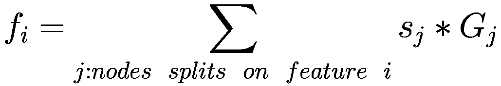

其中

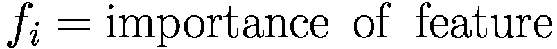

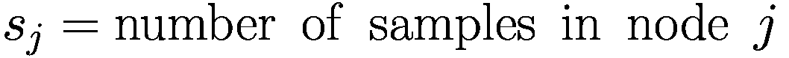

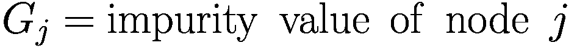

在每个节点，我们计算基尼不纯度，并将其乘以经过该节点的样本数量。如果一个变量在决策树中出现多次，则将每个节点的输出相加，得到该变量的最终特征重要性。最后，对每个变量的特征重要性进行归一化，使其总和为 1。这通过以下公式完成。假设你有 *n 个特征*，最终的特征重要性由下式给出：

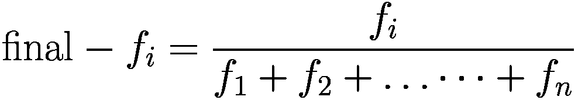

其中

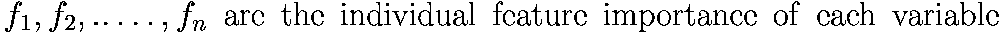

`f[i]` – 使用上述公式计算得到的第 *i* 个变量的特征重要性

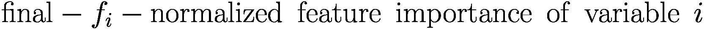

你需要知道，特征重要性是基于训练数据集计算的。因此，当模型过拟合时，特征重要性可能会有偏差。为了克服这个问题，你可以使用适当的验证技术，或使用排列重要性来计算特征重要性。我们将在下一章讨论验证技术。排列重要性的概念超出了本书的范围。现在，让我们继续学习其他基于树的技术。

## 随机森林

在决策树中，你基于训练数据构建一棵树。如果不只构建一棵树，而是构建多棵树并聚合每棵树的结果来得到最终预测，会怎么样？这就是随机森林背后的思想。*随机森林*是一种基于称为装袋（bagging）的概念构建的集成模型。

- *集成*意味着不同模型的集合。单个模型可以使用多种机器学习算法构建，如逻辑回归、决策树、神经网络等。最终结果根据投票（在分类情况下）或预测平均值（在回归情况下）确定。

- *装袋*，也称为自助聚合，是一种使用数据的随机子集（包括行和列）来训练模型的概念。在随机森林算法中，多个决策树在同一个数据集的不同子集上进行训练。例如，第一棵树可能使用`age`和`gender`作为输入变量进行训练，第二棵树可能使用`balance`和`income`作为输入变量进行训练，依此类推。此外，用于训练第一棵树和第二棵树的行（样本）是从原始训练数据集中随机抽取的。你可以*有放回或无放回地*抽取行。当你选择*有放回*时，同一个样本可以被多次使用。在*无放回*的情况下，同一个样本不能被多次使用。

随机森林使用这两个概念来构建树。过程如下：

1. 选择随机特征 – 特征子集（`featureSubsetStrategy`）。

2. 选择随机样本（有放回或无放回） – 行子集（`subsamplingRate`）。

3. 基于特征子集和行子集形成子集数据。

4. 基于子集数据构建决策树。

5. 重复步骤 1-4，构建用户指定数量的树。PySpark 中树的默认数量是 20（`numTrees`）。

6. 对于使用随机森林的最终预测，将数据通过所有单独的树运行。获取每棵树的预测结果。

7. 对于分类，计算每个类别的投票数。选择得票最多的类别作为最终输出。

8. 对于回归，对所有单独树的输出（预测）取平均值，得到最终输出。

### 超参数调优

通过调整`featureSubsetStrategy`和`subsamplingRate`参数，可以同时提高模型性能和训练过程速度。

```
featureSubsetStrategy – "auto", "all", "sqrt", "log2", "onethird"
```

`subsamplingRate` – 0 到 1 之间的任意值。当该值设置为 1 时，使用整个数据集。

### 使用随机森林计算特征重要性

在随机森林中，特征重要性的计算方式与决策树类似，但有一个细微的变化。在归一化步骤之前，会计算变量特征重要性的平均值。

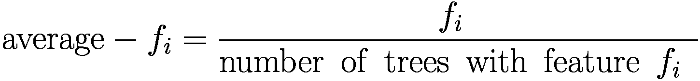

所有变量的 `average - f[i]` 用于计算最终的特征重要性 `final - f[i]`。

同样的概念也用于梯度提升树，你将在下面看到。

### 随机森林的 PySpark 代码

### 分类

```
from pyspark.ml.classification import RandomForestClassifier
clf = RandomForestClassifier(featuresCol='features', labelCol='y')
clf_model = clf.fit(binary_df)
print(clf_model.featureImportances)
print(clf_model.toDebugString)
```

### 回归

```
from pyspark.ml.regression import RandomForestRegressor
reg = RandomForestRegressor(featuresCol='features', labelCol='balance')
reg_model = reg.fit(continuous_df)
print(reg_model.featureImportances)
print(reg_model.toDebugString)
```

### 为什么使用随机森林？

到目前为止，我们还没有介绍为什么需要随机森林。现在我们来讨论一下。

- 随机森林比单棵决策树更稳健，并且能限制过拟合。

- 通过在每棵树训练过程中随机选择特征，消除了特征选择偏差。

- 随机森林使用邻近矩阵，可用于填充缺失值。

## 梯度提升

决策树的另一种变体是梯度提升树。梯度提升是一种基于提升（boosting）概念构建的集成模型。我们已经讨论过集成概念。现在让我们更详细地了解提升。

提升使用弱学习器来构建树。它是一种加法建模技术。它也被称为*顺序学习*，因为当前树会从上一棵树的错误中学习。


### 提升学习过程

- 模型训练从构建初始决策树开始，并使用该树进行预测。
- 根据预测输出创建样本权重列。当预测出现错误时，该样本会被赋予更高权重；当预测准确时，该样本会被赋予较低权重。
- 基于样本权重列创建新的训练数据集。这确保了在新创建的训练数据中，错误样本会得到更多关注。
- 使用新数据重复训练过程，并持续构建树，直到满足用户指定的 `numTrees` 选项。
- 学习率（`learningRate`）用于缩放每个弱学习器的输出。
- 最终模型预测由以下公式给出：

```
第一棵树预测 + learningRate*第二棵树预测 + ....... + learningRate * 第 N 棵树预测
```

## 梯度提升的 PySpark 代码

### 分类

```
from pyspark.ml.classification import GBTClassifier
clf = GBTClassifier(featuresCol='features', labelCol='y')
clf_model = clf.fit(binary_df)
print(clf_model.featureImportances)
print(clf_model.toDebugString)
```

### 回归

```
from pyspark.ml.regression import GBTRegressor
reg = GBTRegressor(featuresCol='features', labelCol='balance')
reg_model = reg.fit(continuous_df)
print(reg_model.featureImportances)
print(reg_model.toDebugString)
```

## 为什么选择梯度提升？

- 适用于对不平衡的目标类别进行建模。
- 与随机森林和决策树构建的深层树相比，梯度提升构建的是浅层树。因此，它擅长减少预测中的偏差。

## 支持向量机（SVM）

想象你在一间坐满学生的教室里。你的任务是画一条线来区分男生和女生。除了画线之外，你的方法还应具备以下特征：

- 男生和女生之间有良好的分离间隔
- 分离过程中的低错误率

这可以通过支持向量机（SVM）来实现。通常，支持向量机使用超平面进行分类。请查看图 5-24 以详细了解该概念。

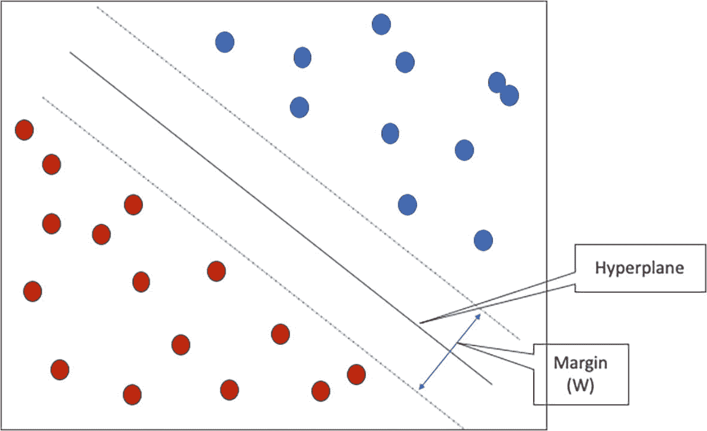

图 5-24：使用支持向量机进行特征空间分离

在图中，使用线性超平面来分离类别。对于非线性数据，可以使用多项式或 rbf（径向基函数）超平面来获得良好的分离效果。这被称为核技巧。目前，PySpark 仅支持线性核。然而，Python 版本支持其他核。SVM 模型包含两个误差函数，如下所示（见图 5-25）：

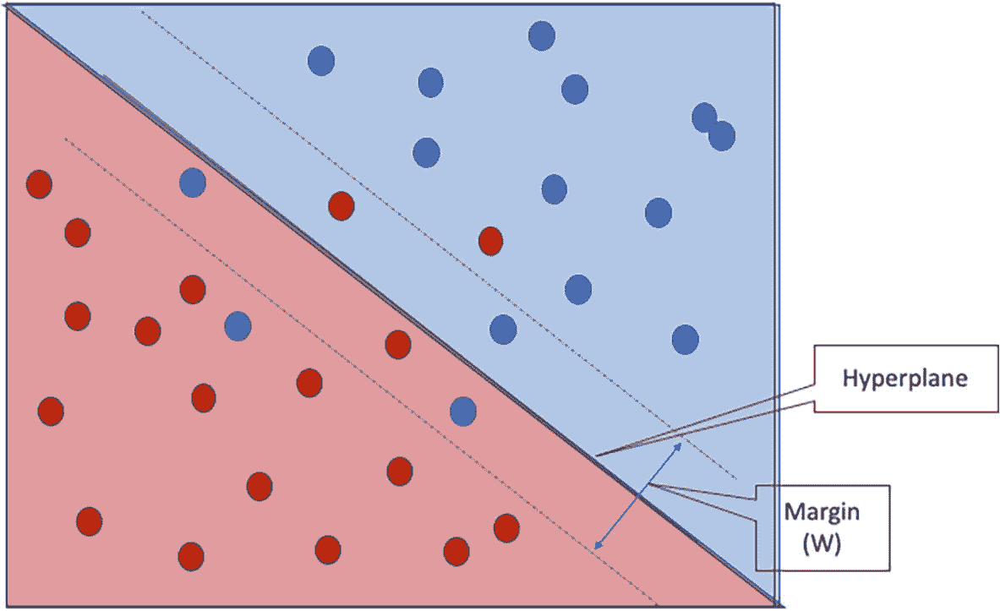

图 5-25：分类误差和间隔误差

```
总误差 = 分类误差 + 间隔误差
```

### 分类误差

分类误差衡量 SVM 模型中的预测误差。该误差类似于误分类率。然而，我们提到间隔也是 SVM 的一个组成部分。因此，任何落在间隔内的观测值也被视为误差，因为你正试图最大化间隔。在图 5-25 中，有七个样本导致了分类误差：两个在间隔之外，五个在间隔之内。总分类误差是这些观测值到间隔边界距离的绝对值之和。为了计算红色观测值的误差，你需要计算其到上间隔边界的距离；对于蓝色观测值的误差，则需要计算其到下间隔边界的距离。

### 间隔误差

间隔误差量化了与间隔边界相关的误差。当间隔较大时，误差较小，反之亦然。让我们用方程的形式来表示这条线，如下所示：


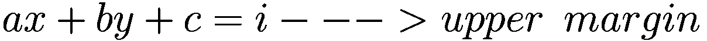

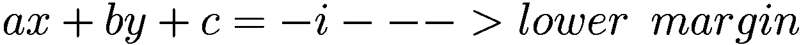

你可以使用以下公式计算间隔的宽度：

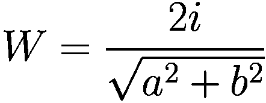

而间隔误差由下式给出：

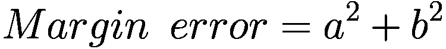

当你将值代入上述方程时，对于大间隔会得到小误差，对于小间隔会得到大误差。

### 总误差

正如你之前所见，总误差是分类误差和间隔误差之和。通常，大间隔会产生大的分类误差，反之亦然。你可以通过使用正则化参数（`regParam`）来调整模型误差函数。后续章节将重点介绍正则化。

#### PySpark 代码

```
from pyspark.ml.classification import LinearSVC
# 定义带有特征列和标签列的 LinearSVC 分类器
clf = LinearSVC(featuresCol='features', labelCol='y')
clf_model = clf.fit(binary_df)
print(binary_df.intercept, clf_model.coefficients)
```

注意：SVM 训练耗时较长。你可以通过调整 `regParam` 选项来加快模型训练速度。

## 神经网络

神经网络的灵感来源于人脑中的生物神经元。在人类中，大脑使用这些神经元与身体其他部位进行通信。根据任务的不同，大脑会激活与任务相对应的神经元并完成它。人工神经网络（ANN）就是基于这一概念构建的，它使用激活函数来激活某些神经元并获得所需的输出。一个简单的神经网络架构如图 5-26 所示。

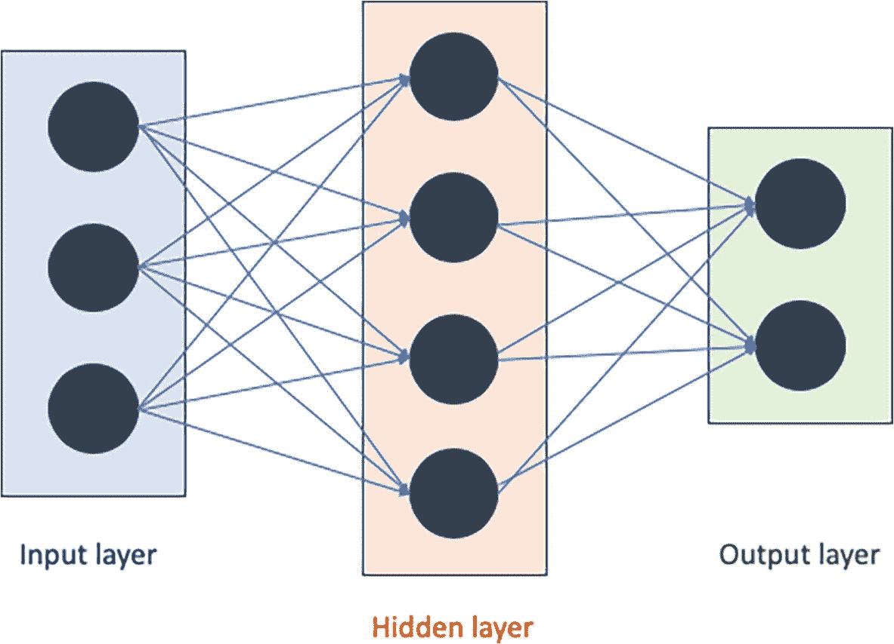

图 5-26：ANN 架构

### 关于 ANN 架构需要了解的内容

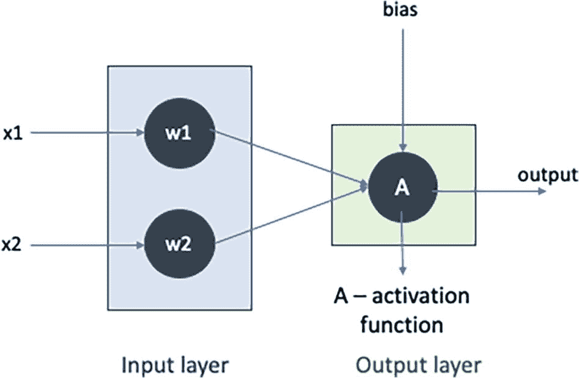

图 5-27：感知器

- 最简单的神经网络只包含输入层和输出层，没有隐藏层。这种类型的网络被称为*感知器*（见图 5-27）。可以使用感知器神经网络构建线性或逻辑回归模型。
- 当激活函数是线性函数时，感知器产生线性回归；当激活函数是 Sigmoid 函数时，感知器产生逻辑回归。
- 你可以在感知器的输入层和输出层之间添加多个隐藏层。由于这种能力，神经网络也被称为多层感知器。
- 隐藏层中的单个单元被称为隐藏单元。在图 5-26 中，隐藏层有四个隐藏单元。
- 你可以使用激活函数来开启/关闭一个隐藏单元。当你使用线性激活函数时，它建模的是线性关系。通过使用像 ReLu 和 TanH 这样的非线性激活函数，你可以建模复杂的关系。
- 当你堆叠多个隐藏层时，就产生了深度神经网络。
- 当你增加隐藏层中隐藏单元的大小时，就产生了更宽的神经网络。
- 神经网络不需要关于数据的先验知识。它们可以通过以下两个步骤来建模特征与目标之间的关系：前馈（步骤 1）、反向传播和梯度下降（步骤 2）。这就是为什么神经网络也被称为前馈神经网络。
- 在 PySpark 中，可以使用超参数（如 `maxIter`、`layers`、`blockSize` 和 `stepSize`）来优化神经网络。


#### 神经网络如何拟合数据？

我们使用逻辑门来详细解释这个概念。在本例中，我们使用一个“或”门。为此，我们使用一个感知器网络。数据列于表 5-5。

**表 5-5** 样本数据

| 输入 1 | 输入 2 | 输出 |
| --- | --- | --- |
| 0 | 0 | 0 |
| 0 | 1 | 1 |
| 1 | 0 | 1 |
| 1 | 1 | 1 |

在神经网络架构建立之后，偏置和权重会被随机初始化。通常，会使用高斯函数或均匀函数来初始化偏置和权重。在本例中，我们将偏置设为 1。由于本例中有两个特征，我们将使用两个权重（`w1` 和 `w2`）。假设初始随机权重值为 `w1 – 0.1` 和 `w2 – 0.7`。本例的激活函数是 Sigmoid。

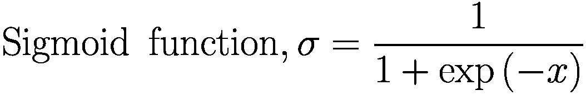

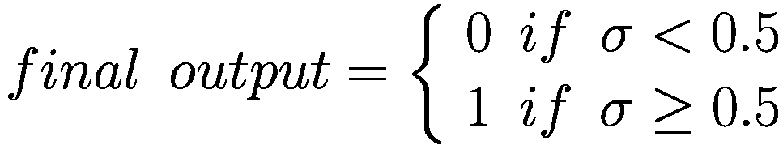

神经网络模型输出 = `w1 * x1 + w2 * x2 + b`

#### 第 1 步：前馈

在前馈步骤中，权重与输入相乘，然后发送到输出函数以计算最终输出（见表 5-6）。

**表 5-6** 误差计算

| 输入 1 | 输入 2 | 目标 | 输出 = `0.1 * 输入 1 + 0.7 * 输入 2 + 1` | Sigmoid(输出) =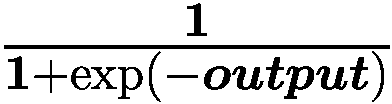 | 误差 = `目标 - Sigmoid(输出)` |
| --- | --- | --- | --- | --- | --- |
| 0 | 0 | 0 | 1 | 0.73 | -0.73 |
| 0 | 1 | 1 | 1.7 | 0.85 | 0.15 |
| 1 | 0 | 1 | 1.1 | 0.75 | 0.25 |
| 1 | 1 | 1 | 1.8 | 0.86 | 0.14 |

#### 第 2 步：反向传播

让我们反向传播误差以更新输入特征的权重。使用以下公式更新权重：

```
新权重 = 旧权重 – (学习率) * 误差增量
误差增量 = 输入 * 误差 * 导数(输出)
```

我们将学习率设为 1。从前面的公式可以看出，我们取每个误差输出的导数来更新权重（见表 5-7）。Sigmoid 函数的导数如下所示：

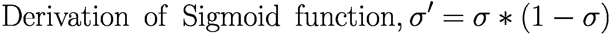

**表 5-7** 导数计算

| 误差 | I = 导数(sigmoid) | J = 误差 * I | W1_ 增量 = 输入 1 * J | W2_ 增量 = 输入 2 * J |
| --- | --- | --- | --- | --- |
| -0.73 | 0.19 | -0.14 | 0 | 0 |
| 0.15 | 0.13 | 0.02 | 0 | 0.02 |
| 0.25 | 0.18 | 0.05 | 0.05 | 0 |
| 0.14 | 0.12 | 0.02 | 0.02 | 0.02 |

```
W1_ 误差增量 = 求和(W1_ 增量) = 0.07
W2_ 误差增量 = 求和(W2_ 增量) = 0.04
新 _w1 = 0.1 - 0.07 = 0.03
新 _w2 = 0.7 - 0.04 = 0.66
```

就是这样。第一次迭代（周期）完成，权重在一个周期后更新。你只需重复这些步骤一定数量的周期来训练你的模型。在每一步中，权重都会更新，模型会慢慢学会根据数据进行拟合。

#### 神经网络中的超参数调优

*   `maxIter` – 运行的周期数。一个周期包括前馈和反向传播。当周期数较多时，模型训练时间更长，反之亦然。此外，当周期数非常少时，模型将无法学习数据中的模式。另一方面，较大的周期会使模型更容易过拟合。

*   `layers` – 训练模型时使用的隐藏层数量。

*   `格式 – [隐藏层 1, ...., 隐藏层 n, 输出层]`。当隐藏层增加时，你可以获得更准确的预测。然而，模型容易过拟合数据。当层数减少时，模型将没有足够的空间来学习。诀窍在于找到合适的平衡点。一个不错的起始数字是 `n` 或 `2*n`，其中 `n` 是输入特征的数量。

*   `blockSize` – 批次大小。训练模型时要使用的批次数量。这就是前面讨论过的小批量概念。

*   `stepSize` – 梯度下降的学习率。你的模型应该学得多快？我们在上一节中详细讨论过这一点。

#### PySpark 代码

```
from pyspark.ml.classification import MultilayerPerceptronClassifier
#输出层设为 2，因为目标是二元的
clf = MultilayerPerceptronClassifier(featuresCol='features', labelCol='y', layers=[4, 4, 2])
clf_model = clf.fit(binary_df)
```

目前，PySpark 不支持使用神经网络进行回归。但是，你可以使用线性激活函数来实现回归。

### One-vs-Rest 分类器

这用于多类分类任务。这个分类器的思想非常简单。假设你有四个 `education` 类别——`primary`、`secondary`、`tertiary` 和 `unknown`。你的目标是预测某个个体的 `education` 结果。这是一个多类问题，因为你有两个以上的输出类别。你创建一个基分类器，并用它对每个类别执行二元分类。第一个分类器将预测 primary 与非 primary（`secondary`、`tertiary` 或 `unknown`）。第二个分类器将预测 secondary 与非 secondary（`primary`、`tertiary` 或 `unknown`）。类似地，第三个分类器将预测 tertiary 与非 tertiary，第四个分类器将预测 unknown 与非 unknown。最终预测是通过评估这四个独立的分类器，并选择置信度最高的分类器的索引作为输出来获得的。

#### PySpark 代码

```
# 使用 RandomForestClassifier 的多类分类模型
target_variable_name = "education"
multiclass_df = data.select(['age', 'balance', 'day', 'duration', 'campaign', 'pdays', 'previous', 'job', 'education'])
features_list = multiclass_df.columns
#features_list = char_vars #此选项仅用于 ChiSqselector
features_list.remove(target_variable_name)
# 对我们的数据框应用函数
# 将特征组装成一个向量列
multiclass_df = assemble_vectors(multiclass_df, features_list, target_variable_name)
# 拟合 one-vs-rest 分类器
from pyspark.ml.classification import RandomForestClassifier, OneVsRest
from pyspark.ml.evaluation import MulticlassClassificationEvaluator
# 生成训练/测试分割。
(train, test) = multiclass_df.randomSplit([0.7, 0.3])
# 实例化基分类器。
clf = RandomForestClassifier(featuresCol='features', labelCol='education')
# 实例化 One Vs Rest 分类器。
ovr = OneVsRest(classifier=clf, featuresCol='features', labelCol='education')
# 训练多类模型。
ovrModel = ovr.fit(train)
# 在测试数据上对模型进行评分。
predictions = ovrModel.transform(test)
# 获取评估器。
evaluator = MulticlassClassificationEvaluator(metricName="accuracy", labelCol='education')
# 计算测试数据上的分类误差。
accuracy = evaluator.evaluate(predictions)
print("测试误差 = %g" % (1.0 - accuracy))
```


### 朴素贝叶斯分类器

朴素贝叶斯分类器基于贝叶斯定理。它假设输入变量相互独立，这也是它被称为*朴素*的原因。输入变量之间并不总是相互独立的。贝叶斯定理根据先验概率和似然度计算后验概率，其公式如下：

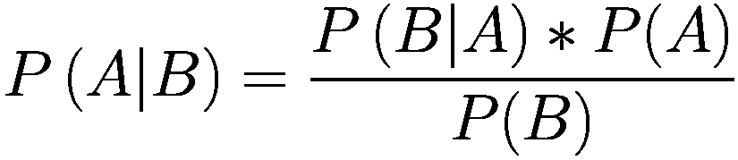

其中，

A 和 B 是事件。

`P(A|B)` = 后验概率。读作“在 B 为真的条件下 A 的概率”。

`P(B|A)` = 似然度。读作“在 A 为真的条件下 B 的概率”。

`P(A)` = 事件 A 的先验概率。

`P(B)` = 事件 B 的先验概率。

查看表 5-8 中的数据以理解贝叶斯定理。我们有两个桶，每个桶里有十个球。第一个桶有七个红球和三个绿球，第二个桶有七个绿球和三个红球。假设你选择每个桶的机会均等。假设你随机从一个桶中取出一个球，结果是绿球。这个球来自桶 2 的概率是多少？

**表 5-8** 贝叶斯演示——样本数据

| 桶 1 | 桶 2 |
| --- | --- |
| 红 | 红 |
| 红 | 绿 |
| 红 | 绿 |
| 绿 | 绿 |
| 红 | 绿 |
| 红 | 绿 |
| 绿 | 红 |
| 红 | 红 |
| 红 | 绿 |
| 绿 | 绿 |

有多种方法可以找到这个问题的答案。我们使用贝叶斯定理来解决这个问题，因为它最适合这种情况。

*   你有两个事件：A – *桶*2 和 B – 绿球。
*   选择每个桶的机会均等，因此桶 2 的先验概率为 `P(A) = 0.5`。
*   选择绿球（GB）这一事件 B 的先验概率由 `P(B)` 给出。
*   `P(B) = P(桶 1) * P(桶 1 中的绿球) + P(桶 2) * P(桶 2 中的绿球)`
*   `P(B) = 0.5 * 0.3 + 0.5 * 0.7 = 0.5`
*   在给定*桶*2 的条件下，绿球的似然度为：

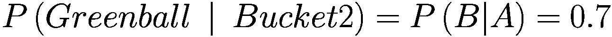

*   在给定绿球的条件下，*桶*2 的概率：

`P(桶 2|绿球) = P(A|B)` = 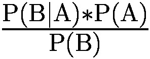 = `(0.7 * 0.5)/0.5 = 0.7`

贝叶斯定理为这类问题提供了简单的解决方案。分类器是该定理的扩展。朴素贝叶斯分类器因其简单性，适用于在大型数据集上训练模型。它最适合分类输入特征。对于数值输入特征，你可以使用 WOE 或其他编码技术手动创建分类变量。你也可以直接输入数值变量而不进行转换，但算法假设变量分布是正态的（你需要谨慎对待这个假设）。

该分类器的一个缺点是*零频率*问题。当测试/评分数据中存在训练数据中未出现的新类别时，模型会将概率输出为 0。在这种情况下，你可以使用平滑技术。PySpark 支持加法平滑（也称为*拉普拉斯平滑*）来平滑分类数据。平滑的默认值为 1。当该值设置为 0 时，不执行平滑。使用该分类器的另一个缺点是它要求特征值为非负。当你的数据集完全是数值型且包含负值时，最好在使用此分类器之前对数据进行标准化，或者选择其他分类器。朴素贝叶斯分类器更适用于文档分类，例如垃圾邮件检测或多类分类。

#### PySpark 代码

```
target_variable_name = "y"
nonneg_df = data.select(['age', 'day', 'duration', 'campaign', 'previous', 'y'])
#排除目标变量并选择所有其他特征向量
features_list = nonneg_df.columns
#features_list = char_vars #此选项仅用于 ChiSqselector
features_list.remove(target_variable_name)
# 将函数应用于我们的 DataFrame
nonneg_df = assemble_vectors(nonneg_df, features_list, target_variable_name)
# 拟合朴素贝叶斯模型
from pyspark.ml.classification import NaiveBayes
clf = NaiveBayes(featuresCol='features', labelCol='y')
clf_model = clf.fit(nonneg_df)
```

### 正则化

正则化是一种用于避免过拟合的技术。通常，有三种类型的正则化：

*   L1 正则化或 Lasso
*   L2 正则化或 Ridge
*   Elastic-net，L1 和 L2 的组合

#### 参数

`elasticNetParam` 用 *alpha* 表示。`regParam` 用 *lambda* 表示。正则化项如下所示：

![$$ \alpha \left(\kern0.5em \lambda \kern0.5em {w}_1\right)+\left(1-\alpha \right)\kern0.5em \left(\frac{\lambda }{2}\kern0.5em {w}_2²\right),\alpha \in \left[0,1\right],\lambda \ge 0 $$](images/500182_2_En_5_Chapter/500182_2_En_5_Chapter_TeX_Eqube.png)

方程中的第一个分量是 L1 或 Lasso 项，第二个分量是 L2 或 Ridge 项。当 `elasticNetParam` 设置为 1 时，执行 Lasso 正则化；当设置为 0 时，执行 Ridge 正则化。当值介于 0 和 1 之间时，执行 elastic-net 正则化。

#### Lasso 或 L1 惩罚

*   Lasso 惩罚取斜率的绝对值并执行正则化。
*   Lasso 排除对模型无用的变量。这可用于特征选择。

#### Ridge 或 L2 惩罚

*   Ridge 惩罚取斜率的平方值并执行正则化。
*   它会减小对模型不太有用的变量的系数，有助于特征选择。

当你尝试评估一组超参数以选择最佳超参数并避免过拟合时，这些技术非常有用。

## 总结

*   你学习了监督技术。
*   你学习了各种误差函数和激活函数。
*   你了解了机器学习领域中可用的不同优化器。
*   你探索了多种监督算法，并看到了回归和分类的用例。
*   最后，你学习了正则化以及如何使用它来避免过拟合。

做得好！在下一章中，你将学习模型验证。继续学习，敬请期待。

