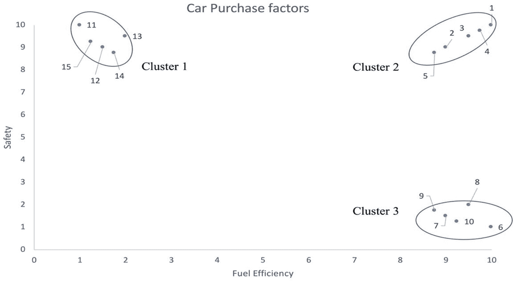
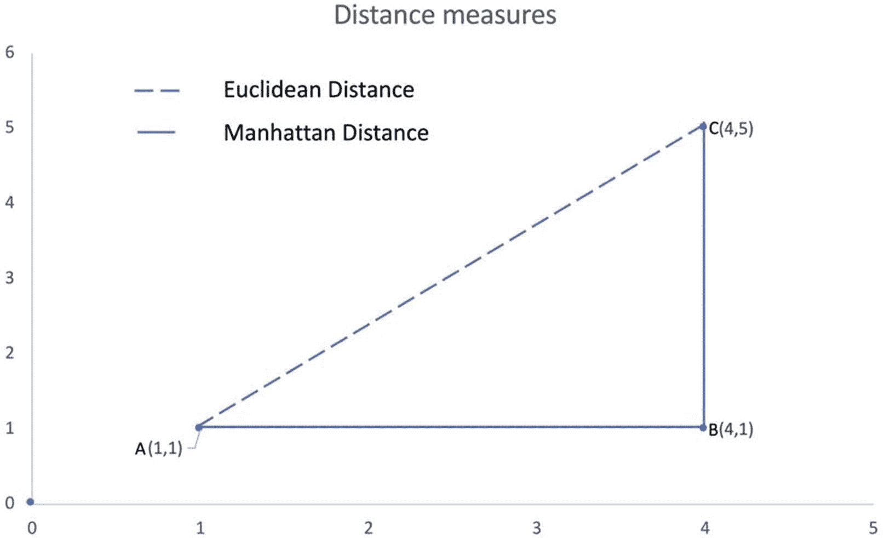

# 7. 无监督学习与推荐算法

本章将探讨业界用于处理无标签数据的流行技术。你将学习如何使用 `PySpark` 实现这些技术。你还将了解分割和推荐算法的基础知识以及所需的数据准备工作。在本章结束时，你将能够理解无监督技术及其在日常数据科学活动中的应用。

本章涵盖以下主题：
- K-means
- 潜在狄利克雷分配
- 使用交替最小二乘法的协同过滤

## 分群

正如*分群*一词所暗示的，这是一种将你的总体（数据中的客户或记录）划分为具有共同需求的逻辑组的技术。这些逻辑组之间的需求可能差异很大，但组内差异很小。让我们退一步思考一下为什么需要这样做。如果你能识别出一组具有共同需求的同质客户，这将有助于你的业务制定策略，以更好地服务客户并保持他们的参与度。你可以创建这些分群来更好地了解你的客户，或出于特定目的，例如为你的应用或产品制定消息推送或开发策略。

假设你是一名应用开发者，拥有关于应用使用情况的数据。识别出具有相似行为的用户群体会很有趣。根据你的应用在不同地理位置、使用时间、年龄组或使用功能上的情况，你可以制定改进应用的策略，并为不同的用户群体定制界面以提高参与度。虽然听起来简单，但识别出正确的群体可能具有挑战性。你不希望群体太多或太少。你还希望在采取行动之前，每个群体中都有相当数量的客户。你还需要这些群体保持稳定。如果它们频繁变化，可能会对你计划的行动构成挑战。

根据你所处的业务垂直领域类型，会有许多变量可用于分群。问题就变成了：你如何为这项工作选择变量？在进入之前讨论的任何变量选择方法之前，重要的是要识别基础变量和描述变量。基础变量是用于分群以定义群体的变量。这些可以是应用使用情况、使用次数、使用的功能等。描述变量不用于分群；它们用于描述和定义已识别的群体。这些描述变量可以是任何你想要量化并观察群体间差异的内部关键绩效指标。例如，如果你使用应用使用数据进行聚类，你可以将应用回访率、应用流失率以及应用收入作为一些描述变量。

同样，针对特定目标控制描述变量可能会产生不同的结果。对于哪些变量可以用作基础变量和描述变量，没有硬性规定。这些是目标特定的。你也可以根据在线收集的调查数据来驱动其中一些分群，以识别客户不断变化的需求。数据可以包括地理、人口统计、社会经济、应用使用情况和忠诚度信息。调查有时有助于收集不可观察的数据，例如生活方式、偏好和利益。

业务规则也可用于数据分群，但随着数据量的不断增加，大多数组织更倾向于使用可用的聚类技术。其中一些技术的挑战之一是，你不知道数据中存在多少个群体。以下数据是出于演示目的而虚构的。它考虑了客户在购买汽车时评估的两个因素。该数据有两个变量：安全性和燃油效率。这两个变量均由 15 名受访者按 1 到 10 的等级进行评分。该数据见表 7-1。

**表 7-1** 购车调查数据

| 受访者 | 安全性 | 燃油效率 |
| --- | --- | --- |
| 1 | 10 | 10 |
| 2 | 9 | 9 |
| 3 | 9.5 | 9.5 |
| 4 | 9.75 | 9.75 |
| 5 | 8.75 | 8.75 |
| 6 | 10 | 1 |
| 7 | 9 | 1.5 |
| 8 | 9.5 | 2 |
| 9 | 8.75 | 1.75 |
| 10 | 9.25 | 1.25 |
| 11 | 1 | 10 |
| 12 | 1.5 | 9 |
| 13 | 2 | 9.5 |
| 14 | 1.75 | 8.75 |
| 15 | 1.25 | 9.25 |

如果你将数据绘制在散点图上，你会立即识别出三个群体，如图 7-1 所示。对于群体 1 中的受访者，安全性比燃油效率更重要。对于群体 2 中的受访者，安全性和燃油效率同等重要。对于群体 3 中的受访者，燃油效率在购车中起着主要作用。你该如何利用这些信息？汽车经销商可以利用这些信息向客户推销合适的汽车。他们可以花更多时间向群体 1 中的受访者解释安全特性，而向群体 3 中的受访者则谈论燃油效率。

仅通过将变量绘制在二维图上，你就可以得出这些推论。然而，你通常会有多个变量，可能无法通过视觉做出这些判断。在接下来的章节中，我们将探讨使用多维数据的技术。



**图 7-1** 群体演示

不存在单一的聚类解决方案。在这个例子中，你可以根据尺寸将汽车大致分为紧凑型、轿车和 SUV。同样，你可以将车辆分为豪华/非豪华以及性能/非性能细分市场。所有这些都是有效的细分。同样，当你对数据进行聚类时，可能存在多种解决方案。具有挑战性的部分是选择适合你业务的方案。描述变量可以帮助你确定正确的指标，从而帮助你选择解决方案。

### 距离度量

根据前面的图表，很明显，彼此接近的点具有相似的特征。换句话说，距离较小的点比距离较大的点更相似。点之间的距离是分割中用于确定相似性的关键概念之一。那么，如何计算点之间的相似度呢？有多种方法可用；其中最流行的一种是欧几里得距离。欧几里得距离是笛卡尔坐标系中两点之间的几何距离。两点——`a (x[1],y[1])` 和 `b (x[2],y[2])`——之间的欧几里得距离通过以下公式计算：

```
Distance[ab]=√ (x[1]- x[2])² +(y[1]- y[2])²
```

让我们为表 7-1 计算这个距离，看看不同受访者之间的距离如何变化。表 7-2、7-3 和 7-4 展示了所有受访者之间计算出的欧几里得距离。

**表 7-4**
表 7-1 的欧几里得距离（部分输出 – 第 3 部分）

|   | 11 | 12 | 13 | 14 | 15 |
|--- |--- |--- |--- |--- |--- |
| 1 | 9.00 | 8.56 | 8.02 | 8.34 | 8.78 |
| 2 | 8.06 | 7.50 | 7.02 | 7.25 | 7.75 |
| 3 | 8.51 | 8.02 | 7.50 | 7.79 | 8.25 |
| 4 | 8.75 | 8.28 | 7.75 | 8.06 | 8.51 |
| 5 | 7.85 | 7.25 | 6.79 | 7.00 | 7.52 |
| 6 | 12.73 | 11.67 | 11.67 | 11.32 | 12.03 |
| 7 | 11.67 | 10.61 | 10.63 | 10.25 | 10.96 |
| 8 | 11.67 | 10.63 | 10.61 | 10.28 | 10.98 |
| 9 | 11.32 | 10.25 | 10.28 | 9.90 | 10.61 |
| 10 | 12.03 | 10.96 | 10.98 | 10.61 | 11.31 |
| 11 | 0.00 | 1.12 | 1.12 | 1.46 | 0.79 |
| 12 | 1.12 | 0.00 | 0.71 | 0.35 | 0.35 |
| 13 | 1.12 | 0.71 | 0.00 | 0.79 | 0.79 |
| 14 | 1.46 | 0.35 | 0.79 | 0.00 | 0.71 |
| 15 | 0.79 | 0.35 | 0.79 | 0.71 | 0.00 |

**表 7-3**
表 7-1 的欧几里得距离（部分输出 – 第 2 部分）

|   | 6 | 7 | 8 | 9 | 10 |
|--- |--- |--- |--- |--- |--- |
| 1 | 9.00 | 8.56 | 8.02 | 8.34 | 8.78 |
| 2 | 8.06 | 7.50 | 7.02 | 7.25 | 7.75 |
| 3 | 8.51 | 8.02 | 7.50 | 7.79 | 8.25 |
| 4 | 8.75 | 8.28 | 7.75 | 8.06 | 8.51 |
| 5 | 7.85 | 7.25 | 6.79 | 7.00 | 7.52 |
| 6 | 0.00 | 1.12 | 1.12 | 1.46 | 0.79 |
| 7 | 1.12 | 0.00 | 0.71 | 0.35 | 0.35 |
| 8 | 1.12 | 0.71 | 0.00 | 0.79 | 0.79 |
| 9 | 1.46 | 0.35 | 0.79 | 0.00 | 0.71 |
| 10 | 0.79 | 0.35 | 0.79 | 0.71 | 0.00 |
| 11 | 12.73 | 11.67 | 11.67 | 11.32 | 12.03 |
| 12 | 11.67 | 10.61 | 10.63 | 10.25 | 10.96 |
| 13 | 11.67 | 10.63 | 10.61 | 10.28 | 10.98 |
| 14 | 11.32 | 10.25 | 10.28 | 9.90 | 10.61 |
| 15 | 12.03 | 10.96 | 10.98 | 10.61 | 11.31 |

**表 7-2**
表 7-1 的欧几里得距离（部分输出 – 第 1 部分）

|   | 1 | 2 | 3 | 4 | 5 |
|--- |--- |--- |--- |--- |--- |
| 1 | 0.00 | 1.41 | 0.71 | 0.35 | 1.77 |
| 2 | 1.41 | 0.00 | 0.71 | 1.06 | 0.35 |
| 3 | 0.71 | 0.71 | 0.00 | 0.35 | 1.06 |
| 4 | 0.35 | 1.06 | 0.35 | 0.00 | 1.41 |
| 5 | 1.77 | 0.35 | 1.06 | 1.41 | 0.00 |
| 6 | 9.00 | 8.06 | 8.51 | 8.75 | 7.85 |
| 7 | 8.56 | 7.50 | 8.02 | 8.28 | 7.25 |
| 8 | 8.02 | 7.02 | 7.50 | 7.75 | 6.79 |
| 9 | 8.34 | 7.25 | 7.79 | 8.06 | 7.00 |
| 10 | 8.78 | 7.75 | 8.25 | 8.51 | 7.52 |
| 11 | 9.00 | 8.06 | 8.51 | 8.75 | 7.85 |
| 12 | 8.56 | 7.50 | 8.02 | 8.28 | 7.25 |
| 13 | 8.02 | 7.02 | 7.50 | 7.75 | 6.79 |
| 14 | 8.34 | 7.25 | 7.79 | 8.06 | 7.00 |
| 15 | 8.78 | 7.75 | 8.25 | 8.51 | 7.52 |

观察表 7-2、7-3 和 7-4 中的数据再次证实了相似点之间的距离最小这一事实。所有较小的距离都已突出显示，它们绝非偶然地形成了图 7-1 中所示的视觉聚类。那么，你可能会有疑问：如何将其扩展到多个变量？你可以使用欧几里得距离的扩展形式来实现，它可以扩展到任意数量的变量。假设你有三个变量。你可以使用以下公式计算点 `a (x[1],y[1],z[1])` 和 `b (x[2],y[2],z[2])` 之间的距离：

```
Distance[ab]=√(x1- x2)² +(y1- y2)²+(z1- z2)²
```

还存在其他形式的距离度量，例如曼哈顿距离和切比雪夫距离。为了便于理解，请参考图 7-2。



**图 7-2**
距离度量

点 `A` 和 `C` 之间的欧几里得距离是 5。你可以通过应用公式进行交叉验证。点 `A` 和 `C` 之间的曼哈顿距离计算为 `(A,B)` 和 `(B,C)` 之间距离的城市街区总和。由于其布局，它也被称为出租车几何，对于图 7-2，它被计算为笛卡尔坐标的绝对差。

```
曼哈顿距离 = |(x2 – x1)| + |(y2-y1)|
曼哈顿距离 = |(4–1)| + |(5-1)|
曼哈顿距离 = 7
```

向量空间中的切比雪夫距离是两个向量之间的距离，是它们沿任何坐标维度的差值的最大值。对于图 7-2，可以使用以下公式计算：

```
切比雪夫距离 = max [(x2 – x1), (y2-y1)]
切比雪夫距离 = max [(4 – 1), (5-1)]
切比雪夫距离 = 4
```

这种策略对于数值变量效果很好，但是如何将此技术应用于分类变量呢？假设你有一个名为“过去 5 年内是否有过购买”的变量，其值为是/否。你如何使用这个变量？请记住，我们在前面章节中介绍过独热编码。你可以使用独热编码将此分类变量（是/否）转换为数值变量。最终你会得到两个变量：一个代表“是”，另一个代表“否”。在实践中，你可能只需要一个变量，因为第二个变量可能与第一个变量完全共线。

如果你仔细观察数据，你会发现之前的变量范围是 1 到 10，而现在的新变量“过去 5 年内是否有过购买”的范围是 0 到 1。将这些变量组合在一起会导致偏差，因为当你计算距离时，新变量的影响可以忽略不计。你如何处理这种情况？是的，你可以使用归一化。*归一化*是一种缩放技术，可以将现有数据重新缩放到 `[0,1]` 的范围内。它使用以下公式计算：

```
X[normalized] = (X-X[min]) / (X[max] -X[min])
```

这是分割中广泛使用的技术。但要小心，因为你可能会丢失关于异常值的信息。

另一种广泛使用的缩放技术是*标准化*。不要将标准化与归一化混淆。在标准化中，你将数据重新缩放，使其均值为 0，标准差为 1。它使用以下公式计算：

```
X[standardized] = X- X[mean] / X[standard_deviation]
```