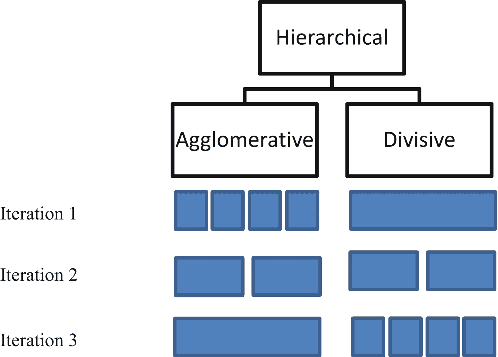
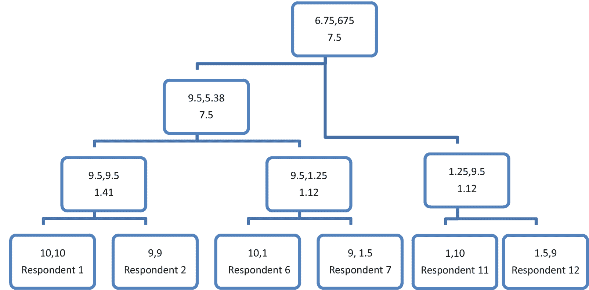
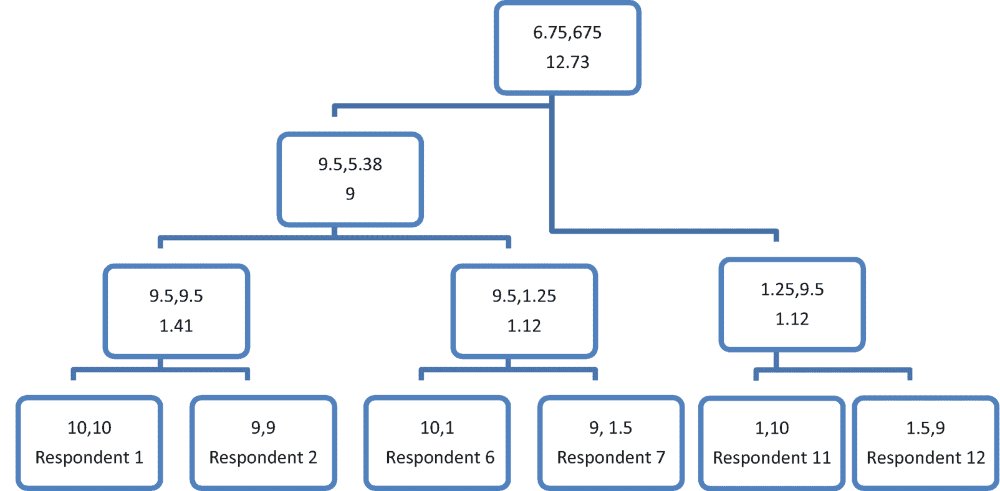
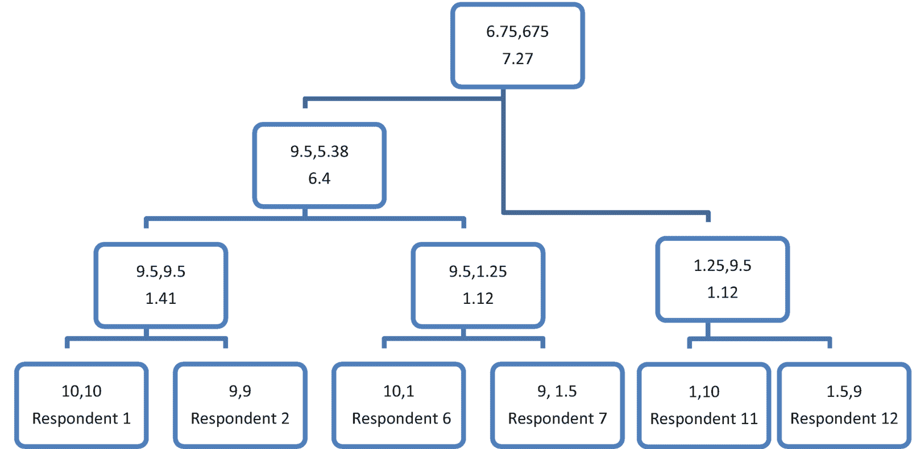
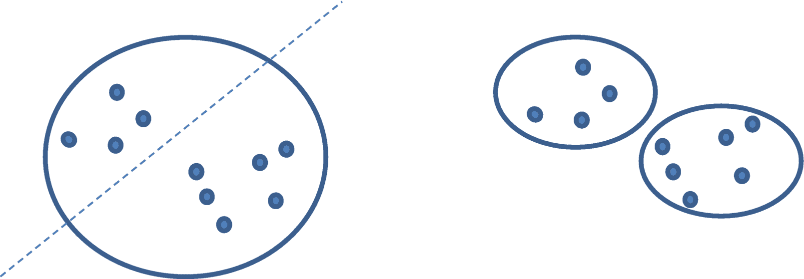
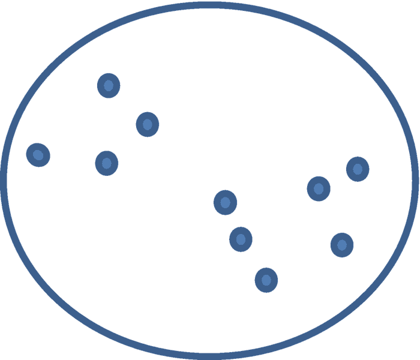
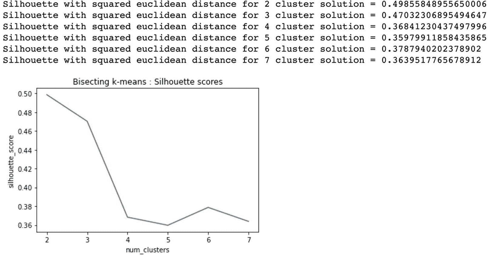
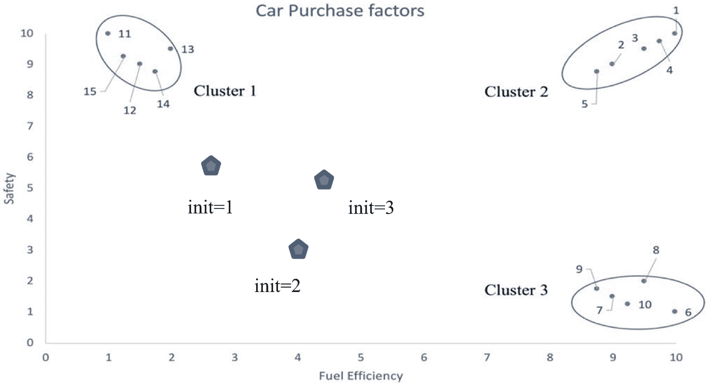

# 使用杰卡德系数与汉明距离处理分类数据

有时你可能会遇到只有分类数据的情况。是否存在比独热编码和欧氏距离更好的技术？答案是肯定的：杰卡德系数和汉明距离。我们在此重点介绍杰卡德系数，它涉及从数据中计算相异度矩阵。

例如，在处理二元属性时，你可以创建一个列联表，其中 `a` 表示项目 `x` 和 `y` 中同时为 1 的特征数量；`b` 表示项目 `x` 中为 1 但项目 `y` 中为 0 的特征数量；`c` 表示项目 `x` 中为 0 但项目 `y` 中为 1 的特征数量；`d` 表示项目 `x` 和 `y` 中同时为 0 的特征数量。特征总数为 `z`，即 `z = a + b + c + d`（见表 7-5）。

**表 7-5** 列联表

| x | y |   |   |
|---|---|---|---|
|   | 1 | 0 | 合计 |
| 1 | a | b | a+b |
| 0 | c | d | c+d |
| 合计 | a+c | b+d | z = (a+b+c+d) |

你需要了解几个术语来计算相异度。

- **对称二元变量** – 变量的两个层级具有相同权重。例如，硬币的正面和反面。
- **非对称二元变量** – 两个层级的权重不同。例如，在医学检测结果中，阳性结果可能比阴性结果具有更高的权重。

根据二元变量的类型，相异度的计算方式会有所不同。对称二元相异度可使用以下公式计算：

`d(x,y) = (b + c) / (a + b + c + d)`

非对称二元相异度可使用以下公式计算：

`d(x,y) = (b + c) / (a + b + c)`

请注意，在上述公式中，分母中忽略了 `d`；这是因为阴性结果的重要性很低甚至无关紧要。使用这种相异度度量，你可以通过以下公式计算 `x` 和 `y` 之间的相似距离：

`相似度(x, y) = 1 – d(x, y)`

`相似度(x, y) = 1 – ((b + c) / (a + b + c))`

`相似度(x, y) = c / (a + b + c)`

这种相似度度量被称为**杰卡德距离**。它可用于确定二元变量之间的相似度。但名义变量该如何处理呢？一种变通方法是将名义变量重新编码为多个二元变量。另一种技术是使用简单匹配系数，其计算公式如下：

`简单匹配系数 = 匹配属性数量 / 属性总数`

对于二元变量而言，该系数与对称二元相异度类似。上述系数给出了相异度指数。相似距离则通过用 1 减去该系数来计算：

`简单匹配距离 = 1 - 简单匹配系数`

现在我们沿用欧氏距离的示例来演示杰卡德距离。假设一家汽车经销商成功与三位车主达成交易，这三位车主拥有三辆不同品牌和型号的汽车。该经销商希望根据性能对这些车主的汽车进行分类。他们对这些汽车进行了不同的测试，以确定当前性能的相似度。未通过的测试用 `Y` 表示，通过的测试用 `N` 表示。为方便起见，我们在此将它们分别转换为 1 和 0（见表 7-6）。

**表 7-6** 杰卡德距离演示

|       | 气候测试 | 机械测试 | 压力脉冲测试 | 排放台架测试 | 催化剂老化测试 | SHED 测试 |
|-------|----------|------------|------------------|-----------------|-----------|------|
| 汽车 1 | 1        | 0          | 1                | 0               | 0         | 0    |
| 汽车 2 | 1        | 0          | 1                | 0               | 1         | 0    |
| 汽车 3 | 1        | 1          | 0                | 0               | 0         | 0    |

你可以使用以下公式计算汽车之间的相异度：

`d(汽车 1, 汽车 2) = 1 + 0 / (2 + 1 + 0)`

`d(汽车 1, 汽车 2) = 0.33`

这些数字是如何得出的？通过使用列联表，我们统计了表 7-6 中 `b` 和 `c` 的数量。对于汽车 1 和汽车 2，催化剂老化测试对应 `b`。这里没有 `c` 值。同时请注意，这是非对称二元相似度，因此分母中不考虑 `d` 的值。从气候测试和压力脉冲测试中，我们知道 `a` 的计数为 2。要计算相似度，你需要用 1 减去这个指数：

`相似度(汽车 1, 汽车 2) = 1 - 0.33`

`相似度(汽车 1, 汽车 2) = 0.67`

类似地，你可以计算其他观测值之间的差异，并创建一个相似度矩阵。

### 聚类类型

广义上，聚类可分为层次聚类和非层次聚类方法。本节重点阐述这些聚类类型之间的差异，以及每种聚类类型可用的算法。顾名思义，层次聚类试图在其求解过程中构建一个聚类的层次结构。层次聚类进一步分为凝聚式聚类和分裂式聚类（见图 7-3）。



**图 7-3** 层次聚类的类型

- **凝聚式聚类：** 在此类聚类中，每个观测值最初自成一类，然后逐步向上合并，最终形成一个单一的聚类。这种方法也被称为*自底向上聚类*。
- **分裂式聚类：** 在此类聚类中，所有观测值最初属于一个单一的聚类，然后在每次迭代中递归地分裂成更小的聚类。这种方法也被称为*自顶向下聚类*。

图 7-3 以图形方式描绘了这两种方法。我们使用选自表 7-1 的数据来演示凝聚式聚类的例子。我们还计算了所有这些点的欧几里得距离（见表 7-8）。所有成对距离都列在表 7-7 中。

**表 7-8** 选定受访者的欧几里得距离

|   | **1** | **2** | **6** | **7** | **11** | **12** |
|---|-------|-------|-------|-------|--------|--------|
| 1 | 0.00  | 1.41  | 9.00  | 8.56  | 9.00   | 8.56   |
| 2 | 1.41  | 0.00  | 8.06  | 7.50  | 8.06   | 7.50   |
| 6 | 9.00  | 8.06  | 0.00  | 1.12  | 12.73  | 11.67  |
| 7 | 8.56  | 7.50  | 1.12  | 0.00  | 11.67  | 10.67  |
| 11| 9.00  | 8.06  | 12.73 | 11.67 | 0.00   | 1.12   |
| 12| 8.56  | 7.50  | 11.67 | 10.61 | 1.12   | 0.00   |

**表 7-7** 凝聚式聚类示例

| **受访者** | **安全性** | **燃油效率** |
|----------------|------------|---------------------|
| 1              | 10         | 10                  |
| 2              | 9          | 9                   |
| 6              | 10         | 1                   |
| 7              | 9          | 1.5                 |
| 11             | 1          | 10                  |
| 12             | 1.5        | 9                   |

请注意，这是一个对称矩阵；你可以使用其中一半来确定你的聚类。当你开始进行凝聚式聚类时，所有数据点都各自独立成类。根据上述数据，这里两个受访者之间观察到的最小距离是 1.12，对应 (6,7) 和 (11,12)。这里出现了平局，那么算法将如何决定哪些对应该合并呢？存在内置规则来打破这种平局，我们假设它任意选择了 (6,7)。在第一步中，你会将它们聚类在一起，然后计算整体的异质性度量，这里等于 1.12。请注意，当你开始聚类时，异质性度量为 0，因为所有数据点都在它们各自的独立类中。一旦你将 6 和 7 合并，下一个被合并的对是 (11,12)。异质性度量保持不变，因为这些点之间的成对距离仍然是 1.12。在下一步中，(1,2) 将被合并在一起，因为它们具有最小的成对距离 1.41。现在平均异质性将上升到 1.21。这是通过计算 (1.12+1.12+1.41)/3 得到的。重复这些步骤，直到所有观测值都落入一个单一的聚类中。

你可能会想，如何选择正确的聚类数量呢？一种识别方法是确定异质性度量中的突变/波动。图 7-4 直观地展示了算法的工作原理。表 7-9 显示了这些步骤。

**表 7-9** 聚类步骤

| **步骤** | **聚类**                    | **异质性** |
|----------|-----------------------------|-------------------|
| 0        | 1 2 6 7 11 12               | 0                 |
| 1        | 1 2 (**6 7**) 11 12         | 1.12              |
| 2        | 1 2 (**6 7**) (**11 12**)   | 1.12              |
| 3        | (**1 2**) (**6 7**) (**11 12**) | 1.21              |
| 4        | (**1 2 6 7**) (11 12)       | 3.84              |
| 5        | (**1 2 6 7 11 12**)         | 5.04              |



**图 7-4** *树状图：基于单链路的层次聚类。展示了质心和欧几里得距离*

观察上述异质性度量，你可以看到从步骤 3 到步骤 4 以及从步骤 4 到步骤 5 的度量存在突变。这里可以得出两种可能的解决方案，即三聚类或四聚类解决方案。

我们在这里使用的方法称为*单链路*。它在确定聚类度量和异质性时考虑最近邻。其他可用于考察相似性的方法包括：



**图 7-5** 树状图：基于全链路的层次聚类。展示了质心和欧几里得距离

- **全链路：** 此方法使用聚类之间的最大距离来确定聚类距离，而不是使用最小距离。图 7-5 展示了聚类属性和距离如何变化。



**图 7-6** 树状图：基于平均链路的层次聚类。展示了质心和欧几里得距离

- **平均链路：** 此方法使用聚类之间的成对平均距离来确定聚类距离。图 7-6 展示了聚类距离如何变化。
- **质心链路：** 此方法在迭代步骤中使用聚类中心之间的距离来确定聚类距离。
- **沃德法：** 此方法基于方差。它基于最小化聚类内观测值之间的聚类方差，并最大化跨聚类的聚类方差的原则。

尽管层次聚类具有无需预先选择初始聚类数量的优势，但它是一种实现起来较为复杂的算法，尤其是在大数据环境下。它的时间和空间复杂度为 `O(n²log(n))`，其中 `n` 是观测值的数量。这可能会减慢运算速度。从好的方面来看，它可以解释观测值是如何分组的。

### 二分 K 均值算法

`BisectingKMeans` 是一种混合方法，结合了层次分裂聚类和非层次聚类的特点。我们将在下一节介绍`k-means`，这是一种较为流行的非层次聚类技术。`BisectingKMeans` 在预先设定聚类数量方面与 `k-means` 类似。你可能会想，在没有任何数据先验知识的情况下，如何设定聚类数量。你可以使用之前介绍过的技术，例如异质性度量，以及其他距离度量方法，通过运行算法若干次迭代来确定聚类。

让我们从理论上看看 `BisectingKMeans` 算法是如何工作的。由于这是一种分裂算法，它从顶部的单个聚类开始，然后迭代地划分数据。首先，你需要设定所需的聚类数量。

开始时，所有数据都存在于一个聚类中（见图 7-7）。我们将数据分成两个聚类（见图 7-8）。



图 7-8

步骤 2：二分 k-means



图 7-7

步骤 1：二分 k-means

前两个聚类是使用 `k-means` 划分的。随着聚类的分裂，会计算每个聚类的质心。然后，计算所有点与质心之间距离的平方和。这被称为距离/误差平方和（`SSE`）。`SSE` 越高，聚类的异质性越大。在下一步中，我们选择所有聚类中 `SSE` 最高的那个，并将其分成两个聚类（见图 7-9）。


图 7-9

步骤 3：二分 k-means

在下一步中，我们查看这三个聚类的 `SSE`，并选择 `SSE` 最高的那个进行二分。我们重复这个过程，直到达到所需的聚类数量。该过程的低计算时间是相对于其他过程的一大优势。`BisectingKMeans` 还能生成大小相似的聚类，这与 `k-means` 不同，后者的聚类大小差异很大。

截至 3.0 版本，PySpark 尚未实现凝聚层次聚类。有一种使用 `BisectingKMeans` 函数的分裂层次聚类方法（自上而下）。为了演示，我们使用来自 Kaggle 的信用卡数据（[`https://www.kaggle.com/arjunbhasin2013/ccdata`](https://www.kaggle.com/arjunbhasin2013/ccdata)）（见表 7-10）。

表 7-10

信用卡数据集的元数据信息

| **列名** | **定义** |
| --- | --- |
| `custid` | 信用卡持有者标识（分类变量） |
| `balance` | 账户中可用于购物的余额 |
| `balancefrequency` | 余额更新的频率；得分介于 0 和 1 之间（1 = 频繁更新，0 = 不频繁更新） |
| `purchases` | 从账户进行的购买金额 |
| `oneoffpurchases` | 单次最大购买金额 |
| `installmentspurchases` | 分期付款的购买金额 |
| `cashadvance` | 用户获得的预借现金金额 |
| `purchasesfrequency` | 购买发生的频率；得分介于 0 和 1 之间（1 = 频繁购买，0 = 不频繁购买） |
| `oneoffpurchasesfrequency` | 单次购买发生的频率（1 = 频繁购买，0 = 不频繁购买） |
| `purchasesinstallmentsfrequency` | 分期购买发生的频率（1 = 频繁发生，0 = 不频繁发生） |
| `cashadvancefrequency` | 预借现金支付的频率 |
| `cashadvancetrx` | 使用“预借现金”进行的交易次数 |
| `purchasestrx` | 进行的购买交易次数 |
| `creditlimit` | 用户的信用卡额度 |
| `payments` | 用户支付的金额 |
| `minimum_payments` | 用户支付的最低金额 |
| `prcfullpayment` | 用户全额支付的比例 |
| `tenure` | 用户使用信用卡服务的期限 |

该数据集不能以其原始形式使用。从描述中我们知道，这些数据元素具有不同的量纲。在应用聚类技术之前，我们必须对它们进行归一化并形成特征向量。

# 读取数据
```
file_location = "cluster_data.csv"
file_type = "csv"
infer_schema = "false"
first_row_is_header = "true"
df = spark.read.format(file_type)\
.option("inferSchema", infer_schema)\
.option("header", first_row_is_header)\
.load(file_location)
```

# 打印元数据
`df.printSchema()`

# 转换多个变量类型
```
from pyspark.sql.types import *
```

# 识别并分配变量列表
`float_vars=list(set(df.columns) - set(['CUST_ID']))`
```
for column in float_vars:
    df=df.withColumn(column,df[column].cast(FloatType()))
```

# 数据插补
```
from pyspark.ml.feature import Imputer
```

# 筛选需要进行均值插补的变量
`input_cols=list(set(df.columns) - set(['CUST_ID']))`

# 定义插补函数
```
imputer = Imputer(
    inputCols=input_cols,
    outputCols=["{}_imputed".format(c) for c in input_cols])
```

# 应用转换
`df_imputed=imputer.fit(df).transform(df)`

# 删除原始列，因为我们已创建了 `_imputed` 列
`df_imputed=df_imputed.drop(*input_cols)`

# 将输入列重命名为原始列名以保持一致性
`new_column_name_list= list(map(lambda x: x.replace("_imputed", ""), df.columns))`
`df_imputed = df_imputed.toDF(*new_column_name_list)`

# 数据准备
```
from pyspark.ml.feature import VectorAssembler
from pyspark.ml.feature import Normalizer
from pyspark.ml import Pipeline
```

# 列出分割分析中不需要的变量
`ignore = ['CUST_ID']`

# 创建所有特征的向量
```
assembler = VectorAssembler(inputCols=[x for x in df.columns if x not in ignore], outputCol='features')
```

# 创建所有特征的归一化，用于缩放到 0 到 1 之间
```
normalizer = Normalizer(inputCol="features", outputCol="normFeatures", p=1.0)
```

# 定义管道
`pipeline = Pipeline(stages=[assembler, normalizer])`

# 拟合管道
`transformations=pipeline.fit(df_imputed)`

# 应用转换
`df_updated = transformations.transform(df_imputed)`

# 构建模型
```
from pyspark.ml.clustering import BisectingKMeans
from pyspark.ml.evaluation import ClusteringEvaluator
```

# 训练二分 k-means 模型。
```
bkm = BisectingKMeans().setK(2).setSeed(1)
model = bkm.fit(df_updated.select('normFeatures').withColumnRenamed('normFeatures','features'))
```

# 进行预测
`predictions = model.transform(df_updated.select('normFeatures').withColumnRenamed('normFeatures','features'))`

# 通过计算轮廓系数评估聚类效果
```
evaluator = ClusteringEvaluator()
silhouette = evaluator.evaluate(predictions)
print("Silhouette with squared euclidean distance = " + str(silhouette))
```

# 显示结果。
```
print("Cluster Centers: ")
centers = model.clusterCenters()
for center in centers:
    print(center)
```

我们使用轮廓系数来确定最佳聚类数。这是确定正确聚类数的最佳可用指标之一。该指标针对数据集中的每个样本进行计算。其计算公式如下：

`轮廓系数 = (x-y)/ max(x,y)`

其中 `x` 是簇间距离，`y` 是簇内距离。该系数的取值范围在 -1 到 1 之间。接近 1 的值表示清晰的分离，更为理想。现在，让我们计算不同聚类数下的轮廓系数，并绘制图表以确定正确的聚类数（见图 7-10）。



*图 7-10*

使用二分 k-means 算法，随着聚类数增加，轮廓系数在多次迭代中的变化情况

```
# 迭代
import pandas as pd
import seaborn as sns
import matplotlib.pyplot as plt
sil_coeff=[]
num_clusters=[]
for iter in range(2,8):
    bkm = BisectingKMeans().setK(iter).setSeed(1)
    model = bkm.fit(df_updated.select('normFeatures').withColumnRenamed('normFeatures','features'))
    # 进行预测
    predictions = model.transform(df_updated.select('normFeatures').withColumnRenamed('normFeatures','features'))
    # 通过计算轮廓系数评估聚类效果
    evaluator = ClusteringEvaluator()
    silhouette = evaluator.evaluate(predictions)
    sil_coeff.append(silhouette)
    num_clusters.append(iter)
    print("Silhouette with squared euclidean distance for "+str(iter) +" cluster solution = " + str(silhouette))

# 创建用于可视化的数据框
df_viz=pd.DataFrame(zip(num_clusters,sil_coeff), columns=['num_clusters','silhouette_score'])
sns.lineplot(x = "num_clusters", y = "silhouette_score", data=df_viz)
plt.title('Bisecting k-means : Silhouette scores')
plt.xticks(range(2, 8))
plt.show()
```

### K-means

到目前为止，k-means 是最流行的聚类技术之一，因为它能相对轻松地扩展到海量数据。当数据量很大时，大多数其他技术计算成本高昂。k-means 的一个优点（有时也是缺点）是你可以指定想要的聚类数。为了演示，我们使用表 7-1 中相同的汽车调查数据。我们将聚类数设置为三。该算法在空间中分配三个随机初始化点，如图 7-11 所示。这些点代表初始聚类中心。



*图 7-11*

K-means 演示

在第二步中，计算所有点到三个初始化聚类中心的距离。根据到聚类中心的最小距离，将所有点分配到一个聚类中。计算新聚类点的质心以找到新的聚类中心。然后，再次计算所有点到新聚类中心的距离。根据到聚类中心的最小距离，重新分配点。此过程重复进行，直到聚类中的点不再发生变化。

你可能想知道，如何确定 k-means 中正确的聚类数？嗯，从层次聚类中你已经知道答案了。你使用聚类方差来确定正确的聚类数。你从 0 到 `n` 运行聚类，并绘制聚类方差的变化。这种图被称为*肘部图*。当你在图中观察到肘部或急剧变化时，可以将该点作为最佳聚类数。目标是找到具有最低平方和（SSE）的最小 `k` 值。

我们将使用相同的信用卡数据集在 PySpark 中实现 k-means。

**练习 7-1：分割**

**问题 1：** 通过设置相同的聚类数，观察层次聚类和非层次聚类之间的差异。

-   聚类轮廓和大小是否相似？

```python
```