# 2. PySpark 基础

本章将帮助你理解 PySpark 的基本操作。我们鼓励你搭建 PySpark 环境，并在你选择的任何数据集上尝试以下操作，以加深理解。鉴于 Spark 的广度，我们将在深入探讨数据整理任务之前，先介绍基本概念。本章将阐述你在日常工作中可能遇到的最常见的 PySpark 数据操作。

本章涵盖以下主题：

-   PySpark 背景
-   PySpark 弹性分布式数据集（RDD）和数据框
-   数据操作

## PySpark 背景

在深入了解 PySpark 之前，你应该了解什么是 Spark 及其优势。Spark 是一个用于处理大量数据的引擎。它使用 Scala 编写，并在 Java 虚拟机上运行。Apache Spark 生态系统的详细表示如图 2-1 所示。

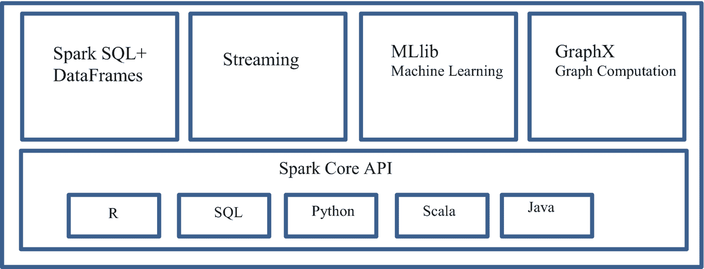
图 2-1 Spark 生态系统概览

Spark 核心是该平台底层的通用执行引擎。Spark 内置了用于 SQL、流处理、机器学习和 GraphX（图处理任务）的组件。

-   **Spark SQL** 最适合处理结构化数据。它使你能够以极快的速度运行 Hive 查询，在现有数据上速度可提升高达 100 倍。
-   **流处理** 支持非传统的实时数据集。它能够对流式数据进行交互式和分析性操作，并与包括 HDFS、Flume、Kafka 和 Twitter 在内的流行数据源良好集成。
-   **机器学习** 是一个基于 Spark 构建的可扩展库，使你能够针对特定用例运行不同的算法。它提供了大多数现成的广泛使用的算法。
-   **GraphX** 是一个基于 Spark 构建的图计算引擎，使你能够以交互方式大规模地创建、转换和推理图结构数据。

速度是 Spark 的代名词，也是其近期广受欢迎的关键驱动力之一。在核心层面，Spark 通过并行处理和内存计算来实现这种速度。Spark 是如何实现这种并行处理的呢？答案是其原生语言 Scala。Scala 基于函数式编程，非常适合并行处理。它在大数据集上进行数据转换的易用性使其成为首选工具。Spark 还拥有丰富的库集，包括机器学习、SQL 和流处理支持。它是在统一环境中驾驭大数据的最通用工具之一。

让我们退一步，看看 Spark 如何在集群上运行以实现并行处理。Spark 的基础源于 MapReduce。MapReduce 是一个用于处理大型数据集的流行框架。它包含两个主要阶段。`map` 阶段是将所有任务分配给不同计算机的阶段。`reduce` 阶段是所有键被逻辑地混洗，并进一步归约以计算有意义的聚合或进行数据转换的阶段。图 2-2 说明了 Spark 在集群模式下的工作方式。

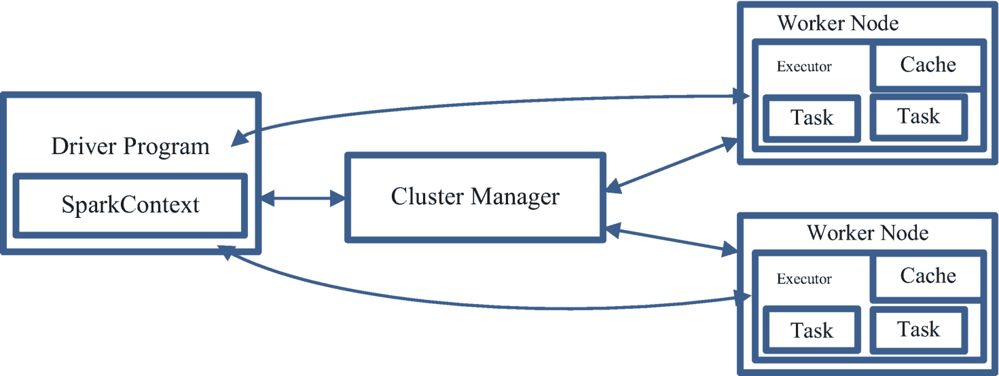
图 2-2 Spark 集群模式概览

当 Spark 启动时，会生成一个独立的进程，并由`SparkContext`或`SparkSession`进行协调，如图 2-2 左侧所示。集群管理器将工作分配给工作节点。图 2-2 中显示了两个工作节点。在实践中，可能有*n*个工作节点。任务对数据集执行一个工作单元，并输出一个新的分区数据集。当对数据执行多个操作时，它们受益于跨这些操作缓存数据所驱动的内存计算。根据操作类型，聚合结果要么发送回驱动程序，要么可以保存到磁盘上。

有向无环图（DAG）是 Spark 中的一个基础概念，对于操作流程的表示和优化都至关重要。当代码提交到 Spark 控制台时，会生成一个算子图，随后在触发操作（如聚合或数据保存）时，该算子图会被转发给 DAG 调度器。然后，调度器将算子图划分为多个阶段。每个步骤可以包含多个数据分区，DAG 调度器会将所有这些单独的算子图捆绑在一起。工作节点的任务是在执行器上执行这些任务。

## Spark 概念与特性

在深入探讨 RDD 和 DataFrame 之前，我们先回顾一下 Spark 的一些概念和特性。你可能会在本书的不同章节中遇到这些术语：

- **不可变性（Immutable）：** 不可变对象可被视为一种数据单元，在转换后无法逆转。这对于实现计算的一致性至关重要，尤其是在并行计算环境中。
- **容错性（Fault-Tolerant）：** 如果在数据转换过程中工作节点发生故障，可以通过在血统中对相应分区重放转换来恢复数据，从而实现相同的计算。这消除了跨多个节点的数据复制。
- **惰性求值（Lazy Evaluation）：** Spark 中的所有转换都是惰性的，这意味着计算不会立即执行。相反，Spark 会记住所有转换逻辑，仅当调用行动操作时才会进行计算。行动操作可以是向驱动程序返回结果，也可以是保存数据集。
- **类型安全（Type Safety）：** 这表示编译器知道预期的列及其数据类型。
- **数据序列化（Data Serialization）：** 这是一种将数据结构转换为特定格式以有效管理数据源和目标的方法。默认情况下，Apache Spark 使用 Java 序列化。
- **数据本地性（Data Locality）：** 通过将执行代码放置在靠近待处理数据的位置来优化处理任务。
- **谓词下推（Predicate Pushdown）：** 此技术允许 Spark 通过使用过滤条件仅处理所需的数据。仅访问所需的文件和分区，从而减少磁盘 I/O。
- **累加器（Accumulators）：** 这些是分配给执行器的全局变量，可以通过结合律和交换律进行累加。
- **Catalyst 优化器（Catalyst Optimizer）：** 这是一个用于实现 Spark SQL 的可扩展优化器。它支持基于规则和基于成本的优化。

现在你可能想知道 PySpark 在这个生态系统中处于什么位置。PySpark 可以被视为 Scala API 之上基于 Python 的封装。PySpark 通过 Py4J 库与 Spark 基于 Scala 的 API 进行通信。该库允许 Python 与 Java 虚拟机代码进行交互。在下一节中，你将了解通过 RDD 和 DataFrame 在 PySpark 中与数据交互的方式。我们将更多地关注 DataFrame，并且你将在下一节中更深入地了解我们做出该决定的原因。

## PySpark 弹性分布式数据集 (RDD) 和 DataFrame

RDD 是数据的元素的不可变分布式集合。它跨集群中的节点进行分区，从而能够通过低级 API 进行并行处理。

RDD 在处理结构化、半结构化和非结构化数据方面非常灵活。它们最适合处理半结构化和非结构化数据。可以使用它们轻松访问这些数据元素，并控制任何低级转换。RDD 是 Spark 核心库的一部分，其操作仅需要 Spark 上下文。

RDD 也确实存在一些挑战。DataFrame 所提供的优化和性能提升在 RDD 中是不存在的。如果你处理的是结构化数据，那么首选始终应该是 DataFrame。只要你能定义模式，就可以随时将 RDD 转换为 DataFrame。

数据集是数据的分布式集合。它兼具 RDD 的优点（强类型、能够使用强大的 lambda 函数）和 Spark SQL 优化执行引擎的优点。数据集可以从 JVM 对象构建，然后通过函数式转换（`map`、`flatMap`、`filter` 等）进行操作。Dataset API 仅在 Scala 和 Java 中可用。Python 不支持 Dataset API。但由于 Python 的动态特性，Dataset API 的许多优点已经可用（例如，你可以自然地通过名称访问行的字段：`row.columnName`）。R 语言的情况类似。

DataFrame 是按列组织的数据集。它以列和行的格式保存数据，类似于表。你可以将列视为变量，将行视为相关的数据点。它在概念上等同于关系数据库中的表或 R/Python 中的数据框，但在底层具有更丰富的优化。DataFrame 可以从多种来源构建，例如结构化数据文件、Hive 中的表、外部数据库或现有的 RDD。DataFrame API 在 Scala、Java、Python 和 R 中均可用。编程操作 DataFrame 需要 `SQLContext`，因为它们位于 Spark 生态系统的 SparkSQL 区域。如果需要，你始终可以将 DataFrame 转换为 RDD。

表 2-1 简要总结了 RDD、DataFrame 和数据集之间的差异。请记住：在本书中，我们使用 DataFrame 作为与数据交互的主要方式。

**表 2-1** Spark 中 RDD、DataFrame 和数据集的功能特性

| 特性 | RDD | DataFrame | 数据集 |
| --- | --- | --- | --- |
| 不可变性 | 是 | 是 | 是 |
| 容错性 | 是 | 是 | 是 |
| 类型安全 | 是 | 否 | 是 |
| 模式 | 否 | 是 | 是 |
| 优化引擎 | 无 | Catalyst | Catalyst |
| 执行优化 | 否 | 是 | 是 |
| API 操作级别 | 低级 | 高级 | 高级 |
| 语言支持 | Java, Scala, Python, R | Java, Scala, Python, R | Java, Scala |

Spark SQL 的 `DataType` 类是所有数据类型的基类，它们主要用于所有 DataFrame 中（见表 2-2）。

**表 2-2** 数据类型

| 数据类型 | 广义分类 |
| --- | --- |
| `BooleanType` | 原子类型：这是一种内部类型，用于表示所有非 null、非数组、非结构体或非映射的内容。 |
| `BinaryType` | |
| `DateType` | |
| `StringType` | |
| `TimestampType` | |
| `ArrayType` | 非原子类型 |
| `MapType` | |
| `StructType` | |
| `CalendarIntervalType` | |
| `NumericType` | |
| `ShortType` | |
| `IntegerType` | |
| `LongType` | |
| `FloatType` | |
| `DoubleType` | |
| `DecimalType` | |
| `ByteType` | |
| `HiveStringType` | |
| `ObjectType` | |
| `NullType` | |

# 第一章：数据操作入门

在上一章中，我们介绍了安装和使用 Spark 的不同方式。现在，让我们进入正题，看看如何执行数据操作。为了本书的目的，我们使用在单机上运行的 Docker 版 PySpark。如果你在分布式系统上安装了 PySpark 版本，我们鼓励使用它来释放并行计算的力量。在单机独立机器上运行操作与在集群上运行操作之间，编程或命令没有区别。请记住，如果你使用单机，将会损失处理速度。

为了演示数据操作，我们使用来自 *themoviedatabase*（TMDB：[`https://www.themoviedb.org/`](https://www.themoviedb.org/)）的数据集。TMDB 是一个社区构建的电影和电视数据库。我们使用 API 提取了其数据的一个样本。该数据包含 44,000 部国际上映电影的信息。我们在数据集中拥有表 2-3 中的信息。该数据集以 CSV 文件形式存在，并使用管道符分隔。该数据集将在本章的 GitHub 页面中共享。

**表 2-3 元数据**

| 变量 | 描述 |
| --- | --- |
| `belongs_to_collection` | 指示电影是否属于某个合集；如果存在，则指定合集。 |
| `budget` | 电影的预算。 |
| `id` | 电影的唯一标识符。 |
| `original_language` | 电影制作的原始语言。 |
| `original_title` | 电影的标题。 |
| `overview` | 电影的概要。 |
| `popularity` | 电影的流行度指数。 |
| `production_companies` | 制作电影的公司列表。 |
| `production_countries` | 电影制作的国家。 |
| `release_date` | 电影上映日期。 |
| `revenue` | 电影票房收入，缺失值用 0 表示。 |
| `runtime` | 电影时长（分钟）。 |
| `status` | 指示电影是否已上映。 |
| `tagline` | 电影标语。 |
| `title` | 电影的英文别名标题。 |
| `vote_average` | 观众的平均投票评分。 |

## 数据操作

我们将使用这些数据直到本章结束，以演示数据操作。

一旦你使用上一章演示的任何方法建立了与 Spark 的连接，就可以启动 PySpark 会话，这可以通过以下代码完成：

```python
from pyspark.sql import SparkSession
spark=SparkSession.builder.appName("Data_Wrangling").getOrCreate()
```

**注意**：上述步骤对于任何 PySpark 程序都是通用的。

正如你从图 2-1 中回忆的那样，`SparkSession` 是入口点，并将你的 PySpark 代码连接到 Spark 集群。默认情况下，所有用于执行代码的已配置节点都处于集群模式设置中。

现在，让我们读取你的第一个数据集。我们使用位于本地机器上、已暴露给 Docker 会话路径中的数据集。我们使用 Docker 方法进行演示。Spark 运行在 Java 8/11、Scala 2.12、Python 2.7+/3.4+ 和 R 3.1+ 上。对于 Java 8 版本 8u92 之前的版本，自 Spark 3.0.0 起已弃用支持。对于 Python 2 和 Python 3 版本 3.6 之前的版本，自 Spark 3.0.0 起已弃用支持。对于 R 版本 3.4 之前的版本，自 Spark 3.0.0 起已弃用支持。如果你使用的是本地版本，请确保拥有正确的 Java 版本以兼容 Spark。与 Python 一样，所有 PySpark DataFrame 变量都区分大小写。

## 从文件读取数据

```python
# 这是数据文件所在的位置
file_location = "movie_data_part1.csv"
# 文件类型，PySpark 也可以读取其他格式，如 json、parquet、orc
file_type = "csv"
# 顾名思义，如果存在底层现有模式，它可以读取该模式
infer_schema = "False"
# 你可以根据文件中是否有标题，将此选项切换为 True 或 False
first_row_is_header = "True"
# 这是数据文件中的分隔符
delimiter = "|"
# 将所有选项组合在一起以读取 csv 文件
df = spark.read.format(file_type) \
.option("inferSchema", infer_schema) \
.option("header", first_row_is_header) \
.option("sep", delimiter) \
.load(file_location)
```

如果你的数据集不是平面文件格式，而是作为 Hive 表存在，你可以通过一个简单的命令轻松读取它，如下所示。

## 从 Hive 表读取数据

使用以下代码从 Hive 表读取数据：

```python
df = spark.sql("select * from database.table_name")
```

**注意**：Spark 仅在读取数据源时映射关系，不会将任何数据加载到内存中。

执行上述命令将使你的数据可供 Spark 访问，你将准备好体验 PySpark 的神奇之处。

一旦开发人员成功从数据源读取数据，他们经常问的第一个问题通常是：如何知道元数据信息？读取元数据的一种便捷方法是通过一个简单的命令。

## 读取元数据

输出如图 2-3 所示。你可以使用此函数快速识别变量及其数据类型：

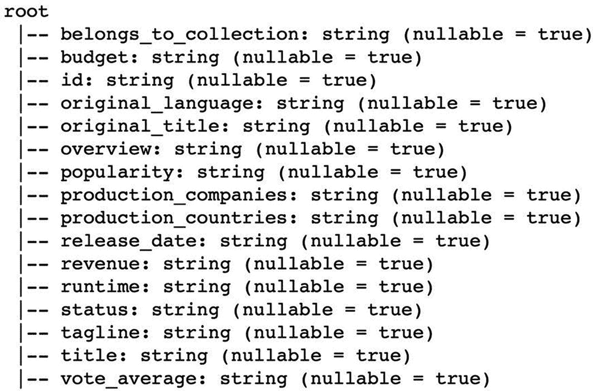

```python
df.printSchema()
```

有多种方法可以实现上述输出。相同的信息也可以通过以下命令以 Python 列表格式提取，这对于进一步的数据操作更可取：

```python
df.dtypes
```

你也可以使用`df.columns`来列出不带数据类型信息的列。

## 计数记录

你可以对数据集执行的另一个快速检查是观察记录总数。这可以通过以下命令完成：

```python
df.count()
```

输出：

```

```

你可以将其包装在 Python 的`print`函数中，以获得更具描述性的输出，如下所示：

```python
print('The total number of records in the movie dataset is '+str(df.count()))
```

输出：

```
The total number of records in the movie dataset is 43998
```

根据我们之前对此数据集的经验，我们知道一些列是字典，并且在其原始形式下没有用处。一些变量包含描述性信息。让我们选择几个随机变量，看看它们的样子。

## 子集列并查看数据概览

同样，有多种方法可以实现以下输出（见图 2-4）：

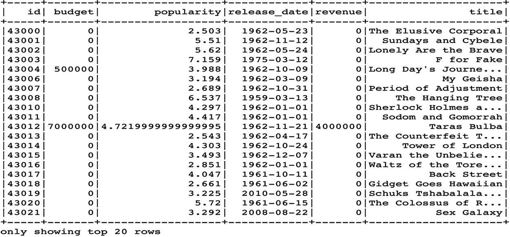

```python
# 定义一个列表来子集所需的列
select_columns=['id', 'budget', 'popularity', 'release_date', 'revenue', 'title']
# 从 DataFrame 中子集所需的列
df=df.select(*select_columns)
# 以下命令显示数据；默认情况下显示前 20 行
df.show()
```

所有操作都在单个语句中完成，如下所示：

```python
df.select('id', 'budget', 'popularity', 'release_date', 'revenue', 'title').show()
```

你还可以选择按索引选择列，而不是从原始 DataFrame 中选择名称：

```python
df.select(df[2],df[1],df[6],df[9],df[10],df[14]).show()
```

如果你已经使用了第一种方法进行子集，请谨慎使用上述选项。它可能会抛出`index out of range`错误。这是因为新的 DataFrame 将只包含列的子集。你还可以通过使用以下语句，将`show`选项中显示的行数更改为所需数量。（在此示例中，我们将数量设置为 25，但可以更改为任意 *n*。）

```python
df.show(25,False)
```

**注意**：使用`False`不仅允许你覆盖默认的 20 行设置，还可以显示被截断的内容（如果有）。

## 缺失值

你可以使用 PySpark 的内置函数计算单列或多列中的缺失值，如下所示：

```python
from pyspark.sql.functions import *
df.filter((df['popularity']=='')|df['popularity'].isNull()|isnan(df['popularity'])).count()
```

输出：

```

```

我们来分解一下前面的命令，看看发生了什么。首先，在 DataFrame 上使用了 `filter` 函数，并基于 `OR` 条件传递了多个条件，在表达式中用 `|` 表示。在第一个条件中，我们搜索 `popularity` 列中存在的空字符串。在第二个条件中，我们使用 `.isNull()` 运算符，当 popularity 为 null 时返回 true；null 表示没有值或空值。在第三个条件中，我们使用 `isnan` 来识别 NaN（非数字）。这些通常是未定义的数学运算的结果。

如果需要计算 DataFrame 中所有的缺失值，可以使用以下命令：

```python
df.select([count(when((col(c)=='') | col(c).isNull() |isnan(c), c)).alias(c) for c in df.columns]).show()
```

此命令选择所有列，并在循环中运行前面的缺失检查。然后在此处使用 `when` 条件来子集化满足缺失值标准的行（见图 2-5）。

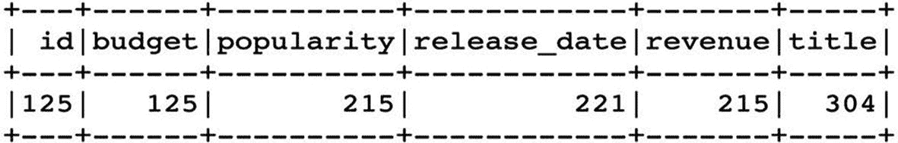

图 2-5

DataFrame 所有列的缺失值输出

注意

在运行任何排序操作之前，请确保导入 `pyspark.sql.functions`。

## 单变量频数

好的，让我们看看如何计算分类变量的频数（见图 2-6）。术语提醒：分类变量是数据集中存在的字符串变量。让我们使用以下代码验证数据集中是否有重复的标题：

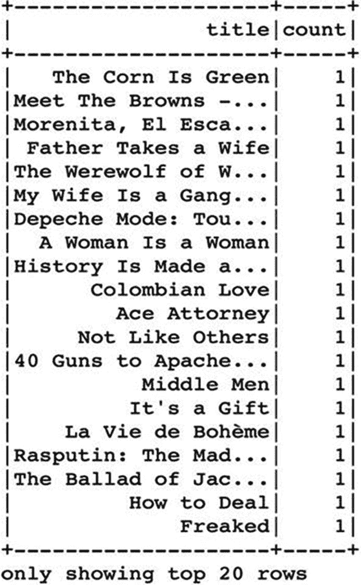

图 2-6

单变量频数输出

```python
df.groupBy(df['title']).count().show()
```

前面的命令给出了一个标题在数据集中出现的次数。通常，你可能希望查看排序后的数据，因此可以使用以下命令（见图 2-7）：

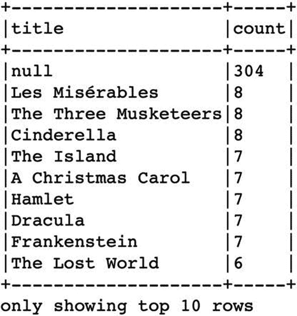

图 2-7

排序后的单变量频数输出

```python
df.groupby(df['title']).count().sort(desc("count")).show(10, False)
```

注意

`groupby` 是 `groupBy` 的别名；两种写法都有效。

有不少标题是重复的。看起来缺少标题是最常见的问题。现实世界的数据可能很混乱。这很好，但你可能希望通过消除任何缺失值并添加额外的过滤器来微调结果，使其仅限制在出现次数超过四次的标题上。

## 排序和过滤单变量频数

首先，过滤掉非空的值。我们使用了不等号（`!=` 和 `~`）来创建一个临时数据集，这样做是为了演示 `not` 条件的使用。

```python
# 子集化并创建一个临时 DataFrame 以消除任何缺失值
df_temp=df.filter((df['title']!=")&(df['title'].isNotNull()) & (~isnan(df['title'])))
# 按 'title' 分组，统计出现次数，过滤出现次数超过四次的标题，按降序排序，并显示前几个结果
df_temp.groupby(df_temp['title']).count().filter("`count` >4").sort(col("count").desc()).show(10,False)
```

如果你没有指定 `desc` 函数，结果将默认按升序排序（见图 2-8）。

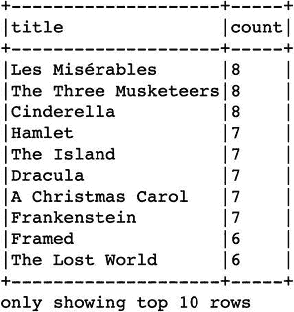

图 2-8

经过过滤和排序的单变量频数输出

```python
# 以下命令用于查找重复出现四次或更多次的标题数量
df_temp.groupby(df_temp['title']).count().filter("`count` >=4").sort(col("count").desc()).count()
```

输出：

```

# 以下命令用于删除我们在过程中创建的任何临时 DataFrame
del df_temp
```

在前面的命令中，你可能已经观察到有多种方法可以达到相同的结果。随着你对这门语言越来越熟练，你可能会形成自己的偏好。

## 变量类型转换

正如你从元数据中观察到的，所有变量都被指示为字符串。在观察数据后，你知道其中一些字段是整数、浮点数或日期对象。如果数据类型没有被正确识别，某些操作可能会导致误导性的结果。我们强烈建议你在任何分析中尽职尽责地识别正确的数据类型。你现在将看到如何将其中一些变量转换为正确的数据类型。

如果你在识别数据类型时不仔细，可能会在转换时遇到数据丢失。例如，如果你将一个字符串列转换为数值列，结果列可能全是 null。在演示数据集的 `tagline` 列上尝试此操作并观察结果。在应用任何转换之前探索数据集是一个好习惯。手动数据中的一些拼写错误（例如，`12,1` 而不是 `12.1`）也可能导致意外结果。

首先在转换前打印数据类型，将 `budget` 变量转换为 `float`，并观察变化（见图 2-9 和 2-10）。

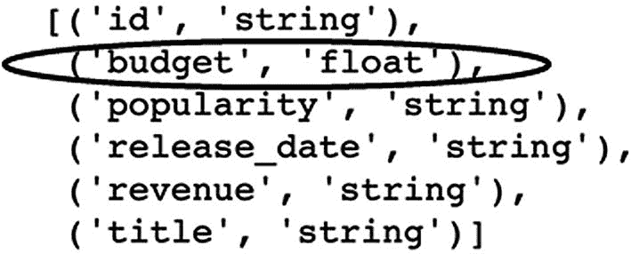

图 2-10

转换后的数据类型

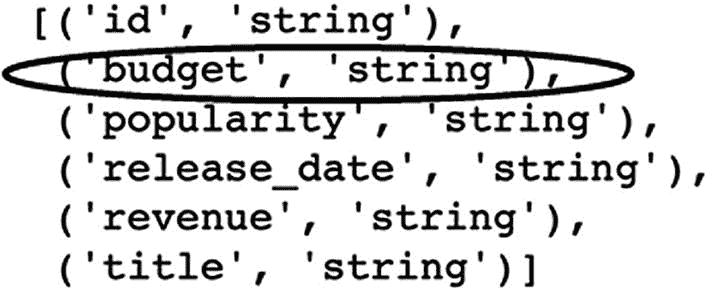

图 2-9

转换前的数据类型

```python
#转换前
df.dtypes
```

```python
#转换
df = df.withColumn('budget',df['budget'].cast("float"))
#转换后
df.dtypes
```

使用了 `cast` 函数。还要注意，我们使用了名为 `.withColumn` 的附加函数。这是 PySpark 中最常用的函数之一。它用于更新数据类型的值，以及重命名和转换它们。它还可以创建新列（见图 2-11 和 2-12）。你将在后续内容中更好地理解它的用途。你可能想知道如何将该函数扩展到多个列。如果你已经知道数据类型，你可以使用已识别变量的列表并在循环中迭代它们。

```python
#导入必要的库
from pyspark.sql.types import *
#识别并分配变量列表
int_vars=['id']
float_vars=['budget', 'popularity', 'revenue']
date_vars=['release_date']
#转换整数变量
for column in int_vars:
df=df.withColumn(column,df[column].cast(IntegerType()))
# 转换浮点变量
for column in float_vars:
df=df.withColumn(column,df[column].cast(FloatType()))
# 转换日期变量
for column in date_vars:
df=df.withColumn(column,df[column].cast(DateType()))
df.dtypes
```

```python
df.show(10,False)
```

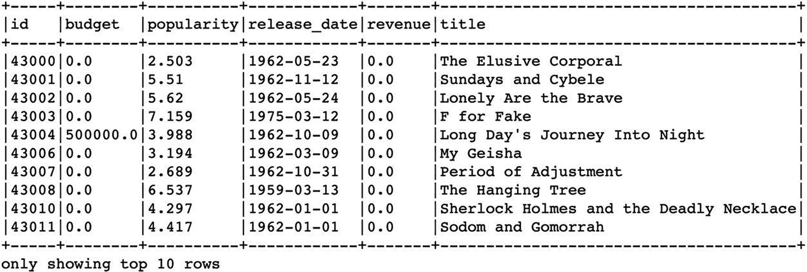

图 2-12

更改数据类型后的数据概览

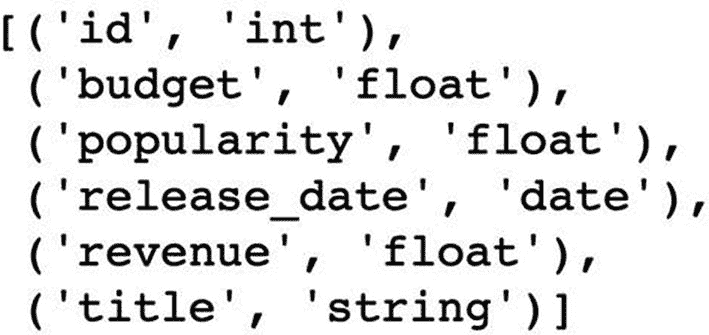

图 2-11

转换后所有变量的数据类型

在前面的输出中，如果你仔细观察，可以看到 `budget` 和 `revenue` 列的值显示方式有明显差异，它们带有一个 `.0` 值，指示了数据类型。比较图 2-4 和图 2-12 以观察转换前后的这些差异。

### 描述性统计

要分析任何数据，你需要对数据类型、分布和离散程度有敏锐的理解。Spark 拥有一套便捷的内置函数，可以让你更轻松地快速计算这些字段。Spark 中的 `describe` 函数非常实用，它能给出每列非缺失值的总数、均值/平均值、标准差以及最小值和最大值（见图 2-13）。你可以转换这个 DataFrame 的输出，并在后续的缺失值插补中使用它。我们将在模型构建部分更深入地讨论这一点。

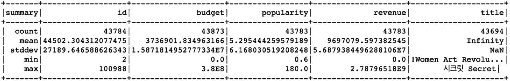

```
df.describe()
```

这里展示的均值是算术平均值，即一组离散观测值的中心值。均值对于许多操作来说是一个很好的估计，但容易受到异常值的影响。异常值有可能显著影响均值。相比之下，中位数提供了更好的估计，因为它不受异常值的影响。然而，计算中位数在计算上可能代价高昂，尤其是因为需要进行排序。

在 Spark 中，由于排序，这个操作可能会消耗大量资源。为了加快计算速度，Spark 实现了一种经过速度优化的 Greenwald-Khanna 算法变体。用于计算中位数的函数是 `approxQuantile`。

`approxQuantile` 函数需要传入三个参数，如下所示：

- `col` – 数值列的名称。
- `probabilities` – 分位数概率的列表。每个数字必须属于 [0, 1]。例如，0 是最小值，0.5 是中位数，1 是最大值。
- `relativeError` – 要达到的相对目标精度 (>= 0)。如果设置为 0，则计算精确分位数，这可能非常昂贵。请注意，大于 1 的值也是可以接受的，但结果与设置为 1 相同。

让我们尝试计算 `budget` 列的中位数。

```
#由于预算中的未知值被标记为 0，让我们在计算中位数之前过滤掉这些值
df_temp = df.filter((df['budget']!=0)&(df['budget'].isNotNull()) & (~isnan(df['budget'])))
#这里的第二个参数表示中位数值，即 0.5；你也可以尝试调整该值来计算其他百分位数
median=df.approxQuantile('budget',[0.5],0.1)
#打印该值
print ('预算的中位数是 '+str(median))
```

输出：

```
预算的中位数是 [7000000.0]
```

如果你想一次性计算多个列的中位数，只需将第一个参数改为 `list` 即可。

### 唯一值/不同值及其计数

有时你可能只想了解一个变量内部的层级数量（基数）。你可以使用 Spark 中提供的 `countDistinct` 函数来确定这一点（见图 2-14）。

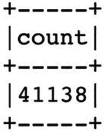

```
# 统计标题的不同出现次数
df.agg(countDistinct(col("title")).alias("count")).show()
```

或者，你也可以使用 `distinct` 函数来查看不同的出现情况（见图 2-15）。

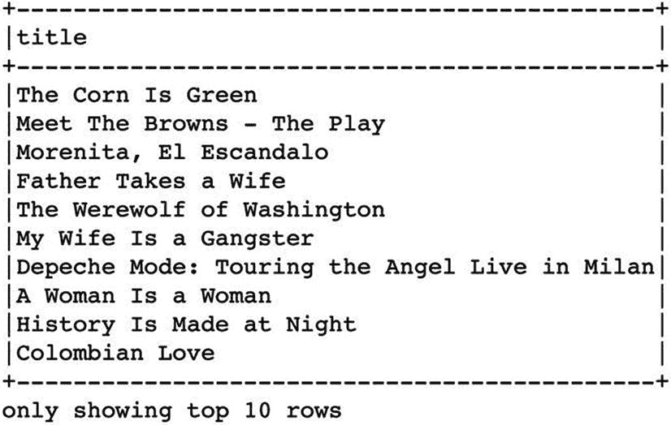

```
# 统计标题的不同出现次数
df.select('title').distinct().show(10,False)
```

直观上，你可能还想按年份查看不同的标题。那么，让我们先从发布日期中提取年份。

```
# 从发布日期中提取年份
df_temp=df.withColumn('release_year',year('release_date'))
```

如果需要，你应该能够使用类似的函数从 `date` 变量中提取月份和日期。以下两个命令仅用于演示目的，并非获得所需输出所必需。第三个命令按年份获取不同计数（见图 2-16）。

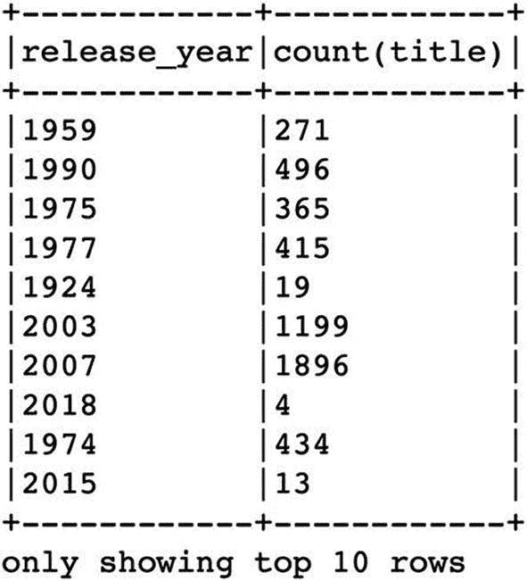

```
# 提取月份
df_temp=df_temp.withColumn('release_month',month('release_date'))
# 提取月份中的日期
df_temp=df_temp.withColumn('release_day',dayofmonth('release_date'))
# 按年份计算不同计数
df_temp.groupBy("release_year").agg(countDistinct("title")).show(10,False)
```

同样，你应该能够使用排序部分讨论的函数，按降序或升序对输出进行排序。

### 过滤

Spark 提供了多种过滤数据的方法。事实上，在进入本节之前，你就已经接触到了 `filter` 函数。这足以说明该函数即使在基本操作中也非常重要。在过滤时，你可能还会遇到 `where` 函数。这两个函数的工作方式相同。不过，`filter` 是 Scala 中此类函数的标准名称，而 `where` 则更受 SQL 用户的青睐。

```
.where() = .filter()
```

之前，你在 `filter` 中接触过包含 `or` 和 `and` 条件的用法。在本演示中，让我们尝试其他可用的数据过滤方法。假设你想过滤所有以 `Meet` 开头的标题，该如何处理？如果你是 SQL 用户，只需使用 `like` 条件即可，如下所示。PySpark 提供了可用于此目的的正则表达式函数（见图 2-17）。

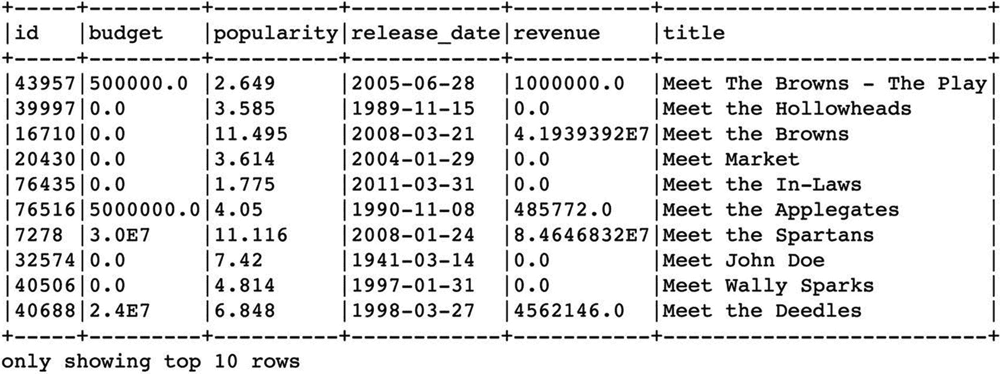

```
df.filter(df['title'].like('Meet%')).show(10,False)
```

现在，让我们找出不以“s”结尾的标题（见图 2-18）。

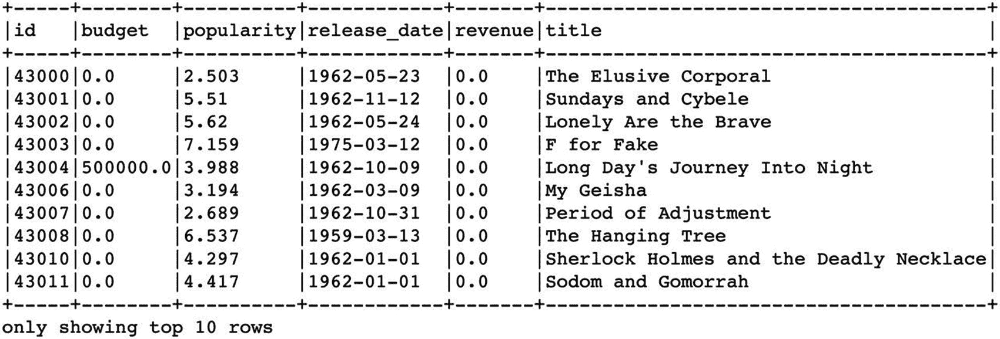

```
df.filter(~df['title'].like('%s')).show(10,False)
```

如果你想查找包含“ove”的标题，可以使用 `rlike` 函数，这是一个正则表达式（regex；见图 2-19）。

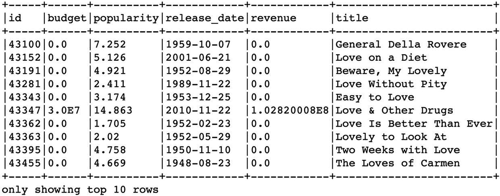

```
df.filter(df['title'].rlike('\w*ove')).show(10,False)
```

上述表达式也可以重写如下：

```
df.filter(df.title.contains('ove')).show()
```

在某些情况下，你会有数千个列，并希望根据特定的前缀或后缀来识别或筛选这些列。你可以使用 `colRegex` 函数来实现这一点。首先，识别以“re”开头的变量（见图 2-20）。

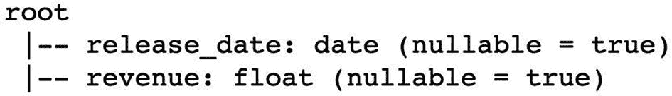

```
df.select(df.colRegex("`re\w*`")).printSchema()
```

那么，如何识别以特定后缀结尾的变量呢？这里有三个以“e”结尾的变量；让我们看看能否通过调整之前的正则表达式来识别它们（见图 2-21）。

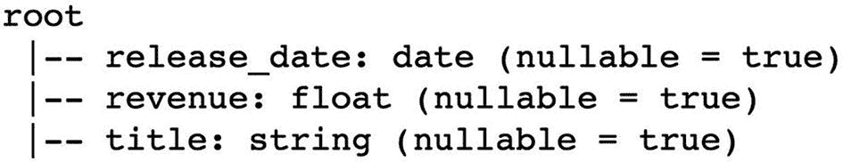

```
df.select(df.colRegex("`\w*e`")).printSchema()
```

正则表达式可能令人困惑，所以让我们简要回顾一下这个主题。通常，你可以通过元字符来识别所有字符和数字。正则表达式使用这些元字符来匹配任何字面量或字母数字表达式。以下是常用元字符的简短列表。

单个字符：

*   `\d` – 匹配 0 到 9 之间的数字
*   `\w` – 匹配所有大小写字母和 0 到 9 的数字 `[A–Z a–z 0–9]`
*   `\s` – 空白字符
*   `.` – 匹配任意单个字符

你还有一组量词，用于指导搜索多少个字符，如下所示。

量词：

*   `*` – 匹配 0 个或多个字符
*   `+` – 匹配 1 个或多个字符
*   `?` – 匹配 0 个或 1 个字符
*   `{min,max}` – 指定范围，匹配介于该范围（包括 `min`, `max`）之间的任意数量字符
*   `{n}` – 精确匹配 *n* 个字符

如果你回顾之前的两个表达式，会发现我们使用了 `\w`，表示我们希望匹配所有字母数字字符，不区分大小写。在识别带有“re”前缀的变量的表达式中，`\w` 后面跟着量词 `*`，表示我们希望包含“re”之后的所有字符。

### 创建新列

创建新特征（列）在许多分析应用中起着关键作用。Spark 提供了多种创建新列的方法。最简单的方法是通过 `withColumn` 函数。假设你想计算流行度的方差。方差是衡量数值与均值离散程度的指标，由以下公式表示：

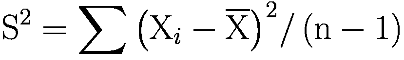

`x[i]` – 单个观测值  
`x` – 均值  
`n` – 观测值总数

那么，首先使用以下命令计算均值。当你需要特定统计量时，这里使用的 `agg` 函数比 `describe` 更好：

```
# 计算平均流行度
mean_pop=df.agg({'popularity': 'mean'}).collect()[0]['avg(popularity)']
count_obs= df.count()
```

由于我们需要将这个值连同单个观测值一起使用，因此使用 `withColumn` 和 `lit` 函数将其添加到所有行中。`lit` 函数是与列字面量交互的一种方式。当你想要直接创建一个包含某个值的列时，它非常有用。

```
df=df.withColumn('mean_popularity',lit(mean_pop))
```

`mean_popularity` 列的所有行都具有相同的值。以下命令中的 `pow` 函数可以帮助你计算一个数的幂。这里，你需要计算平方数，因此传入参数 2。

```
# 计算 'popularity' 列的方差
df=df.withColumn('varaiance',pow((df['popularity']-df['mean_popularity']),2))
variance_sum=df.agg({'varaiance': 'sum'}).collect()[0]['sum(varaiance)']
```

上述命令将所有行的差值求和。在最后一步中，我们将总和除以观测值数量，从而得到结果。

```
variance_population= variance_sum/(count_obs-1)
```

输出：

```
37.85868805766277
```

尽管这个方差计算涉及多个步骤，但目的是让你了解创建新特征可能涉及的操作。一旦你有了方差值，就可以基于它创建自定义变量。

让我们退一步思考。你可能会问：“如果我要创建多个变量，如何一次性完成并保持结构良好？”接下来，我们将为你介绍解决方案。假设你想创建能够将 `budget` 和 `popularity` 变量分类为高、中、低的变量。首先，你需要定义高、中、低阈值的依据。以下阈值仅为方便起见；你可以根据更严格的分析来调整这些值。

以下代码定义了一个简单的 Python 函数。它向函数传递两个变量，并根据阈值决定返回新的变量，这两个变量都是字符串。

```
def new_cols(budget,popularity):
if budget<10000000: budget_cat='Small'
elif budget<100000000: budget_cat='Medium'
else: budget_cat='Big'
if popularity<3: ratings='Low'
elif popularity<5: ratings='Mid'
else: ratings='High'
return budget_cat,ratings
```

现在，有趣的部分来了：我们将使用用户自定义函数。那么，什么是用户自定义函数？如果你来自 Python 世界，它们与 Pandas DataFrame 和 Series 的 `.map()` 和 `.apply()` 方法非常相似。简单来说，用户自定义函数允许开发者将 DataFrame 中行的值作为输入，并将其映射到整个 DataFrame。一个关键点是，你必须指定输出数据类型。不幸的是，这一点无法回避。当需要编写多个列时，这可能会很麻烦。之后我们将讨论另一种方法，可以作为替代方案。

在命令中，你定义了用户自定义函数。注意我们创建了 `StructType` 来保存新变量。我们还显式定义了将要返回的数据类型。我们知道两个返回类型都是字符串，因此我们使用 `StringType()`。`StructType` 对象定义了 Spark DataFrame 的模式。`StructType` 对象包含一个 `StructField` 对象列表，这些对象定义了 DataFrame 中每个列的名称、类型和可空标志。

`StructType` 对象有助于消除代码中的任何顺序依赖关系。我们这么说是什么意思？如果你有多个函数需要在最终步骤之前运行，你可以将它们全部包装在 `StructType` 下，以返回结果数组，而不是创建多个列。这对于读取和管理涉及各种转换和操作的长代码库非常有用。对于此示例，我们将把包含多个输出的 `StructType` 拆分为单独的列，以便进一步访问。

```
# 在 DataFrame 上应用用户自定义函数
udfB=udf(new_cols,StructType([StructField("budget_cat", StringType(), True),StructField("ratings", StringType(), True)]))
```

以下命令传递了一个具有两个输入列的用户自定义函数：`budget`和`popularity`：

```
temp_df=df.select('id','budget','popularity').withColumn("newcat",udfB("budget","popularity"))
# 将结构类型列解包为单独的列，并删除结构类型
df_with_newcols = temp_df.select('id', 'budget',' popularity', 'newcat').withColumn('budget_cat', temp_df.newcat.getItem('budget_cat')).withColumn('ratings', temp_df.newcat.getItem('ratings')).drop('newcat')
df_with_newcols.show(15,False)
```

在以下命令中，请注意我们再次使用 `withColumn` 函数来提取 `StructType` 内的数据。由于我们拥有保存字符串数据类型的 `StructType`，我们使用 `getItem` 函数来访问 `StructType` 中的元素。注意，我们一个接一个地连接函数，以便在一行中实现所需的输出（参见图 2-22）。

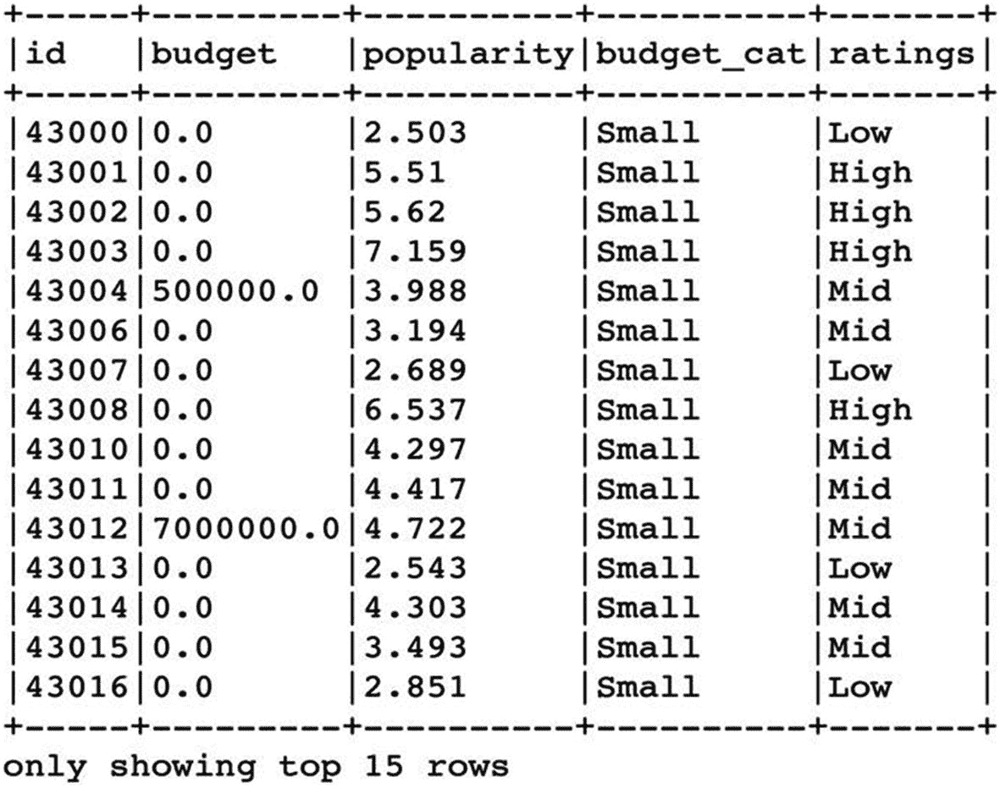

实现相同结果的另一种方法是使用 `when` 函数。使用此函数的一个优点是你无需定义输出数据类型。这对于快速和粗略的操作非常方便。让我们使用 `when` 函数重新创建前面的列。

```
df_with_newcols = df.select('id', 'budget',' popularity').\
withColumn('budget_cat', when(df['budget']<10000000,'Small').when(df['budget']<100000000,'Medium').otherwise('Big')).\
withColumn('ratings', when(df['popularity']<3,'Low').when(df['popularity']<5,'Mid').otherwise('High'))
```

如果你观察前面的命令，可以看到我们连接了许多条件来定义新变量。这会产生与之前方式相同的输出。另一个有用的提示：通过结合使用 `withColumn` 和 `when` 函数，如果你使用相同的列名，可以更新现有列的值。你无需为操作创建新的临时 DataFrame（如图所示）。相反，你可以利用同一个 DataFrame 来更新或添加列值。

### 删除和重命名列

你可以随时使用`drop`函数删除一个或多个列。

```
columns_to_drop=['budget_cat']
df_with_newcols=df_with_newcols.drop(*columns_to_drop)
```

你可以使用`printSchema`函数验证输出。

重命名可以使用`withColumnRenamed`函数或`alias`函数来完成。

```
df_with_newcols = df_with_newcols.withColumnRenamed('id','film_id') .withColumnRenamed('ratings','film_ratings')
```

如果你想更改多个列名，可以尝试以下命令：

```
# 你可以在列表中定义所有变量更改
new_names = [('budget','film_budget'),('popularity','film_popularity')]
# 应用 alias 函数
df_with_newcols_renamed = df_with_newcols.select(list(map(lambda old,new:col(old).alias(new),*zip(*new_names))))
```

上述两种方法具有相同的执行计划。你可以使用`printSchema`函数验证所有这些输出。

练习 2-1 请使用以下数据集：[`https://www.kaggle.com/kakarlaramcharan/tmdb-data-0920`](https://www.kaggle.com/kakarlaramcharan/tmdb-data-0920)。

### Spark 上的 Pandas API

在结束本章之前，我们将探讨 Spark 近几个版本中新增的功能。其中一个亮点是 Spark 上 Pandas API 的集成。对于来自 pandas 世界的用户来说，这可能会改变游戏规则。只需一行代码，你就可以使用熟悉的方法，利用 Spark 的分布式计算能力。同样值得注意的是，Spark 上的 pandas 比 DASK 快得多。如果你不了解 DASK，它是一个用于并行计算的开源 Python 库。

请注意，在使用 Spark 上的 pandas 时，会用到`pyspark.pandas.frame.DataFrame`类。`pandas-on-Spark` DataFrame 和 `Spark` DataFrame 实际上是可互换的。让我们看看 DataFrame 的变体（见图 2-23）。如果你的 dataframe 类以`pyspark`开头，你可以确信它正在使用已配置的并行计算。如果不是，你可以将其更改为 Spark dataframe 或 pandas on Spark dataframe。不要将其与仅在单机上运行的核心 pandas dataframe 混淆。

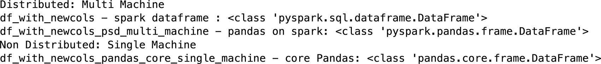

图 2-23

DataFrame 的类型

```
# Dataframe 数据类型:
df_with_newcols_psd_multi_machine = df_with_newcols.pandas_api()
df_with_newcols_pandas_core_single_machine=df_with_newcols.toPandas()
print("分布式: 多机")
print(f'df_with_newcols - spark dataframe : {type(df_with_newcols)}')
print(f'df_with_newcols_psd_multi_machine - pandas on spark: {type(df_with_newcols_psd_multi_machine)}')
print("非分布式: 单机")
print(f'df_with_newcols_pandas_core_single_machine - 核心 Pandas: {type(df_with_newcols_pandas_core_single_machine)}')
```

为了说明如何使用`pandas on spark` DataFrame 类，这里提供了一个示例（见图 2-24 和 2-25）：

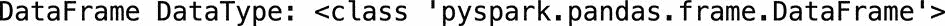

图 2-25

DataFrame 数据类型的输出

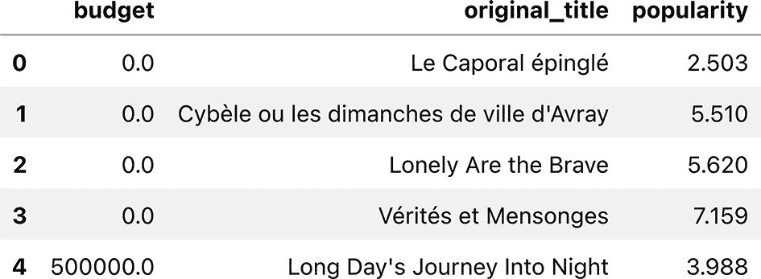

图 2-24

通过 Pandas API 读取 csv 文件的输出

```
#Pandas on spark dataframe
import pyspark.pandas as ps
df_pd_distributed=ps.read_csv("movie_data_part1.csv",sep="|")
df_pd_distributed[['budget','original_title','popularity']].head()
```

```
#验证 dataframe 数据类型
print(f'DataFrame 数据类型: {type(df_pd_distributed)}')
```

在大多数情况下，当你调用 API 时，PySpark 和 Spark 上的 Pandas API 之间的类型转换是自动进行的。你可以使用`dtypes`方法比较转换前后的两个 DataFrame。将 Spark 上的 Pandas API 转换为 PySpark 时也是如此。

Spark 上的 Pandas API 与 pandas 之间的类型转换也非常相似。请注意，某些数据类型是 pandas 独有的，目前尚未计划集成到 Spark 中。

*   `pd.SparseDtype`
*   `pd.DatetimeTZDtype`
*   `pd.UInt*Dtype`
*   `pd.BooleanDtype`
*   `pd.StringDtype`

`transform`和`apply`方法可用于 Spark 上的 Pandas API 进行列操作。`Transform`期望返回与输入 dataframe 相同长度的行，而`apply`方法可以返回任意数量的行。除了这些方法之外，`pandas_on_spark.transform_batch`和`pandas_on_spark.apply_batch`也可用。这些批处理方法允许你调用一个接收并返回 pandas DataFrame 的函数。当你使用这些批处理方法时，Spark 会迭代一个大型 DataFrame，将其分解为多个批次，并为每个批次调用你指定的函数。在较大的数据集上应用这些方法时要小心；**建议所有批次 DataFrame 的索引对齐**。你可能会花费大量时间调试此错误。为避免这种情况，请预先对齐列的索引。

```
# 对列应用转换
import pyspark.pandas as ps
def pandas_plus(pser):
return (pser+1)  # 允许任意长度
df_pd_distributed_func=df_pd_distributed[['budget','popularity']].transform(pandas_plus)
df_pd_distributed_func.head()
type(df_pd_distributed_func)
```

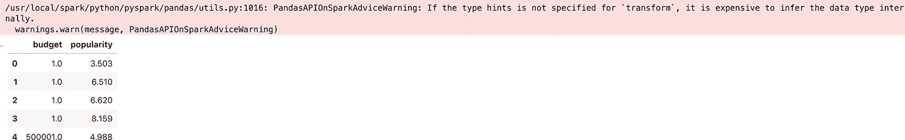

图 2-26

使用 transform 进行数据转换的输出

在上面的例子中，模式是通过取输出的前几行来推断的。这是一个简单的例子。通常的用例可能涉及几个昂贵的操作，例如在执行计划的上游进行数据混洗。Spark 上的 Pandas API 最终会执行 Spark 作业两次——一次用于模式推断，一次用于使用该模式处理实际数据。

为了避免这些后果，Spark 上的 Pandas API 有自己的类型提示风格来指定模式并避免模式推断。Spark 上的 Pandas API 理解返回类型中指定的类型提示，并将其转换为内部使用的 Pandas UDF 的 Spark 模式。类型提示的方式已经演变。

```
def pandas_plus(pser) ->ps.DataFrame[int,float]:
return (pser+1)  # 允许任意长度
df_pd_distributed_func=df_pd_distributed[['budget','popularity']].transform(pandas_plus)
df_pd_distributed_func.head()
type(df_pd_distributed_func)
```

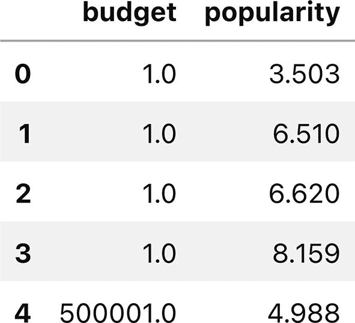

图 2-27

使用 transform 进行数据转换的输出

请注意，一旦在函数定义中包含了类型提示，警告就消失了。最佳实践是使用类型提示来提高操作的性能，尤其是在使用 Spark 上的 Pandas API 时。

Spark 上的 Pandas API 是一个集成层，用户必须注意避免意外的低效。一些需要遵循的最佳实践包括：

*   使用执行计划来了解数据将如何处理；你可以通过调用`.spark.explain()`方法来查看执行计划。
*   在对 Spark 上的 Pandas API 对象进行多次操作后，由于计划庞大且复杂，底层的 Spark 规划器可能会变慢。如果 Spark 计划变得巨大或需要很长时间，`DataFrame.spark.checkpoint()`或`DataFrame.spark.local_checkpoint()`可能会有所帮助。
*   由于数据交换，像排序值这样的操作在并行或分布式环境中比在单内存机器上执行更具挑战性。
*   避免在单个分区上进行计算。如果你在未指定分区的情况下使用 rank，则可能会将所有数据放入单台机器的单个分区中。
*   避免使用保留或重复的列名。
*   Spark 上的 Pandas API 默认禁止对不同 DataFrame（或 Series）进行操作，以防止昂贵的操作。减少对不同 DataFrame 或 Series 的操作。

### 练习 2-1：数据操作

**问题 1：** 找出 2000 年至 2015 年间重复出现的标题，并统计标题数量。（提示：使用过滤器。）

**问题 2：** 找出标题名称中包含 Harry 的所有标题。

**问题 3：** 创建一个新列，作为原始语言是否为英语的二元指示符。

**问题 4：** 按年份统计受欢迎程度的平均值。

## 总结

*   你了解了 Spark 生态系统的概况，并学习了 PySpark 如何融入这个环境，同时你也了解了使用 Spark 的优势。
*   你现在知道了 RDD、DataFrame 和数据集之间的区别。
*   你深入研究了数据操作，并学会了使用各种内置函数。
*   你了解了用户定义函数，并看到了它的实现和机制。
*   你学习了 Spark 上的 Pandas API、它的实现和最佳实践。

干得好！你现在已经熟悉了一些关键概念，这些概念在你阅读本书的整个过程中都很有用。在下一章中，我们将深入探讨一些中级和高级的数据操作技术。

