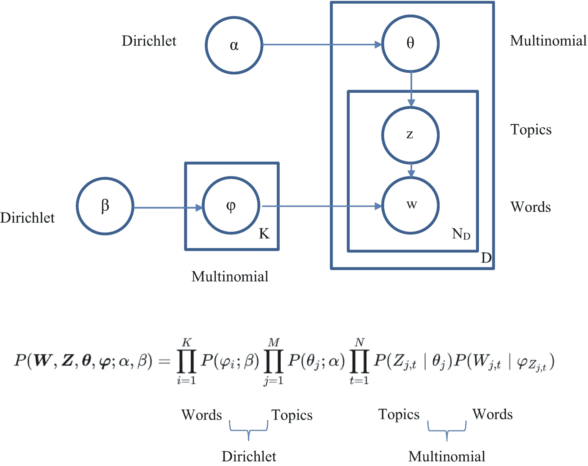
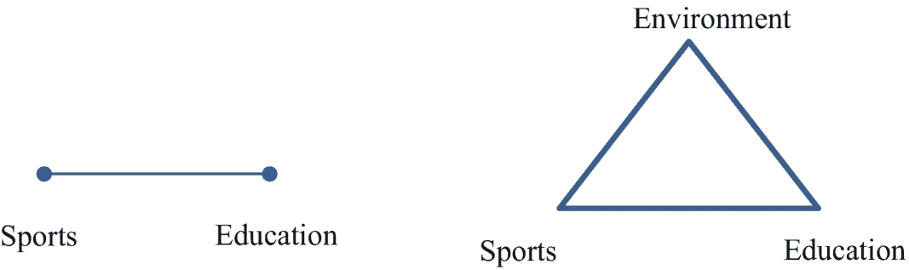
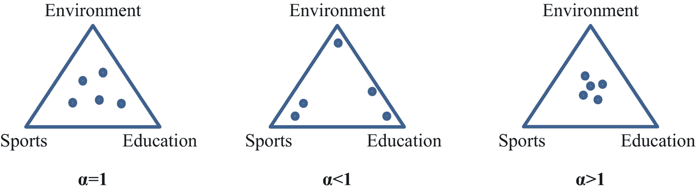
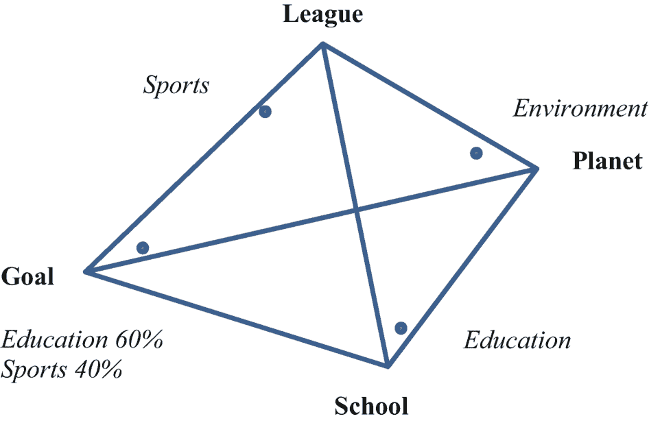
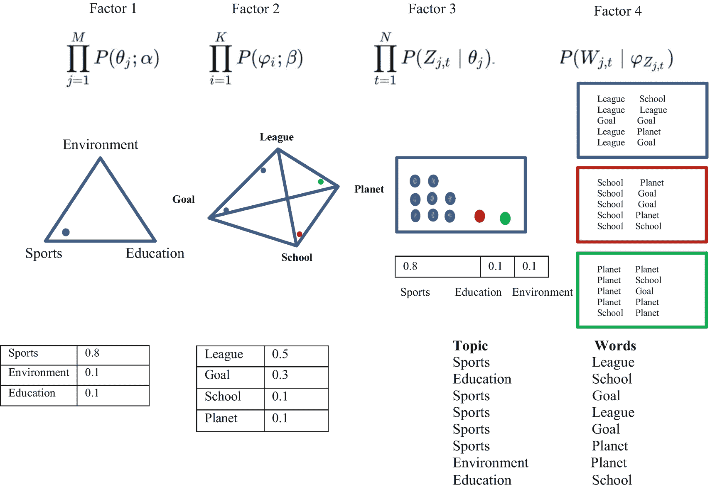
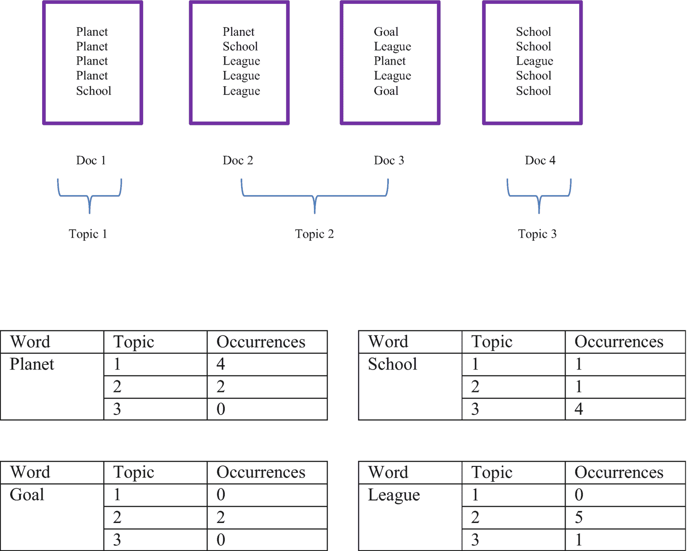

# 通过计算轮廓系数评估聚类效果
evaluator = ClusteringEvaluator()
silhouette = evaluator.evaluate(predictions)
sil_coeff.append(silhouette)
num_clusters.append(iter)
print("对于 " +str(iter) +" 个聚类的解决方案，使用平方欧氏距离的轮廓系数 = " + str(silhouette))
df_viz=pd.DataFrame(zip(num_clusters,sil_coeff), columns=['num_clusters','silhouette_score'])
sns.lineplot(x = "num_clusters", y = "silhouette_score", data=df_viz)
plt.title('k-means : 轮廓系数')
plt.xticks(range(2, 8))
plt.show()
```

## 潜在狄利克雷分配 (LDA)

潜在狄利克雷分配 (LDA) 可以帮助你使用统计模型识别文档集合中的抽象主题。LDA 于 2003 年提出，已被应用于文本分析之外的许多领域，例如情感分析和图像的目标定位。为了解释 LDA，我们从一个简单的图示开始（见图 7-12）。



图 7-12 潜在狄利克雷分配演示

乍一看，这个图和公式可能会让人不知所措。让我们分解一下并理解各个组成部分。首先，什么是狄利克雷？狄利克雷分布是一族连续多元概率分布，由一个正实数向量参数化。它是贝塔分布的多元推广。图 7-12 中的 `∝` 和 `β` 是狄利克雷分布。`θ` 和 `φ` 是多项分布。利用这些分布，我们创建单词和主题，进而可以创建文档。

你可以将 LDA 视为一个生成文档的引擎。在等式的左侧，我们有一个文档出现的概率。通过调整右侧的因子，我们可以期望生成具有不同主题和单词的不同风格的文档。等式的前两个组成部分是狄利克雷分布。单词 (`β`) 可以是阶数为 `n` 的单纯形，具体取决于关键词的数量。主题 (`∝`) 可以是阶数小于或等于 `n` 的单纯形。

从视觉上考虑狄利克雷分布。假设你有两个主题：体育和教育。你可以在视觉上将它们表示为图 7-13 中的狄利克雷分布。你可以添加另一个主题：环境；其表示形式也已显示。如果有四个主题，请记住它将是一个 3 阶单纯形，即一个四面体，而不是一个正方形。



图 7-13 狄利克雷分布表示

如果文档包含体育内容，它们将向体育一侧表示，而教育文档将向教育一侧表示。这就是分布随着 `∝` 的不同值而变化的方式（见图 7-14）。



图 7-14 狄利克雷分布的变化

如果 `∝` 的值等于 1，则文章中的主题分布均匀。如果 `∝` 的值小于 1，则主题分离良好，文档分散在角落。如果 `∝` 的值大于 1，则所有文档都聚集在中心，主题没有很好的分离。大多数文章的内容倾向于遵循 `∝<1` 的分布。下一个问题是，单词呢？我们对单词重复相同的概念。在图 7-15 中，我们使用了四个单词：league、planet、school 和 goal。我们将单词放在角落，并将点作为主题。



图 7-15 单词的主题

我们现在可以将这些放入等式的视角中，并演示从该 LDA 生成单个文档的过程。为了演示，我们将公式分解为四个因子，如图 7-16 所示。



图 7-16 公式分解


第一个因素是 2 阶单纯形，其顶点包含主题，我们随机选取一个点作为将要创建的文档之一。请注意，该点偏向于体育主题。我们可以将这个点表示为一个文档，其中大约包含 80%的体育、10%的环境和 10%的教育内容。我们使用这些百分比在因子 3 中创建多项分布。如图 7-16 所示，我们在体育、教育和环境主题的盒子内模拟了相同的百分比分布。如果我们多次从主题盒子中随机抽取一个主题（有放回），可以预期主题分布将如图 7-16 中因子 3 所示。

现在，我们想要找到与主题对应的单词。为此，我们选取因子 2，其顶点是单词，点代表主题。我们根据单词在四面体中的位置来量化与体育相关的单词百分比。这表示在因子 2 下方的表格中。对应的多项分布表示在因子 4 的第一个盒子中。基于因子 2 中教育和环境的狄利克雷分布，可以为剩余的教育和环境主题获得类似的多项分布。

现在，我们回到因子 3，即主题分布。我们选择第一个主题，即体育。我们查找因子 4 中对应的单词多项分布，并从第一个盒子中随机选择一个单词，恰好是`league`。然后，我们移动到第二个主题实例，即教育。接着，我们使用因子 4 中代表教育的第二个盒子，并随机选择一个单词。假设这个随机单词是`school`。我们对剩余的主题重复此过程，以识别对应的单词。

从所有主题中识别出的单词堆叠在一起，将构成我们的文档。这个机器生成的文档可能没有意义，只是不同单词的组合。这是可以接受的，我们多次重复此过程，改变四个因子的设置以生成多个文档。我们验证这些机器生成文档与输入文档的相似性。在多次迭代中，原始文档与机器生成文档相似的概率很低。随着我们多次重复此过程，我们观察每次迭代中相似度如何变化，并选择使机器生成文档与输入文档之间相似度最大化的设置。

### LDA 实现

你现在可能想知道，当面对一个文档语料库时，如何确定主题的数量。答案是通过超参数设置。在 LDA 中，主题的数量也是一个超参数。结果会根据所选主题的数量而变化。当你向计算机提供一个文档语料库时，它不会像人类那样理解任何解释。但计算机擅长识别文档中单词出现的频率。你还可以验证这些单词在整个语料库的不同文档中是如何出现的。利用这些信息，你可以将单词标记到主题上。驱动此过程的主要属性有两个，如下所示：

*   每篇文章主要包含一个单一主题
*   每个单词主要与一个单一主题关联

如果我们分解上述属性，以图 7-17 所示的四个文档为例，我们会发现文档包含混合的单词；通常文档中存在一个主导主题。我们可以定量地确定单词出现的次数，然后相应地将其标记到不同的主题。假设我们选择了三个主题，我们将把这四个文档分类为主题 1、主题 2 和主题 3。



图 7-17

示例语料库

第二个属性通过按主题划分的单词出现情况来展示。尽管存在一个单词与多个主题关联的多个实例，但每个单词都强烈倾向于一个单一主题。为简单起见，假设大多数情况决定了单词到主题的分配。那么我们将得到表 7-11 所示的数据。

表 7-11

主题分配

| **单词** | **主题** |
| --- | --- |
| `Planet` | 主题 1 |
| `Goal` | 主题 2 |
| `League` | 主题 2 |
| `School` | 主题 3 |

如果存在一些常见的单词，例如`the`、`is`和`any`，它们会使用自然语言处理技术*词频-逆文档频率*（`tf–idf`）被消除。这是一种用于识别语料库中最重要单词的技术。`tf–idf`值随着单词在文档中出现次数的增加而成比例增加，并通过包含该单词的语料库文档数量进行抵消，这有助于调整某些单词通常更频繁出现的事实。

我们可以将问题陈述概括为：将所有单词分类到给定/选择的主题数量中，如果可能，为每个文档保留一个单一主题，并且如果可能，将每个单词归入一个单一主题。这是通过*吉布斯采样*完成的。我们试图做的是找出描述主题模型中潜在变量的变量。我们假设一组潜在变量完全描述了从主题到分配再到指派，最终生成完整文档的过程。

吉布斯采样允许我们逐个将所有单词与正确的主题组织起来。这通过几个步骤完成。第一步涉及文档内的单词搜索，第二步涉及跨文档的单词搜索。使用图 7-17，从文档 1 中，我们选取第一个单词`planet`。我们不会将这个单词分配给任何主题，而是计算文档中其他单词如何被分配到不同的主题。我们有三个`planet`单词和一个`school`单词。根据表 7-11，这三个`planet`单词被分配到主题 1，`school`被分配到主题 3。现在，我们将查看单词`planet`在不同主题中的出现情况（表 7-12）。

表 7-12

主题出现情况


| **主题** | **主题词分配** | **出现次数** | **估计值** |
| --- | --- | --- | --- |
| 主题 1 | 主题 1 在文档 1 中的占比 | 3 | 2 + α |
| 主题 1 中“星球”一词的占比 | 4 | 4 + β |
| 主题 2 | 主题 2 在文档 1 中的占比 | 0 | 0 + α |
| 主题 2 中“星球”一词的占比 | 2 | 2 + β |
| 主题 3 | 主题 3 在文档 1 中的占比 | 1 | 1 + α |
| 主题 3 中“星球”一词的占比 | 0 | 0 + |

利用这些出现次数，我们可以计算某个词属于某个主题的概率。如果仅针对每个主题单独使用这些出现次数，可能会遇到估计值为 0 的问题，从而导致所选词无法被分配到其他主题。为了解决这个问题，我们添加了小的调整项 α 和 β。如果你还记得图 7-16 中的公式，α 和 β 是狄利克雷分布。我们对每个文档中的所有词重复此过程多次，直到最大化本节前面讨论的两个属性。吉布斯采样的一个关键要点是，你可以对词进行重新分类，使其尽可能与单个主题关联。由于此过程是迭代进行的，计算机将帮助你识别每个文档中的主题，并给出定义该主题的词列表。作为最后一步，我们需要观察这些关键词，并为这些主题打上标签。

我们将使用一个真实世界的示例来展示如何使用 PySpark 实现 LDA。为此，我们使用了来自 Kaggle 的数据集（[`https://www.kaggle.com/PromptCloudHQ/amazon-echo-dot-2-reviews-dataset`](https://www.kaggle.com/PromptCloudHQ/amazon-echo-dot-2-reviews-dataset)）。该数据集包含对智能音箱 Echo Dot 的评论，包含以下字段：

- `Page URL`
- `Title`
- `Review Text`
- `Device Color`
- `User Verified`
- `Review Date`
- `Review Useful Count`
- `Configuration`
- `Rating`
- `Declaration Text`（例如：Vine Voice、Top 100 reviewer 等）

我们在此建模练习中使用 `Review Text` 列。

```
