## 4. 变量选择

变量选择是一门艺术。本章旨在帮助你理解可用于在数据集中选择最佳特征的不同变量选择技术。这是数据科学中的关键流程之一。简单来说，假设你是一支足球队的教练。你想挑选最好的队伍来赢得世界杯。你需要每个位置上的最佳球员（最佳特征），并且你不希望在特定时间内有太多踢同一位置的球员（多重共线性）。在 PySpark 中，有多种方法可以完成这项任务。本章将介绍一些内置和自定义的变量选择技术（见图 4-1）。

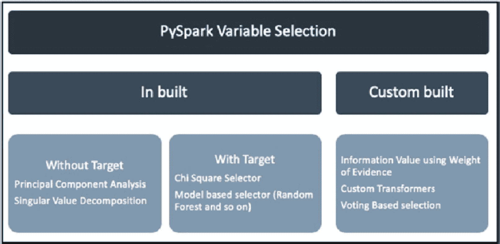
图 4-1 变量选择

接下来的页面将探讨每种技术背后的概念，通过手动计算来了解它们的工作原理 *（必要时）*，最后使用 PySpark 实现它们。在本章中，我们使用来自 UCI 机器学习库（网址为 [`https://archive.ics.uci.edu/ml/datasets/Bank+Marketing`](https://archive.ics.uci.edu/ml/datasets/Bank%252BMarketing)）的银行数据集。你需要从 `data` 文件夹下载 `bank.zip` 文件以获取 `bank-full.csv` 文件。在继续之前，请考虑图 4-2 中这种直观的变量选择方式。

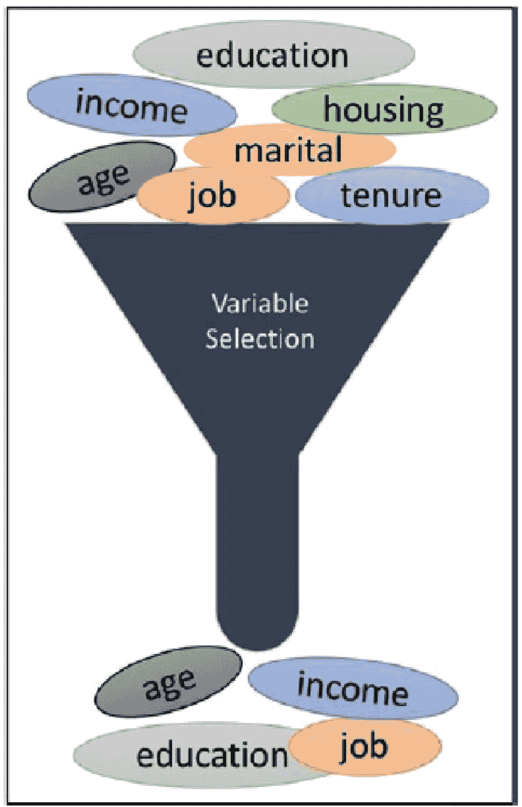
图 4-2 思考变量选择的直观方式

在图 4-2 中，最初会考虑许多特征（显示在漏斗顶部）。然而，只有那些必需且关键的特征最终会通过变量选择技术被选中（漏斗底部）。通过选择正确的特征集（移除冗余或不相关的变量），可以提高模型的准确性和性能，从而缓解维度灾难。因此，变量选择是数据科学过程中一个迭代且关键的步骤。

### 探索性数据分析

探索性数据分析（EDA）用于分析和研究数据集，通过汇总或可视化方法识别特征和模式。前面的章节已经通过大量代码示例广泛介绍了这个主题。我们建议你将这些代码片段应用于你处理的任何数据集。当你更好地理解数据时，你可以快速做出决策并解释决策背后的理由。EDA 也可以成为变量选择过程中一个强大的第一步。如果你想知道如何操作，可以考虑基数（见本节定义）和缺失值。在进行任何机器学习练习时，检查这两点是一个好习惯。

让我们用这个房价示例来更好地理解基数和缺失值（见图 4-3）。

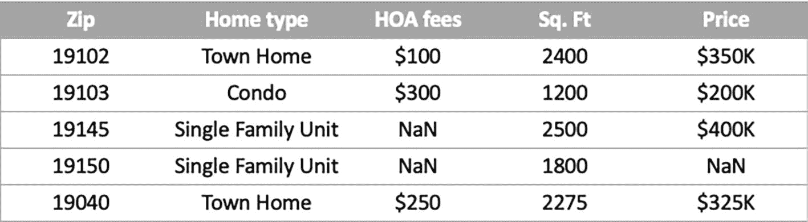
图 4-3 房价数据集

#### 基数

基数是一个变量中唯一值的数量。假设你正在构建一个预测房价的模型。所有记录的 `房屋类型` 变量都是“独栋住宅”。在这种情况下，该变量的基数为 1（“独栋住宅”）。`房屋类型` 没有提供任何有用信息，因为无论你选择哪条记录，该变量都提供相同的信息（“独栋住宅”）。因此，你可以省略此变量，并使用其他变量来构建预测模型。虽然你可以计算任何变量的基数，但基数对于分类变量更为有用。在图 4-3 中，`房屋类型` 的基数为 3，表示有三个不同的值（“联排别墅”、“公寓”和“独栋住宅”）。

#### 缺失值

顾名思义，缺失值指的是缺失的信息片段。你需要理解信息缺失背后的原因，以便构建更好的模型。通常，数据可能因以下三个原因而缺失：

- 随机缺失（MAR）
- 完全随机缺失（MCAR）
- 非随机缺失（MNAR）

通过理解缺失信息的类型，你可以相应地处理数据。下一节将使用相同的房价示例来解释缺失值。

##### 随机缺失（MAR）

当数据随机缺失时，缺失数据与观测数据之间存在关系。房价示例可以帮助解释这一点。当你仔细观察 `房屋类型` 和 `HOA 费用`（业主协会费用）变量时，你会发现当 `房屋类型` 为“联排别墅”或“公寓”时，`HOA 费用` 有一个值；而当 `房屋类型` 为“独栋住宅”时，该费用缺失。这是有道理的，因为独栋住宅（在许多情况下）没有 HOA 费用。在这种情况下，“独栋住宅”的 `HOA 费用` 可以用零来填充。这种类型的缺失数据称为随机缺失（MAR）。

> 注意：填充是数据科学文献中填充缺失值的一种方法。

##### 完全随机缺失（MCAR）

当数据完全随机缺失时，缺失数据与观测数据之间没有关系。考虑数据中的 `价格` 变量。其中一个房价缺失了。与 MAR 示例不同，你无法从这种缺失数据中推导出任何逻辑。信息缺失背后可能有很多原因。也许房子正在挂牌拍卖，或者房子是新建的，卖家尚未确定价格，或者可能有其他原因。无论如何，缺失的价格与观测数据无关。这是数据完全随机缺失（MCAR）的典型示例。要填充此数据，你可能需要使用自己的逻辑。我们确实有一些关于如何处理此类缺失数据的建议，如下所示：

- 均值、中位数或众数填充
- 基于模型的填充（这将在后续章节中讨论）
- 多重填充
- 使用业务逻辑填充缺失信息
- 删除缺失数据严重的特征（变量选择）
- 删除包含缺失值的行（最不推荐，因为可能导致信息丢失）

如何使用业务逻辑来填充缺失信息？假设你在 Zillow 工作，并且知道只有当房子挂牌拍卖时，`价格` 信息才会缺失。在这种情况下，你的团队建议你对挂牌拍卖的房屋使用默认价格（比如 1 美元）。然后，你就可以用 1 美元来填充价格。

##### 非随机缺失（MNAR）

当数据非随机缺失时，意味着数据未被收集。在当前示例中，我们不知道房屋的建造年份（`year`）。此信息缺失是因为我们在数据收集过程中未考虑 `Year` 变量。要解决此问题，您应理解并改进数据收集流程，以纳入缺失的信息。

我们已经详细讨论了缺失值的类型。您能否利用这一点来剔除数据集中的变量？可以。大多数数据科学从业者会根据数据缺失的百分比来剔除变量。例如，您可以剔除缺失值超过 80%的变量。80%并非标准值，可根据具体情况调整。

#### 练习 4-1：缺失值与基数

下载墨尔本住房数据集：[`https://www.kaggle.com/dansbecker/melbourne-housing-snapshot/data#`](https://www.kaggle.com/dansbecker/melbourne-housing-snapshot/data#)。

**问题 1：** 计算数据集中每个变量的基数。您能否根据基数剔除某些变量？（提示：查找基数为 1 的变量。）

**问题 2：** 计算数据集中每个变量的缺失值百分比。您能否根据缺失值剔除某些变量？（提示：仅针对此练习，剔除缺失值超过 45%的变量。）

**问题 3：** 使用中位数填充 `YearBuilt` 列。（提示：对 `relativeError` 使用 0.1。）

**问题 4：** 填充 `BuildingArea` 列，创建一个名为 `mean_imputed_BuildingArea` 的新变量，并计算填充后的新均值。

回到银行数据集，让我们加载数据集并执行基于探索性数据分析（EDA）的变量选择。

```python
filename = "bank-full.csv"
target_variable_name = "y" #此变量也可稍后设置
```

使用以下代码加载数据：

```python
from pyspark.sql import SparkSession
spark = SparkSession.builder.getOrCreate()
df = spark.read.csv(filename, header=True, inferSchema=True, sep=';')
df.show()
```

您需要为此数据集提供分号（`;`）作为分隔符，否则无法正常工作。此外，请注意文件加载操作中的新选项 `inferSchema`。启用此选项后，它会自动推断数据集中每列的数据类型。图 4-4 展示了启用和未启用此选项时的模式推断结果。

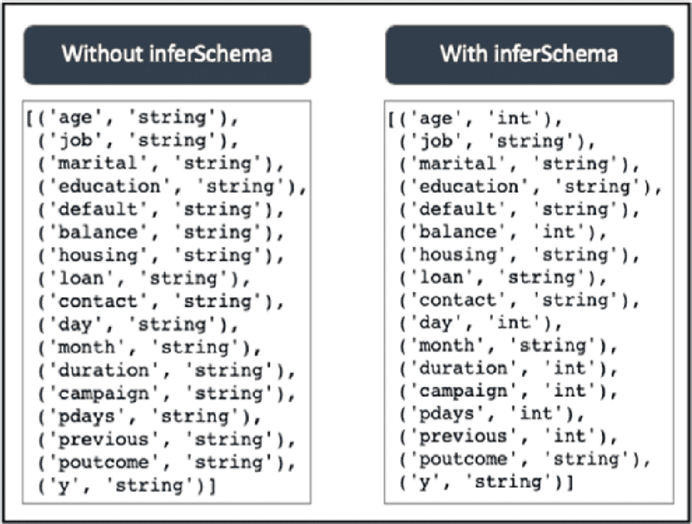
图 4-4 `inferSchema` 选项输出差异

将数据加载到环境后，可参考以下代码开始探索数据：

```python
#数据长度
df.count() #45211
#描述数据
df.describe().toPandas() #后续检查缺失值和基数
#每个变量的类型
df.dtypes
df.printSchema()
#按分组统计单个变量计数
df.groupBy('education').count().show()
#目标变量计数
df.groupBy(target_variable_name).count().show()
#多列分组
df.groupBy(['education',target_variable_name]).count().show()
#列聚合
from pyspark.sql.functions import *
df.groupBy(target_variable_name).agg({'balance':'avg', 'age': 'avg'}).show()
```

我们希望强调图 4-5 中描述的数据输出，并将其与之前讨论的基数和缺失值联系起来。`summary` 列中的 `count` 行给出了变量中非缺失值的数量。总观测值与该列的差值即为每列中的缺失值总数。我们再查看两个统计量：`summary` 列中的 `min` 和 `max` 行。当某个变量的 `min` 和 `max` 行值相同时，该变量的基数为 1。如果无法理解，没关系。您可以使用以下代码执行这些检查。

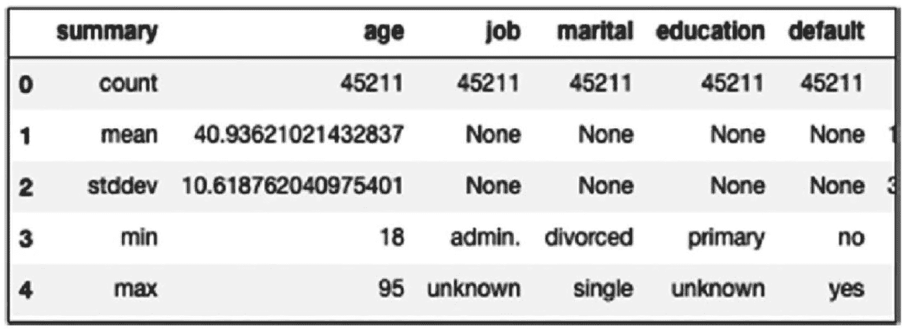
图 4-5 列聚合摘要

##### 代码 1：基数检查

此代码片段允许您快速分析 Spark DataFrame 中每列的基数（唯一值的数量），根据指定阈值（`cut_off`）识别任何低基数列，并使用 pandas 以结构化格式检索结果，以便于操作和解释。

```python
# 基数检查
from pyspark.sql.functions import approxCountDistinct, countDistinct
"""
注意：approxCountDistinct 和 countDistinct 可互换使用。唯一的区别在于计算时间。
"approxCountDistinct" 适用于大型数据集
"countDistinct" 适用于中小型数据集。
"""
def cardinality_calculation(df, cut_off=1):
    cardinality = df.select(*[approxCountDistinct(c).alias(c) for c in df.columns])
    ## 转换为 pandas 以进行高效计算
    final_cardinality_df = cardinality.toPandas().transpose()
    final_cardinality_df.reset_index(inplace=True)
    final_cardinality_df.rename(columns={0:'Cardinality'}, inplace=True)
    #选择基数为 1 的变量
    vars_selected = final_cardinality_df['index']
    [final_cardinality_df['Cardinality'] <= cut_off]
    return final_cardinality_df, vars_selected
cardinality_df, cardinality_vars_selected = cardinality_calculation(df)
```

##### 代码 2：缺失值检查

```python
#缺失值检查
from pyspark.sql.functions import count, when, isnan, col
# 如书中所述，miss_percentage 设置为 80%
def missing_calculation(df, miss_percentage=0.80):
#检查 NaN 和 null 值
missing =
df.select(*[count(when(isnan(c) | col(c).isNull(), c)).alias(c) for c in df.columns])
# 计算 DataFrame 的总长度
length_df = df.count()
## 转换为 pandas 以便高效计算
final_missing_df = missing.toPandas().transpose()
final_missing_df.reset_index(inplace=True)
final_missing_df.rename(columns={0:'missing_count'}, inplace=True)
final_missing_df['missing_percentage'] =
final_missing_df['missing_count']/length_df
#选择基数为 1 的变量
vars_selected = final_missing_df['index'][final_missing_df['missing_percentage'] >= miss_percentage]
return final_missing_df, vars_selected
missing_df, missing_vars_selected = missing_calculation(df)
```

对于银行数据集，没有列因这两项检查而被剔除。然而，在实际数据集中，你会看到在执行基数和缺失值检查后，有少量列可以被删除。这就是你需要学习的基于 EDA 的变量选择技术的全部内容。在继续学习其他选择技术之前，我们还要在 EDA 中再进行一次特征工程练习。这将确保你的数据为下游任务做好准备。请记住图 4-4，其中我们仍然有一些字符串列。下一组选择技术要求所有列都是数值型（整数或浮点数）。

将字符串转换为数值可以通过以下选项之一实现：

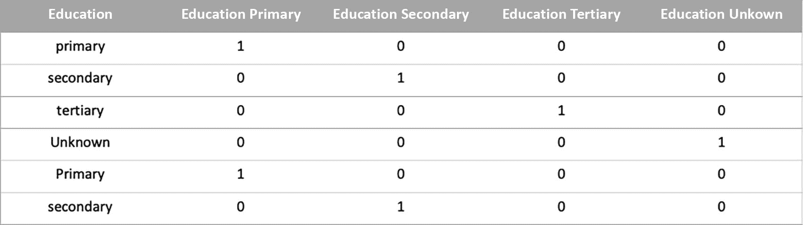
图 4-6 独热编码器

1.  单独将列转换为所需的数据类型。这对于大型数据集来说很繁琐。

2.  来自 `pyspark.ml.feature` 的 `OneHotEncoder`（适用于 Spark >= 3.0）或 `OneHotEncoderEstimator`（适用于 Spark >= 2.3）。此选项将为每个类别创建虚拟变量，从而增加你处理的特征数量。在此数据集中，`education` 变量有四个类别：primary、secondary、tertiary 和 unknown。在此列上使用 `OneHotEncoder` 后，输出如图 4-6 所示。*注意：PySpark 默认情况下不会产生像图* *4-6* *那样的输出；它需要使用前一章讨论的 UDF 函数进行一些调整。*

3.  来自 `pyspark.ml.feature` 的 `StringIndexer`。此选项为每个级别分配一个数字。最频繁出现的值将获得索引 0，其次是次频繁的值，依此类推。使用 `StringIndexer` 对 `education` 变量的输出将如图 4-7 所示。尽管 `StringIndexer` 的输出看起来像有序输出（递增顺序），但不应将其视为有序。大多数算法无法将此变量视为名义输出（互斥级别）。这是 `StringIndexer` 的缺点之一。

4.  最后一个选项是使用加权索引，例如证据权重（WOE），这将在本章后面讨论。它克服了 `StringIndexer` 和 `OneHotEncoder` 面临的缺点。它使用目标群体与非目标群体的分布来为每个类别创建权重。

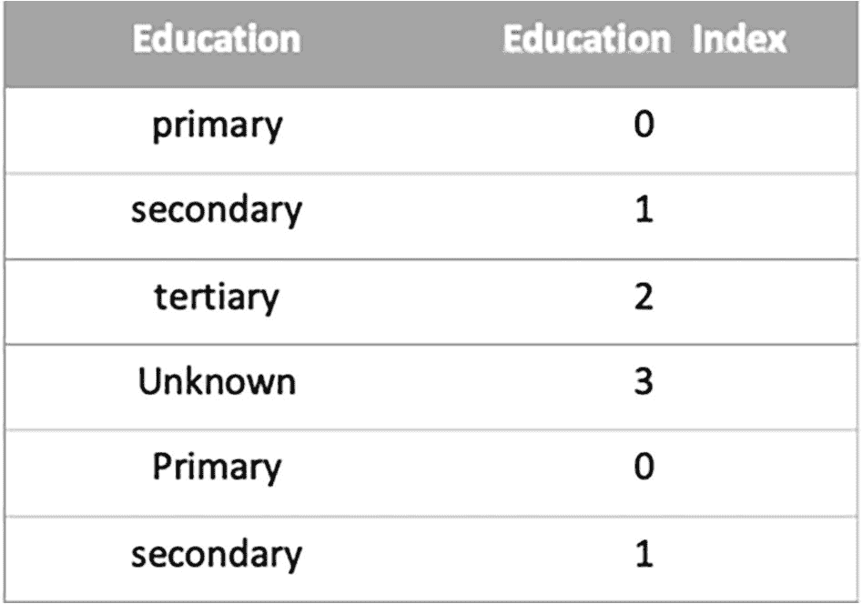
图 4-7 `StringIndexer` 输出

此示例使用 `StringIndexer` 来转换所有列。代码如下所示。

##### 步骤 1：识别变量类型

```python
# 识别变量类型
def variable_type(df):
# 使用 dtypes 来区分字符变量和数值变量
vars_list = df.dtypes
char_vars = [] #字符变量列表
num_vars = [] #数值变量列表
for i in vars_list:
if i[1] in ('string'):
char_vars.append(i[0])
else:
num_vars.append(i[0])
return char_vars, num_vars
#在我们的 DataFrame 上应用 variable_type 函数
char_vars, num_vars = variable_type(df)
```

#### 步骤 2：对字符列应用 `StringIndexer`

对步骤 1 中识别的字符变量（`char_vars`）应用 `StringIndexer` 函数。代码如下：

```python
from pyspark.ml.feature import StringIndexer
from pyspark.ml import Pipeline
#将每个类别列转换为索引
def category_to_index(df, char_vars):
char_df = df.select(char_vars)
indexers =
[StringIndexer(inputCol=c, outputCol=c+"_index", handleInvalid="keep") for c in char_df.columns]
pipeline = Pipeline(stages=indexers)
char_labels = pipeline.fit(char_df)
df = char_labels.transform(df)
return df, char_labels
#在我们的 DataFrame 上应用 category_to_index 函数
df, char_labels = category_to_index(df, char_vars)
```

这段代码中有几点需要强调。首先是 `StringIndexer` 操作，它接收一个输入列（`Education`）并生成一个输出列（`Education_index`）。需要注意的一点是 `handleInvalid` 选项，它被设置为 `keep`，*这样*当你在未来遇到新数据时它仍然可以工作。下一个选项是 `Pipeline` 选项，它按顺序执行步骤。我们将在后续章节中详细介绍管道。当前的 DataFrame 输出包含旧的字符串列和新的数值列。现在按如下方式将数据子集化为所需的列：

```python
df = df.select([c for c in df.columns if c not in char_vars])
```

最后，DataFrame 现在完全是数值型的。有兴趣将 `_index` 变量重命名为原始名称的人可以使用以下代码执行此操作：

```python
#将 _index 列重命名为原始变量名
def rename_columns(df, char_vars):
mapping = dict(zip([i + '_index' for i in char_vars], char_vars))
df = df.select([col(c).alias(mapping.get(c, c)) for c in df.columns])
return df
# 对我们的 DataFrame 应用 rename_columns
df = rename_columns(df, char_vars)
```

#### 步骤 3：对目标列应用 `StringIndexer`

对目标变量 `y` 应用 `StringIndexer` 方法。该方法会创建一个输出列 `y_index`。由于 `y` 和 `y_index` 是重复列，我们提供了额外的代码来删除重复列并将 `y_index` 重命名为原始列名 `y`。代码如下：

```python
# StringIndexer 初始化
indexer = StringIndexer(inputCol='y', outputCol='y_index', handleInvalid='skip')
indexerModel = indexer.fit(df)
# 使用拟合好的 StringIndexer 模型转换 DataFrame
df = indexerModel.transform(df)
# 删除现有的 "y" 列，以便将新的 "y_index" 列重命名为 "y"
df = df.drop(df.y)
# 将新的 "y_index" 列重命名为 "y"
df = df.withColumnRenamed('y_index', 'y')
```

#### 步骤 4：组装特征

最后一步是将各个变量组装成一个单一的特征向量。这样做很有用，因为你可以指向一个变量，而不必在后续步骤中提供各个变量。此外，你还可以选择使用 `StandardScaler` 或 `MinMaxScaler` 对 DataFrame 进行缩放。这可以通过以下代码实现：

```python
#assemble features into one vector
from pyspark.ml.feature import VectorAssembler
#assemble individual columns to one column - 'features'
def assemble_vectors(df, features_list, target_variable_name):
    stages = []
    #assemble vectors
    assembler = VectorAssembler(inputCols=features_list, outputCol='features')
    stages = [assembler]
    #select all the columns + target + newly created 'features' column
    selectedCols = [target_variable_name, 'features'] + features_list
    #use pipeline to process sequentially
    pipeline = Pipeline(stages=stages)
    #assembler model
    assembleModel = pipeline.fit(df)
    #apply assembler model on data
    df = assembleModel.transform(df).select(selectedCols)
    return df
# exclude target variable and select all other feature vectors
features_list = df.columns
features_list.remove(target_variable_name)
# apply the function on our DataFrame
df = assemble_vectors(df, features_list, target_variable_name)
```

如果你希望查看组合特征向量的模式，可以使用以下代码：

```python
df.schema["features"].metadata["ml_attr"]["attrs"]
```

要将其转换为漂亮的 pandas DataFrame，可以使用以下代码：

```python
import pandas as pd
features_df = pd.DataFrame()
# Iterate over metadata attributes in the 'features' column
for k, v in df.schema["features"].metadata["ml_attr"]["attrs"].items():
    # Convert each attribute dict  'v' into Pandas dataframe and append to feature_df
    final = pd.DataFrame(v)
    features_df = features_df.append(final, ignore_index=True)
```

就是这样。现在你拥有了一个与下游任务兼容的 DataFrame（`df`）。需要注意的一点是，目标变量 `y` 在数值转换后看起来如图 4-9 所示。这是因为 `no` 选项的频率高于 `yes` 选项。你需要记住这一点，以便对结果的解释有意义。你也可以根据个人选择，显式地将目标变量转换为所需的数值映射。

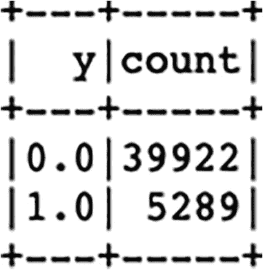

图 4-9 最终目标映射

**快速练习** 尝试在之前的步骤中使用 `StandardScaler` 和 `VectorAssembler` 创建一个缩放后的 DataFrame。（提示：你需要在阶段中添加缩放器模型以及组装器。）

## 内置变量选择过程：无目标变量

在机器学习模型设置中，你可以在没有明确目标变量的情况下减少数据的维度。这种类型的降维被称为*数据压缩*。想象一个图像文件。你有多种方法压缩文件，从而减小文件大小。本节讨论 Spark ML 中现成的两种实现来执行这些任务：PCA 和 SVD。

### 主成分分析（PCA）

主成分分析（PCA）可用于识别大型数据集中的模式。它可以识别数据集中包含最多信息的变量。它是数据集的一种线性表示。如今，我们有像自编码器这样的深度学习算法，它们可以完成相同的工作，并且对于建模复杂的非线性关系非常有用。就本书的范围而言，我们专注于 PCA。一个通用的经验法则是：分布中心紧密围绕均值的变量通常包含最少的信息。下一节将通过一个简单的例子解释 PCA 的机制。

# 机制

假设有六位顾客在一年中的不同月份购买了同一品牌和型号的汽车。你想确定最能解释他们满意度的首要变量（见表 4-1）。

**表 4-1** 样本数据

| 参与者 ID | 质量 | 可靠性 |
| --- | --- | --- |
| 1 | 10 | 6 |
| 2 | 9 | 4 |
| 3 | 8 | 5 |
| 4 | 3 | 3 |
| 5 | 2 | 2 |
| 6 | 1 | 1 |

当你使用单个变量`质量`并绘制数据时，你会观察到参与者 1 到 3 在线的上端彼此靠近，而其余三位参与者则在线的下端。即使只有一条数据线，你也可以推断出前三位参与者和后三位参与者是相似的。在二维空间中绘制这些数据表明，前三位参与者聚集在右上角，后三位参与者聚集在左下角（见图 4-10a）。PCA 将指导你识别对这些变量聚类最重要的变量。让我们开始了解 PCA 是如何计算的。

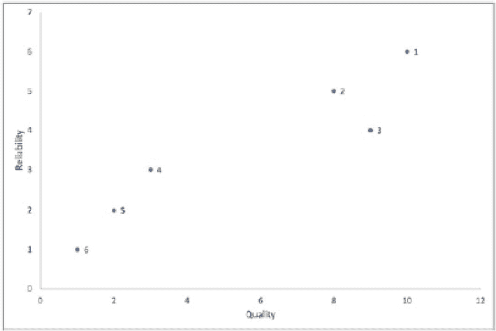

**图 4-10a** 汽车满意度数据

首先，计算两个变量的均值。`质量`和`可靠性`的平均值分别为 5.5 和 3.5。我们将原点从图 4-10b 中所示的 (0,0) 移动到 5.5 和 3.5。这是为了确保数据以原点为中心。

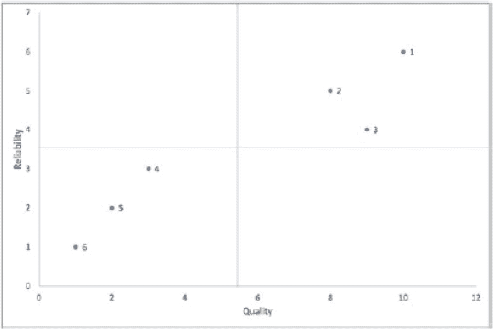

**图 4-10b** 带坐标轴的汽车满意度数据

现在我们尝试通过这些点拟合一条线，直到它很好地拟合数据，并且穿过原点。你如何定义这个标准并知道一条线是否拟合得好？嗯，你确实知道，当数据点到直线的投影距离最小时，就是最接近的拟合（点 5 被投影到穿过原点的直线上）。同样的条件可以反过来表述为：一条最大化投影点到原点距离的直线（同一图中的深色阴影线）。PCA 通过最大化投影点到原点的平方距离之和来找到最佳拟合线（见图 4-10c）。

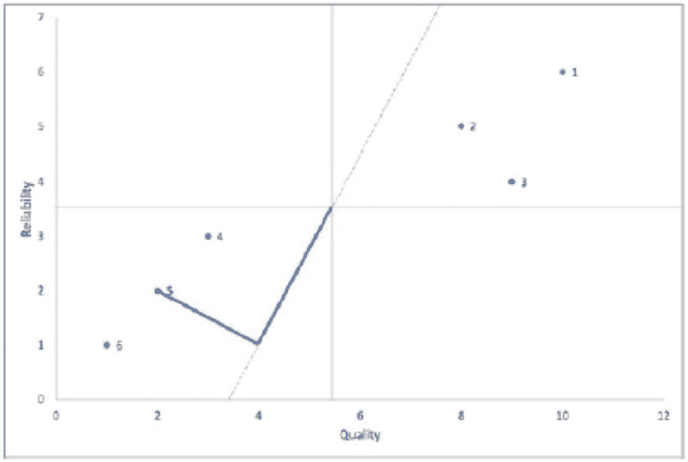

**图 4-10c** PCA 投影

我们使用平方距离的原因是为了避免任何负值。我们通过旋转一条穿过原点的任意直线开始这个过程，并开始计算从原点到直线上投影点的距离。图 4-10c 显示了投影点 5 到原点的距离。高亮的深色线表示该距离。为其余点计算类似的距离，以得出平方距离之和。比较所有这些距离，并选择具有最大平方距离之和的直线（见图 4-10d）。

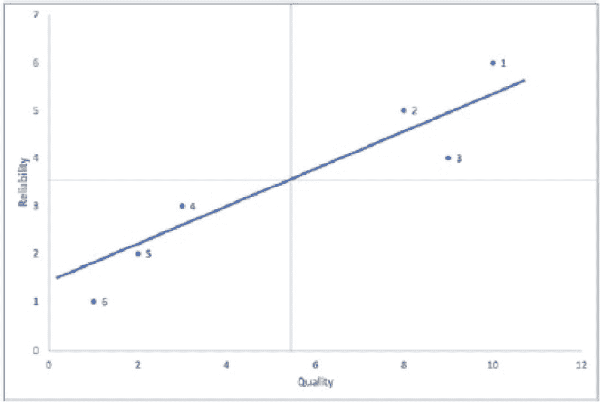

**图 4-10d** PCA 线

该指示线最大化所有点之间距离的平方和。因此，这被视为 PC1，即第一主成分。假设这条线的斜率为 0.25，你可以推断出，在质量方向上每移动四个单位，可靠性就会上升一个单位。这伪性地表明数据在质量轴上完全分散。因此，质量在定义 PC1 中起着主要作用。该成分可以看作是四个单位质量和一个单位可靠性的线性组合。PC2 就是通过原点且垂直于 PC1 的直线。其变量比率将与 PC1 相反。该成分可以看作是四个单位可靠性和一个单位质量的线性组合。如果将两者都缩放为单位向量，就可以计算主成分的载荷得分。特征值是投影点与已识别主成分原点之间距离的平方和。你可以通过将每个主成分的特征值除以`(样本量 - 1)`来将其转换为变异量。

以下是 PCA 的 PySpark 实现代码：

```python
from pyspark.ml.feature import PCA
from pyspark.ml.linalg import Vectors
no_of_components = 3 #自定义数量
# 使用指定参数初始化 PCA
pca = PCA(k=no_of_components, inputCol="features", outputCol="pcaFeatures")
model = pca.fit(df)
result = model.transform(df).select("pcaFeatures")
result.show(truncate=False)
```

`pcaFeatures`是 PCA 算法生成的简化特征集，可用于下游的机器学习过程。请注意，我们使用了 16 个输入变量，最终得到了三个成分。本质上，我们将维度大小缩减了五分之四（3/16 个特征）。要获取每个变量的载荷得分，可以使用以下代码：

```python
model.pc.toArray()
array([[-3.41021399e-04,  2.79524640e-04,  2.58353293e-03],
[-9.99998245e-01,  1.83654726e-03,  1.13892524e-04],
[-1.22934480e-05,  9.79995613e-04,  7.79347982e-03],
[-1.83671689e-03, -9.99996986e-01, -7.36955549e-04],
[ 1.48468991e-05,  1.01391994e-03,  2.75121381e-03],
[-1.13085547e-04,  7.49207153e-04, -9.99889046e-01],
[-1.26153895e-05, -6.36100089e-06, -1.04654388e-02],
[-1.78789640e-05, -4.11817349e-05,  5.51411389e-04],
[ 6.41085932e-06, -5.23364803e-05, -1.45349520e-04],
[-1.11185424e-05,  1.30366514e-05,  2.01500982e-04],
[ 2.91665702e-06,  4.42643869e-06,  3.95562163e-05],
[-1.12221341e-05,  1.26153926e-05,  6.17569266e-04],
[ 1.01623400e-05,  1.50687571e-05,  8.23933054e-05],
[-5.68377754e-07,  6.95393403e-05,  1.03951369e-03],
[-7.60886236e-05, -1.16754927e-04, -3.24662847e-03],
[-8.55162111e-06, -6.01853226e-05, -4.94522998e-03]])
```

现在，让我们将这些载荷得分映射到各个变量。我们使用的是之前提供给`assembler`函数的`features_list`变量。

**表 4-2.** 将载荷得分映射到各个变量

| -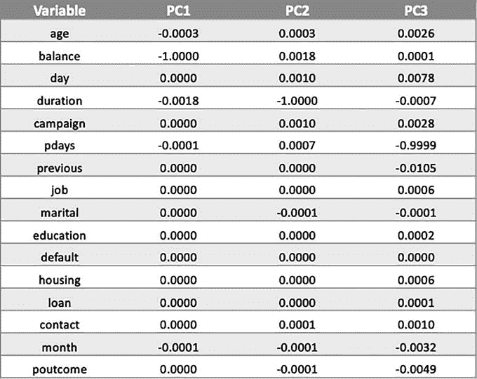 |

你可以看到，`balance`变量主导了 PC1 成分，`duration`主导了 PC2 成分，而`pdays`主导了 PC3 成分。你应该对这些结果保持谨慎，因为输入数据并未标准化。连续特征因其高方差而主导了 PCA 的输出。你应该关注的另一个算法输出是每个成分解释的方差。在 PySpark 中，你可以使用以下代码来实现：

```python
model.explainedVariance
#输出: DenseVector([0.9918, 0.0071, 0.0011])
```

你可以使用以下代码将这些值绘制成图表。这种图表称为碎石图。

```python
import matplotlib.pyplot as plt
import numpy as np
x = []
for i in range(0, len(model.explainedVariance)):
#提取解释方差值及累积和
x.append('PC' + str(i + 1))
y = np.array(model.explainedVariance)
z = np.cumsum(model.explainedVariance)
plt.xlabel('主成分')
plt.ylabel('解释方差')
plt.bar(x, y)
plt.plot(x, z)
```

如图 4-10e 所示，第一主成分解释了数据中 99%的方差。这是因为我们在使用 PCA 之前没有对 DataFrame 进行缩放。因此，让我们在使用 PCA 之前先用`StandardScaler`再运行一次。你会注意到解释方差图发生了巨大变化。

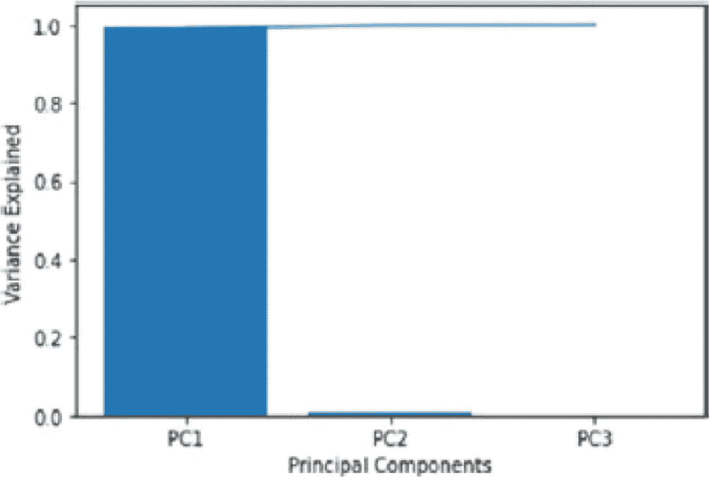

**图 4-10e** 解释方差

```python
from pyspark.ml.feature import VectorAssembler
from pyspark.ml.feature import StandardScaler
#将各个列组装并缩放到一个列 - 'features2'
def scaled_assemble_vectors(df, features_list, target_variable_name):
stages = []
#组装向量
assembler = VectorAssembler(inputCols=features_list, outputCol='assembled_features')
scaler = StandardScaler(inputCol=assembler.getOutputCol(), outputCol='features2')
stages = [assembler, scaler]
#选择所有列 + 目标列 + 新创建的 'features' 列
selectedCols = [target_variable_name, 'features2'] + features_list
#使用流水线顺序处理
pipeline = Pipeline(stages=stages)
#组装器模型
scaleAssembleModel = pipeline.fit(df)
#在数据上应用组装器模型
df = scaleAssembleModel.transform(df).select(selectedCols)
return df
features_list = df.columns
features_list.remove(target_variable_name)
df = scaled_assemble_vectors(df, features_list, target_variable_name)
from pyspark.ml.feature import PCA
from pyspark.ml.linalg import Vectors
# 对缩放后的特征执行 PCA
pca = PCA(k=3, inputCol="features2", outputCol="pcaFeatures")
model = pca.fit(df)
result = model.transform(df).select("pcaFeatures")
result.show(truncate=False)
```

当你使用上述代码新创建的 DataFrame 运行 PCA 时，你会看到第一成分解释的方差发生了巨大变化（见图 4-10f）。在使用 PCA 时，你需要意识到这种情况，尤其是在处理连续变量和分类变量时。

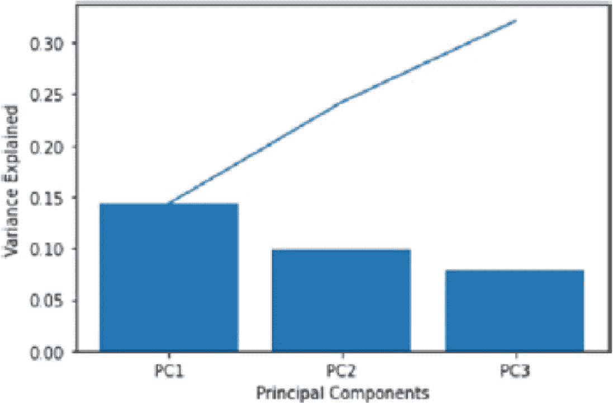

**图 4-10f** 解释方差

```python
model.explainedVariance
#输出: DenseVector([0.1434, 0.0987, 0.0787])
```

## 奇异值分解（SVD）

最著名的矩阵分解方法是奇异值分解，简称 SVD。任何矩阵都可以通过 SVD 进行分解，因此它是一种更稳定的算法。SVD 将一个矩阵分解为三个矩阵：`U`、`Σ` 和 `V`，满足以下关系：

`A = U*Σ*V^T`，

其中：

- `A` 是原始矩阵，维度为 *r* `x` *c*。*r* 代表行数，*c* 代表列数。
- `U` 是一个 *r* `x` *r* 的矩阵，也称为 `A` 的左奇异向量。
- `Σ` 是一个 *r* `x` *c* 的对角矩阵。对角线上的值是原始矩阵 `A` 的奇异值。
- `V^T` 是一个 *c* `x` *c* 的矩阵，也称为 `A` 的右奇异向量。

那么，这如何应用于变量选择的概念呢？答案在于 `Σ` 分量。假设你有一张包含 1000 个特征的图像。使用 SVD，你可以通过访问 `Σ` 矩阵来获取前 *k* 个最大的奇异值。你根据希望在低维表示中保留的信息量来选择这个 *k* 值。在 PCA 场景中，你可以将其视为解释的方差。假设 1000 个特征中的前 100 (*k*) 个解释了数据中 80% 的信息，并且你认为这可以接受。那么，你将选取前 100 个奇异值，并将 `Σ` 矩阵中其余的值替换为 0。然后，得到的低秩矩阵可用于创建原始数据的表示，如下所示：

- `U` – *r* `x` *k* 左奇异值
- `Σ` – *k* `x` *k* 奇异值
- `V^T` – *c* `x` *k* 右奇异值

SVD 更多地用于图像数据压缩和图像恢复。由于矩阵分解的特性，它在协同过滤推荐系统中分解 `user x item` 矩阵方面也发挥着巨大作用。以下是用于在此数据中实现 SVD 的 PySpark 代码：

```python
from pyspark.mllib.linalg import Vectors
from pyspark.mllib.linalg.distributed import RowMatrix
# 将 DataFrame 转换为 rdd
# 将 df 转换为 RDD 并提取特征为数组
df_svd_vector = df.rdd.map(lambda x: x['features'].toArray())
# 从向量 RDD 创建一个 Rowmatrix
mat = RowMatrix(df_svd_vector)
# 计算前 5 个奇异值及对应的奇异向量。
svd = mat.computeSVD(5, computeU=True)
U = svd.U       # U 因子是一个 RowMatrix。
s = svd.s       # 奇异值存储在一个本地稠密向量中。
V = svd.V       # V 因子是一个本地稠密矩阵。
```

你可以阅读更多关于矩阵特征值分解的内容，以更深入地理解 SVD。现在，我们继续讨论基于目标的变量缩减。

# 内置变量选择过程：结合目标变量

本节探讨有监督的变量选择技术。

## 卡方选择器

`ChiSq` 代表*卡方*。它也被称为“拟合优度”统计量，用符号 `χ2` 表示。它使用*卡方独立性检验*来选择最佳特征。当处理分类变量时，这种选择过程非常有用。如果你更倾向于使用连续变量，则需要在使用此技术之前将它们分箱处理。我们将使用泰坦尼克号数据集示例（`https://www.kaggle.com/c/titanic`）来详细解释卡方检验。

图 4-11 中所示的表格称为*列联表*。通过观察该表，你可以注意到女性幸存者的比例（231/340 = 67.9%）远高于男性幸存者的比例（109/340 = 32.0%）。这是否意味着 `Gender` 和 `Survived` 之间存在关系？嗯，你可以使用卡方检验来回答这个问题。在卡方检验中，原假设和备择假设如下：

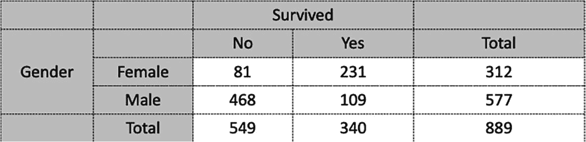

**图 4-11**

泰坦尼克号示例：性别与幸存情况

- *原假设：两个变量之间没有关系。*
- *备择假设：两个变量之间存在关系。*

我们对此检验使用 5% 的显著性水平。卡方检验的公式如下：

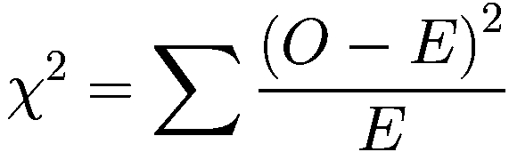

*χ2 – 卡方值，O – 观测数据，E – 期望数据*

观测数据指的是前面表格中的数据。期望数据是根据总计计算得出的。表 4-3 提供了所有四个单元格的期望值。

**表 4-3** 期望值

| 组合 | 计算式 | 期望值 |
| --- | --- | --- |
| *性别 = 女性 且 幸存 = 否* | (312*549)/889 | 192.67 |
| *性别 = 女性 且 幸存 = 是* | (312*340)/889 | 119.32 |
| *性别 = 男性 且 幸存 = 否* | (577*549)/889 | 356.32 |
| *性别 = 男性 且 幸存 = 是* | (577*340)/889 | 220.67 |

我们使用前面展示的公式计算了卡方值，并将*卡方*列求和，得到表 4-4 中的总卡方值。

**表 4-4** 卡方值

| 单元格 | 观测值 | 期望值 | 卡方值 |
| --- | --- | --- | --- |
| *性别 = 女性 且 幸存 = 否* | 81 | 192.67 | 64.72 |
| *性别 = 女性 且 幸存 = 是* | 231 | 119.32 | 104.51 |
| *性别 = 男性 且 幸存 = 否* | 468 | 356.32 | 34.99 |
| *性别 = 男性 且 幸存 = 是* | 109 | 220.67 | 56.51 |
| | | **总计** | **260.75** |

最后一步是计算自由度，使用以下公式：

```text
degrees_of_freedom 或 df = (r – 1) * (c – 1)
```

其中

```text
r = 行数
c = 列数
```

在此示例中，*r* = 2（`Gender` 有两行），*c* = 2（`Survived` 有两列）。因此，自由度为 1。好了，万事俱备。现在我们可以使用卡方分布表（`https://people.richland.edu/james/lecture/m170/tbl-chi.html`）或在线卡方计算器（`https://stattrek.com/online-calculator/chi-square.aspx`）来计算 p 值。此实验的 p 值接近于 0。这意味着我们的结果是显著的，因此我们可以拒绝原假设。从而，我们可以得出结论：`Gender` 和 `Survived` 之间存在关系。

**注意**

卡方检验对较小的频数很敏感。当单元格中的期望值小于 5 时，可能会导致结论出现错误。

### 变量选择的相关性

这与变量选择有何关联？在此示例中，我们计算了一个卡方值（260.75），它揭示了`Gender`和`Survived`两个变量之间的关系。当关系较强时，卡方值会较高，反之亦然。在变量选择场景中，你可以选择卡方值较高的变量，因为它们与目标变量关系密切，从而能提升预测结果。

> **注意**
> 卡方检验不衡量关系的强度。你应该使用相关性（`correlation`）来确定关系的强度。

基于卡方检验的选择代码如下所示。你可能需要重新运行组装后的向量，因为在此类选择中我们只处理分类变量。

```python
# 仅选择数据集中存在的分类特征
features_list = char_vars  # 此选项仅用于 ChiSqSelector
# 在运行此代码前，请使用更新后的特征列表重新运行组装向量
from pyspark.ml.feature import ChiSqSelector
from pyspark.ml.linalg import Vectors

# 初始化 ChiSqSelector 实例
selector = ChiSqSelector(numTopFeatures=6, featuresCol="features",
                         outputCol="selectedFeatures", labelCol="y")
# 在数据上拟合选择器
chi_selector = selector.fit(df)
# 获取结果数据集
result = chi_selector.transform(df)
# 输出结果
print("ChiSqSelector output with top %d features selected" % selector.getNumTopFeatures())
print("Selected Indices: ", chi_selector.selectedFeatures)
features_df['chisq_importance'] = features_df['idx'].apply(lambda x: 1 if x in chi_selector.selectedFeatures else 0)
print(features_df)
```

我们已成功为分类变量实现了基于卡方检验的特征选择技术。

### 基于模型的特征选择

基于模型的特征选择需要你构建一个机器学习模型来找出重要特征。我们将在下一章详细讨论这些模型。现在，假设你想让计算机区分*狗*和*猫*。对人类来说，区分它们很容易，但对计算机来说，自己学会这一点却很难。这时就需要机器学习模型登场了。模型教会计算机寻找特定信息来区分狗和猫。模型用来学习的这些特定信息被称为*特征*。某个特征提供的信息越多，该特征对建模过程就越重要。

在 PySpark 中，基于树的方法（决策树、随机森林和梯度提升）默认提供了这一功能。本节侧重于特征重要性方面，而非实际模型。以下代码计算了特征重要性。我们在`Bank dataset`示例中使用了随机森林。你可以用其他算法复现同样的过程。

```python
from pyspark.ml.classification import RandomForestClassifier

rf = RandomForestClassifier(featuresCol='features', labelCol=target_variable_name)
rf_model = rf.fit(df)
rf_model.featureImportances
# 输出：
# SparseVector(16, {0: 0.0381, 1: 0.0088, 2: 0.0048, 3: 0.4557, 4: 0.002, 5: 0.0347, 6: 0.0313, 7: 0.0021, 8: 0.0019, 9: 0.001, 10: 0.0001, 11: 0.0112, 12: 0.0017, 13: 0.0215, 14: 0.1484, 15: 0.2366})
```

就这样，我们现在得到了特征重要性分数。我们可以使用以下代码来格式化输出。还记得我们在向量组装部分创建的`features_df` DataFrame 吗？我们将在这里用到它。

```python
import pandas as pd

features_df = pd.DataFrame()
for k, v in df.schema["features"].metadata["ml_attr"]["attrs"].items():
    final = pd.DataFrame(v)
    features_df = features_df.append(final, ignore_index=True)

# 临时输出 rf_output
rf_output = rf_model.featureImportances
features_df['Importance'] = features_df['idx'].apply(lambda x: rf_output[x] if x in rf_output.indices else 0)
# 按重要性降序排序
features_df.sort_values("Importance", ascending=False, inplace=True)
```

现在我们得到了一个漂亮的表格，如图 4-12 所示。最重要的特征是`duration`，其次是`poutcome`，依此类推。

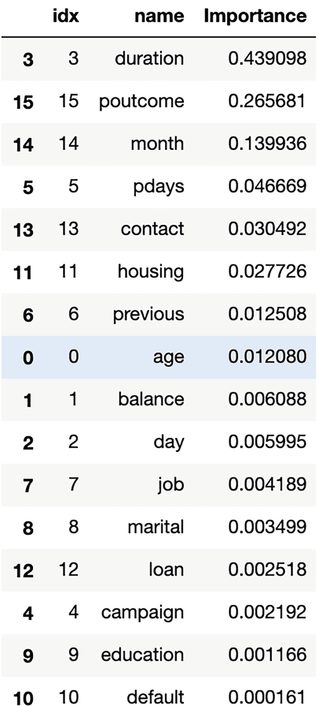

**图 4-12** 随机森林：特征重要性

此外，你可以使用此表格创建特征重要性图，如图 4-13 所示。

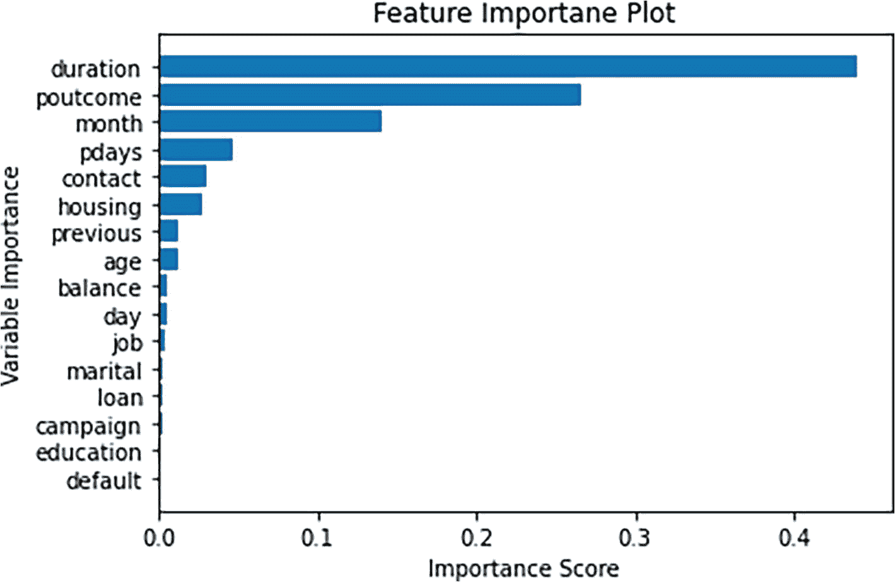

**图 4-13** 特征重要性图

```python
import matplotlib.pyplot as plt

# 仅为了绘图，将其按升序排序
features_df.sort_values("Importance", ascending=True, inplace=True)
plt.barh(features_df['name'], features_df['Importance'])
plt.title("Feature Importance Plot")
plt.xlabel("Importance Score")
plt.ylabel("Variable Importance")
```

很酷，对吧？你可以使用其他算法来完成同样的任务。然而，在处理大型数据集时，基于随机森林的特征选择会使过程变得简单得多。使用基于树的方法的一个缺点是，它使用训练数据集来计算特征重要性。这可能会夸大数值型和高基数变量的重要性。为了克服这一点，你可以使用*排列重要性*，它使用测试数据集来计算特征重要性。排列重要性超出了本书的讨论范围。

> **注意**
> 当你使用线性模型（如逻辑回归）时，请使用模型的系数来展示特征重要性。系数的*绝对值*越高，变量越重要，反之亦然。

最后，我们关注*连续型*和*多项型*目标变量。

1. 对于连续型目标变量，你可以使用回归树（`RandomForestRegressor`或其他树模型），这些可以从`pyspark.ml.regression`模块中获取。对于连续模型，你需要使用`LinearRegression`模块而不是`LogisticRegression`。其余讨论的代码可以复用来计算特征重要性。
2. 对于多项型目标变量，你仍然可以使用本节讨论的基于树的模型，但线性模型`LogisticRegression`除外。在处理多项型目标变量时，使用逻辑回归计算特征重要性有点棘手。对于此类目标变量，我们建议你坚持使用基于树的模型。

到目前为止，我们一直在看代码，而没有深入探讨特征重要性计算背后的公式。别担心。在下一章讨论树模型时，我们会重新回顾这一节。

**练习 4-2：基于模型的选择**

你可以使用`Bank dataset`或`Housing dataset`。

**问题 1：** 实现决策树特征重要性。将其与随机森林的输出进行比较和对比。

**问题 2：** 实现梯度提升树特征重要性。将其与随机森林的输出进行比较和对比。

**问题 3：** 实现逻辑回归特征重要性。将其与随机森林的输出进行比较和对比。（提示：使用逻辑回归的系数。注意：逻辑回归生成的是稠密向量而非稀疏向量。）

## 自定义变量选择过程

本节介绍一些自定义的变量选择技术。

### 使用证据权重的信息价值

证据权重（`WOE`）和信息价值（`IV`）是进行变量转换和选择的简单而强大的技术。这些概念与逻辑回归建模技术密切相关。它们广泛应用于信用评分中，用于衡量好客户与坏客户的区分度。例如，如果你试图预测客户是否会违约，所有违约的客户将被视为事件，而未违约的客户则可视为非事件。

计算`WOE`和`IV`的公式如下：

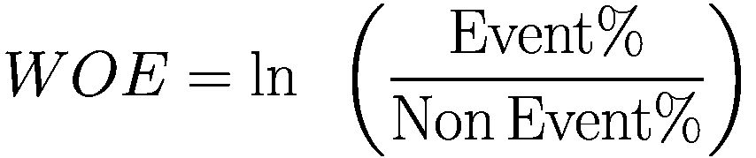

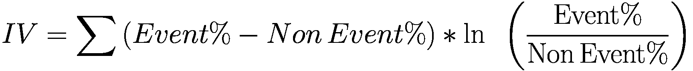

或者简化为：

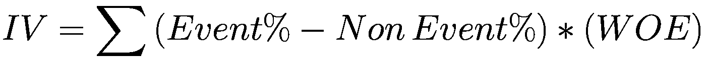

图 4-14 展示了如何计算这些值。

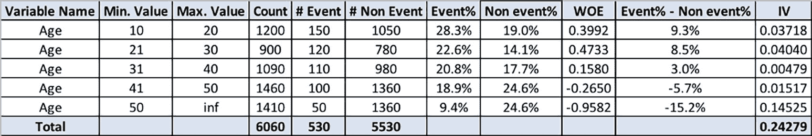

**图 4-14** `WOE`和`IV`计算

`WOE`转换的优点如下：

1. 处理缺失值。
2. 处理异常值。
3. 转换基于分布的对数值，这与逻辑回归的输出函数一致。
4. 无需创建虚拟变量。
5. 使用适当的分箱技术可以在自变量和因变量之间建立单调关系（递增或递减）。

此外，`IV`值可用于根据图 4-15 所示的预测能力表来选择变量。

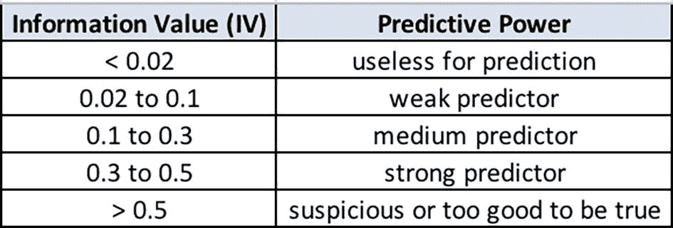

**图 4-15** `IV`与预测能力

如图 4-14 所示，计算`WOE`和`IV`需要类别数据。现在，你可能会想，对于连续变量该怎么办？如前所述，在执行`WOE`和`IV`计算之前，应使用适当的分箱技术将连续变量转换为分类变量。当连续变量数量较少时（例如少于十个），你可以创建自定义分箱，并将其用于`WOE`计算。即便如此，创建自定义分箱也是一项繁琐的任务。现在，考虑一个包含数百个连续变量的大型数据集。创建自定义分箱将是一场噩梦。这正是单调分箱发挥作用的地方。

#### 使用斯皮尔曼相关系数的单调分箱

首先，让我们考虑一下*单调*的含义。见图 4-16。

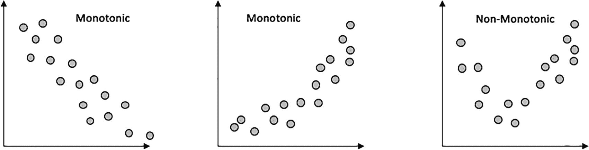

**图 4-16** 单调与非单调

如图 4-16 所示，在前两种情况下，随着 x 轴变量的增加，y 轴的值呈现单一趋势：增加或减少。这是一种单调关系。在第三种情况下，x 轴变量的变化没有单一趋势：既不是持续增加也不是持续减少。因此，它是非单调的。在解释性目的方面，单调关系是有益的。当两个变量呈现单调关系时，你可以轻松地向非技术受众解释结果。例如，假设`balance`和`target`变量之间存在关系，如图 4-17 所示。

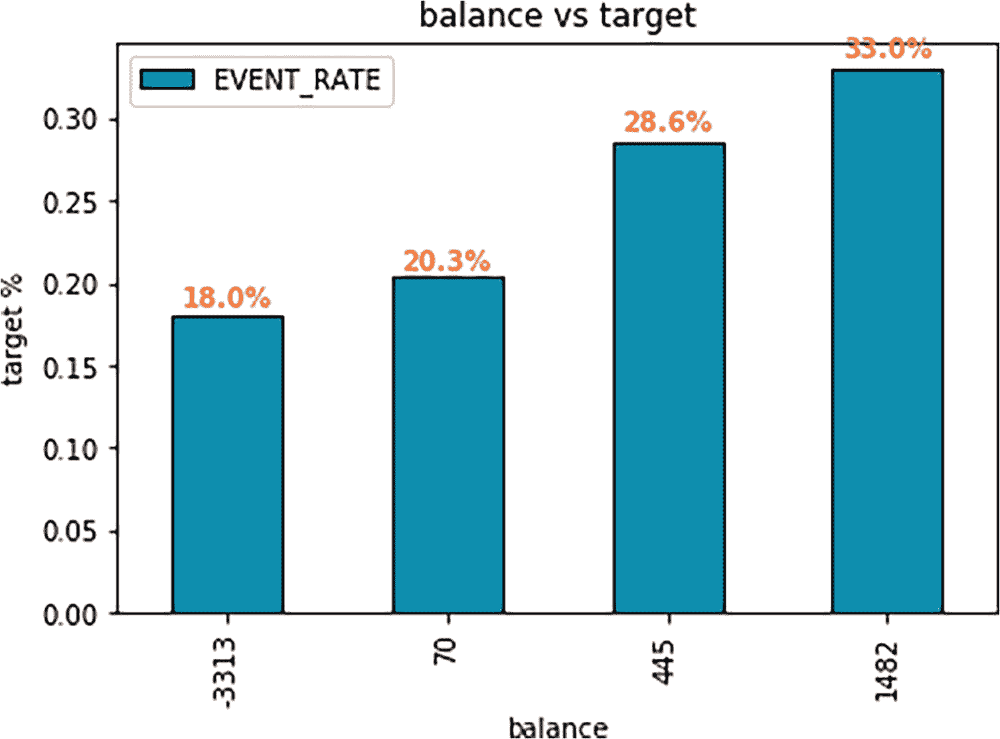

**图 4-17** 余额与目标分箱

查看此图，你可以轻松地说：“随着余额增加，目标转化率增加。”这个结果对于非技术受众来说很容易理解。

要执行单调分箱，你需要了解斯皮尔曼相关系数。斯皮尔曼相关系数衡量两个变量之间单调关联的强度和方向。那么，它与皮尔逊相关系数有何不同？皮尔逊相关系数检验的是两个变量之间的线性关系，而斯皮尔曼相关系数衡量的是单调关系。在这种情况下，图 4-16 中的第二个图对于皮尔逊相关系数来说可能具有中等程度的线性关系。然而，斯皮尔曼相关系数会将其视为强单调关系。斯皮尔曼相关系数也称为*秩相关系数*。

#### 如何手动计算斯皮尔曼相关系数？

斯皮尔曼相关系数的公式如下：

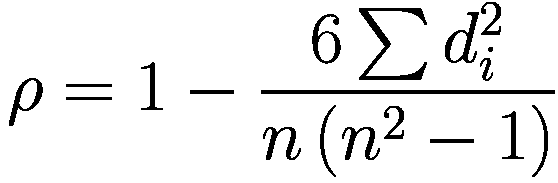

这里，`ρ`是斯皮尔曼相关系数，`d[i]`是配对秩次的差值，`n`是案例数量。当存在并列秩次时，你需要使用以下公式。秩次是结果集中的有序编号。

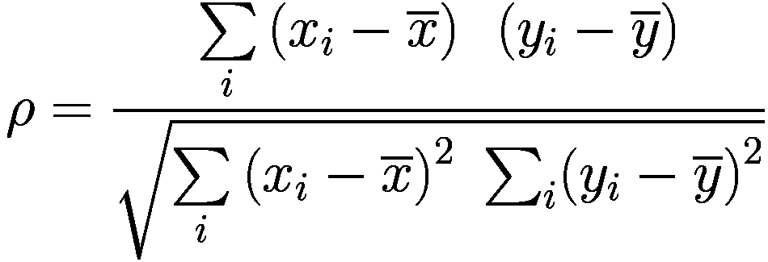

这里，`i`是配对的分数。现在，我们仅使用第一个公式来计算斯皮尔曼相关系数（见图 4-18）。

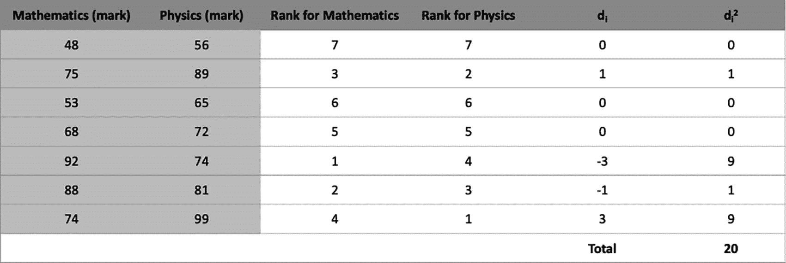

**图 4-18** 斯皮尔曼相关系数计算

使用`d[i]²`为 20，`n`为 7，你可以通过第一个公式计算`ρ`值：

```
p = 1 - ((6*20)/(7*((7*7) - 1))) = 0.64285714
```

我们从数字 0.64 中推断出什么？通常，斯皮尔曼相关系数的取值范围是-1 到+1。当该值接近 1 或-1 时，两个变量之间的单调关系越强。当该值接近 0 时，两个变量之间不存在单调关系。在这个例子中，数学和物理成绩表现出强单调关系。图 4-19 展示了判断关系强度的指南。

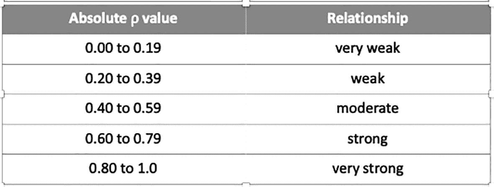

**图 4-19** 斯皮尔曼相关系数值指南

#### 如何使用斯皮尔曼相关系数为连续变量创建单调分箱？

在单调分箱的代码中，请注意`mono_bin()`函数使用了一个`max_bin`选项。这是一个用户指定的值。对于连续变量，我们从用户提供的`max_bin`开始，并在每一步中减少分箱数量。我们根据`max_bin`创建分位数。接下来，我们根据新创建的分位数分箱和目标变量计算斯皮尔曼相关系数。直到我们在连续变量和目标变量之间建立强单调关系之前，我们会持续减少`max_bin`值以创建新的分位数并计算斯皮尔曼值。当两个变量之间达到强相关性时，分箱过程停止。

以下是计算`WOE`和`IV`的完整代码，包括针对连续变量的单调分箱选项。我们提供了从数据加载到`WOE`和`IV`计算的完整代码。此代码可用于任何数据集。并且，该代码作为自学材料提供。

```python
# 默认参数
from pyspark.sql import SparkSession
spark = SparkSession.builder.getOrCreate()
dataset = 2 # 1 或 2
```

```python
# 加载数据集
from pyspark.sql import functions as F
```

# 如果选项设置为 1，则加载银行数据集
if `dataset` == 1:
    `target_variable_name` = 'y'
    # 文件位置和类型
    `file_location` = '/FileStore/tables/bank_full.csv'
    `file_type` = 'csv'
    # CSV 选项
    `infer_schema` = 'true'
    `first_row_is_header` = 'true'
    `delimiter` = ';'
    # 以下选项适用于 CSV 文件。对于其他文件类型，这些选项将被忽略。
    `df` = `spark.read.format(file_type)` \
        .option('inferSchema', `infer_schema`) \
        .option('header', `first_row_is_header`) \
        .option('sep', `delimiter`) \
        .load(`file_location`)
    `df` = `df.withColumn(target_variable_name, F.when(df[target_variable_name] == 'no', 0).otherwise(1))`

```
# 如果选项设置为 1，则加载银行数据集
if dataset == 1:
    target_variable_name = 'y'
    # 文件位置和类型
    file_location = '/FileStore/tables/bank_full.csv'
    file_type = 'csv'
    # CSV 选项
    infer_schema = 'true'
    first_row_is_header = 'true'
    delimiter = ';'
    # 以下选项适用于 CSV 文件。对于其他文件类型，这些选项将被忽略。
    df = spark.read.format(file_type) \
        .option('inferSchema', infer_schema) \
        .option('header', first_row_is_header) \
        .option('sep', delimiter) \
        .load(file_location)
    df = df.withColumn(target_variable_name, F.when(df[target_variable_name] == 'no', 0).otherwise(1))
```

# 如果选项未设置为 1，则加载住房数据集

```python
else:
    #filename = "melb_data.csv"
    target_variable_name = 'type'
    file_location = '/FileStore/tables/melb_data.csv'
    file_type = 'csv'
    # CSV 选项
    infer_schema = 'true'
    first_row_is_header = 'true'
    delimiter = ','
    # 以下选项适用于 CSV 文件。对于其他文件类型，这些选项将被忽略。
    df = spark.read.format(file_type) \
        .option('inferSchema', infer_schema) \
        .option('header', first_row_is_header) \
        .option('sep', delimiter) \
        .load(file_location)
    df = df.withColumn(target_variable_name, F.when(df[target_variable_name] == 'h', 0).otherwise(1))
df.show()
```

# 目标变量检查

```python
df.groupby(target_variable_name).count().show()
```

# 识别变量类型并执行一些操作

```python
def variable_type(df):
    vars_list = df.dtypes
    char_vars = []
    num_vars = []
    for i in vars_list:
        if i[1] in ('string'):
            char_vars.append(i[0])
        else:
            num_vars.append(i[0])
    return char_vars, num_vars

char_vars, num_vars = variable_type(df)
if dataset != 1:
    char_vars.remove('Address')
    char_vars.remove('SellerG')
    num_vars.remove('Date')
    char_vars.remove('Suburb')
    num_vars.remove(target_variable_name)

final_vars = char_vars + num_vars
```

# WOE 和 IV 代码

## 依赖导入

```python
from pyspark.sql import functions as F
import pandas as pd
import numpy as np
from pyspark.ml.feature import QuantileDiscretizer
from pyspark.ml.feature import VectorAssembler
import scipy.stats.stats as stats
```

## 默认参数

- 用于斯皮尔曼相关性的 `rho` 值。您可以调整此值：`custom_rho = 1`
- 初始分箱的最大数量。它将从此数量开始递减。可调参数：`max_bin = 20`

## 计算 WOE 和 IV 值

此函数基于 PySpark 输出计算 WOE 和 IV 值。注意：此部分代码基于 Python 实现，以提高效率。

```python
def calculate_woe(count_df, event_df, min_value, max_value, feature):
    # 实现 WOE 和 IV 计算图中所示的表格结构
    woe_df = pd.merge(left=count_df, right=event_df)
    woe_df['min_value'] = min_value
    woe_df['max_value'] = max_value
    woe_df['non_event'] = woe_df['count'] - woe_df['event']
    woe_df['event_rate'] = woe_df['event']/woe_df['count']
    woe_df['nonevent_rate'] = woe_df['non_event']/woe_df['count']
    woe_df['dist_event'] = woe_df['event']/woe_df['event'].sum()
    woe_df['dist_nonevent'] = woe_df['non_event']/woe_df['non_event'].sum()
    woe_df['woe'] = np.log(woe_df['dist_event']/woe_df['dist_nonevent'])
    woe_df['iv'] = (woe_df['dist_event'] -
                    woe_df['dist_nonevent'])*woe_df['woe']
    woe_df['varname'] = [feature]* len(woe_df)
    woe_df = woe_df[['varname','min_value', 'max_value', 'count', 'event', 'non_event', 'event_rate', 'nonevent_rate', 'dist_event','dist_nonevent','woe', 'iv']]
    # 将无穷大值替换为零以进行 IV 计算
    woe_df = woe_df.replace([np.inf, -np.inf], 0)
    # 特征 IV 值的总和
    woe_df['iv'] = woe_df['iv'].sum()
    return woe_df
```

## 与斯皮尔曼相关性一起实现的单调分箱函数

```python
def mono_bin(temp_df, feature, target, n = max_bin):
    r = 0
    while np.abs(r) < custom_rho and n > 1:
        try:
            # 分位数离散器将数据切割成相等数量的观测值
            qds = QuantileDiscretizer(numBuckets=n, inputCol=feature, outputCol='buckets', relativeError=0.01)
            bucketizer = qds.fit(temp_df)
            temp_df = bucketizer.transform(temp_df)
            # 创建 corr_df 是基于 Python 的实现，以提高效率；按组分组并计算特征和目标变量的平均值
            corr_df = temp_df.groupby('buckets').agg({feature:'avg', target:'avg'}).toPandas()
            corr_df.columns = ['buckets', feature, target]
            r, p = stats.spearmanr(corr_df[feature], corr_df[target]) #斯皮尔曼相关性
            # 如果未满足相关性条件，则减少分箱数量
            n = n - 1
        except Exception as e:
            n = n - 1
    return temp_df
```

## 对数据集中的所有变量执行 WOE

```python
def execute_woe(df, target):
    count = -1
    for feature in final_vars:
        # 如果特征不是目标列名则执行。作为额外检查提供。
        if feature != target:
            count = count + 1
            temp_df = df.select([feature, target])
            # 在进行 WOE 计算之前，对数值变量执行单调分箱
            if feature in num_vars:
                temp_df = mono_bin(temp_df, feature, target, n = max_bin)
            # 对数值变量进行分组
            grouped = temp_df.groupby('buckets')
        else:
            # 仅对分类变量进行分组
            grouped = temp_df.groupby(feature)
        #每个分组的计数和事件值
        count_df = grouped.agg(F.count(target).alias('count')).toPandas()
        event_df = grouped.agg(F.sum(target).alias('event')).toPandas()
        # 存储变量的最小值和最大值。对于分类变量，两者取相同值。
        if feature in num_vars:
            min_value = grouped.agg(F.min(feature).alias('min')).toPandas()['min']
            max_value = grouped.agg(F.max(feature).alias('max')).toPandas()['max']
        else:
            min_value = count_df[feature]
            max_value = count_df[feature]
        #计算 WOE 和 IV
        temp_woe_df = calculate_woe(count_df, event_df, min_value, max_value, feature)
        #创建最终数据集
        if count == 0:
            final_woe_df = temp_woe_df
        else:
            final_woe_df = final_woe_df.append(temp_woe_df, ignore_index=True)
    # 创建单独的 IV 数据集
    iv = pd.DataFrame({'IV':final_woe_df.groupby('varname').iv.max()})
    iv = iv.reset_index()
    return final_woe_df, iv
```

## 调用 WOE 和 IV 代码

```python
output, iv = execute_woe(df, target_variable_name)
```

以上就是全部内容。现在您已经完成了证据权重和信息值的计算。

### 自定义转换器

到目前为止，本章一直在介绍 Spark ML 中可用于执行变量选择的一些高级 API（前面讨论过的内置选择技术）。本节将创建一个自定义的 Spark ML 转换器来实现同样的功能。为什么我们需要讨论自定义转换器呢？

花点时间思考一下前面用于变量选择的 `RandomForest` 代码：

```python
from pyspark.ml.classification import RandomForestClassifier
rf = RandomForestClassifier(featuresCol='features', labelCol=target_variable_name)
rf_model = rf.fit(df)
rf_model.featureImportances
```

仅用几行代码，我们就完成了以下操作：(1) 调用了 `RandomForestClassifier`；(2) 定义了一个 `RandomForestClassifier` 对象的实例；(3) 在数据集上拟合模型；(4) 显示了重要性得分。这就是面向对象编程（OOP）的强大之处。以下是 OOP 概念的快速回顾：

1. *类* – 用户定义的蓝图，用于创建对象实例。在第 2 行中，`RandomForestClassifier` 是一个类，`rf` 是对象实例。

2. *方法* – 在类内部编写的函数。在第 3 行中，`fit` 函数就是一个方法。

3. *抽象* – 这是一种概念，通过它只向用户展示必要的信息。这被称为实现隐藏。在前面展示的 `RandomForestClassifier` 代码中，我们只提供了输入变量、目标和数据集来拟合模型。我们看不到关于随机森林模型如何在后台实现的任何细节。

4. *封装* – 这是一种向用户隐藏信息的概念。这被称为信息隐藏。任何变量/方法都可以使用这种技术进行隐藏。变量/方法可以是*受保护的*（前面加单下划线，不能在类外部访问，但可以在类及其子类中访问），或者是*私有的*（前面加双下划线，只能在类内部访问）。当你查看源代码时，你可能仍然能看到这些变量/方法。所以，它们在概念上是隐藏的，但在视觉上并非不可见。

5. *继承* – 这是一种概念，通过它你可以继承父类的特性来创建子类。想象一个正方形对象。从技术上讲，它是一个所有边都相等的矩形。在这种情况下，`rectangle` 是父类，`square` 是子类。

6. *多态* – 这是一种概念，通过它你可以改变对象的特性。这意味着你可以让同一个对象执行除常规操作之外的多种操作。想想加法（`+`）符号。最初，它只能对数值变量求和。在 Python 中，当你在字符串之间使用加法时，它会将它们连接起来。当你执行这段代码——`print("Hello " + "World")`——它会连接字符串以生成 `Hello World` 输出。在这种情况下，加法（`+`）符号既可以添加字符串，也可以添加数值。这就是多态的一个例子。

使用 OOP 概念，你可以创建一个强大的机器学习类对象。这使得最终用户可以轻松使用你自己的代码。这些对象也更容易组合成一个单一的流水线或工作流，从而创建一个高效的端到端流程。下一节将快速介绍用于创建此类自定义代码的主要概念。

### 流水线中的主要概念

- `DataFrame`：在一个单一的机器学习数据集中组织的不同数据类型的集合。
- `Estimator`：用于将一个函数*拟合*到 `DataFrame`。在 `RandomForestClassifier` 中，`fit` 函数就是 estimator。
- `Transformer`：用于将一个 `DataFrame` *转换*为另一个。有时，transformer 需要先拟合一个函数才能应用。在 `RandomForestClassifier` 中，`predict` 函数就是一个 transformer。
- `Pipeline`：一个机器学习工作流或一系列步骤，用于获得最终结果。
- `Parameter`：estimator 和 transformer 使用统一的 API 来指定参数。

本示例创建一个自定义的相关性 `class`，并将其用于变量选择。我们将演示流水线的用例。在查看任何实现之前，让我们快速浏览一下用于计算数据集相关性的代码。

```python
from pyspark.mllib.stat import Statistics
import pandas as pd
correlation_type = 'pearson' # 'pearson', 'spearman'
#transformer function
features_df = pd.DataFrame()
for k, v in df.schema["features"].metadata["ml_attr"]["attrs"].items():
    final = pd.DataFrame(v)
    features_df=features_df.append(final,ignore_index=True)
    column_names = list(features_df['name'])
    df_vector = df.rdd.map(lambda x: x['features'].toArray())
#generate correlation-matrix using  Statistics.corr
matrix = Statistics.corr(df_vector, method=correlation_type)
corr_df = pd.DataFrame(matrix, columns=column_names, index=column_names)
```

前面的代码生成了一个包含相关性结果的 pandas DataFrame。我们将添加更多代码来扩展其功能。我们包含了一个选项，可以使用外部参数来查找相关性最强的变量。

```python
#transformer continuation
final_corr_df = pd.DataFrame(corr_df.abs().unstack().sort_values(kind='quicksort')).reset_index()
final_corr_df.rename({'level_0': 'col1', 'level_1': 'col2', 0: 'correlation_value'}, axis=1, inplace=True)
final_corr_df = final_corr_df[final_corr_df['col1'] != final_corr_df['col2']]
correlation_cutoff = 0.65 #custom parameter
final_corr_df[final_corr_df['correlation_value'] > correlation_cutoff]
```

我们建议你在使用自定义 `class` 之前，先感受一下前面的代码。

```python
# Import the estimator and transformer classes
from pyspark.ml import Transformer
# Parameter sharing class. We will use this for input column
from pyspark.ml.param.shared import HasInputCol
# Statistics class to calculate correlation
from pyspark.mllib.stat import Statistics
import pandas as pd
# custom class definition
class CustomCorrelation(Transformer, HasInputCol):
    """
    一个用于计算两个变量之间相关性的自定义函数。
    参数：
        inputCol: 默认值 (None)
            用于相关性目的的特征列名称。输入列应为组装后的向量。
        correlation_type: 'pearson' 或 'spearman'
        correlation_cutoff: float, 默认值 (0.7), 接受值 0 到 1
            超过指定阈值的列将显示在输出数据框中。
    """
    # 初始化函数的参数
    def __init__(self, inputCol=None, correlation_type='pearson', correlation_cutoff=0.7):
        super(CustomCorrelation, self).__init__()
        assert inputCol, "请提供一个组装后的特征列名称"
        #self.inputCol 是类参数
        self.inputCol = inputCol
        assert correlation_type == 'pearson' or correlation_type == 'spearman', "请为相关性类型提供一个有效的选项。'pearson' 或 'spearman'。"
        #self.correlation_type 是类参数
        self.correlation_type = correlation_type
        assert 0.0 < correlation_cutoff < 1.0, "请为相关性阈值提供一个有效的值（0 到 1 之间）"
        self.correlation_cutoff = correlation_cutoff
    # 将数据转换为相关矩阵
    def _transform(self, df):
        # 计算相关性矩阵
        df_vector = df.rdd.map(lambda x: x[self.inputCol].toArray())
        corr_matrix = Statistics.corr(df_vector, method=self.correlation_type)
        column_names = df.columns
        corr_df = pd.DataFrame(corr_matrix, columns=column_names, index=column_names)
        # 筛选超过阈值的相关性
        final_corr_df = pd.DataFrame(corr_df.abs().unstack().sort_values(kind='quicksort')).reset_index()
        final_corr_df.rename({'level_0': 'col1', 'level_1': 'col2', 0: 'correlation_value'}, axis=1, inplace=True)
        final_corr_df = final_corr_df[final_corr_df['col1'] != final_corr_df['col2']]
        shortlisted_corr_df = final_corr_df[final_corr_df['correlation_value'] > self.correlation_cutoff]
        # 返回完整的相关矩阵和筛选后的矩阵
        return corr_df, shortlisted_corr_df
```

瞧！你现在有了一个自定义的相关性 `class`，它的工作方式与任何 Spark ML 对象类似。这段代码可以保存在一个名为 `customcorrelation.py` 的独立 Python 文件中。让我们来测试这个新类。

```python
from customcorrelation import CustomCorrelation
clf = CustomCorrelation(inputCol='features')
output, shorlisted_output = clf.transform(df)
```

仅此而已。你仅用三行代码就计算了数据集中输入特征之间的相关性。这与之前看到的 `RandomForestClassifier` 调用类似。有人可能会质疑，我们是否可以用用户自定义函数（`udfs`）实现同样的功能。从代码抽象的角度来看，你是对的；然而，`udfs` 无法融入管道工作流。到目前为止的所有努力，都是为了确保工作流管道的兼容性。那么，我们也来测试一下这个特性。为了演示这一特性，我们将向量组装步骤和相关性步骤合并到一个管道中。如果你需要重新运行代码，需要执行到本章前面讨论的“步骤 2：对字符列应用 `StringIndexer`”为止。

```python
from pyspark.ml.feature import VectorAssembler
from customcorrelation import CustomCorrelation
from pyspark.ml import Pipeline
# 移除特征向量
df = df.drop(*['features2','features'])
# 排除目标变量，选择所有其他特征向量
features_list = df.columns
features_list.remove(target_variable_name)
stages = []
# 组装向量
assembler = VectorAssembler(inputCols=features_list, outputCol='features')
custom_corr = CustomCorrelation(inputCol=assembler.getOutputCol())
stages = [assembler, custom_corr]
# 使用管道按顺序处理
pipeline = Pipeline(stages=stages)
# 管道模型
pipelineModel = pipeline.fit(df)
# 在数据上应用管道模型
output, shorlisted_output = pipelineModel.transform(df)
```

太棒了！现在，你可以实现自己的自定义转换器，并创建一个简洁的机器学习工作流。

### 基于投票的选择

到目前为止，我们已经讨论了多种变量选择技术。如果能将所有变量选择方案整合到一个流程中，那岂不是很好？你可以通过基于投票的架构来实现这一点。其思路是应用多种技术来选择变量。当一种变量选择技术选中某个变量时，你就为该变量分配一个分数。换句话说，该技术为这个变量投了一票。最后，你计算每个变量的总得分，并选择得分最高的变量（见图 4-20）。这样，你最终会从多种选择技术中挑选出“偏好度”最高的变量，这些技术如果单独使用，在某些情况下可能效果不佳。

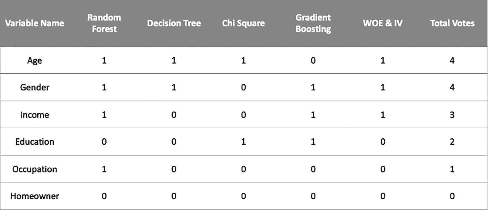
图 4-20 基于投票的选择

本节要求你完成练习 4-2：基于模型的选择。为了便于演示，我们在此提供该练习的解决方案（见图 4-21）。我们使用了本章前面讨论的所有基于目标变量的选择技术。

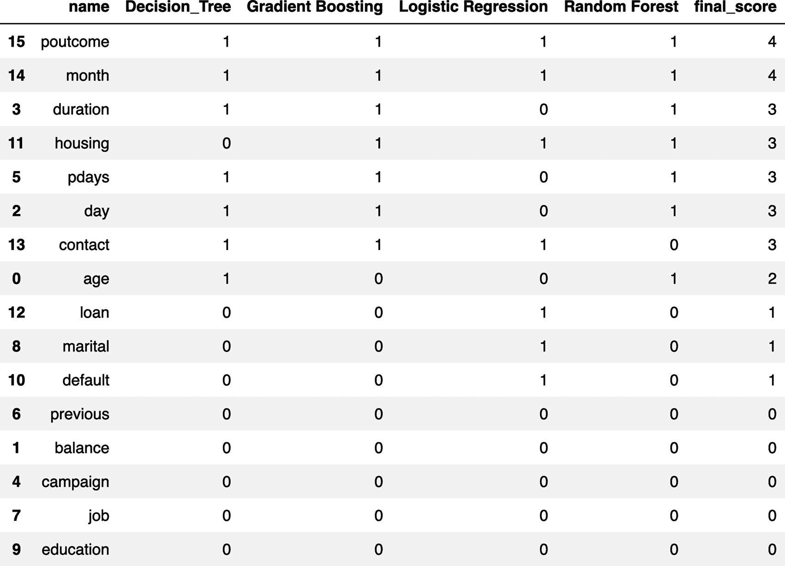
图 4-21 基于投票的选择输出

```python
# 决策树算法 – 问题 1 的解决方案
from pyspark.ml.classification import DecisionTreeClassifier
dt = DecisionTreeClassifier(featuresCol='features', labelCol=target_variable_name)
dt_model = dt.fit(df)
dt_output = dt_model.featureImportances
features_df['Decision_Tree'] = features_df['idx'].apply(lambda x: dt_output[x] if x in dt_output.indices else 0)

# 梯度提升算法 – 问题 2 的解决方案
from pyspark.ml.classification import GBTClassifier
gb = GBTClassifier(featuresCol='features', labelCol=target_variable_name)
gb_model = gb.fit(df)
gb_output = gb_model.featureImportances
features_df['Gradient Boosting'] = features_df['idx'].apply(lambda x: gb_output[x] if x in gb_output.indices else 0)

# 逻辑回归算法 – 问题 3 的解决方案
from pyspark.ml.classification import LogisticRegression
lr = LogisticRegression(featuresCol='features', labelCol=target_variable_name)
lr_model = lr.fit(df)
lr_output = lr_model.coefficients
# 使用绝对值将负系数转换为正数。此操作仅应在特征重要性计算时进行。
features_df['Logistic Regression'] = features_df['idx'].apply(lambda x: abs(lr_output[x]))

# 随机森林 – 我们之前讨论过的技术
from pyspark.ml.classification import RandomForestClassifier
rf = RandomForestClassifier(featuresCol='features', labelCol=target_variable_name)
rf_model = rf.fit(df)
rf_model.featureImportances
rf_output = rf_model.featureImportances
features_df['Random Forest'] = features_df['idx'].apply(lambda x: rf_output[x] if x in rf_output.indices else 0)

## 基于投票的选择
features_df.drop('idx', axis=1, inplace=True)
num_top_features = 7 # 每个算法选取的前 n 个特征
columns = ['Decision_Tree', 'Gradient Boosting', 'Logistic Regression', 'Random Forest']
score_table = pd.DataFrame({},[])
score_table['name'] = features_df['name']
# 评估每个算法选出的前几个特征
for i in columns:
    score_table[i] = features_df['name'].isin(list(features_df.nlargest(num_top_features,i)['name'])).astype(int)
# 汇总最终得分
score_table['final_score'] = score_table.sum(axis=1)
score_table.sort_values('final_score',ascending=0)
```

### 总结

- 你详细了解了变量选择技术。
- 你学习了基于目标变量与不基于目标变量的选择技术。
- 你创建了自己的 Spark ML 转换器，并将其集成到机器学习工作流中。
- 最后，你结合了所有选择技术，创建了一种基于投票的选择技术。

干得漂亮！在下一章中，你将学习本书最激动人心的部分——机器学习模型。请继续学习，保持关注。

