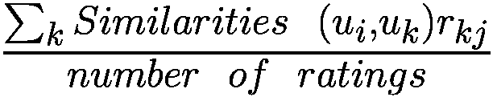
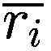
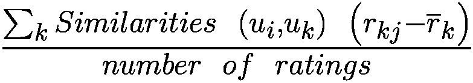
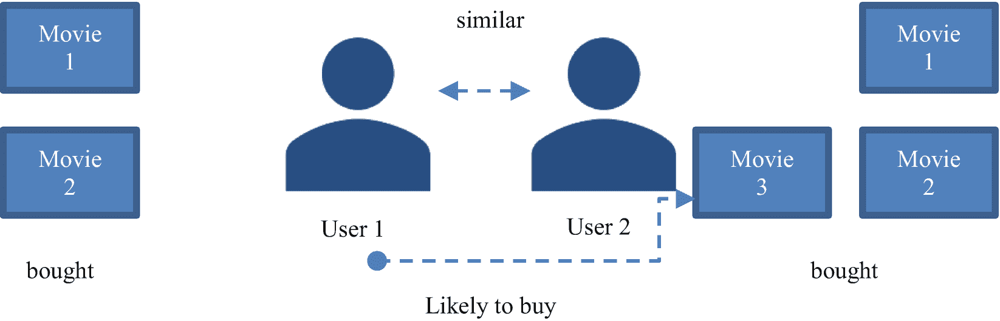
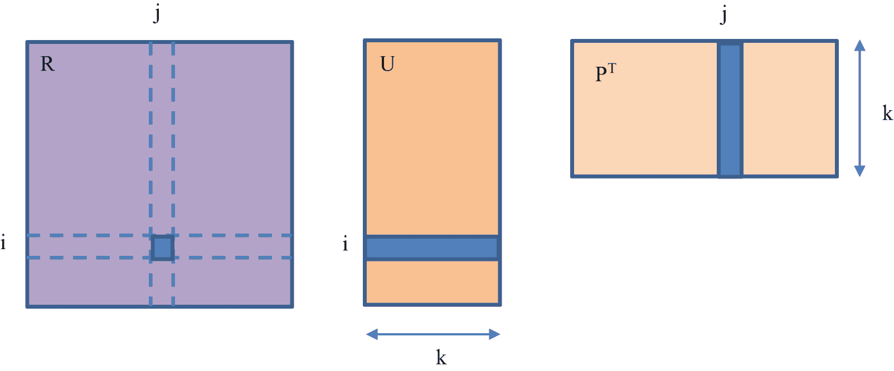
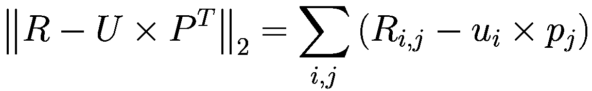

# IDF
idf = IDF(inputCol="raw_features", outputCol="features")
idfModel = idf.fit(result_cv)
result_tfidf = idfModel.transform(result_cv)
```

在上述步骤中，我们使用内置函数创建了词频和逆文档频率。`CountVectorizer` 有助于将文本文档集合转换为词频向量。`IDF` 则对特征进行重新加权，以降低在语料库中频繁出现的词的权重。

我们将这些包含每个文档中高重要性词的数据用于 LDA 模型。然后，我们打印每个主题的前五个词以理解主题。这里我们使用了十个主题，但这是最佳选择吗？不，我们需要尝试不同的组合来确定正确的数量。此处使用十个主题仅作为示例。你可以对不同的组合进行迭代，并观察哪个数量能为你提供有意义的主题集合。

```
num_topics = 10
max_iterations = 100
lda_model=LDA.train(result_tfidf.select("index", "features").rdd.mapValues(MLlibVectors.fromML).map(list),k = num_topics, maxIterations = max_iterations)
wordNumbers = 5
data_topics=lda_model.describeTopics(maxTermsPerTopic = wordNumbers)
vocabArray = cvmodel.vocabulary
topicIndices = spark.sparkContext.parallelize(data_tp)
def topic_render(topic):
terms = topic[0]
result = []
for i in range(wordNumbers):
term = vocabArray[terms[i]]
result.append(term)
return result
topics_final = topicIndices.map(lambda topic: topic_render(topic)).collect()
for topic in range(len(topics_final)):
print ("Topic" + str(topic) + ":")
for term in topics_final[topic]:
print (term)
print ('\n')
```

输出：

```
Topic0:
works
good
speaker
sound
better
Topic1:
know
time
questions
playing
alexa
Topic2:
amazon
another
first
purchased
back
Topic3:
would
device
work
could
give
Topic4:
well
need
thing
pretty
loves
Topic5:
love
great
bought
little
much
Topic6:
home
weather
smart
voice
things
Topic7:
really
getting
without
wish
enjoy
Topic8:
music
echo
play
every
want
Topic9:
product
easy
still
alexa
using
```


## 协同过滤

如果你使用过或接触过任何推荐引擎，那么其底层极有可能采用了协同过滤技术。协同过滤的优势之一在于，它不需要大量的客户数据，仅需用户对一组商品的历史偏好即可。其内在假设之一是：未来的偏好与过去的偏好保持一致。用户偏好主要分为两类：显式评分和隐式评分。顾名思义，`显式评分`是用户根据服务商约定的评分标准给出的（例如，IMDB 的 1 到 10 分）。这为我们提供了绝佳的机会，因为我们可以明确了解用户对某个产品/内容的喜爱或厌恶程度。而`隐式评分`则是通过用户参与行为来衡量的（例如，用户收听某首特定曲目的次数、购买记录、观看习惯等）。

现实世界中的数据通常是双模态的，它由两类实体之间的联合交互产生。例如，用户对电影的评分同时受到用户特征和电影特征的影响。想象一个数据集，其行代表不同用户，列代表他们对电影的评分，传统的聚类技术会考察用户在多维空间中的距离远近。我们常常忽略了列与列之间的关系。而共聚类旨在根据对象之间成对交互的相似性，同时按行和列对对象进行分组。当数据稀疏时，共聚类非常有效。在大多数现实场景中，数据都是稀疏的。一个观众能观看的电影数量是有限的，因此当我们跨用户和电影收集数据时，数据会变得稀疏，这正是共聚类的最佳应用场景之一。在协同过滤的术语中，它们被称为基于用户的协同过滤和基于物品的协同过滤。

### 基于用户的协同过滤

假设你有一个 `a` x `b` 的评分矩阵，其中用户为 `u[i,]`（`i = 1` 到 `n`），物品为 `p[j]`（`j = 1` 到 `m`）。如果你想预测评分 `r[ij]`，且用户尚未观看物品 `j`，你可以计算用户 `i` 与所有其他用户之间的相似度（见图 7-18）。然后，你可以选择最相似的若干用户，并以相似度为权重，对这些用户的评分进行加权平均。

`r[ij] =` 

同样，评分者可能类型各异，从严格到宽松。为避免偏差，你可以在计算时使用每个用户对所有物品的平均评分，并将其加回到目标评分中。

`r[ij] =`  `+` 

还有其他计算相似度的方法，例如皮尔逊相关系数和余弦相似度。所有这些指标都基于同一原则：当用户对相似物品有相同的参与度或购买行为时，他们就是相似的。这些方法能帮助你找到与目标用户最相似的用户。

### 基于物品的协同过滤

对于基于物品的协同过滤，你利用从其他具有相似品味或偏好的用户那里收集到的信息，根据用户的品味来预测他们可能偏好的物品。这种方法提供了稳定性，但计算量很大。



图 7-18

基于用户的协同过滤

## 矩阵分解

共聚类需要使用矩阵分解。这是一种将初始稀疏的用户-物品交互矩阵分解为具有潜在特征的低维矩阵的方法，这些低维矩阵的稀疏性更低。潜在特征可以是对物品的广泛分类（例如，杂货店中的生鲜产品、电影的类型等）。矩阵分解可以估算出一部电影在多大程度上符合某个类别，以及一个用户在多大程度上符合同一类别。该方法的最大优势之一是，即使两个用户之间没有共同物品的显式或隐式评分，你仍然可以通过他们共享的潜在特征来发现相似性（见图 7-19）。



图 7-19

矩阵分解

矩阵分解会将用户-物品矩阵 `R` 分解为 `U`（基于用户）和 `P`（基于物品），使得 `R ~ U x P`，其中 `U ∈ R^(m*k)`，`P ∈ R^(n*k)`。这里的 `k` 是分解的秩。现在，你可以将其视为一个优化过程，通过最小化代价函数 `J`，用 `U` 和 `P` 来逼近原始矩阵 `R`：

```
J = ||R - U x P^T||_2 + λ (||U||_2 + ||P||_2)
```

第一项表示 `R` 与其近似矩阵 `U x P^T` 之间的均方误差距离。第二项是正则化项，用于防止过拟合。


### 使用交替最小二乘法（ALS）进行优化

`ALS` 通过迭代更新一半参数并固定另一半参数来最小化损失函数。这种交替方法避免了在优化步骤中进行梯度计算。它是针对隐式反馈进行矩阵分解的一种高效解决方案。由于我们假设未观测到的条目为 0，梯度计算的开销可能极其巨大。随着我们进一步讨论代价函数，你将获得更深入的理解。

基于代价函数，你需要学习两类变量：`U` 和 `P`，它们表示为 `U × P^T`。该函数的实际代价为以下求和：



再加上正则化项。由于 `Us` 和 `Vs` 是未知变量，这使得代价函数成为非凸函数。如果你固定 `P` 并优化 `U`，本质上可以将问题简化为线性回归。这是一个巨大的优势，并且该过程可以并行化。`ALS` 是一个两步迭代过程。在每次迭代中，先固定 `P` 并求解 `U`。在下一步中，固定 `U` 并求解 `P`。由于普通最小二乘法保证了最小的均方误差，代价函数永远不会增加。在这两步之间交替进行，将不断降低代价函数，直至收敛。

当可用数据量极少时，协同过滤非常适合用于推荐。但你必须意识到它的局限性。作为矩阵分解一部分而生成的潜在特征是不可解释的。你还可能遇到冷启动问题。当一个新项目没有足够数量的用户时，模型将无法为该新项目做出推荐，并且可能陷入流行度偏差的陷阱。

我们现在通过一个虚构的数据集来演示协同过滤的实现，该数据集包含三列：多个用户和电影的 `userid`、`movieid` 和 `ratings`。所有代码均在单独的 Jupyter Notebook 中提供，方便访问。

```
