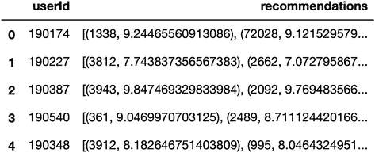
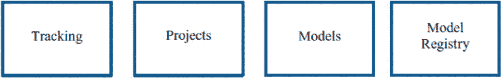

# Generate top 10 user recommendations for each movie
movieRecs = model.recommendForAllItems(10)
movieRecs.count()
userRecs_df = userRecs.toPandas()
print(userRecs_df.shape)
movieRecs_df = movieRecs.toPandas()
print(movieRecs_df.shape)
userRecs_df.head()
```

输出：



**练习 7-2：协同过滤**

**问题 1：** 更改 `ALS` 设置中的潜在特征数量，并观察均方误差如何变化。

## 总结

*   你已了解了无监督学习技术的概览。
*   你现在知道了层次聚类和非层次聚类方法的区别，并且了解了轮廓系数如何帮助确定最佳聚类数。
*   你探索了潜在狄利克雷分配的工作原理并实现了它。
*   你还回顾了使用交替最小二乘法实现协同过滤的过程。

干得漂亮！你现在已经熟悉了一些在无监督学习和非结构化数据中非常有用的关键概念。在下一章中，我们将带你了解如何构建项目以及创建自动化机器学习流程。


# 8. 机器学习流程与自动化管道

将模型投入生产是数据科学领域最具挑战性的任务之一。这是许多组织中持续存在的"最后一公里"问题。尽管有许多管理工作流程的工具，但随着组织成熟度的提升，其需求也在变化，管理现有模型可能成为一项艰巨的任务。退一步分析为何如此困难，你会发现这源于大多数组织中存在的结构性问题。工程团队维护着生产平台，而数据科学工具集与生产平台之间存在鸿沟。部分数据科学工作可以在`Jupyter Notebook`中开发，很少考虑云环境；部分数据流在本地创建，扩展能力有限。这类应用在处理大量数据时往往表现不佳。软件开发周期中的最佳实践难以适用于机器学习生命周期，因为涉及的任务种类繁多，标准主要由组织内的数据科学团队定义。此外，该领域的快速发展在模型管理和部署方面留下了空白。

本章旨在探索可用于管理和部署数据科学管道的工具。我们将介绍业界可用的部分工具，并通过示例演示如何构建自动化管道。我们将运用你已学过的所有概念来构建这些管道。学完本章后，你将学会如何构建机器学习模块，并将其与自定义数据预处理协同自动化。

本章涵盖以下主题：

- **MLflow。** 我们将介绍 MLflow 及其组件和优势，随后进行演示。前半部分重点介绍安装和概念，后半部分聚焦于在 MLflow 中实现模型。
- **自动化机器学习管道。** 我们将介绍在 PySpark 中设计和实现自动化机器学习框架的概念。本节前半部分着重于实现，后半部分聚焦于管道生成的输出。

## MLflow

通过前几章获得的知识，你已经知道如何构建独立的监督和无监督模型。通常，你会迭代多个模型以选择最佳方案。如何跟踪所有实验及使用的超参数？经过多次实验后如何复现特定结果？当存在多种部署工具和环境时，如何将模型投入生产？是否有更好的方法来管理机器学习工作流程并与更广泛的社区共享成果？当你在 PySpark 中熟练构建模型后，这些问题便会浮现。Databricks 构建了一个名为`MLflow`的工具，它能在管理机器学习工作流程的同时优雅地处理上述部分问题。`MLflow`被设计为开放接口和开源工具。人们经常在实验和为模型添加新功能之间反复切换，而`MLflow`能轻松处理此类实验。它基于 REST API 构建，便于多种工具调用。该框架还能轻松添加现有的机器学习代码模块。其开源特性使得跨团队共享工作流程和模型变得简单。简而言之，`MLflow`提供了一个管理机器学习生命周期的框架，涵盖实验、可复现性、部署和中央模型注册表。

`MLflow`的组件如图 8-1 所示，并在以下列表中描述。



图 8-1

`MLflow`的组件

- **跟踪：** 该组件有助于记录代码、配置、数据和结果，并提供查询实验的机制。
- **项目：** 该组件帮助将机器学习代码打包成可在多个平台上轻松复现的格式。
- **模型：** 该组件协助在不同环境中部署机器学习代码。
- **模型注册表：** 该组件充当存储、管理和搜索模型的仓库。

该框架为数据工程师和数据科学家打开了协作通道，使他们能够高效构建数据管道。它还提供了从多种系统消费和写入数据的能力，为在数据湖和批流平台上处理结构化和非结构化数据提供了通用框架。

这对初次使用者来说可能有些抽象。我们将通过一个示例来演示这些组件如何发挥作用及如何实现。为便于说明，我们使用与第 6 章相同的银行数据集。


### MLflow 代码设置与安装

在本节中，我们将逐步介绍支持 MLflow 所需的代码更改及其安装过程。所有演示均使用 PySpark Docker 版本。启动并运行 MLflow 主要包含以下两个步骤：

- 代码/脚本更改
- Docker 端更改及 MLflow 服务器安装

代码更改量很小。你只需在现有的机器学习代码中添加几个 MLflow 函数即可适配 MLflow。

常规代码可以很好地构建简单的随机森林模型，但如果你想通过更改输入变量或任何超参数设置来了解接收者操作特征（ROC）/其他指标（准确率、误分类率等），该怎么办？如果只是单次更改，你可以将每次运行记录在 Excel 中，但这并非跟踪实验的有效方式。作为数据科学专业人士，我们会运行数百次实验，尤其是在模型微调阶段。有没有更好的方法来捕获和注释这些结果与日志？是的，你可以通过 MLflow 的跟踪功能来实现。接下来，我们将重写一个简单的随机森林模型代码，并添加 MLflow 组件。代码中的更改部分以粗体突出显示。

**注意**

我们将把以下代码保存为 `.py` 文件，并在安装 MLflow 后通过 Docker 运行它。

```python
