# 6. 模型评估

> *“所有模型都是错的，但有些是有用的。”*
> 
> — 乔治·E·P·博克斯。

许多人试图开发模型来执行特定任务（例如，预测房价）。通常，这些模型无法百分之百地反映现实。在房地产示例中，我们无法始终精确预测房价。然而，这并不意味着模型毫无价值。一般来说，所有统计和机器学习模型都面临这个问题。那么，为什么还要构建模型呢？尽管我们无法百分之百地反映现实，但我们仍然可以对有用的行为进行建模，并足够接近地反映现实。例如，我们可以使用邮政编码等人口统计信息来预测价格，并且这个模型的表现可以优于随机猜测。这一事实为整个章节奠定了基础。你需要确保充分理解这个想法，因为每个人都关心你基于模型所带来的见解。

话虽如此，你可以构建一个或多个模型来预测房价。你选择哪一个，为什么？本章提供了回答这些问题的技巧和方法。但在深入探讨模型评估指标之前，我们需要介绍一些相关概念。

## 模型复杂度

模型复杂度衡量的是模型对从训练中习得信息的泛化能力。在上一章中，我们将数据分为了训练数据和测试数据。然后，我们在训练数据集上构建模型（模型拟合），并将拟合后的模型应用于测试数据集（模型泛化）。整个过程如图 6-1 所示。作为示例，我们使用了三种分类模型。当你比较使用不同超参数和同一算法（如神经网络）的多个训练周期生成的模型时，同样的概念也适用。

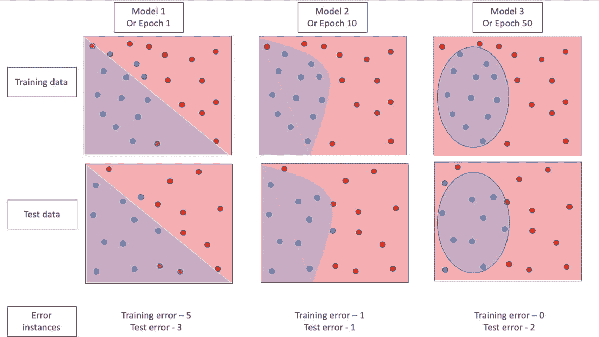

图 6-1 比较不同设置下模型的性能

### 欠拟合

请看图 6-1 中的模型 1。它是一个线性模型，未能很好地拟合训练数据。因此，它在测试数据上的泛化效果也不好。该模型未能捕捉到底层数据中的非线性关系。结果，训练数据集和测试数据集上的误差水平都很高。这被称为欠拟合。当出现这类问题时，模型在训练数据和测试数据上的表现都很差。

### 最佳拟合

现在请看图 6-1 中的模型 2。它更好地捕捉了数据中的非线性关系。因此，该模型在训练数据和测试数据上的表现同样出色。模型拟合和泛化都很好。这是一种最佳拟合模型的情况。作为数据科学家或机器学习爱好者，你应该始终寻找这个最佳点——金发姑娘点。

### 过拟合

现在请看图 6-1 中的模型 3。该模型完美地拟合了训练数据。然而，它在测试数据上的泛化效果不佳。这被称为过拟合。在训练过程中设置较多的训练周期也可能导致模型过拟合。结果，模型很好地记忆了（而非泛化）训练数据，但在测试数据上表现不佳。

当你绘制每个模型的训练误差和测试误差时，通常会得到如图 6-2 所示的图表。该图是基于图 6-1 中的错误实例数量生成的。

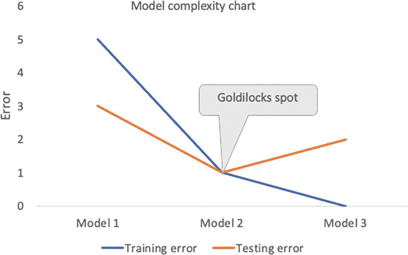

图 6-2 模型复杂度图

通常，你会希望以占整个数据集百分比的形式来查看误差——即误分类率。让我们用误分类率再生成一张图，这次我们将使用每个训练周期的误差水平，而不是不同的模型。你可以清楚地看到因欠拟合、最佳拟合和过拟合导致的误分类率的差异。通过查看此图，你可以为你的数据选择最佳模型，即金发姑娘点，如图 6-3 所示。在第 10 个训练周期，模型在训练数据和测试数据上的表现都更好，如图 6-3 所示。

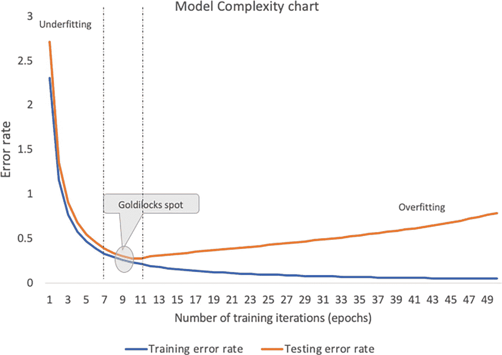

图 6-3 金发姑娘点

### 偏差与方差

在讨论模型复杂度时，有些人使用术语偏差和方差来描述它。*通常，一个理想的模型应该具有低偏差和低方差。*那么，它们是什么呢？

-   偏差告诉你算法表示数据中真实关系的能力。
-   方差告诉你算法在不同数据集上的一致性（性能）。

在当前示例中，模型 1 无法捕捉数据中的非线性关系，因此它具有高偏差。然而，它在训练数据集和测试数据集上产生了相似的误差，因此它具有低方差。类似地，模型 2 具有低偏差和低方差，而模型 3 具有低偏差和高方差。因此，我们选择模型 2 作为最佳模型。

## 模型验证

基于我们关于模型复杂度的讨论，你现在应该理解在建模过程中进行训练/测试集划分的目的。拥有训练数据集和测试数据集是执行模型验证的一种方法。还有其他可用的方法。让我们从训练/测试集划分开始，然后介绍其他验证技术。

### 训练/测试集划分

正如你一直所见，这个想法很简单。你根据指定的比例随机分割数据。在大多数示例中，我们使用 70/30 的分割比例。这意味着大约 70% 的数据从原始数据集中随机抽样形成训练集，剩下的 30% 进入测试集。如图 6-4 所示。

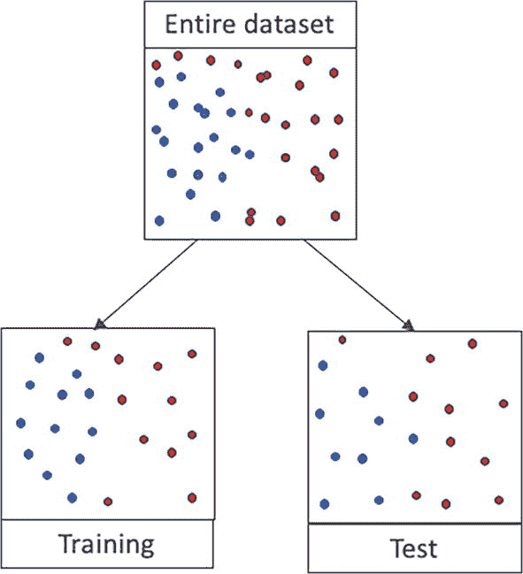

图 6-4 训练/测试集划分

另一种表示此方法的方式是使用图 6-5 中所示的条形图。


图 6-5 训练/测试集划分

在执行分割时，你可以使用简单随机抽样或分层抽样。

#### 简单随机抽样

数据点根据用户指定的比例随机分配到每个训练和测试数据集。对于 70/30 的分割，随机选择 70% 的数据创建训练数据集，剩下的 30% 分配给测试数据集。

#### 分层抽样

这种类型的抽样用于监督学习。查看原始数据集中目标的分布。假设分布是 60% 的 0 和 40% 的 1。通过分层抽样，即使在分割之后，你仍然可以在训练数据集和测试数据集中保持 60/40 的目标分布。

其他抽样方法——如等距抽样、整群抽样和系统抽样——不在本书的讨论范围内。在 PySpark 中，你可以使用三种选项之一来完成训练/测试集划分。以下代码执行 70/30 的分割。

##### 选项 1

```python
train, test = df.randomSplit([0.7, 0.3], seed=12345)
```

##### 选项 2

第二个选项使用 PySpark 的 *ML 调优* 库。在此步骤之前，你需要使用向量组装器的输出作为输入。

```python
from pyspark.ml.evaluation import BinaryClassificationEvaluator
from pyspark.ml.classification import LogisticRegression
from pyspark.ml.tuning import ParamGridBuilder, TrainValidationSplit
# 模型初始化
lr = LogisticRegression(maxIter=10, featuresCol='features', labelCol='label')
# 要尝试的模型参数 - 参数网格设置
paramGrid = ParamGridBuilder().addGrid(lr.regParam, [0.1, 0.01]).addGrid(lr.elasticNetParam, [0.0, 0.5, 1.0]).build()
# 70% 的数据将用于训练，30% 用于验证。
train_valid_clf = TrainValidationSplit(estimator=lr, estimatorParamMaps=paramGrid, evaluator=BinaryClassificationEvaluator(), trainRatio=0.7)
# assembled_df 是向量组装器的输出
model = train_valid_clf.fit(assembled_df)
```

##### 选项 3

要在 PySpark 中执行分层抽样，你需要使用 `randomSplit` 选项的变通方法。代码如下所示：

```python
# 为 0 和 1 分割数据
zero_df = df.filter(df["label"]==0)
one_df = df.filter(df["label"]==1)
# 将数据分割为训练集和测试集
train_zero, test_zero = zero_df.randomSplit([0.7,0.3], seed=12345)
train_one, test_one = one_df.randomSplit([0.7,0.3], seed=12345)
# 合并数据集
train = train_zero.union(train_one)
test = test_zero.union(test_one)
```

#### 采样偏差

你已经看到了使用训练/测试集的好处。然而，这种方法也存在一些缺点。假设你正在预测零售额，并使用 11 月份的数据。由于感恩节，商店推出了大幅折扣，销售额增长了 `x` 个百分点。当你使用这些数据构建模型并预测当月剩余时间的销售额时，你得到的模型可能无法考虑节日折扣的影响。这被称为采样偏差。

当你的数据偏向于总体的某个部分，而没有考虑到总体的所有部分时，就会发生采样偏差。作为建模者，你需要在构建模型之前理解数据。你还应该了解你的模型可以在哪些情况下使用。否则，模型将无法产生预期的结果。可以通过使用以下技术之一来最小化采样偏差：留出法/跨时间验证法或交叉验证法。

##### 留出法/跨时间验证法

留出法的概念扩展了训练/测试集划分的思路，不同之处在于这次你有三个数据集而不是两个。见图 6-6。


图 6-6 留出法概念

要在 PySpark 中创建留出数据集，你可能需要对之前看到的代码稍作修改。这将产生一个 70/20/10 的划分。

```python
train, test, holdout = df.randomSplit([0.7, 0.2, 0.1], seed=12345)
```

此外，你可以在执行选项 2 之前拥有训练和测试数据集，并在训练数据集上拟合模型，而不是在整个数据集上。这样，测试数据集就可以成为留出数据集。

留出数据集部分解决了采样偏差问题，但数据仍然来自同一时间段。为了解决这个问题，你需要考虑跨时间验证数据。在零售额预测示例中，11 月的数据将作为训练/测试/留出数据，然后其他月份（例如 6 月）的数据将作为跨时间验证数据。*行业实践建议你至少使用两个跨时间验证数据样本来验证你的模型*。这样，你就可以在模型中考虑节日折扣的重要性，并使你的预测保持稳定。

##### 总体稳定性指数

避免采样偏差和实现稳定模型的另一个建议是对跨数据集（训练/测试/留出/跨时间验证）的变量执行总体稳定性指数（PSI）检查。本质上，你是在衡量每个变量相对于目标变量在数据中的分布变化。你选择具有高特征重要性和低变异性（低 PSI 指数）的最佳变量。这样，你的模型就能随着时间的推移产生稳定的预测。PSI 检查是一个简单的公式：

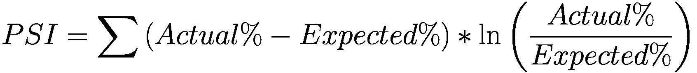

这个公式应该类似于你在第 4 章证据权重（WOE）部分看到的信息价值（IV）公式。

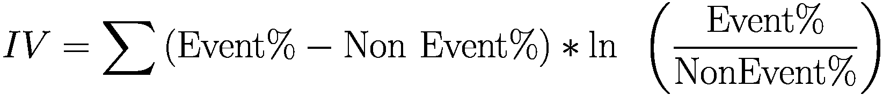

IV 和 PSI 之间的唯一区别在于，IV 值比较的是同一变量中事件与非事件的分布，而 PSI 比较的是来自两个不同时间段（例如，训练数据与跨时间验证数据）的同一变量的事件分布。因此，训练数据的事件分布被视为*预期*结果，而其余数据集的事件分布被视为*实际*结果。在 IV 分析中，倾向于选择高 IV 值的变量，而在 PSI 分析中，则倾向于选择低 PSI 值的变量。PSI 的临界值也与 IV 略有不同。见表 6-1。

表 6-1 PSI 值

| 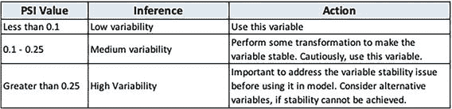 |

让我们对单个变量的训练数据集和留出数据集做一个简单的 PSI 计算。结果如表 6-2 所示。

表 6-2 训练数据集与留出数据集

| 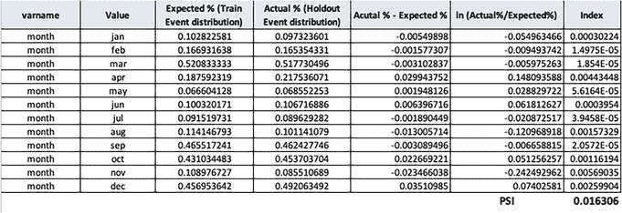 |

注意

> 在训练数据集上运行 WOE 代码，并将分箱应用于留出数据集。训练数据集将始终包含*预期*值。

`month` 变量的 PSI 值为 0.016。这表明该变量在训练数据集和留出数据集之间是稳定的（低变异性）。你可以对模型中的所有变量执行相同的检查，并确保它们在两个数据集之间都是稳定的。附带说明一下，你可以对模型输出进行 PSI 检查，并监控模型在不同时间段内的性能。

### k 折交叉验证

到目前为止，你已经看到了一种可以处理采样偏差的留出法/跨时间验证法方法。如果你必须使用单个数据集并且没有跨时间验证数据集，该怎么办？这种情况经常出现，尤其是在处理调查数据时。K 折交叉验证可以在这些情况下帮助你。其思路很简单。

-   将数据随机分成 `k` 折（通常值为 5 或 10，这是一个可配置参数）。
-   在 `k`−1 折上拟合模型，并在留出的那一折（第 `k` 折）上测试模型。
-   测量该模型的指标（准确率/误差）。
-   重复此过程，直到所有折都被用作测试数据集。
-   最终的指标（准确率/误差）是所有 k 折指标的平均值。

k 折（四折）交叉验证的图示如图 6-7 所示。


图 6-7 四折交叉验证

在 k 折交叉验证中，每个数据点都用于训练和测试模型。每个数据点在给定时间要么在训练集中，要么在测试集中，但不能同时存在。因此，训练数据和测试数据不是静态的，从而最小化了采样偏差。

在 PySpark 中，你可以使用 *ML 调优* 库执行 k 折交叉验证。

```python
from pyspark.ml.evaluation import BinaryClassificationEvaluator
from pyspark.ml.classification import LogisticRegression
from pyspark.ml.tuning import ParamGridBuilder, CrossValidator
#模型初始化
lr = LogisticRegression(maxIter=10, featuresCol='features', labelCol='label')
#要尝试的模型参数
paramGrid = ParamGridBuilder().addGrid(lr.regParam, [0.1, 0.01]).addGrid(lr.elasticNetParam, [0.0, 0.5, 1.0]).build()
# 折数 = 3
crossval_clf = CrossValidator(estimator=lr, estimatorParamMaps=paramGrid, evaluator=BinaryClassificationEvaluator(), numFolds=3)
# assembled_df 是向量组装器的输出
model = crossval_clf.fit(assembled_df)
```

该代码执行了三折交叉验证。你能猜出上述代码训练了多少个模型吗？如果你的答案是 18，那就对了。请注意用于训练交叉验证模型的参数网格。`elasticNet` 有三个参数，`正则化参数` 有两个，还有三个 `折` (3 * 2 * 3 = 18 个模型)。如你所见，当你增加网格参数或折数时，交叉验证的成本会迅速增加。然而，这种方法对于*超参数调优*非常有用，而不是手动尝试每种参数设置。

### 留一法交叉验证

留一法交叉验证是 k 折交叉验证的一种变体。其思想是使用单个观测值作为测试集，并使用其余数据作为训练集。图 6-8 展示了该方法的图示。

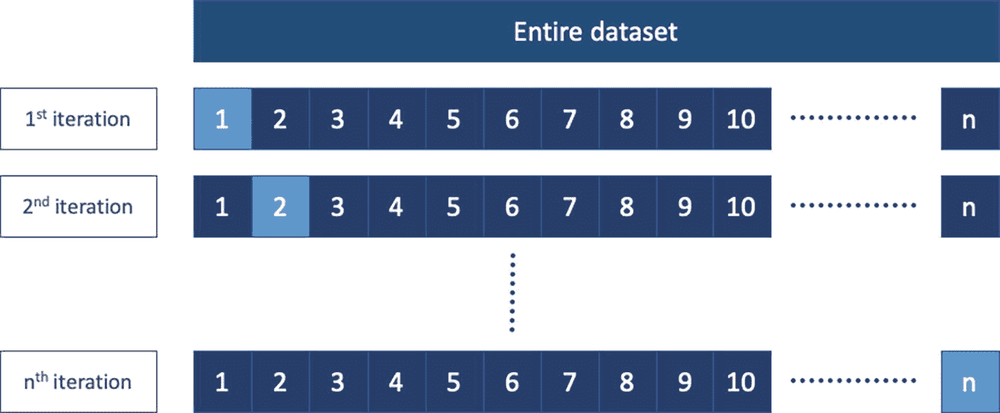

图 6-8 留一法交叉验证

这里，`n` 是数据中的观测值数量。在 PySpark 中，你可以通过将数据集大小 (`n`) 作为之前展示的 k 折交叉验证代码中的折数来执行留一法交叉验证。此方法计算成本高昂，因为对于一组参数设置，模型需要训练 `n` 次。

## 留一组法交叉验证

这是 k 折交叉验证的另一种变体。当你想要测试模型在不同人群分段上的性能时，它会变得非常有用。假设你正在进行一项人口统计研究，并希望了解哪个年龄组会对营销活动做出积极回应。这里不能使用 k 折方法，因为它没有考虑每个折中的年龄组分段。你希望在验证模型性能时保持年龄组的纯净。这时，留一组法交叉验证就派上了用场。图 6-9 展示了该方法的图示，其中包含四个组。

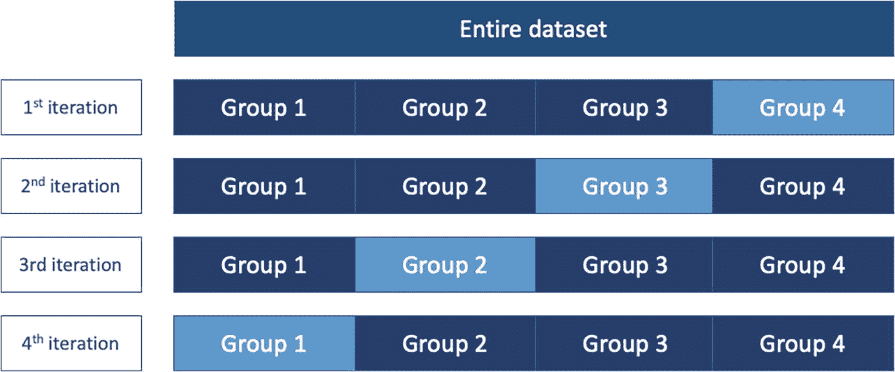

图 6-9 留一组法交叉验证

此方法目前在 `PySpark` 中不可用。我们在此展示一些变通代码：

```python
from pyspark.sql import SparkSession
from pyspark.ml.feature import VectorAssembler
from pyspark.ml import Pipeline
from pyspark.sql.functions import countDistinct
from pyspark.ml.classification import LogisticRegression
from pyspark.ml.evaluation import BinaryClassificationEvaluator
from pyspark.sql import functions as F
import numpy as np

filename = "bank-full.csv"
spark = SparkSession.builder.getOrCreate()
df = spark.read.csv(filename, header=True, inferSchema=True, sep=';')
df = df.withColumn('label', F.when(F.col("y") == 'yes', 1).otherwise(0))
df = df.drop('y')
df = df.select(['education', 'age', 'balance', 'day', 'duration', 'campaign', 'pdays', 'previous', 'label'])

features_list = ['age', 'balance', 'day', 'duration', 'campaign', 'pdays', 'previous']

#assemble individual columns to one column - 'features'
def assemble_vectors(df, features_list, target_variable_name, group_variable_name):
    stages = []
    #assemble vectors
    assembler = VectorAssembler(inputCols=features_list, outputCol='features')
    stages = [assembler]
    #select all the columns + target + newly created 'features' column
    selectedCols = [group_variable_name, target_variable_name, 'features']
    #use pipeline to process sequentially
    pipeline = Pipeline(stages=stages)
    #assembler model
    assembleModel = pipeline.fit(df)
    #apply assembler model on data
    df = assembleModel.transform(df).select(selectedCols)
    return df

# apply the function on our DataFrame
joined_df = assemble_vectors(df, features_list, 'label', 'education')

# find the groups to apply cross validation
groups = list(joined_df.select('education').toPandas()['education'].unique())

# leave-one-group-out validation
def leave_one_group_out_validator(df, var_name, groups):
    train_metric_score = []
    test_metric_score = []
    for i in groups:
        train = df.filter(df[var_name]!=i)
        test = df.filter(df[var_name]==i)
        #model initialization
        lr = LogisticRegression(maxIter=10, featuresCol='features', labelCol='label')
        evaluator = BinaryClassificationEvaluator(labelCol='label', rawPredictionCol='rawPrediction', metricName='areaUnderROC')
        #fit model
        lrModel = lr.fit(train)
        #make predicitons
        predict_train = lrModel.transform(train)
        predict_test = lrModel.transform(test)
        train_metric_score.append(evaluator.evaluate(predict_train))
        test_metric_score.append(evaluator.evaluate(predict_test))
        print(str(i) + " Group evaluation")
        print(" Train AUC - ", train_metric_score[-1])
        print(" Test AUC - ", test_metric_score[-1])
    print('Final evaluation for model')
    print('Train ROC', np.mean(train_metric_score))
    print('Test ROC', np.mean(test_metric_score))
```

## 时间序列模型验证

关于时间序列验证，训练/测试集的划分与你目前所见的方式略有不同。假设你正在处理过去一年的月度时间序列数据，并希望执行 70/30 的划分。你应该选择前八个月的数据进行训练，后四个月的数据进行测试。`K` 折交叉验证在这里仍然可以使用；但是，在所有折中，训练数据必须始终在测试数据之前。

## 数据泄露

机器学习中的另一个常见问题是**数据泄露**，当你在训练模型时使用了预测时不可用的信息，就会发生这种情况。数据泄露可能发生在数据中，也可能发生在目标中。无论哪种情况，模型在生产环境中部署时都不会达到预期效果。

### 目标泄露

我们用一个简单的例子来解释这个问题。问题陈述：“预测下个月可能购买产品的客户。”你使用的是七月份的数据，理想情况下，此案例的目标应来自八月份。相反，你基于七月份创建了目标。在这种情况下，你是在事件发生后进行预测。这并不能解决你定义的问题陈述，并且是目标泄露的一个例子。

目标泄露的另一种变体是，当你使用一个输入特征来推导目标变量时。假设你想预测一所房子是否会以超过一百万美元的价格售出。你根据销售价格推导出目标（超过一百万美元为 1，低于一百万美元为 0）。在这种情况下，如果你在模型训练中包含销售价格变量，就会发生目标泄露，因为它是目标的代理变量。当目标定义复杂时，这个问题更有可能发生。

### 数据泄露

这种类型的泄露比目标泄露更常见。假设你有一个 70/30（训练/测试）的划分。你没有在 70% 的训练数据上训练模型，而是在整个数据集（100%）上训练模型。在这种情况下，模型已经看到了测试数据。因此，模型的评估指标是有偏差的。

这个问题的另一种变体发生在你在训练/测试划分之前对数据集进行自助采样时。自助采样是一种随机复制数据点的概念。它也被称为**有放回随机抽样**。当你在自助采样后划分数据时，同一个数据点更有可能同时出现在两个数据集中，从而导致数据泄露。在时间序列数据中，当你随机划分数据而不是遵循标准（训练发生在测试之前）时，会导致数据泄露。

### 数据泄露带来的问题

目标泄露或数据泄露可能导致严重问题，如下所示：

1. 模型无法部署，因为数据不可用。
2. 模型性能指标有偏差。
3. 模型输出不稳定，导致模型在生产中无法工作。

正确的业务理解、特征工程、与业务利益相关者一起评估你的数据/目标定义，以及使用非同期数据集，可以帮助你解决数据泄露问题。

## 模型评估

现在是时候深入探讨模型评估指标了。根据模型类型的不同，`PySpark` 提供了多种指标，如图 6-10 所示。

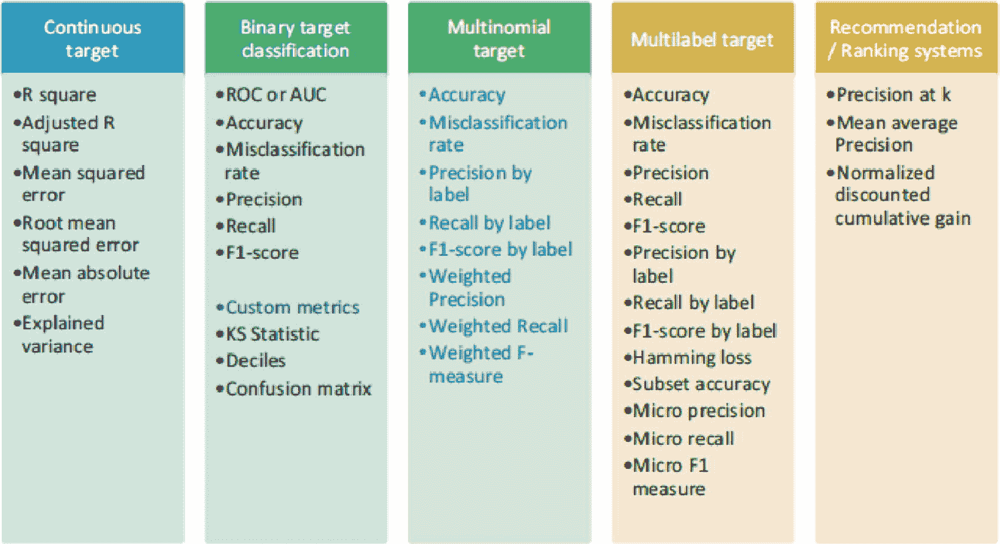

图 6-10 模型评估指标

### 连续目标

你可以使用 `PySpark` *ML Tuning* 包中的 `RegressionEvaluator` 选项来评估连续目标。让我们来看一下示例数据。

| x1 | x2 | target |
| --- | --- | --- |
| 58 | 50 | 12 |
| 37 | 95 | 27 |
| 29 | 137 | 39 |
| 19 | 150 | 45 |

图 6-11 展示了带有回归趋势线（拟合）的数据图。我们使用 Excel 生成了该图。使用图中所示的 `PySpark` `LinearRegression` 模型，你将得到相同的输出。

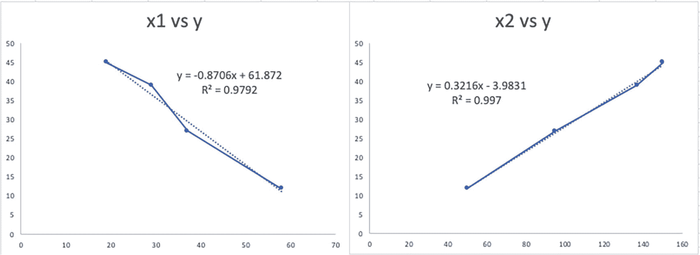

图 6-11 回归评估

我们将通过 *x1 vs y* 分析来全面了解回归评估指标。

#### 使用 PySpark 复现输出的代码

```python
from pyspark.sql.types import IntegerType
from pyspark.sql.types import StructField, StructType
cSchema = StructType([StructField("x1", IntegerType())\
,StructField("x2", IntegerType())\
,StructField("y", IntegerType())])
df_list = [[58, 50, 12], [37, 95, 27], [29, 137, 39], [19, 150, 45]]
df = spark.createDataFrame(df_list, schema=cSchema)

# 我们在前面章节中使用过的向量组装器
assembled_df = assemble_vectors(df, ['x1'], 'y')

# 构建回归模型
from pyspark.ml.regression import LinearRegression
reg = LinearRegression(featuresCol='features', labelCol='y')
reg_model = reg.fit(assembled_df) # 拟合模型

# 打印系数和截距
print(reg_model.coefficients[0], reg_model.intercept)
# 输出: -0.8705560619872369 61.87237921604372

# 预测结果
pred_result = reg_model.transform(assembled_df)

# 模型摘要
reg_summary = reg_model.summary
```

#### 模型方程

```python
y-hat = -0.8706* x1 + 61.8723
```

#### 误差

**误差** 定义为预测值与实际目标值之间的差异。我们使用以下方程来预测 *y-hat* 值：

```python
Obs1 = -0.8706 * 58.0 + 61.8723 = 11.38
Obs2 = -0.8706 * 37.0 + 61.8723 = 29.66
Obs3 = -0.8706 * 29.0 + 61.8723 = 36.63
Obs4 = -0.8706 * 19.0 + 61.8723 = 45.33
```

现在我们有了预测值。让我们计算每个预测值的误差。

```python
Error1 = 12 – 11.38 = 0.62
Error2 = 27 – 29.66 = -2.66
Error3 = 39 – 36.62 = 2.37
Error4 = 45 – 45.33 = -0.33
```

当我们对误差求和以量化模型预测结果时，会发生什么？

```python
Total error= 0.62 – 2.66 + 2.37 – 0.33 = 0.0078
```

这没有意义，因为误差并没有正确量化我们的评估结果。正误差抵消了负误差，使得我们的误差值非常小。**当你的数据中存在异常值时，这种效应更为显著，因为一两个值可能会补偿其余误差**。因此，我们需要使用其他指标来量化误差。表 6-3 总结了每个选择指标，并展示了如何使用它们来评估连续模型的性能。

表 6-3 选择指标

| **指标** | **模型性能** |
| --- | --- |
| 均方误差 (`MSE`) | 越低越好 |
| 均方根误差 (`RMSE`) | 越低越好 |
| 平均绝对误差 | 越低越好 |
| R 平方 | 越高越好 |
| 调整后 R 平方 | 越高越好 |
| 解释方差 | 越高越好 |

#### 均方误差 (`MSE`)

均方误差是取平方误差的平均值。首先，让我们计算平方误差。我们将使用之前计算出的误差。

```python
Sum Squared Error (SSE) = (0.62)2 + (-2.66)2 + (2.37)2 + (-0.33)2 = 13.21
```

均方误差是上述值的平均值。

```python
Mean Squared Error (MSE) = 13.21/4 = 3.303
```

让我们使用 `PySpark` 进行相同的计算。

```python
from pyspark.ml.evaluation import RegressionEvaluator
evaluator = RegressionEvaluator(labelCol='y', predictionCol='prediction', metricName='mse')
evaluator.evaluate(pred_result)

# 使用模型摘要
print('Mean Squared error', reg_summary.meanSquaredError)
```

#### 均方根误差 (`RMSE`)

均方根误差是取均方误差 (`MSE`) 的平方根。

```python
RMSE = \sqrt[MSE] = \sqrt[3.303] = 1.817
```

让我们使用 `PySpark` 进行相同的计算。

```python
evaluator = RegressionEvaluator(labelCol='y', predictionCol='prediction', metricName='rmse')
evaluator.evaluate(pred_result)

# 使用模型摘要
print('Root mean squared error', reg_summary.rootMeanSquaredError)
```

#### 平均绝对误差 (`MAE`)

平均绝对误差是取误差绝对值的平均值。让我们计算这些预测值的绝对误差。

```python
Sum Absolute Error (SAE) = 0.62 + 2.66 + 2.37 + 0.33 = 5.989
```

平均绝对误差取该值的平均值。

```python
Mean absolute error = 5.989/4 = 1.497
```

让我们在 `PySpark` 中进行相同的计算。

```python
evaluator = RegressionEvaluator(labelCol='y', predictionCol='prediction', metricName='mae')
evaluator.evaluate(pred_result)

# 使用模型摘要
print('Mean Absolute error', reg_summary.meanAbsoluteError)
```

#### R 平方 (R²)

R 平方是回归模型的决定系数。它衡量拟合优度；即模型对数据的拟合程度。有多种方式可以表示 R 平方方程。

##### 使用模型拟合

假设，

```python
SST = SSM + SSE
其中
SST = 总平方和
SSM = 模型平方和
SSE = 误差平方和
那么
R-squared = SSM/ SST = 1 – (SSE/SST)
```

## 使用模型方差

```
var(model) = 模型方差 = MSE
var(mean) = 目标均值周围平方误差和的平均值 (MSM)
R squared = 1 – (var(model)/var(mean)) = 1 – (MSE/MSM)
```

让我们手动计算。这次，我们使用模型方差法，因为我们已经计算了 MSE。

```
目标均值 (mean) = (12 + 27 + 39 + 45)/4 = 30.75
SS(mean) = (12 – 30.75)2 + (27 – 30.75)2 + (39 – 30.75)2 + (45 – 30.75)2
var(mean) = (351.56 + 14.06 + 68.06 + 203.06)/4 = 636.75/4 = 159.19
var(model) = MSE = 3.303
R-squared = 1 – (3.303/159.19) = 0.9792
```

注意 `SS (mean)` 等同于 `SST`。让我们在 PySpark 中进行相同的计算。

```
evaluator = RegressionEvaluator(labelCol='y', predictionCol='prediction', metricName='r2')
evaluator.evaluate(pred_result)
print('R squared', reg_summary.r2)
```

### 解释方差 (Var)

解释方差是基线模型方差与拟合模型方差之间的差值。

```
Explained variance (var) = var(mean) – var(model)
Var = 159.19 – 3.303 = 155.884
```

让我们在 PySpark 中进行相同的计算。

```
# 适用于 PySpark 3.0 及以上版本
evaluator = RegressionEvaluator(labelCol='y', predictionCol='prediction', metricName='var')
evaluator.evaluate(pred_result)
# PySpark < 3.0
print('Explained Variance', reg_summary.explainedVariance)
```

### 调整后 R 平方 (Adj. R²)

R 平方是一个有偏估计，因为参数数量会影响其值。当你添加一个噪声参数或一个完全随机的参数时，R 平方值会增加。因此，根据模型中参数的数量调整 R 平方值是很好的做法。公式如下：

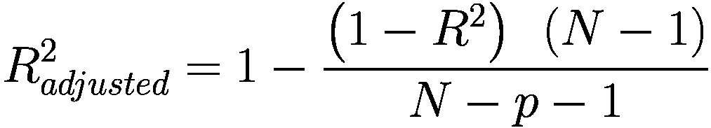

*   N – 观测值数量（本例中为 4）
*   p – 参数数量（本例中为 1，即 'x1'）

`R²[adjusted]` = 1 - (((1-0.97924) *3)/ (4-1-1)) = 0.96886

让我们使用 PySpark 进行计算。

```
print('R squared', reg_summary.r2adj)
```

## 二分类目标

当涉及二分类目标时，PySpark 提供了 `BinaryClassificationEvaluator` 和 `MulticlassClassificationEvaluator` 来评估模型性能。这些选项可在 PySpark `ML Tuning` 包中找到。此外，你还可以使用 `BinaryClassificationMetrics` 和 `MulticlassMetrics` 选项。遗憾的是，PySpark 并不支持 Scala 版本中使用的所有评估方法。有时，你需要使用变通方法来获取指标。我们建议你将预测结果转换为 pandas 数据集，并使用 `scikit-learn` 来生成指标。这是一种替代方法。在本书中，我们使用原生的 PySpark 方法。表 6-4 提供了示例数据（或逻辑门）。

**表 6-4** 示例数据

| x1 | x2 | 目标 |
| --- | --- | --- |
| 0 | 0 | 0 |
| 0 | 1 | 1 |
| 1 | 0 | 1 |
| 1 | 1 | 1 |

图 6-12 展示了使用 `x1` 和 `x2` 特征针对目标绘制的数据。

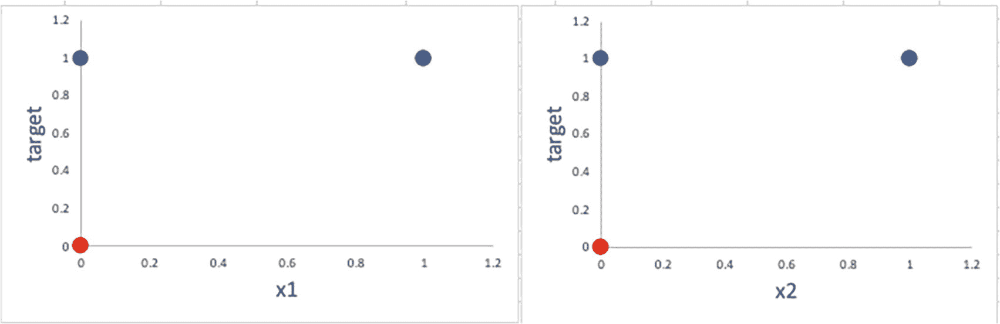

**图 6-12** 示例数据图

我们使用 `x1` 与目标的关系来评估分类指标。

### 使用 PySpark 复现输出的代码

```
from pyspark.sql.types import IntegerType, DoubleType
from pyspark.sql.types import StructField, StructType
cSchema = StructType([StructField("x1", IntegerType())\
,StructField("x2", IntegerType())\
,StructField("target", IntegerType())])
df_list = [[0, 0, 0], [0, 1, 1], [1, 0, 1], [1, 1, 1]]
df = spark.createDataFrame(df_list, schema=cSchema)
assembled_df = assemble_vectors(df, ['x1'], 'target')
from pyspark.ml.classification import LogisticRegression
clf = LogisticRegression(featuresCol='features', labelCol='target')
clf_model = clf.fit(assembled_df)
# 打印系数和截距
print(clf_model.coefficients[0], clf_model.intercept)
#输出: 14.49962091530358, -7.57e-09
pred_result = clf_model.transform(assembled_df)
```

### 模型方程

```
y-hat = 14.49* x1 – 7.57e-09
```

### 从 y-hat 预测到概率再到最终预测

我们使用 Sigmoid 函数将 `y-hat` 预测值转换为概率。

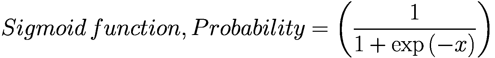

现在我们可以使用前面的 y-hat 公式来计算预测值。

```
Obs1 = 22.45* 0 + 0.0000021 = 0.0000021
```

类似地，我们分别得到 `Obs2`、`Obs3` 和 `Obs4` 的值为 0.0000021、22.45 和 22.45。现在，我们使用 Sigmoid 函数将预测值转换为概率。这分别得到值 0.5、0.5、1.0 和 1.0。我们通过使用一个截断值将概率转换为预测值。大多数算法默认使用 0.5 作为截断值。这个截断值可以根据你的情况进行修改。在本例中，我们也使用 0.5。

```
probability >= cut-off = 1
probability < cut-off = 0
```

基于这个截断值，我们得到的*最终预测*分别为 1、1、1 和 1。

### 混淆矩阵

然后，我们将预测值与实际目标值叠加，得到如图 6-13 所示的混淆矩阵。生成该矩阵的代码仅供参考。

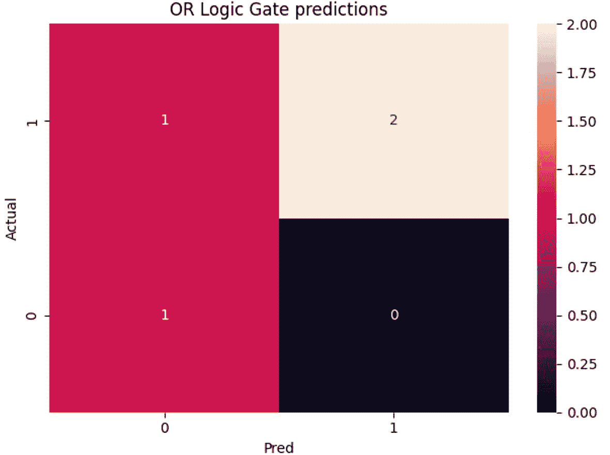

**图 6-13** 混淆矩阵

```
from pyspark.mllib.evaluation import BinaryClassificationMetrics, MulticlassMetrics
# 从预测结果中选择所需的列
predictionAndTarget = pred_result.select("prediction", "target")
predictionAndTarget = predictionAndTarget.withColumn("target", predictionAndTarget["target"].cast(DoubleType()))
predictionAndTarget = predictionAndTarget.withColumn("prediction", predictionAndTarget["prediction"].cast(DoubleType()))
#转换为 RDD 以用于 MulticlassMetrics
metrics = MulticlassMetrics(predictionAndTarget.rdd.map(tuple))
#### 混淆矩阵
cm = metrics.confusionMatrix().toArray()
#绘图函数
import seaborn as sns
import matplotlib.pyplot as plt
def make_confusion_matrix_chart(cf_matrix):
list_values = ['0', '1']
plt.subplot(111)
sns.heatmap(cf_matrix, annot=True, yticklabels=list_values,
xticklabels=list_values, fmt='g')
plt.ylabel("实际")
plt.xlabel("预测")
plt.ylim([0,2])
plt.title('或逻辑门预测')
plt.tight_layout()
return None
make_confusion_matrix_chart(cm) #绘制混淆矩阵图
```

抽象意义上的混淆矩阵如下所示。

| | | **预测值** |
| --- | --- | --- |
| | | **负类** | **正类** |
| 实际值 | 正类 | 假负例 (FN) | 真正例 (TP) |
| | 负类 | 真负例 (TN) | 假正例 (FP) |

将抽象术语矩阵叠加到这个结果矩阵上，我们得到：

```
真正例, TP = 2
真负例, TN = 1
假正例, FP = 0
假负例, FN = 1
```

现在我们逐一计算分类指标来评估这个模型（见表 6-5）。在此之前，我们先看一下一次性计算所有这些指标的代码。

**表 6-5** 分类指标

| 指标 | 范围 | 模型性能 | 何时使用 | 示例 |
| --- | --- | --- | --- | --- |
| 准确率 | 0 到 1 | 越高越好。 | 所有类别都重要。 | 目标分布相对平衡。 |
| 误分类率 | 0 到 1 | 越低越好。 | 所有类别都重要。 | 目标分布相对平衡。 |
| 精确率 | 0 到 1 | 越高越好。 | 假正例成本高。 | 科学测试（怀孕、COVID-19）。 |
| 召回率 | 0 到 1 | 越高越好。 | 假负例成本高。 | 不平衡数据（欺诈检测）。 |
| F1 分数 | 0 到 1 | 越高越好。 | 假正例和假负例成本都高。 | 信息检索任务。 |
| ROC 或 AUC | 0.5 到 1 | 越高越好。 | 所有类别都重要。 | 演示、业务利益相关者。 |
| KS 统计量 | - | 越高越好。 | 0 和 1 之间的分离很重要。 | 双样本分析。 |
| 十分位数 | - | 将概率从高到低排序为十个分段。排序不应中断。 | 观测值的排序很重要。 | 营销活动。 |
| 混淆矩阵 | - | 结果 (TP, TN, FP, FN) | 所有类别都重要。 | 演示、业务利益相关者。 |
| ROC 曲线 | 0.5 到 1 | 性能图。 | 所有类别都重要。 | 演示、业务利益相关者。 |
| 精确率-召回率曲线 | 正类目标分布（对于平衡类为 0.5）到 1 | 性能图。 | 不平衡类别。 | 信息检索任务。 |
| 基尼系数（超出本书范围） | 0 到 1 公式: (2 * AUC – 1) | 越高越好。 | 所有类别都重要。 | 信用评分模型。 |

```
from pyspark.ml.evaluation import BinaryClassificationEvaluator
acc = metrics.accuracy
misclassification_rate = 1 - acc
precision = metrics.precision(1.0)
recall = metrics.recall(1.0)
f1 = metrics.fMeasure(1.0)
evaluator = BinaryClassificationEvaluator(labelCol='target', rawPredictionCol='rawPrediction', metricName='areaUnderROC')
roc = evaluator.evaluate(pred_result)
print(acc, misclassification_rate, precision, recall, f1, roc)
```

### 准确率

准确率衡量算法预测与实际目标匹配的次数。它由以下公式定义：

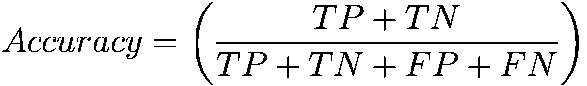

该模型计算出的准确率值为 `0.75`。或者，你可以认为四个预测中有一个是错误的。因此，准确率为 `0.75`。

### 误分类率

误分类率衡量的是*算法预测结果与实际目标不匹配的次数*。它也被称为错误率。其定义公式如下：

```
误分类率 = 1 – 准确率
```

该模型的误分类率为 `0.25`。换句话说，你可以认为每四次预测中就有一次是错误的。因此，错误率为 `0.25`。

### 精确率

精确率衡量的是*算法基于其预测结果返回相关匹配的次数*。它也被称为阳性预测值。其定义公式如下：

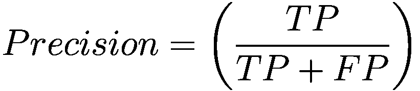

此处模型的精确率为 `0.75`。

### 召回率

召回率衡量的是*算法在所有相关项中返回相关匹配的次数*。它也被称为灵敏度或真正例率。其定义公式如下：

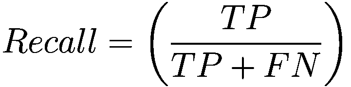

该模型的召回率为 `1`。

### F1 分数

F1 分数衡量的是精确率和召回率的调和平均数。其定义公式如下：

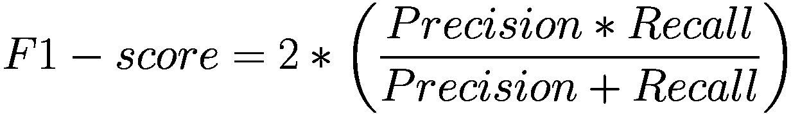

该模型的 F1 分数为 `0.86`。

#### 受试者工作特征曲线（ROC）/曲线下面积（AUC）

ROC 或 AUC 衡量的是灵敏度与 `1`-特异度曲线下的面积。在图 `6-14` 中以浅色阴影显示。

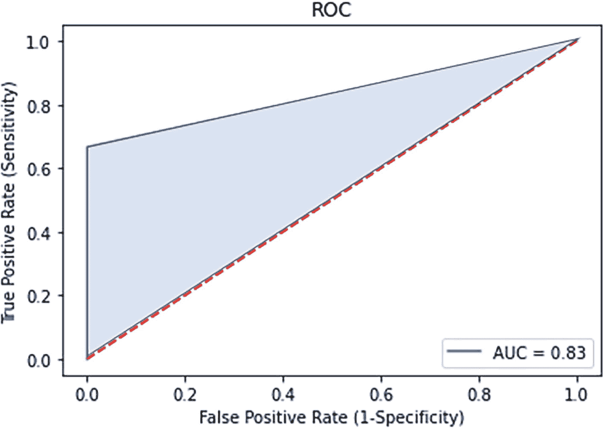

图 6-14 ROC 曲线

这张图是如何生成的？嗯，你已经了解了灵敏度（即召回率）。特异度的定义公式如下：

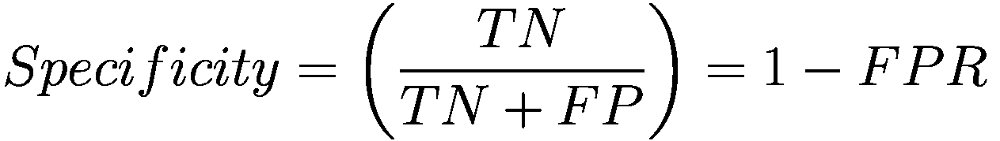

其中

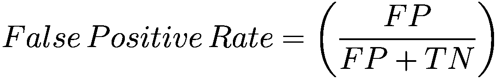

还记得我们用来将概率转换为预测结果的阈值吗？在初始计算中，我们将其设置为 `0.5`。如前所述，这个值是可自定义的。使用从 `0` 到 `1` (`0, 0.1, 0.2, 0.3, 0.4, 0.5, 0.6, 0.7, 0.8, 0.9, 1`) 的一系列值作为阈值，你可以利用公式计算出灵敏度和特异度。

然后，使用所有范围计算出的灵敏度和特异度值，绘制出如图所示图表。为了获得图表中更精细的细节，你可以增加 `0` 到 `1` 之间的数值范围。最后，计算图表所形成曲线下的面积。

红线代表一个 `随机模型`。由于该图是一个正方形，红线形成的三角形面积等于 `0.5 * 底 * 高 = 0.5 * 1 * 1 = 0.5`。这意味着 ROC 的基线值为 `0.5`。正方形的面积为 `1`。因此，ROC 的最大值为 `1`。要手动计算曲线（蓝线）和红线形成的面积，你可以创建正方形和三角形，并分别计算每个图形的面积。将所有面积相加，就能得到最终的 ROC 值。

在 PySpark 中，你可以执行以下代码来绘制 ROC 图：

```
from pyspark.mllib.evaluation import BinaryClassificationMetrics
# 使用 CurveMetrics 计算 fpr, tpr
class CurveMetrics(BinaryClassificationMetrics):
def __init__(self, *args):
super(CurveMetrics, self).__init__(*args)
# 将 RDD 结果转换为点列表
def _to_list(self, rdd):
points = []
results_collect = rdd.collect()
for row in results_collect:
points += [(float(row._1()), float(row._2()))]
return points
# 获取曲线点
def get_curve(self, method):
rdd = getattr(self._java_model, method)().toJavaRDD()
return self._to_list(rdd)
# 使用概率列应用阈值
preds = pred_result.select('target','probability').rdd.map(lambda row: (float(row['probability'][1]), float(row['target'])))
# 返回为列表 (假正例率, 真正例率)
points = CurveMetrics(preds).get_curve('roc')
# 绘制图表
import matplotlib.pyplot as plt
plt.figure()
x_val = [x[0] for x in points]
y_val = [x[1] for x in points]
plt.title('ROC')
plt.xlabel('假正例率 (1-特异度)')
plt.ylabel('真正例率 (灵敏度)')
plt.plot(x_val, y_val, label = 'AUC = %0.2f' % roc)
plt.plot([0, 1], [0, 1], color='red', linestyle='--')
plt.legend(loc = 'lower right')
```

#### 当分类器性能不佳时，ROC 曲线会发生什么变化？

曲线将与红线随机模型重叠，因此 ROC 的值将接近 `0.5`。

#### 精确率-召回率曲线

精确率-召回率曲线是精确率和召回率之间的权衡曲线。它对于不平衡分类任务非常有用。与 ROC 类似，针对不同的阈值计算精确率和召回率值，并生成如图 `6-15` 所示的图表。红线是基于数据中目标值为 `1` 的分布生成的。在此例中，`50%` 的目标值为 `1`。因此，模型基线设置为 `0.5`。

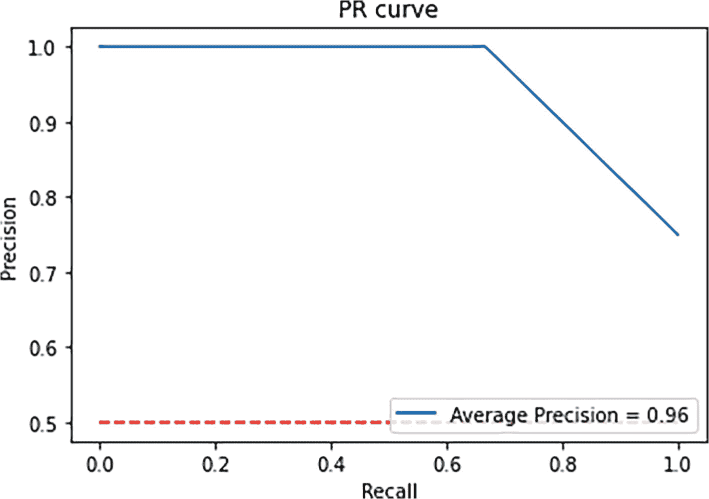

图 6-15 精确率-召回率曲线

你可以通过对不同阈值下的精确率值取平均来计算蓝线下的面积。对于此图表，手动计算面积很容易。图表顶部左侧三角形的面积为 `0.33 * 0.25 * 0.5 = 0.0416`。因此，PR 曲线下的面积为 `1 – 0.0416 = 0.9584`。我们可以使用 PySpark 完成同样的任务：

```
# 使用 BinaryClassificationEvaluator 评估 PR 曲线
evaluator = BinaryClassificationEvaluator(labelCol='target', rawPredictionCol='rawPrediction', metricName='areaUnderPR')
pr = evaluator.evaluate(pred_result)
preds = pred_result.select('target','probability').rdd.map(lambda row: (float(row['probability'][1]), float(row['target'])))
# 使用自定义 CurveMetrics 类计算 PR 曲线的点
points = CurveMetrics(preds).get_curve('pr')
plt.figure()
x_val = [x[0] for x in points]
y_val = [x[1] for x in points]
plt.title('PR 曲线')
plt.xlabel('召回率')
plt.ylabel('精确率')
plt.plot(x_val, y_val, label = '平均精确率 = %0.2f' % pr)
plt.plot([0, 1], [0.5, 0.5], color='red', linestyle='--')
plt.legend(loc = 'lower right')
```

#### 当分类器性能不佳时，PR 曲线会发生什么变化？

PR 曲线下的面积将类似于所有目标值都等于 `1` 的分布面积。在这种情况下，该值将接近 `0.5`。我们可以使用随机值生成器来证明这一点（见图 `6-16`）。

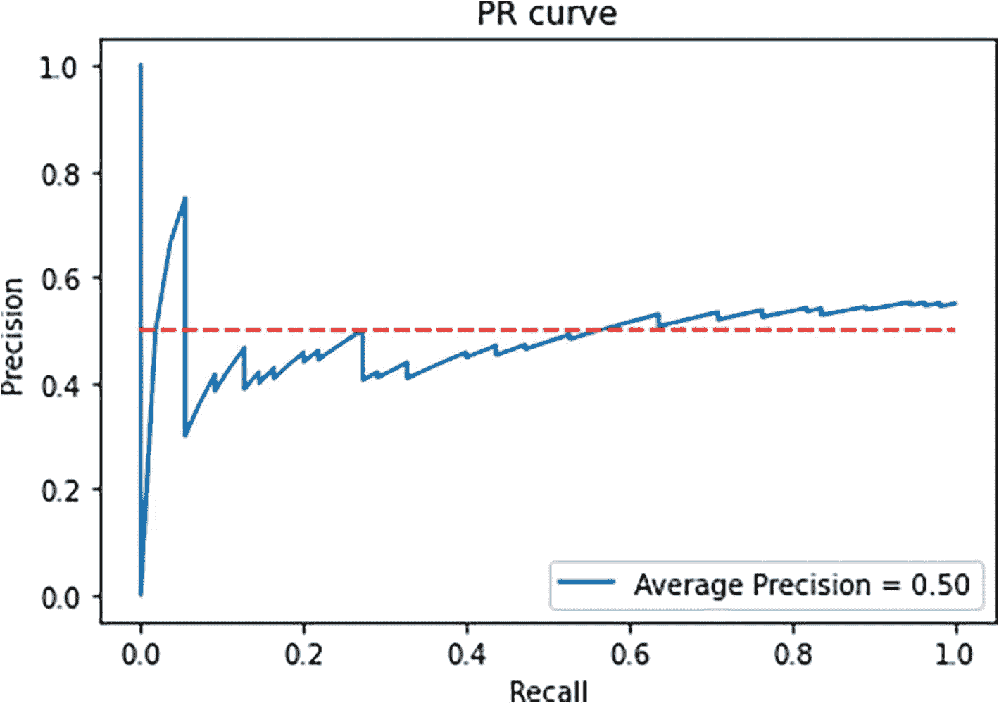

图 6-16 分类器性能不佳时的 PR 曲线

```
from sklearn.metrics import precision_recall_curve, average_precision_score
# 随机目标和概率
rand_y = [random.choice([1, 0]) for i in range(0, 100)]
rand_prob = [random.uniform(0, 1) for i in range(0, 100)]
# 计算精确率、召回率和平均精确率分数
rand_precision, rand_recall, _ = precision_recall_curve(rand_y, rand_prob)
pr = average_precision_score(rand_y, rand_prob)
# 绘制随机预测结果
plt.figure()
plt.title('PR 曲线')
plt.xlabel('召回率')
plt.ylabel('精确率')
plt.plot(rand_recall, rand_precision, label = '平均精确率 = %0.2f' % pr)
plt.plot([0, 1], [0.5, 0.5], color='red', linestyle='--')
plt.legend(loc = 'lower right')
```

#### 柯尔莫哥洛夫-斯米尔诺夫（KS）统计量与十分位数

KS 统计量衡量的是目标值与非目标值分布之间的差异。它是一种非参数评估方法。要执行 KS 检验，首先需要创建十分位数。

### 分位数

要获取模型的分位数，请按以下步骤操作：

1. 在数据集上应用模型。
2. 基于降序概率对分数进行排序（隐式处理并列情况）。
3. 将分数分成十个桶（分位数）。

现在您已获得分位数。分位数有助于您进行各种分析，尤其是在营销活动中。基于分位数，您可以衡量前 `10%`、前 `30%` 等部分的转化率。此外，您还可以衡量提升度以及实际值与预测值的统计量。

## KS 统计量

我们按分位数计算目标值和非目标值的累积分布。这两个值之间的差值即为分布的离散度，离散度的最大值即为`KS`值。

`PySpark`没有提供直接执行此分析的方法。我们提供了一个变通方案。以下工作中，我们使用了银行数据集。

```python
#load dataset, cleanup and fit model
from pyspark.sql import SparkSession
from pyspark.ml.feature import VectorAssembler
from pyspark.ml import Pipeline
from pyspark.sql.functions import countDistinct
from pyspark.ml.classification import LogisticRegression
from pyspark.ml.evaluation import BinaryClassificationEvaluator
from pyspark.sql import functions as F
import numpy as np
filename = "bank-full.csv"
spark = SparkSession.builder.getOrCreate()
df = spark.read.csv(filename, header=True, inferSchema=True, sep=';')
df = df.withColumn('label', F.when(F.col("y") == 'yes', 1).otherwise(0))
df = df.drop('y')
#assemble individual columns to one column - 'features'
def assemble_vectors(df, features_list, target_variable_name):
    stages = []
    #assemble vectors
    assembler = VectorAssembler(inputCols=features_list, outputCol='features')
    stages = [assembler]
    #select all the columns + target + newly created 'features' column
    selectedCols = [target_variable_name, 'features']
    #use pipeline to process sequentially
    pipeline = Pipeline(stages=stages)
    #assembler model
    assembleModel = pipeline.fit(df)
    #apply assembler model on data
    df = assembleModel.transform(df).select(selectedCols)
    return df
# Select relevant features and assemble into vectors
df = df.select(['education', 'age', 'balance', 'day', 'duration', 'campaign', 'pdays', 'previous', 'label'])
features_list = ['age', 'balance', 'day', 'duration', 'campaign', 'pdays', 'previous']
assembled_df = assemble_vectors(df, features_list, 'label')
clf = LogisticRegression(featuresCol='features', labelCol='label')
train, test = assembled_df.randomSplit([0.7, 0.3], seed=12345)
clf_model = clf.fit(train)
#Deciling and KS calculation begins here
from pyspark.sql import Window
def create_deciles(df, clf, score, prediction, target, buckets):
    # get predictions from model
    pred = clf.transform(df)
    #probability of 1's, prediction and target
    pred = pred.select(F.col(score), F.col(prediction), F.col(target)).rdd.map(lambda row: (float(row[score][1]), float(row['prediction']), float(row[target])))
    predDF = pred.toDF(schema=[score, prediction, target])
    # remove ties in scores work around
    window = Window.orderBy(F.desc(score))
    predDF = predDF.withColumn("row_number", F.row_number().over(window))
    predDF.cache()
    predDF = predDF.withColumn("row_number", predDF['row_number'].cast("double"))
    # partition into 10 buckets
    window2 = Window.orderBy("row_number")
    final_predDF = predDF.withColumn("deciles", F.ntile(buckets).over(window2))
    final_predDF = final_predDF.withColumn("deciles", final_predDF['deciles'].cast("int"))
    # create non target column
    final_predDF = final_predDF.withColumn("non_target", 1 - final_predDF[target])
    final_predDF.cache()    #final predicted df
    #ks calculation starts here
    temp_deciles = final_predDF.groupby('deciles').agg(F.sum(target).alias(target)).toPandas()
    non_target_cnt = final_predDF.groupby('deciles').agg(F.sum('non_target').alias('non_target')).toPandas()
    temp_deciles = temp_deciles.merge(non_target_cnt, on='deciles', how='inner')
    temp_deciles = temp_deciles.sort_values(by='deciles', ascending=True)
    temp_deciles['total'] = temp_deciles[target] + temp_deciles['non_target']
    temp_deciles['target_%'] = (temp_deciles[target] / temp_deciles['total'])*100
    temp_deciles['cum_target'] = temp_deciles[target].cumsum()
    temp_deciles['cum_non_target'] = temp_deciles['non_target'].cumsum()
    temp_deciles['target_dist'] = (temp_deciles['cum_target']/temp_deciles[target].sum())*100
    temp_deciles['non_target_dist'] = (temp_deciles['cum_non_target']/temp_deciles['non_target'].sum())*100
    temp_deciles['spread'] = temp_deciles['target_dist'] - temp_deciles['non_target_dist']
    decile_table=temp_deciles.round(2)
    decile_table = decile_table[['deciles', 'total', 'label', 'non_target', 'target_%', 'cum_target', 'cum_non_target', 'target_dist', 'non_target_dist', 'spread']]
    print("KS Value - ", round(temp_deciles['spread'].max(), 2))
    return final_predDF, decile_table
#create deciles on the train and test datasets
pred_train, train_deciles = create_deciles(train, clf_model, 'probability', 'prediction', 'label', 10)
pred_test, test_deciles = create_deciles(test, clf_model, 'probability', 'prediction', 'label', 10)
#pandas styling functions
from collections import OrderedDict
import pandas as pd
import sys
%matplotlib inline
def plot_pandas_style(styler):
    from IPython.core.display import HTML
    html = '\n'.join([line.lstrip() for line in styler.render().split('\n')])
    return HTML(html)
def highlight_max(s,color='yellow'):
    '''
    highlight the maximum in a Series yellow.
    '''
    is_max = s == s.max()
    return ['background-color: {}'.format(color) if v else '' for v in is_max]
def decile_labels(agg1, target, color='skyblue'):
    agg1 = agg1.round(2)
    agg1 = agg1.style.apply(highlight_max, color = 'yellow', subset=['spread']).set_precision(2)
    agg1.bar(subset=[target], color='{}'.format(color), vmin=0)
    agg1.bar(subset=['total'], color='{}'.format(color), vmin=0)
    agg1.bar(subset=['target_%'], color='{}'.format(color), vmin=0)
    return agg1
#train deciles and KS
plot_decile_train = decile_labels(train_deciles, 'label', color='skyblue')
plot_pandas_style(plot_decile_train)
```

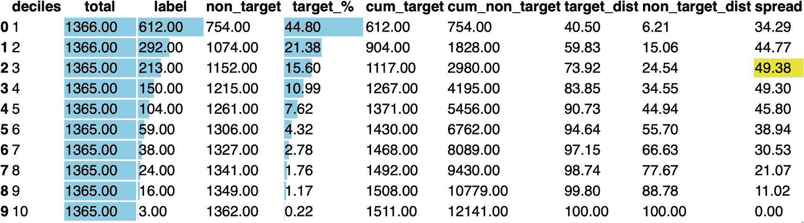
图 6-18 测试数据集

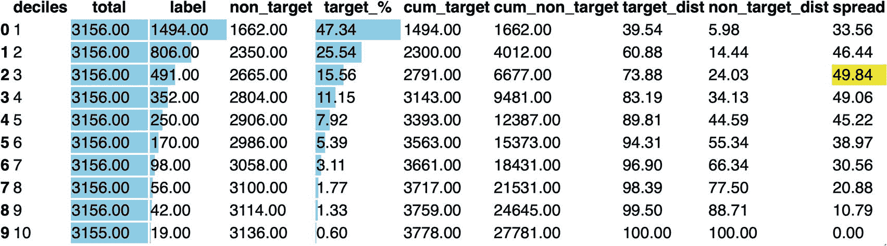
图 6-17 训练数据集

```python
#test deciles and KS
plot_decile_test = decile_labels(test_deciles, 'label', color='skyblue')
plot_pandas_style(plot_decile_test)
```

训练集和测试集的`KS`值分别为 50.28 和 49.63，如图 6-17 和图 6-18 所示。测试集的`KS`值位于训练集`KS`值的±3 范围内。此外，您还可以看到分位数之间没有排名中断。因此，该模型是稳定的。

## 实际值与预测值、增益图、提升图

接下来，我们将在`PySpark`中实现这些指标，然后逐一详细分析。我们将使用上一步的输出结果。

```python
import matplotlib.pyplot as plt
def plots(agg1,target,type):
    plt.figure(1,figsize=(20, 5))
    plt.subplot(131)
    plt.plot(agg1['DECILE'],agg1['ACTUAL'],label='实际值')
    plt.plot(agg1['DECILE'],agg1['PRED'],label='预测值')
    plt.xticks(range(10,110,10))
    plt.legend(fontsize=15)
    plt.grid(True)
    plt.title('实际值与预测值', fontsize=20)
    plt.xlabel("人口百分比 %",fontsize=15)
    plt.ylabel(str(target) + " " + str(type) + " %",fontsize=15)
    plt.subplot(132)
    X = agg1['DECILE'].tolist()
    X.append(0)
    Y = agg1['DIST_TAR'].tolist()
    Y.append(0)
    plt.plot(sorted(X),sorted(Y))
    plt.plot([0, 100], [0, 100],'r--')
    plt.xticks(range(0,110,10))
    plt.yticks(range(0,110,10))
    plt.grid(True)
    plt.title('增益图', fontsize=20)
    plt.xlabel("人口百分比 %",fontsize=15)
    plt.ylabel(str(target) + str(" 分布") + " %",fontsize=15)
    plt.annotate(round(agg1[agg1['DECILE'] == 30].DIST_TAR.item(),2),xy=[30,30],
        xytext=(25, agg1[agg1['DECILE'] == 30].DIST_TAR.item() + 5),
        fontsize = 13)
    plt.annotate(round(agg1[agg1['DECILE'] == 50].DIST_TAR.item(),2),
        xy=[50,50],
        xytext=(45, agg1[agg1['DECILE'] == 50].DIST_TAR.item() + 5),
        fontsize = 13)
    plt.subplot(133)
    plt.plot(agg1['DECILE'],agg1['LIFT'])
    plt.xticks(range(10,110,10))
    plt.grid(True)
    plt.title('提升图', fontsize=20)
    plt.xlabel("人口百分比 %",fontsize=15)
    plt.ylabel("提升值",fontsize=15)
    plt.tight_layout()
# 实际值与预测值、增益和提升的聚合函数
def gains(data, decile_df, decile_by, target, score):
    agg1 = pd.DataFrame({},index=[])
    agg1 = data.groupby(decile_by).agg(F.avg(target).alias('ACTUAL')).toPandas()
    score_agg = data.groupby(decile_by).agg(F.avg(score).alias('PRED')).toPandas()
    agg1 = agg1.merge(score_agg, on=decile_by, how='inner').merge(decile_df, on=decile_by, how='inner')
    agg1 = agg1.sort_values(by=decile_by, ascending=True)
    agg1 = agg1[[decile_by, 'ACTUAL', 'PRED', 'target_dist']]
    agg1 = agg1.rename(columns={'target_dist':'DIST_TAR', 'deciles': 'DECILE'})
    decile_by = 'DECILE'
    agg1[decile_by] = agg1[decile_by]*10
    agg1['LIFT'] = agg1['DIST_TAR']/agg1[decile_by]
    agg1.columns = [x.upper() for x in agg1.columns]
    plots(agg1,target,'分布')
    # 训练指标
    gains(pred_train, train_deciles, 'deciles', 'label','probability')
```

```
#测试指标
gains(pred_test, test_deciles, 'deciles', 'label','probability')
```

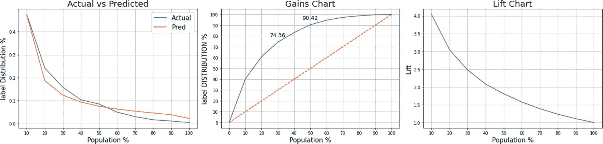

图 6-19a 实际值与预测值、增益图、提升图

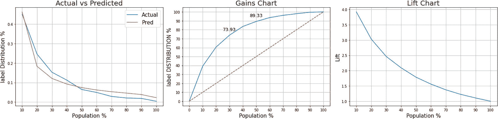

图 6-19b 实际值与预测值、增益图、提升图

好了，现在你已经了解了这些指标的样子。接下来，让我们逐一深入探讨。

### 实际值与预测值

该图将目标变量和预测值的平均分布叠加在一起。当预测值非常接近实际值时，表明模型表现良好，反之亦然。

### 增益图

该图显示了针对特定比例人群进行营销时所能达到的转化率。在此示例中，通过触达前 30%的客户，目标转化率达到 74%。这意味着近四分之三的目标客户集中在模型的前三个十分位中。增益图的值越高，模型越好。这个指标对于向营销团队解释模型非常有用，因为他们更关注基于转化的指标。

### 提升图

提升图是观察转化的另一种方式。基线模型的提升值为 1。这意味着当你针对 10%的人群进行营销时，会获得 10%的转化率。同样，针对 20%的人群时，会获得 20%的转化率，以此类推。然而，通过构建机器学习模型，你可以在前 10%的人群中实现 40%的转化率。因此，你的模型在前 10%人群中实现的提升值是基线模型的四倍。随着你深入更低的十分位，模型的提升值会逐渐降低，最终变为 1。营销团队可以在营销活动中使用此指标来确定他们的目标人群。

### 多分类、多标签评估指标

这些主题超出了本书的讨论范围。我们在二分类模型评估中使用了一些多分类指标。你可以运用本章学到的见解，将本章学习的指标扩展到多分类和多标签分类任务中。

## 总结

-   你详细了解了模型复杂度。
-   你学习了不同类型的模型验证技术。
-   你了解了数据泄露问题以及如何处理它以获得更好的模型性能。
-   最后，你详细学习了回归模型和二分类模型的评估指标。

做得好！在下一章中，你将学习无监督技术、主题建模和推荐算法。请继续学习，保持关注。

