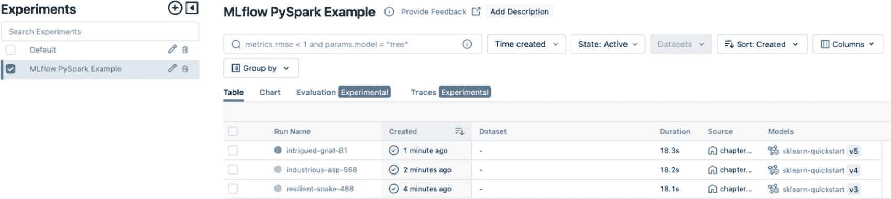
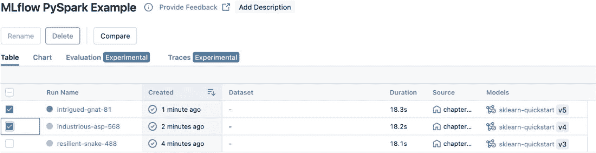
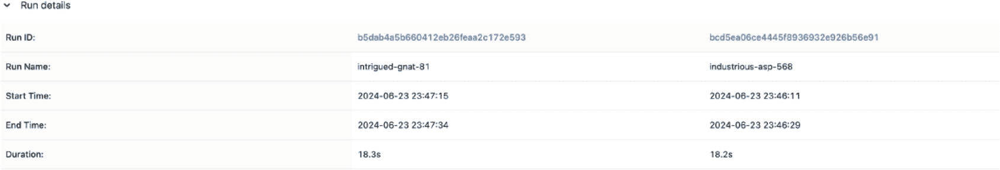
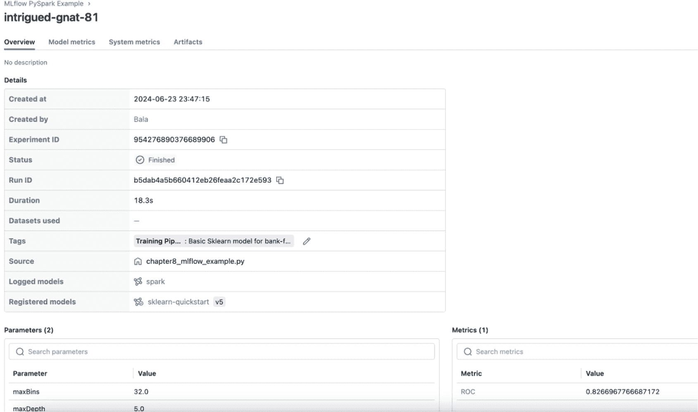
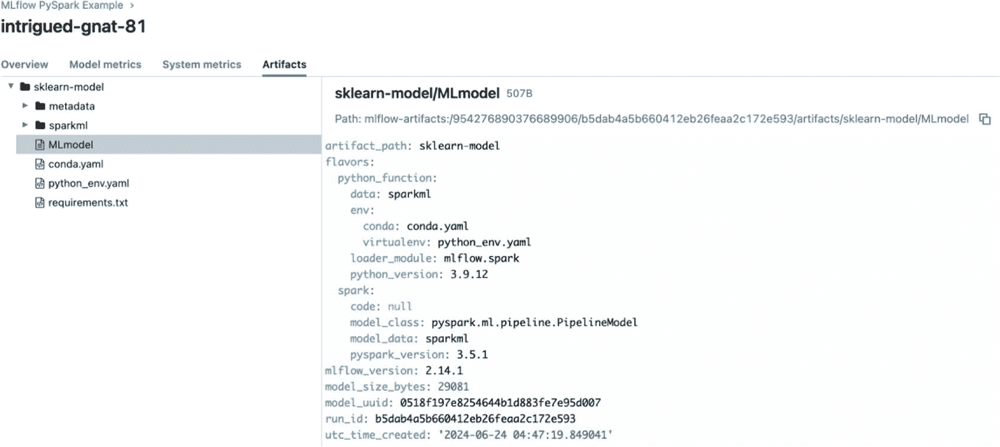
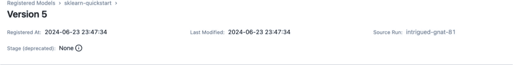

# 创建一个新的 MLflow 实验
mlflow.set_experiment("MLflow PySpark Example")
with mlflow.start_run():
    stages_tree=[]
    # 定义管道的阶段
    classifier = RandomForestClassifier(labelCol = 'label',featuresCol = 'features',maxBins=maxBinsVal, maxDepth=maxDepthVal)
    stages_tree += [classifier]
    pipeline_tree=Pipeline(stages=stages_tree)
    print('正在运行 RF 模型')
    RFmodel = pipeline_tree.fit(assembled_train_df)
    print('RF 模型训练完成')
    predictions = RFmodel.transform(assembled_test_df)
    evaluator = BinaryClassificationEvaluator()
    print("测试集 ROC 曲线下面积: " + str(evaluator.evaluate(predictions, {evaluator.metricName: "areaUnderROC"})))
    # 将参数和指标记录到 MLflow
    mlflow.log_param("maxBins", maxBinsVal)
    mlflow.log_param("maxDepth", maxDepthVal)
    mlflow.log_metric("ROC", evaluator.evaluate(predictions, {evaluator.metricName: "areaUnderROC"}))
    mlflow.spark.log_model(RFmodel,"spark-model")
    # 设置一个标签，用于提醒自己此次运行的目的
    mlflow.set_tag("训练管道", "用于 bank-full.csv 的基本 Sklearn 模型")
    # 使用 MLflow 记录模型
    model_info = mlflow.spark.log_model(RFmodel,
                                        artifact_path="sklearn-model",
                                        registered_model_name="sklearn-quickstart",)
```

在前面的代码片段中，我们添加了 `log_param` 和 `log_metric` 来捕获我们想要跟踪的信息。另外，请注意我们使用 `mlflow.spark.log_model` 函数记录模型，这有助于将模型保存到 MLflow 后端。这是一个可选语句，但对于从 MLflow 注册模型非常方便。你可以通过最少的代码更改，将现有模型与 MLflow 组件适配。为什么这很重要？当数百个实验跨越数天进行时，跟踪参数和指标的变化会变得非常具有挑战性。

现在，我们需要将前面的代码保存为一个 Python 文件。我们使用 Spark submit 来执行此 PySpark 代码。在本示例中，我们将代码保存为 `Chapter8_mlflow_example.py`。

接下来是 MLflow 设置的第二部分，这是一个简单的三步过程，如下所述：

1. `pip install mlflow`
2. 启动 MLflow 服务器：`mlflow server --host 127.0.0.1 --port 8080`
3. 打开浏览器并输入 `http://127.0.0.1:8080/` 以打开 MLflow UI


### MLflow 用户界面演示

在本节中，我们将结合上一节讨论的示例，逐步演示 MLflow 用户界面。以下代码使用三种不同的设置运行之前保存的脚本：

```
spark-submit --master local chapter8_mlflow_example.py --maxBinsVal 16 --maxDepthVal 3
spark-submit --master local chapter8_mlflow_example.py --maxBinsVal 16 --maxDepthVal 5
spark-submit --master local chapter8_mlflow_example.py --maxBinsVal 32 --maxDepthVal 5
```

运行完上述三个命令后，我们可以导航回 MLflow 用户界面。（在任何网页浏览器中，导航至 `http://127.0.0.1:8080`。）MLflow 用户界面如图 8-2 所示。

如您所见，用户界面将所有信息格式化为实验和模型。您可以使用每个实验中每次运行的注释选项进行任何注释或记录。该框架允许您管理并运行包含多次运行的多个实验。您还可以根据参数设置筛选运行。这在机器学习生命周期中极其有用，因为与软件开发生命周期不同，我们倾向于根据模型的稳定性和准确性在旧版本和新版本之间进行迭代。



图 8-2

MLflow 用户界面

此外，每次运行都有详细的逐行信息。您可以深入查看并在多个实验之间比较这些信息。在此处的演示中，我们仅使用了一个指标，但在实际场景中，您可能还需要捕获每次运行的准确率、误分类率、提升度和 KS 统计量。然后，您可以根据业务需求可接受的指标来比较和排序每次迭代。

当您从之前的执行中选择几次迭代时，请注意“比较”按钮是激活的；在图 8-2 中它是灰色的。当您点击“比较”时，它将比较这两次迭代，并给出准备好的图表，展示指标在不同运行之间的变化情况（见图 8-3）。在前面的代码中，我们显式设置了日志指标。从 Spark 3 版本开始，提供了自动日志记录的选项。



图 8-3

MLflow 用户界面运行比较

观察图 8-4 中的窗口；MLflow 会自动生成 `RunID`。此功能允许您比较实验中的多次运行。当您拥有足够的数据点时，可以直观地选择性能最佳的模型运行。您还可以观察通过更改参数，模型性能会如何变化。



图 8-4

MLflow 用户界面比较窗口

如果您返回 MLflow 用户界面的主页并点击任何一次运行，它将显示关于该模型运行的更多信息，如图 8-5 所示。此运行窗口还提供了注册模型的便捷功能。注册模型将使其可用于评分。注册模型后，将开启多个其他功能。



图 8-5

MLflow 用户界面运行窗口

点击“工件”部分中的 `spark-model` 文件将打开下一个窗口。此窗口包含运行模型所需的所有元数据信息，如图 8-6 所示。



图 8-6

MLflow 用户界面模型信息

用户也可以手动注册模型。但是，我们已经通过代码注册了模型。可以通过点击右上角的“已注册模型”链接来查看已注册的模型。在“模型”选项卡中，模型会自动进行版本控制。



图 8-7

MLflow 模型选项卡

注意

图 8-7 显示的是版本 5，因为模型注册代码运行了几次。在您的情况下，您可能会看到版本 1。

嗯，这一切都很棒，但是如何通过这些流水线对新数据进行评分呢？当您点击运行或模型信息时，您会获得模型元数据信息的完整路径，如图 8-7 所示。您可以使用此元数据对任何新数据进行评分。有多种方法可以实现这一点。例如，我们编写一些简单的代码来准备用于评分的数据，然后使用 `best_roc_model`。我们将以下代码保存为 Python 文件，并通过 Docker 中的 `spark-submit` 运行它。

```
#导入必要的库
import mlflow
import mlflow.spark
import sys
from pyspark.sql import SparkSession
spark = SparkSession.builder.appName("mlflow_predict").getOrCreate()
filename = "bank-full.csv"
target_variable_name = "y"
from pyspark.sql import functions as F
df = spark.read.csv(filename, header=True, inferSchema=True, sep=';')
df = df.withColumn('label', F.when(F.col("y") == 'yes', 1).otherwise(0))
df = df.drop('y')
train, test = df.randomSplit([0.7, 0.3], seed=12345)
for k, v in df.dtypes:
if v not in ['string']:
print(k)
df = df.select(['age', 'balance', 'day', 'duration', 'campaign', 'pdays', 'previous', 'label'])
from pyspark.ml.feature import VectorAssembler
from pyspark.ml import Pipeline
