# 7. 无监督学习与推荐算法

本章将探讨业界用于处理无标签数据的流行技术。你将学习如何使用 `PySpark` 实现这些技术。你还将了解分割和推荐算法的基础知识以及所需的数据准备工作。在本章结束时，你将能够理解无监督技术及其在日常数据科学活动中的应用。

本章涵盖以下主题：
- K-means
- 潜在狄利克雷分配
- 使用交替最小二乘法的协同过滤

## 分群

正如*分群*一词所暗示的，这是一种将你的总体（数据中的客户或记录）划分为具有共同需求的逻辑组的技术。这些逻辑组之间的需求可能差异很大，但组内差异很小。让我们退一步思考一下为什么需要这样做。如果你能识别出一组具有共同需求的同质客户，这将有助于你的业务制定策略，以更好地服务客户并保持他们的参与度。你可以创建这些分群来更好地了解你的客户，或出于特定目的，例如为你的应用或产品制定消息推送或开发策略。

假设你是一名应用开发者，拥有关于应用使用情况的数据。识别出具有相似行为的用户群体会很有趣。根据你的应用在不同地理位置、使用时间、年龄组或使用功能上的情况，你可以制定改进应用的策略，并为不同的用户群体定制界面以提高参与度。虽然听起来简单，但识别出正确的群体可能具有挑战性。你不希望群体太多或太少。你还希望在采取行动之前，每个群体中都有相当数量的客户。你还需要这些群体保持稳定。如果它们频繁变化，可能会对你计划的行动构成挑战。

根据你所处的业务垂直领域类型，会有许多变量可用于分群。问题就变成了：你如何为这项工作选择变量？在进入之前讨论的任何变量选择方法之前，重要的是要识别基础变量和描述变量。基础变量是用于分群以定义群体的变量。这些可以是应用使用情况、使用次数、使用的功能等。描述变量不用于分群；它们用于描述和定义已识别的群体。这些描述变量可以是任何你想要量化并观察群体间差异的内部关键绩效指标。例如，如果你使用应用使用数据进行聚类，你可以将应用回访率、应用流失率以及应用收入作为一些描述变量。

同样，针对特定目标控制描述变量可能会产生不同的结果。对于哪些变量可以用作基础变量和描述变量，没有硬性规定。这些是目标特定的。你也可以根据在线收集的调查数据来驱动其中一些分群，以识别客户不断变化的需求。数据可以包括地理、人口统计、社会经济、应用使用情况和忠诚度信息。调查有时有助于收集不可观察的数据，例如生活方式、偏好和利益。

业务规则也可用于数据分群，但随着数据量的不断增加，大多数组织更倾向于使用可用的聚类技术。其中一些技术的挑战之一是，你不知道数据中存在多少个群体。以下数据是出于演示目的而虚构的。它考虑了客户在购买汽车时评估的两个因素。该数据有两个变量：安全性和燃油效率。这两个变量均由 15 名受访者按 1 到 10 的等级进行评分。该数据见表 7-1。

**表 7-1** 购车调查数据

| 受访者 | 安全性 | 燃油效率 |
| --- | --- | --- |
| 1 | 10 | 10 |
| 2 | 9 | 9 |
| 3 | 9.5 | 9.5 |
| 4 | 9.75 | 9.75 |
| 5 | 8.75 | 8.75 |
| 6 | 10 | 1 |
| 7 | 9 | 1.5 |
| 8 | 9.5 | 2 |
| 9 | 8.75 | 1.75 |
| 10 | 9.25 | 1.25 |
| 11 | 1 | 10 |
| 12 | 1.5 | 9 |
| 13 | 2 | 9.5 |
| 14 | 1.75 | 8.75 |
| 15 | 1.25 | 9.25 |

如果你将数据绘制在散点图上，你会立即识别出三个群体，如图 7-1 所示。对于群体 1 中的受访者，安全性比燃油效率更重要。对于群体 2 中的受访者，安全性和燃油效率同等重要。对于群体 3 中的受访者，燃油效率在购车中起着主要作用。你该如何利用这些信息？汽车经销商可以利用这些信息向客户推销合适的汽车。他们可以花更多时间向群体 1 中的受访者解释安全特性，而向群体 3 中的受访者则谈论燃油效率。

仅通过将变量绘制在二维图上，你就可以得出这些推论。然而，你通常会有多个变量，可能无法通过视觉做出这些判断。在接下来的章节中，我们将探讨使用多维数据的技术。

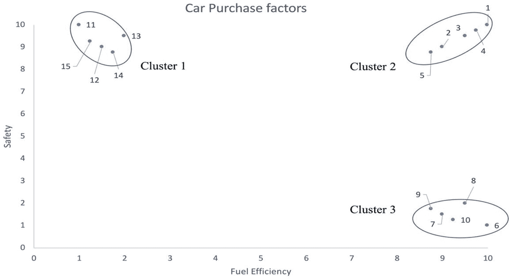

**图 7-1** 群体演示

不存在单一的聚类解决方案。在这个例子中，你可以根据尺寸将汽车大致分为紧凑型、轿车和 SUV。同样，你可以将车辆分为豪华/非豪华以及性能/非性能细分市场。所有这些都是有效的细分。同样，当你对数据进行聚类时，可能存在多种解决方案。具有挑战性的部分是选择适合你业务的方案。描述变量可以帮助你确定正确的指标，从而帮助你选择解决方案。

### 距离度量

根据前面的图表，很明显，彼此接近的点具有相似的特征。换句话说，距离较小的点比距离较大的点更相似。点之间的距离是分割中用于确定相似性的关键概念之一。那么，如何计算点之间的相似度呢？有多种方法可用；其中最流行的一种是欧几里得距离。欧几里得距离是笛卡尔坐标系中两点之间的几何距离。两点——`a (x[1],y[1])` 和 `b (x[2],y[2])`——之间的欧几里得距离通过以下公式计算：

```
Distance[ab]=√ (x[1]- x[2])² +(y[1]- y[2])²
```

让我们为表 7-1 计算这个距离，看看不同受访者之间的距离如何变化。表 7-2、7-3 和 7-4 展示了所有受访者之间计算出的欧几里得距离。

**表 7-4**
表 7-1 的欧几里得距离（部分输出 – 第 3 部分）

|   | 11 | 12 | 13 | 14 | 15 |
|--- |--- |--- |--- |--- |--- |
| 1 | 9.00 | 8.56 | 8.02 | 8.34 | 8.78 |
| 2 | 8.06 | 7.50 | 7.02 | 7.25 | 7.75 |
| 3 | 8.51 | 8.02 | 7.50 | 7.79 | 8.25 |
| 4 | 8.75 | 8.28 | 7.75 | 8.06 | 8.51 |
| 5 | 7.85 | 7.25 | 6.79 | 7.00 | 7.52 |
| 6 | 12.73 | 11.67 | 11.67 | 11.32 | 12.03 |
| 7 | 11.67 | 10.61 | 10.63 | 10.25 | 10.96 |
| 8 | 11.67 | 10.63 | 10.61 | 10.28 | 10.98 |
| 9 | 11.32 | 10.25 | 10.28 | 9.90 | 10.61 |
| 10 | 12.03 | 10.96 | 10.98 | 10.61 | 11.31 |
| 11 | 0.00 | 1.12 | 1.12 | 1.46 | 0.79 |
| 12 | 1.12 | 0.00 | 0.71 | 0.35 | 0.35 |
| 13 | 1.12 | 0.71 | 0.00 | 0.79 | 0.79 |
| 14 | 1.46 | 0.35 | 0.79 | 0.00 | 0.71 |
| 15 | 0.79 | 0.35 | 0.79 | 0.71 | 0.00 |

**表 7-3**
表 7-1 的欧几里得距离（部分输出 – 第 2 部分）

|   | 6 | 7 | 8 | 9 | 10 |
|--- |--- |--- |--- |--- |--- |
| 1 | 9.00 | 8.56 | 8.02 | 8.34 | 8.78 |
| 2 | 8.06 | 7.50 | 7.02 | 7.25 | 7.75 |
| 3 | 8.51 | 8.02 | 7.50 | 7.79 | 8.25 |
| 4 | 8.75 | 8.28 | 7.75 | 8.06 | 8.51 |
| 5 | 7.85 | 7.25 | 6.79 | 7.00 | 7.52 |
| 6 | 0.00 | 1.12 | 1.12 | 1.46 | 0.79 |
| 7 | 1.12 | 0.00 | 0.71 | 0.35 | 0.35 |
| 8 | 1.12 | 0.71 | 0.00 | 0.79 | 0.79 |
| 9 | 1.46 | 0.35 | 0.79 | 0.00 | 0.71 |
| 10 | 0.79 | 0.35 | 0.79 | 0.71 | 0.00 |
| 11 | 12.73 | 11.67 | 11.67 | 11.32 | 12.03 |
| 12 | 11.67 | 10.61 | 10.63 | 10.25 | 10.96 |
| 13 | 11.67 | 10.63 | 10.61 | 10.28 | 10.98 |
| 14 | 11.32 | 10.25 | 10.28 | 9.90 | 10.61 |
| 15 | 12.03 | 10.96 | 10.98 | 10.61 | 11.31 |

**表 7-2**
表 7-1 的欧几里得距离（部分输出 – 第 1 部分）

|   | 1 | 2 | 3 | 4 | 5 |
|--- |--- |--- |--- |--- |--- |
| 1 | 0.00 | 1.41 | 0.71 | 0.35 | 1.77 |
| 2 | 1.41 | 0.00 | 0.71 | 1.06 | 0.35 |
| 3 | 0.71 | 0.71 | 0.00 | 0.35 | 1.06 |
| 4 | 0.35 | 1.06 | 0.35 | 0.00 | 1.41 |
| 5 | 1.77 | 0.35 | 1.06 | 1.41 | 0.00 |
| 6 | 9.00 | 8.06 | 8.51 | 8.75 | 7.85 |
| 7 | 8.56 | 7.50 | 8.02 | 8.28 | 7.25 |
| 8 | 8.02 | 7.02 | 7.50 | 7.75 | 6.79 |
| 9 | 8.34 | 7.25 | 7.79 | 8.06 | 7.00 |
| 10 | 8.78 | 7.75 | 8.25 | 8.51 | 7.52 |
| 11 | 9.00 | 8.06 | 8.51 | 8.75 | 7.85 |
| 12 | 8.56 | 7.50 | 8.02 | 8.28 | 7.25 |
| 13 | 8.02 | 7.02 | 7.50 | 7.75 | 6.79 |
| 14 | 8.34 | 7.25 | 7.79 | 8.06 | 7.00 |
| 15 | 8.78 | 7.75 | 8.25 | 8.51 | 7.52 |

观察表 7-2、7-3 和 7-4 中的数据再次证实了相似点之间的距离最小这一事实。所有较小的距离都已突出显示，它们绝非偶然地形成了图 7-1 中所示的视觉聚类。那么，你可能会有疑问：如何将其扩展到多个变量？你可以使用欧几里得距离的扩展形式来实现，它可以扩展到任意数量的变量。假设你有三个变量。你可以使用以下公式计算点 `a (x[1],y[1],z[1])` 和 `b (x[2],y[2],z[2])` 之间的距离：

```
Distance[ab]=√(x1- x2)² +(y1- y2)²+(z1- z2)²
```

还存在其他形式的距离度量，例如曼哈顿距离和切比雪夫距离。为了便于理解，请参考图 7-2。

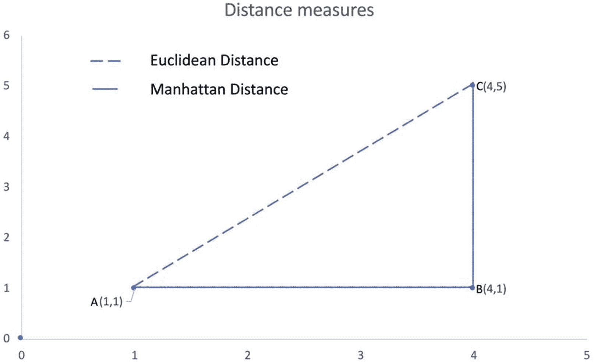

**图 7-2**
距离度量

点 `A` 和 `C` 之间的欧几里得距离是 5。你可以通过应用公式进行交叉验证。点 `A` 和 `C` 之间的曼哈顿距离计算为 `(A,B)` 和 `(B,C)` 之间距离的城市街区总和。由于其布局，它也被称为出租车几何，对于图 7-2，它被计算为笛卡尔坐标的绝对差。

```
曼哈顿距离 = |(x2 – x1)| + |(y2-y1)|
曼哈顿距离 = |(4–1)| + |(5-1)|
曼哈顿距离 = 7
```

向量空间中的切比雪夫距离是两个向量之间的距离，是它们沿任何坐标维度的差值的最大值。对于图 7-2，可以使用以下公式计算：

```
切比雪夫距离 = max [(x2 – x1), (y2-y1)]
切比雪夫距离 = max [(4 – 1), (5-1)]
切比雪夫距离 = 4
```

这种策略对于数值变量效果很好，但是如何将此技术应用于分类变量呢？假设你有一个名为“过去 5 年内是否有过购买”的变量，其值为是/否。你如何使用这个变量？请记住，我们在前面章节中介绍过独热编码。你可以使用独热编码将此分类变量（是/否）转换为数值变量。最终你会得到两个变量：一个代表“是”，另一个代表“否”。在实践中，你可能只需要一个变量，因为第二个变量可能与第一个变量完全共线。

如果你仔细观察数据，你会发现之前的变量范围是 1 到 10，而现在的新变量“过去 5 年内是否有过购买”的范围是 0 到 1。将这些变量组合在一起会导致偏差，因为当你计算距离时，新变量的影响可以忽略不计。你如何处理这种情况？是的，你可以使用归一化。*归一化*是一种缩放技术，可以将现有数据重新缩放到 `[0,1]` 的范围内。它使用以下公式计算：

```
X[normalized] = (X-X[min]) / (X[max] -X[min])
```

这是分割中广泛使用的技术。但要小心，因为你可能会丢失关于异常值的信息。

另一种广泛使用的缩放技术是*标准化*。不要将标准化与归一化混淆。在标准化中，你将数据重新缩放，使其均值为 0，标准差为 1。它使用以下公式计算：

```
X[standardized] = X- X[mean] / X[standard_deviation]
```

# 使用杰卡德系数与汉明距离处理分类数据

有时你可能会遇到只有分类数据的情况。是否存在比独热编码和欧氏距离更好的技术？答案是肯定的：杰卡德系数和汉明距离。我们在此重点介绍杰卡德系数，它涉及从数据中计算相异度矩阵。

例如，在处理二元属性时，你可以创建一个列联表，其中 `a` 表示项目 `x` 和 `y` 中同时为 1 的特征数量；`b` 表示项目 `x` 中为 1 但项目 `y` 中为 0 的特征数量；`c` 表示项目 `x` 中为 0 但项目 `y` 中为 1 的特征数量；`d` 表示项目 `x` 和 `y` 中同时为 0 的特征数量。特征总数为 `z`，即 `z = a + b + c + d`（见表 7-5）。

**表 7-5** 列联表

| x | y |   |   |
|---|---|---|---|
|   | 1 | 0 | 合计 |
| 1 | a | b | a+b |
| 0 | c | d | c+d |
| 合计 | a+c | b+d | z = (a+b+c+d) |

你需要了解几个术语来计算相异度。

- **对称二元变量** – 变量的两个层级具有相同权重。例如，硬币的正面和反面。
- **非对称二元变量** – 两个层级的权重不同。例如，在医学检测结果中，阳性结果可能比阴性结果具有更高的权重。

根据二元变量的类型，相异度的计算方式会有所不同。对称二元相异度可使用以下公式计算：

`d(x,y) = (b + c) / (a + b + c + d)`

非对称二元相异度可使用以下公式计算：

`d(x,y) = (b + c) / (a + b + c)`

请注意，在上述公式中，分母中忽略了 `d`；这是因为阴性结果的重要性很低甚至无关紧要。使用这种相异度度量，你可以通过以下公式计算 `x` 和 `y` 之间的相似距离：

`相似度(x, y) = 1 – d(x, y)`

`相似度(x, y) = 1 – ((b + c) / (a + b + c))`

`相似度(x, y) = c / (a + b + c)`

这种相似度度量被称为**杰卡德距离**。它可用于确定二元变量之间的相似度。但名义变量该如何处理呢？一种变通方法是将名义变量重新编码为多个二元变量。另一种技术是使用简单匹配系数，其计算公式如下：

`简单匹配系数 = 匹配属性数量 / 属性总数`

对于二元变量而言，该系数与对称二元相异度类似。上述系数给出了相异度指数。相似距离则通过用 1 减去该系数来计算：

`简单匹配距离 = 1 - 简单匹配系数`

现在我们沿用欧氏距离的示例来演示杰卡德距离。假设一家汽车经销商成功与三位车主达成交易，这三位车主拥有三辆不同品牌和型号的汽车。该经销商希望根据性能对这些车主的汽车进行分类。他们对这些汽车进行了不同的测试，以确定当前性能的相似度。未通过的测试用 `Y` 表示，通过的测试用 `N` 表示。为方便起见，我们在此将它们分别转换为 1 和 0（见表 7-6）。

**表 7-6** 杰卡德距离演示

|       | 气候测试 | 机械测试 | 压力脉冲测试 | 排放台架测试 | 催化剂老化测试 | SHED 测试 |
|-------|----------|------------|------------------|-----------------|-----------|------|
| 汽车 1 | 1        | 0          | 1                | 0               | 0         | 0    |
| 汽车 2 | 1        | 0          | 1                | 0               | 1         | 0    |
| 汽车 3 | 1        | 1          | 0                | 0               | 0         | 0    |

你可以使用以下公式计算汽车之间的相异度：

`d(汽车 1, 汽车 2) = 1 + 0 / (2 + 1 + 0)`

`d(汽车 1, 汽车 2) = 0.33`

这些数字是如何得出的？通过使用列联表，我们统计了表 7-6 中 `b` 和 `c` 的数量。对于汽车 1 和汽车 2，催化剂老化测试对应 `b`。这里没有 `c` 值。同时请注意，这是非对称二元相似度，因此分母中不考虑 `d` 的值。从气候测试和压力脉冲测试中，我们知道 `a` 的计数为 2。要计算相似度，你需要用 1 减去这个指数：

`相似度(汽车 1, 汽车 2) = 1 - 0.33`

`相似度(汽车 1, 汽车 2) = 0.67`

类似地，你可以计算其他观测值之间的差异，并创建一个相似度矩阵。

### 聚类类型

广义上，聚类可分为层次聚类和非层次聚类方法。本节重点阐述这些聚类类型之间的差异，以及每种聚类类型可用的算法。顾名思义，层次聚类试图在其求解过程中构建一个聚类的层次结构。层次聚类进一步分为凝聚式聚类和分裂式聚类（见图 7-3）。

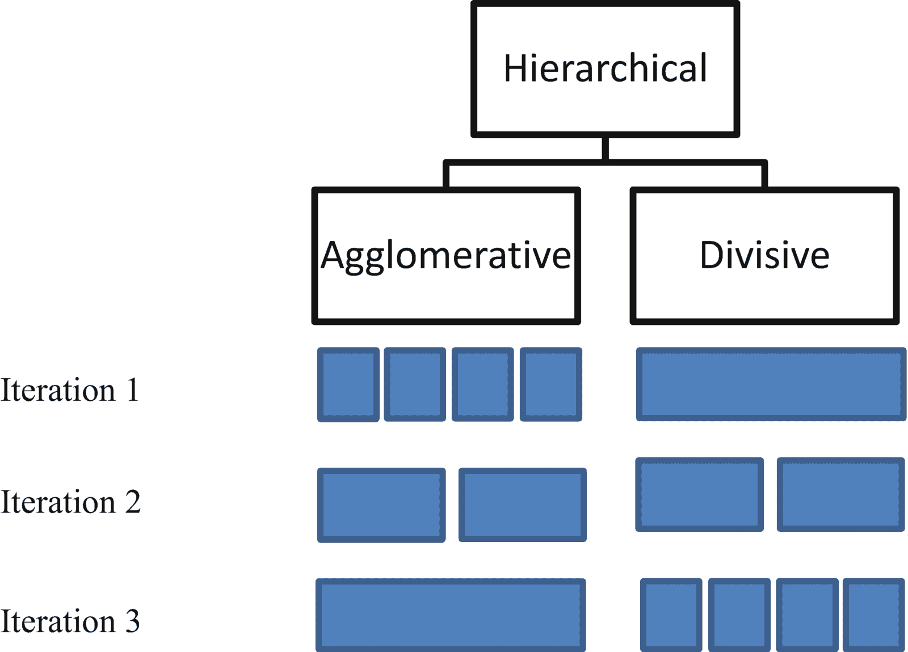

**图 7-3** 层次聚类的类型

- **凝聚式聚类：** 在此类聚类中，每个观测值最初自成一类，然后逐步向上合并，最终形成一个单一的聚类。这种方法也被称为*自底向上聚类*。
- **分裂式聚类：** 在此类聚类中，所有观测值最初属于一个单一的聚类，然后在每次迭代中递归地分裂成更小的聚类。这种方法也被称为*自顶向下聚类*。

图 7-3 以图形方式描绘了这两种方法。我们使用选自表 7-1 的数据来演示凝聚式聚类的例子。我们还计算了所有这些点的欧几里得距离（见表 7-8）。所有成对距离都列在表 7-7 中。

**表 7-8** 选定受访者的欧几里得距离

|   | **1** | **2** | **6** | **7** | **11** | **12** |
|---|-------|-------|-------|-------|--------|--------|
| 1 | 0.00  | 1.41  | 9.00  | 8.56  | 9.00   | 8.56   |
| 2 | 1.41  | 0.00  | 8.06  | 7.50  | 8.06   | 7.50   |
| 6 | 9.00  | 8.06  | 0.00  | 1.12  | 12.73  | 11.67  |
| 7 | 8.56  | 7.50  | 1.12  | 0.00  | 11.67  | 10.67  |
| 11| 9.00  | 8.06  | 12.73 | 11.67 | 0.00   | 1.12   |
| 12| 8.56  | 7.50  | 11.67 | 10.61 | 1.12   | 0.00   |

**表 7-7** 凝聚式聚类示例

| **受访者** | **安全性** | **燃油效率** |
|----------------|------------|---------------------|
| 1              | 10         | 10                  |
| 2              | 9          | 9                   |
| 6              | 10         | 1                   |
| 7              | 9          | 1.5                 |
| 11             | 1          | 10                  |
| 12             | 1.5        | 9                   |

请注意，这是一个对称矩阵；你可以使用其中一半来确定你的聚类。当你开始进行凝聚式聚类时，所有数据点都各自独立成类。根据上述数据，这里两个受访者之间观察到的最小距离是 1.12，对应 (6,7) 和 (11,12)。这里出现了平局，那么算法将如何决定哪些对应该合并呢？存在内置规则来打破这种平局，我们假设它任意选择了 (6,7)。在第一步中，你会将它们聚类在一起，然后计算整体的异质性度量，这里等于 1.12。请注意，当你开始聚类时，异质性度量为 0，因为所有数据点都在它们各自的独立类中。一旦你将 6 和 7 合并，下一个被合并的对是 (11,12)。异质性度量保持不变，因为这些点之间的成对距离仍然是 1.12。在下一步中，(1,2) 将被合并在一起，因为它们具有最小的成对距离 1.41。现在平均异质性将上升到 1.21。这是通过计算 (1.12+1.12+1.41)/3 得到的。重复这些步骤，直到所有观测值都落入一个单一的聚类中。

你可能会想，如何选择正确的聚类数量呢？一种识别方法是确定异质性度量中的突变/波动。图 7-4 直观地展示了算法的工作原理。表 7-9 显示了这些步骤。

**表 7-9** 聚类步骤

| **步骤** | **聚类**                    | **异质性** |
|----------|-----------------------------|-------------------|
| 0        | 1 2 6 7 11 12               | 0                 |
| 1        | 1 2 (**6 7**) 11 12         | 1.12              |
| 2        | 1 2 (**6 7**) (**11 12**)   | 1.12              |
| 3        | (**1 2**) (**6 7**) (**11 12**) | 1.21              |
| 4        | (**1 2 6 7**) (11 12)       | 3.84              |
| 5        | (**1 2 6 7 11 12**)         | 5.04              |

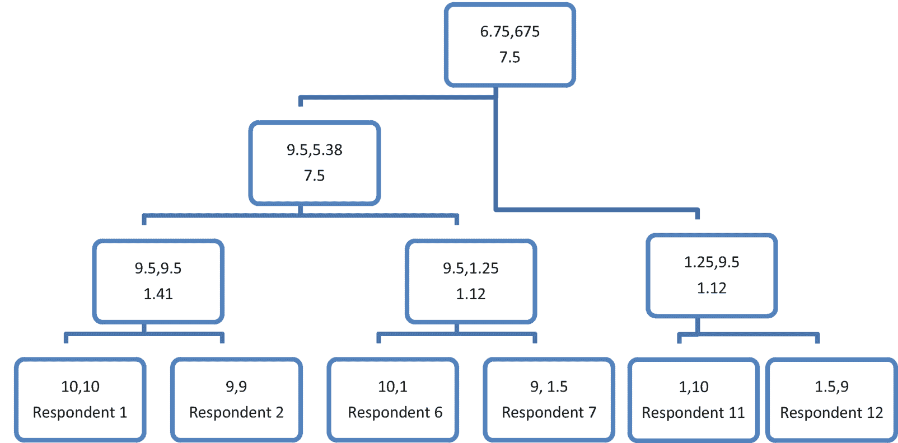

**图 7-4** *树状图：基于单链路的层次聚类。展示了质心和欧几里得距离*

观察上述异质性度量，你可以看到从步骤 3 到步骤 4 以及从步骤 4 到步骤 5 的度量存在突变。这里可以得出两种可能的解决方案，即三聚类或四聚类解决方案。

我们在这里使用的方法称为*单链路*。它在确定聚类度量和异质性时考虑最近邻。其他可用于考察相似性的方法包括：

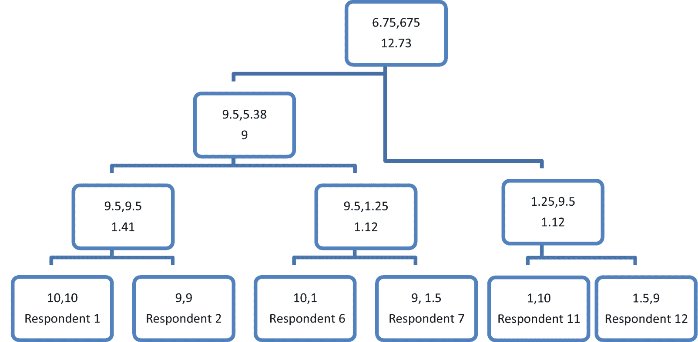

**图 7-5** 树状图：基于全链路的层次聚类。展示了质心和欧几里得距离

- **全链路：** 此方法使用聚类之间的最大距离来确定聚类距离，而不是使用最小距离。图 7-5 展示了聚类属性和距离如何变化。

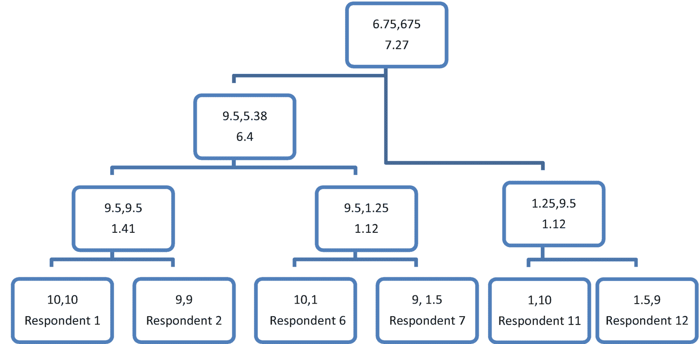

**图 7-6** 树状图：基于平均链路的层次聚类。展示了质心和欧几里得距离

- **平均链路：** 此方法使用聚类之间的成对平均距离来确定聚类距离。图 7-6 展示了聚类距离如何变化。
- **质心链路：** 此方法在迭代步骤中使用聚类中心之间的距离来确定聚类距离。
- **沃德法：** 此方法基于方差。它基于最小化聚类内观测值之间的聚类方差，并最大化跨聚类的聚类方差的原则。

尽管层次聚类具有无需预先选择初始聚类数量的优势，但它是一种实现起来较为复杂的算法，尤其是在大数据环境下。它的时间和空间复杂度为 `O(n²log(n))`，其中 `n` 是观测值的数量。这可能会减慢运算速度。从好的方面来看，它可以解释观测值是如何分组的。

### 二分 K 均值算法

`BisectingKMeans` 是一种混合方法，结合了层次分裂聚类和非层次聚类的特点。我们将在下一节介绍`k-means`，这是一种较为流行的非层次聚类技术。`BisectingKMeans` 在预先设定聚类数量方面与 `k-means` 类似。你可能会想，在没有任何数据先验知识的情况下，如何设定聚类数量。你可以使用之前介绍过的技术，例如异质性度量，以及其他距离度量方法，通过运行算法若干次迭代来确定聚类。

让我们从理论上看看 `BisectingKMeans` 算法是如何工作的。由于这是一种分裂算法，它从顶部的单个聚类开始，然后迭代地划分数据。首先，你需要设定所需的聚类数量。

开始时，所有数据都存在于一个聚类中（见图 7-7）。我们将数据分成两个聚类（见图 7-8）。

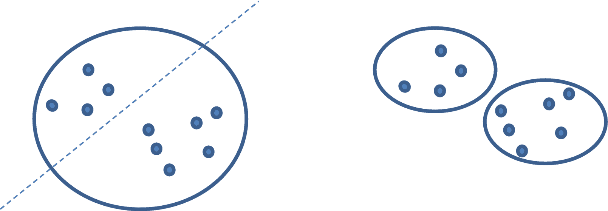

图 7-8

步骤 2：二分 k-means

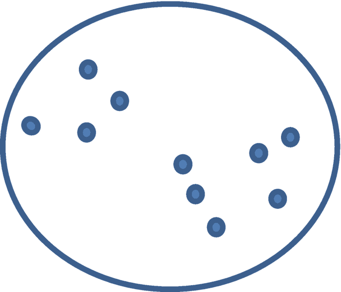

图 7-7

步骤 1：二分 k-means

前两个聚类是使用 `k-means` 划分的。随着聚类的分裂，会计算每个聚类的质心。然后，计算所有点与质心之间距离的平方和。这被称为距离/误差平方和（`SSE`）。`SSE` 越高，聚类的异质性越大。在下一步中，我们选择所有聚类中 `SSE` 最高的那个，并将其分成两个聚类（见图 7-9）。

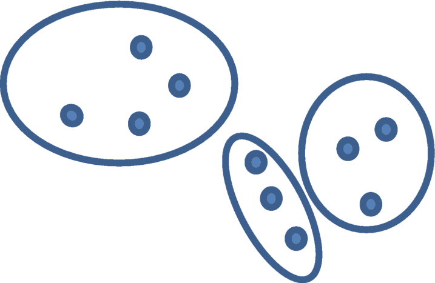

图 7-9

步骤 3：二分 k-means

在下一步中，我们查看这三个聚类的 `SSE`，并选择 `SSE` 最高的那个进行二分。我们重复这个过程，直到达到所需的聚类数量。该过程的低计算时间是相对于其他过程的一大优势。`BisectingKMeans` 还能生成大小相似的聚类，这与 `k-means` 不同，后者的聚类大小差异很大。

截至 3.0 版本，PySpark 尚未实现凝聚层次聚类。有一种使用 `BisectingKMeans` 函数的分裂层次聚类方法（自上而下）。为了演示，我们使用来自 Kaggle 的信用卡数据（[`https://www.kaggle.com/arjunbhasin2013/ccdata`](https://www.kaggle.com/arjunbhasin2013/ccdata)）（见表 7-10）。

表 7-10

信用卡数据集的元数据信息

| **列名** | **定义** |
| --- | --- |
| `custid` | 信用卡持有者标识（分类变量） |
| `balance` | 账户中可用于购物的余额 |
| `balancefrequency` | 余额更新的频率；得分介于 0 和 1 之间（1 = 频繁更新，0 = 不频繁更新） |
| `purchases` | 从账户进行的购买金额 |
| `oneoffpurchases` | 单次最大购买金额 |
| `installmentspurchases` | 分期付款的购买金额 |
| `cashadvance` | 用户获得的预借现金金额 |
| `purchasesfrequency` | 购买发生的频率；得分介于 0 和 1 之间（1 = 频繁购买，0 = 不频繁购买） |
| `oneoffpurchasesfrequency` | 单次购买发生的频率（1 = 频繁购买，0 = 不频繁购买） |
| `purchasesinstallmentsfrequency` | 分期购买发生的频率（1 = 频繁发生，0 = 不频繁发生） |
| `cashadvancefrequency` | 预借现金支付的频率 |
| `cashadvancetrx` | 使用“预借现金”进行的交易次数 |
| `purchasestrx` | 进行的购买交易次数 |
| `creditlimit` | 用户的信用卡额度 |
| `payments` | 用户支付的金额 |
| `minimum_payments` | 用户支付的最低金额 |
| `prcfullpayment` | 用户全额支付的比例 |
| `tenure` | 用户使用信用卡服务的期限 |

该数据集不能以其原始形式使用。从描述中我们知道，这些数据元素具有不同的量纲。在应用聚类技术之前，我们必须对它们进行归一化并形成特征向量。

# 读取数据
```
file_location = "cluster_data.csv"
file_type = "csv"
infer_schema = "false"
first_row_is_header = "true"
df = spark.read.format(file_type)\
.option("inferSchema", infer_schema)\
.option("header", first_row_is_header)\
.load(file_location)
```

# 打印元数据
`df.printSchema()`

# 转换多个变量类型
```
from pyspark.sql.types import *
```

# 识别并分配变量列表
`float_vars=list(set(df.columns) - set(['CUST_ID']))`
```
for column in float_vars:
    df=df.withColumn(column,df[column].cast(FloatType()))
```

# 数据插补
```
from pyspark.ml.feature import Imputer
```

# 筛选需要进行均值插补的变量
`input_cols=list(set(df.columns) - set(['CUST_ID']))`

# 定义插补函数
```
imputer = Imputer(
    inputCols=input_cols,
    outputCols=["{}_imputed".format(c) for c in input_cols])
```

# 应用转换
`df_imputed=imputer.fit(df).transform(df)`

# 删除原始列，因为我们已创建了 `_imputed` 列
`df_imputed=df_imputed.drop(*input_cols)`

# 将输入列重命名为原始列名以保持一致性
`new_column_name_list= list(map(lambda x: x.replace("_imputed", ""), df.columns))`
`df_imputed = df_imputed.toDF(*new_column_name_list)`

# 数据准备
```
from pyspark.ml.feature import VectorAssembler
from pyspark.ml.feature import Normalizer
from pyspark.ml import Pipeline
```

# 列出分割分析中不需要的变量
`ignore = ['CUST_ID']`

# 创建所有特征的向量
```
assembler = VectorAssembler(inputCols=[x for x in df.columns if x not in ignore], outputCol='features')
```

# 创建所有特征的归一化，用于缩放到 0 到 1 之间
```
normalizer = Normalizer(inputCol="features", outputCol="normFeatures", p=1.0)
```

# 定义管道
`pipeline = Pipeline(stages=[assembler, normalizer])`

# 拟合管道
`transformations=pipeline.fit(df_imputed)`

# 应用转换
`df_updated = transformations.transform(df_imputed)`

# 构建模型
```
from pyspark.ml.clustering import BisectingKMeans
from pyspark.ml.evaluation import ClusteringEvaluator
```

# 训练二分 k-means 模型。
```
bkm = BisectingKMeans().setK(2).setSeed(1)
model = bkm.fit(df_updated.select('normFeatures').withColumnRenamed('normFeatures','features'))
```

# 进行预测
`predictions = model.transform(df_updated.select('normFeatures').withColumnRenamed('normFeatures','features'))`

# 通过计算轮廓系数评估聚类效果
```
evaluator = ClusteringEvaluator()
silhouette = evaluator.evaluate(predictions)
print("Silhouette with squared euclidean distance = " + str(silhouette))
```

# 显示结果。
```
print("Cluster Centers: ")
centers = model.clusterCenters()
for center in centers:
    print(center)
```

我们使用轮廓系数来确定最佳聚类数。这是确定正确聚类数的最佳可用指标之一。该指标针对数据集中的每个样本进行计算。其计算公式如下：

`轮廓系数 = (x-y)/ max(x,y)`

其中 `x` 是簇间距离，`y` 是簇内距离。该系数的取值范围在 -1 到 1 之间。接近 1 的值表示清晰的分离，更为理想。现在，让我们计算不同聚类数下的轮廓系数，并绘制图表以确定正确的聚类数（见图 7-10）。

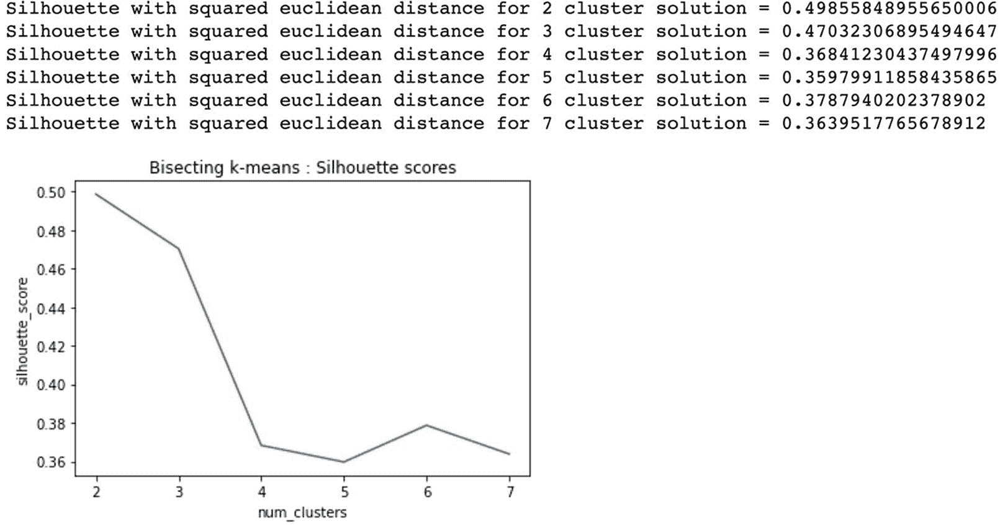

*图 7-10*

使用二分 k-means 算法，随着聚类数增加，轮廓系数在多次迭代中的变化情况

```
# 迭代
import pandas as pd
import seaborn as sns
import matplotlib.pyplot as plt
sil_coeff=[]
num_clusters=[]
for iter in range(2,8):
    bkm = BisectingKMeans().setK(iter).setSeed(1)
    model = bkm.fit(df_updated.select('normFeatures').withColumnRenamed('normFeatures','features'))
    # 进行预测
    predictions = model.transform(df_updated.select('normFeatures').withColumnRenamed('normFeatures','features'))
    # 通过计算轮廓系数评估聚类效果
    evaluator = ClusteringEvaluator()
    silhouette = evaluator.evaluate(predictions)
    sil_coeff.append(silhouette)
    num_clusters.append(iter)
    print("Silhouette with squared euclidean distance for "+str(iter) +" cluster solution = " + str(silhouette))

# 创建用于可视化的数据框
df_viz=pd.DataFrame(zip(num_clusters,sil_coeff), columns=['num_clusters','silhouette_score'])
sns.lineplot(x = "num_clusters", y = "silhouette_score", data=df_viz)
plt.title('Bisecting k-means : Silhouette scores')
plt.xticks(range(2, 8))
plt.show()
```

### K-means

到目前为止，k-means 是最流行的聚类技术之一，因为它能相对轻松地扩展到海量数据。当数据量很大时，大多数其他技术计算成本高昂。k-means 的一个优点（有时也是缺点）是你可以指定想要的聚类数。为了演示，我们使用表 7-1 中相同的汽车调查数据。我们将聚类数设置为三。该算法在空间中分配三个随机初始化点，如图 7-11 所示。这些点代表初始聚类中心。

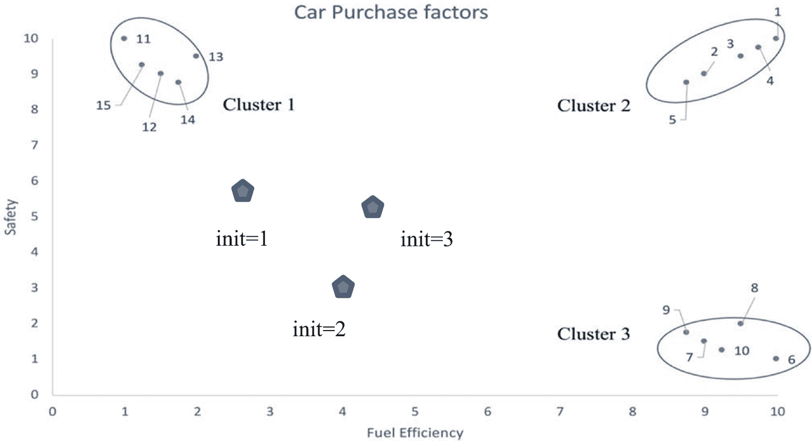

*图 7-11*

K-means 演示

在第二步中，计算所有点到三个初始化聚类中心的距离。根据到聚类中心的最小距离，将所有点分配到一个聚类中。计算新聚类点的质心以找到新的聚类中心。然后，再次计算所有点到新聚类中心的距离。根据到聚类中心的最小距离，重新分配点。此过程重复进行，直到聚类中的点不再发生变化。

你可能想知道，如何确定 k-means 中正确的聚类数？嗯，从层次聚类中你已经知道答案了。你使用聚类方差来确定正确的聚类数。你从 0 到 `n` 运行聚类，并绘制聚类方差的变化。这种图被称为*肘部图*。当你在图中观察到肘部或急剧变化时，可以将该点作为最佳聚类数。目标是找到具有最低平方和（SSE）的最小 `k` 值。

我们将使用相同的信用卡数据集在 PySpark 中实现 k-means。

**练习 7-1：分割**

**问题 1：** 通过设置相同的聚类数，观察层次聚类和非层次聚类之间的差异。

-   聚类轮廓和大小是否相似？

```python
```

# 导入 SparkSession

```python
from pyspark.sql import SparkSession
spark=SparkSession.builder.appName("Clustering").getOrCreate()
```

# 打印 PySpark 和 Python 版本

```python
import sys
print('Python version: ' + sys.version)
print('Spark version: ' + spark.version)
```

# 读取数据

```python
file_location = "cluster_data.csv"
file_type = "csv"
infer_schema = "false"
first_row_is_header = "true"
df = spark.read.format(file_type)\
.option("inferSchema", infer_schema)\
.option("header", first_row_is_header)\
.load(file_location)
```

# 打印元数据
```
df.printSchema()
```

# 统计数据
```
df.count()
print('信用卡数据集中的记录总数为 ' + str(df.count()))
```

# 转换多个变量类型

`from pyspark.sql.types import *`

# 识别并分配变量列表

```python
float_vars=list(set(df.columns) - set(['CUST_ID']))
for column in float_vars:
df=df.withColumn(column,df[column].cast(FloatType()))
from pyspark.ml.feature import Imputer
```

# 筛选需要进行均值插补的变量

```
input_cols=list(set(df.columns) - set(['CUST_ID']))
```

# 定义插补函数

```
imputer = Imputer(
inputCols=input_cols,
outputCols=["{}_imputed".format(c) for c in input_cols])
```

# 应用转换
`df_imputed=imputer.fit(df).transform(df)`

# 删除原始列，因为我们创建了 `_imputed` 列
`df_imputed` = `df_imputed`.drop(`input_cols`)

# 将输入列重命名为原始列名以保持一致性

```python
new_column_name_list= list(map(lambda x: x.replace("_imputed", ""), df.columns))
df_imputed = df_imputed.toDF(*new_column_name_list)
from pyspark.ml.feature import VectorAssembler
from pyspark.ml.feature import Normalizer
from pyspark.ml import Pipeline
```

# 列出在分段分析中不需要的变量

```
ignore = ['CUST_ID']
```

# 创建所有特征的向量
```python
assembler = VectorAssembler(inputCols=[x for x in df.columns if x not in ignore], outputCol='features')
```

# 对所有特征进行归一化，使其缩放到 0 到 1 之间

```
normalizer = Normalizer(inputCol="features", outputCol="normFeatures", p=1.0)
```

# 定义管道

`pipeline` = `Pipeline`(stages=[`assembler`, `normalizer`])

```
pipeline = Pipeline(stages=[assembler, normalizer])
```

# 拟合管道
```
transformations = pipeline.fit(df_imputed)
```

# 应用转换
```
df_updated = transformations.transform(df_imputed)
from pyspark.ml.clustering import KMeans
from pyspark.ml.evaluation import ClusteringEvaluator
```

# 训练 k-means 模型。

```
kmeans = KMeans().setK(2).setSeed(1003)
model = kmeans.fit(df_updated.select('normFeatures').withColumnRenamed('normFeatures','features'))
```

# 进行预测

```
predictions = model.transform(df_updated.select('normFeatures').withColumnRenamed('normFeatures','features'))
```

# 通过计算轮廓系数评估聚类效果

```
evaluator = ClusteringEvaluator()
silhouette = evaluator.evaluate(predictions)
print("使用平方欧氏距离的轮廓系数 = " + str(silhouette))
```

# 显示结果。

```
centers = model.clusterCenters()
print("聚类中心: ")
for center in centers:
print(center)
import pandas as pd
import seaborn as sns
import matplotlib.pyplot as plt
sil_coeff=[]
num_clusters=[]
for iter in range(2,8):
kmeans = KMeans().setK(iter).setSeed(1003)
model = kmeans.fit(df_updated.select('normFeatures').withColumnRenamed('normFeatures','features'))
```

## 进行预测
```
predictions = model.transform(df_updated.select('normFeatures').withColumnRenamed('normFeatures','features'))
```

# 潜在狄利克雷分配 (LDA)

潜在狄利克雷分配 (LDA) 可以帮助你使用统计模型识别文档集合中的抽象主题。LDA 于 2003 年提出，已被应用于文本分析之外的许多领域，例如情感分析和图像的目标定位。为了解释 LDA，我们从一个简单的图示开始（见图 7-12）。

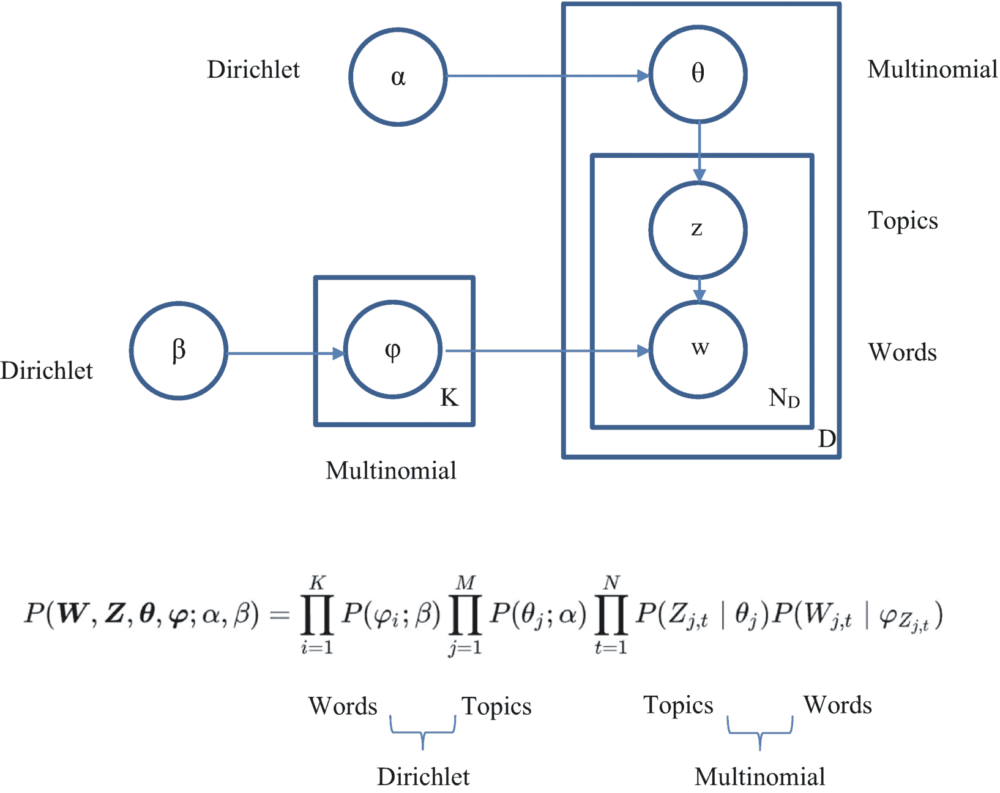

图 7-12 潜在狄利克雷分配演示

乍一看，这个图和公式可能会让人不知所措。让我们分解一下并理解各个组成部分。首先，什么是狄利克雷？狄利克雷分布是一族连续多元概率分布，由一个正实数向量参数化。它是贝塔分布的多元推广。图 7-12 中的 `∝` 和 `β` 是狄利克雷分布。`θ` 和 `φ` 是多项分布。利用这些分布，我们创建单词和主题，进而可以创建文档。

你可以将 LDA 视为一个生成文档的引擎。在等式的左侧，我们有一个文档出现的概率。通过调整右侧的因子，我们可以期望生成具有不同主题和单词的不同风格的文档。等式的前两个组成部分是狄利克雷分布。单词 (`β`) 可以是阶数为 `n` 的单纯形，具体取决于关键词的数量。主题 (`∝`) 可以是阶数小于或等于 `n` 的单纯形。

从视觉上考虑狄利克雷分布。假设你有两个主题：体育和教育。你可以在视觉上将它们表示为图 7-13 中的狄利克雷分布。你可以添加另一个主题：环境；其表示形式也已显示。如果有四个主题，请记住它将是一个 3 阶单纯形，即一个四面体，而不是一个正方形。

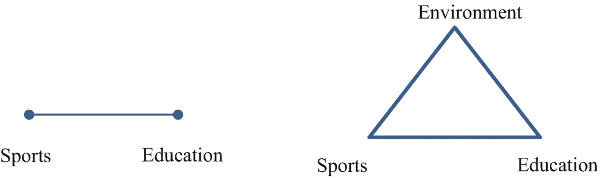

图 7-13 狄利克雷分布表示

如果文档包含体育内容，它们将向体育一侧表示，而教育文档将向教育一侧表示。这就是分布随着 `∝` 的不同值而变化的方式（见图 7-14）。

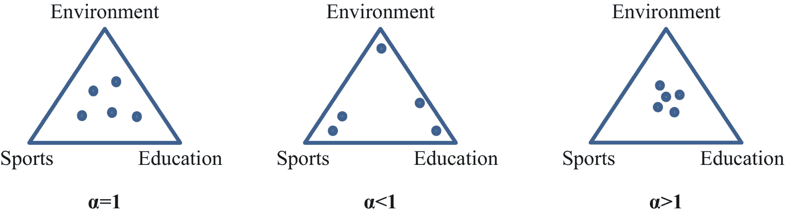

图 7-14 狄利克雷分布的变化

如果 `∝` 的值等于 1，则文章中的主题分布均匀。如果 `∝` 的值小于 1，则主题分离良好，文档分散在角落。如果 `∝` 的值大于 1，则所有文档都聚集在中心，主题没有很好的分离。大多数文章的内容倾向于遵循 `∝<1` 的分布。下一个问题是，单词呢？我们对单词重复相同的概念。在图 7-15 中，我们使用了四个单词：league、planet、school 和 goal。我们将单词放在角落，并将点作为主题。

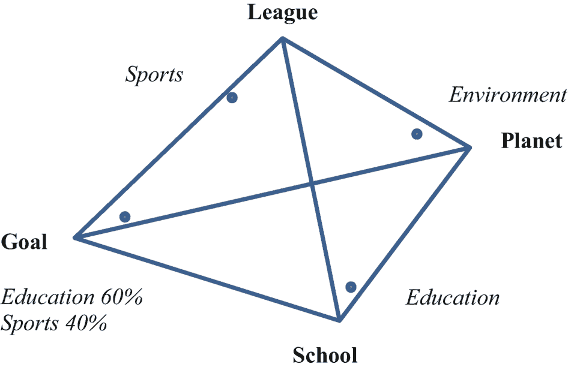

图 7-15 单词的主题

我们现在可以将这些放入等式的视角中，并演示从该 LDA 生成单个文档的过程。为了演示，我们将公式分解为四个因子，如图 7-16 所示。

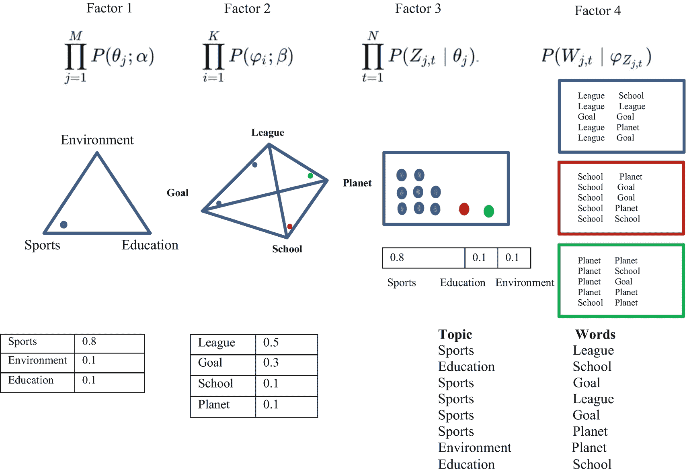

图 7-16 公式分解

第一个因素是 2 阶单纯形，其顶点包含主题，我们随机选取一个点作为将要创建的文档之一。请注意，该点偏向于体育主题。我们可以将这个点表示为一个文档，其中大约包含 80%的体育、10%的环境和 10%的教育内容。我们使用这些百分比在因子 3 中创建多项分布。如图 7-16 所示，我们在体育、教育和环境主题的盒子内模拟了相同的百分比分布。如果我们多次从主题盒子中随机抽取一个主题（有放回），可以预期主题分布将如图 7-16 中因子 3 所示。

现在，我们想要找到与主题对应的单词。为此，我们选取因子 2，其顶点是单词，点代表主题。我们根据单词在四面体中的位置来量化与体育相关的单词百分比。这表示在因子 2 下方的表格中。对应的多项分布表示在因子 4 的第一个盒子中。基于因子 2 中教育和环境的狄利克雷分布，可以为剩余的教育和环境主题获得类似的多项分布。

现在，我们回到因子 3，即主题分布。我们选择第一个主题，即体育。我们查找因子 4 中对应的单词多项分布，并从第一个盒子中随机选择一个单词，恰好是 `league`。然后，我们移动到第二个主题实例，即教育。接着，我们使用因子 4 中代表教育的第二个盒子，并随机选择一个单词。假设这个随机单词是 `school`。我们对剩余的主题重复此过程，以识别对应的单词。

从所有主题中识别出的单词堆叠在一起，将构成我们的文档。这个机器生成的文档可能没有意义，只是不同单词的组合。这是可以接受的，我们多次重复此过程，改变四个因子的设置以生成多个文档。我们验证这些机器生成文档与输入文档的相似性。在多次迭代中，原始文档与机器生成文档相似的概率很低。随着我们多次重复此过程，我们观察每次迭代中相似度如何变化，并选择使机器生成文档与输入文档之间相似度最大化的设置。

## LDA 实现

你现在可能想知道，当面对一个文档语料库时，如何确定主题的数量。答案是通过超参数设置。在 LDA 中，主题的数量也是一个超参数。结果会根据所选主题的数量而变化。当你向计算机提供一个文档语料库时，它不会像人类那样理解任何解释。但计算机擅长识别文档中单词出现的频率。你还可以验证这些单词在整个语料库的不同文档中是如何出现的。利用这些信息，你可以将单词标记到主题上。驱动此过程的主要属性有两个，如下所示：

*   每篇文章主要包含一个单一主题
*   每个单词主要与一个单一主题关联

如果我们分解上述属性，以图 7-17 所示的四个文档为例，我们会发现文档包含混合的单词；通常文档中存在一个主导主题。我们可以定量地确定单词出现的次数，然后相应地将其标记到不同的主题。假设我们选择了三个主题，我们将把这四个文档分类为主题 1、主题 2 和主题 3。

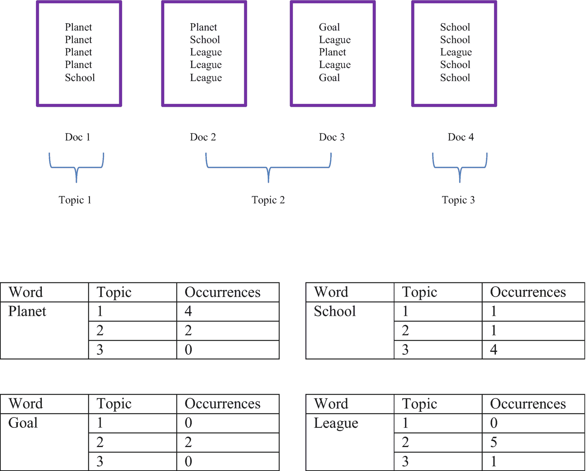

图 7-17 示例语料库

第二个属性通过按主题划分的单词出现情况来展示。尽管存在一个单词与多个主题关联的多个实例，但每个单词都强烈倾向于一个单一主题。为简单起见，假设大多数情况决定了单词到主题的分配。那么我们将得到表 7-11 所示的数据。

**表 7-11 主题分配**

| **单词** | **主题** |
| --- | --- |
| `Planet` | 主题 1 |
| `Goal` | 主题 2 |
| `League` | 主题 2 |
| `School` | 主题 3 |

如果存在一些常见的单词，例如 `the`、`is` 和 `any`，它们会使用自然语言处理技术*词频-逆文档频率*（`tf–idf`）被消除。这是一种用于识别语料库中最重要单词的技术。`tf–idf` 值随着单词在文档中出现次数的增加而成比例增加，并通过包含该单词的语料库文档数量进行抵消，这有助于调整某些单词通常更频繁出现的事实。

我们可以将问题陈述概括为：将所有单词分类到给定/选择的主题数量中，如果可能，为每个文档保留一个单一主题，并且如果可能，将每个单词归入一个单一主题。这是通过*吉布斯采样*完成的。我们试图做的是找出描述主题模型中潜在变量的变量。我们假设一组潜在变量完全描述了从主题到分配再到指派，最终生成完整文档的过程。

吉布斯采样允许我们逐个将所有单词与正确的主题组织起来。这通过几个步骤完成。第一步涉及文档内的单词搜索，第二步涉及跨文档的单词搜索。使用图 7-17，从文档 1 中，我们选取第一个单词 `planet`。我们不会将这个单词分配给任何主题，而是计算文档中其他单词如何被分配到不同的主题。我们有三个 `planet` 单词和一个 `school` 单词。根据表 7-11，这三个 `planet` 单词被分配到主题 1，`school` 被分配到主题 3。现在，我们将查看单词 `planet` 在不同主题中的出现情况（表 7-12）。

**表 7-12 主题出现情况**

| **主题** | **主题词分配** | **出现次数** | **估计值** |
| --- | --- | --- | --- |
| 主题 1 | 主题 1 在文档 1 中的占比 | 3 | 2 + α |
| 主题 1 中“星球”一词的占比 | 4 | 4 + β |
| 主题 2 | 主题 2 在文档 1 中的占比 | 0 | 0 + α |
| 主题 2 中“星球”一词的占比 | 2 | 2 + β |
| 主题 3 | 主题 3 在文档 1 中的占比 | 1 | 1 + α |
| 主题 3 中“星球”一词的占比 | 0 | 0 + β |

利用这些出现次数，我们可以计算某个词属于某个主题的概率。如果仅针对每个主题单独使用这些出现次数，可能会遇到估计值为 0 的问题，从而导致所选词无法被分配到其他主题。为了解决这个问题，我们添加了小的调整项 `α` 和 `β`。如果你还记得图 7-16 中的公式，`α` 和 `β` 是狄利克雷分布。我们对每个文档中的所有词重复此过程多次，直到最大化本节前面讨论的两个属性。吉布斯采样的一个关键要点是，你可以对词进行重新分类，使其尽可能与单个主题关联。由于此过程是迭代进行的，计算机将帮助你识别每个文档中的主题，并给出定义该主题的词列表。作为最后一步，我们需要观察这些关键词，并为这些主题打上标签。

我们将使用一个真实世界的示例来展示如何使用 PySpark 实现 LDA。为此，我们使用了来自 Kaggle 的数据集（[`https://www.kaggle.com/PromptCloudHQ/amazon-echo-dot-2-reviews-dataset`](https://www.kaggle.com/PromptCloudHQ/amazon-echo-dot-2-reviews-dataset)）。该数据集包含对智能音箱 Echo Dot 的评论，包含以下字段：

- `Page URL`
- `Title`
- `Review Text`
- `Device Color`
- `User Verified`
- `Review Date`
- `Review Useful Count`
- `Configuration`
- `Rating`
- `Declaration Text`（例如：Vine Voice、Top 100 reviewer 等）

我们在此建模练习中使用 `Review Text` 列。

# 通过计算轮廓系数评估聚类效果

```python
evaluator = ClusteringEvaluator()
silhouette = evaluator.evaluate(predictions)
sil_coeff.append(silhouette)
num_clusters.append(iter)
print("对于 " +str(iter) +" 个聚类的解决方案，使用平方欧氏距离的轮廓系数 = " + str(silhouette))
df_viz=pd.DataFrame(zip(num_clusters,sil_coeff), columns=['num_clusters','silhouette_score'])
sns.lineplot(x = "num_clusters", y = "silhouette_score", data=df_viz)
plt.title('k-means : 轮廓系数')
plt.xticks(range(2, 8))
plt.show()
```

# 导入 Sparksession

```
from pyspark.sql import SparkSession
spark=SparkSession.builder.appName("LDA").getOrCreate()
```

# 打印 PySpark 和 Python 版本
```python
import sys
print('Python version: '+sys.version)
print('Spark version: '+spark.version)
```

# 读取数据
```
file_location = "lda_data.csv"
file_type = "csv"
infer_schema = "false"
first_row_is_header = "true"
df = spark.read.format(file_type)\
.option("inferSchema", infer_schema)\
.option("header", first_row_is_header)\
.load(file_location)
```


# 打印元数据
`df.printSchema()`


# 统计数据量

`df.count()`
`print('The total number of records in the credit card dataset are ' + str(df.count()))`

```bash
pip install nltk
```

# 导入相关库

```
from pyspark.sql.types import *
from pyspark.mllib.linalg import Vector, Vectors
from pyspark.ml.feature import CountVectorizer , IDF
from pyspark.mllib.clustering import LDA, LDAModel
from pyspark.mllib.linalg import Vectors as MLlibVectors
import re
import nltk
nltk.download('stopwords')
from nltk.corpus import stopwords
```

在上述步骤中，我们读取了数据，导入了必要的库，并探索了与数据相关的元数据。

# 从 DataFrame 中提取评论文本并过滤掉空值

```
reviews = df.rdd.map(lambda x : x['Review Text']).filter(lambda x: x is not None)
```

# 从 NLTK 定义英文停用词

```
StopWords = stopwords.words("english")
tokens = reviews.map(lambda document: document.strip().lower())\
.map( lambda document: re.split(" ", document)) \
.map( lambda word: [x for x in word if x.isalpha()]) \
.map( lambda word: [x for x in word if len(x) > 3] )\
.map( lambda word: [x for x in word if x not in StopWords]).zipWithIndex()
```

在上述步骤中，我们将 `DataFrame` 转换为 `RDD` 并过滤掉空评论。然后，我们从 `NLTK` 库加载停用词，并使用多个 lambda 函数来去除多余空格、转换为小写、检查字母字符、移除长度小于三个字母的词（包括停用词）。最后，我们为每一行添加一个索引，以便在后续过程中将其用作标识符。

# 将 RDD 转换为 DataFrame

```
df_txts = spark.createDataFrame(tokens, ['list_of_words','index'])
```

# TF

```
cv = CountVectorizer(inputCol="list_of_words", outputCol="raw_features", vocabSize=5000, minDF=10)
cvmodel = cv.fit(df_txts)
result_cv = cvmodel.transform(df_txts)
```

# 数据处理

## IDF

```python
idf = IDF(inputCol="raw_features", outputCol="features")
idfModel = idf.fit(result_cv)
result_tfidf = idfModel.transform(result_cv)
```

在上述步骤中，我们使用内置函数创建了词频和逆文档频率。`CountVectorizer`有助于将文本文档集合转换为词频向量。`IDF`则对特征进行重新加权，以降低在语料库中频繁出现的词的权重。

我们将这些包含每个文档中高重要性词的数据用于 LDA 模型。然后，我们打印每个主题的前五个词以理解主题。这里我们使用了十个主题，但这是最佳选择吗？不，我们需要尝试不同的组合来确定正确的数量。此处使用十个主题仅作为示例。你可以对不同的组合进行迭代，并观察哪个数量能为你提供有意义的主题集合。

```python
num_topics = 10
max_iterations = 100
lda_model=LDA.train(result_tfidf.select("index", "features").rdd.mapValues(MLlibVectors.fromML).map(list),k = num_topics, maxIterations = max_iterations)
wordNumbers = 5
data_topics=lda_model.describeTopics(maxTermsPerTopic = wordNumbers)
vocabArray = cvmodel.vocabulary
topicIndices = spark.sparkContext.parallelize(data_tp)
def topic_render(topic):
terms = topic[0]
result = []
for i in range(wordNumbers):
term = vocabArray[terms[i]]
result.append(term)
return result
topics_final = topicIndices.map(lambda topic: topic_render(topic)).collect()
for topic in range(len(topics_final)):
print ("Topic" + str(topic) + ":")
for term in topics_final[topic]:
print (term)
print ('\n')
```

输出：

```
Topic0:
works
good
speaker
sound
better
Topic1:
know
time
questions
playing
alexa
Topic2:
amazon
another
first
purchased
back
Topic3:
would
device
work
could
give
Topic4:
well
need
thing
pretty
loves
Topic5:
love
great
bought
little
much
Topic6:
home
weather
smart
voice
things
Topic7:
really
getting
without
wish
enjoy
Topic8:
music
echo
play
every
want
Topic9:
product
easy
still
alexa
using
```

## 协同过滤

如果你使用过或接触过任何推荐引擎，那么其底层极有可能采用了协同过滤技术。协同过滤的优势之一在于，它不需要大量的客户数据，仅需用户对一组商品的历史偏好即可。其内在假设之一是：未来的偏好与过去的偏好保持一致。用户偏好主要分为两类：显式评分和隐式评分。顾名思义，`显式评分`是用户根据服务商约定的评分标准给出的（例如，IMDB 的 1 到 10 分）。这为我们提供了绝佳的机会，因为我们可以明确了解用户对某个产品/内容的喜爱或厌恶程度。而`隐式评分`则是通过用户参与行为来衡量的（例如，用户收听某首特定曲目的次数、购买记录、观看习惯等）。

现实世界中的数据通常是双模态的，它由两类实体之间的联合交互产生。例如，用户对电影的评分同时受到用户特征和电影特征的影响。想象一个数据集，其行代表不同用户，列代表他们对电影的评分，传统的聚类技术会考察用户在多维空间中的距离远近。我们常常忽略了列与列之间的关系。而共聚类旨在根据对象之间成对交互的相似性，同时按行和列对对象进行分组。当数据稀疏时，共聚类非常有效。在大多数现实场景中，数据都是稀疏的。一个观众能观看的电影数量是有限的，因此当我们跨用户和电影收集数据时，数据会变得稀疏，这正是共聚类的最佳应用场景之一。在协同过滤的术语中，它们被称为基于用户的协同过滤和基于物品的协同过滤。

### 基于用户的协同过滤

假设你有一个 `a` x `b` 的评分矩阵，其中用户为 `u[i,]`（`i = 1` 到 `n`），物品为 `p[j]`（`j = 1` 到 `m`）。如果你想预测评分 `r[ij]`，且用户尚未观看物品 `j`，你可以计算用户 `i` 与所有其他用户之间的相似度（见图 7-18）。然后，你可以选择最相似的若干用户，并以相似度为权重，对这些用户的评分进行加权平均。

`r[ij] =` 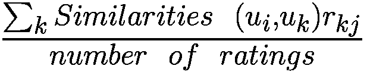

同样，评分者可能类型各异，从严格到宽松。为避免偏差，你可以在计算时使用每个用户对所有物品的平均评分，并将其加回到目标评分中。

`r[ij] =` 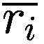 `+` 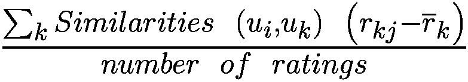

还有其他计算相似度的方法，例如皮尔逊相关系数和余弦相似度。所有这些指标都基于同一原则：当用户对相似物品有相同的参与度或购买行为时，他们就是相似的。这些方法能帮助你找到与目标用户最相似的用户。

### 基于物品的协同过滤

对于基于物品的协同过滤，你利用从其他具有相似品味或偏好的用户那里收集到的信息，根据用户的品味来预测他们可能偏好的物品。这种方法提供了稳定性，但计算量很大。

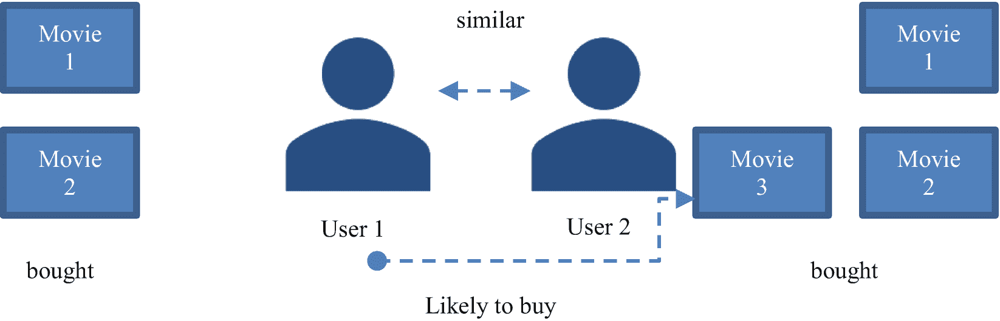

图 7-18

基于用户的协同过滤

## 矩阵分解

共聚类需要使用矩阵分解。这是一种将初始稀疏的用户-物品交互矩阵分解为具有潜在特征的低维矩阵的方法，这些低维矩阵的稀疏性更低。潜在特征可以是对物品的广泛分类（例如，杂货店中的生鲜产品、电影的类型等）。矩阵分解可以估算出一部电影在多大程度上符合某个类别，以及一个用户在多大程度上符合同一类别。该方法的最大优势之一是，即使两个用户之间没有共同物品的显式或隐式评分，你仍然可以通过他们共享的潜在特征来发现相似性（见图 7-19）。

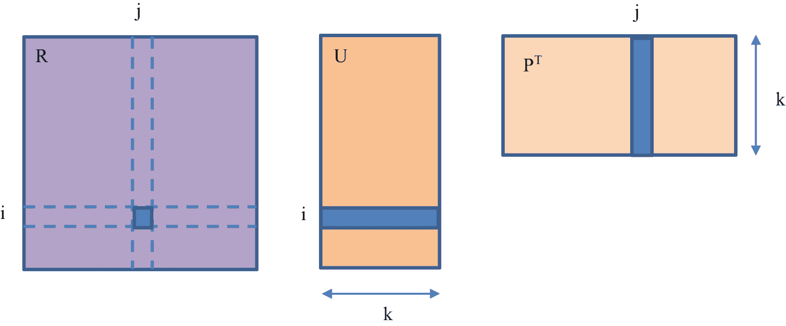

图 7-19

矩阵分解

矩阵分解会将用户-物品矩阵 `R` 分解为 `U`（基于用户）和 `P`（基于物品），使得 `R ~ U x P`，其中 `U ∈ R^(m*k)`，`P ∈ R^(n*k)`。这里的 `k` 是分解的秩。现在，你可以将其视为一个优化过程，通过最小化代价函数 `J`，用 `U` 和 `P` 来逼近原始矩阵 `R`：

```
J = ||R - U x P^T||_2 + λ (||U||_2 + ||P||_2)
```

第一项表示 `R` 与其近似矩阵 `U x P^T` 之间的均方误差距离。第二项是正则化项，用于防止过拟合。

### 使用交替最小二乘法（ALS）进行优化

`ALS` 通过迭代更新一半参数并固定另一半参数来最小化损失函数。这种交替方法避免了在优化步骤中进行梯度计算。它是针对隐式反馈进行矩阵分解的一种高效解决方案。由于我们假设未观测到的条目为 0，梯度计算的开销可能极其巨大。随着我们进一步讨论代价函数，你将获得更深入的理解。

基于代价函数，你需要学习两类变量：`U` 和 `P`，它们表示为 `U × P^T`。该函数的实际代价为以下求和：

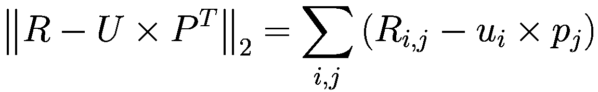

再加上正则化项。由于 `Us` 和 `Vs` 是未知变量，这使得代价函数成为非凸函数。如果你固定 `P` 并优化 `U`，本质上可以将问题简化为线性回归。这是一个巨大的优势，并且该过程可以并行化。`ALS` 是一个两步迭代过程。在每次迭代中，先固定 `P` 并求解 `U`。在下一步中，固定 `U` 并求解 `P`。由于普通最小二乘法保证了最小的均方误差，代价函数永远不会增加。在这两步之间交替进行，将不断降低代价函数，直至收敛。

当可用数据量极少时，协同过滤非常适合用于推荐。但你必须意识到它的局限性。作为矩阵分解一部分而生成的潜在特征是不可解释的。你还可能遇到冷启动问题。当一个新项目没有足够数量的用户时，模型将无法为该新项目做出推荐，并且可能陷入流行度偏差的陷阱。

我们现在通过一个虚构的数据集来演示协同过滤的实现，该数据集包含三列：多个用户和电影的 `userid`、`movieid` 和 `ratings`。所有代码均在单独的 Jupyter Notebook 中提供，方便访问。

# Import Sparksession
```python
from pyspark.sql import SparkSession
spark = SparkSession.builder.appName("CF").getOrCreate()
```

# Print PySpark and Python versions

```
import sys
print('Python version: '+sys.version)
print('Spark version: '+spark.version)
```

# Read data
`file_location = "cf_data.csv"`
`file_type = "csv"`
`infer_schema = "false"`
`first_row_is_header = "true"`

```
df = spark.read.format(file_type)\
    .option("inferSchema", infer_schema)\
    .option("header", first_row_is_header)\
    .load(file_location)
```

```
# Print metadata
df.printSchema()
```

# Count data
```
df.count()
print('The total number of records in the credit card dataset are '+str(df.count()))
```

```python
# Import appropriate libraries
from `pyspark.sql.types` import *
import `pyspark.sql.functions` as `sql_fun`
from `pyspark.ml.recommendation` import `ALS`, `ALSModel`
from `pyspark.mllib.evaluation` import `RegressionMetrics`, `RankingMetrics`
from `pyspark.ml.evaluation` import `RegressionEvaluator`
import `re`
```

# Casting variables

在这段代码中，我们首先转换变量类型：

```python
int_vars=['userId','movieId']
for column in int_vars:
    df=df.withColumn(column,df[column].cast(IntegerType()))
float_vars=['rating']
for column in float_vars:
    df=df.withColumn(column,df[column].cast(FloatType()))
(training, test) = df.randomSplit([0.8, 0.2])
```

然后，我们使用 `ALS` 执行矩阵分解。PySpark 中 `ALS` 模型的参数如下：

- `NumBlocks` 是用户和项目被划分成的块数，以便并行计算。
- `rank` 是模型中潜在特征的数量。
- `maxIter` 是运行的最大迭代次数。
- `regParam` 指定 `ALS` 中的正则化参数，通过惩罚较大的系数来防止过拟合。
- `implicitPrefs` 指定是使用显式反馈 `ALS` 变体还是适用于隐式反馈数据的变体（默认为 `false`，表示使用显式反馈）。
- `alpha` 是一个适用于 `ALS` 隐式反馈变体的参数，它控制偏好观测中的基线置信度（默认为 `1.0`）。

我们将 `coldStartStrategy` 设置为 `drop`，以消除空的评估指标。

```python
# 后续模型训练与评估代码示例
```

# Define `ALS` model parameters and fit the model
```
als = ALS(rank=15,maxIter=2, regParam=0.01,
userCol="userId", itemCol="movieId", ratingCol="rating",
coldStartStrategy="drop",
implicitPrefs=False)
model = als.fit(training)
```

# Evaluate the model by computing the RMSE on the test data
```python
# Evaluate the model by computing the RMSE on the test data
predictions = model.transform(test)
evaluator = RegressionEvaluator(metricName="rmse", labelCol="rating",
predictionCol="prediction")
rmse = evaluator.evaluate(predictions)
print("Root-mean-square error = " + str(rmse))
```

# Generate top 10 movie recommendations for each user

```
userRecs = model.recommendForAllUsers(10)
userRecs.count()
```

# Generate top 10 user recommendations for each movie
`movieRecs` = `model.recommendForAllItems(10)`
`movieRecs.count()`
`userRecs_df` = `userRecs.toPandas()`
print(`userRecs_df.shape`)
`movieRecs_df` = `movieRecs.toPandas()`
print(`movieRecs_df.shape`)
`userRecs_df.head()`

```
```

输出：

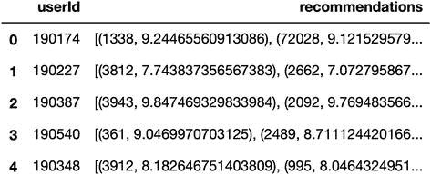

## 练习 7-2：协同过滤

**问题 1：** 更改 `ALS` 设置中的潜在特征数量，并观察均方误差如何变化。

## 总结

*   你已了解了无监督学习技术的概览。
*   你现在知道了层次聚类和非层次聚类方法的区别，并且了解了轮廓系数如何帮助确定最佳聚类数。
*   你探索了潜在狄利克雷分配的工作原理并实现了它。
*   你还回顾了使用交替最小二乘法实现协同过滤的过程。

干得漂亮！你现在已经熟悉了一些在无监督学习和非结构化数据中非常有用的关键概念。在下一章中，我们将带你了解如何构建项目以及创建自动化机器学习流程。

