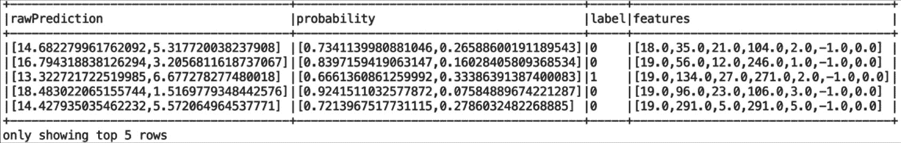
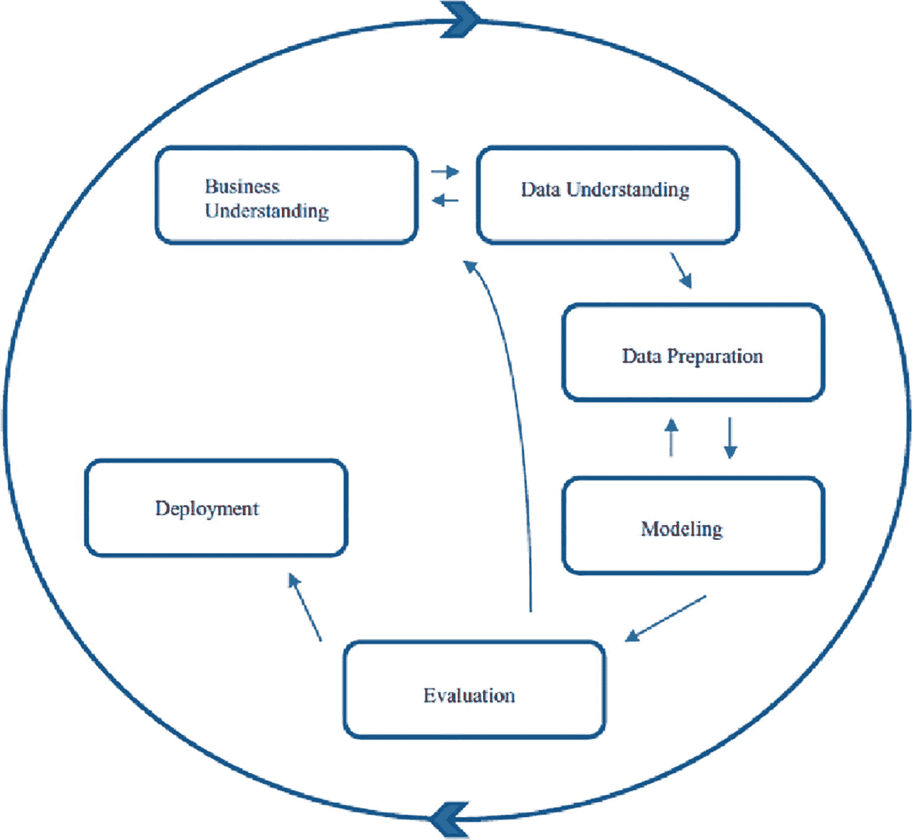
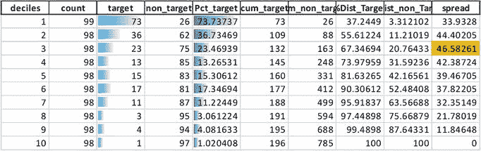
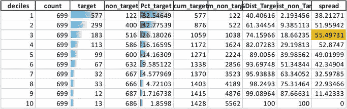
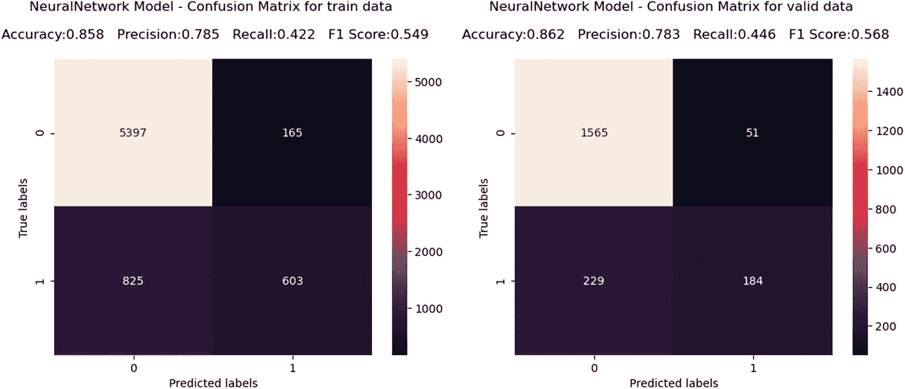
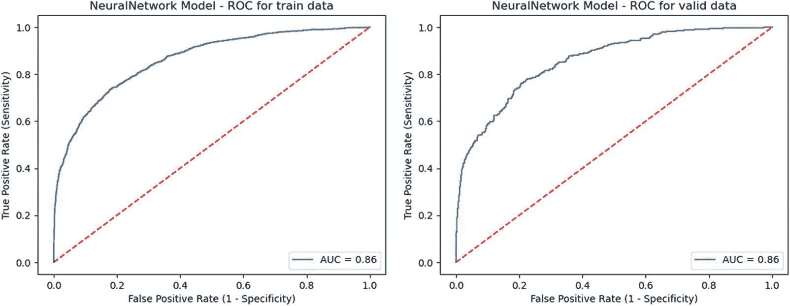
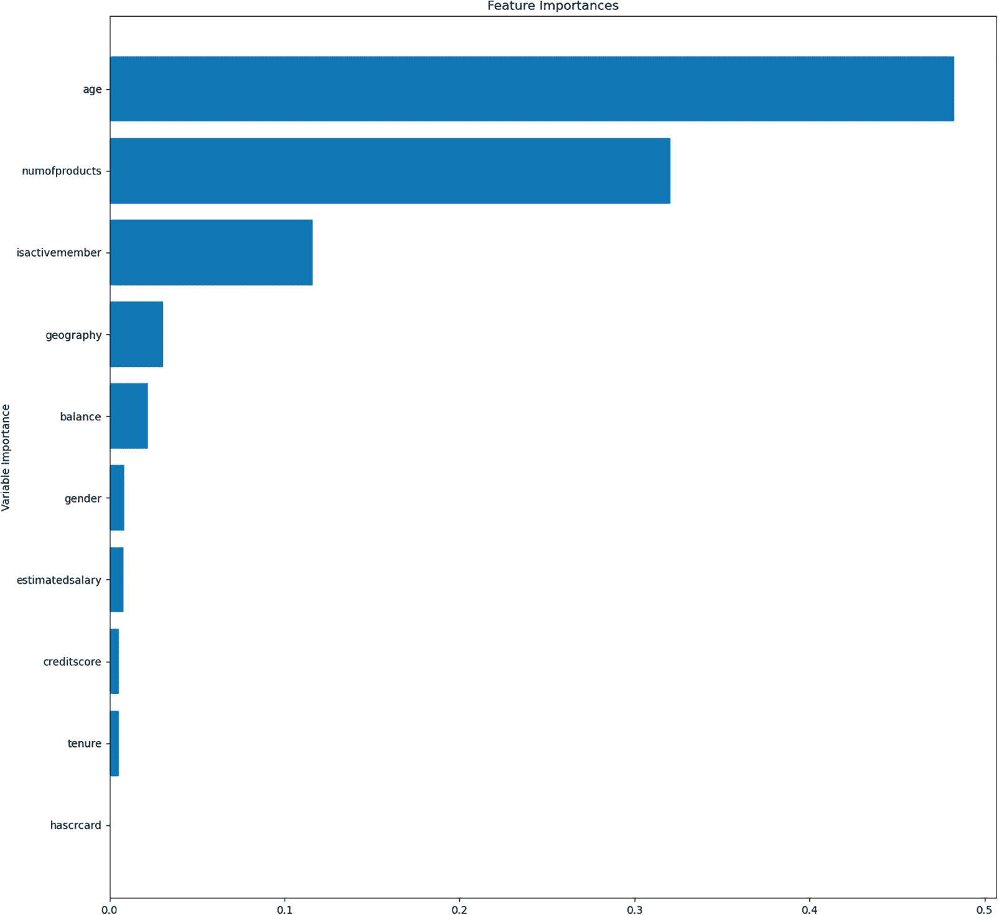
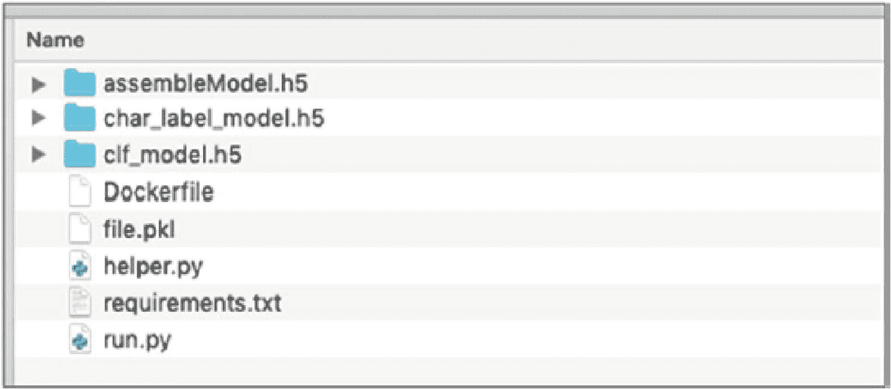
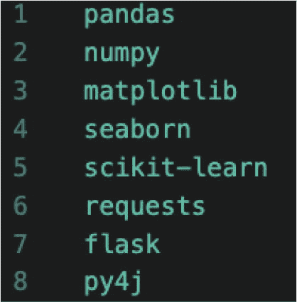
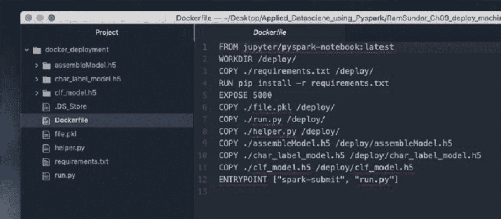

# 从 MLflow 加载 Spark ML 模型
model = mlflow.spark.load_model(model_uri)
print("model.type:", type(model))
predictions = model.transform(assembled_test_df)
print("predictions.type:", type(predictions))
predictions.printSchema()
df = predictions.select('rawPrediction','probability', 'label', 'features')
df.show(5, False)
```

这段代码是一个简单的流水线。您也可以灵活地将评分函数包装成一个简单的 `udf`。保存代码后，您需要在 Docker 中运行以下命令以获取结果：

```
spark-submit --master local chapter8_predict_spark.py mlartifacts/795206614136056686/cd6d4c9a47b54d1396f63eb172fbc547/artifacts/sklearn-model
```

这将给出如图 8-8 所示的输出。



图 8-8

MLflow 模型评分输出

以上所有内容和代码都是在 Spark 中指定的。MLflow 支持多种其他风格。您可以将上述流水线序列化为 `mleap` 风格，这是一个无需 Spark 上下文即可托管 Spark 流水线的项目，适用于不需要分布式计算的较小数据集。MLflow 还可以以 MLflow 项目格式将代码发布到 GitHub，使任何人都可以轻松运行该代码。


## 自动化机器学习流水线

机器学习生命周期是一个迭代过程。你常常需要反复调整参数、输入和数据流水线，随着数据管理流水线数量的增加，这一过程会迅速变得繁琐。创建自动化流水线可以节省大量时间。你已从前面的章节学习了数据操作、算法和建模技术。现在，你将它们结合起来，创建一个自动化的 PySpark 流程，该流程可以生成基线模型，以便快速进行实验。

本实验使用来自 Kaggle (`https://www.kaggle.com/shrutimechlearn/churn-modelling#Churn_Modelling.csv`) 的客户流失数据集。这个银行数据集包含客户属性以及哪些客户已流失的数据。目标是基于给定的属性识别将会流失的客户。表 8-1 列出了这些属性。

**表 8-1** 元数据

| 列名 | 描述 |
| --- | --- |
| `RowNumber` | 标识符 |
| `CustomerId` | 客户的唯一 ID |
| `Surname` | 客户的姓氏 |
| `Credit score` | 客户的信用评分 |
| `Geography` | 客户所属的国家 |
| `Gender` | 男性或女性 |
| `Age` | 客户的年龄 |
| `Tenure` | 客户与该银行合作的年数 |
| `Balance` | 客户的银行余额 |
| `NumOfProducts` | 客户正在使用的银行产品数量 |
| `HasCrCard` | 二进制标志，表示客户是否持有该银行的信用卡 |
| `IsActiveMember` | 二进制标志，表示客户是否为该银行的活跃会员 |
| `EstimatedSalary` | 客户的预估年薪（美元） |
| `Exited` | 二进制标志：1 表示客户已销户，0 表示客户仍有账户 |

### 流水线需求与框架

在设计任何流水线时，必须定义你期望的输出和需求。首先，定义你认为必要的输出。由于本例处理的是二分类目标，拥有以下输出会很好：

- **KS：** Kolmogorov-Smirnov 检验是衡量好样本与坏样本之间分离程度的指标。值越高越好。
- **ROC：** 该曲线是一种比较诊断测试的方法。它是真正率与假正率的对比图。值越高越好。
- **准确率：** 即 (真正例 + 真负例) / (真正例 + 真负例 + 假正例 + 假负例)。值越高越好。

以下是自动化模型构建工具的需求：

- 该模块应能自行处理缺失值和分类值。
- 该模块应负责变量选择。
- 该模块应在选择最终变量之前测试多种算法。
- 该模块应基于首选指标比较不同算法，并选择冠军模型和挑战者模型。
- 如果该模块能通过前缀、后缀或变量名称移除某些变量，将会非常方便。这可以支持多次迭代并调整输入变量。
- 该模块应能收集并存储所有输出指标，并将它们整理成文档，以供日后参考。
- 最后，如果该模块能保存模型对象并自动生成评分代码以实现无缝部署，那就更好了。

我们如何确定这些需求？还记得我们在第 3 章讨论过的 CRISP-DM 框架吗（见图 8-9）？我们在此处将该框架用作架构蓝图。



这些需求很多，如果处理不当，很快就会变得难以招架。我们已经定义了输出和需求，但预期的输入会是什么呢？可能是一个来自数据存储或平面文件的数据集。有了这些信息，你可以通过将代码分解为逻辑步骤来开始构建流水线。这将是一个代码密集型的章节，你可以使用此模块并创建自己的基线自动化模型。我们将任务分解为每个逻辑步骤中的子任务。这些任务大致分为以下几类：

- 数据操作
- 特征选择
- 模型构建
- 指标计算
- 验证与图表生成
- 模型选择
- 评分代码创建
- 结果整理
- 处理上述所有步骤的框架

### 数据操作

在本节中，我们定义一些用于处理数据的常用函数，例如：

- 缺失值百分比计算
- 输入数据的元数据分类
- 使用标签编码器处理分类数据
- 填充缺失值
- 重命名分类列
- 合并特征和标签
- 将数据拆分为训练集、测试集和验证集
- 组装向量
- 缩放输入变量

你可以通过此链接访问此代码：`https://github.com/Apress/applied-data-science-using-pyspark/blob/main/Ch08/Chapter8_automator/data_manipulations.py`。

### 特征选择

此模块筛选变量，并选择预测能力最强的顶级变量。它使用随机森林来识别顶级变量。你可以通过此链接访问此模块的代码：`https://github.com/Apress/applied-data-science-using-pyspark/blob/main/Ch08/Chapter8_automator/feature_selection.py`。

### 模型构建

在此模块中，我们定义了多个支持二分类目标的算法函数，包括逻辑回归、随机森林、梯度提升和神经网络。你可以通过此链接访问此模块的代码：`https://github.com/Apress/applied-data-science-using-pyspark/blob/main/Ch08/Chapter8_automator/model_builder.py`。

### 指标计算

此模块计算模型指标，包括 KS、ROC 和准确率。你可以通过此链接访问此模块的代码：`https://github.com/Apress/applied-data-science-using-pyspark/blob/main/Ch08/Chapter8_automator/metrics_calculator.py`。

### 验证与图表生成

此模块生成各种图表，包括 ROC、混淆矩阵和 KS。模型验证也作为此模块的一部分完成。你可以通过此链接访问代码：`https://github.com/Apress/applied-data-science-using-pyspark/blob/main/Ch08/Chapter8_automator/validation_and_plots.py`。

### 模型选择

此模块基于验证指标标准生成挑战者模型和冠军模型的定义。它还生成包含所有模型信息的合并 Excel 输出文件。代码位于：`https://github.com/Apress/applied-data-science-using-pyspark/blob/main/Ch08/Chapter8_automator/model_selection.py`。


### 评分代码创建

该模块用于生成生产部署所需的伪评分代码。它将建模过程中生成的所有模型对象链接起来，并集中存放于一处。其中还包含了数据处理和分类变量处理函数。只要模型对象保存在同一位置，并指向正确的输入数据源，该文件即可独立运行。此模块的代码位于 [`https://github.com/Apress/applied-data-science-using-pyspark/blob/main/Ch08/Chapter8_automator/scorecode_creator.py`](https://github.com/Apress/applied-data-science-using-pyspark/blob/main/Ch08/Chapter8_automator/scorecode_creator.py)。

### 结果汇总

使用一个 zip 文件模块将前面各模块生成的所有输出打包成一个 ZIP 文件。该文件可以轻松导出，以便在其他地方部署模型。此模块的链接为 [`https://github.com/Apress/applied-data-science-using-pyspark/blob/main/Ch08/Chapter8_automator/zipper_function.py`](https://github.com/Apress/applied-data-science-using-pyspark/blob/main/Ch08/Chapter8_automator/zipper_function.py)。

### 框架

该框架文件整合了前面所有模块，以逻辑方式编排它们并生成所需的输出。它对数据进行处理并执行变量选择。它构建机器学习算法，并在保留数据集上验证模型。它根据用户选择的统计指标挑选最佳算法。同时，它还会生成用于生产的评分代码。

该框架文件接收所有输入。我们将包括此框架文件在内的所有前述模块保存为一个 Python 文件。由于我们在此处理的是客户流失建模数据集，因此我们在 `data_folder_path` 中提供了输入 CSV 文件的位置。所有其他必需的输入都在代码的第一个块中提供。此代码设计用于适配 Docker 版本的 PySpark。通过进行少量修改，它也可以适用于任何集群执行环境。你可以通过以下链接访问相关代码：[`https://github.com/Apress/applied-data-science-using-pyspark/blob/main/Ch08/Chapter8_automator/build_and_execute_pipe.ipynb`](https://github.com/Apress/applied-data-science-using-pyspark/blob/main/Ch08/Chapter8_automator/build_and_execute_pipe.ipynb) 或 [`https://github.com/Apress/applied-data-science-using-pyspark/blob/main/Ch08/Chapter8_automator/build_and_execute_pipe.py`](https://github.com/Apress/applied-data-science-using-pyspark/blob/main/Ch08/Chapter8_automator/build_and_execute_pipe.py)。

要执行，请使用以下命令打开 Docker：

```
docker run -it -p 8888:8888 -v /Users/ramcharankakarla/demo_data/:/home/jovyan/work/ jupyter/pyspark-notebook:latest bash
```

在本地机器上，将所有文件复制到暴露给 Docker 的路径（例如 `/Users/ramcharankakarla/demo_data/`）。我们创建了一个名为 `Chapter8_automator` 的文件夹，并将所有必需的文件放入其中（见表 8-2）。将 `churn_modeling.csv` 数据集复制到同一个文件夹中。

**表 8-2** 自动化框架中的文件及其功能

| **模块** | **文件名** |
| --- | --- |
| 数据处理 | `data_manipulations.py` |
| 特征选择 | `feature_selection.py` |
| 模型构建 | `model_builder.py` |
| 指标计算 | `metrics_calculator.py` |
| 验证与图表生成 | `validation_and_plots.py` |
| 模型选择 | `model_selection.py` |
| 评分代码创建 | `scorecode_creator.py` |
| 结果汇总 | `zipper_function.py` |
| 框架 | `build_and_execute_pipe.py` 或 `build_and_execute_pipe.ipynb` |

在运行这些框架文件之前，请确保在 Docker 中安装或检查是否存在以下包：

```
pip install openpyxl
pip install xlsxwriter
```

要从 Docker 运行框架文件，请使用以下命令：

```
spark-submit --master local[*] /home/jovyan/work/Chapter8_automator/build_and_execute_pipe.py
```

执行完成后，所有数据将存储在 `/home/jovyan/` 中。

要创建文件和指标的本地副本以防止工作丢失，请使用以下命令。此命令会创建工作副本。同样，如果需要，你也可以复制一个 zip 文件（`mla_chapter8_testrun.zip`）。

```
cp -r mla_chapter8_testrun /home/jovyan/work/
```

干得漂亮！你已经成功构建了一个端到端的自动化引擎，它可以为你节省大量时间。下一节将介绍该引擎生成的输出。

### 流水线输出

图 8-10 至 8-12 以及表 8-3 至 8-5 展示了自动化流水线框架生成的输出。对于任何给定的二分类模型，都会生成以下输出。

**表 8-5** 神经网络测试

|  |

**表 8-4** Kolmogorov-Smirnov 统计量

|  |



**图 8-12** 自动化模型——混淆矩阵



**图 8-11** 自动化模型 ROC 曲线

**表 8-3** 综合指标

| **model_type** | **roc_train** | **accuracy_train** | **ks_train** | **roc_valid** | **accuracy_valid** | **ks_valid** |
| --- | --- | --- | --- | --- | --- | --- |
| `neuralNetwork` | 0.86171092 | 0.858369099 | 55.5 | 0.857589 | 0.862000986 | 54.43 |
| `randomForest` | 0.838162018 | 0.860228898 | 50.57 | 0.835679 | 0.856086742 | 50.48 |
| `logistic` | 0.755744261 | 0.81230329 | 37.19 | 0.754326 | 0.807294234 | 37.31 |
| `gradientBoosting` | 0.881999528 | 0.869384835 | 59.46 | 0.858617 | 0.853622474 | 55.95 |

| **model_type** | **roc_test** | **accuracy_test** | **ks_test** | **roc_oot1** | **accuracy_oot1** |
| --- | --- | --- | --- | --- | --- |
| `neuralNetwork` | 0.813792 | 0.849134 | 46.58 | 0.856175 | 0.8582 |
| `randomForest` | 0.806239 | 0.840979 | 44.3 | 0.834677 | 0.8575 |
| `logistic` | 0.719284 | 0.805301 | 32.19 | 0.751941 | 0.8106 |
| `gradientBoosting` | 0.816005 | 0.850153 | 47.22 | 0.870804 | 0.8643 |

| **model_type** | **ks_oot1** | **roc_oot2** | **accuracy_oot2** | **ks_oot2** | **selected_model** |
| --- | --- | --- | --- | --- | --- |
| `neuralNetwork` | 54.43 | 0.856175108 | 0.8582 | 54.43 | Champion |
| `randomForest` | 49.99 | 0.834676561 | 0.8575 | 49.99 | Challenger |
| `logistic` | 36.49 | 0.751941185 | 0.8106 | 36.49 |   |
| `gradientBoosting` | 57.51 | 0.870803793 | 0.8643 | 57.51 |   |



**图 8-10** 自动化模型特征重要性

本模块旨在帮助你快速创建自动化实验，绝无取代模型构建活动之意。

**练习 8-1：构建自定义流水线**

**问题：** 我们向你发起挑战，请构建一个单独的流水线或集成代码流程，以适配连续型目标变量。

## 总结

-   你了解了模型管理和部署所面临的挑战。
-   你现在知道了如何使用 MLflow 来管理实验和部署模型。
-   你探索了如何为各种模型构建活动构建自定义流水线。
-   你看到了如何将流水线堆叠在一起以创建自动化流水线。

干得漂亮！你现在已经熟悉了一些关键概念，这些概念对于将模型投入生产非常有用。这应该能让你在构建数据准备流水线时，对如何管理模型生命周期有一个清晰的认识。在下一章中，我们将介绍一些技巧、窍门以及在你日常工作中可能用到的有趣主题。


# 9. 部署机器学习模型

本章介绍部署机器学习模型时应遵循的最佳实践。我们将通过三种方法来演示生产环境部署，具体如下：

- 使用 HDFS 对象和 pickle 文件进行模型部署
- 使用 Docker 进行模型部署
- 实时评分 API

在上一章中，你已经初步了解了第一种技术。本章我们将更详细地介绍它。所提供的代码是用于构建模型和评估结果的起始代码。

## 起始代码

你可以在以下 GitHub 链接中找到代码：[`https://github.com/Apress/applied-data-science-using-pyspark/tree/main/Ch09`](https://github.com/Apress/applied-data-science-using-pyspark/tree/main/Ch09)。请参考 GitHub 仓库中的 `model deployment.ipynb` 文件以获取起始代码。该代码将用于后续的练习。如果你已经有一个模型，可以跳过本节。

## 保存模型对象并创建评分代码

到目前为止，你已经构建了一个可靠的模型，并使用多种指标对其进行了验证。现在是时候保存模型对象以供将来评分，并创建评分代码了。

- **模型对象** 是包含训练过程信息的 PySpark 或 Python 参数。你需要识别出所有无需重新训练模型即可复现结果所需的相关模型对象。识别后，将它们保存在特定位置（HDFS 或其他路径），并在后续评分时使用。
- **评分代码** 包含在新数据集上运行模型对象以生成评分所需的核心代码。请记住，评分代码仅用于评分过程。你不应在评分代码中包含模型训练脚本。

### 模型对象

在此模型示例中，我们需要保存六个对象以供将来使用，具体如下：

- `char_labels` – 此对象用于对新数据进行标签编码。
- `assembleModel` – 此对象用于组装向量，使数据准备好进行评分。
- `clf_model` – 此对象是随机森林分类器模型。
- `features_list` – 此对象包含要从新数据中使用的输入特征列表。
- `char_vars` – 这些是字符型变量。
- `num_vars` – 这些是数值型变量。

在 `Model deployment.ipynb` 文件中，我们提供了一个名为“保存模型对象以供将来评分”的章节。请参考该章节以了解如何保存模型对象。

### 评分代码

使用 Python 脚本文件来执行评分操作。如前所述，此脚本文件不应包含模型训练脚本。评分代码至少应完成以下任务：

1. 导入必要的包
2. 读取新的输入文件以执行评分
3. 读取从训练过程中保存的模型对象
4. 使用模型对象执行必要的转换
5. 使用分类器/回归对象计算模型评分
6. 将最终评分输出到指定位置

首先，创建一个 `helper.py` 脚本，其中包含执行评分所需的所有代码。要粘贴到文件中的代码在 `Model deployment.ipynb` 文件的评分代码部分提供。

创建文件后，你可以使用 `Model deployment.ipynb` 中的最终代码对新数据进行评分。你可以将脚本保存在 `run.py` 文件中。

最终评分可在 `final_scores_df` DataFrame 中获得，该数据集在最后一步中保存为 CSV 文件。你需要确保 `run.py` 和 `helper.py` 文件位于同一目录中。就这样。你已经拥有了一个可靠的评分代码，可以部署到生产环境中。我们将在接下来的章节中介绍生产实现。

## 使用 HDFS 对象和 Pickle 文件进行模型部署

这是一种在生产环境中部署模型的非常简单的方法。当你有多个模型需要评分时，你可以手动提交你在上一步中创建的每个 `run.py` 脚本，或者创建一个调度程序来定期运行这些脚本。无论哪种情况，以下代码都将帮助你完成此任务：

```
spark-submit run.py
```

如前所述，要使此代码正常工作，`run.py` 和 `helper.py` 文件应位于同一目录中。你可以在提交作业时配置上述命令以指定 `configurations`。当你处理大型数据集时，`configurations` 选项非常有用，因为你可能需要调整执行器、核心和内存选项。你可以通过以下链接了解 `spark-submit` 和 `configuration` 选项：

- [`https://spark.apache.org/docs/latest/submitting-applications.html`](https://spark.apache.org/docs/latest/submitting-applications.html)
- [`https://spark.apache.org/docs/latest/configuration.html`](https://spark.apache.org/docs/latest/configuration.html)

## 使用 Docker 进行模型部署

现在我们换个方向，使用 Docker 部署模型。与传统的评分方法（如 `spark-submit`）相比，基于 Docker 的部署在很多方面都很有用。

- **可移植性** – 你可以将应用程序移植到任何平台并使其立即工作。
- **容器化** – 整个应用程序是自包含的。使应用程序工作所需的所有代码和可执行文件都位于容器内。
- **微服务架构** – 你可以将传统的单体应用程序拆分为微服务。这样，你可以根据需要随时修改或扩展/缩减单个微服务。
- **更快的软件交付周期** – 与持续集成和持续开发（CI/CD）流程兼容，使得将应用程序部署到生产环境变得容易。
- 当 Spark 后端发生更改时，数据科学家/工程师无需花费额外时间来修复他们的代码/错误。
- 与虚拟机相比，Docker 消耗更少的内存，从而更有效地利用系统资源。

让我们继续使用 Docker 实现此模型。在开始之前，你应该在单个目录中拥有以下文件（参见图 9-1）。



图 9-1 目录结构

现在，大多数文件对你来说应该很熟悉了。图中显示了两个新文件：`Dockerfile` 和 `requirements.txt`。`Dockerfile` 包含用于创建 Docker 容器的脚本，`requirements.txt` 包含使代码工作所需的所有附加包。让我们看看文件内容。

### requirements.txt 文件

此处提供了该文件的内容，以便你可以将其复制并粘贴到文件中（参见图 9-2）。



图 9-2 requirements.txt 文件


### Dockerfile

我们使用 PySpark Jupyter Notebook 镜像作为基础 Docker 镜像。在镜像内部，我们创建一个名为`/deploy/`的工作目录，用于复制和粘贴所有模型对象和文件（见图 9-3）。



图 9-3

Dockerfile

此过程分步骤完成。此外，我们通过执行`requirements.txt`文件来安装所需的包，如第 4 行所示。最后，我们使用上一节中使用的`spark-submit`命令执行模型。需要注意的一点是，容器中暴露了端口号 5000。我们将在实时评分部分使用此端口。现在请忽略此端口。`Dockerfile`脚本如下所示：

```
