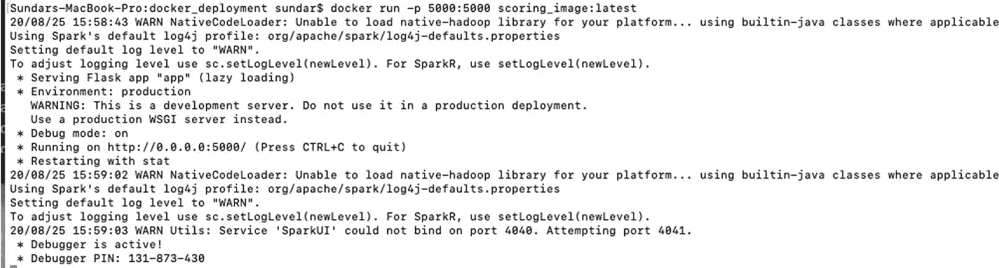

# Specify the entry point command to run when the container starts
ENTRYPOINT ["spark-submit", "run.py"]
```

### 对 `helper.py` 和 `run.py` 文件的修改

在`helper.py`文件中，修改以下行：

```
path_to_read_objects ='/deploy'
```

在`run.py`文件中，修改以下行：

```
path_to_output_scores = '/localuser'
filename = path_to_output_scores + "/score_data.csv"
```

这些修改是为了反映 Docker 内部（`/deploy`）以及稍后在 Docker 执行期间挂载的卷（`/localuser`）中的适当目录路径。

### 创建 Docker 并执行评分代码

要创建 Docker 容器，请在终端/命令提示符中执行以下代码：

```
docker build -t scoring_image .
```

镜像构建完成后，您可以使用以下命令执行它。您需要从包含评分数据的目录执行该命令。

```
docker run -p 5000:5000 -v ${PWD}:/localuser scoring_image:latest
```

就是这样。您应该会在本地文件夹中看到`predictions.csv`文件。到目前为止，我们使用了批量评分流程。现在让我们转向实时评分 API。

### 实时评分 API

实时评分 API 用于实时对模型进行评分。它使您的模型能够嵌入到 Web 浏览器中，以获取预测并根据这些预测采取行动。这对于进行在线推荐、检查信用卡批准状态等非常有用。其应用范围非常广泛，使用 Docker 管理此类 API 变得更加容易。此示例使用 Flask 实时实现模型（见图 9-4）。Flask 脚本存储在`pysparkapi/app.py`文件中。您可以参考本节代码，地址为：[`https://github.com/Apress/applied-data-science-using-pyspark/tree/main/Ch09/real_time_scoring`](https://github.com/Apress/applied-data-science-using-pyspark/tree/main/Ch09/real_time_scoring)。



图 9-4

Flask API 就绪

我们还修改了`Dockerfile`，将`app.py`文件复制到`/deploy`目录。在上一模块中，我们运行了`run.py`文件。在本模块中，这由`app.py`文件处理。以下是更新后的`Dockerfile`内容：

```
FROM jupyter/pyspark-notebook:latest
WORKDIR /deploy/
COPY ./requirements.txt /deploy/
RUN pip install -r requirements.txt
EXPOSE 5000
