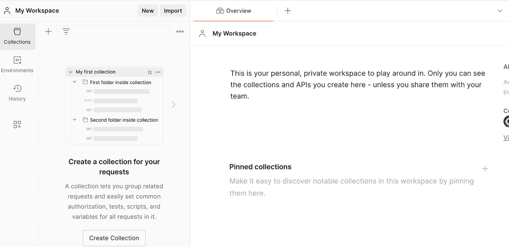
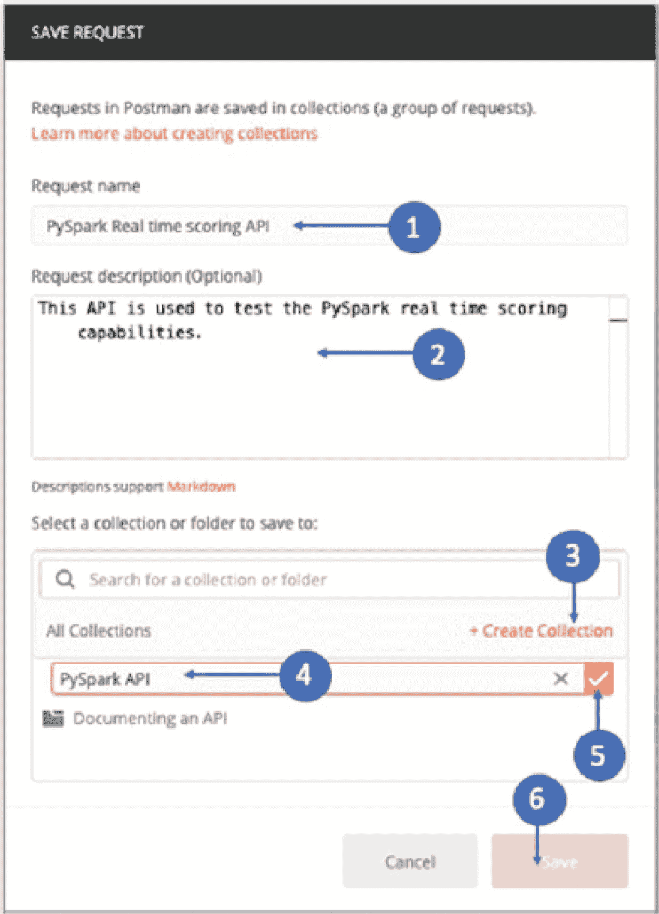
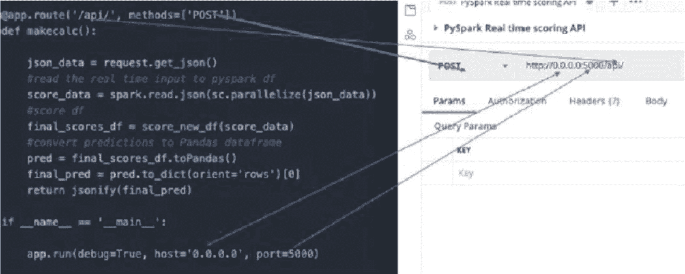
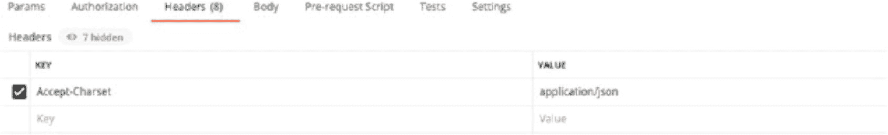
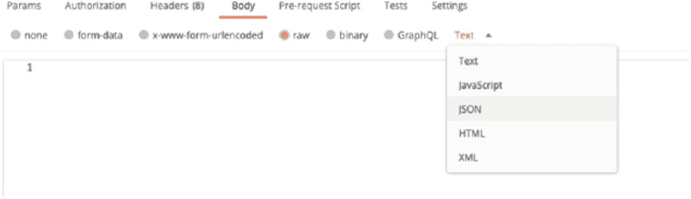
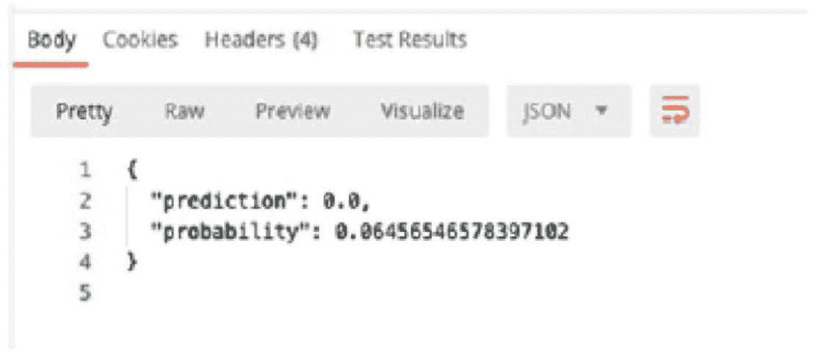
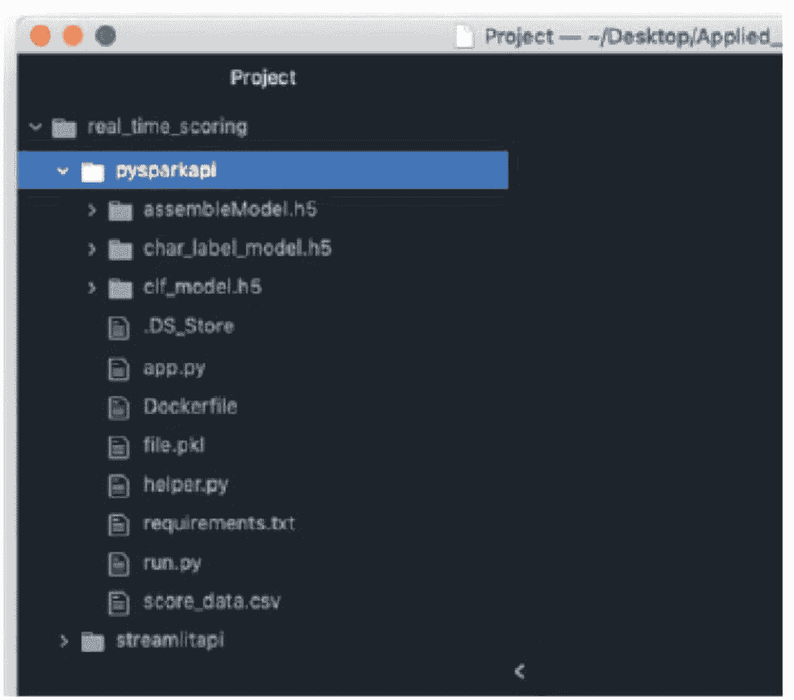

# Specify the entry point command to run when the container starts
```
ENTRYPOINT ["python", "app.py"]
```

好了，我们已经准备好执行实时评分。稍后我们将编写 UI 代码。让我们先使用`Postman`应用程序测试代码。

使用以下代码重新创建 Docker 镜像：

```
docker build -t scoring_image .
```

这次您不需要卷映射，因为您将执行实时评分。您需要确保本地系统的端口号映射到 Docker 端口号。

```
docker run -p 5000:5000 scoring_image:latest
```

一旦收到此消息，您可以切换回 Postman API 并测试此应用程序。您可以在线下载 Postman，如果尚未安装，请安装它。启动应用程序并进行必要的更改，如下所示。

### Postman API

本节面向不熟悉 Postman API 的读者（见图 9-5）。如果您已经熟悉，可以跳过本节。



图 9-5

Postman API

您需要通过单击左上角的“New”按钮，然后单击“Request”->“Create a Basic Request”来创建一个 API 实例，以获取图 9-6 所示的窗口。



图 9-6

创建新的 API 请求

现在，让我们对图 9-7 中所示的 API 进行配置。



图 9-7

配置

让我们通过导航到“Headers”选项卡来添加一个标头列。通过此选项，API 知道它正在寻找 JSON 输入（见图 9-8）。



图 9-8

JSON 标头对象

最后，您就可以进行评分了。由于您提供输入用于测试，请将 body 类型切换为`raw`，并选择 JSON 作为文本选项（见图 9-9）。



图 9-9

JSON 选择

### 使用 Postman API 测试实时评分

使用以下 JSON 对象进行测试。请注意前面的方括号。这用于传递一个 JSON 对象列表。

```
[{"age":58,"job":"management","marital":"married","education":"tertiary","default":"no","balance":2143,"housing":"yes","loan":"no","contact":"unknown","day":5,"month":"may","duration":261,"campaign":1,"pdays":-1,"previous":0,"poutcome":"unknown"}]
```

将 JSON 对象复制并粘贴到 API 的 body 中，然后单击“Send”（见图 9-10）。



图 9-10

实时评分

您现在可以继续为应用程序构建 UI 组件。

### 构建 UI

我们将使用 Python 包`streamlit`来构建用户界面（UI）。`streamlit`易于与现有代码集成。使用`streamlit`的最大优势之一是，您可以编辑 Python 代码并立即在 Web 应用程序中看到实时更改。另一个优势是，构建 UI 所需的代码量极少。在开始之前，请查看图 9-11 中所示的目录结构。父目录是`real_time_scoring`。我们创建了两个子目录：`pysparkapi`和`streamlitapi`。我们将把到目前为止讨论的所有代码移动到`pysparkapi`目录中。UI 代码将位于`streamlitapi`目录中。



图 9-11

UI 目录结构

### `streamlitapi` 目录

导航至 `streamlitapi` 目录，并在其中创建以下三个文件。

- `Dockerfile` – 前端的 Docker 配置
- `requirements.txt` – 所需的包
- `webapp.py` – UI 代码

在部署到 Docker 容器之前，你可以通过运行以下代码来测试这段代码：

```
streamlit run webapp.py
```

如前所述，`streamlit` 的交互式功能让你只需少量代码即可即时设计自定义布局。好了，准备工作已完成。这三个文件位于 `streamlitapi` 目录中。现在你有两个 Docker 容器——一个用于 PySpark Flask，另一个用于 `streamlit` UI。你需要在这两个容器之间创建一个网络，以便 UI 与后端的 PySpark API 进行交互。让我们切换到父目录，名为 `real_time_scoring`。

### `real_time_scoring` 目录

`docker-compose` 文件用于组合多个 Docker 容器并创建 Docker 网络服务。让我们看看这个文件的内容。

`docker-compose.yml`

```