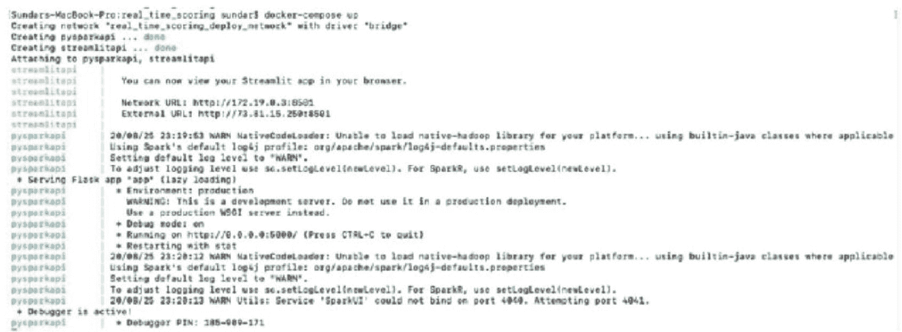
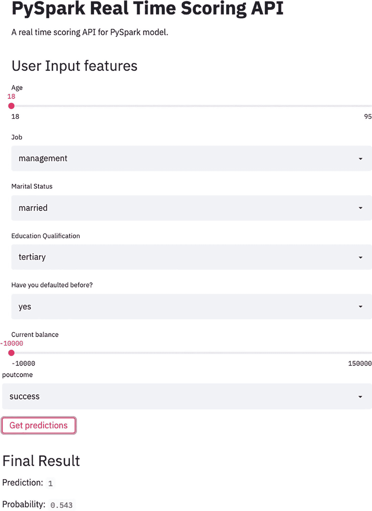
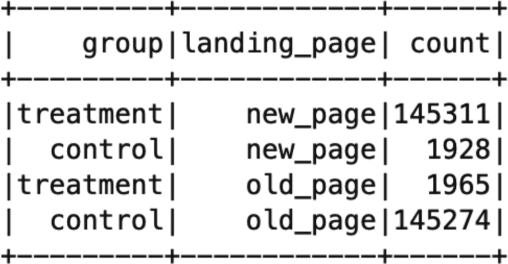

# 定义两个服务：pysparkapi, streamlitapi

```yaml
version: '3'
services:
  pysparkapi:
    build: pysparkapi/
    ports:
    - 5000:5000
    networks:
    - deploy_network
    container_name: pysparkapi
  streamlitapi:
    build: streamlitapi/
    depends_on:
    - pysparkapi
    ports:
    - 8501:8501
    networks:
    - deploy_network
    container_name: streamlitapi
networks:
  deploy_network:
    driver: bridge
```

### 执行 `docker-compose.yml` 文件

现在使用以下代码执行 `docker-compose.yml` 文件：

```bash
docker-compose build
```

Docker 网络服务已建立。现在你可以使用图 9-12 所示的代码执行 Docker 服务。启动服务需要一些时间；请等待调试器引脚出现，然后再切换到浏览器。



### 实时评分 API

要访问 UI，你需要在浏览器中输入以下链接：

`http://localhost:8501/`

如果你使用了本书中指示的相同代码，UI 应该如图 9-13 所示。图中仅显示了部分 UI。你可以输入特征值，然后点击 **获取预测** 来获得结果。



当你想停止此服务时，可以使用以下代码（见图 9-14）：


```bash
docker-compose down
```

就这样。你已经通过一个漂亮的前端实时部署了模型。此部署的最佳之处在于 UI 和 PySpark 位于独立的 Docker 容器中。它们可以分别进行管理和定制，并在需要时通过 `docker-compose` 文件组合在一起。这使得软件开发生命周期过程变得更加容易。

## 总结

- 你详细了解了模型部署过程。
- 你使用批处理和实时处理两种方式部署了模型。
- 最后，你使用 `streamlit` API 创建了一个自定义 UI 前端，并通过 `docker-compose` 将其与 PySpark API 服务集成。

干得好！在下一章中，你将学习实验和 PySpark 代码优化。继续学习，敬请期待。

# 10. 实验与优化策略

在本章中，我们将深入探讨实验概念。我们还将探索如何制定清晰的研究问题和假设，然后使用 PySpark 及其分布式计算框架在大数据上进行可扩展的实验。

## 实验的重要性

- **揭示因果关系**：通过实验，你可以在变量之间建立因果关系，而不仅仅是依赖观察数据。简单来说，它帮助你不仅理解“发生了什么”，还理解“为什么发生”。
- **数据驱动决策**：它使你能够收集数据驱动的见解，从而优化不同策略并做出明智的决策。
- **持续改进**：它通过迭代测试和优化不同方法，帮助确保模型和应用程序随着时间的推移保持有效。

以下部分将探讨 PySpark 如何具体增强应用数据科学中的实验能力。

## 实验过程

让我们从成功进行实验所需的高级步骤开始。

- **定义问题**：这是你试图解决的问题或想要检验的假设。这是实验过程中的基础步骤。
- **设计实验**：选择能够回答你问题的实验类型。实验有多种类型：对照实验、现场实验、自然实验、准实验、A/B 测试、析因实验、纵向研究和横截面研究。
- **识别变量并收集数据**：你需要明确定义自变量、因变量以及控制实验的变量。你需要决定如何操纵和测量它们。最后，你需要收集数据来检验你的假设，并决定如何收集数据。这可能涉及以适当的方式设置管道并将其存储起来以供将来分析。
- **进行实验**：按照设计运行你的实验。你必须控制*混杂变量*（既影响你的处理又影响结果的变量），并确保实验以公平和合乎道德的方式进行。
- **分析结果**：使用统计方法分析你的实验结果。这可能涉及计算均值、进行回归分析、检验统计显著性等。
- **解释并传达结果**：从你的分析中得出结论并传达你的发现。这可能涉及撰写报告、向利益相关者展示你的结果，以及在科学期刊上发表你的发现。
- **优化与迭代**：根据实验结果，你可能需要优化你的问题、设计新的实验或收集更多数据。实验通常是一个迭代过程。

### 假设检验

*假设*是一种可被检验的主张或断言。通过假设检验，你可以拒绝或暂不质疑某个特定陈述。用一个例子可能更直观。例如，吃早餐的人比不吃早餐的人更不容易患糖尿病。另一个例子是，客户流失是否会影响收到优惠的人群与未收到优惠的人群？其核心思想是检验这些断言在总体中是否成立。假设有两种类型。

- **零假设：** 用 `H0` 表示。它基于传统认知或经验。
- **备择假设：** 用 `Ha` 表示。这通常是你试图验证的、感兴趣的假设。

假设你需要为早餐的例子构建假设。你可以这样写：

- `H0`：吃早餐对糖尿病发病率没有影响
- `Ha`：吃早餐对糖尿病发病率有负面影响

`p 值` 被用作拒绝点的替代，以提供拒绝零假设的最小显著性水平。`p 值` 越小，表明支持备择假设的证据越强。

以下是错误类型：

| 实际情况 | `H0` 为真 | `H0` 为假 |
| --- | --- | --- |
| **决策** | | |
| 无法拒绝零假设 | 正确 | 第二类错误 |
| 拒绝零假设 | 第一类错误 | 正确 |

第一类错误的概率用 `α` 表示，第二类错误的概率用 `β` 表示。统计检验的功效为 `1-β`。根据具体用例，重点在于降低 `α` 或 `β`。大多数教科书侧重于降低 `α`，因为其基本原理是坚持传统方法（至少不会因采用替代方法而使情况变得更糟）。

以抛硬币为例。效应量可以定义为 `n` 次抛掷中正面与反面的差异。而样本量则是正面和反面的次数。效应量和样本量都会影响 `p 值`。这就是为什么无法同时减少第一类和第二类错误。在假设检验中，你首先构建零假设，然后是备择假设。接着，你决定所需的显著性水平 `α`（大多数检验通常为 5%）。然后运行检验并根据显著性水平做出决策。如果 `p 值` 小于显著性水平，则拒绝零假设。如果 `p 值` 大于或等于显著性水平，则无法拒绝零假设。PySpark 统计包提供了内置方法来运行皮尔逊卡方检验和柯尔莫哥洛夫-斯米尔诺夫检验。它不支持大多数假设检验方法。不过，可以使用用户自定义函数来编写这些方法。这些方法列于下表中。

| 何时使用？ | 参数检验 | 非参数检验 |
| --- | --- | --- |
| 比较两组均值 | T 检验 | 曼-惠特尼 U 检验 |
| 比较两个相关组的均值 | 配对 t 检验 | 威尔科克森符号秩检验 |
| 比较两个以上组的均值 | 单因素方差分析 | 克鲁斯卡尔-沃利斯检验 |
| 评估两个变量之间的关系 | 皮尔逊相关 | 斯皮尔曼相关 |

## 实验案例研究

让我们选取一些示例数据，学习如何使用 PySpark 进行 A/B 测试。假设你经营一家电子商务公司，你认为可以改进网站以更好地吸引客户，从而提高转化率。你拥有关于客户及其在网站上行为的数据。示例数据如下所示：

| `user_id` | `timestamp` | `group` | `landing_page` | `converted` |
| --- | --- | --- | --- | --- |
| 851104 | 2017-01-21 22:11:48.556739 | control | old_page | 0 |
| 804228 | 2017-01-12 08:01:45.159739 | control | old_page | 0 |
| 661590 | 2017-01-11 16:55:06.154213 | treatment | new_page | 0 |
| 853541 | 2017-01-08 18:28:03.143765 | treatment | new_page | 0 |
| 864975 | 2017-01-21 01:52:26.210827 | control | old_page | 1 |
| 936923 | 2017-01-10 15:20:49.083499 | control | old_page | 0 |
| 679687 | 2017-01-19 03:26:46.940749 | treatment | new_page | 1 |
| 719014 | 2017-01-17 01:48:29.539573 | control | old_page | 0 |

你可以从 Kaggle 获取此示例数据，网址为 [`https://www.kaggle.com/datasets/zhangluyuan/ab-testing/data`](https://www.kaggle.com/datasets/zhangluyuan/ab-testing/data)。

该数据集包含五列：

- `User_Id` – 每个用户的唯一 ID。
- `Timestamp` – 用户访问网站的时间。
- `Group` – 用户被分配到实验组还是对照组。分配到实验组的用户将看到新网站，而对照组的用户将看到旧网站。
- `Landing_page` – 描述用户看到的是 `new_page` 还是 `old_page`。
- `Converted` – 用户是否进行了交易，用 0（否）和 1（是）表示。

让我们回顾一下本章开头讨论的实验过程，并看看如何将其应用于这个 A/B 测试案例研究。

- **定义问题：** 提高网站的转化率。转化率定义为“购买总数”除以“操作总数”。用户可以在网站上执行三种操作：`view_product`、`add_to_cart` 和 `purchase`。
- **设计实验：** 你想改进网站，并将其性能与现有网站进行比较。这是一个经典的 A/B 测试用例，因此我们将沿用此方法。
- **确定变量并收集数据：** 在此实验中，你将随机将人群分配到对照组和测试组（50/50）。你可以潜在地控制混杂因素（年龄、性别），但这些因素在本章中不予考虑。因此，本实验的自变量是用户是否接受了处理（测试组，看到了新网站）或未接受处理（对照组，看到了旧网站）。本实验的因变量是购买率。没有控制变量。
- **进行实验：** 假设实验公平进行，并且分配到处理组的人群是随机选择的。
- **分析结果：** 你可以使用 t 检验来分析实验结果。但等等，你没有现成的 Spark 包来进行 t 检验。我们将向你展示两种运行此实验并分析结果均值的方法。
- **解释并沟通结果：** 最后，你根据结果进行解释，然后做出决策。
- **优化与迭代：** 你可以再次更改网站布局，并重新开始整个过程。

在深入进行 A/B 测试之前，先考虑一些关于数据的高级统计信息。

```python
from pyspark.sql.functions import col, count
data.groupby(['group', 'landing_page']).count().show()
```



这些数据有些不对劲。似乎有些用户进入了错误的 `landing_page`。这可能是由于实验开始时的某些噪声或其他外部因素造成的。让我们清理数据，筛选出正确的处理和 `landing_page` 分配。

### 数据过滤与初步分析

（原文此处内容缺失）