# 8. 机器学习流程与自动化管道

将模型投入生产是数据科学领域最具挑战性的任务之一。这是许多组织中持续存在的"最后一公里"问题。尽管有许多管理工作流程的工具，但随着组织成熟度的提升，其需求也在变化，管理现有模型可能成为一项艰巨的任务。退一步分析为何如此困难，你会发现这源于大多数组织中存在的结构性问题。工程团队维护着生产平台，而数据科学工具集与生产平台之间存在鸿沟。部分数据科学工作可以在`Jupyter Notebook`中开发，很少考虑云环境；部分数据流在本地创建，扩展能力有限。这类应用在处理大量数据时往往表现不佳。软件开发周期中的最佳实践难以适用于机器学习生命周期，因为涉及的任务种类繁多，标准主要由组织内的数据科学团队定义。此外，该领域的快速发展在模型管理和部署方面留下了空白。

本章旨在探索可用于管理和部署数据科学管道的工具。我们将介绍业界可用的部分工具，并通过示例演示如何构建自动化管道。我们将运用你已学过的所有概念来构建这些管道。学完本章后，你将学会如何构建机器学习模块，并将其与自定义数据预处理协同自动化。

本章涵盖以下主题：

- **`MLflow`。** 我们将介绍`MLflow`及其组件和优势，随后进行演示。前半部分重点介绍安装和概念，后半部分聚焦于在`MLflow`中实现模型。
- **自动化机器学习管道。** 我们将介绍在`PySpark`中设计和实现自动化机器学习框架的概念。本节前半部分着重于实现，后半部分聚焦于管道生成的输出。

## MLflow

通过前几章获得的知识，你已经知道如何构建独立的监督和无监督模型。通常，你会迭代多个模型以选择最佳方案。如何跟踪所有实验及使用的超参数？经过多次实验后如何复现特定结果？当存在多种部署工具和环境时，如何将模型投入生产？是否有更好的方法来管理机器学习工作流程并与更广泛的社区共享成果？当你在`PySpark`中熟练构建模型后，这些问题便会浮现。`Databricks`构建了一个名为`MLflow`的工具，它能在管理机器学习工作流程的同时优雅地处理上述部分问题。`MLflow`被设计为开放接口和开源工具。人们经常在实验和为模型添加新功能之间反复切换，而`MLflow`能轻松处理此类实验。它基于`REST API`构建，便于多种工具调用。该框架还能轻松添加现有的机器学习代码模块。其开源特性使得跨团队共享工作流程和模型变得简单。简而言之，`MLflow`提供了一个管理机器学习生命周期的框架，涵盖实验、可复现性、部署和中央模型注册表。

`MLflow`的组件如图 8-1 所示，并在以下列表中描述。


图 8-1 `MLflow`的组件

- **跟踪：** 该组件有助于记录代码、配置、数据和结果，并提供查询实验的机制。
- **项目：** 该组件帮助将机器学习代码打包成可在多个平台上轻松复现的格式。
- **模型：** 该组件协助在不同环境中部署机器学习代码。
- **模型注册表：** 该组件充当存储、管理和搜索模型的仓库。

该框架为数据工程师和数据科学家打开了协作通道，使他们能够高效构建数据管道。它还提供了从多种系统消费和写入数据的能力，为在数据湖和批流平台上处理结构化和非结构化数据提供了通用框架。

这对初次使用者来说可能有些抽象。我们将通过一个示例来演示这些组件如何发挥作用及如何实现。为便于说明，我们使用与第 6 章相同的银行数据集。

### MLflow 代码设置与安装

在本节中，我们将逐步介绍支持`MLflow`所需的代码更改及其安装过程。所有演示均使用`PySpark Docker`版本。启动并运行`MLflow`主要包含以下两个步骤：

- 代码/脚本更改
- Docker 端更改及`MLflow`服务器安装

代码更改量很小。你只需在现有的机器学习代码中添加几个`MLflow`函数即可适配`MLflow`。

常规代码可以很好地构建简单的随机森林模型，但如果你想通过更改输入变量或任何超参数设置来了解接收者操作特征（`ROC`）/其他指标（准确率、误分类率等），该怎么办？如果只是单次更改，你可以将每次运行记录在`Excel`中，但这并非跟踪实验的有效方式。作为数据科学专业人士，我们会运行数百次实验，尤其是在模型微调阶段。有没有更好的方法来捕获和注释这些结果与日志？是的，你可以通过`MLflow`的跟踪功能来实现。接下来，我们将重写一个简单的随机森林模型代码，并添加`MLflow`组件。代码中的更改部分以粗体突出显示。

**注意**

我们将把以下代码保存为`.py`文件，并在安装`MLflow`后通过`Docker`运行它。

```python

# 导入库

```python
import pyspark
from pyspark.sql import SparkSession
import mlflow
import mlflow.spark
import sys
import time
from pyspark.ml.classification import RandomForestClassifier
from pyspark.ml.evaluation import BinaryClassificationEvaluator
```

请注意，我们导入了与 MLflow 相关的库，这些库允许用户使用 PySpark。MLflow 支持多种语言和包，包括 Spark 和 Python，并对`scikitlearn`和`tensorflow`等包提供了扩展支持。

```python
spark = SparkSession.builder.appName("mlflow_example").getOrCreate()
```

# `show_versions(spark)`

```
filename = "bank-full.csv"
target_variable_name = "y"
from pyspark.sql import functions as F
df = spark.read.csv(filename, header=True, inferSchema=True, sep=';')
df = df.withColumn('label', F.when(F.col("y") == 'yes', 1).otherwise(0))
df = df.drop('y')
train, test = df.randomSplit([0.7, 0.3], seed=12345)
for k, v in df.dtypes:
    if v not in ['string']:
        print(k)
df = df.select(['age', 'balance', 'day', 'duration', 'campaign', 'pdays', 'previous', 'label'])
```

## 将各个列组合成一个列 - 'features'

```python
def assemble_vectors(df, features_list, target_variable_name):
    stages = []
    # 组合向量
    assembler = VectorAssembler(inputCols=features_list, outputCol='features')
    stages = [assembler]
    # 选择所有列 + 目标列 + 新创建的 'features' 列
    selectedCols = [target_variable_name, 'features']
    # 使用管道按顺序处理
    pipeline = Pipeline(stages=stages)
    # 组合器模型
    assembleModel = pipeline.fit(df)
    # 对数据应用组合器模型
    df = assembleModel.transform(df).select(selectedCols)
    return df
```

# 排除目标变量并选择所有其他特征向量

```
features_list = df.columns
#features_list = char_vars # 此选项仅用于 ChiSqselector
features_list.remove('label')
```

# 对我们的 DataFrame 应用该函数

```python
assembled_train_df = assemble_vectors(train, features_list, 'label')
assembled_test_df = assemble_vectors(test, features_list, 'label')
print(f"sysarg1: {sys.argv[1]}")
print(f"sysarg2: {sys.argv[2]}")
print(f"sysarg3: {sys.argv[3]}")
```

这些是你在每次实验中打算更改的系统参数。执行此脚本时，你将把这些作为系统参数传入。这里，我们使用了 `maxBins` 和 `maxDepth`。你可以包含任何其他你想在脚本中记录的变量更改。

```python
maxBinsVal = float(sys.argv[2])
maxDepthVal = float(sys.argv[4])
```

在下一步中，我们使用 MLflow 初始化机器学习代码部分，因为感兴趣的跟踪变量都在此范围内。你可以根据用例需要修改此范围。

```python

# 设置用于日志记录的跟踪服务器 URI

```
mlflow.set_tracking_uri(uri="http://127.0.0.1:8080")
```

# 创建一个新的 MLflow 实验

```python
mlflow.set_experiment("MLflow PySpark Example")
with mlflow.start_run():
    stages_tree=[]
    # 定义管道的阶段
    classifier = RandomForestClassifier(labelCol = 'label',featuresCol = 'features',maxBins=maxBinsVal, maxDepth=maxDepthVal)
    stages_tree += [classifier]
    pipeline_tree=Pipeline(stages=stages_tree)
    print('正在运行 RF 模型')
    RFmodel = pipeline_tree.fit(assembled_train_df)
    print('RF 模型训练完成')
    predictions = RFmodel.transform(assembled_test_df)
    evaluator = BinaryClassificationEvaluator()
    print("测试集 ROC 曲线下面积: " + str(evaluator.evaluate(predictions, {evaluator.metricName: "areaUnderROC"})))
    # 将参数和指标记录到 MLflow
    mlflow.log_param("maxBins", maxBinsVal)
    mlflow.log_param("maxDepth", maxDepthVal)
    mlflow.log_metric("ROC", evaluator.evaluate(predictions, {evaluator.metricName: "areaUnderROC"}))
    mlflow.spark.log_model(RFmodel,"spark-model")
    # 设置一个标签，用于提醒自己此次运行的目的
    mlflow.set_tag("训练管道", "用于 bank-full.csv 的基本 Sklearn 模型")
    # 使用 MLflow 记录模型
    model_info = mlflow.spark.log_model(RFmodel,
                                        artifact_path="sklearn-model",
                                        registered_model_name="sklearn-quickstart",)
```

在前面的代码片段中，我们添加了 `log_param` 和 `log_metric` 来捕获我们想要跟踪的信息。另外，请注意我们使用 `mlflow.spark.log_model` 函数记录模型，这有助于将模型保存到 MLflow 后端。这是一个可选语句，但对于从 MLflow 注册模型非常方便。你可以通过最少的代码更改，将现有模型与 MLflow 组件适配。为什么这很重要？当数百个实验跨越数天进行时，跟踪参数和指标的变化会变得非常具有挑战性。

现在，我们需要将前面的代码保存为一个 Python 文件。我们使用 Spark submit 来执行此 PySpark 代码。在本示例中，我们将代码保存为 `Chapter8_mlflow_example.py`。

接下来是 MLflow 设置的第二部分，这是一个简单的三步过程，如下所述：

1. `pip install mlflow`
2. 启动 MLflow 服务器：`mlflow server --host 127.0.0.1 --port 8080`
3. 打开浏览器并输入 `http://127.0.0.1:8080/` 以打开 MLflow UI

### MLflow 用户界面演示

在本节中，我们将结合上一节讨论的示例，逐步演示 MLflow 用户界面。以下代码使用三种不同的设置运行之前保存的脚本：

```
spark-submit --master local chapter8_mlflow_example.py --maxBinsVal 16 --maxDepthVal 3
spark-submit --master local chapter8_mlflow_example.py --maxBinsVal 16 --maxDepthVal 5
spark-submit --master local chapter8_mlflow_example.py --maxBinsVal 32 --maxDepthVal 5
```

运行完上述三个命令后，我们可以导航回 MLflow 用户界面。（在任何网页浏览器中，导航至 `http://127.0.0.1:8080`。）MLflow 用户界面如图 8-2 所示。

如您所见，用户界面将所有信息格式化为实验和模型。您可以使用每个实验中每次运行的注释选项进行任何注释或记录。该框架允许您管理并运行包含多次运行的多个实验。您还可以根据参数设置筛选运行。这在机器学习生命周期中极其有用，因为与软件开发生命周期不同，我们倾向于根据模型的稳定性和准确性在旧版本和新版本之间进行迭代。

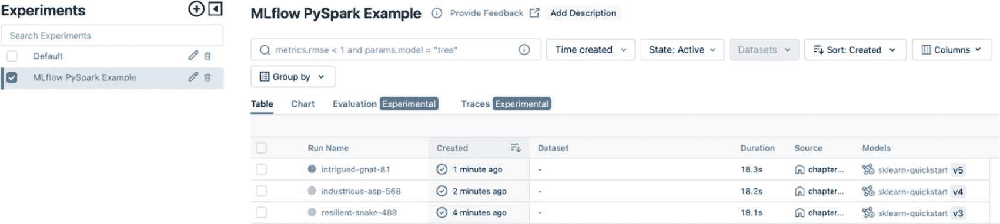

此外，每次运行都有详细的逐行信息。您可以深入查看并在多个实验之间比较这些信息。在此处的演示中，我们仅使用了一个指标，但在实际场景中，您可能还需要捕获每次运行的准确率、误分类率、提升度和 KS 统计量。然后，您可以根据业务需求可接受的指标来比较和排序每次迭代。

当您从之前的执行中选择几次迭代时，请注意“比较”按钮是激活的；在图 8-2 中它是灰色的。当您点击“比较”时，它将比较这两次迭代，并给出准备好的图表，展示指标在不同运行之间的变化情况（见图 8-3）。在前面的代码中，我们显式设置了日志指标。从 Spark 3 版本开始，提供了自动日志记录的选项。

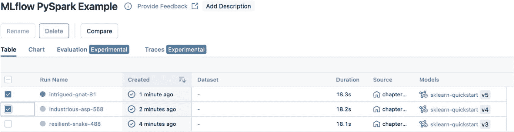

观察图 8-4 中的窗口；MLflow 会自动生成 `RunID`。此功能允许您比较实验中的多次运行。当您拥有足够的数据点时，可以直观地选择性能最佳的模型运行。您还可以观察通过更改参数，模型性能会如何变化。

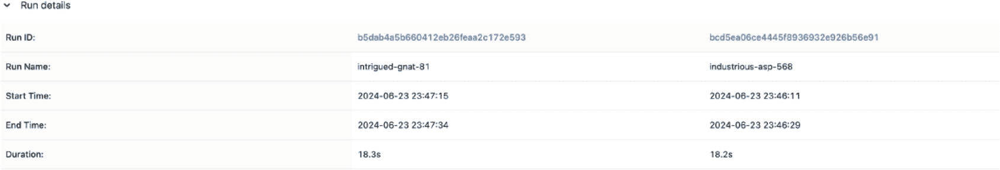

如果您返回 MLflow 用户界面的主页并点击任何一次运行，它将显示关于该模型运行的更多信息，如图 8-5 所示。此运行窗口还提供了注册模型的便捷功能。注册模型将使其可用于评分。注册模型后，将开启多个其他功能。

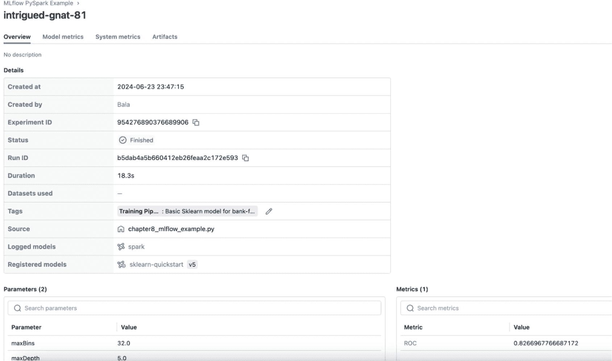

点击“工件”部分中的 `spark-model` 文件将打开下一个窗口。此窗口包含运行模型所需的所有元数据信息，如图 8-6 所示。

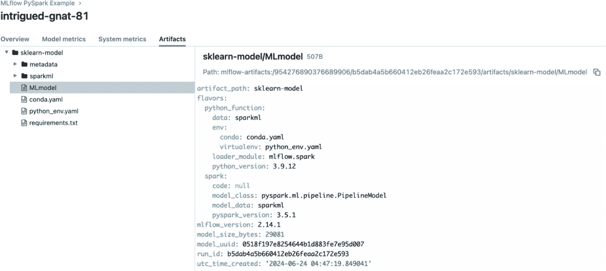

用户也可以手动注册模型。但是，我们已经通过代码注册了模型。可以通过点击右上角的“已注册模型”链接来查看已注册的模型。在“模型”选项卡中，模型会自动进行版本控制。


> **注意**
>
> 图 8-7 显示的是版本 5，因为模型注册代码运行了几次。在您的情况下，您可能会看到版本 1。

嗯，这一切都很棒，但是如何通过这些流水线对新数据进行评分呢？当您点击运行或模型信息时，您会获得模型元数据信息的完整路径，如图 8-7 所示。您可以使用此元数据对任何新数据进行评分。有多种方法可以实现这一点。例如，我们编写一些简单的代码来准备用于评分的数据，然后使用 `best_roc_model`。我们将以下代码保存为 Python 文件，并通过 Docker 中的 `spark-submit` 运行它。

```python
#导入必要的库
import mlflow
import mlflow.spark
import sys
from pyspark.sql import SparkSession
spark = SparkSession.builder.appName("mlflow_predict").getOrCreate()
filename = "bank-full.csv"
target_variable_name = "y"
from pyspark.sql import functions as F
df = spark.read.csv(filename, header=True, inferSchema=True, sep=';')
df = df.withColumn('label', F.when(F.col("y") == 'yes', 1).otherwise(0))
df = df.drop('y')
train, test = df.randomSplit([0.7, 0.3], seed=12345)
for k, v in df.dtypes:
if v not in ['string']:
print(k)
df = df.select(['age', 'balance', 'day', 'duration', 'campaign', 'pdays', 'previous', 'label'])
from pyspark.ml.feature import VectorAssembler
from pyspark.ml import Pipeline
```

# 将各个列组合成一个列 - 'features'

```python
def assemble_vectors(df, features_list, target_variable_name):
    stages = []
    # 组合向量
    assembler = VectorAssembler(inputCols=features_list, outputCol='features')
    stages = [assembler]
    # 选择所有列 + 目标变量 + 新创建的 'features' 列
    selectedCols = [target_variable_name, 'features']
    # 使用流水线按顺序处理
    pipeline = Pipeline(stages=stages)
    # 组合器模型
    assembleModel = pipeline.fit(df)
    # 在数据上应用组合器模型
    df = assembleModel.transform(df).select(selectedCols)
    return df
```

```python
# 排除目标变量并选择所有其他特征向量
features_list = df.columns
# features_list = char_vars #此选项仅用于 ChiSqselector
features_list.remove('label')
```

## 在我们的数据框上应用该函数
```
assembled_test_df = assemble_vectors(test, features_list, 'label')
print(sys.argv[1])
```

# 来自参数的模型信息
```
model_uri=sys.argv[1]
print("model_uri:", model_uri)
```

# 从 MLflow 加载 Spark ML 模型

```python
model = mlflow.spark.load_model(model_uri)
print("model.type:", type(model))
predictions = model.transform(assembled_test_df)
print("predictions.type:", type(predictions))
predictions.printSchema()
df = predictions.select('rawPrediction','probability', 'label', 'features')
df.show(5, False)
```

这段代码是一个简单的流水线。您也可以灵活地将评分函数包装成一个简单的 `udf`。保存代码后，您需要在 Docker 中运行以下命令以获取结果：

```bash
spark-submit --master local chapter8_predict_spark.py mlartifacts/795206614136056686/cd6d4c9a47b54d1396f63eb172fbc547/artifacts/sklearn-model
```

这将给出如图 8-8 所示的输出。

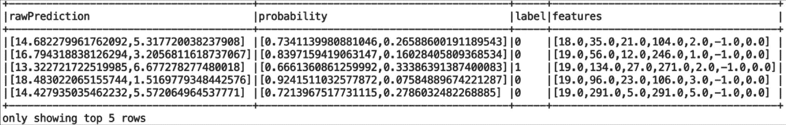

图 8-8

MLflow 模型评分输出

以上所有内容和代码都是在 Spark 中指定的。MLflow 支持多种其他风格。您可以将上述流水线序列化为 `mleap` 风格，这是一个无需 Spark 上下文即可托管 Spark 流水线的项目，适用于不需要分布式计算的较小数据集。MLflow 还可以以 MLflow 项目格式将代码发布到 GitHub，使任何人都可以轻松运行该代码。

## 自动化机器学习流水线

机器学习生命周期是一个迭代过程。你常常需要反复调整参数、输入和数据流水线，随着数据管理流水线数量的增加，这一过程会迅速变得繁琐。创建自动化流水线可以节省大量时间。你已从前面的章节学习了数据操作、算法和建模技术。现在，你将它们结合起来，创建一个自动化的 PySpark 流程，该流程可以生成基线模型，以便快速进行实验。

本实验使用来自 Kaggle (`https://www.kaggle.com/shrutimechlearn/churn-modelling#Churn_Modelling.csv`) 的客户流失数据集。这个银行数据集包含客户属性以及哪些客户已流失的数据。目标是基于给定的属性识别将会流失的客户。表 8-1 列出了这些属性。

**表 8-1** 元数据

| 列名 | 描述 |
| --- | --- |
| `RowNumber` | 标识符 |
| `CustomerId` | 客户的唯一 ID |
| `Surname` | 客户的姓氏 |
| `Credit score` | 客户的信用评分 |
| `Geography` | 客户所属的国家 |
| `Gender` | 男性或女性 |
| `Age` | 客户的年龄 |
| `Tenure` | 客户与该银行合作的年数 |
| `Balance` | 客户的银行余额 |
| `NumOfProducts` | 客户正在使用的银行产品数量 |
| `HasCrCard` | 二进制标志，表示客户是否持有该银行的信用卡 |
| `IsActiveMember` | 二进制标志，表示客户是否为该银行的活跃会员 |
| `EstimatedSalary` | 客户的预估年薪（美元） |
| `Exited` | 二进制标志：1 表示客户已销户，0 表示客户仍有账户 |

### 流水线需求与框架

在设计任何流水线时，必须定义你期望的输出和需求。首先，定义你认为必要的输出。由于本例处理的是二分类目标，拥有以下输出会很好：

- **KS：** Kolmogorov-Smirnov 检验是衡量好样本与坏样本之间分离程度的指标。值越高越好。
- **ROC：** 该曲线是一种比较诊断测试的方法。它是真正率与假正率的对比图。值越高越好。
- **准确率：** 即 (真正例 + 真负例) / (真正例 + 真负例 + 假正例 + 假负例)。值越高越好。

以下是自动化模型构建工具的需求：

- 该模块应能自行处理缺失值和分类值。
- 该模块应负责变量选择。
- 该模块应在选择最终变量之前测试多种算法。
- 该模块应基于首选指标比较不同算法，并选择冠军模型和挑战者模型。
- 如果该模块能通过前缀、后缀或变量名称移除某些变量，将会非常方便。这可以支持多次迭代并调整输入变量。
- 该模块应能收集并存储所有输出指标，并将它们整理成文档，以供日后参考。
- 最后，如果该模块能保存模型对象并自动生成评分代码以实现无缝部署，那就更好了。

我们如何确定这些需求？还记得我们在第 3 章讨论过的 CRISP-DM 框架吗（见图 8-9）？我们在此处将该框架用作架构蓝图。

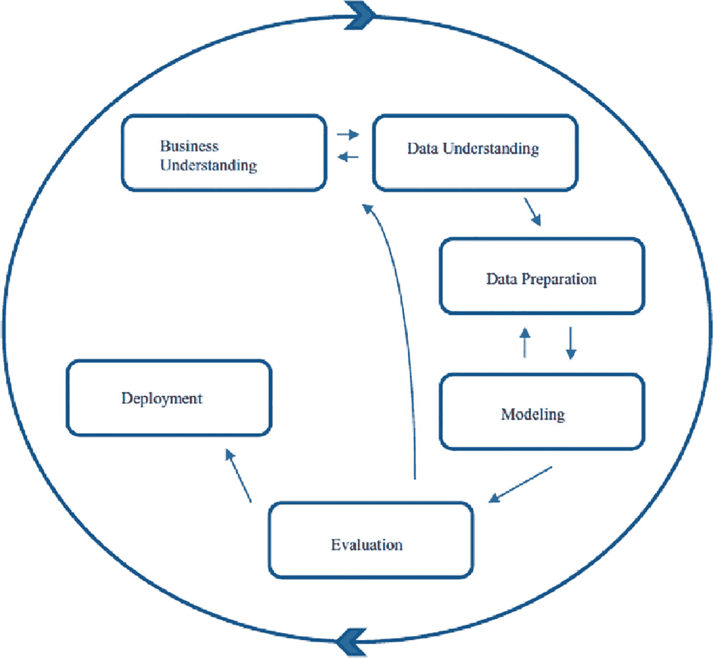

这些需求很多，如果处理不当，很快就会变得难以招架。我们已经定义了输出和需求，但预期的输入会是什么呢？可能是一个来自数据存储或平面文件的数据集。有了这些信息，你可以通过将代码分解为逻辑步骤来开始构建流水线。这将是一个代码密集型的章节，你可以使用此模块并创建自己的基线自动化模型。我们将任务分解为每个逻辑步骤中的子任务。这些任务大致分为以下几类：

- 数据操作
- 特征选择
- 模型构建
- 指标计算
- 验证与图表生成
- 模型选择
- 评分代码创建
- 结果整理
- 处理上述所有步骤的框架

### 数据操作

在本节中，我们定义一些用于处理数据的常用函数，例如：

- 缺失值百分比计算
- 输入数据的元数据分类
- 使用标签编码器处理分类数据
- 填充缺失值
- 重命名分类列
- 合并特征和标签
- 将数据拆分为训练集、测试集和验证集
- 组装向量
- 缩放输入变量

你可以通过此链接访问此代码：`https://github.com/Apress/applied-data-science-using-pyspark/blob/main/Ch08/Chapter8_automator/data_manipulations.py`。

### 特征选择

此模块筛选变量，并选择预测能力最强的顶级变量。它使用随机森林来识别顶级变量。你可以通过此链接访问此模块的代码：`https://github.com/Apress/applied-data-science-using-pyspark/blob/main/Ch08/Chapter8_automator/feature_selection.py`。

### 模型构建

在此模块中，我们定义了多个支持二分类目标的算法函数，包括逻辑回归、随机森林、梯度提升和神经网络。你可以通过此链接访问此模块的代码：`https://github.com/Apress/applied-data-science-using-pyspark/blob/main/Ch08/Chapter8_automator/model_builder.py`。

### 指标计算

此模块计算模型指标，包括 `KS`、`ROC` 和准确率。你可以通过此链接访问此模块的代码：`https://github.com/Apress/applied-data-science-using-pyspark/blob/main/Ch08/Chapter8_automator/metrics_calculator.py`。

### 验证与图表生成

此模块生成各种图表，包括 `ROC`、混淆矩阵和 `KS`。模型验证也作为此模块的一部分完成。你可以通过此链接访问代码：`https://github.com/Apress/applied-data-science-using-pyspark/blob/main/Ch08/Chapter8_automator/validation_and_plots.py`。

### 模型选择

此模块基于验证指标标准生成挑战者模型和冠军模型的定义。它还生成包含所有模型信息的合并 Excel 输出文件。代码位于：`https://github.com/Apress/applied-data-science-using-pyspark/blob/main/Ch08/Chapter8_automator/model_selection.py`。

### 评分代码创建

该模块用于生成生产部署所需的伪评分代码。它将建模过程中生成的所有模型对象链接起来，并集中存放于一处。其中还包含了数据处理和分类变量处理函数。只要模型对象保存在同一位置，并指向正确的输入数据源，该文件即可独立运行。此模块的代码位于 [`https://github.com/Apress/applied-data-science-using-pyspark/blob/main/Ch08/Chapter8_automator/scorecode_creator.py`](https://github.com/Apress/applied-data-science-using-pyspark/blob/main/Ch08/Chapter8_automator/scorecode_creator.py)。

### 结果汇总

使用一个 zip 文件模块将前面各模块生成的所有输出打包成一个 ZIP 文件。该文件可以轻松导出，以便在其他地方部署模型。此模块的链接为 [`https://github.com/Apress/applied-data-science-using-pyspark/blob/main/Ch08/Chapter8_automator/zipper_function.py`](https://github.com/Apress/applied-data-science-using-pyspark/blob/main/Ch08/Chapter8_automator/zipper_function.py)。

### 框架

该框架文件整合了前面所有模块，以逻辑方式编排它们并生成所需的输出。它对数据进行处理并执行变量选择。它构建机器学习算法，并在保留数据集上验证模型。它根据用户选择的统计指标挑选最佳算法。同时，它还会生成用于生产的评分代码。

该框架文件接收所有输入。我们将包括此框架文件在内的所有前述模块保存为一个 Python 文件。由于我们在此处理的是客户流失建模数据集，因此我们在 `data_folder_path` 中提供了输入 CSV 文件的位置。所有其他必需的输入都在代码的第一个块中提供。此代码设计用于适配 Docker 版本的 PySpark。通过进行少量修改，它也可以适用于任何集群执行环境。你可以通过以下链接访问相关代码：[`https://github.com/Apress/applied-data-science-using-pyspark/blob/main/Ch08/Chapter8_automator/build_and_execute_pipe.ipynb`](https://github.com/Apress/applied-data-science-using-pyspark/blob/main/Ch08/Chapter8_automator/build_and_execute_pipe.ipynb) 或 [`https://github.com/Apress/applied-data-science-using-pyspark/blob/main/Ch08/Chapter8_automator/build_and_execute_pipe.py`](https://github.com/Apress/applied-data-science-using-pyspark/blob/main/Ch08/Chapter8_automator/build_and_execute_pipe.py)。

要执行，请使用以下命令打开 Docker：

```bash
docker run -it -p 8888:8888 -v /Users/ramcharankakarla/demo_data/:/home/jovyan/work/ jupyter/pyspark-notebook:latest bash
```

在本地机器上，将所有文件复制到暴露给 Docker 的路径（例如 `/Users/ramcharankakarla/demo_data/`）。我们创建了一个名为 `Chapter8_automator` 的文件夹，并将所有必需的文件放入其中（见表 8-2）。将 `churn_modeling.csv` 数据集复制到同一个文件夹中。

**表 8-2** 自动化框架中的文件及其功能

| **模块** | **文件名** |
| --- | --- |
| 数据处理 | `data_manipulations.py` |
| 特征选择 | `feature_selection.py` |
| 模型构建 | `model_builder.py` |
| 指标计算 | `metrics_calculator.py` |
| 验证与图表生成 | `validation_and_plots.py` |
| 模型选择 | `model_selection.py` |
| 评分代码创建 | `scorecode_creator.py` |
| 结果汇总 | `zipper_function.py` |
| 框架 | `build_and_execute_pipe.py` 或 `build_and_execute_pipe.ipynb` |

在运行这些框架文件之前，请确保在 Docker 中安装或检查是否存在以下包：

```bash
pip install openpyxl
pip install xlsxwriter
```

要从 Docker 运行框架文件，请使用以下命令：

```bash
spark-submit --master local[*] /home/jovyan/work/Chapter8_automator/build_and_execute_pipe.py
```

执行完成后，所有数据将存储在 `/home/jovyan/` 中。

要创建文件和指标的本地副本以防止工作丢失，请使用以下命令。此命令会创建工作副本。同样，如果需要，你也可以复制一个 zip 文件（`mla_chapter8_testrun.zip`）。

```bash
cp -r mla_chapter8_testrun /home/jovyan/work/
```

干得漂亮！你已经成功构建了一个端到端的自动化引擎，它可以为你节省大量时间。下一节将介绍该引擎生成的输出。

### 流水线输出

图 8-10 至 8-12 以及表 8-3 至 8-5 展示了自动化流水线框架生成的输出。对于任何给定的二分类模型，都会生成以下输出。

**表 8-5** 神经网络测试

| 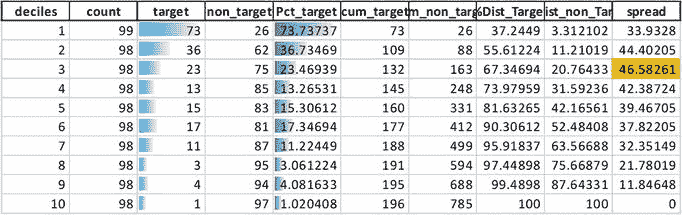 |

**表 8-4** Kolmogorov-Smirnov 统计量

| 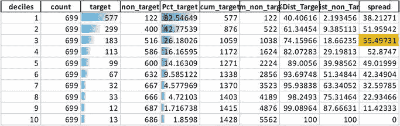 |

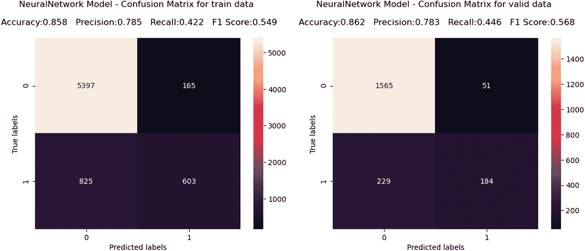

**图 8-12** 自动化模型——混淆矩阵

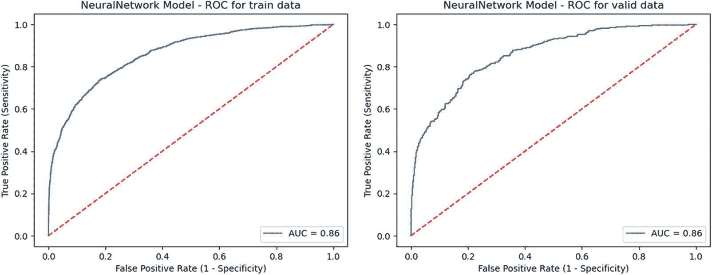

**图 8-11** 自动化模型 ROC 曲线

**表 8-3** 综合指标

| `model_type` | `roc_train` | `accuracy_train` | `ks_train` | `roc_valid` | `accuracy_valid` | `ks_valid` |
| --- | --- | --- | --- | --- | --- | --- |
| `neuralNetwork` | 0.86171092 | 0.858369099 | 55.5 | 0.857589 | 0.862000986 | 54.43 |
| `randomForest` | 0.838162018 | 0.860228898 | 50.57 | 0.835679 | 0.856086742 | 50.48 |
| `logistic` | 0.755744261 | 0.81230329 | 37.19 | 0.754326 | 0.807294234 | 37.31 |
| `gradientBoosting` | 0.881999528 | 0.869384835 | 59.46 | 0.858617 | 0.853622474 | 55.95 |

| `model_type` | `roc_test` | `accuracy_test` | `ks_test` | `roc_oot1` | `accuracy_oot1` |
| --- | --- | --- | --- | --- | --- |
| `neuralNetwork` | 0.813792 | 0.849134 | 46.58 | 0.856175 | 0.8582 |
| `randomForest` | 0.806239 | 0.840979 | 44.3 | 0.834677 | 0.8575 |
| `logistic` | 0.719284 | 0.805301 | 32.19 | 0.751941 | 0.8106 |
| `gradientBoosting` | 0.816005 | 0.850153 | 47.22 | 0.870804 | 0.8643 |

| `model_type` | `ks_oot1` | `roc_oot2` | `accuracy_oot2` | `ks_oot2` | `selected_model` |
| --- | --- | --- | --- | --- | --- |
| `neuralNetwork` | 54.43 | 0.856175108 | 0.8582 | 54.43 | Champion |
| `randomForest` | 49.99 | 0.834676561 | 0.8575 | 49.99 | Challenger |
| `logistic` | 36.49 | 0.751941185 | 0.8106 | 36.49 |   |
| `gradientBoosting` | 57.51 | 0.870803793 | 0.8643 | 57.51 |   |

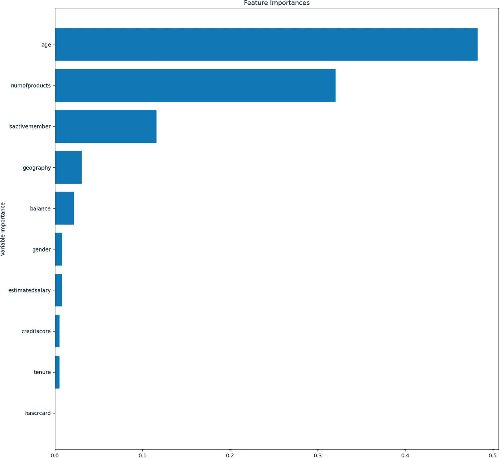

**图 8-10** 自动化模型特征重要性

本模块旨在帮助你快速创建自动化实验，绝无取代模型构建活动之意。

**练习 8-1：构建自定义流水线**

**问题：** 我们向你发起挑战，请构建一个单独的流水线或集成代码流程，以适配连续型目标变量。

## 总结

-   你了解了模型管理和部署所面临的挑战。
-   你现在知道了如何使用 `MLflow` 来管理实验和部署模型。
-   你探索了如何为各种模型构建活动构建自定义流水线。
-   你看到了如何将流水线堆叠在一起以创建自动化流水线。

干得漂亮！你现在已经熟悉了一些关键概念，这些概念对于将模型投入生产非常有用。这应该能让你在构建数据准备流水线时，对如何管理模型生命周期有一个清晰的认识。在下一章中，我们将介绍一些技巧、窍门以及在你日常工作中可能用到的有趣主题。

