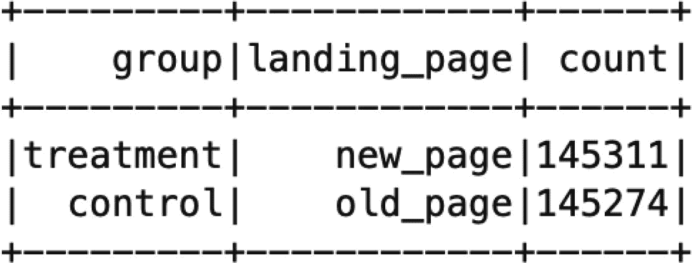

# 筛选合适的数据

```python
data = data.where(((data.group ==  'treatment') & (data.landing_page=='new_page')) |
((data.group ==  'control') & (data.landing_page=='old_page')))
```

让我们再次检查数据：

```python
data.groupby(['group', 'landing_page']).count().show()
```



现在，让我们检查平均结果。这有助于确定`control`组中有多少人进行了购买，以及这与`treatment`组有何不同：

```python
# 示例中最后一个代码块为空，此处保持原样
```