# 9. 部署机器学习模型

本章介绍部署机器学习模型时应遵循的最佳实践。我们将通过三种方法来演示生产环境部署，具体如下：

- 使用 HDFS 对象和 `pickle` 文件进行模型部署
- 使用 `Docker` 进行模型部署
- 实时评分 `API`

在上一章中，你已经初步了解了第一种技术。本章我们将更详细地介绍它。所提供的代码是用于构建模型和评估结果的起始代码。

## 起始代码

你可以在以下 `GitHub` 链接中找到代码：[`https://github.com/Apress/applied-data-science-using-pyspark/tree/main/Ch09`](https://github.com/Apress/applied-data-science-using-pyspark/tree/main/Ch09)。请参考 `GitHub` 仓库中的 `model deployment.ipynb` 文件以获取起始代码。该代码将用于后续的练习。如果你已经有一个模型，可以跳过本节。

## 保存模型对象并创建评分代码

到目前为止，你已经构建了一个可靠的模型，并使用多种指标对其进行了验证。现在是时候保存模型对象以供将来评分，并创建评分代码了。

- **模型对象** 是包含训练过程信息的 `PySpark` 或 `Python` 参数。你需要识别出所有无需重新训练模型即可复现结果所需的相关模型对象。识别后，将它们保存在特定位置（`HDFS` 或其他路径），并在后续评分时使用。
- **评分代码** 包含在新数据集上运行模型对象以生成评分所需的核心代码。请记住，评分代码仅用于评分过程。你不应在评分代码中包含模型训练脚本。

### 模型对象

在此模型示例中，我们需要保存六个对象以供将来使用，具体如下：

- `char_labels` – 此对象用于对新数据进行标签编码。
- `assembleModel` – 此对象用于组装向量，使数据准备好进行评分。
- `clf_model` – 此对象是随机森林分类器模型。
- `features_list` – 此对象包含要从新数据中使用的输入特征列表。
- `char_vars` – 这些是字符型变量。
- `num_vars` – 这些是数值型变量。

在 `Model deployment.ipynb` 文件中，我们提供了一个名为“保存模型对象以供将来评分”的章节。请参考该章节以了解如何保存模型对象。

### 评分代码

使用 `Python` 脚本文件来执行评分操作。如前所述，此脚本文件不应包含模型训练脚本。评分代码至少应完成以下任务：

1. 导入必要的包
2. 读取新的输入文件以执行评分
3. 读取从训练过程中保存的模型对象
4. 使用模型对象执行必要的转换
5. 使用分类器/回归对象计算模型评分
6. 将最终评分输出到指定位置

首先，创建一个 `helper.py` 脚本，其中包含执行评分所需的所有代码。要粘贴到文件中的代码在 `Model deployment.ipynb` 文件的评分代码部分提供。

创建文件后，你可以使用 `Model deployment.ipynb` 中的最终代码对新数据进行评分。你可以将脚本保存在 `run.py` 文件中。

最终评分可在 `final_scores_df` `DataFrame` 中获得，该数据集在最后一步中保存为 `CSV` 文件。你需要确保 `run.py` 和 `helper.py` 文件位于同一目录中。就这样。你已经拥有了一个可靠的评分代码，可以部署到生产环境中。我们将在接下来的章节中介绍生产实现。

## 使用 HDFS 对象和 Pickle 文件进行模型部署

这是一种在生产环境中部署模型的非常简单的方法。当你有多个模型需要评分时，你可以手动提交你在上一步中创建的每个 `run.py` 脚本，或者创建一个调度程序来定期运行这些脚本。无论哪种情况，以下代码都将帮助你完成此任务：

```
spark-submit run.py
```

如前所述，要使此代码正常工作，`run.py` 和 `helper.py` 文件应位于同一目录中。你可以在提交作业时配置上述命令以指定 `configurations`。当你处理大型数据集时，`configurations` 选项非常有用，因为你可能需要调整执行器、核心和内存选项。你可以通过以下链接了解 `spark-submit` 和 `configuration` 选项：

- [`https://spark.apache.org/docs/latest/submitting-applications.html`](https://spark.apache.org/docs/latest/submitting-applications.html)
- [`https://spark.apache.org/docs/latest/configuration.html`](https://spark.apache.org/docs/latest/configuration.html)

## 使用 Docker 进行模型部署

现在我们换个方向，使用 `Docker` 部署模型。与传统的评分方法（如 `spark-submit`）相比，基于 `Docker` 的部署在很多方面都很有用。

- **可移植性** – 你可以将应用程序移植到任何平台并使其立即工作。
- **容器化** – 整个应用程序是自包含的。使应用程序工作所需的所有代码和可执行文件都位于容器内。
- **微服务架构** – 你可以将传统的单体应用程序拆分为微服务。这样，你可以根据需要随时修改或扩展/缩减单个微服务。
- **更快的软件交付周期** – 与持续集成和持续开发（`CI/CD`）流程兼容，使得将应用程序部署到生产环境变得容易。
- 当 `Spark` 后端发生更改时，数据科学家/工程师无需花费额外时间来修复他们的代码/错误。
- 与虚拟机相比，`Docker` 消耗更少的内存，从而更有效地利用系统资源。

让我们继续使用 `Docker` 实现此模型。在开始之前，你应该在单个目录中拥有以下文件（参见图 9-1）。

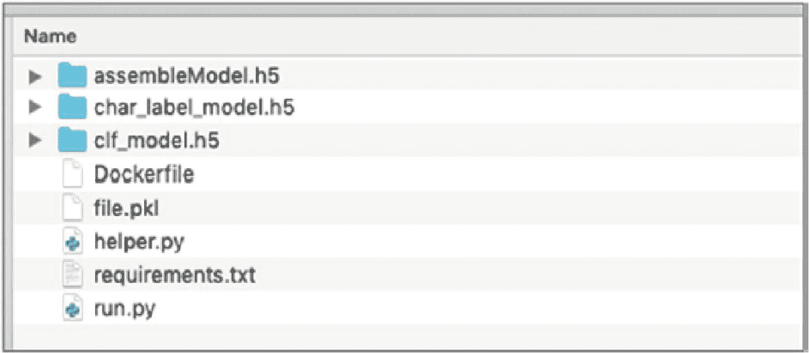

图 9-1 目录结构

现在，大多数文件对你来说应该很熟悉了。图中显示了两个新文件：`Dockerfile` 和 `requirements.txt`。`Dockerfile` 包含用于创建 `Docker` 容器的脚本，`requirements.txt` 包含使代码工作所需的所有附加包。让我们看看文件内容。

### requirements.txt 文件

此处提供了该文件的内容，以便你可以将其复制并粘贴到文件中（参见图 9-2）。

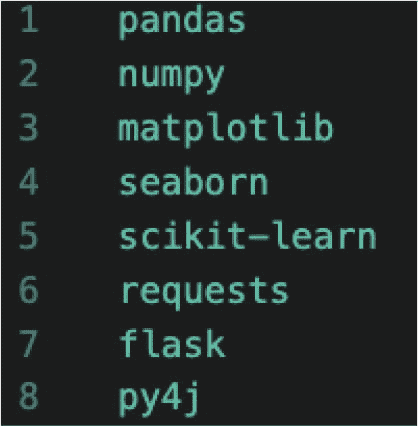

图 9-2 `requirements.txt` 文件

### Dockerfile

我们使用 `PySpark` `Jupyter` `Notebook` 镜像作为基础 `Docker` 镜像。在镜像内部，我们创建一个名为`/deploy/`的工作目录，用于复制和粘贴所有模型对象和文件（见图 9-3）。

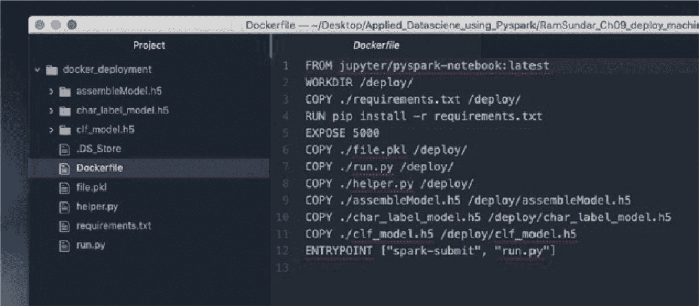

图 9-3 `Dockerfile`

此过程分步骤完成。此外，我们通过执行`requirements.txt`文件来安装所需的包，如第 4 行所示。最后，我们使用上一节中使用的`spark-submit`命令执行模型。需要注意的一点是，容器中暴露了端口号 5000。我们将在实时评分部分使用此端口。现在请忽略此端口。`Dockerfile`脚本如下所示：

```
FROM jupyter/pyspark-notebook:latest
WORKDIR /deploy
COPY . .
RUN pip install -r requirements.txt
EXPOSE 5000
CMD ["spark-submit", "run.py"]
```

# use `jupyter/pyspark-notebook` as the base image

```
FROM jupyter/pyspark-notebook:latest
WORKDIR /deploy/
```

# Copy the requirements.txt file from local to container directory
COPY `./requirements.txt` `/deploy/`

# install python dependencies

```
RUN pip install -r requirements.txt
```

# Expose port 5000
EXPOSE 5000

# Copy necessary files from local to container dir

`COPY ./file.pkl /deploy/`
`COPY ./run.py /deploy/`
`COPY ./helper.py /deploy/`
`COPY ./assembleModel.h5 /deploy/assembleModel.h5`
`COPY ./char_label_model.h5 /deploy/char_label_model.h5`
`COPY ./clf_model.h5 /deploy/clf_model.h5`

## 对 `helper.py` 和 `run.py` 文件的修改

在 `helper.py` 文件中，修改以下行：

```
path_to_read_objects = '/deploy'
```

在 `run.py` 文件中，修改以下行：

```
path_to_output_scores = '/localuser'
filename = path_to_output_scores + "/score_data.csv"
```

这些修改是为了反映 Docker 内部（`/deploy`）以及稍后在 Docker 执行期间挂载的卷（`/localuser`）中的适当目录路径。

## 创建 Docker 并执行评分代码

要创建 Docker 容器，请在终端/命令提示符中执行以下代码：

```
docker build -t scoring_image .
```

镜像构建完成后，您可以使用以下命令执行它。您需要从包含评分数据的目录执行该命令。

```
docker run -p 5000:5000 -v ${PWD}:/localuser scoring_image:latest
```

就是这样。您应该会在本地文件夹中看到 `predictions.csv` 文件。到目前为止，我们使用了批量评分流程。现在让我们转向实时评分 API。

## 实时评分 API

实时评分 API 用于实时对模型进行评分。它使您的模型能够嵌入到 Web 浏览器中，以获取预测并根据这些预测采取行动。这对于进行在线推荐、检查信用卡批准状态等非常有用。其应用范围非常广泛，使用 Docker 管理此类 API 变得更加容易。此示例使用 Flask 实时实现模型（见图 9-4）。Flask 脚本存储在 `pysparkapi/app.py` 文件中。您可以参考本节代码，地址为：`https://github.com/Apress/applied-data-science-using-pyspark/tree/main/Ch09/real_time_scoring`。

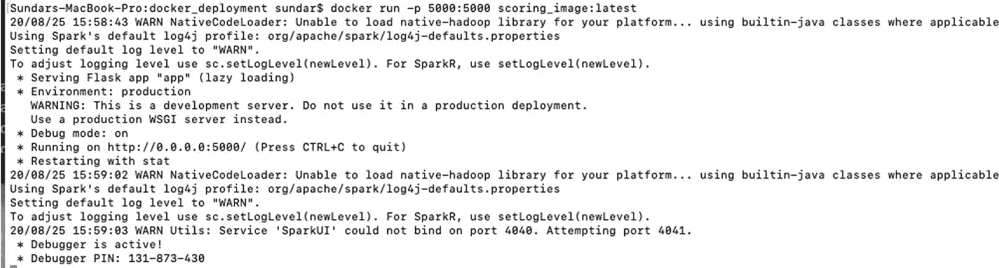

图 9-4

Flask API 就绪

我们还修改了 `Dockerfile`，将 `app.py` 文件复制到 `/deploy` 目录。在上一模块中，我们运行了 `run.py` 文件。在本模块中，这由 `app.py` 文件处理。以下是更新后的 `Dockerfile` 内容：

```
FROM jupyter/pyspark-notebook:latest
WORKDIR /deploy/
COPY ./requirements.txt /deploy/
RUN pip install -r requirements.txt
EXPOSE 5000
```

# Copy necessary files from local to container dir
`COPY` `./file.pkl` `/deploy/`
`COPY` `./run.py` `/deploy/`
`COPY` `./helper.py` `/deploy/`
`COPY` `./assembleModel.h5` `/deploy/assembleModel.h5`
`COPY` `./char_label_model.h5` `/deploy/char_label_model.h5`
`COPY` `./clf_model.h5` `/deploy/clf_model.h5`
`COPY` `./app.py` `/deploy/`

# Specify the entry point command to run when the container starts
```
ENTRYPOINT ["python", "app.py"]
```

好了，我们已经准备好执行实时评分。稍后我们将编写 UI 代码。让我们先使用`Postman`应用程序测试代码。

使用以下代码重新创建 Docker 镜像：

```
docker build -t scoring_image .
```

这次您不需要卷映射，因为您将执行实时评分。您需要确保本地系统的端口号映射到 Docker 端口号。

```
docker run -p 5000:5000 scoring_image:latest
```

一旦收到此消息，您可以切换回 Postman API 并测试此应用程序。您可以在线下载 Postman，如果尚未安装，请安装它。启动应用程序并进行必要的更改，如下所示。

### Postman API

本节面向不熟悉 Postman API 的读者（见图 9-5）。如果您已经熟悉，可以跳过本节。

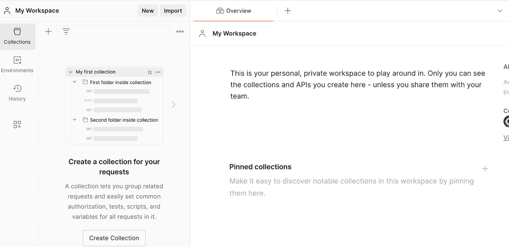

图 9-5

Postman API

您需要通过单击左上角的“New”按钮，然后单击“Request”->“Create a Basic Request”来创建一个 API 实例，以获取图 9-6 所示的窗口。

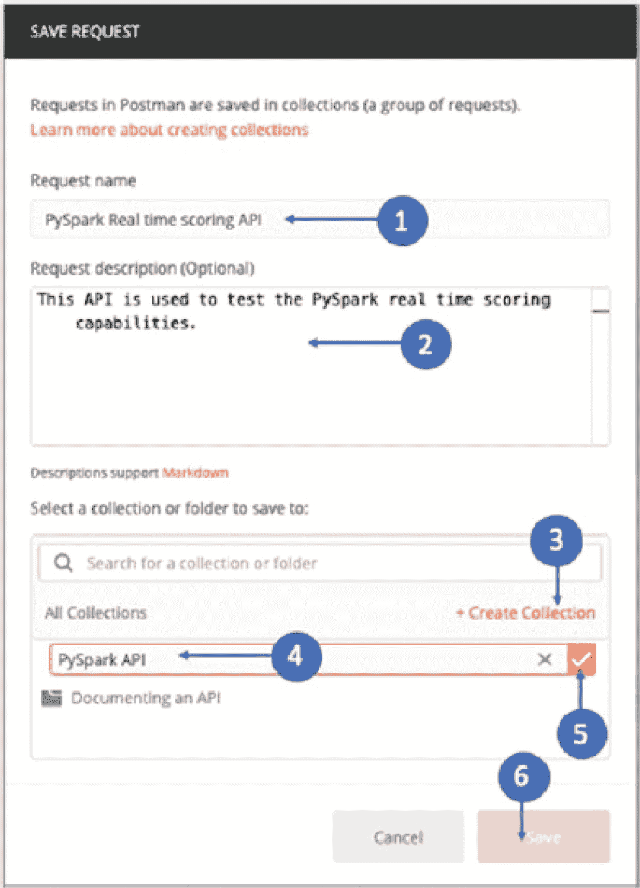

图 9-6

创建新的 API 请求

现在，让我们对图 9-7 中所示的 API 进行配置。

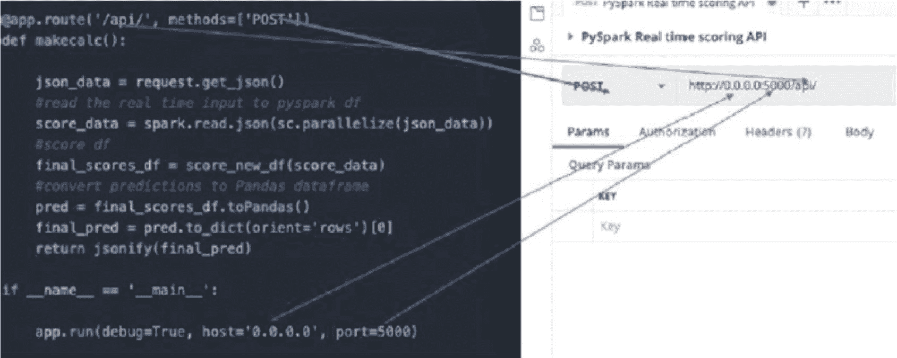

图 9-7

配置

让我们通过导航到“Headers”选项卡来添加一个标头列。通过此选项，API 知道它正在寻找 JSON 输入（见图 9-8）。


图 9-8

JSON 标头对象

最后，您就可以进行评分了。由于您提供输入用于测试，请将 body 类型切换为`raw`，并选择 JSON 作为文本选项（见图 9-9）。

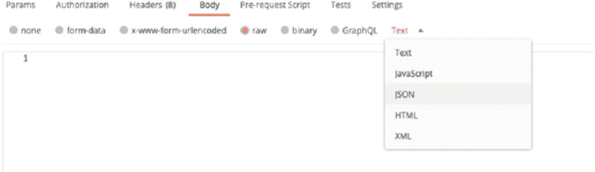

图 9-9

JSON 选择

### 使用 Postman API 测试实时评分

使用以下 JSON 对象进行测试。请注意前面的方括号。这用于传递一个 JSON 对象列表。

```
[{"age":58,"job":"management","marital":"married","education":"tertiary","default":"no","balance":2143,"housing":"yes","loan":"no","contact":"unknown","day":5,"month":"may","duration":261,"campaign":1,"pdays":-1,"previous":0,"poutcome":"unknown"}]
```

将 JSON 对象复制并粘贴到 API 的 body 中，然后单击“Send”（见图 9-10）。

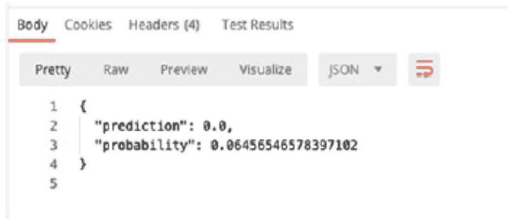

图 9-10

实时评分

您现在可以继续为应用程序构建 UI 组件。

### 构建 UI

我们将使用 Python 包`streamlit`来构建用户界面（UI）。`streamlit`易于与现有代码集成。使用`streamlit`的最大优势之一是，您可以编辑 Python 代码并立即在 Web 应用程序中看到实时更改。另一个优势是，构建 UI 所需的代码量极少。在开始之前，请查看图 9-11 中所示的目录结构。父目录是`real_time_scoring`。我们创建了两个子目录：`pysparkapi`和`streamlitapi`。我们将把到目前为止讨论的所有代码移动到`pysparkapi`目录中。UI 代码将位于`streamlitapi`目录中。

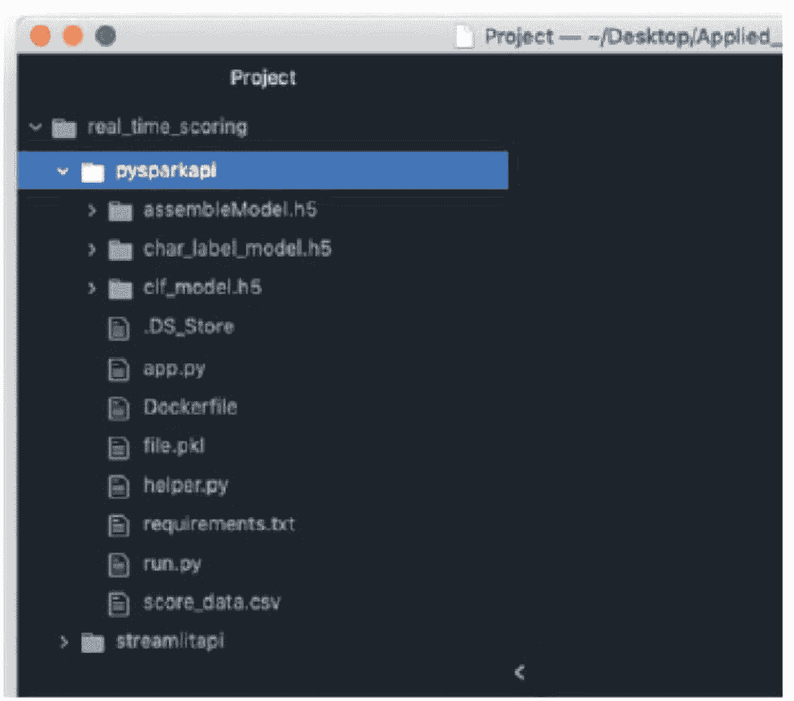

图 9-11

UI 目录结构

### `streamlitapi` 目录

导航至 `streamlitapi` 目录，并在其中创建以下三个文件。

- `Dockerfile` – 前端的 Docker 配置
- `requirements.txt` – 所需的包
- `webapp.py` – UI 代码

在部署到 Docker 容器之前，你可以通过运行以下代码来测试这段代码：

```
streamlit run webapp.py
```

如前所述，`streamlit` 的交互式功能让你只需少量代码即可即时设计自定义布局。好了，准备工作已完成。这三个文件位于 `streamlitapi` 目录中。现在你有两个 Docker 容器——一个用于 PySpark Flask，另一个用于 `streamlit` UI。你需要在这两个容器之间创建一个网络，以便 UI 与后端的 PySpark API 进行交互。让我们切换到父目录，名为 `real_time_scoring`。

### `real_time_scoring` 目录

`docker-compose` 文件用于组合多个 Docker 容器并创建 Docker 网络服务。让我们看看这个文件的内容。

`docker-compose.yml`

```

# 定义两个服务：pysparkapi, streamlitapi

```yaml
version: '3'
services:
  pysparkapi:
    build: pysparkapi/
    ports:
    - 5000:5000
    networks:
    - deploy_network
    container_name: pysparkapi
  streamlitapi:
    build: streamlitapi/
    depends_on:
    - pysparkapi
    ports:
    - 8501:8501
    networks:
    - deploy_network
    container_name: streamlitapi
networks:
  deploy_network:
    driver: bridge
```

### 执行 `docker-compose.yml` 文件

现在使用以下代码执行 `docker-compose.yml` 文件：

```bash
docker-compose build
```

Docker 网络服务已建立。现在你可以使用图 9-12 所示的代码执行 Docker 服务。启动服务需要一些时间；请等待调试器引脚出现，然后再切换到浏览器。

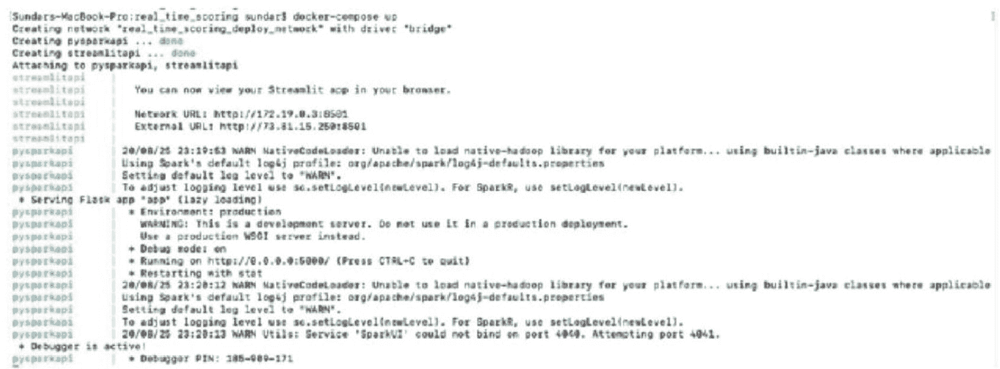

### 实时评分 API

要访问 UI，你需要在浏览器中输入以下链接：

`http://localhost:8501/`

如果你使用了本书中指示的相同代码，UI 应该如图 9-13 所示。图中仅显示了部分 UI。你可以输入特征值，然后点击 **获取预测** 来获得结果。

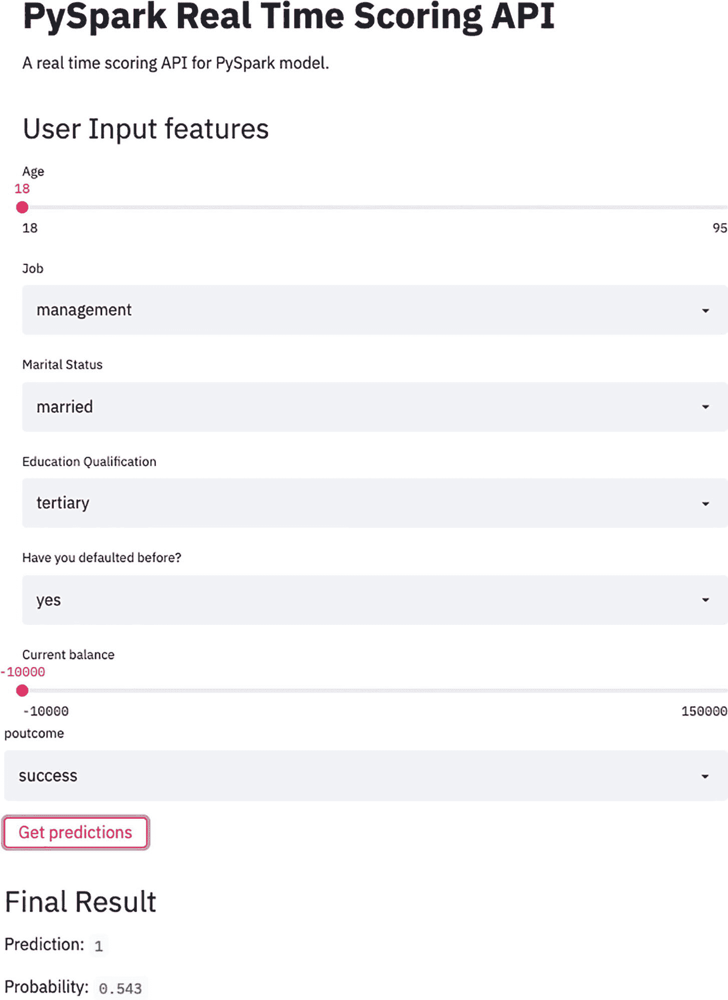

当你想停止此服务时，可以使用以下代码（见图 9-14）：

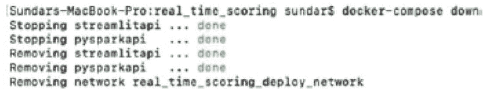

```bash
docker-compose down
```

就这样。你已经通过一个漂亮的前端实时部署了模型。此部署的最佳之处在于 UI 和 PySpark 位于独立的 Docker 容器中。它们可以分别进行管理和定制，并在需要时通过 `docker-compose` 文件组合在一起。这使得软件开发生命周期过程变得更加容易。

## 总结

- 你详细了解了模型部署过程。
- 你使用批处理和实时处理两种方式部署了模型。
- 最后，你使用 `streamlit` API 创建了一个自定义 UI 前端，并通过 `docker-compose` 将其与 PySpark API 服务集成。

干得好！在下一章中，你将学习实验和 PySpark 代码优化。继续学习，敬请期待。

# 10. 实验与优化策略

在本章中，我们将深入探讨实验概念。我们还将探索如何制定清晰的研究问题和假设，然后使用 PySpark 及其分布式计算框架在大数据上进行可扩展的实验。

## 实验的重要性

- **揭示因果关系**：通过实验，你可以在变量之间建立因果关系，而不仅仅是依赖观察数据。简单来说，它帮助你不仅理解“发生了什么”，还理解“为什么发生”。
- **数据驱动决策**：它使你能够收集数据驱动的见解，从而优化不同策略并做出明智的决策。
- **持续改进**：它通过迭代测试和优化不同方法，帮助确保模型和应用程序随着时间的推移保持有效。

以下部分将探讨 PySpark 如何具体增强应用数据科学中的实验能力。

## 实验过程

让我们从成功进行实验所需的高级步骤开始。

- **定义问题**：这是你试图解决的问题或想要检验的假设。这是实验过程中的基础步骤。
- **设计实验**：选择能够回答你问题的实验类型。实验有多种类型：对照实验、现场实验、自然实验、准实验、A/B 测试、析因实验、纵向研究和横截面研究。
- **识别变量并收集数据**：你需要明确定义自变量、因变量以及控制实验的变量。你需要决定如何操纵和测量它们。最后，你需要收集数据来检验你的假设，并决定如何收集数据。这可能涉及以适当的方式设置管道并将其存储起来以供将来分析。
- **进行实验**：按照设计运行你的实验。你必须控制*混杂变量*（既影响你的处理又影响结果的变量），并确保实验以公平和合乎道德的方式进行。
- **分析结果**：使用统计方法分析你的实验结果。这可能涉及计算均值、进行回归分析、检验统计显著性等。
- **解释并传达结果**：从你的分析中得出结论并传达你的发现。这可能涉及撰写报告、向利益相关者展示你的结果，以及在科学期刊上发表你的发现。
- **优化与迭代**：根据实验结果，你可能需要优化你的问题、设计新的实验或收集更多数据。实验通常是一个迭代过程。

### 假设检验

*假设*是一种可被检验的主张或断言。通过假设检验，你可以拒绝或暂不质疑某个特定陈述。用一个例子可能更直观。例如，吃早餐的人比不吃早餐的人更不容易患糖尿病。另一个例子是，客户流失是否会影响收到优惠的人群与未收到优惠的人群？其核心思想是检验这些断言在总体中是否成立。假设有两种类型。

- **零假设：** 用 `H0` 表示。它基于传统认知或经验。
- **备择假设：** 用 `Ha` 表示。这通常是你试图验证的、感兴趣的假设。

假设你需要为早餐的例子构建假设。你可以这样写：

- `H0`：吃早餐对糖尿病发病率没有影响
- `Ha`：吃早餐对糖尿病发病率有负面影响

`p 值` 被用作拒绝点的替代，以提供拒绝零假设的最小显著性水平。`p 值` 越小，表明支持备择假设的证据越强。

以下是错误类型：

| 实际情况 | `H0` 为真 | `H0` 为假 |
| --- | --- | --- |
| **决策** | | |
| 无法拒绝零假设 | 正确 | 第二类错误 |
| 拒绝零假设 | 第一类错误 | 正确 |

第一类错误的概率用 `α` 表示，第二类错误的概率用 `β` 表示。统计检验的功效为 `1-β`。根据具体用例，重点在于降低 `α` 或 `β`。大多数教科书侧重于降低 `α`，因为其基本原理是坚持传统方法（至少不会因采用替代方法而使情况变得更糟）。

以抛硬币为例。效应量可以定义为 `n` 次抛掷中正面与反面的差异。而样本量则是正面和反面的次数。效应量和样本量都会影响 `p 值`。这就是为什么无法同时减少第一类和第二类错误。在假设检验中，你首先构建零假设，然后是备择假设。接着，你决定所需的显著性水平 `α`（大多数检验通常为 5%）。然后运行检验并根据显著性水平做出决策。如果 `p 值` 小于显著性水平，则拒绝零假设。如果 `p 值` 大于或等于显著性水平，则无法拒绝零假设。PySpark 统计包提供了内置方法来运行皮尔逊卡方检验和柯尔莫哥洛夫-斯米尔诺夫检验。它不支持大多数假设检验方法。不过，可以使用用户自定义函数来编写这些方法。这些方法列于下表中。

| 何时使用？ | 参数检验 | 非参数检验 |
| --- | --- | --- |
| 比较两组均值 | T 检验 | 曼-惠特尼 U 检验 |
| 比较两个相关组的均值 | 配对 t 检验 | 威尔科克森符号秩检验 |
| 比较两个以上组的均值 | 单因素方差分析 | 克鲁斯卡尔-沃利斯检验 |
| 评估两个变量之间的关系 | 皮尔逊相关 | 斯皮尔曼相关 |

## 实验案例研究

让我们选取一些示例数据，学习如何使用 PySpark 进行 A/B 测试。假设你经营一家电子商务公司，你认为可以改进网站以更好地吸引客户，从而提高转化率。你拥有关于客户及其在网站上行为的数据。示例数据如下所示：

| `user_id` | `timestamp` | `group` | `landing_page` | `converted` |
| --- | --- | --- | --- | --- |
| 851104 | 2017-01-21 22:11:48.556739 | control | old_page | 0 |
| 804228 | 2017-01-12 08:01:45.159739 | control | old_page | 0 |
| 661590 | 2017-01-11 16:55:06.154213 | treatment | new_page | 0 |
| 853541 | 2017-01-08 18:28:03.143765 | treatment | new_page | 0 |
| 864975 | 2017-01-21 01:52:26.210827 | control | old_page | 1 |
| 936923 | 2017-01-10 15:20:49.083499 | control | old_page | 0 |
| 679687 | 2017-01-19 03:26:46.940749 | treatment | new_page | 1 |
| 719014 | 2017-01-17 01:48:29.539573 | control | old_page | 0 |

你可以从 Kaggle 获取此示例数据，网址为 [`https://www.kaggle.com/datasets/zhangluyuan/ab-testing/data`](https://www.kaggle.com/datasets/zhangluyuan/ab-testing/data)。

该数据集包含五列：

- `User_Id` – 每个用户的唯一 ID。
- `Timestamp` – 用户访问网站的时间。
- `Group` – 用户被分配到实验组还是对照组。分配到实验组的用户将看到新网站，而对照组的用户将看到旧网站。
- `Landing_page` – 描述用户看到的是 `new_page` 还是 `old_page`。
- `Converted` – 用户是否进行了交易，用 0（否）和 1（是）表示。

让我们回顾一下本章开头讨论的实验过程，并看看如何将其应用于这个 A/B 测试案例研究。

- **定义问题：** 提高网站的转化率。转化率定义为“购买总数”除以“操作总数”。用户可以在网站上执行三种操作：`view_product`、`add_to_cart` 和 `purchase`。
- **设计实验：** 你想改进网站，并将其性能与现有网站进行比较。这是一个经典的 A/B 测试用例，因此我们将沿用此方法。
- **确定变量并收集数据：** 在此实验中，你将随机将人群分配到对照组和测试组（50/50）。你可以潜在地控制混杂因素（年龄、性别），但这些因素在本章中不予考虑。因此，本实验的自变量是用户是否接受了处理（测试组，看到了新网站）或未接受处理（对照组，看到了旧网站）。本实验的因变量是购买率。没有控制变量。
- **进行实验：** 假设实验公平进行，并且分配到处理组的人群是随机选择的。
- **分析结果：** 你可以使用 t 检验来分析实验结果。但等等，你没有现成的 Spark 包来进行 t 检验。我们将向你展示两种运行此实验并分析结果均值的方法。
- **解释并沟通结果：** 最后，你根据结果进行解释，然后做出决策。
- **优化与迭代：** 你可以再次更改网站布局，并重新开始整个过程。

在深入进行 A/B 测试之前，先考虑一些关于数据的高级统计信息。

```python
from pyspark.sql.functions import col, count
data.groupby(['group', 'landing_page']).count().show()
```

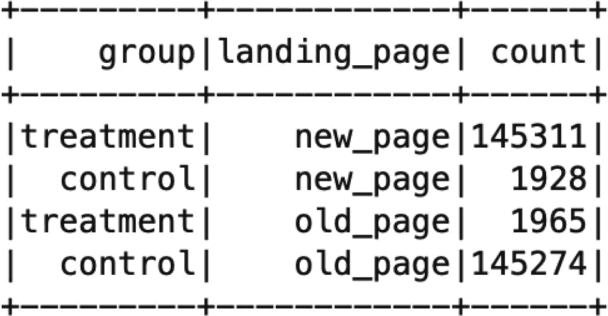

这些数据有些不对劲。似乎有些用户进入了错误的 `landing_page`。这可能是由于实验开始时的某些噪声或其他外部因素造成的。让我们清理数据，筛选出正确的处理和 `landing_page` 分配。

### 数据过滤与初步分析

（原文此处内容缺失）

# 筛选合适的数据

```python
data = data.where(((data.group ==  'treatment') & (data.landing_page=='new_page')) |
((data.group ==  'control') & (data.landing_page=='old_page')))
```

让我们再次检查数据：

```python
data.groupby(['group', 'landing_page']).count().show()
```

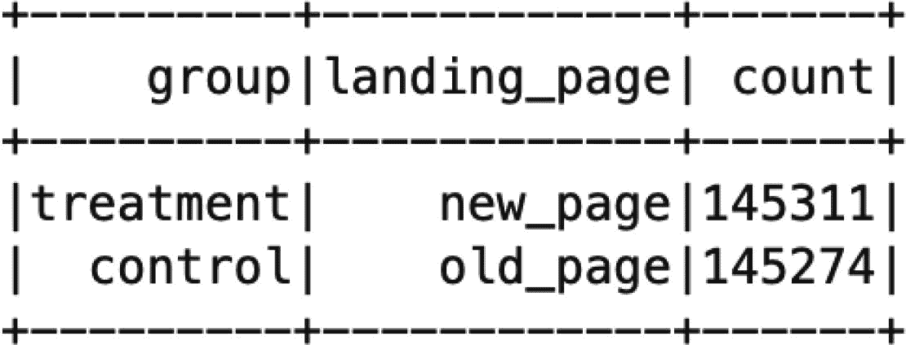

现在，让我们检查平均结果。这有助于确定`control`组中有多少人进行了购买，以及这与`treatment`组有何不同：

```python
# 示例中最后一个代码块为空，此处保持原样
```

# 检查组均值
`data.groupby(['group', 'landing_page']).agg(avg("converted")).show()`
```

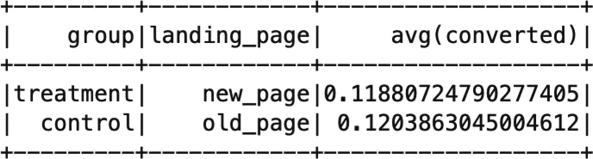

计算相同结果的另一种方法是计算`uplift`百分比：

```

# 将 DataFrame 拆分为两个：一个用于对照组，一个用于处理组

```
control_df = data.filter(data.group == "control")
treatment_df = data.filter(data.group == "treatment")
```

# 计算每组的转化率
```python
control_conversions = control_df.filter(col("converted") == 1).count()
control_rate = control_conversions / control_df.count()
treatment_conversions = treatment_df.filter(col("converted") == 1).count()
treatment_rate = treatment_conversions / treatment_df.count()
```

# 计算提升率（可选）
`uplift = (treatment_rate - control_rate) / control_rate * 100`

# 打印结果
```python
print("对照组转化率:", round(`control_rate`, 4))
print("处理组转化率:", round(`treatment_rate`, 4))
print("提升率（如适用）:", round(`uplift`, 4), "%")
```
对照组转化率: 0.1204
处理组转化率: 0.1188
提升率（如适用）: -1.3117 %

## 解读与决策
请记住这些转化率平均值，稍后将在本章中使用。注意，由于新网站布局，转化率出现了-1.3%的下降。你能得出结论说新布局没有达到预期效果，并继续对所有用户使用旧布局吗？在这种情况下，你可以这样做，因为转化率并未朝着正确的方向变化。然而，你可能会遇到一些用例，其中转化率略高于对照组，因此你仍然无法确定是否要进行更改。为了最终回答这个问题，你需要找到证据。换句话说，你需要使用 `t` 检验来拒绝零假设。假设在这种情况下你仍然有兴趣尝试新布局，让我们进行 `t` 检验，看看能从中了解到什么。

### 假设检验
- `H0`：旧网站布局的平均购买量 = 新网站布局的平均购买量
- `H1`：两个平均值不同

我们需要证据来拒绝`H0`并接受`H1`。那么，让我们使用 Python 运行 `t` 检验：
```python
```

# 此代码为每种处理类型创建结果变量列表

`control_data_flag = control_df.select('converted').rdd.flatMap(lambda x: x).collect()`
`treatment_data_flag = treatment_df.select('converted').rdd.flatMap(lambda x: x).collect()`
`import scipy.stats as stats`

# 计算 t 统计量和 p 值

```
t_statistic, p_value = stats.ttest_ind(treatment_data_flag, control_data_flag)
```

## 打印结果
```
print("t 统计量:", t_statistic)
print("p 值:", p_value)
```
输出：
```
t 统计量: -1.31
p 值: 0.19
```

注意，t 检验结果不显著。这意味着你无法拒绝零假设。因此，你可以安全地得出结论：新版本的网站布局与旧版本相比，并未显著推动更多购买。尽管这个实验没有产生统计学上显著的结果，但它带来了希望，即未来可以测试更多迭代，这可能会改善购买行为。

另外，我们在 GitHub 上的一个单独笔记本中提供了一个假样本用例。当你运行那个实验时，你会注意到它显示了 6% 的提升。在这种情况下，t 检验也显示结果不显著。不幸的是，当你无法拒绝零假设时，你没有足够的证据表明新版本优于旧版本。因此，你需要进一步调查、完善分析并迭代实验。

### 使用 PySpark 进行 t 检验

现在，让我们看看如何使用 PySpark 的可扩展能力运行 t 检验。请记住，当你在第 5 章学习线性回归时，你查看了变量系数和变量的 p 值显著性。这些显著的 p 值基于 t 检验。那么，让我们利用这一点，看看是否可以通过线性回归得到相同的结果。要运行线性回归，你需要将输入特征转换为向量。

```python
from pyspark.ml.regression import LinearRegression
from pyspark.ml.feature import VectorAssembler

vectorAssembler = VectorAssembler(inputCols=["group_flag"], outputCol="v_group_flag")
v_data = vectorAssembler.transform(data)
```

# 定义线性回归模型
```
lr = LinearRegression(featuresCol='v_group_flag', labelCol='converted')
```

# 拟合模型

```
lr_model = lr.fit(v_data)
```

# 打印线性回归的系数和截距

```
print("系数: " + str(lr_model.coefficients))
print("截距: " + str(lr_model.intercept))
系数: [-0.0016]
截距: 0.1204
```

回归截距与之前计算的 `Control` 组转化率相同。系数-0.0016 是处理组带来的增量转化，等于（0.1204 - 0.0016 = 0.1188）。这些值与之前计算的值一致。

```
print(lr_model.summary.tValues)
print(lr_model.summary.pValues)
[-1.31, 141.41]
[0.19, 0.0]
```

我们使用上述代码得到了 t 统计量和 p 值。第一个值对应处理组，第二个值对应截距（在本例中为对照组）。因此，回归得到的 t 统计量与之前计算的 t 统计量相同。同时，p 值也与之前的计算结果一致。这种方法展示了在 PySpark 中进行 t 检验的可扩展方法。

## 总结与扩展

这是一个使用 PySpark 展示实验能力的简单示例。当然，当你使用真实世界数据时，需要考虑添加必要的特征（混杂变量、工具变量和遗漏变量偏差）和数据收集方法（控制变量和抽样策略），并最终确保实验是干净且可复现的。

你可以将这个实验扩展到多个时间段，以衡量处理对结果的影响。你需要测量同一时间段的输入特征以及观察到的结果，这使你能够构建面板数据。有了这些数据，你可以执行双重差分回归来分析一段时间内的处理效应。这个概念超出了本书的范围。

### 为何使用 PySpark 进行实验？

-   选择 PySpark 的主要优势在于其可扩展性和效率。Spark 可以处理数 TB 甚至 PB 级的数据，而其他工具需要额外的基础设施才能支持相同级别的可扩展性。PySpark 原生地并行化其操作，因此在操作数据和训练模型方面非常高效。这在处理实时流数据用例时尤其有用。
-   PySpark 提供了用于模型训练和数据整理的 `MLlib` 和 `SQL` 包。它有助于与这两个库无缝集成，简化实验中的数据清洗任务。
-   PySpark 可以处理传统数据格式（`CSV`、`JSON` 和 `parquet`）以及流式数据源（`Kafka`）。因此，可以轻松切换到不同的数据源，而无需担心格式限制。其次，它使用 Python，因此可以轻松地与现有的基于 Python 的数据工作流集成。
-   PySpark 确保实验的确定性执行；因此，无论集群配置如何，相同的代码在相同的数据上都会产生相同的结果。这有助于您复现结果并促进与其他数据科学家的协作。此外，您还可以与其他数据科学家共享您的笔记本，以实现代码的可复现性。
-   对于预算有限的组织来说，这是市场上用于大规模数据实验的经济高效的开源解决方案之一。

## 使用 PySpark 的优化策略

### 随机数据生成

您可能经常需要创建数据来测试场景和算法。PySpark 有一个方便的内置函数，可以通过调用简单的函数来实现这一点：

```python
from pyspark.mllib.random import RandomRDDs
```

# Generate a random double `RDD` that contains 1 million i.i.d. values drawn

# from the standard normal distribution `N(0, 1)`, evenly distributed

in 10 partitions.
```
u = `RandomRDDs`.`normalRDD`(`spark.sparkContext`, 1000000, 10)
```

```
# Apply a transform to get a random double RDD following `N(1, 4)`.
v = u.map(lambda x: 1.0 + 2.0 * x)
```

此示例生成一个随机双精度 `RDD`，其值遵循标准正态分布 `N(0, 1)`，然后将其映射到 `N(1, 4)`。

## 采样

采样是机器学习中的一个重要概念。如果样本数据集不具有代表性，那么带有偏差的实验通常几乎没有价值。本节介绍 PySpark 中可用的采样类型。

### 简单随机采样 (SRS)

在简单随机采样中，每一行都是随机选择的，并且被选中的机会均等。`sample()` 有助于执行 SRS。在 SRS 中，您有几种选择。为了演示，我们使用第 8 章中介绍的客户流失建模数据集。

有放回 SRS：

```python

```

# Read data

```python
file_location = "churn_modelling.csv"
file_type = "csv"
infer_schema = "false"
first_row_is_header = "true"
delimiter = ","
df = spark.read.format(file_type)\
.option("inferSchema", infer_schema)\
.option("header", first_row_is_header)\
.option("sep", delimiter)\
.load(file_location)
```

# Simple Random Sampling without replacement

`df`=`df`.`select`('Geography','NumOfProducts','Age','Gender','Tenure','Exited')
`df_srs_without_rep` = `df`.`sample`(`False`, `0.5`, `23`)
`df_srs_without_rep`.`show`(`10`,`False`)

```python
无放回 SRS：
```

# 抽样方法

## 有放回简单随机抽样
`df_srs_without_rep = df.sample(True, 0.5, 23)`
`df_srs_without_rep.show(10, False)`

## 分层采样

在分层采样中，总体的每个成员都被分组到称为*层*的同质子组中，并从每个组（层）中选择一个代表。

```python
```

# Stratified Sampling
```
from pyspark.sql.types import IntegerType
df = df.withColumn("Exited", df["Exited"].cast(IntegerType()))
df.select('Exited').describe().show()
```

```
# Perform stratified sampling based on column "Exited"

```
# Perform stratified sampling based on column "Exited"
stratified_sampled = df.sampleBy("Exited", fractions={0: 0.5, 1: 0.5}, seed=23)
stratified_sampled.select('Exited').describe().show()
```

以下提供了原始数据（左）和分层样本分布（右）：

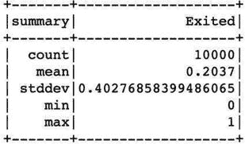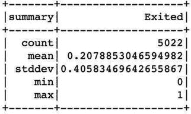

## `coalesce` 与 `repartition` 函数的区别

`coalesce` 和 `repartition` 函数都用于在保存数据时控制分区数量。这里有一个小技巧：当归档中小型数据时，优先使用 `coalesce` 而不是 `repartition` 作为快速解决方案。否则，最好使用 `repartition`。原因如下：

-   `coalesce` 使用现有分区来最小化数据混洗，这会导致分区大小不均匀。它在无需完全混洗的情况下，将数据合并到更少的分区中非常高效。
-   `repartition` 执行完全混洗并创建新的分区。这确保了数据分区大小相等。还建议您在运行过滤查询后重新分区数据，以提高查询效率。如果在过滤后不重新分区数据，最终可能会产生许多内存分区，导致性能不佳。您还需要考虑重新分区数据时完全混洗的成本。

有向无环图（DAG）调度器可以很好地洞察每个操作是如何应用于数据的。

## 在 Python 与 PySpark 之间切换

PySpark 最适合处理大型数据集，而 `pandas` 在处理较小数据集时速度更快。您可以在多种情况下将 `pandas` DataFrame 与 PySpark DataFrame 结合使用，以优化代码的执行时间。您在第 8 章中看到了一个经典示例，即构建自动化流水线。对于计算指标，我们使用 PySpark 来完成繁重的工作。一旦我们有了可管理的数据（行数在 10 到 100 之间，列数较少），我们就将其转移到 `pandas` 以高效地处理和计算指标。

当您知道要处理汇总数据立方体时，这是一个很好的策略。您可以在 PySpark 中处理大型数据集，并将分组的 PySpark DataFrame 转换为 `pandas` DataFrame。由于 `pandas` 比 PySpark 更成熟，它将打开大量在各种情况下可能有用的包。

### 空值的奇特特性

在 PySpark 中，有时您尝试填充列中的空值并使用 `fillna` 函数。`fillna()` 工作正常，但您最终仍然会在列中得到空值。是的，您猜对了，当您要填充的列的数据类型与 `fillna` 值不匹配时，最终会得到空值。例如，计算整数列的均值可能会得到一个 `float` 值。现在，如果您尝试使用这个 `float` 值进行填充，您可能仍然会观察到空值。解决方法是确保列的数据类型与您打算用于填充空值的值的数据类型匹配。

### 常见函数冲突

有时会出现诸如 `max` 之类的函数同时存在于 Python 和 PySpark SQL 函数中的情况。如果您使用通配符导入 `pyspark.sql.functions`，则会出现导入冲突错误。

### 连接条件

连接是 Spark 程序的关键操作之一。通常，Spark 有两种集群通信策略。节点到节点策略涉及跨集群的 Spark 数据混洗。而按节点策略则执行广播连接。Spark 主要使用三种连接类型：

- **排序合并连接：** 包含几个步骤。第一步是对数据集进行排序，第二步是通过连接键遍历元素，将分区内已排序的数据进行合并。这通常是 Spark 中的默认设置。为了实现优化的排序合并，参与连接的 DataFrame 应在连接列上均匀分布。如果所有连接键都位于同一位置，则连接将进一步优化，因为无需进行混洗操作。当两侧数据量都很大时，优先选择排序合并连接。
- **广播连接：** 这是 Spark 中最高效的连接方式。它们适用于将小数据集与大数据集进行连接。在这种连接中，较小的表会被广播到所有工作节点。务必确保广播的是较小的表。
- **混洗哈希连接：** 此连接基于 MapReduce 的概念。该过程会遍历 DataFrame，并将连接列的值作为输出键。Spark 使用自定义函数来确保对于给定的数据集，混洗哈希连接比广播连接更优。创建哈希表是一项开销较大的操作。

始终建议检查连接键中是否存在任何空值。这个错误代价可能很高。它可能导致无关的错误，例如调用 `o206.ShowString` 或 `o64.cacheTable` 时出现的错误。另一个原因可能是重复值。如果在连接表之前检查了空值和重复值，就可以避免遇到上述任何错误，从而节省时间。

Spark 用于连接的主要策略有两种。当两侧数据量都很大时，使用排序合并连接；当一侧数据量较小时，使用广播连接。

## 用户自定义函数 (UDF)

即使在成功将 UDF 导入到运行文件后，您也可能会遇到问题。同样，您可能会遇到奇怪的 `ShowString` 错误。真正的原因是某些工作节点无法使用该 UDF。您可以通过在脚本中添加以下行来克服此错误。它使其他工作节点能够引用您的模块文件。

```
sc.addPyFile(path_to_your_module.py)
```

还建议尽量减少 UDF 的使用。这是因为它在后端触发了从反序列化到重新序列化的开销。

### 处理数据倾斜

不平衡的数据集可能导致执行时间出现峰值。您可以在 Spark UI 后端通过 `min` 和 `max` 时间值观察到这一点。使用均匀分布的数据集可以显著提升性能。

在 SQL 连接操作中，会更改连接键以重新均匀分布数据，从而避免某个分区的处理耗时过长。这种技术称为*加盐*。

在两侧各添加一个列，其值为 0 到 `spark.sql.shuffle.partitions`-1 之间的随机 `int`，然后添加一个 `join` 子句，包含对生成的列进行连接。

### 使用缓存

缓存是加速性能的利器。如果对所有对象都使用缓存，最终可能会导致存储速度略有下降。使用缓存会占用会话的部分处理能力。在“存储”选项卡中，您可以观察内存大小和磁盘分布大小。

### 持久化/取消持久化

您已经了解到 Spark 使用惰性求值来执行命令。持久化是 Spark 存储中可用的有吸引力的选项之一。它提供了在集群中存储中间 RDD 以便更快访问的能力。例如，假设您有一个初始数据集读入 Spark，并且需要应用过滤操作。由于 Spark 基于惰性求值的概念工作，过滤后的数据并不包含实际数据。它仅维护了为创建过滤数据而需要执行的 DAG 顺序。如果过滤后的数据集将被不同的对象消费以生成不同的结果，那么对于每一次迭代，都会在过滤后的数据集上执行转换。想象一下，对这个过滤后的数据集有 100 个操作。对于相当大的数据量，这可能会迅速增加处理时间，并将操作从几分钟延长到几小时。

持久化数据可以节省大量计算时间。当过滤后的数据在第一次迭代中被计算出来时，它会被持久化到内存中。在后续运行中，内存中的这个 DataFrame 将用于所有下游操作。在完成所需的下游操作后，最好将存储的数据从内存和磁盘中取消持久化。

### 混洗分区

当为连接或聚合操作混洗数据时，会存在这些分区。每当进行混洗时，大量数据块会在分区之间移动。这种混洗可以在执行器内部或跨执行器发生。这些操作可能会很快变得代价高昂。想象一下，您有一个包含八个初始分区的小型 DataFrame。通过执行一个简单的分组操作，您会将混洗分区数提升到 200。这是因为 DataFrame 的默认混洗分区数设置为 200。您有机会使用以下配置重置分区：

```

```

# 设置混洗分区数
`sparkSession.conf.set("spark.sql.shuffle.partitions",50)`。一些用于混洗操作的其他设置值得探索：

```

# 设置混洗期间传输中缩减数据的最大大小
`sparkSession.conf.set("spark.reducer.maxSizeInFlight", "96MB")`

# 启用或禁用压缩
```
sparkSession.conf.set("spark.shuffle.compress", "true")
```

# Spark 配置与性能优化

## Spark 配置

以下是用于提升 Spark 应用性能的常见配置示例。

```python
# 设置将混洗文件写入磁盘的缓冲区大小
sparkSession.conf.set("spark.shuffle.file.buffer", "1m")
```

如果您不设置这些配置，可能会未充分利用您的 Spark 资源。

## 使用最优格式

Spark 支持多种格式，包括 CSV、JSON、XML、parquet、orc 和 Avro。性能最佳的格式是使用 snappy 压缩的 parquet，这是 Spark 2.x 或更高版本的默认格式。Parquet 以列式格式存储数据，并且针对 Spark 中的高效数据处理进行了高度优化。

## 数据序列化

Spark 作业是分布式的，因此适当的数据序列化对于获得最佳性能至关重要。Spark 有两种序列化选项：

- Java 序列化是默认选项。
- Kryo 序列化是一种较新的格式，可以比 Java 实现更快、更紧凑的序列化。Kryo 要求您在程序中注册类，并且它不支持所有 `Serializable` 类型。

## 总结

- 您了解了实验的整体流程。
- 您学习了假设检验的概述和不同的采样技术。
- 您学习了一些常见的技巧和优化方法，这些方法可以在日常活动中节省时间。
- 您还对一些性能调优技术有了概览。

干得漂亮！祝您 PySpark 愉快！！

# 建模框架

预测建模已成为企业在当今数据驱动格局中争夺竞争优势的不可或缺工具。通过利用历史数据预测未来结果，公司可以做出明智决策，提升客户满意度、优化营销策略，并最终推动增长。然而，预测模型的真正力量在于其集成与堆叠能力，从而构建出能够为利益相关者提供可操作洞察和显著价值的综合框架。

本章旨在深入探讨如何集成各类预测模型，以构建应对关键业务挑战的稳健框架。通过理解并应用这些框架，组织能够改进决策流程，进而提升效率、盈利能力和客户留存率。

## 客户生命周期价值

客户生命周期价值（`CLV`）是商业与营销领域的基础概念，用于量化一家公司从单个客户账户在整个关系存续期间预期产生的总收入。在客户获取与留存对长期成功至关重要的当今竞争激烈的商业环境中，这一指标变得愈发重要。通过理解并利用 `CLV`，企业可以就资源分配、营销策略和客户留存工作做出明智决策，最终推动盈利能力和可持续增长。

### 理解客户生命周期价值（`CLV`）

从核心来看，`CLV` 代表一家公司从客户与其业务关系的整个周期中预期获得的净利润。它涵盖了来自该客户的所有收入流，包括首次购买、重复购买，以及通过推荐或口碑营销带来的任何附加价值。`CLV` 是一种前瞻性指标，可帮助企业预测未来收入流，并基于客户的长期价值做出战略决策。

计算 `CLV` 的基本公式如下：

```
CLV = (平均购买价值) * (购买频率) * (客户生命周期)
```

其中：

- `平均购买价值` 是客户每笔交易的平均花费金额。该值可通过将客户产生的总收入除以其交易次数计算得出。
- `购买频率` 是客户在每个时间段（如每年或每月）的平均购买次数。该指标可通过分析历史购买数据并识别客户行为模式得出。
- `客户生命周期` 是客户持续从企业购买的平均时长。可根据历史数据、行业基准或考虑客户流失率和留存策略等因素的预测模型进行估算。

这一基本公式提供了计算 `CLV` 的简化方法，而更复杂的模型可能会纳入额外因素以提高准确性。这些因素可包括客户获取成本、毛利率、考虑货币时间价值的折现率，以及客户特定变量（如人口统计特征、购买历史和参与度水平）。

### `CLV` 的重要性

客户生命周期价值对企业而言至关重要，原因如下：

1. **资源分配**  
   `CLV` 通过识别高价值客户，帮助企业更有效地分配资源。通过专注于留存这些客户，公司可以最大化投资回报率（`ROI`），并确保持续的收入流。这在客户获取成本高昂的行业中尤为重要，因为留存现有客户比获取新客户更具成本效益。

2. **客户留存**  
   理解 `CLV` 使企业能够制定有针对性的留存策略。由于获取新客户通常比留存现有客户成本更高，提升 `CLV` 可显著降低营销和销售成本。通过识别并满足高价值客户的需求，企业可以培养忠诚度并减少客户流失，最终提高整体盈利能力。

3. **营销策略**  
   `CLV` 为营销活动的有效性提供了洞察。通过比较不同客户群体的 `CLV`，企业可以调整营销工作，以吸引和留存最有利可图的客户。这种数据驱动的方法可确保营销资源得到高效分配，并优化活动以实现最大影响。

4. **财务预测**  
   `CLV` 是财务预测的宝贵工具。通过估算现有客户的未来收入流，企业可以做出更准确的预测，并就预算、投资和资源分配做出明智决策。这种长期视角对于战略规划和确保企业财务可持续性至关重要。

5. **客户细分**  
   通过分析 `CLV`，企业可以将客户群划分为不同的价值层级。这种细分允许实施个性化的营销和客户服务策略，从而提升客户满意度和忠诚度。高价值客户可享受优质产品与个性化体验，而低价值群体则可采用更具成本效益的策略进行接触。

### `CLV` 的类型

虽然 `CLV` 的概念很直接，但计算和分析这一指标有多种方法，每种方法都有其独特的优势和适用场景。以下是几种最常见的 `CLV` 类型：

1.  **历史 `CLV`**

`历史 CLV` 根据客户过去的交易来衡量其产生的总收入。这种 `CLV` 类型有助于理解现有客户的价值，并构建理想客户的画像。通过分析历史数据，企业可以识别出最有价值客户的特征和模式，从而为未来的获客和留存策略提供参考。

然而，`历史 CLV` 在预测未来收入方面存在局限性，因为它没有考虑客户行为、市场状况或企业自身策略的变化。它提供的是回顾性视角，可能无法准确反映客户未来的潜在价值。

2.  **预测性 `CLV`**

`预测性 CLV` 利用历史数据和预测分析来估算客户未来的价值。这种方法考虑了客户获取成本、购买频率和业务开销等因素，以提供更准确的未来收入预测。`预测性 CLV` 对于长期战略规划尤其有用，因为它能帮助企业预测未来的现金流，并就资源分配和投资做出明智决策。

预测模型可以纳入多种变量，包括客户人口统计信息、购买历史、参与度水平，以及市场趋势和经济状况等外部因素。通过利用机器学习和人工智能等高级分析技术，企业可以不断优化其预测模型，提高 `CLV` 估算的准确性。

3.  **同期群分析**

同期群分析根据客户首次购买的时间段对其进行分组，并追踪其随时间变化的行为。这种方法有助于识别客户行为模式，并比较不同客户群的 `CLV`。通过分析同期群，企业可以深入了解客户获取、留存和收入趋势，从而相应地优化其策略。

例如，企业可以分析通过不同营销渠道或在特定促销期间获取的客户的 `CLV`。这些信息可以帮助他们了解哪些获客策略在吸引高价值客户方面最有效，从而指导其营销策略的调整和优化。

4.  **基于留存的 `CLV`**

这种方法侧重于重复购买次数、平均购买价值和客户留存率。它对于客户留存是关键指标的订阅制企业尤其有用。通过分析留存率和回头客产生的收入，企业可以识别提升客户忠诚度的机会，并最大化其客户群的终身价值。

基于留存的 `CLV` 模型通常包含客户流失率、续订率以及留存策略对客户行为的影响等因素。这种方法有助于企业理解留住客户的长期价值，并优先考虑那些能培养客户忠诚度、降低流失率的举措。

5.  **`RFM` 分析**

`RFM`（最近一次购买时间、购买频率、消费金额）分析考虑了三个因素：客户最近一次购买的时间、购买频率以及消费金额。这种方法有助于企业识别高价值客户，并相应地调整其营销策略。

通过根据客户的 `RFM` 评分对其进行细分，企业可以优先安排工作并更有效地分配资源。例如，对于最近购买时间近且购买频率高的客户，可以针对性地推出忠诚度计划或个性化优惠；而对于评分较低的客户，则可能需要开展激活活动或赢回策略。

`RFM` 分析在客户流失率高的行业中尤其有用，因为它能帮助企业识别有流失风险的客户，并采取主动措施来留住他们。

### 不同商业模式中的 `CLV`

虽然 `CLV` 的概念适用于各行各业，但其具体实施和考量因素可能因商业模式而异。以下是 `CLV` 在不同业务场景中的应用方式：

1.  **电子商务**

在电子商务中，`CLV` 帮助企业了解客户的长期价值，并优化其营销支出。通过关注高 `CLV` 客户，电商企业可以提高重复购买率和客户忠诚度。电商面临的主要挑战之一是与在线广告和营销活动相关的高昂客户获取成本。通过识别并留住高价值客户，电商企业可以抵消这些成本，并最大化其盈利能力。

电商中的 `CLV` 分析通常涉及追踪客户在多个渠道的行为，包括网站访问、电子邮件互动和社交媒体参与。这些数据可用于根据客户的购买历史、浏览模式和参与度水平对其进行细分，从而实现精准营销和个性化体验。此外，电商企业可以利用预测性 `CLV` 模型来识别具有高潜在价值的客户，并相应地调整其获客和留存策略。这可能包括提供个性化推荐、忠诚度计划或针对性促销，以鼓励重复购买并提高客户终身价值。

2.  **订阅制模式**

对于订阅制企业而言，`CLV` 对于理解经常性收入的价值至关重要。它有助于这些企业优化定价策略、降低流失率并提高客户留存率。在订阅模式中，`CLV` 通常根据每用户平均收入（`ARPU`）、客户获取成本和客户流失率来计算。通过分析这些因素，企业可以确定最佳的定价和留存策略，以最大化其客户群的终身价值。

例如，订阅制企业可能会为承诺更长订阅期的客户提供折扣或激励，因为这可以通过降低流失率并确保持续的经常性收入流来提高其 `CLV`。此外，订阅企业可以利用 `CLV` 分析来识别高价值客户，并优先考虑留存工作。通过了解其最有价值客户的特征和行为，这些企业可以制定有针对性的留存策略，例如个性化沟通、独家优惠或增强客户支持。

3.  **`B2B`（企业对企业）**

在 `B2B` 行业中，由于交易规模更大、销售周期更长，`CLV` 可能显著更高。`B2B` 公司利用 `CLV` 来优先处理高价值客户，并有效分配资源以维护这些关系。`B2B` 环境中的 `CLV` 通常涉及分析合同价值、续约率和交叉销售机会等因素。通过了解客户账户的潜在终身价值，`B2B` 企业可以就资源分配、客户管理和客户支持做出明智决策。

例如，`B2B` 公司可能会为其 `CLV` 最高的客户优先分配客户管理资源，确保这些宝贵的关系获得专门的支持和关注。此外，他们可以制定有针对性的交叉销售策略，通过提供互补产品或服务来增加这些账户的终身价值。`B2B` 公司还可以利用 `CLV` 分析来识别账户扩展或追加销售的机会。通过了解客户的需求和潜在价值，他们可以调整其产品和销售策略，以最大化收入和盈利能力。

4.  **`SaaS`（软件即服务）**

### 面向 `SaaS` 公司

对于 `SaaS` 公司而言，`CLV` 是理解其订阅模式盈利能力的关键指标。它帮助这些公司优化客户获取成本，并制定策略以提升客户留存率、把握追加销售机会。

在 `SaaS` 行业，`CLV` 通常基于月度经常性收入（`MRR`）、客户获取成本、流失率以及升级或降级率等因素进行计算。通过分析这些指标，`SaaS` 公司可以确定最优的定价策略、客户获取渠道和留存举措，从而最大化客户群的整体生命周期价值。

`SaaS` 公司可以利用 `CLV` 分析，根据客户的潜在价值对其进行细分，并相应地调整产品和服务。例如，可以为高 `CLV` 客户提供高级支持、额外功能或个性化引导，以确保其长期满意度和留存率。此外，`SaaS` 企业还可以利用 `CLV` 数据来优化产品路线图和开发工作。通过了解哪些功能和特性能够驱动客户留存和追加销售机会，他们可以优先进行产品增强，以满足最有价值客户的需求。

### 零售业

在零售业，`CLV` 帮助企业了解客户的购买行为，并制定有针对性的营销活动。通过聚焦高 `CLV` 客户，零售商可以提升客户忠诚度，推动长期收入增长。零售业的 `CLV` 分析通常涉及追踪客户在实体店、电商平台和会员计划等多个渠道的购买历史、购物篮大小和参与度。这些数据可用于根据客户的消费模式、偏好和生命周期价值进行客户细分。

零售商可以利用 `CLV` 数据来制定有针对性的忠诚度计划、个性化促销活动和定制化营销活动。例如，高 `CLV` 客户可能会收到独家优惠、新品抢先体验机会，或基于其购买历史的个性化推荐。此外，`CLV` 分析还能帮助零售商优化库存管理和商品陈列策略。通过了解最有价值客户的偏好和购买行为，零售商可以确保库存正确的商品，并有效分配货架空间，以最大化销售额和盈利能力。

### 实施 `CLV` 的挑战与考量

尽管 `CLV` 对企业来说是一个强大的指标，但其实施和有效利用可能面临若干挑战：

1.  **数据质量与可用性**

准确的 `CLV` 计算依赖于高质量的数据，包括客户购买历史、人口统计信息和参与度指标。企业在从多个来源（如销售点系统、电商平台和客户关系管理（`CRM`）系统）收集和整合数据时可能面临挑战。

不完整或不准确的数据可能导致有缺陷的 `CLV` 计算和潜在的误导性洞察。为应对这一挑战，企业必须投资于稳健的数据管理系统，并实施流程以确保各个接触点的数据质量和一致性。

2.  **客户行为的变化**

客户行为是动态的，可能因市场趋势、经济状况和个人情况等多种因素而随时间变化。仅依赖历史数据的 `CLV` 模型可能无法捕捉这些变化，从而导致预测不准确和次优决策。

为缓解这一挑战，企业应持续监控客户行为，并相应更新其 `CLV` 模型。这可能涉及纳入外部数据源，如经济指标或市场研究，以考虑可能影响客户行为的更广泛趋势和因素。

3.  **客户获取成本的核算**

虽然 `CLV` 计算通常侧重于收入流，但为了准确评估盈利能力，考虑客户获取成本（`CAC`）至关重要。未能核算 `CAC` 可能导致 `CLV` 被高估，尤其是在客户获取成本较高的行业。

企业应仔细追踪和分配客户获取成本，包括营销费用、销售佣金及其他相关支出。通过将 `CAC` 纳入 `CLV` 计算，企业可以更全面地了解客户关系的真实盈利能力。

4.  **短期与长期战略的平衡**

`CLV` 是一个关注客户生命周期价值的长期指标。然而，企业也必须考虑短期目标，例如达成季度或年度收入目标。在短期和长期战略之间取得适当平衡可能具有挑战性，因为对客户留存和忠诚度的投资可能不会立即产生回报。

为应对这一挑战，企业应制定一种整体方法，使短期策略与长期 `CLV` 目标保持一致。这可能涉及设定适当的关键绩效指标（`KPIs`），以平衡即时收入目标与客户生命周期价值指标，并根据需要持续监控和调整策略。

5.  **组织协调与认同**

实施有效的 `CLV` 策略需要跨职能协作以及组织内各利益相关方的认同。市场、销售、客户服务和产品团队必须协同工作，以确保在客户获取、留存和价值最大化方面采取一致且连贯的方法。

实现组织协调可能具有挑战性，因为不同部门可能存在相互竞争的优先级或各自为政的工作方式。为克服这一挑战，企业应培养以客户为中心的文化，建立清晰的沟通渠道，并提供培训和教育，以确保整个组织对 `CLV` 及其重要性有共同的理解。

### 利用 `CLV` 的最佳实践

为了有效利用 `CLV` 并推动业务成功，企业应考虑以下最佳实践：

1.  **将 `CLV` 融入决策流程**

`CLV` 应成为营销活动、产品开发、定价策略和资源分配等各项业务决策的关键考量因素。通过将 `CLV` 融入决策流程，企业可以确保其行动与最大化客户生命周期价值和长期盈利能力保持一致。

2.  **持续监控并优化 `CLV` 模型**

客户行为和市场状况不断变化，因此需要定期监控和优化 `CLV` 模型。企业应建立流程，定期审查和更新 `CLV` 计算，纳入新的数据源、不断变化的客户偏好以及新兴趋势。

3.  **投资客户数据管理**

准确的 `CLV` 计算依赖于高质量的客户数据。企业应投资建设稳健的数据管理系统和流程，以确保数据在不同接触点的完整性、一致性和可访问性。这可能涉及实施客户关系管理（`CRM`）系统、数据仓库解决方案和数据治理框架。

4.  **培养以客户为中心的文化**

最大化 `CLV` 需要整个组织具备以客户为中心的思维。企业应培养一种优先考虑客户满意度、忠诚度和长期价值创造的文化。这可以通过员工培训、激励计划以及清晰传达组织以客户为中心的愿景和价值观来实现。

5.  **利用高级分析和预测建模**

随着 `CLV` 模型日益复杂，企业应利用高级分析技术和预测建模来增强洞察力和决策能力。这可能涉及运用机器学习算法、人工智能和预测分析工具来识别模式、预测客户行为，并优化最大化 `CLV` 的策略。

6.  **与跨职能团队协作**

有效的 `CLV` 管理需要营销、销售、客户服务和产品开发等多个部门的协作。企业应建立跨职能团队或工作组，以分享见解、协调策略，并确保在客户获取、留存和价值最大化方面采取一致的方法。

7.  **衡量并优化客户体验**

理解 `CLV` 有助于企业识别促成积极客户体验的因素。通过关注这些因素，公司可以改善整体客户旅程，从而提高满意度和忠诚度。个性化体验、及时的客户支持以及相关的产品推荐是提升 `CLV` 的一些方法。

## `CLV` 模型的类型

客户生命周期价值（`CLV`）是企业的一项关键指标，它衡量的是公司在一个客户账户的整个关系存续期内，可以预期从该账户获得的总收入。准确计算并利用 `CLV` 可以显著影响公司的盈利能力、客户留存率和整体业务战略。有多种类型的 `CLV` 模型可供选择，每种模型都有其独特的方法、优势和劣势。在这份全面的回答中，我们将深入探讨不同类型的 `CLV` 模型、它们的公式以及计算方法，从而提供对这一重要指标的详细理解。

## 简单 CLV 模型

简单`CLV`模型是计算`CLV`最基本的方法。它简单直接，易于实施，是数据或资源有限的企业的一个良好起点。然而，它在准确性和预测能力方面存在显著局限性。

公式：

`CLV = 平均客户收入 × 平均客户生命周期`

说明：

- `平均客户收入`：这是客户在特定时期内（通常为一年）产生的平均收入。计算方法是将所有客户的总收入除以客户数量。
- `平均客户生命周期`：这是客户与企业保持活跃关系的平均时长。计算方法是将所有客户的生命周期总和除以客户总数。

计算步骤：

1.  确定要计算平均客户收入的时间段（例如，一年）。
2.  计算该时间段内所有客户产生的总收入。
3.  将总收入除以客户数量，得到平均客户收入。
4.  将所有客户的生命周期相加，再除以客户总数，得到平均客户生命周期。
5.  将平均客户收入乘以平均客户生命周期，得到简单`CLV`。

优点：

- 易于计算和理解。
- 所需数据最少。
- 提供客户价值的快速估算。

缺点：

- 假设收入和流失率恒定，这在现实场景中很少见。
- 未考虑货币的时间价值或客户行为随时间的变化。
- 未考虑获取和保留客户的成本。
- 与更高级的模型相比，提供的`CLV`估算准确性较低。

虽然简单`CLV`模型是一个良好的起点，但对于需要更准确、更全面理解客户价值的企业来说，它往往过于简单。需要更高级的模型来考虑客户行为的复杂性和货币的时间价值。

## 历史 CLV 模型

历史`CLV`模型基于过去的客户数据计算`CLV`。它汇总客户产生的所有历史收入，而不试图预测未来行为。该模型适用于希望了解现有客户基础价值，而不对未来行为做出假设的企业。

公式：

`CLV = ∑(t=0 到 T) 收入(t)`

说明：

- `收入(t)`：客户在时间 *t* 产生的收入。
- `T`：计算所考虑的总时间段。

计算步骤：

1.  确定要计算历史`CLV`的时间段（例如，客户的生命周期或特定年数）。
2.  对于每个客户，汇总指定时间范围内每个时间段 `t` 产生的收入。
3.  所得总和即为该客户的历史`CLV`。

优点：

- 简单直接。
- 基于实际历史数据，对于过去的表现相对准确。
- 有助于理解现有客户的价值。

缺点：

- 不预测未来的客户行为。
- 忽略潜在的未来收入和客户行为的变化。
- 对于希望预测未来收入流的企业没有帮助。
- 未考虑货币的时间价值或获取和保留客户的成本。

虽然历史`CLV`模型为现有客户的价值提供了宝贵的见解，但它并未提供客户生命周期价值的完整图景。希望预测未来收入并优化客户获取和留存策略的企业需要考虑更高级的预测模型。

## 预测性客户生命周期价值模型

预测性客户生命周期价值模型运用统计技术和机器学习来预测未来的客户行为，并更准确地估算客户生命周期价值。这些模型更为复杂，但能提供对客户价值更全面的理解，因此对于希望优化客户策略并最大化盈利的企业至关重要。

### 1. 回归模型

回归模型利用各种客户属性和交易历史来预测未来的客户行为并估算客户生命周期价值。

公式：

`CLV = β0 + β1 X1 + β2 X2 + ... + βn Xn`

解释：

- `β0`：截距项。
- `βi`：每个预测变量 `Xi` 的系数。
- `Xi`：预测变量，例如客户人口统计信息、购买历史和参与度指标。

计算步骤：

1.  收集客户属性和交易历史数据，包括人口统计信息、购买行为和参与度指标等预测变量。
2.  将数据拆分为训练集和测试集。
3.  使用训练数据拟合回归模型，估算每个预测变量 `Xi` 的系数 `βi`。
4.  评估模型在测试数据上的表现，并进行必要的调整。
5.  对于每位客户，将其预测变量值代入回归方程，计算其客户生命周期价值。

优点：

- 可以纳入多个变量以提高准确性。
- 灵活，可适应不同的业务场景。
- 提供对影响客户行为和客户生命周期价值因素的洞察。

缺点：

- 需要大量数据进行训练。
- 实施和解释可能较为复杂。
- 假设预测变量与客户生命周期价值之间存在线性关系，但实际情况可能并非总是如此。

回归模型示例：

假设一家公司希望根据客户的年龄、平均订单价值和购买频率来预测客户生命周期价值。回归模型可能如下所示：

`CLV = 100 + 2.5 × 年龄 + 50 × 平均订单价值 + 75 × 购买频率`

在此示例中，模型表明年龄较大、平均订单价值较高以及购买频率较高的客户通常具有更高的客户生命周期价值。

### 2. 概率模型

概率模型使用概率分布来模拟客户行为。最著名的概率模型之一是帕累托/NBD（负二项分布）模型。

帕累托/NBD 模型：

该模型假设客户购买行为遵循泊松过程，并且流失率遵循伽马分布。

公式：

`CLV = (p × λ) / μ`

解释：

- `p`：客户活跃的概率。
- `λ`：购买率。
- `μ`：流失率。

计算步骤：

1.  收集客户购买历史和流失行为的数据。
2.  使用最大似然估计或其他技术估算参数 `p`、`λ` 和 `μ`。
3.  将估算的参数值代入帕累托/NBD 公式，计算每位客户的客户生命周期价值。

优点：

- 提供客户行为的概率估计。
- 能够处理不同的购买频率和流失率。
- 考虑了客户行为的异质性。

缺点：

- 需要很好地理解概率分布。
- 计算量可能很大。
- 可能无法捕捉客户行为的所有方面，例如营销活动的影响或客户偏好的变化。

帕累托/NBD 模型示例：

假设一家公司为其客户群估算了以下参数：

- `p = 0.8`：随机选择的客户仍然活跃的概率。
- `λ = 2`：活跃客户每年的平均购买次数。
- `μ = 0.2`：流失率，即客户在给定年份内变为不活跃的概率。

使用帕累托/NBD 公式，该客户群的客户生命周期价值为：

`CLV = (0.8 × 2) / 0.2 = 8`

这表明，平均而言，每位客户预计将产生相当于平均购买金额 8 倍的终身价值。

### 3. 机器学习模型

机器学习模型，例如决策树、随机森林和神经网络，可用于预测客户生命周期价值。这些模型能够处理大型数据集和变量之间的复杂关系，非常适合拥有丰富客户数据的企业。

计算步骤：

1.  收集客户属性、交易历史和其他相关变量的数据。
2.  将数据拆分为训练集和测试集。
3.  选择合适的机器学习算法（例如随机森林、神经网络），并在训练数据上训练模型。
4.  评估模型在测试数据上的表现，并进行必要的调整。
5.  使用训练好的模型，根据每位客户的输入变量预测其客户生命周期价值。

优点：

- 能够捕捉变量之间的非线性关系和交互作用。
- 在数据充足且调优得当的情况下，准确性很高。
- 能够处理大型和复杂的数据集。

缺点：

- 需要大量的计算资源。
- 可能是一个“黑箱”，导致结果难以解释。
- 如果未进行适当的正则化或验证，容易过拟合。

机器学习模型示例：

假设一家公司希望使用随机森林模型预测客户生命周期价值。该模型可能会考虑以下变量：

- 客户人口统计信息（年龄、性别、位置）
- 购买历史（频率、平均订单价值、产品类别）
- 参与度指标（网站访问量、邮件打开率、社交媒体互动）
- 营销活动响应

随机森林模型将从训练数据中学习这些变量与客户生命周期价值之间的模式和关系，从而能够为具有变化行为的新客户或现有客户做出准确的预测。

## 生存分析模型

生存分析模型，也称为“事件时间”模型，对于基于订阅的业务尤其有用。这些模型会考虑删失数据（在分析时仍活跃的客户），并估算客户随时间推移保持活跃（生存）的概率。

### 生存函数

生存函数 `S(t)` 表示客户在时间 `t` 之后仍保持活跃的概率：

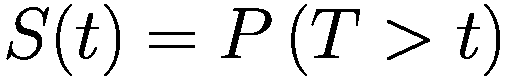

其中 `T` 是流失时间。该函数随时间递减，在 `t = 0` 时从 1 开始，当 `t` 趋近于无穷大时趋近于 0。

### 风险函数

风险函数 `lambda(t)` 是在时间 `t` 的瞬时流失率，前提是客户已存活至时间 `t`：

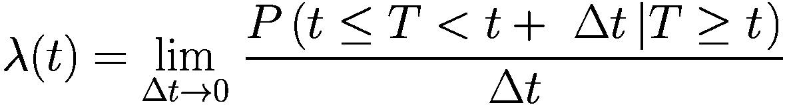

风险函数提供了在任何给定时间点流失风险的洞察。

### 生存函数与风险函数的关系

生存函数和风险函数通过以下方程相关联：

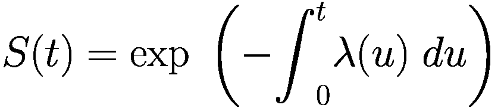

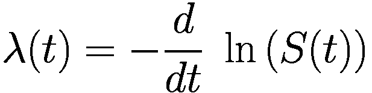

### 常见的生存分析模型

#### Cox 比例风险模型

一种半参数模型，用于估算在特定时间发生事件的风险。

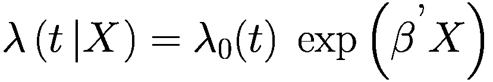

其中：

- `lambda_0(t)` 是基线风险函数。
- `beta` 是协变量 `X` 的系数向量。

Cox 模型的偏似然函数为：

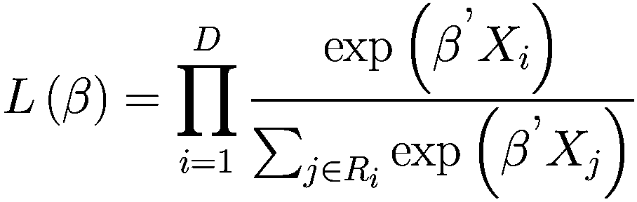

其中：

- `D` 是已发生事件的个体集合。
- `R_i` 是在时间 `t_i` 的风险集。

#### Kaplan-Meier 估计量

一种非参数统计量，用于根据生存数据估算生存函数。

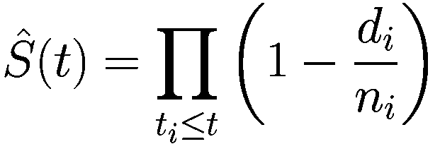

其中：

- `t_i` 是第 i 个事件发生的时间。
- `d_i` 是在时间 `t_i` 发生的事件（流失）数量。
- `n_i` 是在时间 `t_i` 之前处于风险中的客户数量。

计算示例：

假设我们有以下流失数据：

Kaplan-Meier 生存函数的计算如下：

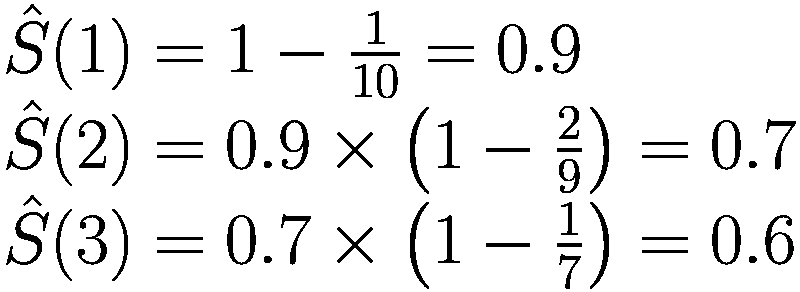

#### Weibull 模型

一种参数模型，假设事件时间服从 Weibull 分布。

### 计算步骤

1.  收集客户生命周期、删失指示符以及相关协变量（例如，人口统计信息、使用模式和营销活动）的数据。
2.  将生存分析模型（例如，Cox 比例风险模型）拟合到数据中，估算每个协变量的系数 `βi`。
3.  使用拟合模型估算每个客户在不同时间点的生存概率。
4.  通过对生存概率随时间进行积分，并考虑与每个客户相关的预期收入和成本，来计算 `CLV`。

### 优势

- 能够处理删失数据，使其适用于持续的客户关系。
- 提供影响客户生存因素的洞察。
- 可以纳入随时间变化的协变量。
- 适用于具有经常性收入流的业务。

### 劣势

- 需要专业知识来实施和解释。
- 计算量可能很大。
- 假设比例风险或事件时间服从特定分布，但这并非总是成立。

### 生存分析模型示例

假设一家基于订阅的公司希望使用 Cox 比例风险模型来估算 `CLV`。该模型可能包含以下协变量：

- 客户存续期
- 订阅计划
- 使用模式（例如，登录次数、功能使用情况）
- 营销活动曝光度

该模型将根据这些协变量，估算客户在任何给定时间点流失（变为不活跃）的风险。然后，可以使用随时间变化的生存概率来计算预期的未来收入，并最终计算每个客户的 `CLV`。

## 传统 CLV 模型

传统 `CLV` 模型适用于客户收入不随时间保持恒定的业务。它考虑了客户生命周期内发生的变化，例如不同的收入流以及留住客户的相关成本。

### 公式

`CLV = (GML × 留存率) / (1 + 折现率 - 留存率)`

### 解释

- `GML`：每个客户生命周期的毛利润。
- `留存率`：在设定时间段内留存在企业的客户百分比。
- `折现率`：用于考虑通货膨胀的百分比，通常设为 10%。

### 计算步骤

1.  通过从客户在其生命周期内产生的总收入中减去获取和服务该客户的相关成本，来确定每个客户生命周期的毛利润 (`GML`)。
2.  通过将特定时间段内留存的客户数量除以该时间段开始时的客户总数，来计算留存率。
3.  选择合适的折现率，以考虑货币的时间价值和通货膨胀。
4.  将计算出的值代入传统 `CLV` 公式。

### 优势

- 考虑了货币的时间价值以及留住客户的相关成本。
- 考虑了客户收入随时间的变化。
- 与简单 `CLV` 模型相比，提供了更全面的 `CLV` 估算。

### 劣势

- 假设留存率和折现率随时间保持不变，但这可能并不总是准确。
- 不考虑单个客户的特征或行为。
- 需要准确估算毛利润率和留存率，而这可能难以获得。

### 传统 CLV 模型示例

假设一家公司拥有以下数据：

- 每个客户生命周期的毛利润 (`GML`) = 1,000 美元
- 留存率 = 80%（即每年留存 80% 的客户）
- 折现率 = 10%

使用传统 `CLV` 公式，`CLV` 将为：

`CLV = (1,000 × 0.8) / (1 + 0.1 - 0.8) = 800 / 0.3 = 2,666.67 美元`

这表明，考虑到货币的时间价值和留住客户的相关成本，平均而言，预计每个客户将为公司带来 2,666.67 美元的生命周期价值。

#### 加速失效时间（AFT）模型

加速失效时间（AFT）模型是一种用于生存分析的参数模型，旨在估计协变量对受试者生存时间的影响。与假设协变量对风险函数产生乘法效应的 Cox 比例风险模型不同，AFT 模型假设协变量以一个恒定因子加速或延缓事件的生命进程。这使得 AFT 模型在比例风险假设可能不成立的情况下特别有用。

**模型设定：**

在 AFT 模型中，生存时间的对数被建模为协变量的线性函数。AFT 模型的一般形式可以指定为：

`log(T) = β0 + β1 X1 + β2 X2 + ... + βp Xp + ε`

其中：

- `T` 是生存时间。
- `β0` 是截距项。
- `βi` 是协变量 `Xi` 的系数。
- `ε` 是误差项，它遵循特定的分布（例如，正态分布、逻辑分布、威布尔分布）。

该模型也可以用生存函数 `S(t|θ)` 和风险函数 `λ(t|θ)` 来表示：

`S(t|θ) = S0(θ t)`

`λ(t|θ) = θ λ0(θ t)`

其中 `θ = exp(-[β1 X1 + ... + βp Xp])`。

**AFT 模型的优点：**

1.  **无需比例风险假设：** 与 Cox PH 模型不同，AFT 模型不需要比例风险假设，该假设认为协变量不同水平之间的风险比随时间恒定。这一假设在现实数据中经常被违反。
2.  **直接解释：** AFT 模型中的系数直接量化了协变量对生存时间的影响，使得解释更加直观。这些系数代表了生存时间的加速或延缓。
3.  **更高效的估计：** 基于渐近结果，AFT 模型可以比 Cox PH 模型产生更高效的参数估计，尤其是在样本量较小时。
4.  **洞察基线风险：** 当有足够的经验信息可用时，AFT 模型可以提供对基线风险函数形式的洞察，而半参数的 Cox PH 模型则无法做到这一点。
5.  **处理删失数据：** 与 Cox PH 模型一样，AFT 模型可以处理删失的生存数据。
6.  **可压缩性：** AFT 模型是可压缩的，这意味着系数的边际估计和条件估计是相同的。这一特性对于因果推断非常有用。

**AFT 模型的缺点：**

1.  **分布假设：** AFT 模型需要对生存时间做出特定的分布假设（例如，威布尔分布、对数逻辑分布、对数正态分布），这在实践中可能并不总是成立。
2.  **对异常值敏感：** AFT 模型可能对数据中的异常值或极端值敏感，这会影响参数估计。
3.  **模型选择困难：** 为 AFT 模型选择合适的分布可能具有挑战性，不同的分布可能导致不同的结果。
4.  **时变效应的解释：** 虽然 AFT 模型可以处理时变协变量，但对其效应的解释可能比 Cox PH 模型更复杂。
5.  **软件可用性有限：** 与广泛可用的 Cox PH 模型相比，一些统计软件包对 AFT 模型的支持或实现可能有限。

#### 示例 11.1

此示例创建合成数据以生成 RFM 细分，展示如何使用 PySpark 实现 RFM 细分的概念：

```python
# 此处为代码块示例
```

```
# 导入必要的库
from pyspark.sql import SparkSession
from pyspark.sql.functions import col, count, sum, max, lit, datediff, when, concat, percentile_approx
from pyspark.sql.types import DateType
import datetime
import random
```

# 初始化 Spark 会话

`spark` = `SparkSession`..`builder`..`appName`("RFM Analysis")..`getOrCreate`()

# 生成合成数据

```
num_customers = 100
num_transactions = 1000
customers = [f"customer_{i}" for i in range(1, num_customers + 1)]
transaction_dates = [datetime.date.today() - datetime.timedelta(days=random.randint(1, 365)) for _ in range(num_transactions)]
transaction_amounts = [random.uniform(10.0, 1000.0) for _ in range(num_transactions)]
data = [(random.choice(customers), transaction_dates[i], transaction_amounts[i]) for i in range(num_transactions)]
columns = ["CustomerID", "TransactionDate", "Amount"]
```

# 创建 DataFrame

```
df = spark.createDataFrame(data, columns)
```

# 显示数据
```
df.show(5)
```

# 计算最近一次消费、频率和货币价值

`current_date` = `datetime.date.today()`

# 添加一个包含当前日期的列

```
df = df.withColumn("CurrentDate", lit(current_date).cast(DateType()))
```

# 计算最近一次消费

```
recency_df = df.groupBy("CustomerID").agg(datediff(max("CurrentDate"), max("TransactionDate")).alias("Recency"))
```

# 计算频率

```
frequency_df = df.groupBy("CustomerID").agg(count("TransactionDate").alias("Frequency"))
```

# 计算货币价值
```
monetary_df = df.groupBy("CustomerID").agg(sum("Amount").alias("Monetary"))
```

# 合并最近一次消费、频率和货币价值

```
rfm_df = recency_df.join(frequency_df, "CustomerID").join(monetary_df, "CustomerID")
```

# 显示 RFM 值

```
rfm_df.show(5)
```

# 计算动态分位数

```
quantiles = [0.25, 0.50, 0.75]
recency_quantiles = rfm_df.approxQuantile("Recency", quantiles, 0.0)
frequency_quantiles = rfm_df.approxQuantile("Frequency", quantiles, 0.0)
monetary_quantiles = rfm_df.approxQuantile("Monetary", quantiles, 0.0)
```

# 使用分位数定义细分条件

## 按照Recency分配R_Segment
```python
rfm_df = rfm_df.withColumn("R_Segment",
    when(col("Recency") <= recency_quantiles[2], "R1")
    .when(col("Recency") <= recency_quantiles[1], "R2")
    .when(col("Recency") <= recency_quantiles[0], "R3")
    .otherwise("R4"))
```

## 按照Frequency分配F_Segment
```python
rfm_df = rfm_df.withColumn("F_Segment",
    when(col("Frequency") > frequency_quantiles[2], "F1")
    .when(col("Frequency") > frequency_quantiles[1], "F2")
    .when(col("Frequency") > frequency_quantiles[0], "F3")
    .otherwise("F4"))
```

## 按照Monetary分配M_Segment
```python
rfm_df = rfm_df.withColumn("M_Segment",
    when(col("Monetary") > monetary_quantiles[2], "M1")
    .when(col("Monetary") > monetary_quantiles[1], "M2")
    .when(col("Monetary") > monetary_quantiles[0], "M3")
    .otherwise("M4"))
```

## 拼接RFM_Segment
```python
rfm_df = rfm_df.withColumn("RFM_Segment", concat(col("R_Segment"), col("F_Segment"), col("M_Segment")))
```

# 显示细分后的 RFM 值
`rfm_df.show(10)`

# 停止 Spark 会话
`spark.stop()`

## 示例 11.2

我们再次使用合成数据，通过 PySpark 的 AFT 库生成 CLV 值。

### 导入必要的库
```python
from pyspark.sql import SparkSession
from pyspark.sql.functions import col, count, sum, max, lit, datediff, when, min, udf
from pyspark.sql.types import DateType, FloatType
from pyspark.ml.feature import VectorAssembler
from pyspark.ml.regression import AFTSurvivalRegression
from pyspark.ml.evaluation import RegressionEvaluator
import datetime
import random
```

### 初始化 Spark 会话
```python
spark = SparkSession.builder.appName("基于 AFT 模型的 CLV 生存分析").getOrCreate()
```

### 生成模拟数据
```python
num_customers = 100
num_transactions = 1000
customers = [f"customer_{i}" for i in range(1, num_customers + 1)]
transaction_dates = [datetime.date.today() - datetime.timedelta(days=random.randint(1, 365)) for _ in range(num_transactions)]
transaction_amounts = [random.uniform(10.0, 1000.0) for _ in range(num_transactions)]
churn_dates = [random.choice([datetime.date.today() - datetime.timedelta(days=random.randint(30, 365)), None]) for _ in range(num_customers)]
transaction_data = [(random.choice(customers), transaction_dates[i], transaction_amounts[i]) for i in range(num_transactions)]
churn_data = [(customers[i], churn_dates[i]) for i in range(num_customers)]
transaction_columns = ["CustomerID", "TransactionDate", "Amount"]
churn_columns = ["CustomerID", "ChurnDate"]
```

### 创建 DataFrame
```python
transaction_df = spark.createDataFrame(transaction_data, transaction_columns)
churn_df = spark.createDataFrame(churn_data, churn_columns)
```

### 展示数据
```python
transaction_df.show(5)
churn_df.show(5)
```

### 计算最近一次消费时间、消费频率和消费金额
```python
current_date = datetime.date.today()
```

### 添加当前日期列
```python
transaction_df = transaction_df.withColumn("CurrentDate", lit(current_date).cast(DateType()))
```

### 计算最近一次消费时间
```python
recency_df = transaction_df.groupBy("CustomerID").agg(datediff(max("CurrentDate"), max("TransactionDate")).alias("Recency"))
```

### 计算消费频率
```python
frequency_df = transaction_df.groupBy("CustomerID").agg(count("TransactionDate").alias("Frequency"))
```

### 计算消费金额
```python
monetary_df = transaction_df.groupBy("CustomerID").agg(sum("Amount").alias("Monetary"))
```

### 合并 RFM 值
```python
rfm_df = recency_df.join(frequency_df, "CustomerID").join(monetary_df, "CustomerID")
```

### 将 RFM 数据与流失数据合并
```python
rfm_churn_df = rfm_df.join(churn_df, "CustomerID")
```

### 将空值的流失日期填充为未来日期，表示未流失
```python
future_date = current_date + datetime.timedelta(days=365)
rfm_churn_df = rfm_churn_df.withColumn("ChurnDate", when(col("ChurnDate").isNull(), lit(future_date)).otherwise(col("ChurnDate")))
```

### 计算客户生命周期（首次交易到流失日期的天数）
```python
tenure_df = transaction_df.groupBy("CustomerID").agg(min("TransactionDate").alias("FirstTransactionDate"))
rfm_churn_df = rfm_churn_df.join(tenure_df, "CustomerID")
rfm_churn_df = rfm_churn_df.withColumn("Tenure", datediff(col("ChurnDate"), col("FirstTransactionDate")))
```

### 计算事件（是否流失）
```python
rfm_churn_df = rfm_churn_df.withColumn("Event", when(col("ChurnDate") < lit(current_date), 1).otherwise(0))
```

### 为 AFT 模型组装特征
```python
assembler = VectorAssembler(inputCols=["Recency", "Frequency", "Monetary"], outputCol="features")
rfm_churn_df = assembler.transform(rfm_churn_df)
```

### 将数据拆分为训练集和测试集
```python
train_df, test_df = rfm_churn_df.randomSplit([0.8, 0.2], seed=12345)
```

### 拟合 AFT 生存回归模型
```python
aft = AFTSurvivalRegression(featuresCol="features", labelCol="Tenure", censorCol="Event")
aft_model = aft.fit(train_df)
```

### 预测测试集的生存概率
```python
predictions = aft_model.transform(test_df)
```

### 展示预测结果
```python
predictions.select("CustomerID", "features", "Event", "Tenure", "prediction").show(5)
```

### 计算平均月收入
```python
rfm_churn_df = rfm_churn_df.withColumn("AvgMonthlyRevenue", col("Monetary") / (col("Tenure") / 30))
```

### 使用生存分析计算 CLV 的函数
```python
def calculate_clv(rfm_churn_df, predictions):
    # 将预测结果与原始 DataFrame 合并
    rfm_churn_df = rfm_churn_df.join(predictions.select("CustomerID", "prediction"), "CustomerID")
    # 计算 CLV
    rfm_churn_df = rfm_churn_df.withColumn("PredictedCLV", col("AvgMonthlyRevenue") * col("prediction") / 30)  # 将天数转换为月数
    return rfm_churn_df
```

### 应用 CLV 计算
```python
clv_df = calculate_clv(rfm_churn_df, predictions)
```

### 使用实际流失日期计算实际 CLV
```python
clv_df = clv_df.withColumn("ActualCLV", col("AvgMonthlyRevenue") * (col("Tenure") / 30))
```

### 确保评估所需的列可用
```python
clv_df_eval = clv_df.select("PredictedCLV", "ActualCLV")
```

### 展示最终的 CLV 数据
```python
clv_df.select("CustomerID", "Recency", "Frequency", "Monetary", "Tenure", "AvgMonthlyRevenue", "prediction", "PredictedCLV", "ActualCLV").show(10)
```

### 评估 CLV 预测的准确性
```python
evaluator_mae = RegressionEvaluator(labelCol="ActualCLV", predictionCol="PredictedCLV", metricName="mae")
mae = evaluator_mae.evaluate(clv_df_eval)
print(f"平均绝对误差 (MAE): {mae}")

evaluator_mse = RegressionEvaluator(labelCol="ActualCLV", predictionCol="PredictedCLV", metricName="mse")
mse = evaluator_mse.evaluate(clv_df_eval)
print(f"均方误差 (MSE): {mse}")

evaluator_rmse = RegressionEvaluator(labelCol="ActualCLV", predictionCol="PredictedCLV", metricName="rmse")
rmse = evaluator_rmse.evaluate(clv_df_eval)
print(f"均方根误差 (RMSE): {rmse}")
```

### 停止 Spark 会话
```python
spark.stop()
```

# 营销投资回报率 (`ROMI`)

营销投资回报率 (`ROMI`) 是企业衡量营销活动效果的关键指标。它量化了营销活动产生的收入与所投入成本之间的关系，帮助企业优化营销支出。在当今数据驱动的世界中，准确计算 `ROMI` 需要利用多种数据科学模型和技术，以捕捉消费者行为和营销影响的复杂性。

## `ROMI` 的基本公式

`ROMI` 的基本公式为：

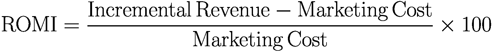

其中：

- `增量收入`：营销活动带来的额外收入。
- `营销成本`：营销活动的总成本。

该公式提供了 `ROMI` 的宏观视角，但在实践中，计算过程更为复杂，需要结合各种数据科学技术以确保准确性和可靠性。

## 使用数据科学模型计算 `ROMI` 的分步方法

### 第一步：数据收集与准备

*数据收集*是计算 `ROMI` 的第一步。它涉及从各种来源收集数据，以全面了解营销活动及其对收入的影响。这包括：

- **客户数据：** 人口统计信息、购买历史和行为数据。
- **营销数据：** 营销活动的详细信息，包括成本、展示次数、点击次数和转化次数。
- **销售数据：** 交易记录、订单金额和日期。
- **网站分析数据：** 网站流量、用户交互和转化率。

每个数据源都提供了宝贵的见解，有助于全面理解营销效果。

*数据准备*涉及清洗、转换和合并这些数据源，以创建一个适合分析的统一数据集。

- **数据清洗：** 删除重复项、处理缺失值并纠正错误，以确保数据质量。
- **数据转换：** 将数据转换为适合分析的格式。这可能涉及将每日数据汇总为月度数据、标准化数值或对分类变量进行编码。
- **数据合并：** 将来自不同来源的数据组合成一个包含所有相关信息的单一数据集。

**示例：** 一家电商零售商从其 `CRM` 系统、营销自动化平台、电商网站和网站分析工具收集数据。这些数据经过清洗、转换和合并，以创建一个用于分析的全面数据集。

### 第二步：客户细分

客户细分涉及根据共同特征将客户划分为不同的群体。这有助于针对不同的客户群体定制营销策略，并确定不同群体对营销活动的反应。

客户细分技术：

- **`K-Means` 聚类：** 一种流行的算法，根据客户的相似性将其划分为 `K` 个聚类。
- **层次聚类：** 通过合并或拆分现有聚类来构建聚类的层次结构。
- **`DBSCAN`（基于密度的噪声应用空间聚类）：** 根据密度识别不同形状和大小的聚类。

客户细分的目的：

- 为不同的客户群体定制营销策略。
- 分析营销活动对不同客户群体的影响。
- 识别高价值群体，以便集中营销工作。

**示例：** 使用 `K-Means` 聚类，一家电商零售商根据最近一次购买时间、频率和货币价值（`RFM`）对客户进行细分。这有助于零售商了解哪些群体更有可能对特定营销活动做出反应，并据此分配预算。

### 第三步：归因建模

归因建模用于确定哪些营销渠道和接触点促成了转化。准确的归因对于理解营销活动的真实影响和优化未来的营销活动至关重要。

归因模型类型：

1. **单触点归因：**
    - **首次触点归因：** 将全部转化价值归因于第一个接触点。
    - **末次触点归因：** 将全部转化价值归因于最后一个接触点。

2. **多触点归因：**
    - **线性归因：** 将转化价值平均分配给所有接触点。
    - **时间衰减归因：** 将更多价值分配给更接近转化的接触点。
    - **基于位置的归因：** 为首次和末次接触点分配更高的价值，剩余价值在中间接触点之间分配。

3. **算法归因：** 使用机器学习模型，根据每个接触点的实际影响来分配转化价值。与基于规则的模型相比，这种方法更复杂，能提供更准确的见解。

归因建模的目的：

- 了解每个营销渠道对转化的贡献。
- 更有效地分配营销预算。
- 识别哪些接触点和渠道在推动转化方面最有效。

**示例：** 一家电商零售商使用线性归因模型，将转化价值平均分配给所有接触点。通过这样做，零售商可以深入了解每个营销渠道（例如，电子邮件、社交媒体、搜索引擎）如何促进整体转化，从而做出更明智的预算分配决策。

### 第四步：增量收入预测建模

预测建模使用历史数据来预测营销活动的收入影响。这涉及应用回归分析和机器学习算法，根据过去的行为预测未来的结果。

常见的预测模型：

- **线性回归：** 对因变量（例如，收入）和自变量（例如，营销支出）之间的关系进行建模。
- **时间序列分析：** 诸如 `ARIMA`（自回归积分滑动平均模型）和指数平滑等技术，根据过去的数据预测未来值。
- **机器学习模型：** 决策树、随机森林、梯度提升和神经网络等算法可以捕捉复杂关系并做出准确预测。

预测建模的目的：

- 预测未来营销活动的收入影响。
- 根据预测结果优化营销支出。
- 识别收入的关键驱动因素，并将营销工作集中在高影响力的活动上。

**示例：** 一家电商零售商使用梯度提升回归器来预测营销活动产生的增量收入。该模型使用历史数据进行训练，并使用均方误差等指标评估其性能。这有助于零售商预测未来活动的潜在收入影响，并就营销支出做出数据驱动的决策。

### 第五步：客户生命周期价值（`CLV`）分析

客户生命周期价值（`CLV`）是企业期望从单个客户在其整个生命周期中获得的总收入。它是理解营销活动长期影响和定制策略以最大化客户价值的关键指标。

`CLV` 分析的目的：

- 了解通过营销活动获取的客户的长期价值。
- 定制营销策略以最大化 `CLV`。
- 识别高价值客户，并将留存工作重点放在他们身上。

**示例：** 一家电商零售商计算历史 `CLV` 和预测 `CLV`，以了解营销活动的长期影响。预测模型根据客户特征和行为估算未来的 `CLV`，帮助零售商定制营销策略以最大化客户价值。

### 第六步：营销成本计算

营销成本包括与开展营销活动相关的所有费用。这包括广告支出等直接成本，以及人员和技术等间接成本。

营销成本的组成部分：

# ROMI 计算与产品参与度

## 营销成本计算

- **广告支出：** 与在线和离线广告渠道相关的成本。
- **人员成本：** 营销人员的薪资和福利。
- **技术成本：** 营销自动化平台、分析工具和其他技术的成本。
- **创意成本：** 与创建营销内容相关的成本，如图形设计和视频制作。

营销成本计算的目的：

- 准确核算所有营销费用。
- 计算营销活动产生的净利润。
- 确保全面了解营销活动的总投资。

**示例：** 一家电商零售商汇总了所有营销成本，包括广告支出、人员成本、技术成本和创意成本。通过准确核算这些费用，零售商确保`ROMI`计算能够反映营销活动的真实投资。

### 第 7 步：ROMI 计算

在完成所有组件的准备后，最后一步是使用前述公式计算 ROMI：


ROMI 计算的目的：

-   评估营销活动的有效性。
-   基于 ROMI 分析的洞察，优化未来的营销工作。
-   就营销支出和策略做出数据驱动的决策。

**示例：** 一家电商零售商计算了接触营销活动的客户所产生的增量收入，并与未接触的客户进行了比较。通过使用 ROMI 公式，该零售商确定了营销投资的回报，并深入了解了该活动的有效性。

## 高级技术与考量

### 高级归因模型

可以通过高级技术增强归因模型，以更准确地洞察营销活动的影响。

1.  **沙普利值归因：**
    -   一种合作博弈论方法，公平地将转化价值分配给所有接触点。
    -   它考虑了每个接触点对整体转化的边际贡献，从而更准确地反映每个渠道的影响。

2.  **马尔可夫链归因：**
    -   使用转移概率来模拟客户旅程，并据此分配转化。
    -   它捕捉了客户交互的概率性质，并提供了对转化路径中最具影响力接触点的洞察。

**目的：**

-   提高归因模型的准确性。
-   更深入地了解每个营销渠道的贡献。
-   基于更精确的归因数据优化营销支出。

**示例：** 一家电商零售商使用沙普利值归因，公平地将转化价值分配给客户旅程中的所有接触点。这种方法更准确地反映了每个渠道的影响，使零售商能够优化预算分配。

### 用于预测建模的机器学习

机器学习模型可用于增强 ROMI 计算的预测建模。这些模型能够捕捉复杂关系并提供更准确的预测。

常见的机器学习模型：

-   **神经网络：** 捕捉数据中复杂的非线性关系，以实现更准确的预测。
-   **集成方法：** 结合多个模型以提高预测准确性和稳健性。例如随机森林和梯度提升。

**目的：**

-   提高预测模型的准确性。
-   捕捉传统模型可能遗漏的复杂关系。
-   为增量收入和 `CLV` 提供更可靠的预测。

**示例：** 一家电商零售商使用神经网络来预测营销活动产生的增量收入。该模型捕捉了数据中的复杂关系，提供了更准确的预测，并帮助零售商优化营销支出。

### 实时数据处理

实时数据处理框架能够基于最新数据持续更新 ROMI 计算。这使得企业能够做出更及时、更明智的决策。

**技术：**

-   **流式分析：** 使用 `Apache Kafka` 和 `Apache Spark Streaming` 等实时数据处理框架，在数据到达时进行处理。
-   **实时仪表盘：** 实施实时仪表盘以可视化 ROMI 及其他关键指标，从而实现快速决策。

**目的：**

-   提供关于营销活动有效性的最新洞察。
-   基于实时数据，能够及时调整营销策略。
-   提高对客户行为和市场条件变化的响应能力。

**示例：** 一家电商零售商实施了实时仪表盘，以持续监控 ROMI 及其他关键指标。通过实时处理数据，该零售商可以根据最新洞察快速调整营销策略。

### 实验与 A/B 测试

A/B 测试等实验框架有助于隔离特定营销活动的影响，并提供更准确的增量收入估算。

**技术：**

-   **A/B 测试：** 将客户随机分配到对照组和测试组，以隔离特定营销活动的影响。比较两组之间的结果，以估算营销活动产生的增量收入。
-   **多臂老虎机：** 一种自适应实验框架，平衡探索与利用以优化营销策略。它根据实时表现数据，动态地将资源分配给最有前景的营销活动。

**目的：**

-   隔离特定营销活动的影响。
-   提供更准确的增量收入估算。
-   基于实验结果优化营销策略。

**示例：** 一家电商零售商进行 A/B 测试，以评估一项新电子邮件营销活动的影响。客户被随机分配到对照组（未接触）和测试组（接触活动）。通过比较两组之间的结果，零售商估算了该活动产生的增量收入，并计算了 ROMI。

### ROMI 结论

使用数据科学模型计算营销投资回报率 (`ROMI`) 涉及多种技术的结合，以准确地将收入归因于营销工作、预测未来收入并了解客户的长期价值。通过利用高级模型和方法，企业可以更深入地了解其营销活动的有效性，并做出数据驱动的决策来优化营销策略。

总之，使用数据科学模型计算 `ROMI` 的关键步骤包括：

1.  **数据收集与准备：** 从各种来源收集和准备数据，以创建统一的数据集。
2.  **客户细分：** 将客户划分为不同的群体，以定制营销策略并了解特定细分市场的反应。
3.  **归因建模：** 使用高级归因模型确定每个营销渠道对转化的贡献。
4.  **增量收入预测建模：** 使用机器学习模型预测营销活动的收入影响。
5.  **客户生命周期价值 (`CLV`) 分析：** 了解客户的长期价值，并定制营销策略以最大化 `CLV`。
6.  **营销成本计算：** 准确核算所有营销费用，以计算营销活动产生的净利润。
7.  **ROMI 计算：** 使用 ROMI 公式评估营销活动的有效性，并就营销支出做出数据驱动的决策。

通过整合这些步骤并利用高级数据科学模型，企业可以准确计算 `ROMI`，优化营销工作，并最终推动营销投资获得更高回报。

# 产品参与度评分

`产品参与度评分` 是用于量化用户如何与产品交互的指标。这些评分提供了对用户行为、产品性能和整体用户满意度的洞察。它们对于了解产品的健康状况和指导业务决策至关重要。

## 产品参与度评分的重要性

产品参与度评分至关重要，原因如下：

1.  **用户留存**：高参与度通常与更好的用户留存率相关。了解参与度有助于识别那些能吸引用户回访的功能。
2.  **功能改进**：通过分析参与度评分，公司可以确定哪些功能最受欢迎，哪些需要改进。
3.  **个性化**：参与度评分可用于个性化用户体验，根据个人用户偏好定制内容和功能。
4.  **市场营销与销售**：参与度高的用户更有可能转化为付费客户。参与度指标有助于优化营销策略。
5.  **产品开发**：从参与度评分中获得的洞察可以为产品开发提供信息，确保新功能符合用户需求和偏好。

## 示例 1：流媒体平台

参与度指标：

1.  **观看时长**：观看内容的总时间。
2.  **会话频率**：特定时间段内每个用户的会话次数。
3.  **内容互动**：对内容的点赞、评论、分享及其他互动次数。
4.  **流失率**：停止使用平台的用户百分比。
5.  **订阅率**：转化为付费订阅的用户百分比。

### 计算参与度评分

假设一个流媒体平台收集用户交互数据，包括观看时长、会话频率和内容互动。你可以通过组合这些指标来创建一个综合参与度评分。标准化通常涉及将每个指标缩放到一个公共范围，例如 0 到 1。

#### 步骤 1：标准化指标

首先，你需要对指标进行标准化，以确保它们处于同一尺度。

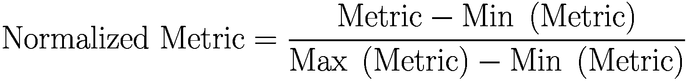

#### 步骤 2：分配权重

接下来，根据每个指标的重要性为其分配权重。例如：

- 观看时长：40%
- 会话频率：30%
- 内容互动：30%

#### 步骤 3：计算综合评分

最后，计算综合参与度评分。

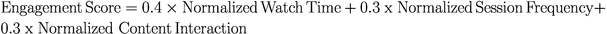

计算示例：

假设某用户的标准化指标如下：

- 标准化观看时长：0.8
- 标准化会话频率：0.6
- 标准化内容互动：0.7

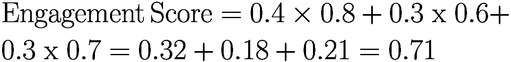

## 示例 2：软件应用

以下是参与度指标：

### 计算参与度评分

对于软件应用，你可以采用与流媒体平台类似的方法。

#### 步骤 1：标准化指标

对指标进行标准化，以确保它们处于同一尺度。


#### 步骤 2：分配权重

根据每个指标的重要性为其分配权重。例如：

- 活跃天数：25%
- 功能使用量：25%
- 会话时长：20%
- 错误率：10%
- 留存率：20%

#### 步骤 3：计算综合评分

计算综合参与度评分。

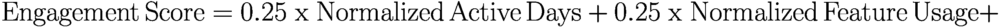

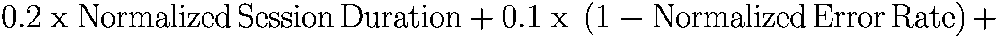

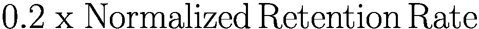

> **注意**：错误率从 1 中减去，因为更高的错误率意味着更低的参与度。

计算示例：

假设某用户的标准化指标如下：

- 标准化活跃天数：0.9
- 标准化功能使用量：0.7
- 标准化会话时长：0.8
- 标准化错误率：0.2
- 标准化留存率：0.85

![$$ {\displaystyle \begin{array}{l}\mathrm{参与度评分}=0.25\;\mathrm{x}\;0.9+0.25\;\mathrm{x}\;0.7+0.2\;\mathrm{x}\;0.8+0.1\;\mathrm{x}\;\left(1-0.2\right)+\\ {}0.2\;\mathrm{x}\;0.85\left]\right\mathrm{参与度评分}=0.225+0.175+0.16+0.08+0.17=0.81\end{array}} $$

#### 注意事项

-   **错误率解读**：确保错误率的解读与其对参与度的影响一致。
-   **标准化一致性**：对所有指标（包括错误率）使用一致的标准化方法。
-   **权重调整**：根据每个指标的相对重要性以及错误率对整体参与度的影响来调整权重。
-   **验证**：使用真实数据验证修订后的参与度评分公式，以确保其在捕捉用户参与度方面的有效性。

#### 利用参与度评分进行决策

**流媒体平台：**

1.  **内容推荐**：使用参与度评分推荐能保持用户参与度的内容。
2.  **流失预测**：识别参与度评分低的用户，并针对他们采取留存策略。
3.  **营销活动**：根据用户参与度定制营销活动，以最大化效果。
4.  **产品开发**：专注于开发能推动更高参与度的功能和内容。

**软件应用：**

1.  **功能优先级排序**：使用参与度评分确定哪些功能对用户最重要，并优先开发。
2.  **用户引导**：为参与度评分低的用户优化引导流程，以改善其体验。
3.  **错误修复**：专注于降低高参与度功能的错误率，以维持用户满意度。
4.  **留存策略**：为参与度评分下降的用户制定有针对性的留存策略。

## 产品参与度评分的重要性

1.  **客户洞察：** 参与度评分提供了关于客户行为和偏好的宝贵见解，使企业能够做出明智的决策。
2.  **产品改进：** 通过识别哪些功能推动了参与度，公司可以集中精力改进和扩展这些功能。
3.  **收入增长：** 更高的参与度通常会提高客户留存率和转化率，从而推动收入增长。
4.  **竞争优势：** 有效监控并响应参与度指标的企业，可以通过持续提升用户体验来保持领先于竞争对手。
5.  **资源分配：** 参与度评分通过突出需要关注和投入的领域，帮助有效分配资源。

使用数据科学和数学技术计算产品参与度评分，可以量化衡量用户与产品的互动方式。这些评分对于理解用户行为、指导产品开发以及做出明智的业务决策至关重要。通过利用参与度指标，企业可以提高用户满意度、增加留存率，并最终推动增长。

总之，流媒体平台和软件应用程序的参与度评分可以通过结合标准化指标和加权平均值来计算。这些评分提供了关键洞察，可用于个性化用户体验、优化营销策略、改进产品功能以及有效分配资源。理解和利用参与度评分对于任何希望在当今竞争激烈的环境中蓬勃发展的企业都至关重要。

# 提升建模

提升建模（也称为增量建模或真实提升建模）是一种用于预测某项干预（例如营销活动）对个体行为增量影响的数据科学技术。与预测给定输入结果的传统预测模型不同，提升建模预测的是接受干预组与未接受干预组之间的结果差异。

## 提升建模的重要性

1.  **精准营销：** 提升建模有助于识别更有可能对干预做出积极响应的个体，从而实现更有效、更高效的营销策略。
2.  **成本效益：** 通过仅针对那些可能受干预影响的个体，企业可以降低营销成本并提高投资回报率。
3.  **客户留存：** 提升建模可用于识别有流失风险、且在接受激励后更有可能留存的客户。
4.  **个性化：** 提升建模能够实现个性化的干预策略，提高客户满意度和忠诚度。

## 提升建模的理论

提升建模涉及创建两个模型：

1.  **干预模型：** 预测接受干预个体的结果。
2.  **对照组模型：** 预测未接受干预个体的结果。

这两个模型预测结果之间的差值即为提升量。

## 提升建模的基本步骤

1.  **数据收集：** 收集接受干预和未接受干预个体的数据，包括可能影响其行为的特征。
2.  **特征工程：** 创建能够捕捉个体特征的相关特征。
3.  **模型构建：** 分别为干预组和对照组构建模型。
4.  **提升量计算：** 通过从干预模型的预测结果中减去对照组模型的预测结果来计算提升量。
5.  **评估：** 使用适当的指标（如 `Qini` 系数或提升曲线）评估提升模型。

在提升建模中，根据干预的潜在影响，个体可以被划分为四个关键类别。这些类别通常使用一个二乘二矩阵（象限）来可视化，其中坐标轴代表在有干预和无干预情况下做出积极响应的可能性。这些类别如下：

1.  **可说服者**
    -   **定义：** 可能对干预做出积极响应的个体。
    -   **特征：** 没有干预时他们不会采取期望行动，但有干预时会。
    -   **影响：** 正向提升。
    -   **示例：** 只有收到促销邮件才会购买产品的客户。

2.  **确定者**
    -   **定义：** 无论是否接受干预都会采取期望行动的个体。
    -   **特征：** 无论是否接受干预，他们的行为都不会改变。
    -   **影响：** 无提升（中性）。
    -   **示例：** 无论是否收到促销邮件都会购买产品的客户。

3.  **无望者**
    -   **定义：** 无论是否接受干预都不太可能采取期望行动的个体。
    -   **特征：** 无论是否接受干预，他们都不会做出积极回应。
    -   **影响：** 无提升（中性）。
    -   **示例：** 无论是否收到促销邮件都不会购买产品的客户。

4.  **勿扰者**
    -   **定义：** 可能对干预产生负面反应的个体。
    -   **特征：** 没有干预时他们可能会采取期望行动，但由于干预，他们这样做的可能性降低了。
    -   **影响：** 负向提升。
    -   **示例：** 可能因促销邮件感到厌烦，并因此决定不购买产品的客户。

### 使用提升象限矩阵

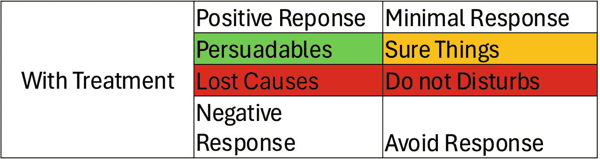

定位策略：

-   **可说服者：** 将资源集中用于这些个体，因为他们能带来最高的增量收益。
-   **确定者：** 不要在这些个体上花费资源，因为他们无论如何都会采取期望行动。
-   **无望者：** 避免针对这些个体，因为他们不太可能做出积极回应。
-   **勿扰者：** 将这些个体排除在干预之外，以避免潜在的负面反应。

## 实际应用

假设你正在为一个新产品开展营销活动。在构建并应用你的提升模型后，你发现以下情况：

- **可说服者：** 2,000 名客户
- **确定者：** 1,500 名客户
- **无望者：** 3,000 名客户
- **勿扰者：** 500 名客户

### 示例：零售业务的提升建模

假设一家零售企业希望实施提升模型，以提高旨在增加客户购买量的促销活动的效果。

模拟数据：

1. **客户数据：** 包括客户人口统计信息、购买历史和参与度指标。
2. **处理数据：** 指示客户是否收到了促销优惠。
3. **结果数据：** 表示客户在活动期间是否进行了购买。

以下是一小部分模拟数据示例：

| `CustomerID` | `Age` | `Gender` | `Purchase History` | `EngagementScore` | `Treatment` | `Purchase` |
| --- | --- | --- | --- | --- | --- | --- |
| 1 | 25 | F | 5 | 80 | 1 | 1 |
| 2 | 34 | M | 2 | 60 | 0 | 0 |
| 3 | 45 | F | 10 | 90 | 1 | 1 |
| 4 | 30 | M | 3 | 50 | 0 | 1 |
| 5 | 50 | F | 8 | 85 | 1 | 0 |

- **`CustomerID`：** 每个客户的唯一标识符。
- **`Age`：** 客户的年龄。
- **`Gender`：** 客户的性别。
- **`Purchase History`：** 客户过去的购买次数。
- **`Engagement Score`：** 代表客户与品牌互动程度的分数。
- **`Treatment`：** 指示客户是否收到了促销优惠（1 表示已处理，0 表示对照组）。
- **`Purchase`：** 指示客户在活动期间是否进行了购买（1 表示是，0 表示否）。

### 提升建模的逐步流程

#### 第 1 步：数据收集与准备

收集已处理和未处理客户的数据，包括其人口统计信息、购买历史和参与度指标。确保数据干净且一致。

#### 第 2 步：特征工程

创建能够捕捉客户特征的特征。例如，可以创建年龄与参与度分数之间的交互项，或者购买历史与处理状态之间的交互项。

#### 第 3 步：模型构建

为处理组和对照组分别构建模型。这些模型用于预测每组客户的购买可能性。

1. **处理模型：** 使用收到促销优惠的客户数据。
2. **对照模型：** 使用未收到促销优惠的客户数据。

#### 第 4 步：提升值计算

通过从处理模型的预测值中减去对照模型的预测值，计算每个客户的提升值。


#### 第 5 步：评估

使用 Qini 系数或提升曲线等指标评估提升模型。这些指标衡量模型在识别最有可能对处理产生积极反应的客户方面的有效性。

### 详细示例

#### 第 1 步：数据收集与准备

假设您已经收集了 1,000 名客户的数据，包括人口统计信息、购买历史、参与度分数、处理状态和购买结果。

#### 第 2 步：特征工程

您创建了以下特征：

- **`Age`：** 客户的年龄。
- **`Gender`：** 客户的性别（编码为 0 表示男性，1 表示女性）。
- **`Purchase History`：** 过去的购买次数。
- **`Engagement Score`：** 客户参与度分数。
- **`Treatment`：** 指示客户是否收到促销优惠的二元变量。

#### 第 3 步：模型构建

您将数据分为处理组和对照组，并为每组构建逻辑回归模型。

处理模型：

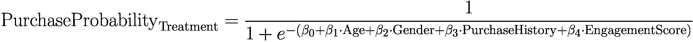

对照模型：

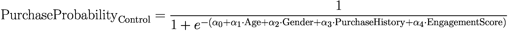

#### 第 4 步：提升值计算

对于每个客户，您使用两个模型计算预测的购买概率，并计算提升值。


计算示例：

对于具有以下特征的客户：

- `Age`：30
- `Gender`：男性
- `Purchase History`：3
- `Engagement Score`：70

假设处理模型预测的购买概率为 0.6，对照模型预测的购买概率为 0.4。

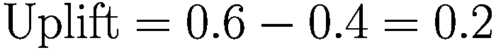

#### 第 5 步：评估

您使用 Qini 系数评估提升模型，该系数衡量作为目标客户累计数量函数的累计增量响应。

Qini 曲线：

- 在 y 轴上绘制累计增量响应，在 x 轴上绘制目标客户的累计数量。
- Qini 系数是 Qini 曲线与基线之间的面积。

### 示例：电子邮件营销活动

假设您在一家在线零售公司工作，希望开展一次电子邮件营销活动以增加销售额。您有 10,000 名客户的名单，需要决定哪些人应该收到这封邮件。

1. **定义处理组和对照组**
    - **处理组：** 5,000 名客户将收到营销邮件。
    - **对照组：** 5,000 名客户不会收到营销邮件。
2. **开展活动**
    - 向处理组发送邮件。
    - 等待一段时间（例如一个月），然后衡量结果（例如，客户是否进行了购买）。
3. **收集数据**
    - 收集处理组和对照组的购买数据。
    - 假设数据显示如下：
        - **处理组：** 5,000 名客户中有 1,000 名进行了购买。
        - **对照组：** 5,000 名客户中有 800 名进行了购买。
4. **计算提升值**
    - 提升值是处理组和对照组响应率之间的差异。
    - 处理组的响应率：`1000/5000 = 20%`
    - 对照组的响应率：`800/5000 = 16%`
    - 提升值：`20% - 16% = 4%`
5. **开发提升模型**
    - 使用机器学习技术（例如决策树、随机森林）构建一个提升模型，用于预测邮件对每个客户的增量影响。
    - 该模型将使用过去的购买行为、人口统计信息、浏览历史等特征来估算每个客户的提升值。
6. **细分客户**
    - **可说服者：** 预测具有正向提升值的客户（更有可能因为邮件而购买）。
    - **确定购买者：** 预测无论是否收到邮件都会购买的客户。
    - **无动于衷者：** 预测无论是否收到邮件都不会购买的客户。
    - **勿扰客户：** 预测具有负面响应的客户（更不可能因为邮件而购买）。
7. **优化活动**
    - 将邮件活动重点放在可说服者身上，以最大化投资回报率 (ROI)。
    - 避免向确定购买者（无额外收益）、无动于衷者（浪费精力）和勿扰客户（潜在的负面影响）发送邮件。

#### 提升建模的优势

- **精准营销**：通过识别可被说服的客户，你可以将营销精力集中在最可能受影响的群体上，从而提高营销活动的效率。
- **降低成本**：避免向“铁定购买者”、“无动于衷者”和“反感打扰者”进行营销，从而减少资源浪费，并最大程度降低潜在的负面影响。
- **改善客户体验**：避免发送不必要或可能引起反感的沟通信息，有助于与客户保持积极的关系。

总之，提升建模能帮助企业将营销重点放在最可能因营销活动而受到积极影响的个体上，从而带来更好的成果和更高效的资源利用。

提升建模是一项强大的技术，它通过锁定最可能对营销干预产生积极反应的个体，帮助企业优化营销策略。借助数据科学和机器学习模型，企业可以准确预测营销活动的增量影响，从而实现更高效、更具成本效益的营销活动。

在零售业务的示例中，我们演示了如何收集和准备数据、创建相关特征、构建实验组和对照组模型、计算提升值，并使用 Qini 系数评估模型。这套全面的方法使企业能够做出数据驱动的决策，提升客户参与度，并最大化投资回报率。

### 总结

总之，本章讨论了多种框架，包括以下内容：

1. **客户生命周期价值 (CLV)**
    客户生命周期价值 (CLV) 是一项关键指标，用于估算客户在整个关系存续期间为企业带来的总价值。通过预测 CLV，企业可以识别高价值客户，并据此调整营销策略。

2. **营销投资回报率 (ROMI) 框架**
    有效的营销对业务增长至关重要，但理解营销投资回报率 (ROMI) 同样关键。预测模型可用于衡量 ROMI，帮助企业更高效地分配营销预算。通过叠加预测模型，企业可以预测营销活动的影响、优化支出并最大化回报。

3. **衡量产品参与度**
    产品参与度指标能揭示客户如何与产品互动，这对产品开发和客户满意度至关重要。通过理解这些指标，企业可以提升用户体验并推动产品改进。

4. **提升建模**
    提升建模专注于识别那些能因特定干预措施而受到积极影响的个体。通过预测营销活动的增量影响，企业可以锁定最可能做出积极回应的客户，从而提高留存率并最大化营销效率。

### 结论

通过将预测模型叠加成综合框架，企业可以解锁更深入的洞察，并制定更有效的策略。本章旨在深入阐述这些模型如何协同工作以创造价值，并为利用预测分析实现业务目标提供实用指导。通过探索客户生命周期价值、营销投资回报、产品参与度指标以及提升建模框架，你将掌握在自己的组织中应用这些强大工具所需的知识。

# 索引

## A

- A/B 测试
- 加速失效时间（AFT）模型
    - 优势
    - 劣势
- 累加器
- 准确率
- 激活函数
    - 带泄露修正线性单元/参数化修正线性单元函数
    - 线性激活
    - 修正线性单元函数
    - S 型函数
    - Softmax 函数
    - Swish 函数
    - 双曲正切函数
- 自适应梯度（AdaGrad）优化器
- 自适应矩估计（Adam）优化器
- AFT 模型（参见加速失效时间（AFT）模型）
- 凝聚层次聚类
- 聚合函数
- 算法函数
- ALS（参见交替最小二乘法（ALS））
- ALS 矩阵分解
- 备择假设
- 交替最小二乘法（ALS）
- Anaconda
- 分析函数
- 分析学
- ANNs（参见人工神经网络（ANNs））
- Apache Spark
- `approxQuantile` 函数
- 人工神经网络（ANNs）
- 自动化机器学习
- 自动化机器学习流水线
    - 银行数据集
    - PySpark
- 自动化模型
- 自动化模型构建工具
- 自动化模型 ROC 曲线
- 自动化流水线框架
- 自动化框架

## B

- Bagging
- 基线模型
- 基本操作
    - 访问数据
    - 计算圆周率
    - 上传数据
- 批量归一化
- 贝叶斯定理
    - 贝叶斯演示案例
    - 后验概率
- 大数据环境
- 二分类模型
- 二元目标
- 二分 k-means
- 自助聚合
- `Broadcast` 函数
- B2B（参见企业对企业（B2B））
- 企业对企业（B2B）

## C

- CAC（参见客户获取成本（CAC））
- 缓存
- 基数
- 笛卡尔坐标
- Catalyst 优化器
- 分类变量
- 质心连接
- 切比雪夫距离
- `ChiSq` 选择器
- 卡方
- 卡方值
- 经典聚类技术
- 分类指标
- 聚类
    - 凝聚与分裂步骤
    - 层次聚类的类型
- 聚类技术
- 聚类演示
- CLV（参见客户生命周期价值（CLV））
- CLV 模型
    - AFT 模型
    - 历史模型
    - 预测模型（参见预测性 CLV 模型）
    - 简单模型
    - 生存分析（参见生存分析模型）
    - 传统 CLV 模型
- `coalesce` 函数
- 同期群分析
- 协同过滤
    - 基于物品
    - 基于用户
- `collect_list` 函数
- `colRegex` 函数
- 组合指标
- 混淆矩阵
- 列联表
- 连续目标
- 对照组
- 基于转化的指标
- `countDistinct` 函数
- Cox 比例风险模型
- 信用卡数据集
- CRISP–DM（参见跨行业数据挖掘标准流程（CRISP–DM））
- 跨行业数据挖掘标准流程（CRISP–DM）
- 自定义变量选择过程
    - 自定义转换器
    - 信息价值与 WOE
        - 优势
        - 计算
        - 连续变量，单调分箱
        - 单调分箱，斯皮尔曼相关性
        - 预测能力
        - 斯皮尔曼相关性
        - 斯皮尔曼相关性值指南
        - 值
    - 变量转换与选择
    - 基于投票的选择
- `customcorrelation.py`
- 客户获取成本（CAC）
- 客户生命周期价值（CLV）
    - 计算 ROMI 的方法
    - 平均购买价值
    - 基本公式
    - 最佳实践，利用 CLV
    - 业务与营销
    - 在商业模式中
        - B2B 公司
        - 电子商务零售
        - SaaS 公司
        - 订阅制模式
    - 实施与利用中的挑战
        - 考虑 CAC
        - 平衡短期与长期策略
        - 客户行为变化
        - 数据质量与可用性
        - 组织协调与认同
    - 常见类型
        - 同期群分析
        - 历史 CLV
        - 预测性 CLV
        - 基于留存率的 CLV
        - RFM 分析
    - 客户生命周期
    - 客户留存
    - 客户细分
    - 财务预测
    - 营销策略
    - 购买频率
    - 推荐/口碑营销
    - 资源分配
    - 模型类型（参见 CLV 模型）
- 自定义转换器类
    - `DataFrame`
    - `Estimator`
    - 面向对象编程概念
        - 抽象
        - 类
        - 继承
        - 方法
        - 多态
    - 参数
    - 流水线
    - `RandomForest` 代码
    - `RandomForestClassifier`
    - 转换器

## D

# D

## DAG（参见有向无环图（DAG））
## Databricks 社区版
### 云服务提供商
### 集群创建
### 创建账户
### Databricks 选项
### 数据文件，导入说明
### 笔记本
## 数据压缩
## DataFrames
## 数据本地性
## 数据操作
### 变量类型转换
### 数据类型函数
### 概览已识别变量并迭代列
#### `agg` 函数
#### 预算与流行度
#### 自定义 DataFrame
#### 删除/重命名
#### 公式
#### `lit` 函数
#### `mean_popularity`
#### Python 函数
#### `StructField`
#### `StructType`
#### 用户自定义函数
#### 变量
#### 方差计算
#### `when` 函数
#### `withColumn` 函数
### 计数记录
### DataFrames 描述性统计
### 过滤列
#### `like` 表达式
#### 匹配
#### 元字符
#### 量词
#### 正则表达式
### 元数据
### 缺失值
### 单变量频数
### 过滤输出
### 排序
### 从文件读取数据
### 从 Hive 表读取数据
### 字符串函数
### 子集列/视图
### 概览
### 唯一/不同值及其计数
### 窗口函数（参见窗口函数）
## 数据操作
## 数据运算
## 数据科学
## 数据科学家
## 数据序列化
## 数据集
## 数据类型
## 数据可视化
### 分类数据
### 电影数据集，1960/1970
### 过滤
### 直方图函数
### 包
### 流行度数据
## 十分位划分
## 决策树
### 算法规范
### 信用卡审批数据集
### 熵
### 特征重要性
### 基尼不纯度
### 信息增益
#### 年龄变量
#### 最终树
#### 首次分裂公式
#### 观测值
#### 第二次分裂
### 叶节点
### 数值变量
### 剪枝
### PySpark 代码
#### 分类
#### 回归
### 根/父节点
## 有向无环图（DAG）
## 狄利克雷分布
### 教育与环境
### 狄利克雷表示
## 距离度量
### 欧几里得距离
## 分裂聚类
## 基于 Docker 的部署
### 容器
### 创建 Docker 并执行评分代码
### 目录结构
### `Dockerfile` 文件
### 更快的软件交付周期
### `helper.py` 文件
### 微服务架构
### 可移植性与
### `requirements.txt` 文件
## 基于 Docker 的安装
### Docker
### Docker 镜像
### PySpark Docker
### PySpark Docker 命令
#### 建立端口
#### 外部文件
#### 交互式/bash 模式
#### 运行命令
#### 标签，空间优化
### `docker-compose` 文件
### `docker-compose.yml` 文件
## `dropDuplicates`
## Dropout

# E

## EDA（参见探索性数据分析（EDA））
## 基于 EDA 的变量选择
## 特征值
## 工程团队
## 熵
## 误差函数
## 欧几里得距离
## 评估连续模型性能
## 实验
### 持续改进
### 数据驱动决策
### 揭示因果关系
## 实验过程
## 解释方差
## 探索性数据分析（EDA）
### 基数
### 房价数据集
### 缺失值（参见缺失值，EDA）
### 变量选择过程

# F

## F1 分数
## 容错
## 特征
## `features_df` DataFrame
## `fillna()`
## `float` 值
## 公式分解
## 四折交叉验证

# G

## 吉布斯采样
## 基尼不纯度
## GitHub 账户
## GitHub Codespaces
### `file_location`
### 笔记本
### 包验证
### Python 和 Jupyter 扩展，微软
### Python 环境
### Python 版本
### 测试
### VS Code 起始页
### VS Code 终端
## 金发姑娘点
## “拟合优度”
## 梯度提升
## 梯度下降
## GraphX

# H

## `helper.py` 文件
## `histogram` 函数
## 历史 CLV
## 历史 CLV 模型
## 留出数据集
## 房屋类型变量
## 超参数调优
## 假设
## 假设检验
### A/B 测试
### 使用 PySpark 进行 A/B 测试
### 备择假设
### 早餐示例
### 主张
### 效应量
### 零假设
### p 值
### 用于实验的 PySpark
### PySpark 统计包
### 样本数据
### 来自 Kaggle 的样本数据
### 错误类型

# I

## `InferSchema`
## 信息隐藏
## 基于物品的协同过滤

# J

## 杰卡德演示
## Java 序列化
## Java 版本
## 连接
### 广播 DataFrames
### 全外连接
### ID
### 内连接
### 左反连接
### 左/左外连接
### 左半连接
### 元数据
### 右/右外连接
### 类型
## 连接，Spark 程序
### 广播连接
### 混洗哈希连接
### 排序合并连接
## Jupyter Notebook

# K

## K 折交叉验证
## k-means
## 柯尔莫哥洛夫-斯米尔诺夫（KS）
### 十分位
### 统计量
### 统计值
## 柯尔莫哥洛夫-斯米尔诺夫统计量
## 柯尔莫哥洛夫-斯米尔诺夫检验
## Kryo 序列化
## KS（参见柯尔莫哥洛夫-斯米尔诺夫（KS））

# L

## `landing_page` 分配
## 拉普拉斯平滑
## 潜在狄利克雷分配（LDA）
### 应用
### 组合
### 演示
### 实现
### 超参数设置
### tf–idf 值
### 主题分配
## LDA（参见潜在狄利克雷分配（LDA））
## 数据泄露
### 自助法
### 目标类型变体
## 带泄露修正线性单元/参数化修正线性单元函数
## 留一组交叉验证
## 留一法交叉验证
## 提升图
## 有限内存 BFGS
## 线性激活函数
## 线性回归
### 系数
### 概念
### 方程
### 解释
### 最小二乘法/最小二乘回归
### 多重共线性
### 多元线性回归
### 表示
### 简单线性回归
### 平方误差
### 用途
### 变量
## 本地安装，Anaconda
### Apache Spark，下载/解压
### 代码环境创建
### Java 8
### Jupyter notebook 扩展
### Mac/Linux 用户
### 运行 PySpark
### Windows 用户
## 逻辑回归
### 二元变量解释
### 二元 vs. 多项分类
### 连续变量解释
### 方程
### 最大似然估计
### PySpark 代码
### vs. 对数几率尺度
### vs. 对数几率尺度
## `LogisticRegression`
## 损失函数
### 绝对误差损失
### 平方误差损失
### 函数类型

# M

## 机器生成文档
## 机器学习
### 分类
### 数据类型
### 监督学习
#### 分类算法
#### 回归算法
### 无监督学习
#### 聚类
## 机器学习算法
### 分类模型
### 推荐系统
### 回归模型
### 强化学习
### 半监督算法
### 起始代码
### 监督学习
### 无监督学习
## 机器学习生命周期
## 机器学习运维（MLOps）
## Mac/Linux 用户
## MapReduce
## 营销成本
### 广告支出
### 计算
### 创意成本
### 电子商务零售商
### 人员成本
### 技术成本
## 马尔可夫链归因
## 矩阵分解
## 矩阵分解
## 最大对数似然估计（MLE）
## 平均绝对误差（MAE）
## 均值分布
## 均方误差（MSE）
### PySpark
## 元数据
## 指标计算
## `MinMaxScaler`
## 误分类率
## 随机缺失（MAR）
## 完全随机缺失（MCAR）
## 非随机缺失（MNAR）
## 缺失值，EDA
### 组装特征
### 基数检查
### 识别变量类型
### 插补
### MAR
### MCAR
### 缺失信息片段
### 缺失值检查
### MNAR
### `StringIndexer` 应用于字符列
### `StringIndexer` 应用于目标列
## MLflow
### 代码变更
### 组件
### 机器学习代码
### 模型选项卡
### 设置步骤
### 跟踪变量
### 运行结果 UI 对比
### UI 对比窗口
### UI 模型信息
### UI 运行窗口
### 用户界面
#### 自动日志记录
#### KS 统计量
### 机器学习生命周期
## MLOps（参见机器学习运维（MLOps））
## 模型评估指标
## 基于模型的特征选择
## 模型构建
### 算法函数
### 指标
### 模型定义
### 伪评分代码
### 验证 zip 文件模块
## 模型复杂度
### 偏差与方差图
### 分类
### 泛化性能
## 使用 Docker 进行模型部署（参见基于 Docker 的部署）
## 使用 HDFS 进行模型部署
### 对象和 pickle 文件
### 配置选项
### `run.py` 和 `helper.py` 文件
### `run.py` 脚本
## `Model deployment.ipynb` 文件
## 模型对象
### `assembleModel`
### `char_labels`
### `clf_model`
### `features_list`
## 模型训练
## 模型训练过程
## 模型验证技术
### 测试集
### 训练/测试
### 训练/测试分割
## `mono_bin()` 函数
## 单调
## 单调 vs. 非单调
## 多臂老虎机
## 多类指标
## 多项分类模型
## 多项目标

# N

## 朴素贝叶斯分类器
## 神经网络
### 反向传播
### 偏置与权重
### 前馈步骤
### 超参数调优
### 输出
### PySpark 代码
### 样本数据
### S 型函数
## 神经网络测试
## 非单调
## 非概率技术
## 零假设

# O

## 面向对象编程（OOP）
## `o64.cacheTable`
## `o206.ShowString`
## `OneHotEncoder`
## 一对多分类器
## OOP（参见面向对象编程（OOP））
## 最优参数
## 优化器
### AdaGrad 优化器
### Adam 优化器
### 梯度下降
#### 条件
#### 方程
#### 初始模型训练阶段
#### 学习率
#### 局部最小值 vs. 全局最小值
#### 模型训练时间
#### 小批量
#### 优化器
#### 动量
### RMSprop 优化器
### SGD 优化器
## 有序分类
## 过拟合

# P

## PaaS（参见平台即服务（PaaS））
## `partitionBy` 函数
## `pcaFeatures`
## 皮尔逊相关性
## 皮尔逊卡方检验
## 排列重要性
## 持久化函数
## 平台即服务（PaaS）
## 群体稳定性指标（PSI）
### 计算
### 留出/超时值
## 阳性预测值
## Postman 应用
## Postman API
## 精确率
## 精确率-召回率曲线
## 预测分析
## 预测性 CLV
## 预测性 CLV 模型
### 机器学习模型
### 概率模型
### 回归模型
## 预测建模
## 主成分分析（PCA）
### 识别大型数据集中的模式
### 机制
#### 汽车满意度数据
#### 带坐标轴的汽车满意度数据
#### 特征值
#### `features_list` 变量
#### `pcaFeatures`
#### PCA 线投影
#### PySpark 实现，代码示例数据
#### 碎石图
#### 平方距离
#### `StandardScaler`
#### 解释方差
## 概率技术
## 产品参与度评分
### 功能改进
### 营销与销售
### 参与度指标
### 个性化
### 产品开发
### 软件应用
#### 分配权重
#### 竞争优势
#### 综合评分
#### 客户洞察
#### 用于决策的参与度评分
#### 错误率解释
#### 参与度指标
#### 归一化一致性
#### 归一化指标
#### 产品改进
#### 资源分配
#### 收入增长
#### 验证
#### 权重调整
### 流媒体平台
#### 分配权重
#### 综合参与度评分
#### 归一化指标
#### 用户留存
## PSI（参见群体稳定性指标（PSI））
## PySpark
### 空值特征
### DataFrames
### 优化策略与 Python
### 常见函数冲突
### 连接，Spark 程序（参见连接，Spark 程序）
### 采样
## PySpark Docker 版本
## PySpark Flask
## PySpark ML 调优包
## PySpark 会话
## `pyspark.sql.functions`
## PySpark 统计包
## Python
## Python 文件
## Python 版本

# Q

## Qini 系数
## 定性数据
## 定量数据

# R

## 随机森林
## 基于随机森林的特征选择
## `RandomForestClassifier`
## 随机森林
### Bagging
### 集成
### 特征重要性
### 超参数调优过程
### PySpark 代码
### 要求
## 随机模型
## 随机值生成器
## 排名函数
## 秩相关
## RDDs（参见弹性分布式数据集（RDDs））
## `real_time_scoring`
## 实时评分 API
### 更新后的 `docker-compose.yml` 文件
### Dockerfile 内容
### Flask API 就绪
### Flask 脚本
### 停止 Docker 服务
### Postman 应用
### Postman API
### `real_time_scoring`
### 使用 Streamlit 构建 UI
### `streamlitapi` 目录
### Streamlit API
### 使用 Postman API 测试实时功能
## 接收者操作特征（ROC）
### 度量
### 精确率-召回率曲线
### 灵敏度值
## 最近、频率、金额（RFM）分析
## 推荐系统
### 算法
## 修正线性单元（ReLu）函数
## 回归评估
## 正则化
## 正则化参数
## 强化学习
## ReLu 函数（参见修正线性单元（ReLu）函数）
## `repartition` 函数
## `requirements.txt` 文件
## 弹性分布式数据集（RDDs）
## 基于留存率的 CLV
## 营销投资回报率（ROMI）
### A/B 测试
### 计算 ROMI 的方法
### 归因建模
### CLV 分析
### 客户细分
### 数据收集
### 数据准备
### 预测建模
### 归因建模
### 基本公式计算
### 机器学习模型，预测建模
### 营销成本计算
### 马尔可夫链归因
### 实时数据处理
### 沙普利值归因
### 计算 ROMI 的步骤
### 使用数据科学模型
## 评论文本列
## RFM 分析（参见最近、频率、金额（RFM）分析）
## `rlike` 函数
## RMSE（参见均方根误差（RMSE））
## RMSprop 优化器（参见均方根传播（RMSprop）优化器）
## ROC（参见接收者操作特征（ROC））
## ROMI（参见营销投资回报率（ROMI））
## 均方根误差（RMSE）
## 均方根传播（RMSprop）优化器
## R 平方

# S

# S

*   SaaS（参见软件即服务（SaaS））
*   加盐
*   抽样、探索、建模、修改和评估（SEMMA）
*   采样
    *   `coalesce` 和 `repartition` 函数
    *   方法
    *   参数
    *   总体
    *   PySpark 随机采样
    *   `sampleBy` 函数
    *   样本量
    *   简单随机抽样
    *   分层抽样
    *   技术
*   采样偏差
*   `saveAsTable` 函数
*   保存数据
*   评分代码
    *   `final_scores_df` DataFrame
    *   `helper.py` 脚本
    *   `Model deployment.ipynb`
    *   `run.py` 和 `helper.py` 文件
    *   任务
*   评分函数
*   细分
    *   业务规则
    *   聚类
    *   地理位置
    *   调查数据变量
*   半监督算法
*   SEMMA（参见抽样、探索、建模、修改和评估（SEMMA））
*   SGD 优化器（参见随机梯度下降（SGD）优化器）
*   沙普利值归因
*   `ShowString` 错误
*   S 型函数
*   简单 CLV 模型
*   简单随机抽样（SRS）
    *   数据点
    *   留出概念
    *   留出数据集
    *   采样方法
*   单连接
*   奇异值分解（SVD）
*   Softmax 函数
*   软件即服务（SaaS）
*   Spark
    *   内置组件
    *   集群管理器
    *   集群模式
    *   概念与属性
    *   DAG
    *   生态系统库
    *   MapReduce
    *   Pandas API
        *   最佳实践
        *   csv
        *   `DataFrame` 类
        *   数据框
        *   数据转换
        *   数据类型
        *   列索引
        *   方法
        *   `pyspark.pandas.frame.DataFrame` 类
        *   模式
        *   类型转换
        *   类型提示风格
    *   Py4J 库
    *   Scala
    *   速度
    *   SQL
    *   存储级别
    *   存储类型
    *   版本
*   Spark 程序
*   Spark SQL
*   斯皮尔曼相关性
*   平方距离/误差（SSE）
*   流处理
*   SSE（参见平方距离/误差（SSE））
*   标准化
*   `StandardScaler`
*   起始代码
*   随机梯度下降（SGD）优化器
*   分层抽样
*   `streamlit`
*   `streamlitapi` 目录
*   字符串函数
*   `StringIndexer`
*   订阅制模式
*   平方和（SSE）
*   监督学习
*   监督机器学习算法
*   支持向量机（SVM）
    *   分类误差
    *   特征空间分离
    *   间隔误差
    *   PySpark 代码
    *   总误差
*   生存分析模型
    *   优势
    *   Cox 比例风险模型
    *   劣势
    *   风险函数
    *   Kaplan-Meier 估计量
    *   生存函数
    *   作为“时间至事件”模型
    *   Weibull 模型
*   SVD（参见奇异值分解（SVD））
*   SVM（参见支持向量机（SVM））
*   Swish 函数
*   对称矩阵

## T

*   双曲正切函数
*   测试数据集
*   三折交叉验证
*   时间序列验证
*   `toPandas()` 函数
*   主题出现次数
*   传统 CLV 模型
*   传统预测建模
*   训练数据集
*   训练 *vs.* 留出数据集
*   基于树的方法

## U

*   欠拟合
*   无监督学习
*   提升建模
    *   控制模型
    *   成本效益
    *   成本节约
    *   客户留存
    *   数据收集
    *   不打扰
    *   评估
    *   特征工程
    *   改善客户体验
    *   作为增量/真实提升建模
    *   无望客户
    *   模型构建
    *   个性化
    *   可说服客户
    *   确定客户
    *   定向营销
    *   处理模型
    *   提升计算
    *   使用提升象限矩阵
        *   数据收集与准备
        *   评估
        *   特征工程
        *   邮件营销活动
        *   模型构建
        *   零售业务的实际应用
        *   逐步提升建模过程
        *   定向策略
        *   提升计算
*   基于用户的协同过滤
*   用户自定义函数（UDFs）
    *   数据序列化
    *   最优格式
    *   持久化/取消持久化
    *   混洗分区
    *   偏斜
    *   使用缓存

## V

*   变量/方法
*   变量选择
    *   自定义（参见自定义变量选择过程）
    *   EDA
    *   带目标变量的特征
        *   `ChiSq` 选择器
        *   特征重要性图
        *   基于模型的特征选择
    *   无目标变量的特征
        *   PCA
        *   SVD
*   方差膨胀因子（VIF）
*   VIF（参见方差膨胀因子（VIF））
*   基于投票的选择

## W, X, Y, Z

*   沃德方法
*   证据权重（WOE）
*   窗口函数
    *   `agg` 函数
    *   `alias` 函数
    *   `DataFrame`
    *   十分位流行度
    *   十分位划分
    *   `denseRank`
    *   `ntile` 函数
    *   `orderBy`
    *   `rangeBetween` 函数
    *   `rank` 函数
    *   收入差异
    *   类型
    *   `window.partitionBy` 函数
*   Windows 用户
*   WOE（参见证据权重（WOE））