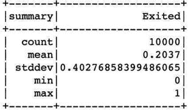
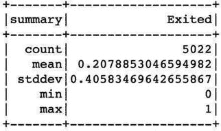

# Perform stratified sampling based on column "Exited"
stratified_sampled = df.sampleBy("Exited", fractions={0: 0.5, 1: 0.5}, seed=23)
stratified_sampled.select('Exited').describe().show()
```

以下提供了原始数据（左）和分层样本分布（右）：



## `coalesce` 与 `repartition` 函数的区别

`coalesce` 和 `repartition` 函数都用于在保存数据时控制分区数量。这里有一个小技巧：当归档中小型数据时，优先使用 `coalesce` 而不是 `repartition` 作为快速解决方案。否则，最好使用 `repartition`。原因如下：

-   `coalesce` 使用现有分区来最小化数据混洗，这会导致分区大小不均匀。它在无需完全混洗的情况下，将数据合并到更少的分区中非常高效。
-   `repartition` 执行完全混洗并创建新的分区。这确保了数据分区大小相等。还建议您在运行过滤查询后重新分区数据，以提高查询效率。如果在过滤后不重新分区数据，最终可能会产生许多内存分区，导致性能不佳。您还需要考虑重新分区数据时完全混洗的成本。

有向无环图（DAG）调度器可以很好地洞察每个操作是如何应用于数据的。

## 在 Python 与 PySpark 之间切换

PySpark 最适合处理大型数据集，而 `pandas` 在处理较小数据集时速度更快。您可以在多种情况下将 `pandas` DataFrame 与 PySpark DataFrame 结合使用，以优化代码的执行时间。您在第 8 章中看到了一个经典示例，即构建自动化流水线。对于计算指标，我们使用 PySpark 来完成繁重的工作。一旦我们有了可管理的数据（行数在 10 到 100 之间，列数较少），我们就将其转移到 `pandas` 以高效地处理和计算指标。

当您知道要处理汇总数据立方体时，这是一个很好的策略。您可以在 PySpark 中处理大型数据集，并将分组的 PySpark DataFrame 转换为 `pandas` DataFrame。由于 `pandas` 比 PySpark 更成熟，它将打开大量在各种情况下可能有用的包。

### 空值的奇特特性

在 PySpark 中，有时您尝试填充列中的空值并使用 `fillna` 函数。`fillna()` 工作正常，但您最终仍然会在列中得到空值。是的，您猜对了，当您要填充的列的数据类型与 `fillna` 值不匹配时，最终会得到空值。例如，计算整数列的均值可能会得到一个 `float` 值。现在，如果您尝试使用这个 `float` 值进行填充，您可能仍然会观察到空值。解决方法是确保列的数据类型与您打算用于填充空值的值的数据类型匹配。

### 常见函数冲突

有时会出现诸如 `max` 之类的函数同时存在于 Python 和 PySpark SQL 函数中的情况。如果您使用通配符导入 `pyspark.sql.functions`，则会出现导入冲突错误。


### 连接条件

连接是 Spark 程序的关键操作之一。通常，Spark 有两种集群通信策略。节点到节点策略涉及跨集群的 Spark 数据混洗。而按节点策略则执行广播连接。Spark 主要使用三种连接类型：

- **排序合并连接：** 包含几个步骤。第一步是对数据集进行排序，第二步是通过连接键遍历元素，将分区内已排序的数据进行合并。这通常是 Spark 中的默认设置。为了实现优化的排序合并，参与连接的 DataFrame 应在连接列上均匀分布。如果所有连接键都位于同一位置，则连接将进一步优化，因为无需进行混洗操作。当两侧数据量都很大时，优先选择排序合并连接。
- **广播连接：** 这是 Spark 中最高效的连接方式。它们适用于将小数据集与大数据集进行连接。在这种连接中，较小的表会被广播到所有工作节点。务必确保广播的是较小的表。
- **混洗哈希连接：** 此连接基于 MapReduce 的概念。该过程会遍历 DataFrame，并将连接列的值作为输出键。Spark 使用自定义函数来确保对于给定的数据集，混洗哈希连接比广播连接更优。创建哈希表是一项开销较大的操作。

始终建议检查连接键中是否存在任何空值。这个错误代价可能很高。它可能导致无关的错误，例如调用 `o206.ShowString` 或 `o64.cacheTable` 时出现的错误。另一个原因可能是重复值。如果在连接表之前检查了空值和重复值，就可以避免遇到上述任何错误，从而节省时间。

Spark 用于连接的主要策略有两种。当两侧数据量都很大时，使用排序合并连接；当一侧数据量较小时，使用广播连接。

## 用户自定义函数 (UDF)

即使在成功将 UDF 导入到运行文件后，您也可能会遇到问题。同样，您可能会遇到奇怪的 `ShowString` 错误。真正的原因是某些工作节点无法使用该 UDF。您可以通过在脚本中添加以下行来克服此错误。它使其他工作节点能够引用您的模块文件。

```
sc.addPyFile(path_to_your_module.py)
```

还建议尽量减少 UDF 的使用。这是因为它在后端触发了从反序列化到重新序列化的开销。

### 处理数据倾斜

不平衡的数据集可能导致执行时间出现峰值。您可以在 Spark UI 后端通过 `min` 和 `max` 时间值观察到这一点。使用均匀分布的数据集可以显著提升性能。

在 SQL 连接操作中，会更改连接键以重新均匀分布数据，从而避免某个分区的处理耗时过长。这种技术称为*加盐*。

在两侧各添加一个列，其值为 0 到 `spark.sql.shuffle.partitions`-1 之间的随机 `int`，然后添加一个 `join` 子句，包含对生成的列进行连接。

### 使用缓存

缓存是加速性能的利器。如果对所有对象都使用缓存，最终可能会导致存储速度略有下降。使用缓存会占用会话的部分处理能力。在“存储”选项卡中，您可以观察内存大小和磁盘分布大小。

### 持久化/取消持久化

您已经了解到 Spark 使用惰性求值来执行命令。持久化是 Spark 存储中可用的有吸引力的选项之一。它提供了在集群中存储中间 RDD 以便更快访问的能力。例如，假设您有一个初始数据集读入 Spark，并且需要应用过滤操作。由于 Spark 基于惰性求值的概念工作，过滤后的数据并不包含实际数据。它仅维护了为创建过滤数据而需要执行的 DAG 顺序。如果过滤后的数据集将被不同的对象消费以生成不同的结果，那么对于每一次迭代，都会在过滤后的数据集上执行转换。想象一下，对这个过滤后的数据集有 100 个操作。对于相当大的数据量，这可能会迅速增加处理时间，并将操作从几分钟延长到几小时。

持久化数据可以节省大量计算时间。当过滤后的数据在第一次迭代中被计算出来时，它会被持久化到内存中。在后续运行中，内存中的这个 DataFrame 将用于所有下游操作。在完成所需的下游操作后，最好将存储的数据从内存和磁盘中取消持久化。

### 混洗分区

当为连接或聚合操作混洗数据时，会存在这些分区。每当进行混洗时，大量数据块会在分区之间移动。这种混洗可以在执行器内部或跨执行器发生。这些操作可能会很快变得代价高昂。想象一下，您有一个包含八个初始分区的小型 DataFrame。通过执行一个简单的分组操作，您会将混洗分区数提升到 200。这是因为 DataFrame 的默认混洗分区数设置为 200。您有机会使用以下配置重置分区：

```
